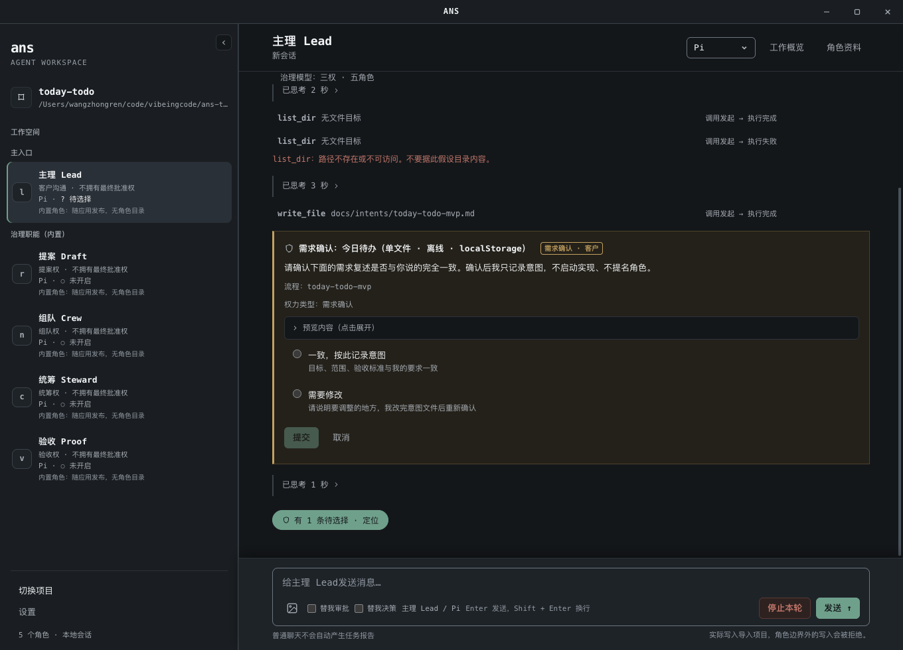

# ANS Studio

[中文](README.md)

**Let AI split work by role and complete coding tasks within explicit file boundaries.**

ANS Studio is for developers who want to use multiple AI roles collaboratively in real projects: starting from requirements and authorization, through dispatch, modification, and testing, then handing execution evidence back for review. It provides a desktop app and a CLI. The desktop uses Claude by default and can switch to Pi or Codex; the CLI supports demo (no model calls), Pi, Codex, and Claude.

## Five governance roles

New or empty projects default to the **three powers · five roles (三权 · 五角色)** governance model, and the UI status line shows 「三权 · 五角色」. The three powers are the decision rights of proposal, team formation, and coordination; communication and acceptance are not decision rights. The five built-in governance roles ship with the app, have no role directory, and may write only governance files and evidence; they do not implement or test. Shell commands go through the same approval chain as other roles. Internal roleIds stay stable, and the UI displays the following names. The app's built-in UI role names are Chinese; the English names below are explanatory labels and remain consistent with the Chinese UI names.

| UI name | roleId | Responsibilities | Power |
| --- | --- | --- | --- |
| Lead / 主理 | `liaison` | Customer communication and default main entry; writes customer intent to `docs/intents/`; also serves as workflow manager | Customer communication · workflow management · no final approval power |
| Draft / 提案 | `rapporteur` | Forms proposals and cross-role contracts | Proposal power · no final approval power |
| Crew / 组队 | `nominator` | Nominates project roles; writes role cards and boundaries | Team-formation power · no final approval power |
| Steward / 统筹 | `convener` | Orchestrates flows and dispatches tasks | Coordination power · no final approval power |
| Proof / 验收 | `verifier` | Independently checks evidence and issues acceptance cards | Acceptance power · no final approval power |

`su` is only for the legacy model (single) and compatibility paths, not the default entry for new projects.

## What ANS is and its academic source

**ANS Skill** is a role-first AI development skill inspired by the Role-First Software Governance (RFSG) paper; ANS is a name, not an acronym. **ANS Studio** in this repository turns that approach into a runnable desktop app and CLI.

It emphasizes three things:

- Define business responsibility first, then decide module and code ownership.
- Read widely as needed, and modify only within authorized scope.
- When a cross-module issue appears, hand it to the responsible role; understanding a problem does not grant permission to modify.

Academic source: Wang, Zhongren. 2026. *Role-First Software Governance: Asymmetric Authority Boundaries for AI-Native Agent Systems*. [DOI: 10.5281/zenodo.22824700](https://zenodo.org/records/22824700).



## Download and run

Current version: **v1.7.0** (released 2026-10-24). The runtime bundle includes its own runtime environment, so no separate Node.js installation is needed to launch the app. To run a project's `npm test`, Git, and similar commands, that project's required development toolchain is still needed.

| System | Download | Checksum file | Launch |
| --- | --- | --- | --- |
| macOS 13+ · Apple Silicon | [mac-arm64.zip](https://github.com/wangzhongren/ans-studio/releases/download/v1.7.0/ANS-Studio-1.7.0-mac-arm64.zip) | [SHA256SUMS-darwin-arm64.txt](https://github.com/wangzhongren/ans-studio/releases/download/v1.7.0/SHA256SUMS-darwin-arm64.txt) | Extract fully, then open `ANS Studio.app` |
| macOS 13+ · Intel | [mac-x64.zip](https://github.com/wangzhongren/ans-studio/releases/download/v1.7.0/ANS-Studio-1.7.0-mac-x64.zip) | [SHA256SUMS-darwin-x64.txt](https://github.com/wangzhongren/ans-studio/releases/download/v1.7.0/SHA256SUMS-darwin-x64.txt) | Extract fully, then open `ANS Studio.app` |
| Windows 10/11 · x64 | [win-x64.zip](https://github.com/wangzhongren/ans-studio/releases/download/v1.7.0/ANS-Studio-1.7.0-win-x64.zip) | [SHA256SUMS-win32-x64.txt](https://github.com/wangzhongren/ans-studio/releases/download/v1.7.0/SHA256SUMS-win32-x64.txt) | Extract fully, open `ANS Studio.exe`, and keep the resource files in the same directory |

After downloading, verify SHA256 first: on macOS, run `shasum -a 256 -c SHA256SUMS-darwin-arm64.txt` in the download directory (use `SHA256SUMS-darwin-x64.txt` for Intel); on Windows PowerShell, run `Get-FileHash .\ANS-Studio-1.7.0-win-x64.zip -Algorithm SHA256` and compare it with `SHA256SUMS-win32-x64.txt`. [SHA256SUMS-overlay.txt](https://github.com/wangzhongren/ans-studio/releases/download/v1.7.0/SHA256SUMS-overlay.txt), [release-provenance.json](https://github.com/wangzhongren/ans-studio/releases/download/v1.7.0/release-provenance.json), and [overlay.patch](https://github.com/wangzhongren/ans-studio/releases/download/v1.7.0/overlay.patch) record the frozen source and packaging adaptations; see [this release record](角色卡/装配/docs/change/2026-10-24_change_release-v1.7.0-prepare.md) for source verification.

<details>
<summary>v1.7.0 SHA256</summary>

| Artifact | SHA256 |
| --- | --- |
| `ANS-Studio-1.7.0-mac-arm64.zip` | `734aa9325adaf30b3fec0ab2f1392470a4645e8d2143c17f3eb1125091206f42` |
| `ANS-Studio-1.7.0-mac-x64.zip` | `45d493d0dd3f339265d482d1f1bb374723c46cb9789b570fb9f2c43b15191a77` |
| `ANS-Studio-1.7.0-win-x64.zip` | `7a3fc9cbcd6e49585ab535aebf4bbfa571814121b65162f8c16a327857de20a3` |
| `overlay.patch` | `8d30b0cfbf953fe47e51752081671a17a0b95c6ece40051d6f09c20800e3f131` |
| `release-provenance.json` | `283ee68bbfe8d332027d6bc48a82c39e644c6d26dd6ae35776ee38a2e07456d2` |

The runtime bundles are **unsigned and not notarized**: macOS builds are not notarized and Windows builds are not code-signed, so the first launch may warn that the source is unverified.

</details>

v1.7.0 highlights: independent acceptance is restored to cover all changes (including non-release changes); `release` is only optional release metadata; the acceptance-criteria gate covers every new-contract flow that declares acceptance criteria; the appointment customer decision closes automatically, and write-card validation feedback is deduplicated with busy gating; the Chinese UI uses Chinese built-in role names, role details show role root documents, and the app supports directory-level authorization and a zh-CN/en-US UI (i18n); flow steps advance automatically when complete; acceptance rework is routed back to Lead; Lead handles governance coordination; legacy v1/v2/v3 plans, flows, and role cards remain compatible.

The runtime bundles are not yet signed or notarized: macOS Gatekeeper or Windows SmartScreen may warn that the source is unverified. Download from the Release above, verify SHA256 first, then run.

## First use

1. **Import a project and choose an engine.** Click "Import project" (导入项目) in the lower-left corner. Engine selection is unavailable before import; you can also choose an empty folder and start with the default five roles. Choose the engine at the top of the session: Claude by default, or switch to Pi or Codex. If configuration is missing, click the "Open settings" (打开设置) button in the prompt; later you can also open "Settings" (设置) from the lower-left. A successful save only means the configuration has been saved; whether the connection is available still requires an actual request to verify.
2. **Describe the requirement to Lead.** Lead is the default main entry, responsible for confirming goals, scope, and acceptance criteria, and writing customer intent to `docs/intents/`. After writing the intent, Lead starts an **intent confirmation** (`confirm` / `revise`). With "Decide for me" (替我决策) enabled and automatic judgment applicable, the judge agent may choose `confirm` on your behalf but must not choose `revise`; otherwise you answer the intent confirmation card. Only after confirmation is the intent handed to Draft.
3. **Confirm the proposal and appointment.** Draft forms a proposal from the intent; the proposal card offers `accept` / `accept-quick` / `revise` / `reject`. After acceptance, Steward writes the flow sheet, and Crew nominates project roles and starts the appointment confirmation; after appointment, Crew writes role cards and boundaries path by path through write confirmation. Proposal, appointment, and write confirmation follow the delegation switches described below.
4. **Implementation, handback, and acceptance.** Project roles implement, test, and hand back within their boundaries; Steward handles flows and dispatch. Proof independently checks delivery and handback evidence and issues an acceptance card (`accept` / `reject`). With "Decide for me" (替我决策) enabled and automatic judgment applicable, the judge agent may accept on your behalf; otherwise you decide whether to accept.
5. **Acceptance ends the task.** There is no "wrap-up" (收束) prompt to watch for. Feedback from internal roles is summarized by Lead and reported to you; it is not relayed verbatim.

Formal tasks are dispatched by Steward to project roles and enter a queue when busy; ordinary chat does not automatically produce an "unreported" (未报告) handback. "Work overview" (工作概览) shows pending confirmations, queued messages, and recent handbacks. The input area uses **Enter to send, Shift + Enter for a newline**; while busy you can stop the current turn or withdraw queued messages not yet executed, and roles and engines each keep their own drafts. The details drawer supports Esc to close and return to the original entry.

### Engine configuration

Each engine uses independent configuration and does not automatically switch to another engine when configuration is missing.

| Engine | Required configuration | Optional configuration |
| --- | --- | --- |
| Pi | `ANTHROPIC_AUTH_TOKEN`, `ANS_PI_BASE_URL`, `ANS_PI_MODEL` | `ANS_PI_CONTEXT_WINDOW`, default 500000 when empty; override when the model/gateway's actual window is smaller |
| Codex | `CODEX_API_KEY` (or `OPENAI_API_KEY`), `ANS_CODEX_MODEL` | `ANS_CODEX_BASE_URL`, default `https://api.openai.com/v1`; custom endpoints must be compatible with the Responses API |
| Claude | `ANTHROPIC_API_KEY` | `ANS_CLAUDE_MODEL`, `ANTHROPIC_BASE_URL`, empty uses the SDK default |

Codex and Claude use API keys and do not fall back to subscriptions or OAuth login. For more variable descriptions, see [`.env.example`](.env.example).

The runtime bundle stores configuration in the **`.env` in the user data directory**; development startup uses the **repository-root `.env`**. The settings panel shows the actual path. Secret values are not echoed, are not included in the runtime bundle, and should not be committed to Git. Session records are stored in the project's `.ans/sessions/`, which this repository has added to its ignore rules.

## How role collaboration constrains changes

- **Divide work first, then authorize.** Role cards describe responsibilities; Section 1 of `boundary.yaml` lists modifiable paths; when an active task write set exists, scope is narrowed further by the task. The boundaries of the five governance roles come from the built-in registry and do not create role directories.
- **Lead is the workflow manager.** Lead can use `flow_get` / `flow_step_update` / `flow_step_supersede` to advance or rework flows, and `dispatch_task` to dispatch coordination tasks to Steward and project roles. Coordination and advancement are not customer approval: customer decisions still go through the judge agent / customer card, and Lead still has no final approval power.
- **Governance write gates.** Role cards/`boundary.yaml`, proposals, flows, acceptance, and disk writes have preview or confirmation cards before writing; out-of-bound writes are rejected before side effects and point back to the correct owner: proposal→Draft / 提案, role card and nomination→Crew / 组队, flow→Steward / 统筹, acceptance→Proof / 验收, app governance records→app.
- **All roles have shell capability.** The five governance roles, like project roles, can read/write and run arbitrary shell commands, all through the existing approval flow: read-only allowlist commands run directly; risky/review/deny commands are approved one by one by the customer or judge agent; rejection, timeout, or channel unavailability never allows execution. Shell side effects are not constrained by file-write gates; the approval chain is the only control; file writes still prefer `write_file` and go through write confirmation. Shell decision audits still go to `docs/audit/shell-gate.jsonl`.
- **Delegated approval and delegated decisions by switch.** The desktop "Approve for me" (替我审批) handles shell commands and write/role-card confirmations; "Decide for me" (替我决策) handles intent confirmation, proposal acceptance, appointment, and acceptance. Intent confirmation can delegate only `confirm`, not `revise`. Successful delegation is marked "judge delegated" and does not impersonate your own click. For requests eligible for automatic judgment with the switch on, insufficient evidence, read failure, judge unavailability, timeout, or parse failure are all treated as not passed: shell is not executed, and write and decision requests are returned to the initiating role for correction, without automatically showing a manual card. Requests with the switch off, no automatic judgment connected, or not applicable still use the original manual path; turning the switch off during governance judgment restores the original card; an aborted turn is treated as cancelled.
- **The two kinds of judge agents review different things.** The shell judge agent for "Approve for me" reviews only system risk—hangs, boundary violations, destruction, resources, sensitive exfiltration—and does not judge business necessity; non-destructive commands within the project are decided by the initiating role. The decision judge agent for "Decide for me" reviews only intent drift—goals, scope, non-goals, acceptance criteria, and decisions already accepted by the customer—and does not re-review engineering quality, architecture, or tests; Proof checks those during acceptance.
- **The judge agent is read-only.** It reads only text allowed within the project: `.ans/project.json` and `.ans/governance/ledger.jsonl` are open read-only; `.ans/sessions/**` and other sensitive content remain denied, with specific paths and reasons. It does not write files, execute commands, or dispatch tasks. The read budget remains fail-closed (hard limits can be adjusted via environment variables); when the budget is insufficient, evidence is insufficient, risk is unclear, or intent is missing, it does not automatically allow, and follows the failure handling above without guessing.
- **Dispatch and acceptance are separate.** Dispatching a task does not increase the target role's write permission. Task reports, history saving, handback delivery, and receiver processing each show their actual state; a report claiming "done" does not equal independent acceptance.

Technical structure and cross-role interfaces are in [project architecture](角色卡/项目管理/docs/architecture.md).

## Flow state YAML

Flow state uses `docs/flows/<flowId>.yaml` as the single machine state; the app parses only it for dispatch and acceptance decisions. The same-named `docs/flows/<flowId>.md` is only a human-readable view; the app does not parse it for decisions; Markdown flow documents can still be kept for people.

Top-level fields are `flowId` / `version` / `qualityTier` / `steps`; step fields are `id` / `title` / `owner` / `kind` / `status` / `evidence` / `supersedes` / `supersededBy`.

```yaml
flowId: todo-list-v1          # 必填；与文件名一致
version: 1                    # 必填；正整数
qualityTier: production       # 必填；prototype | production
steps:                        # 必填；非空
  - id: delivery-server-old   # 被 retake 取代的旧步骤
    title: 服务端交付（旧）
    owner: <项目角色 id>
    kind: dispatch
    status: superseded
    supersededBy: delivery-server
  - id: delivery-server       # 必填；小写 slug；verification / acceptance 为保留 id
    title: 服务端交付
    owner: <项目角色 id>
    kind: dispatch            # dispatch | customer-decision | artifact | acceptance
    status: done              # pending | dispatched | delivered | done | superseded | failed | blocked | aborted
    evidence:                 # done 必填；kind 与步骤 kind 对应，ref 为账本匹配键
      kind: dispatch
      ref: delivery-server
    supersedes: [delivery-server-old]  # 与旧步骤的 supersededBy 双写，同一条关系
  - id: verification
    title: 验收
    owner: app
    kind: acceptance
    status: pending
```

- **`done` must have matching evidence.** `dispatch` reconciles against the ledger `dispatch.accepted`; `customer-decision` against a settled customer decision; `artifact` against `artifact.observed`; `acceptance` against the customer acceptance decision.
- **Acceptance steps belong to the app.** `verification` / `acceptance` are acceptance steps automatically dispatched to Proof by the app (`kind: acceptance`, initial `status: pending`); Steward does not use these two ids, does not dispatch them, and does not mark them `done`; execution and evidence steps use other ids (such as `verification-evidence`).
- **Supersession is recorded explicitly.** Recommended double-write: the old step replaced by a retake is marked `status: superseded` with `supersededBy`, and the new step writes `supersedes`; writing only one side is also valid. True cycles (steps pointing to each other or closing a loop) and contradictions between the two sides are rejected. `failed` / `blocked` / `aborted` without `superseded` still block closure.
- **Invalid YAML does not fall back.** When YAML exists but validation fails (unknown fields, unknown enums, missing required fields, `done` without evidence, etc.), the app fails closed and gives the specific path and reason; only when YAML does not exist does the migration period remain compatible with legacy Markdown flows.

## Flow tools (method-based)

The app is the sole writer of `docs/flows/<flowId>.yaml`; roles no longer write flow files directly and instead use the following tools; initial creation still goes through `schedule-write` write cards, and after creation no file write or write card is needed for each state update.

- **`flow_get`**: reads the flow summary, steps, and steps the current role can update, returning `revision` and `canUpdate`; fetch the latest `revision` before updating.
- **`flow_step_update`**: updates step state according to `expectedRevision`. Steward / Lead can update all non-terminal steps; other roles can update only steps whose owner is themselves (limited to delivery, failure, blocking, and similar transitions). `done` must carry ledger-reconcilable `evidence`; version conflicts return `revision-conflict`, insufficient evidence returns `insufficient-evidence`; follow the hint to re-run `flow_get` or add evidence and retry; never fabricate evidence.
- **`flow_step_supersede`**: for Steward / Lead rework; the old step is marked `superseded` with `supersededBy`, the new step is `pending`, and history is kept, not deleted.
- **Advancement is not approval.** Advancing or reworking through flow tools does not mean customer consent; steps requiring customer decisions still use customer cards or the judge agent such as `request_choice` / `request_confirmation`.

## Engineering quality baseline and acceptance demo

By default, work proceeds at production quality; only when the customer explicitly chooses the prototype tier at the intent stage may the inapplicable items be relaxed. Proposals, role cards, flow dispatch, and acceptance all carry the same quality baseline; it is not deferred until final acceptance.

Engineering quality baseline (production by default; relax only when the customer explicitly chooses the prototype tier):
- Correctness: acceptance criteria are demonstrable one by one; no TODOs/placeholders/fake data; boundaries and invalid inputs have defined behavior.
- Robustness: input validation and limits, consistent error codes, failures do not destroy existing data; atomic persistence writes and restart recovery; concurrency/reentrancy has an explicit strategy.
- Security: authentication/authorization boundaries are stated even if simplified; protection against injection/XSS/path traversal/CSRF; no secrets or sensitive data in records; when there are zero third-party dependencies, explain why.
- Maintainability: clear module boundaries, consistent naming, comments only at constraints; README covers startup, architecture, API, permissions, state machine, known limitations, and trade-offs.
- Observability: key failures are diagnosable (structured logs/error messages), not silently swallowed.
- Performance and capacity: pagination/limits/timeouts are explicit; no unbounded growth; known capacity boundaries are stated.
- Frontend: loading/empty/error states are complete; keyboard usability, labels, contrast, and other basic accessibility; usable on narrow screens.
- Testing: unit + integration + end-to-end matrix; permissions and invalid paths must have negative cases; tests are independent of implementation; do not weaken assertions to keep green.
- Delivery: before acceptance, the app must actually be started and demonstrated (startup command, access address, or screenshot/screen recording); if not actually run, do not recommend acceptance.

Architecture and extensibility (part of the same baseline, checked by both proposal and acceptance):
- Proposals must include an architecture plan (new projects) or architecture impact analysis (changes): module decomposition and responsibilities, dependency direction, data flow, extension points, data schema and API version migration, cross-cutting concerns, and trade-offs.
- Role write areas correspond one-to-one with architecture modules; acceptance checks that implementation matches the architecture statement.
- If the architecture section is missing or the implementation deviates from the statement, do not recommend `accept`.

Before Proof issues an acceptance card, it checks the baseline evidence item by item; if the delivery was not actually started and demonstrated, do not recommend `accept`. The demo is based on the actually running app: provide the startup command and access address, or attach a screenshot/screen recording; test output or code reading alone does not count as a demo.

## Building from source

Requires **Node.js 23.6+** and npm.

```bash
git clone https://github.com/wangzhongren/ans-studio.git
cd ans-studio
npm ci
npm run app
```

After the desktop app starts, configure it according to the first-use flow above. If you use the CLI, you can first copy `.env.example` to `.env` and fill in the chosen engine configuration.

### Common CLI commands

Run from the repository root:

```bash
# 自检与帮助
node bin/ans.js doctor
node bin/ans.js --help

# 不调用模型的演示会话
node bin/ans.js role run 编排 --task T-1

# 对已有目录发起治理会话；确认通过终端问答完成
node --env-file=.env bin/ans.js govern /path/to/project --runtime pi

# 运行项目中已登记的角色；替换角色 ID 与任务内容
node --env-file=.env bin/ans.js role run "角色ID" --task "任务内容" --runtime pi
```

`--runtime` supports `demo|pi|codex|claude` and takes precedence over the `ANS_RUNTIME` environment variable. When unspecified, `role run` defaults to demo and `govern` defaults to Pi. The desktop default engine is Claude, while the CLI keeps the defaults above. The `govern` target directory must already exist; when no directory is provided, the current tool project is used. `ans init` has been removed.

### Checks and packaging

```bash
node --test "test/**/*.test.ts"
npm run typecheck
```

Test paths must keep their quotes to ensure coverage of multiple directory levels. Some integration tests need to listen on the local loopback address.

Release builds use the [GitHub Actions workflow](.github/workflows/release.yml), building, extracting, and verifying actual runtime bundles on each target system and architecture. Maintainers' source verification, build commands, and release steps are in [desktop packaging notes](角色卡/装配/docs/feature/desktop-release-packaging.md).

## Current limitations

- **Only open trusted projects.** Shell commands have rule checks and review flows but no OS sandbox; the file side effects of approved commands are not constrained by the ANS file-write gate. The CLI currently does not enable the shell tool.
- **Windows does not yet support built-in source document reading.** You can view the full summary and execution record; open source files with the system editor.
- **CLI and desktop capabilities differ.** The CLI uses terminal confirmation and does not yet provide desktop-style task dispatch, handback delivery, or a queue UI. Automatic scheduling of multi-task dependencies is not yet implemented.
- **ZIP distribution has no installer or auto-update.** Updates require downloading the new version yourself.
- **Verification scope is limited.** The three-platform runtime bundles are built, regressed, and smoke-checked for extraction/startup by native CI; in-bundle tests do not call online models. In existing real verification records, online desktop and coding tasks are mainly Pi; controlled/offline full-chain tests for Codex and Claude are not equivalent to online-model full-chain acceptance. The desktop default of Claude only indicates the default choice, not that online acceptance has been obtained.

## Learn more

- [v1.7.0 release preparation](角色卡/装配/docs/change/2026-10-24_change_release-v1.7.0-prepare.md): frozen source, release recipe, and local precheck results.
- [v1.6.0 release preparation](角色卡/装配/docs/change/2026-10-23_change_release-v1.6.0-prepare.md): frozen source, release recipe, and three-platform artifacts.
- [v1.5.0 release preparation](角色卡/装配/docs/change/2026-10-22_change_release-v1.5.0-prepare.md): frozen source, release recipe, and local precheck results.
- [v1.4.0 release acceptance and public download](角色卡/测试/docs/change/2026-10-20_change_v1.4-release-verification.md): actual artifacts, source, and test evidence.
- [v1.3.0 release acceptance and public download](角色卡/测试/docs/change/2026-10-17_change_v1.3-release-verification.md): actual artifacts, source, and test evidence.
- [v1.2.0 release acceptance and public download](角色卡/测试/docs/change/2026-10-16_change_v1.2-release-verification.md): actual artifacts, source, and test evidence.
- [v1.1.0 release acceptance and public download](角色卡/测试/docs/change/2026-10-16_change_v1.1-release-verification.md): actual artifacts, source, and test evidence.
- [v1.0.0 release and three-platform acceptance](角色卡/测试/docs/change/2026-10-15_change_v1-release-verification.md): actual artifacts, source, and test evidence.
- [Real desktop and Pi project verification](角色卡/测试/docs/change/2026-10-15_change_visual-v2-independent-verification.md): ordinary chat, formal tasks, tool output, and handback flow.
- [Desktop interaction design](角色卡/UIUX设计师/docs/design/2026-10-15_design_visual-convergence.md): page structure and interaction specification.
- [CLI wiring and behavior notes](角色卡/装配/docs/feature/cli-runtime-assembly.md): runtime selection, configuration, and command details.
- [Engineering rules](角色卡/项目管理/docs/project-rules.md): layering, role boundaries, and collaboration constraints.

This project uses the [MIT License](LICENSE).
