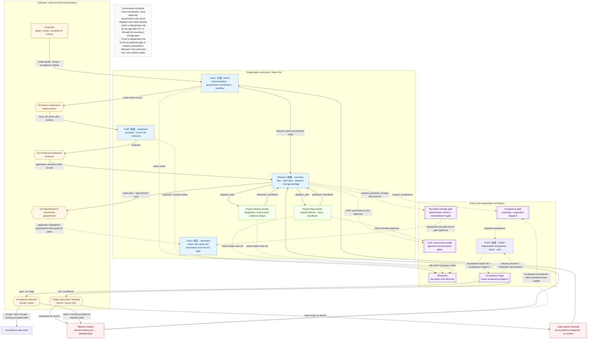

# ANS Studio

[中文](README.md)

**ANS Studio is not a generic multi-agent task orchestrator. It is an agent runtime with organizational governance: Role-First — dispersed authority, gates before action, independent acceptance.**

It puts "who decides, who dispatches, who writes, who accepts" into the runtime instead of leaving it in prompts. The desktop app and CLI share the same roles and governance tools. The desktop uses Claude by default and can switch to Pi or Codex; the CLI supports demo (no model calls), Pi, Codex, and Claude.

**Version status:** the current public runtime bundle is **v1.7.0** (released 2026-10-24). `main` already contains `request_acceptance`, acceptance triage, and the background-task / flow-status panels. This branch adds `request_boundary_change` (including the intermediate AI gate), scaffold-first governance, and the rule that Steward proactively requests acceptance on completion. Everything on `main` and on this branch will reach the runtime bundle in the next release; each item is marked inline below.

## Three layers: intent, organization, rules

| Layer | Role or mechanism | Responsibility | Power and limits |
| --- | --- | --- | --- |
| **Intent and final authorization** | **Customer** | Sets goals, scope, and acceptance criteria; decides at G0 intent confirmation, G1 proposal acceptance, G2 appointment and boundaries, acceptance cards, and triage cards | Final approval authority; does not schedule internal roles |
| **Organization and action** | **Lead / 主理** (`liaison`) | Customer communication; writes intent to `docs/intents/`; governance coordination and workflow management | Communication and coordination; **coordinates but does not approve**; never dispatches project workers directly |
| | **Draft / 提案** (`rapporteur`) | Turns customer intent into proposals and cross-role contracts | Proposal power; no final approval |
| | **Crew / 组队** (`nominator`) | Writes project role cards, boundaries, and working documents from the customer-confirmed team plan; handles boundary-change requests | Write-card power (after G2, through `appointment-write`); does not select roles or edit the team plan |
| | **Steward / 统筹** (`convener`) | Writes flow YAML, team plans, readiness reviews, and change packages; dispatches project workers; submits independent acceptance | Coordination power; **the execution hub, not a power center**: cannot appoint, change boundaries, replace acceptance, or bypass G1/G2 |
| | **Project Map / Reduce workers** | Implement, test, deliver, and hand back inside their bounded context and write set; Map runs per module, Reduce handles integration, end-to-end work, and evidence merging | Write only Section 1 and the task write set; no cross-directory writes, no self-expansion |
| **Rules and independent verification** | **Application gates** | WriteGate boundary decisions, shell approval chain, governance judge, gates 0/1/2, acceptance gate, acceptance triage, stage transitions | Deterministic validation and process integrity; **does not replace customer decisions** |
| | **Proof / 验收** (`verifier`) | Writes acceptance criteria before implementation; independently checks the candidate, evidence, and a real launch/demo; writes the acceptance report and issues the acceptance card | Acceptance power, not approval power; does not implement or dispatch |
| | **Acceptance triage** | Reads `acceptance-triage/v1`, then chooses rework, report-only, or return the report to Proof | Decides only whether to rework (or return the report); does not change the verdict or fabricate customer decisions |

The "three powers" are **proposal, team formation, and coordination**. Communication and acceptance are not decision rights. The five built-in governance roles ship with the app, have no role directories, write only governance files and evidence, and do not implement or test. Their shell commands go through the same approval chain as every other role. Internal roleIds stay stable; the UI shows "三权 · 五角色" (three powers · five roles). The built-in UI role names are Chinese; the English names in this table are explanatory labels. `su` exists only for the legacy single model and compatibility paths, not as the default entry for new projects.

## Role flow topology



| Legend | Meaning |
| --- | --- |
| Solid arrow | Role dispatch/handoff: `hand_off_intent`, `dispatch_task`, `delivered` / handback |
| Dashed arrow + gate-shaped node | Path through an application gate: WriteGate, shell/governance judge, boundary-change gate, acceptance gate, acceptance triage |
| Hexagon | Customer decision: G0/G1/G2, acceptance, triage |
| Red box | Acceptance rework routing / report-only |

- **Lead coordinates; it does not approve.** Lead may advance flows and send coordination tasks to Steward, but cannot approve proposals, appointments, or acceptance, cannot dispatch project workers directly, and cannot write other roles' governance artifacts.
- **Governance roles do not dispatch each other directly.** Apart from Lead sending coordination tasks to Steward as workflow manager, Draft / Crew / Steward / Proof never dispatch one another; built-in governance roles are not valid `dispatch_task` targets.
- **Crew has exactly two entry points.** After G2, the application dispatches `appointment-write` in the background; or Steward calls `request_boundary_change`, which passes the application's deterministic checks and intermediate AI gate before the application dispatches Crew. Crew never selects roles or edits the team plan.
- **Proof has exactly two entry points.** The application acceptance gate (triggered by settle / handback / ledger changes and similar events), and Steward's `request_acceptance` (which also goes through the acceptance gate). No other role dispatches Proof.
- **Steward is the execution hub, not a power center.** It writes flows, team plans, readiness records, and change packages, and dispatches project workers; it cannot appoint roles, change role cards or boundaries, replace Proof's acceptance, or bypass G1/G2.
- `request_boundary_change` and the intermediate AI gate are **new on this branch and take effect in the next release**.

## Two closed loops

### Task execution loop

`Steward → project workers deliver/hand back → evidence/change package → acceptance gate → Proof → triage → rework or report`

1. **After G1, write the flow and team plan.** Steward writes `docs/flows/<flowId>.yaml` and the team plan (modules, directories, write sets, dependencies, risk tier), then sends the appointment card. Plans that include code or test delivery must also put an independent `build-scaffold` step first (new on this branch: package config, TypeScript/build/test config, and an entry skeleton must be delivered before implementation, with `npm run typecheck` and a minimal test actually passing; today this lands as role-card guidance plus the generic `dependsOn` dispatch gate — the application does not yet deterministically reject an appointment card that lacks `build-scaffold`).
2. **After G2, write cards and run readiness.** The application dispatches Crew in the background to write project role cards and boundaries from the team plan (`appointment-write`, path by path). Steward then performs a per-role/per-directory readiness review; dispatch starts only after readiness passes.
3. **Dispatch and delivery.** Steward uses `dispatch_task` only for appointed, carded, readiness-passed project roles; a step is not dispatched until all `dependsOn` steps are `done`. Workers implement and test inside Section 1 / the team-plan write set, mark each step `delivered`, and hand back.
4. **Verification and change package.** Steward verifies `delivered → done` (workers cannot mark `done`; managers cannot mark `delivered` on a worker's behalf), writes the change package (`riskTier`, candidate, changed paths, evidence), and produces `verification-evidence` (a real launch/demo).
5. **Acceptance gate.** On settle / handback / ledger changes / `request_acceptance`, the application checks flow completeness, acceptance criteria, and the change package; when everything is ready it dispatches Proof. Once delivery and evidence are complete, Steward must proactively call `request_acceptance({flowId})` (the tool is already on `main`; the "request on completion" card text is strengthened on this branch). `dispatched` **does not mean** acceptance passed.
6. **Proof performs independent acceptance.** Proof writes the acceptance criteria before implementation, checks the candidate and evidence plus a real launch/demo, writes the acceptance report (five header items + `acceptance-triage/v1`), and issues an `accept` / `reject` acceptance card.
7. **Triage, then rework or report.** The application reads the report: `pass` follows the existing acceptance-card path; `fail` / `conditional` is classified by deterministic rules (together with the "Decide for me" switch) as rework or report-only; missing structure or infeasible improvements return the report to Proof. Rework routing carries severity, reasons, and improvement pointers back to Steward. After rework, a substantive flow update, and all execution steps `done`, the re-dispatch gate sends Proof exactly once more. Report-only is reported honestly by Lead: acceptance is not reopened and no rework is dispatched.

#### Acceptance criteria and quality baseline

Work proceeds at production quality by default; items that do not apply may be relaxed only when the customer explicitly chooses the prototype tier at the intent stage. Proposals, role cards, flow dispatch, and acceptance all carry the same quality baseline.

- Proposals must include an architecture plan (new projects) or architecture impact analysis (changes), plus a "quality baseline and evidence plan"; missing architecture or quality sections block implementation.
- Acceptance criteria are frozen before implementation is dispatched and must be demonstrable item by item; no TODOs, placeholders, or fake data; boundaries and invalid inputs have defined behavior.
- Before acceptance, the app must be started and demonstrated for real (startup command, access address, or screenshot/screen recording); test output or code reading alone is not a demo and must not lead to `accept`.
- Proof checks correctness, robustness, security, maintainability, observability, performance/capacity, frontend, the test matrix, and delivery evidence item by item. Implementation that deviates from the architecture statement, or a missing architecture section, forbids recommending `accept`.

The complete baseline is the single-source text in the built-in role cards (`ENGINEERING_QUALITY_BASELINE` in `src/common/门禁引擎/governance-roles.ts`); role cards and acceptance criteria reference it item by item.

#### Flow state (machine contract)

`docs/flows/<flowId>.yaml` is the single machine state used for dispatch and acceptance decisions. A same-named `.md` is a human-readable view only; the app does not parse it for decisions.

```yaml
flowId: todo-list-v1          # required; must match the file name
version: 1                    # required; positive integer
qualityTier: production       # required; prototype | production
steps:                        # required; non-empty
  - id: delivery-server       # lowercase slug; verification / acceptance are reserved ids
    title: Server delivery
    owner: <project role id>
    kind: dispatch            # dispatch | customer-decision | artifact | acceptance
    status: done              # pending | dispatched | delivered | done | superseded | failed | blocked | aborted
    evidence:                 # required for done; kind must match the step kind, ref matches the ledger
      kind: dispatch
      ref: delivery-server
  - id: verification
    title: Acceptance
    owner: app
    kind: acceptance
    status: pending
```

- **`done` requires evidence.** `dispatch` reconciles against ledger `dispatch.accepted`; `customer-decision` against a settled customer decision; `artifact` against `artifact.observed`; `acceptance` against the customer acceptance decision.
- **Acceptance steps belong to the application.** `verification` / `acceptance` are dispatched to Proof by the app (`kind: acceptance`, initially `pending`). Steward does not use, dispatch, or mark them `done`.
- **Supersession is explicit.** Rework uses `flow_step_supersede`: the old step becomes `superseded` with `supersededBy`, and the new step starts `pending`. `failed` / `blocked` / `aborted` without `superseded` still block closure.
- **Invalid YAML fails closed.** If YAML exists but fails validation, the app refuses with the exact path and reason; only when YAML is absent does it fall back to legacy Markdown flows. Initial creation still goes through the `schedule-write` card; after that the app is the sole writer and roles use `flow_get` / `flow_step_update` / `flow_step_supersede`, with every `done` backed by ledger-reconcilable evidence.

### Organizational governance loop

`Steward finds a boundary gap → request_boundary_change → application deterministic checks + intermediate AI gate → (only if approved) Crew appointment-write → role card/boundary takes effect`

1. **Find the gap.** A project role reports that its write set or boundary is insufficient, or Steward finds during verification, readiness, or pre-dispatch checks that the boundary cannot cover the paths the task needs.
2. **Submit the request.** Call `request_boundary_change({ roleId, addPaths, removePaths, rationale, flowId })` with **exact project-relative paths/directory entries** and a rationale. Do not rewrite the whole boundary, do not expand unrelated paths, and do not try to dispatch Crew with `dispatch_task` (built-in governance roles cannot be dispatched).
3. **Application deterministic checks.** Validate path shape (no wildcards, `..`, or absolute paths), forbid additions to governance-critical paths and release roots, require an actual change, and deduplicate by request. The application writes a ticket to `.ans/governance/boundary-requests/<flowId>/<ticketId>.json`.
4. **Intermediate AI gate.** The gate reads only evidence (governance ledger, team plan, flow summary, target role card/boundary), has deny-all write access, and checks only whether the exact paths and rationale are consistent with the role card, current boundary, team plan, and flow — and whether the request smuggles in extra permissions or touches governance-critical paths. `deny` / `manual` / timeout / unavailable all become `rejected`: **nothing is dispatched and nothing is auto-approved**; the receipt goes back to Steward.
5. **Crew writes the card.** Only after approval does the application dispatch Crew in the background. Crew verifies `roleId`, added/removed paths, and rationale, then obtains customer/judge confirmation path by path through `appointment-write` and submits the result to the application's boundary validation. **A request from Steward is not customer approval**; no implementation may write to those paths until confirmation and validation complete.
6. **Take effect and re-check.** The new boundary takes effect only after the change and validation complete; Steward re-checks readiness and dispatch conditions against it. No implementation is dispatched to the new paths before that.
7. **Status.** This loop (`request_boundary_change` + intermediate AI gate) is **new on this branch and takes effect in the next release**. In released versions, Steward can only report a boundary gap; it cannot initiate this channel.

## Acceptance triage and state semantics

Besides the five header items, Proof's acceptance report must contain exactly one fenced YAML block with `schema: acceptance-triage/v1`:

```yaml
schema: acceptance-triage/v1
conclusion: fail            # pass | fail | conditional
items:
  - id: F1
    severity: blocker       # blocker | major | minor | nit
    owner: <one role id>      # split items across owners
    reason: why it does not pass
    action: improvement plan  # required, with targets or criteria pointers
    targets: [<file/module pointer>]
    criteria: <acceptance-criteria pointer>
```

Field rules: `pass` allows empty items; `fail` / `conditional` must be non-empty; unknown fields, duplicate ids, empty owner/reason/action, or unknown severity make the whole block invalid.

| Report conclusion | Triage disposition | Closed? | Rework? |
| --- | --- | --- | --- |
| `pass` | No triage; existing acceptance card (`accept` / `reject`; with "Decide for me" on and mechanical checks passing, the judge may delegate `accept`) | Closes through the existing `accepted` path after the customer (or judge delegation) chooses `accept` | No; a customer `reject` follows the existing acceptance-rejection path |
| `fail` / `conditional` with `blocker` / `major` items whose improvement plans are executable | Recommend rework; with the switch on and an authoritative recommendation, deterministic rules delegate; otherwise show the customer triage card | Triage itself does not close; acceptance runs again after rework | **Yes**: `rework-routing.json` + Steward task carrying severity, reasons, improvement plan, and file/criteria pointers |
| `fail` / `conditional` with only `minor` / `nit` | Recommend report-only; with the switch on and an authoritative recommendation, deterministic rules delegate; otherwise show the customer triage card | The customer choosing "report only" closes through the existing `accepted` path; **a judge-delegated "report only" writes no `customer.decision` and leaves the acceptance step `pending` (not closed)** | **No**: no acceptance reopened, no rework, no new steps |
| `fail` / `conditional` with `blocker` / `major` whose improvement plan is not executable (owner cannot be dispatched, `action` empty, no `targets`/`criteria`) | Structurally insufficient: return the report to Proof | Not closed | No; no customer card, no rework routing |
| Missing `acceptance-triage/v1` / broken block / contradiction (`pass` with blocker/major, `fail` with empty items, etc.) | Return the report to Proof (`declined + notPresented`; not shown to the customer) | Not closed | No; no customer card, no `customer.decision` |
| Triage record corrupt / judge delegation unavailable / executability cannot be checked | Corrupt record falls back to the original acceptance card for manual handling; judge delegation unavailable or uncheckable shows the customer triage card (with the default recommendation or "no automatic recommendation available") | Customer decides | Customer decides |

**Semantics that must not be blurred:**

- **"Report only" is not "acceptance passed."** The report conclusion remains `fail` / `conditional`. The flow does not fabricate a customer decision; Lead's report must state the conclusion, failure reasons, improvement suggestions, the source of the no-rework decision, and the report path.
- **A judge-delegated "report only" stays unclosed.** It writes no `customer.decision` and leaves the acceptance step `pending`. Only when the customer chooses "report only" on the triage card does the existing `accepted` path settle and close it. A judge-delegated "rework" likewise writes only the triage record and the `acceptance.triage` ledger entry, never `customer.decision`.
- **A polished report cannot hide a blocker.** Any executable `blocker` / `major` forbids recommending `pass` or report-only; conversely, with only `minor` / `nit`, harsh wording still forbids recommending rework. The decision reads structure (conclusion, severity, pointers), never prose style.
- **Triage v1 is deterministic rules plus the "Decide for me" switch (judge-rule), not a separate AI triage role.** If the switch is off, the recommendation is not authoritative, or executability cannot be checked, the case always falls back to the customer triage card; nothing is auto-executed.
- **Records are auditable and recoverable.** The triage record is written to `.ans/governance/acceptance/<flowId>/triage-v1.json`, and the ledger appends `acceptance.triage` (**not** `customer.decision`). The idempotency key is `flowId + reportSha256`; after a restart, the app re-pushes the triage card or completes the missing report, and a new report never inherits an old disposition.

## The honest limits of the two gates

Application gates and AI gates are complementary: the former makes deterministic decisions, the latter performs bounded structured review; neither replaces customer decisions.

- **Application gates guarantee paths, permissions, and process integrity — not business correctness, and not customer consent.** WriteGate only decides Section 1 / task write set / forbidden paths; gates 0/1/2 and the acceptance gate only do deterministic checks and stage transitions. They cannot replace customer decisions or prove engineering quality.
- **Writes inside the boundary are preauthorized, which is not a bypass.** Writes inside Section 1 use `write_file` / `edit_file` directly, without a per-write confirmation card; writes outside the boundary are rejected by WriteGate before side effects. Role-card/boundary changes, shared directories or other roles' write sets, `docs/flows/**` flow YAML, the governance ledger, and release/change packages still follow the existing confirmation rules. Directory-level authorization and the team plan's exact write sets narrow the effective scope further.
- **The shell approval chain reviews system risk only.** All five governance roles, like project roles, have shell access. Read-only allowlisted commands run directly; risky/review/deny commands are approved one by one by the customer or judge agent. Rejection, timeout, or channel unavailability never allows execution. Shell side effects are **not** constrained by WriteGate — the approval chain is the only control, and there is no OS sandbox today.
- **AI gates perform structured review only.** The judge agent reads only permitted text and reviews only system risk (hangs, boundary violations, destruction, resources, sensitive exfiltration) or intent drift (goals, scope, non-goals, acceptance criteria, decisions already accepted). It does not re-review engineering quality, architecture, or tests; Proof checks those during acceptance.
- **deny / manual / timeout / unavailable never passes.** Shell commands do not run; `request_boundary_change` returns `rejected` to Steward and **does not dispatch Crew**; when a governance-card judge cannot delegate, it settles as `declined` and returns the request to the initiating role for correction (no automatic customer card; turning the switch off mid-judgment restores the original card with a notice); acceptance triage with no automatic recommendation falls back to the customer triage card. There is no "judge failed, so default to approve" and no "default to rework."
- **Application advancement, dispatch, acceptance requests, and boundary-change requests are not customer approval.** Dispatch grants no extra write permission; `request_acceptance` returning `dispatched` only means "independent review was dispatched"; `request_boundary_change` returning `dispatched` only means "the exact change request was sent to Crew" — the boundary is still unchanged.
- **Delegated approval does not impersonate the customer.** Successful delegation is marked "judge delegated," never as the customer's own click. Requests with the switch off, no automatic judgment connected, or not applicable still use the manual card; turning the switch off during governance judgment restores the original card.

Technical structure and cross-role interfaces are in [project architecture](角色卡/项目管理/docs/architecture.md).

## Install and run

### Download the runtime

Current public version: **v1.7.0** (released 2026-10-24). The bundle ships with its own runtime, so no separate Node.js installation is needed to launch the app. Running a project's `npm test`, Git, and similar commands still requires that project's development toolchain.

| System | Download | Checksum file | Launch |
| --- | --- | --- | --- |
| macOS 13+ · Apple Silicon | [mac-arm64.zip](https://github.com/wangzhongren/ans-studio/releases/download/v1.7.0/ANS-Studio-1.7.0-mac-arm64.zip) | [SHA256SUMS-darwin-arm64.txt](https://github.com/wangzhongren/ans-studio/releases/download/v1.7.0/SHA256SUMS-darwin-arm64.txt) | Extract fully, then open `ANS Studio.app` |
| macOS 13+ · Intel | [mac-x64.zip](https://github.com/wangzhongren/ans-studio/releases/download/v1.7.0/ANS-Studio-1.7.0-mac-x64.zip) | [SHA256SUMS-darwin-x64.txt](https://github.com/wangzhongren/ans-studio/releases/download/v1.7.0/SHA256SUMS-darwin-x64.txt) | Extract fully, then open `ANS Studio.app` |
| Windows 10/11 · x64 | [win-x64.zip](https://github.com/wangzhongren/ans-studio/releases/download/v1.7.0/ANS-Studio-1.7.0-win-x64.zip) | [SHA256SUMS-win32-x64.txt](https://github.com/wangzhongren/ans-studio/releases/download/v1.7.0/SHA256SUMS-win32-x64.txt) | Extract fully, open `ANS Studio.exe`, and keep the resource files in the same directory |

Verify SHA256 before launching: on macOS, run `shasum -a 256 -c SHA256SUMS-darwin-arm64.txt` in the download directory (use `SHA256SUMS-darwin-x64.txt` for Intel); on Windows PowerShell, run `Get-FileHash .\ANS-Studio-1.7.0-win-x64.zip -Algorithm SHA256` and compare it with `SHA256SUMS-win32-x64.txt`.

<details>
<summary>v1.7.0 SHA256 and provenance</summary>

| Artifact | SHA256 |
| --- | --- |
| `ANS-Studio-1.7.0-mac-arm64.zip` | `734aa9325adaf30b3fec0ab2f1392470a4645e8d2143c17f3eb1125091206f42` |
| `ANS-Studio-1.7.0-mac-x64.zip` | `45d493d0dd3f339265d482d1f1bb374723c46cb9789b570fb9f2c43b15191a77` |
| `ANS-Studio-1.7.0-win-x64.zip` | `7a3fc9cbcd6e49585ab535aebf4bbfa571814121b65162f8c16a327857de20a3` |
| `overlay.patch` | `8d30b0cfbf953fe47e51752081671a17a0b95c6ece40051d6f09c20800e3f131` |
| `release-provenance.json` | `283ee68bbfe8d332027d6bc48a82c39e644c6d26dd6ae35776ee38a2e07456d2` |

[SHA256SUMS-overlay.txt](https://github.com/wangzhongren/ans-studio/releases/download/v1.7.0/SHA256SUMS-overlay.txt), [release-provenance.json](https://github.com/wangzhongren/ans-studio/releases/download/v1.7.0/release-provenance.json), and [overlay.patch](https://github.com/wangzhongren/ans-studio/releases/download/v1.7.0/overlay.patch) record the frozen source and packaging adaptations; see [this release record](角色卡/装配/docs/change/2026-10-24_change_release-v1.7.0-prepare.md) for provenance verification.

The runtime bundles are **unsigned and not notarized**: macOS builds are not notarized and Windows builds are not code-signed, so the first launch may warn that the source is unverified. Download from the Release above, verify SHA256, then run.

</details>

v1.7.0 includes the bilingual UI (zh-CN / en-US), directory-level authorization, acceptance rework routing, and independent acceptance covering all changes. Capabilities added on this branch are not in that bundle.

### First use

1. **Import a project and choose an engine.** Click "Import project" (导入项目) in the lower-left corner. Engine selection is unavailable before import; you can also choose an empty folder and start with the default five roles. Choose the engine at the top of the session: Claude by default, or switch to Pi or Codex. If configuration is missing, click "Open settings" (打开设置) in the prompt; later you can open Settings from the lower-left. A successful save only means the configuration was saved; connection availability still requires an actual request.
2. **Describe the requirement to Lead (G0).** Lead is the default main entry. It confirms goals, scope, and acceptance criteria, and writes customer intent to `docs/intents/`. It then starts an **intent confirmation** (`confirm` / `revise`). With "Decide for me" (替我决策) enabled and automatic judgment applicable, the judge agent may choose `confirm` but must not choose `revise`; otherwise you answer the intent confirmation card. Only after confirmation does the application hand the intent to Draft.
3. **Confirm the proposal and appointment (G1 / G2).** Draft forms a proposal from the intent; the proposal card offers `accept` / `accept-quick` / `revise` / `reject`. After acceptance, the application advances to Steward, who writes the flow YAML and team plan and sends the appointment card. After appointment, the application dispatches Crew in the background to write role cards and boundaries path by path through `appointment-write`. Proposal, appointment, and write confirmations follow the delegation switches below.
4. **Implementation, handback, and acceptance.** Project roles implement, test, and hand back within their boundaries; Steward handles flows, dispatch, and the change package. Proof independently checks delivery and handback evidence, writes the acceptance report, and issues an acceptance card (`accept` / `reject`). When the report conclusion is `fail` / `conditional`, acceptance triage runs first, as described above.
5. **Acceptance ends the task.** There is no "wrap-up" (收束) prompt to watch for. Feedback from internal roles is summarized by Lead and reported to you; it is not relayed verbatim.

Formal tasks are dispatched by Steward to project roles and enter a queue when busy; ordinary chat does not automatically produce an "unreported" (未报告) handback. "Work overview" (工作概览) shows pending confirmations, queued messages, recent handbacks, background tasks, and flow status: flow status is read-only from `docs/flows/*.yaml`, and background tasks let you inspect log tails and stop tasks in the current session. The input area uses **Enter to send, Shift + Enter for a newline**; while busy you can stop the current turn or withdraw queued messages not yet executed, and roles and engines keep their own drafts. The details drawer closes with Esc and returns to the original entry.

### Engine configuration

Each engine has its own configuration and never silently switches to another engine when configuration is missing.

| Engine | Required configuration | Optional configuration |
| --- | --- | --- |
| Pi | `ANTHROPIC_AUTH_TOKEN`, `ANS_PI_BASE_URL`, `ANS_PI_MODEL` | `ANS_PI_CONTEXT_WINDOW`, default 500000 when empty; override when the model/gateway's actual window is smaller |
| Codex | `CODEX_API_KEY` (or `OPENAI_API_KEY`), `ANS_CODEX_MODEL` | `ANS_CODEX_BASE_URL`, default `https://api.openai.com/v1`; custom endpoints must be compatible with the Responses API |
| Claude | `ANTHROPIC_API_KEY` | `ANS_CLAUDE_MODEL`, `ANTHROPIC_BASE_URL`; empty uses the SDK default |

Codex and Claude use API keys and do not fall back to subscriptions or OAuth login. For more variables, see [`.env.example`](.env.example).

The runtime bundle stores configuration in the **`.env` in the user data directory**; development startup uses the **repository-root `.env`**. The settings panel shows the actual path. Secret values are not echoed, are not included in the runtime bundle, and should not be committed to Git. Session records live in the project's `.ans/sessions/`, which this repository ignores.

## Build from source

Requires **Node.js 23.6+** and npm.

```bash
git clone https://github.com/wangzhongren/ans-studio.git
cd ans-studio
npm ci
npm run app
```

After the desktop app starts, configure it according to the first-use flow above. If you use the CLI, copy `.env.example` to `.env` and fill in the chosen engine configuration.

### Common CLI commands

Run from the repository root:

```bash
# Self-check and help
node bin/ans.js doctor
node bin/ans.js --help

# Demo session without model calls
node bin/ans.js role run 编排 --task T-1

# Start a governance session on an existing directory; confirm through terminal Q&A
node --env-file=.env bin/ans.js govern /path/to/project --runtime pi

# Run a registered role in the project; replace the role ID and task text
node --env-file=.env bin/ans.js role run "角色ID" --task "任务内容" --runtime pi
```

`--runtime` supports `demo|pi|codex|claude` and takes precedence over the `ANS_RUNTIME` environment variable. When unspecified, `role run` defaults to demo and `govern` defaults to Pi. The desktop default is Claude; the CLI keeps the defaults above. The `govern` target directory must already exist; when no directory is given, the current tool project is used. `ans init` has been removed.

### Directory layout

```text
app/                 Electron main process, preload, desktop-window logic, and React renderer
bin/ans.js           CLI executable entry
src/
  model/             Shared types: roles, boundaries, decisions, runtime contracts
  service/           Service layer: role resolution, runtime sessions, boundary binding
  provider/          Provider layer: Pi / Codex / Claude adapters and governed tools
  pipeline/          Orchestration: governed sessions, flow advancement, judges and gates
  interface/         CLI interface layer
  common/            Role-private and shared support code (gate engine, orchestration public exits, etc.)
  index.ts           CLI root entry and layer wiring
test/                Unit, integration, e2e, and startup smoke tests by role/layer
docs/                Governance artifacts: intents / proposals / contracts / flows / scheduling / acceptance / verification / governance
角色卡/               Role cards, boundary.yaml, and role documents (this repository's own governance)
site/                Static site
.github/workflows/   Release and Pages pipelines
electron-builder.yml Electron packaging configuration
vite.config.ts       Renderer build configuration
```

After a user project is imported, it produces its own governance artifacts under that project's `docs/`; `.ans/` is the application-exclusive governance record area.

### Checks and packaging

```bash
node --test "test/**/*.test.ts"
npm run typecheck
npm run typecheck:renderer
```

Keep the quotes around the test path so it covers multiple directory levels. Some integration tests need to listen on the local loopback address. Build the renderer with `npm run build:renderer`; package locally with `npm run package:local`.

## Release and verification

Release builds use the [GitHub Actions workflow](.github/workflows/release.yml). On native macOS (arm64 / x64) and Windows (x64) runners it freezes the source, applies an explicit overlay, runs `npm ci`, `npm run typecheck`, the full regression suite, the renderer build, packaging, extraction, and a real launch check, then generates `SHA256SUMS`, `release-provenance.json`, and `overlay.patch`. Maintainer provenance checks, build commands, and release steps are in [desktop packaging notes](角色卡/装配/docs/feature/desktop-release-packaging.md) and the [v1.7.0 release record](角色卡/装配/docs/change/2026-10-24_change_release-v1.7.0-prepare.md).

The native CI builds, regresses, and extracts/starts each bundle; in-bundle tests do not call online models. In existing real verification records, online desktop and coding tasks are mainly Pi; controlled/offline whole-chain tests for Codex and Claude are not equivalent to online-model full-chain acceptance. The desktop default of Claude indicates the default choice only, not online acceptance.

## Current limitations

- **Open only trusted projects.** Shell commands have rule checks and review flows but no OS sandbox; approved commands' file side effects are not constrained by the ANS file-write gate. The CLI does not currently enable the shell tool.
- **Windows does not yet support built-in source document reading.** You can view the full summary and execution record; open source files with the system editor.
- **CLI and desktop capabilities differ.** The CLI uses terminal confirmation and does not yet provide desktop-style dispatch, handback delivery, or a queue UI. Automatic scheduling of multi-task dependencies is not implemented.
- **ZIP distribution has no installer or auto-update.** Updates require downloading a new version yourself.
- **Some capabilities are not in the release bundle yet.** `request_acceptance`, acceptance triage, and the background-task / flow-status panels on `main`, plus `request_boundary_change`, the intermediate AI gate, and scaffold-first governance on this branch, will reach the runtime bundle only in the next release. The current v1.7.0 bundle does not include them.
- **Scaffold-first is governance guidance, not a deterministic hard gate yet.** When a team plan lacks `build-scaffold` or places it too late, the application does not yet deterministically reject the appointment card; enforcement relies on the role-card requirement and the generic `dependsOn` dispatch gate, and real-model compliance with the card text has not been verified online.
- **Verification scope is limited.** The three-platform bundles are built and regressed by native CI with extraction/startup checks. Real desktop and online-model verification is still mainly Pi; controlled/offline tests for Codex and Claude are not online full-chain acceptance. The bundles are unsigned and not notarized.

## Learn more

- [v1.7.0 release preparation](角色卡/装配/docs/change/2026-10-24_change_release-v1.7.0-prepare.md): frozen source, release recipe, and local precheck results.
- [Independent acceptance report for all changes](docs/acceptance/2026-10-24_all-changes-independent-acceptance-report.md): basis and evidence for acceptance covering all changes.
- [Acceptance triage design](角色卡/项目管理/docs/design/2026-10-25_design_acceptance-triage.md): rework / report-only states and ledger semantics.
- [Background tasks and flow status acceptance](角色卡/独立验收/docs/change/2026-10-25_change_app-ui-background-flow-acceptance.md): the background-task panel and read-only flow-status surface.
- [Project architecture](角色卡/项目管理/docs/architecture.md): layering, call direction, and role collaboration.
- [Engineering rules](角色卡/项目管理/docs/project-rules.md): layering, role boundaries, and collaboration constraints.
- [CLI wiring and behavior notes](角色卡/装配/docs/feature/cli-runtime-assembly.md): runtime selection, configuration, and command details.
- [Desktop packaging notes](角色卡/装配/docs/feature/desktop-release-packaging.md): release pipeline, artifacts, and verification.

This project uses the [MIT License](LICENSE).
