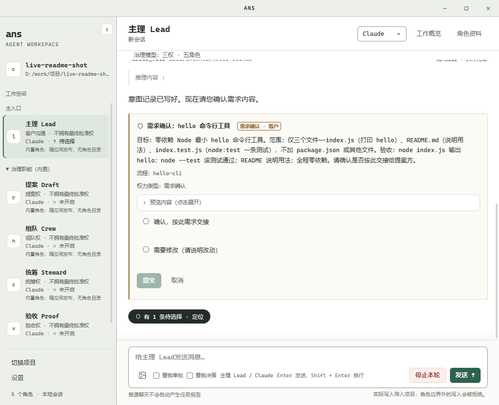

# ANS Studio

**让 AI 按角色分工，在明确的文件边界内完成代码任务。**

ANS Studio 面向希望在真实项目中使用多个 AI 角色协作的开发者：从需求与授权开始，经过派发、修改和测试，再把执行证据交回检查。提供桌面应用与 CLI；桌面默认使用 Claude，也可切换 Pi 或 Codex，CLI 支持 demo（不调用模型）、Pi、Codex 与 Claude。

## 五个治理角色

新建或空项目默认使用 **三权 · 五角色** 治理模型，界面状态行显示「三权 · 五角色」。三权指提案、组队、统筹三类决定权，沟通与验收不是决定权。五个内置治理角色随应用发布，没有角色目录，只读写治理文件与证据，不承担实现与测试；内部 roleId 保持稳定，界面显示下列名称。

| 界面名称 | roleId | 职责 | 权力 |
| --- | --- | --- | --- |
| Lead / 主理 | `liaison` | 客户沟通与默认主入口；把客户意图写入 `docs/intents/` | 客户沟通 · 不拥有最终批准权 |
| Draft / 提案 | `rapporteur` | 形成提案与跨角色契约 | 提案权 · 不拥有最终批准权 |
| Crew / 组队 | `nominator` | 提名项目角色、写角色卡与边界 | 组队权 · 不拥有最终批准权 |
| Steward / 统筹 | `convener` | 编排流程、派发任务 | 统筹权 · 不拥有最终批准权 |
| Proof / 验收 | `verifier` | 独立只读核对证据、出验收卡 | 验收权 · 不拥有最终批准权 |

`su` 只用于旧模型（single）与兼容路径，不是新项目的默认入口。

## ANS 是什么与学术来源

**ANS Skill** 是一套受 Role-First Software Governance（RFSG）论文启发的角色优先 AI 开发技能；ANS 是名称，不作缩写展开。本仓库的 **ANS Studio** 将这套思路落成可运行的桌面应用与 CLI。

它强调三件事：

- 先明确业务责任，再确定模块和代码归属。
- 按需广泛阅读，在授权范围内修改。
- 发现跨模块问题，交给对应角色处理；理解问题不会自动带来修改权限。

学术来源：Wang, Zhongren. 2026. *Role-First Software Governance: Asymmetric Authority Boundaries for AI-Native Agent Systems*. [DOI: 10.5281/zenodo.22824700](https://zenodo.org/records/22824700)。



## 下载与运行

当前版本：[v1.3.0](https://github.com/wangzhongren/ans-studio/releases/tag/v1.3.0)。运行包自带运行环境，启动应用无需另装 Node.js；执行项目的 `npm test`、Git 等命令，仍需安装该项目所需的开发工具链。

| 系统 | 下载 | 启动方式 |
| --- | --- | --- |
| macOS 13+ · Apple Silicon | [mac-arm64.zip](https://github.com/wangzhongren/ans-studio/releases/download/v1.3.0/ANS-Studio-1.3.0-mac-arm64.zip) | 完整解压，打开 `ANS Studio.app` |
| macOS 13+ · Intel | [mac-x64.zip](https://github.com/wangzhongren/ans-studio/releases/download/v1.3.0/ANS-Studio-1.3.0-mac-x64.zip) | 完整解压，打开 `ANS Studio.app` |
| Windows 10/11 · x64 | [win-x64.zip](https://github.com/wangzhongren/ans-studio/releases/download/v1.3.0/ANS-Studio-1.3.0-win-x64.zip) | 完整解压，打开 `ANS Studio.exe`，保留同目录资源文件 |

运行包尚未签名或公证，系统可能提示来源未验证。请从上述 Release 下载，并核对页面中的 `SHA256SUMS-*.txt`。

## 第一次使用

1. **导入项目并选择引擎。** 点击左下角「导入项目」。导入前引擎选择不可用；也可以选择一个空文件夹，按默认的五角色开始。在会话顶部选择引擎：默认 Claude，也可切换 Pi、Codex。缺少配置时，点击提示中的「打开设置」按钮；日后也可从左下角「设置」进入。保存成功只表示配置已保存，连接是否可用仍需实际请求验证。
2. **与 Lead 说明需求。** Lead 是默认主入口，负责确认目标、范围与验收标准，并把客户意图写入 `docs/intents/`。写完意图后，Lead 会弹出**需求确认卡**（`confirm` / `revise`）；只有你确认后，意图才会交给 Draft。
3. **确认提案与任命。** Draft 依据意图形成提案，提案卡提供 `accept` / `accept-quick` / `revise` / `reject`。接受后，Steward 写流程单，Crew 提名项目角色并弹出任命卡；任命后 Crew 再经写盘确认卡逐路径写角色卡与边界。
4. **实施、回交与验收。** 项目角色按各自边界实施、测试并回交；Steward 处理流程与派发。Proof 独立只读核对交付与回交证据，出验收卡（`accept` / `reject`），由你决定是否验收。
5. **验收通过即结束。** 没有看护的「收束」提示。内部角色的反馈由 Lead 汇总后告知你，不直接转述原文。

正式任务由 Steward 派发到项目角色，忙碌时进入队列；普通聊天不会自动产生「未报告」回交。「工作概览」可查看待确认项、排队消息与最近回交。输入区使用 **Enter 发送，Shift + Enter 换行**；忙碌时可停止本轮或撤回尚未执行的排队消息，角色和引擎各自保留草稿。详情抽屉支持 Esc 关闭并回到原入口。

### 引擎配置

每个引擎使用独立配置，不会在缺配置时自动切换到其他引擎。

| 引擎 | 必填配置 | 可选配置 |
| --- | --- | --- |
| Pi | `ANTHROPIC_AUTH_TOKEN`、`ANS_PI_BASE_URL`、`ANS_PI_MODEL` | `ANS_PI_CONTEXT_WINDOW`，留空默认 500000；模型/网关实际窗口更小时请覆盖 |
| Codex | `CODEX_API_KEY`（或 `OPENAI_API_KEY`）、`ANS_CODEX_MODEL` | `ANS_CODEX_BASE_URL`，默认 `https://api.openai.com/v1`；自定义端点须兼容 Responses API |
| Claude | `ANTHROPIC_API_KEY` | `ANS_CLAUDE_MODEL`、`ANTHROPIC_BASE_URL`，留空使用 SDK 默认 |

Codex 与 Claude 使用 API key，不使用订阅或 OAuth 登录回退。更多变量说明见 [`.env.example`](.env.example)。

运行包将配置保存在**用户数据目录的 `.env`**，开发启动使用**仓库根 `.env`**，设置面板会显示实际路径。秘密值不回显、不进入运行包，也不应提交到 Git。会话记录保存在项目的 `.ans/sessions/`，本仓库已将其加入忽略规则。

## 角色协作怎样约束修改

- **先分工，再授权。** 角色卡说明职责，`boundary.yaml` 的 Section 1 列出可修改路径；存在已生效的任务写集时，再按任务范围收窄。五个治理角色的边界来自内置注册表，不建角色目录。
- **治理写入门禁。** 角色卡/`boundary.yaml`、提案、流程、验收与写盘等在写入前有预览或确认卡；越界写入在产生副作用前被拒绝，并指回正确归属：提案→Draft / 提案，角色卡与提名→Crew / 组队，流程→Steward / 统筹，验收→Proof / 验收，应用治理记录→应用。
- **治理角色只读。** Lead、Draft、Crew、Proof 不接 shell；Steward 只有只读档，白名单只读命令可直接执行，risky/review/deny 一律拒绝。实现、测试与执行类命令由项目角色完成。
- **需求确认卡是客户专属。** 桌面「替我审批」只代批 shell 命令与写盘/写卡确认；「替我决策」只代批提案接受、任命与验收。需求确认卡不代批。代批会标明「judge 代批」，不冒充你本人点击，也不改变任何门槛；证据不足、读取被拒或判断失败时回落手动确认。
- **判断 agent 只读。** 它只读项目内允许的文本：`.ans/project.json` 与 `.ans/governance/ledger.jsonl` 只读开放，`.ans/sessions/**` 及其他敏感内容仍被拒绝，并给出具体路径与原因。它不写文件、不执行命令、不派发任务。
- **派发与验收分开。** 派发任务不会增加目标角色的写权限。任务报告、历史保存、回交投递和接收方处理分别显示实际状态；报告声明「已完成」不等于独立验收通过。

技术结构与跨角色接口见[项目架构](角色卡/项目管理/docs/architecture.md)。

## 从源码开发

需要 **Node.js 23.6+** 与 npm。

```bash
git clone https://github.com/wangzhongren/ans-studio.git
cd ans-studio
npm ci
npm run app
```

桌面启动后按上面的首次使用流程配置即可。若使用 CLI，可先将 `.env.example` 复制为 `.env`，填写所选引擎配置。

### 常用 CLI 命令

在仓库根目录执行：

```bash
# 自检与帮助
node bin/ans.js doctor
node bin/ans.js --help

# 不调用模型的演示会话
node bin/ans.js role run 编排 --task T-1

# 对已有目录发起治理会话；确认通过终端问答完成
node --env-file=.env bin/ans.js govern /path/to/project --runtime pi

# 运行项目中已登记的角色；替换角色 ID 与任务内容
node --env-file=.env bin/ans.js role run "角色ID" --task "任务内容" --runtime pi
```

`--runtime` 支持 `demo|pi|codex|claude`，优先于 `ANS_RUNTIME` 环境变量。未指定时，`role run` 默认 demo，`govern` 默认 Pi。桌面的默认引擎是 Claude，CLI 保持上述默认。`govern` 的目标目录必须已存在；不提供目录时使用当前工具项目。`ans init` 已移除。

### 检查与打包

```bash
node --test "test/**/*.test.ts"
npm run typecheck
```

测试路径需保留引号，确保覆盖多层目录。部分集成测试需要监听本地回环地址。

发布构建使用 [GitHub Actions 工作流](.github/workflows/release.yml)，在各目标系统与架构上构建、解压并验证实际运行包。维护者的来源核验、构建命令与发布步骤见[桌面打包说明](角色卡/装配/docs/feature/desktop-release-packaging.md)。

## 当前限制

- **请仅打开可信项目。** shell 命令有规则检查与审读流程，但没有操作系统沙箱；获准命令的文件副作用不受 ANS 文件写入门禁约束。CLI 当前未启用 shell 工具。
- **Windows 暂不支持内置来源文档阅读。** 可查看完整摘要和执行记录，来源文件请通过系统编辑器打开。
- **CLI 与桌面能力有差异。** CLI 使用终端确认，暂不提供桌面式任务派发与回交投递、队列界面。多任务依赖的自动调度尚未实现。
- **ZIP 分发暂无安装器和自动更新。** 更新时需自行下载新版本。
- **验证范围有限。** 三平台运行包由原生 CI 构建、回归并做解压启动检查，包内测试不调用在线模型；既有真实验证记录中，在线桌面与代码任务以 Pi 为主，Codex、Claude 的受控/离线整链测试不等于在线模型全链路验收。桌面默认 Claude 只表示默认选择，不表示已获在线验收。

## 深入了解

- [v1.2.0 发布验收与公开下载](角色卡/测试/docs/change/2026-10-16_change_v1.2-release-verification.md)：实际产物、来源与测试证据。
- [v1.1.0 发布验收与公开下载](角色卡/测试/docs/change/2026-10-16_change_v1.1-release-verification.md)：实际产物、来源与测试证据。
- [v1.0.0 发布与三平台验收](角色卡/测试/docs/change/2026-10-15_change_v1-release-verification.md)：实际产物、来源与测试证据。
- [真实桌面与 Pi 项目验证](角色卡/测试/docs/change/2026-10-15_change_visual-v2-independent-verification.md)：普通聊天、正式任务、工具输出与回交流程。
- [桌面交互设计](角色卡/UIUX设计师/docs/design/2026-10-15_design_visual-convergence.md)：页面结构与交互规范。
- [CLI 接线与行为说明](角色卡/装配/docs/feature/cli-runtime-assembly.md)：运行时选择、配置与命令细节。
- [工程规则](角色卡/项目管理/docs/project-rules.md)：分层、角色边界与协作约束。

本项目采用 [MIT 许可证](LICENSE)。
