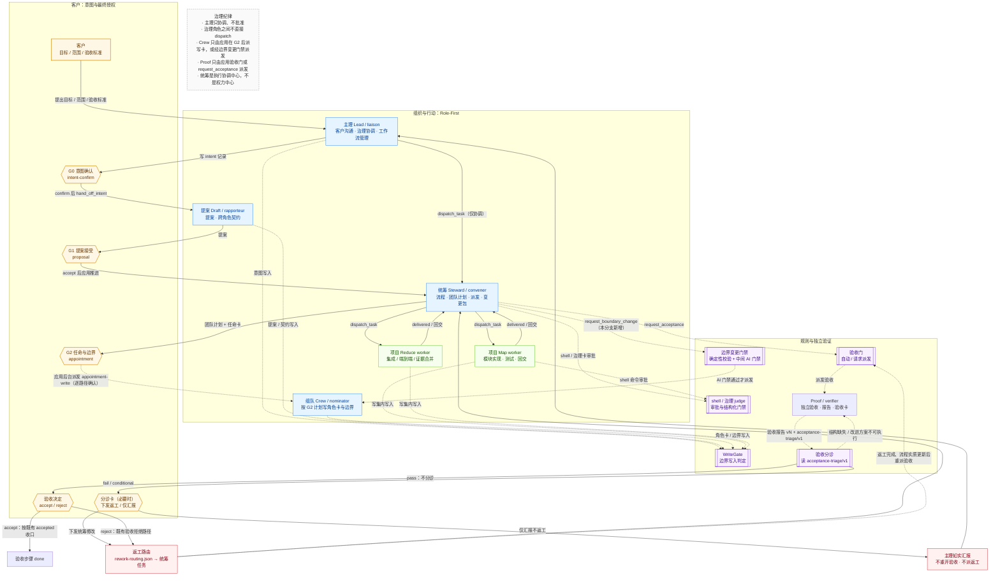

# ANS Studio

[English](README.en.md)

**ANS Studio 不是普通的多 Agent 任务编排器，而是带组织治理机制的 Agent 运行时：Role-First——权力分散、门禁前置、独立验收。**

它把「谁决定、谁派发、谁写入、谁验收」写进运行时，而不是只写在提示词里。桌面应用与 CLI 共用同一套角色与治理工具：桌面默认使用 Claude，可切换 Pi、Codex；CLI 支持 demo（不调用模型）、Pi、Codex 与 Claude。

**版本状态**：当前公开运行包为 **v1.7.0**（2026-10-24）。`main` 已合入 `request_acceptance`、验收分诊与后台任务/流程状态面板；本分支在 `main` 之上新增 `request_boundary_change`（含中间 AI 门禁）、脚手架先行治理与「统筹完成即主动提交验收」。main 与本分支的新增能力都将随下一次发布进入运行包，文中逐项标注。

## 三层结构：意图、组织、规则

| 层 | 角色或机制 | 职责 | 权力与边界 |
| --- | --- | --- | --- |
| **意图与最终授权** | **客户** | 提出目标、范围与验收标准；在 G0 意图确认、G1 提案接受、G2 任命与边界确认、验收卡与分诊卡上作决定 | 最终批准权；不承担内部角色调度 |
| **组织与行动** | **主理 Lead**（`liaison`） | 客户沟通；把意图写入 `docs/intents/`；治理协调与工作流管理 | 沟通权 + 协调权；**只协调、不批准**，不直接派项目 worker |
| | **提案 Draft**（`rapporteur`） | 读客户意图，形成提案与跨角色契约 | 提案权；不拥有最终批准权 |
| | **组队 Crew**（`nominator`） | 按客户确认后的团队计划写项目角色卡、边界与工作文档；处理边界变更请求 | 写卡权（G2 后经 `appointment-write`）；不选角色、不改团队计划 |
| | **统筹 Steward**（`convener`） | 写流程 YAML、团队计划、readiness、变更包；派发项目 worker；提交独立验收 | 统筹权；**执行协调中心，不是权力中心**：不能任命、不能改边界、不能替代验收、不能绕过 G1/G2 |
| | **项目 Map / Reduce worker** | 在各自 bounded context 与写集内实现、测试、交付、回交；Map 按模块并行，Reduce 做集成/端到端/证据合并 | 只写 Section 1 与任务写集；不跨目录、不自行扩权 |
| **规则与独立验证** | **应用门禁** | WriteGate 边界写入判定、shell 审批链、治理 judge、闸门 0/1/2、验收门、验收分诊、阶段流转 | 确定性校验与流程完整性；**不代替客户决策** |
| | **Proof / 验收**（`verifier`） | 实施前写验收标准；独立核对候选、证据与真实启动/演示；写验收报告并发验收卡 | 验收权（不是批准权）；不实现、不派发 |
| | **验收分诊** | 读验收报告 `acceptance-triage/v1`，决定返工、仅汇报或退回 Proof 补报告 | 只决定「是否返工 / 退回补报告」；不改验收结论、不伪造客户决定 |

「三权」指**提案、组队、统筹**三类决定权；沟通与验收不是决定权。五个内置治理角色随应用发布，没有角色目录，文件写入限于治理文件与证据，不承担实现与测试；shell 命令与其他角色一样全部经审批链。内部 roleId 保持稳定，界面显示「三权 · 五角色」。`su` 只用于旧模型（single）与兼容路径，不是新项目的默认入口。

## 角色流转拓扑



| 图例 | 含义 |
| --- | --- |
| 实线箭头 | 角色派发/交接：`hand_off_intent`、`dispatch_task`、`delivered` / 回交 |
| 虚线箭头 + 门形节点 | 经应用门禁：WriteGate、shell/治理 judge、边界变更门禁、验收门、验收分诊 |
| 六边形 | 客户决定：G0/G1/G2、验收、分诊 |
| 红色框 | 验收返工路由 / 仅汇报 |

- **主理只协调、不批准。** Lead 可推进流程、向 Steward 派协调任务；不批准提案、任命或验收，不直接派项目 worker，也不写他人的治理产物。
- **治理角色之间不直接 dispatch。** 除 Lead 作为工作流管理者向 Steward 派协调任务外，Draft / Crew / Steward / Proof 互不派发；内置治理角色不可被 `dispatch_task` 选中。
- **Crew 只有两个入口。** G2 任命后由应用后台派 `appointment-write` 写卡；或 Steward 的 `request_boundary_change` 经应用确定性校验 + 中间 AI 门禁通过后，由应用派发。Crew 不自行选择角色、不改团队计划。
- **Proof 只有两个入口。** 应用验收门（由 settle / 回交 / 账本变化等事件触发），以及 Steward 的 `request_acceptance`（同样走验收门）。其他角色不派 Proof。
- **统筹是执行协调中心，不是权力中心。** 能写流程、团队计划、readiness、变更包并派项目 worker；不能任命、不能改角色卡/边界、不能替代 Proof 验收、不能绕过 G1/G2。
- `request_boundary_change` 与中间 AI 门禁为**本分支新增，随下次发布生效**。

## 两条闭环

### 任务执行闭环

`统筹 → 项目 worker 交付/回交 → 证据/变更包 → 验收门 → Proof → 分诊 → 返工或汇报`

1. **G1 之后写流程与团队计划。** Steward 写 `docs/flows/<flowId>.yaml`、团队计划（模块 / 目录 / 写集 / 依赖 / 风险档位）并发 appointment 卡。含代码/测试交付的计划还必须先列独立 `build-scaffold` 前置步骤（本分支新增：先交付包配置、TS/构建/测试配置与入口骨架，`npm run typecheck` 与最小测试可跑后才派实现；当前落地为角色卡要求 + 通用 `dependsOn` 派发门，应用尚无「缺 `build-scaffold` 即拒绝任命卡」的确定性硬校验）。
2. **G2 后写卡与 readiness。** 应用后台派 Crew 按团队计划写项目角色卡与边界（`appointment-write` 逐路径确认）；Steward 做逐角色/逐目录 readiness 复核，pass 后才进入派发。
3. **派发与交付。** Steward 只向已任命、已写卡且 readiness pass 的项目角色 `dispatch_task`；`dependsOn` 未全部 `done` 不派。worker 在 Section 1 / 团队计划写集内实现与测试，按步骤标 `delivered` 并回交。
4. **核证与变更包。** Steward 核证 `delivered → done`（worker 不能标 `done`，manager 不能代标 `delivered`），收齐回交后写 change-package（含 `riskTier`、候选、改动路径、证据），并产出 `verification-evidence`（真实启动/演示）。
5. **验收门。** 应用在 settle / 回交 / 账本变化 / `request_acceptance` 时检查流程完整性、验收标准与变更包；齐备后派 Proof。Steward 在交付与证据齐备后必须主动调用 `request_acceptance({flowId})`（工具已在 `main`；「完成即主动提交」的卡文本为本分支强化）。`dispatched` **不等于**验收通过。
6. **Proof 独立验收。** 实施前写验收标准；核对候选、证据与真实启动/演示；写验收报告（首行五项 + `acceptance-triage/v1`），发 `accept` / `reject` 验收卡。
7. **分诊与返工/汇报。** 应用读报告：`pass` 走既有验收卡；`fail` / `conditional` 按确定性规则（结合「替我决策」开关）决定返工或仅汇报；结构缺失/改进方案不可执行则退回 Proof 补报告。返工路由携带严重度、原因与改进方案回 Steward；返工完成、流程实质更新、执行步骤全 `done` 后，重派门恰好重派一次 Proof。仅汇报由主理如实汇报，不重开验收、不派返工。

#### 验收标准与质量基线

默认按生产级质量推进；客户在意图阶段明确选择原型档时，才可放宽其中不适用的条目。提案、角色卡、流程派发与验收携带同一份质量基线。

- 提案必须包含架构方案（新项目）或架构影响分析（变更），以及「质量基线与证据计划」；缺失架构或质量章节不得进入实现。
- 验收标准在实施派发前冻结，逐条可演示；无 TODO/占位/假数据，边界与非法输入有明确行为。
- 验收前必须真实启动应用并演示（启动命令、访问地址或截图/录屏）；仅有测试输出或代码阅读不算演示，不得建议 `accept`。
- Proof 逐项核对正确性、健壮性、安全、可维护性、可观测性、性能/容量、前端、测试矩阵与交付证据；实现偏离架构声明或缺少架构章节时不得建议 `accept`。

完整基线是内置角色卡的单一来源文本（`src/common/门禁引擎/governance-roles.ts` 的 `ENGINEERING_QUALITY_BASELINE`），角色卡与验收标准逐项引用。

#### 流程状态（机器契约）

流程状态以 `docs/flows/<flowId>.yaml` 为唯一机器状态，应用只解析它做派发与验收判定；同名 `.md` 仅是人读视图，应用不解析它做判定。

```yaml
flowId: todo-list-v1          # 必填；与文件名一致
version: 1                    # 必填；正整数
qualityTier: production       # 必填；prototype | production
steps:                        # 必填；非空
  - id: delivery-server       # 小写 slug；verification / acceptance 为保留 id
    title: 服务端交付
    owner: <项目角色 id>
    kind: dispatch            # dispatch | customer-decision | artifact | acceptance
    status: done              # pending | dispatched | delivered | done | superseded | failed | blocked | aborted
    evidence:                 # done 必填；kind 与步骤 kind 对应，ref 为账本匹配键
      kind: dispatch
      ref: delivery-server
  - id: verification
    title: 验收
    owner: app
    kind: acceptance
    status: pending
```

- **`done` 必须有证据。** `dispatch` 对账账本 `dispatch.accepted`；`customer-decision` 对账已结算的客户决定；`artifact` 对账 `artifact.observed`；`acceptance` 对账客户验收决定。
- **验收步骤归应用。** `verification` / `acceptance` 由应用自动派 Proof（`kind: acceptance`，初始 `pending`）；Steward 不占用、不派发、不标 `done`。
- **取代关系显式记录。** 返工用 `flow_step_supersede`：旧步骤 `superseded` + `supersededBy`，新步骤 `pending`；`failed` / `blocked` / `aborted` 未标 `superseded` 时仍阻塞收尾。
- **非法 YAML 不回退。** YAML 存在但校验失败时应用 fail-closed 并给出路径与原因；仅在 YAML 不存在时，迁移期兼容旧 Markdown 流程。初始创建仍走 `schedule-write` 写卡；创建后应用是唯一写者，角色改用 `flow_get` / `flow_step_update` / `flow_step_supersede`，每条 `done` 都必须带账本可对账的证据。

### 组织治理闭环

`统筹发现边界缺口 → request_boundary_change → 应用确定性校验 + 中间 AI 门禁 →（通过才）组队 appointment-write → 角色卡/边界生效`

1. **发现缺口。** 项目角色报告写集/边界不足，或 Steward 在核证、readiness、派发前检查中发现角色边界覆盖不了任务所需路径。
2. **提交请求。** 调用 `request_boundary_change({ roleId, addPaths, removePaths, rationale, flowId })`，只提交**精确的项目相对路径/目录条目**与理由；不重写整个边界、不扩大其它路径，也不用 `dispatch_task` 直接派 Crew（内置治理角色不可被派发）。
3. **应用确定性校验。** 校验路径形状（无通配符、`..`、绝对路径）、治理关键路径/发布根不得新增、必须产生实际变化、同一请求幂等；应用票据写入 `.ans/governance/boundary-requests/<flowId>/<ticketId>.json`。
4. **中间 AI 门禁。** 只读证据（治理账本、团队计划、流程摘要、目标角色卡/边界），deny-all 写权，只判断请求的精确路径与理由是否与角色卡、当前边界、团队计划及流程一致，是否顺带扩权或触碰治理关键路径。`deny` / `manual` / 超时 / 不可用一律 `rejected`，**不派发、不自动放行**，回执给 Steward。
5. **组队写卡。** 通过后才由应用后台派 Crew。Crew 逐项核对 `roleId`、增删路径与理由，按 `appointment-write` 逐路径取得客户/判断 agent 确认，写后交应用边界校验。**请求来自统筹不等于客户批准**；确认与校验完成前，不得按新路径写入。
6. **生效与复核。** 边界变更完成且校验通过后才生效；Steward 按新边界重新核对 readiness / 派发条件。变更未完成前不得派实现写入该路径。
7. **状态标注。** 本闭环（`request_boundary_change` + 中间 AI 门禁）为**本分支新增，随下次发布生效**；已发布版本中 Steward 只能上报边界缺口，不能自行发起该通道。

## 验收分诊与状态语义

Proof 的验收报告除首行五项外，必须包含恰好一个 fenced YAML 段 `schema: acceptance-triage/v1`：

```yaml
schema: acceptance-triage/v1
conclusion: fail            # pass | fail | conditional
items:
  - id: F1
    severity: blocker       # blocker | major | minor | nit
    owner: <单个角色 id>      # 跨 owner 必须拆项
    reason: 为什么不通过
    action: 改进方案         # 必填，并带 targets 或 criteria 指针
    targets: [<文件/模块指针>]
    criteria: <验收标准指针>
```

字段纪律：`pass` 允许空 items，`fail` / `conditional` 必须非空；未知字段、重复 id、空 owner/reason/action、未知 severity 都会使整段 invalid。

| 报告结论 | 分诊处置 | 是否收口 | 是否返工 |
| --- | --- | --- | --- |
| `pass` | 不分诊，走既有验收卡（`accept` / `reject`；「替我决策」开启且机械门槛通过时可判断代批 `accept`） | 客户（或判断代批）`accept` 后按既有 `accepted` 收口 | 否；客户 `reject` 走既有验收拒绝路径 |
| `fail` / `conditional`，存在 `blocker` / `major` 且改进方案可执行 | 建议下发统筹修改；开关开启且建议权威时按确定性规则代批，否则弹客户分诊卡 | 分诊本身不收口；返工完成后重新验收 | **是**：`rework-routing.json` + 统筹任务，携带严重度、原因、改进方案与文件/标准指针 |
| `fail` / `conditional`，仅 `minor` / `nit` | 建议仅汇报不返工；开关开启且建议权威时按确定性规则代批，否则弹客户分诊卡 | 客户在分诊卡选「仅汇报」时按既有 `accepted` 收口；**判断代批的「仅汇报」不写 `customer.decision`，验收步骤保持 `pending`（未收口）** | **否**：不重开验收、不派返工、不建新步骤 |
| `fail` / `conditional`，有 `blocker` / `major` 但改进方案不可执行（owner 不可派发、`action` 为空、无 `targets`/`criteria`） | 结构不足：退回 Proof 补报告 | 不收口 | 否；不弹卡、不写返工路由 |
| 缺 `acceptance-triage/v1` / 段坏 / 矛盾（`pass` 带 blocker/major、`fail` 空 items 等） | 退回 Proof 补报告（`declined + notPresented`，未向客户呈现） | 不收口 | 否；不弹卡、不写 `customer.decision` |
| 分诊记录损坏 / 判断代批不可用 / 无法核对可执行性 | 记录损坏回落原验收卡人工处理；判断代批不可用或无法核对时弹客户分诊卡（带默认建议或「无法自动建议」） | 由客户决定 | 由客户决定 |

**必须区分的语义：**

- **「仅汇报」不是「验收通过」。** 报告结论仍是 `fail` / `conditional`；流程不伪造客户决定，主理汇报必须写明验收结论、失败原因、改进建议、本次不返工的决定来源与报告路径。
- **判断代批的「仅汇报」保持未收口。** 它不写 `customer.decision`，验收步骤仍为 `pending`；只有客户在分诊卡选「仅汇报」时，才按既有 `accepted` 结算并收口。判断代批的「返工」同样只写分诊记录与账本 `acceptance.triage`，不写 `customer.decision`。
- **报告写得漂亮不能掩盖 blocker。** 只要存在可执行的 `blocker` / `major`，就不得建议 `pass`、不得建议仅汇报；反过来，只有 `minor` / `nit` 时，措辞再严厉也不得建议返工。判定只读结构（结论、严重度、指针），不读文风。
- **分诊 v1 是确定性规则 + 「替我决策」开关（judge-rule），不是独立的 AI 分诊角色。** 开关关闭、建议不权威或无法核对时，一律回落客户分诊卡；不自动执行任何处置。
- **记录可审计、可恢复。** 分诊记录写入 `.ans/governance/acceptance/<flowId>/triage-v1.json`，账本追加 `acceptance.triage`（**不是** `customer.decision`）；幂等键为 `flowId + reportSha256`；重启后按记录状态重推分诊卡或补汇报，新报告不继承旧结论。

## 两道门禁的诚实边界

应用门禁与 AI 门禁是两道互补的闸：前者做确定性判定，后者做受限的结构化审核；两者都不代替客户决策。

- **应用门禁保证的是路径、权限与流程完整性，不是业务正确性，也不是客户同意。** WriteGate 只判定 Section 1 / 任务写集与禁写路径；闸门 0/1/2 与验收门只做确定性校验和阶段流转；它们不能替代客户决策，也不能证明工程质量。
- **边界内写入是预授权，不等于绕过门禁。** Section 1 边界内的写入用 `write_file` / `edit_file` 直接执行，不逐次发写盘确认；边界外由 WriteGate 在产生副作用前拒绝。角色卡/边界变更、共享目录或他人写集、`docs/flows/**` 流程 YAML、治理账本、发布/变更包等治理敏感写入仍按既有规则确认。目录级授权与团队计划精确写集进一步收窄实际范围。
- **shell 审批链只审系统风险。** 五个治理角色与项目角色一样具备 shell 能力，只读白名单直接执行，risky/review/deny 逐条由客户或判断 agent 审批；拒绝、超时、通道不可用一律不放行。shell 的文件副作用**不受** WriteGate 约束，审批链是唯一控制，且当前没有操作系统沙箱。
- **AI 门禁只做结构化审核。** 判断 agent 只读允许的文本，只审系统风险（卡死、越界、破坏、资源、敏感外发）或意图漂移（目标、范围、非目标、验收标准、已接受的决定），不重复审工程质量、架构与测试；这些由 Proof 在验收阶段核对。
- **deny / manual / 超时 / 不可用一律不放行。** shell 命令不执行；`request_boundary_change` 返回 `rejected` 并退回 Steward，**不派发组队**；治理卡判断未能代批时以 `declined` 退回发起角色修正（不自动弹客户卡；判断期间关闭开关则恢复原卡 + 提示）；验收分诊无法自动建议时回落客户分诊卡。不存在「判断失败就默认通过」或「默认返工」。
- **应用推进、派发、请求复核、请求变更都不等于客户批准。** 派发不增加任何角色的写权限；`request_acceptance` 的 `dispatched` 只表示「已派发独立复核」；`request_boundary_change` 的 `dispatched` 只表示「已把精确修改请求派给组队」，边界仍未修改。
- **判断代批不冒充客户。** 成功代批会标明「judge 代批」，不写成客户本人点击；开关关闭、未接入自动判断或不适用的请求仍走手动卡；治理判断期间关闭开关，原卡可恢复。

技术结构与跨角色接口见[项目架构](角色卡/项目管理/docs/architecture.md)。

## 安装与运行

### 下载运行包

当前公开版本：**v1.7.0**（2026-10-24 发布）。运行包自带运行环境，启动应用无需另装 Node.js；执行项目的 `npm test`、Git 等命令，仍需安装该项目所需的开发工具链。

| 系统 | 下载 | 校验文件 | 启动方式 |
| --- | --- | --- | --- |
| macOS 13+ · Apple Silicon | [mac-arm64.zip](https://github.com/wangzhongren/ans-studio/releases/download/v1.7.0/ANS-Studio-1.7.0-mac-arm64.zip) | [SHA256SUMS-darwin-arm64.txt](https://github.com/wangzhongren/ans-studio/releases/download/v1.7.0/SHA256SUMS-darwin-arm64.txt) | 完整解压，打开 `ANS Studio.app` |
| macOS 13+ · Intel | [mac-x64.zip](https://github.com/wangzhongren/ans-studio/releases/download/v1.7.0/ANS-Studio-1.7.0-mac-x64.zip) | [SHA256SUMS-darwin-x64.txt](https://github.com/wangzhongren/ans-studio/releases/download/v1.7.0/SHA256SUMS-darwin-x64.txt) | 完整解压，打开 `ANS Studio.app` |
| Windows 10/11 · x64 | [win-x64.zip](https://github.com/wangzhongren/ans-studio/releases/download/v1.7.0/ANS-Studio-1.7.0-win-x64.zip) | [SHA256SUMS-win32-x64.txt](https://github.com/wangzhongren/ans-studio/releases/download/v1.7.0/SHA256SUMS-win32-x64.txt) | 完整解压，打开 `ANS Studio.exe`，保留同目录资源文件 |

下载后先核对 SHA256：macOS 在下载目录执行 `shasum -a 256 -c SHA256SUMS-darwin-arm64.txt`（Intel 用 `SHA256SUMS-darwin-x64.txt`）；Windows PowerShell 执行 `Get-FileHash .\ANS-Studio-1.7.0-win-x64.zip -Algorithm SHA256`，与 `SHA256SUMS-win32-x64.txt` 对照。

<details>
<summary>v1.7.0 SHA256 与来源核验</summary>

| 产物 | SHA256 |
| --- | --- |
| `ANS-Studio-1.7.0-mac-arm64.zip` | `734aa9325adaf30b3fec0ab2f1392470a4645e8d2143c17f3eb1125091206f42` |
| `ANS-Studio-1.7.0-mac-x64.zip` | `45d493d0dd3f339265d482d1f1bb374723c46cb9789b570fb9f2c43b15191a77` |
| `ANS-Studio-1.7.0-win-x64.zip` | `7a3fc9cbcd6e49585ab535aebf4bbfa571814121b65162f8c16a327857de20a3` |
| `overlay.patch` | `8d30b0cfbf953fe47e51752081671a17a0b95c6ece40051d6f09c20800e3f131` |
| `release-provenance.json` | `283ee68bbfe8d332027d6bc48a82c39e644c6d26dd6ae35776ee38a2e07456d2` |

[SHA256SUMS-overlay.txt](https://github.com/wangzhongren/ans-studio/releases/download/v1.7.0/SHA256SUMS-overlay.txt)、[release-provenance.json](https://github.com/wangzhongren/ans-studio/releases/download/v1.7.0/release-provenance.json) 与 [overlay.patch](https://github.com/wangzhongren/ans-studio/releases/download/v1.7.0/overlay.patch) 记录固定源码与打包适配，来源核验见[本次发布记录](角色卡/装配/docs/change/2026-10-24_change_release-v1.7.0-prepare.md)。

运行包**未签名、未公证**：macOS 未公证、Windows 未做代码签名，首次启动可能提示来源未验证。请从上述 Release 下载，先核对 SHA256 再运行。

</details>

v1.7.0 包含双语界面（zh-CN / en-US）、目录级授权、验收返工路由与覆盖所有变更的独立验收；本分支新增能力不在该运行包内。

### 第一次使用

1. **导入项目并选择引擎。** 点击左下角「导入项目」。导入前引擎选择不可用；也可以选择一个空文件夹，按默认的五角色开始。在会话顶部选择引擎：默认 Claude，也可切换 Pi、Codex。缺少配置时，点击提示中的「打开设置」按钮；日后也可从左下角「设置」进入。保存成功只表示配置已保存，连接是否可用仍需实际请求验证。
2. **与 Lead 说明需求（G0）。** Lead 是默认主入口，负责确认目标、范围与验收标准，并把客户意图写入 `docs/intents/`。写完意图后，Lead 发起**需求确认**（`confirm` / `revise`）。开启「替我决策」且适用自动判断时，判断 agent 可代选 `confirm`，不能代选 `revise`；其余情况由你回答需求确认卡。确认后，意图才由应用投递给 Draft。
3. **确认提案与任命（G1 / G2）。** Draft 依据意图形成提案，提案卡提供 `accept` / `accept-quick` / `revise` / `reject`。接受后应用推进到 Steward：Steward 写流程 YAML 与团队计划、发 appointment 卡；任命确认后，应用后台派 Crew 经 `appointment-write` 逐路径写角色卡与边界。提案、任命和写盘确认按下文的代批开关处理。
4. **实施、回交与验收。** 项目角色按各自边界实施、测试并回交；Steward 处理流程、派发与变更包。Proof 独立核对交付与回交证据，写验收报告并发验收卡（`accept` / `reject`）；报告结论为 `fail` / `conditional` 时先进入验收分诊，见上文。
5. **验收通过即结束。** 没有看护的「收束」提示。内部角色的反馈由 Lead 汇总后告知你，不直接转述原文。

正式任务由 Steward 派发到项目角色，忙碌时进入队列；普通聊天不会自动产生「未报告」回交。「工作概览」可查看待确认项、排队消息、最近回交、后台任务与流程状态：流程状态只读解析 `docs/flows/*.yaml`，后台任务可查看日志尾部并停止当前会话的任务。输入区使用 **Enter 发送，Shift + Enter 换行**；忙碌时可停止本轮或撤回尚未执行的排队消息，角色和引擎各自保留草稿。详情抽屉支持 Esc 关闭并回到原入口。

### 引擎配置

每个引擎使用独立配置，不会在缺配置时自动切换到其他引擎。

| 引擎 | 必填配置 | 可选配置 |
| --- | --- | --- |
| Pi | `ANTHROPIC_AUTH_TOKEN`、`ANS_PI_BASE_URL`、`ANS_PI_MODEL` | `ANS_PI_CONTEXT_WINDOW`，留空默认 500000；模型/网关实际窗口更小时请覆盖 |
| Codex | `CODEX_API_KEY`（或 `OPENAI_API_KEY`）、`ANS_CODEX_MODEL` | `ANS_CODEX_BASE_URL`，默认 `https://api.openai.com/v1`；自定义端点须兼容 Responses API |
| Claude | `ANTHROPIC_API_KEY` | `ANS_CLAUDE_MODEL`、`ANTHROPIC_BASE_URL`，留空使用 SDK 默认 |

Codex 与 Claude 使用 API key，不使用订阅或 OAuth 登录回退。更多变量说明见 [`.env.example`](.env.example)。

运行包将配置保存在**用户数据目录的 `.env`**，开发启动使用**仓库根 `.env`**，设置面板会显示实际路径。秘密值不回显、不进入运行包，也不应提交到 Git。会话记录保存在项目的 `.ans/sessions/`，本仓库已将其加入忽略规则。

## 从源码开发

需要 **Node.js 23.6+** 与 npm。

```bash
git clone https://github.com/wangzhongren/ans-studio.git
cd ans-studio
npm ci
npm run app
```

桌面启动后按上面的首次使用流程配置即可。若使用 CLI，可先将 `.env.example` 复制为 `.env`，填写所选引擎配置。

### 常用 CLI 命令

在仓库根目录执行：

```bash
# 自检与帮助
node bin/ans.js doctor
node bin/ans.js --help

# 不调用模型的演示会话
node bin/ans.js role run 编排 --task T-1

# 对已有目录发起治理会话；确认通过终端问答完成
node --env-file=.env bin/ans.js govern /path/to/project --runtime pi

# 运行项目中已登记的角色；替换角色 ID 与任务内容
node --env-file=.env bin/ans.js role run "角色ID" --task "任务内容" --runtime pi
```

`--runtime` 支持 `demo|pi|codex|claude`，优先于 `ANS_RUNTIME` 环境变量。未指定时，`role run` 默认 demo，`govern` 默认 Pi。桌面的默认引擎是 Claude，CLI 保持上述默认。`govern` 的目标目录必须已存在；不提供目录时使用当前工具项目。`ans init` 已移除。

### 目录结构

```text
app/                 Electron 主进程、preload、桌面窗口逻辑与 React 渲染层
bin/ans.js           CLI 可执行入口
src/
  model/             共享类型：角色、边界、决策与运行时契约
  service/           服务层：角色解析、运行时会话、边界绑定
  provider/          提供方层：Pi / Codex / Claude 适配器与受治理工具
  pipeline/          编排层：受治理会话、流程推进、判断与门禁
  interface/         CLI 接口层
  common/            各角色私有与跨角色共享支撑代码（门禁引擎、编排公共出口等）
  index.ts           CLI 根入口与层间接线
test/                按角色/层的单元、集成、e2e 与启动冒烟
docs/                治理产物：intents / proposals / contracts / flows / scheduling / acceptance / verification / governance
角色卡/               角色卡、boundary.yaml 与各角色文档（本仓库自身的开发治理）
site/                静态站点
.github/workflows/   Release 与 Pages 流水线
electron-builder.yml Electron 打包配置
vite.config.ts       渲染层构建配置
```

用户项目导入后，会在项目自己的 `docs/` 下产生意图、提案、契约、流程、团队计划、验收与治理记录；`.ans/` 是应用独占的治理记录区。

### 检查与打包

```bash
node --test "test/**/*.test.ts"
npm run typecheck
npm run typecheck:renderer
```

测试路径需保留引号，确保覆盖多层目录。部分集成测试需要监听本地回环地址。渲染层可用 `npm run build:renderer` 构建；本地打包用 `npm run package:local`。

## 发布与校验

发布构建使用 [GitHub Actions 工作流](.github/workflows/release.yml)，在 macOS（arm64 / x64）与 Windows（x64）原生 runner 上冻结源码、应用显式 overlay、`npm ci`、`npm run typecheck`、全量回归、构建渲染层、打包、解压并验证实际运行包，再生成 `SHA256SUMS`、`release-provenance.json` 与 `overlay.patch`。维护者的来源核验、构建命令与发布步骤见[桌面打包说明](角色卡/装配/docs/feature/desktop-release-packaging.md)与[v1.7.0 发布记录](角色卡/装配/docs/change/2026-10-24_change_release-v1.7.0-prepare.md)。

运行包由原生 CI 构建、回归并做解压启动检查；包内测试不调用在线模型。既有真实验证记录中，在线桌面与代码任务以 Pi 为主；Codex、Claude 的受控/离线整链测试不等于在线模型全链路验收。桌面默认 Claude 只表示默认选择，不表示已获在线验收。

## 当前限制

- **请仅打开可信项目。** shell 命令有规则检查与审读流程，但没有操作系统沙箱；获准命令的文件副作用不受 ANS 文件写入门禁约束。CLI 当前未启用 shell 工具。
- **Windows 暂不支持内置来源文档阅读。** 可查看完整摘要和执行记录，来源文件请通过系统编辑器打开。
- **CLI 与桌面能力有差异。** CLI 使用终端确认，暂不提供桌面式任务派发与回交投递、队列界面。多任务依赖的自动调度尚未实现。
- **ZIP 分发暂无安装器和自动更新。** 更新时需自行下载新版本。
- **部分能力尚未随发布包提供。** `main` 上的 `request_acceptance`、验收分诊、后台任务/流程状态面板，以及本分支的 `request_boundary_change`、中间 AI 门禁、脚手架先行治理，均需下一次发布后才进入运行包；当前 v1.7.0 运行包不含这些能力。
- **脚手架先行目前是治理规则，不是确定性硬门。** 团队计划缺 `build-scaffold` 或把它后置时，应用尚不会确定性拒绝 appointment 卡；执行依赖角色卡要求与 `dependsOn` 通用派发门，真实模型对卡文本的遵从未在线验收。
- **验证范围有限。** 三平台运行包由原生 CI 构建、回归并做解压启动检查；真实桌面与在线模型验证仍以 Pi 为主，Codex、Claude 的受控/离线测试不等于在线全链路验收。运行包未签名、未公证。

## 深入了解

- [v1.7.0 发布准备](角色卡/装配/docs/change/2026-10-24_change_release-v1.7.0-prepare.md)：冻结源、发布配方与本地预检结果。
- [全部变更独立验收报告](docs/acceptance/2026-10-24_all-changes-independent-acceptance-report.md)：独立验收覆盖所有变更的依据与证据。
- [验收分诊设计](角色卡/项目管理/docs/design/2026-10-25_design_acceptance-triage.md)：返工 / 仅汇报的状态与账本语义。
- [后台任务与流程状态验收](角色卡/独立验收/docs/change/2026-10-25_change_app-ui-background-flow-acceptance.md)：后台任务面板与流程状态只读面。
- [项目架构](角色卡/项目管理/docs/architecture.md)：分层、层间调用方向与角色协作。
- [工程规则](角色卡/项目管理/docs/project-rules.md)：分层、角色边界与协作约束。
- [CLI 接线与行为说明](角色卡/装配/docs/feature/cli-runtime-assembly.md)：运行时选择、配置与命令细节。
- [桌面打包说明](角色卡/装配/docs/feature/desktop-release-packaging.md)：发布流水线、产物与校验。

本项目采用 [MIT 许可证](LICENSE)。
