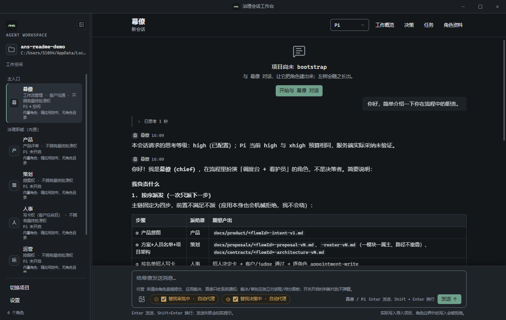
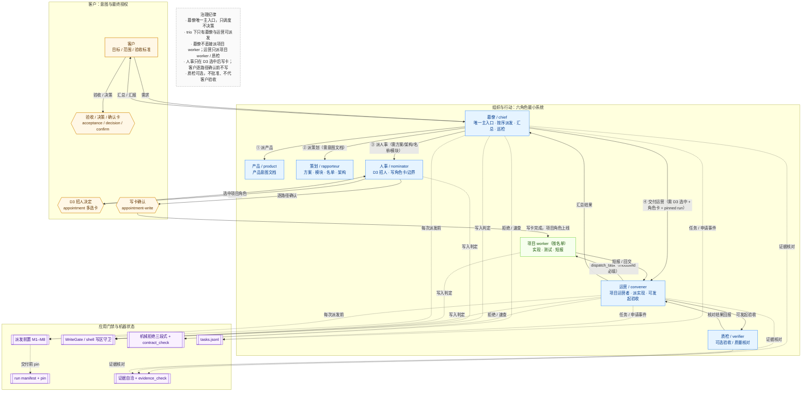

# ANS Studio

[English](README.en.md)

**ANS Studio 不是普通的多 Agent 任务编排器，而是带组织治理机制的 Agent 运行时：Role-First——权力分散、门禁前置、独立验收。**

它把「谁决定、谁派发、谁写入、谁验收」写进运行时，而不是只写在提示词里。桌面应用与 CLI 共用同一套角色与治理工具：桌面默认使用 Claude，可切换 Pi、Codex；CLI 支持 demo（不调用模型）、Pi、Codex 与 Claude。

**版本状态**：当前公开运行包为 **v1.8.1**（2026-10-31）。该运行包在 v1.8.0 基础上新增：意图入口契约对角色可见（幕僚/产品/策划/人事四卡与只读 `contract_check` 暴露 frontmatter 模板、`docs/intents/<intentId>.md` 命名规则与显式 intentId，冲突 fail-closed）、投递与会话收尾不变量（失败投递不覆盖回合、停止可解开 target-busy 楔死、空闲 busy 自愈、队列状态可见、看护告警 UI 旁路、重启后续投持久队列）、请求级超时（首字节 90s / 流空闲 300s，交互/工具/abort/离线期间暂停计时）与 SDK `api_retry` 诊断、网络状态监听（离线安全暂停、恢复窗口 5min、UI 状态行）、仅 replay-safe 的同回合安全重试、验收卡归属的三段式拒绝指引（验收卡由质检发起，运营/幕僚被拒时给出改派指引），并移除 `view_image` 每轮图片预算（保留单图上限）。v1.8.0 能力不变：六角色最小系统与雇佣链、模块/名单/拓扑版本化契约、run 冻结、机械拒绝三段式与契约速查、证据自洽校验；旧 v1/v2/v3 计划、流程与角色卡仅作历史兼容。



## 三层结构：意图、组织、规则

| 层 | 角色或机制 | 职责 | 权力与边界 |
| --- | --- | --- | --- |
| **意图与最终授权** | **客户** | 提出目标、范围与验收标准；在 D3 招人、写卡确认、验收/决策与确认卡上作决定 | 最终批准权；不承担内部角色调度 |
| **组织与行动** | **幕僚 `chief`** | 唯一主入口与总调度：按链序派发产品 → 策划 → 人事 → 运营，汇总回报并巡检 | 只派发内置链与验收调度；**不直接派项目 worker**、不亲自实现、不替客户决策 |
| | **产品 `product`** | 出产品意图文档 `docs/product/<flowId>-intent-vN.md` | 写 `docs/product/`；不派发 |
| | **策划 `rapporteur`** | 依据产品意图出方案、模块清单、人员名单（含模块→角色绑定与人员+模块拓扑）与项目架构 | 写 `docs/proposals/`、`docs/contracts/`；不招人、不写角色卡 |
| | **人事 `nominator`** | 依据名单发起 D3 招人决定；D3 选中后以 `appointment-write` 逐路径写项目角色卡/边界与工作文档；技能/MCP 安装登记 | 写卡权只在 D3 选中且客户/判断 agent 逐路径确认后；不选角色、不改名单 |
| | **运营 `convener`** | 项目运营者：接交付后向项目 worker 派实现任务、收短报；可发起质检核对 | 只派项目 worker（实现）或质检（核对）；需 handoff、pinned run、模块归属；不派产品/策划/人事/幕僚 |
| | **项目 worker** | 按名单与模块实现、测试，向运营短报/回交 | 只写任务模块路径与边界/任务写集；不跨模块、不自行扩权 |
| **规则与机器状态** | **应用门禁** | WriteGate、shell 写区守卫、run manifest pin、机械拒绝三段式、版本化文档只读、证据自洽、`tasks.jsonl` | 确定性校验与流程完整性；**不代替客户决策**，不证明工程质量 |
| | **质检 `verifier`** | 可选的验收/质量核对：读交付与证据，核对后把结果回报发起者（运营或幕僚） | 核对权；不批准、不代客户验收、不派实现 |

六个内置治理角色随应用发布，没有角色目录，文件写入限于各自 Section 1 与任务写集，不承担实现与测试；shell 命令与其他角色一样经审批链。内部 roleId 保持稳定，界面显示中文角色名（幕僚 / 产品 / 策划 / 人事 / 运营 / 质检）。旧 `liaison` 已退休，`su` 只用于旧 single 模型与兼容路径，不是新项目的默认入口。

## 角色流转拓扑



| 图例 | 含义 |
| --- | --- |
| 实线箭头 | 角色派发/交接/回报：`dispatch_task`、`task.delivered`、短报/回交、结果汇总 |
| 虚线箭头 + 门形节点 | 经应用门禁与机器状态：派发前置、run pin、写区判定、机械拒绝、证据核对、`tasks.jsonl` |
| 六边形 | 客户决定卡：D3 招人、`appointment-write` 写卡确认、验收/决策/确认 |
| 黄色虚线节点 | 治理纪律提示，不是角色 |

- **幕僚是唯一主入口与总调度。** 它按「产品 → 策划 → 人事 → 运营」顺序派发，汇总结果并向客户汇报；不亲自实现、不替客户决策，也不直接给项目 worker 派实现任务。
- **trio 下只有幕僚与运营可以派发。** 幕僚可派内置链目标与质检调度；运营只可派项目 worker（实现）或质检（验收核对），不得派产品/策划/人事/幕僚。其他角色不派发。
- **人事只在 D3 后写卡。** D3 是 `appointment` 多选卡，选项与推荐集由应用从最新名单生成；D3 选中的项目角色才可进入 `appointment-write` 逐路径确认并写 `角色卡/<id>/role-card.md`、`boundary.yaml` 与工作文档。没有 D3 或客户确认，不产生任何项目角色写权。
- **运营交付有机械前置。** 需要 `flowId`、M1 前生成的 draft run、D3 选中集合、全部选中角色卡，并在 handoff 前把同一 runId pin 为 pinned；派实现时还要求 `moduleId` 且目标拥有该模块、目标在 D3 选中集合与 pinned run 的角色集合内。
- **质检是可选的核对者。** 由运营发起或幕僚调度；读交付与证据后把结果回报发起者，不批准、不代替客户验收。
- **新系统没有 flow YAML / gate 引擎 / ledger。** 任务与申请状态以 `.ans/state/tasks.jsonl` 为唯一机器状态，run 契约单独保存在 `.ans/runs/<runId>/manifest.json`；`flowId` 仍是 run/文档/criteria 的命名与校验 slug，但不再是流程 YAML 的机器状态。

## 两条闭环

### 任务执行闭环

`客户需求 → 幕僚按序派发（产品 → 策划 → 人事 → 运营） → 运营派实现 → worker 短报/回交 → 质检可选核对 → 运营汇总 → 幕僚回报客户`

1. **需求与产品意图。** 客户把目标、范围与验收标准告诉幕僚；幕僚先派产品写 `docs/product/<flowId>-intent-vN.md`。产品只写 `docs/product/`；意图文档是派策划的机械前置。
2. **策划方案与契约。** 幕僚派策划时必须已有意图文档；策划产出方案（`docs/proposals/<flowId>-proposal-vN.md`）、模块清单（`-modules-vN.md`，唯一权威源）、人员名单（`-roster-vN.md`，含模块→角色绑定、版本化引用与人员+模块拓扑块）和项目架构（`docs/contracts/<flowId>-architecture-vN.md`）。这些文档全部版本化：旧版只读，只能新建 vN+1。
3. **人事招人。** 幕僚派人事前，应用机械核对方案/架构/名单/模块与固定 `env-bootstrap` 角色（小项目省略须在名单写明理由）。人事按名单发 D3 `appointment` 多选卡；D3 选中的项目角色才可写卡；随后以 `appointment-write` 在客户/判断 agent 逐路径确认后写角色卡、边界与工作文档。没有 D3 或确认，不产生任何项目角色写权。
4. **交付运营与 run 冻结。** 幕僚派运营时需 `flowId`、M1 前生成的 draft run、D3 选中集合、全部选中角色卡；交付任务固定 `stepId=project-handoff`。handoff 前应用把同一 runId 从 draft pin 为 pinned：intent/proposal/modules/roster/architecture 五类文档强制校验 path+sha256/schema，拓扑取 roster 中的拓扑块，assets 可选；D3、roster、roles 一并冻结。pin 后实施与验收只读 pinned 契约。
5. **运营派实现。** 运营只向项目 worker（实现）或质检（验收核对）派发；实现任务必须带 `moduleId`，目标必须拥有该模块、在 D3 选中集合与 pinned run 的角色集合内；run 必须 pinned、handoff 必须存在。worker 在模块目录/边界与任务写集内实现、测试，并向运营短报/回交；报告按 `task.created.from` 路由回创建者。
6. **质检可选核对。** 质检由运营发起或幕僚调度；读交付与证据并核对（可用只读 `evidence_check` 核 sidecar 与自报），结果回报发起者。质检不批准、不代替客户验收；没有质检任务时由运营与幕僚汇总。
7. **汇总与收口。** 运营把结果汇总给幕僚，幕僚向客户汇报；任务与申请状态全部落在 `.ans/state/tasks.jsonl`。`task.closed` 由应用写入（幕僚收口动作或派发拒绝），角色不直接写；验收/决策仍由客户卡决定。

#### 任务与申请状态（机器契约）

`.ans/state/tasks.jsonl` 是新系统**唯一机器状态**：应用独占、append-only、每行一个事件；角色不可写。事件形状以 `TaskStateEvent` 为单一来源，包含任务事件（`task.created` / `task.delivered` / `task.reported` / `task.closed` / `task.redispatch` / `delegation.changed`）与申请/审批事件（`request.created` / `request.presented` / `request.resolved` / `request.notified` / `request.orphaned`、`approval.created` / `approval.resolved` / `approval.expired`）。

```json
{
  "v": 1,
  "at": "2026-10-30T00:00:00.000Z",
  "kind": "task.created",
  "taskId": "t-...",
  "from": "chief",
  "to": "product",
  "text": "写产品意图文档",
  "sideEffect": "docs",
  "idempotencyKey": "...",
  "flowId": "focus",
  "runId": "run-20261030-focus-...",
  "runState": "draft"
}
```

- **坏行不阻塞启动。** 读取/重放时跳过坏行并记录；轮转文件按旧→新读取。
- **run 契约单独保存。** `.ans/runs/<runId>/manifest.json` 只由应用写，只存文档路径、hash、schema 与引用，不复制文档正文；项目角色只读。
- **没有旧流程机器。** v1.8.1 不生成或解析 `docs/flows/<flowId>.yaml`，也没有 gate 引擎与 ledger；测试断言不产生 `docs/flows` 与 `.ans/governance/ledger.jsonl`。旧 v1/v2/v3 的 flow/gate/ledger/验收分诊/`request_boundary_change` 产物不再被读取或执行，仅作历史资料保留。

### 组织结构治理闭环（run 冻结与契约治理）

`M1 前生成 draft runId → handoff 前 pin 同一 runId → 实施/验收只读 pinned 契约 → 运行中变更走 run-change 决策卡 → 旧 run 关闭或新 run 重新 pin`

1. **先有 draft run。** 应用在 M1 首次派发前生成 draft `runId`；尚无真实 flow 时使用 pending 占位，真实 flow 到达后领养同一 runId。manifest 只由应用写，角色不手写、不伪造。
2. **交付前 pin。** handoff 前把同一 runId 从 draft pin 为 pinned：intent/proposal/modules/roster/architecture 必须存在且 schema/hash 校验通过，拓扑取自 roster 的拓扑块，assets 可选；D3（decisionId + targetRoleIds）、roster 版本与项目角色集合一并冻结。缺文档、schema/hash 不符、缺 D3、roster 非法或同 flow 已有 active pinned run 都 fail-closed。
3. **pinned 只读。** 实施与验收只在 pinned run 上继续，并校验 pinned 文档 hash；legacy（无 manifest）只读，不能继续实现/验收，只能新建 run 并在 handoff 前重新 pin。
4. **运行中不改冻结契约。** 运行中出现新版本文档不会替换 pinned 依据；版本化文档的旧版本在任何通道（`write_file` / `edit_file` / shell 的 cp/tee/脚本）都只读，只能新建 vN+1 并在引用链中指向最新。
5. **变更走 run-change 决策卡。** 需要改变冻结契约时使用 `run-change/v1` 决策卡，三种模式：`continue-frozen`（继续现有 run）、`stop-and-restart`（关闭旧 run，需新 run 并重新 pin）、`stop`（关闭）。`approve` / `reject` / `cancel` 分别映射到后三者中的确定模式；未知选择 fail-closed，不自动猜。
6. **写权仍只来自角色边界与确认。** 角色卡/边界只在 D3 选中并经 `appointment-write` 逐路径确认后写；其他治理敏感写入与边界外写入仍走确认或拒绝；shell 写文件同样受写区守卫约束。

## 门禁与机器状态的诚实边界

应用门禁与判断 agent 是两道互补的闸：前者做确定性判定，后者做受限的结构化审核；两者都不代替客户决策。

- **应用门禁保证的是路径、权限与流程完整性，不是业务正确性，也不是客户同意。** WriteGate 只判定 Section 1 / 任务写集与禁写路径；派发前置 M1–M8 只做链序、名单、D3、模块与 run 状态的确定性校验；run pin 只校验文档 path+sha256/schema 与冻结事实。它们不能替代客户决策，也不能证明工程质量。
- **边界内写入是预授权，不等于绕过门禁。** Section 1 边界内的写入用 `write_file` / `edit_file` 直接执行，不逐次发写盘确认；边界外由 WriteGate 在产生副作用前拒绝。角色卡/边界变更、共享目录或他人写集、治理敏感写入仍按既有规则确认；版本化文档旧版在所有通道只读。
- **shell 写文件受写区守卫约束。** `shell-write-guard` 用与 WriteGate 相同的 `resolveWrite` 判定 shell 命令的静态写目标：能完整解析且全部落在角色写区 ⇒ 继续审批链；任一目标越界/命中禁写/符号链接逃逸 ⇒ 直接拒绝、不弹卡；无法静态解析（未知选项、`find -exec`、`xargs`、脚本/解释器/构建脚本等）⇒ 标记 opaque，必须由客户本人审批，不由自动判断代批。只读白名单直接执行；risky/review/deny 逐条审批；拒绝、超时、通道不可用一律不放行。没有操作系统沙箱。
- **run 冻结不猜「最新」。** pinned 文档与 hash 是唯一 active 依据；运行中新版本不替换 pinned 契约；legacy 无 manifest 只读；run-change 只接受三种确定模式。应用不会因为文件更新或时间戳变化而悄悄改用新版本。
- **机械拒绝是同一套三段式。** 高频拒绝统一为 `{code, missing, action, owner, docs, retryable}`：客户卡只显示人话（缺什么/做什么/谁来做），技术 code 进系统行或模型回执。只读 `contract_check` 提供 code→owner 速查与当前 run/写区摘要，≤4KB、按调用角色裁剪，**不是批准或授权**。
- **证据自洽由应用重算。** 证据旁可放 `evidence-meta/v1` sidecar；应用重算 artifact 的 lines/bytes/sha256，与 sidecar、artifact 自述、`generatedAt` 新鲜度和 acIds 比对。P0 由 `ans-criteria/v1` 的 criteria 机械派生（P0 必须有 sidecar；sidecar 的 `p0` 自报忽略；非 P0 缺 sidecar 标未校验/legacy）。自述行数或 pass/fail 与实际不一致、artifact 修改晚于 sidecar、acIds 不含该 AC 都 fail-closed。只读 `evidence_check` 复用同一数据层，不执行项目脚本、不写 artifact/sidecar，且按调用角色的模块目录裁剪。
- **AI 门禁只做结构化审核。** 判断 agent 只读允许的文本，只审系统风险（卡死、越界、破坏、资源、敏感外发）或意图漂移；不重复审工程质量、架构与测试，这些由质检在核对阶段处理。`deny` / `manual` / 超时 / 不可用一律不放行；判断代批会标明「judge 代批」，不冒充客户本人。
- **应用推进、派发、pin、验收请求都不等于客户批准。** 派发不增加任何角色的写权限；pin 只冻结契约，不表示验收通过；`appointment-write` 的确认只发行已预览的精确路径；质检核对不替代客户验收。
- **旧机制已退场。** v1.8.1 没有验收分诊（`acceptance-triage/v1`）、`request_boundary_change`、flow YAML、gate 引擎或 ledger；这些旧 v1/v2/v3 产物不再被读取或执行，仅作历史资料保留。

技术结构与跨角色接口见[项目架构](角色卡/项目管理/docs/architecture.md)。

## 研究与引用

ANS Studio 的 Role-First 治理模型受 Role-First Software Governance（RFSG）研究启发；ANS 是名称，不作缩写展开。角色优先、非对称权限边界与独立验证的设计讨论见：

Wang, Zhongren. 2026. *Role-First Software Governance: Asymmetric Authority Boundaries for AI-Native Agent Systems*. [DOI: 10.5281/zenodo.22824700](https://zenodo.org/records/22824700).

## 安装与运行

### 下载运行包

当前公开版本：**v1.8.1**（2026-10-31 发布）。运行包自带运行环境，启动应用无需另装 Node.js；执行项目的 `npm test`、Git 等命令，仍需安装该项目所需的开发工具链。

| 系统 | 下载 | 校验文件 | 启动方式 |
| --- | --- | --- | --- |
| macOS 13+ · Apple Silicon | [mac-arm64.zip](https://github.com/wangzhongren/ans-studio/releases/download/v1.8.1/ANS-Studio-1.8.1-mac-arm64.zip) | [SHA256SUMS-darwin-arm64.txt](https://github.com/wangzhongren/ans-studio/releases/download/v1.8.1/SHA256SUMS-darwin-arm64.txt) | 完整解压，打开 `ANS Studio.app` |
| macOS 13+ · Intel | [mac-x64.zip](https://github.com/wangzhongren/ans-studio/releases/download/v1.8.1/ANS-Studio-1.8.1-mac-x64.zip) | [SHA256SUMS-darwin-x64.txt](https://github.com/wangzhongren/ans-studio/releases/download/v1.8.1/SHA256SUMS-darwin-x64.txt) | 完整解压，打开 `ANS Studio.app` |
| Windows 10/11 · x64 | [win-x64.zip](https://github.com/wangzhongren/ans-studio/releases/download/v1.8.1/ANS-Studio-1.8.1-win-x64.zip) | [SHA256SUMS-win32-x64.txt](https://github.com/wangzhongren/ans-studio/releases/download/v1.8.1/SHA256SUMS-win32-x64.txt) | 完整解压，打开 `ANS Studio.exe`，保留同目录资源文件 |

下载后先核对 SHA256：macOS 在下载目录执行 `shasum -a 256 -c SHA256SUMS-darwin-arm64.txt`（Intel 用 `SHA256SUMS-darwin-x64.txt`）；Windows PowerShell 执行 `Get-FileHash .\ANS-Studio-1.8.1-win-x64.zip -Algorithm SHA256`，与 `SHA256SUMS-win32-x64.txt` 对照。

<details>
<summary>v1.8.1 SHA256（发布后回填）</summary>

v1.8.1 的 SHA256 在构建完成前无法确定，本表不预填：v1.8.1 发布后由 Release 的 `SHA256SUMS-darwin-arm64.txt`、`SHA256SUMS-darwin-x64.txt`、`SHA256SUMS-win32-x64.txt` 与 `SHA256SUMS-overlay.txt` 回填/核对。

[SHA256SUMS-overlay.txt](https://github.com/wangzhongren/ans-studio/releases/download/v1.8.1/SHA256SUMS-overlay.txt)、[release-provenance.json](https://github.com/wangzhongren/ans-studio/releases/download/v1.8.1/release-provenance.json) 与 [overlay.patch](https://github.com/wangzhongren/ans-studio/releases/download/v1.8.1/overlay.patch) 记录固定源码与打包适配，来源核验见[本次发布记录](角色卡/装配/docs/change/2026-10-31_change_release-v1.8.1-prepare.md)。

运行包**未签名、未公证**：macOS 未公证、Windows 未做代码签名，首次启动可能提示来源未验证。请从上述 Release 下载，先核对 SHA256 再运行。

</details>

v1.8.1 包含双语界面（zh-CN / en-US）、六角色雇佣链、模块/名单/拓扑契约、run 冻结、拒绝三段式与契约速查、证据自洽校验，以及意图入口契约可见、投递/收尾不变量与停止解楔、请求级超时与 SDK 诊断、网络状态监听、仅 replay-safe 的安全重试、验收卡归属指引（并移除每轮图片预算）；资产 gate（3.3）、分阶段放行（3.5）与时间线面板（3.6）仍不在该运行包内。

### 第一次使用

1. **导入项目并选择引擎。** 点击左下角「导入项目」。导入前引擎选择不可用；也可以选择一个空文件夹，按默认的六个内置治理角色开始。在会话顶部选择引擎：默认 Claude，也可切换 Pi、Codex。缺少配置时，点击提示中的「打开设置」按钮；日后也可从左下角「设置」进入。保存成功只表示配置已保存，连接是否可用仍需实际请求验证。
2. **对幕僚说需求。** 幕僚（`chief`）是默认主入口。它确认目标、范围与验收标准，并按「产品 → 策划 → 人事 → 运营」的顺序派发；你不需要记住内部角色 id，也不需要在聊天里口头批准。产品先写产品意图文档；策划随后产出方案、模块清单、人员名单（含模块→角色绑定与拓扑）与项目架构，均为版本化文档。
3. **在客户卡上作决定。** 人事按名单发起 D3 招人 `appointment` 多选卡；D3 选中后，写卡以 `appointment-write` 逐路径确认。验收、决策与其他需要客户确认的动作也以卡呈现。开启「替我审批」/「替我决策」时，判断 agent 可按卡内唯一推荐项或已发选项代批；代批会标明「judge 代批」，不会冒充你本人；开关关闭、判断不可用/超时/无法核对时回落给你。不要在聊天里口头回答需要卡的问题。
4. **交付、实施与可选验收。** 幕僚把项目交付运营（handoff）前，应用会把同一 runId 的 draft pin 为 pinned；运营随后只向 D3 选中且已写卡的项目 worker 派实现任务，任务必须带模块归属。项目 worker 在模块目录内实现、测试并向运营短报；运营可发起质检核对，质检把结果回报运营。质检是可选的，不批准、不代替你的验收。
5. **汇总与结果。** 运营把结果汇总给幕僚，幕僚向你汇报。任务与申请状态以 `.ans/state/tasks.jsonl` 为准；旧 flow YAML 的「流程状态」不再参与判定。工作概览显示待确认项、当前工作、排队消息、最近交付与后台任务；输入区使用 **Enter 发送，Shift + Enter 换行**；忙碌时可停止本轮或撤回尚未执行的排队消息，角色和引擎各自保留草稿；详情抽屉按 Esc 关闭并回到原入口。

### 引擎配置

每个引擎使用独立配置，不会在缺配置时自动切换到其他引擎。

| 引擎 | 必填配置 | 可选配置 |
| --- | --- | --- |
| Pi | `ANTHROPIC_AUTH_TOKEN`、`ANS_PI_BASE_URL`、`ANS_PI_MODEL` | `ANS_PI_CONTEXT_WINDOW`，留空默认 500000；模型/网关实际窗口更小时请覆盖 |
| Codex | `CODEX_API_KEY`（或 `OPENAI_API_KEY`）、`ANS_CODEX_MODEL` | `ANS_CODEX_BASE_URL`，默认 `https://api.openai.com/v1`；自定义端点须兼容 Responses API |
| Claude | `ANTHROPIC_API_KEY` | `ANS_CLAUDE_MODEL`、`ANTHROPIC_BASE_URL`，留空使用 SDK 默认 |

Codex 与 Claude 使用 API key，不使用订阅或 OAuth 登录回退。更多变量说明见 [`.env.example`](.env.example)。

运行包将配置保存在**用户数据目录的 `.env`**，开发启动使用**仓库根 `.env`**，设置面板会显示实际路径。秘密值不回显、不进入运行包，也不应提交到 Git。会话记录保存在项目的 `.ans/sessions/`，本仓库已将其加入忽略规则。

## 从源码开发

需要 **Node.js 23.6+** 与 npm。

```bash
git clone https://github.com/wangzhongren/ans-studio.git
cd ans-studio
npm ci
npm run app
```

桌面启动后按上面的首次使用流程配置即可。若使用 CLI，可先将 `.env.example` 复制为 `.env`，填写所选引擎配置。

### 常用 CLI 命令

在仓库根目录执行：

```bash
# 自检与帮助
node bin/ans.js doctor
node bin/ans.js --help

# 不调用模型的演示会话
node bin/ans.js role run 编排 --task T-1

# 对已有目录发起治理会话；确认通过终端问答完成
node --env-file=.env bin/ans.js govern /path/to/project --runtime pi

# 运行项目中已登记的角色；替换角色 ID 与任务内容
node --env-file=.env bin/ans.js role run "角色ID" --task "任务内容" --runtime pi
```

`--runtime` 支持 `demo|pi|codex|claude`，优先于 `ANS_RUNTIME` 环境变量。未指定时，`role run` 默认 demo，`govern` 默认 Pi。桌面的默认引擎是 Claude，CLI 保持上述默认。`govern` 的目标目录必须已存在；不提供目录时使用当前工具项目。`ans init` 已移除。

### 目录结构

```text
app/                 Electron 主进程、preload、桌面窗口逻辑与 React 渲染层
bin/ans.js           CLI 可执行入口
src/
  model/             共享类型：角色、边界、决策与运行时契约
  service/           服务层：角色解析、运行时会话、边界绑定
  provider/          提供方层：Pi / Codex / Claude 适配器与受治理工具
  pipeline/          编排层：受治理会话、流程推进、判断与门禁
  interface/         CLI 接口层
  common/            各角色私有与跨角色共享支撑代码（门禁引擎、编排公共出口等）
  index.ts           CLI 根入口与层间接线
test/                按角色/层的单元、集成、e2e 与启动冒烟
docs/                治理产物：intents / proposals / contracts / flows / scheduling / acceptance / verification / governance
角色卡/               角色卡、boundary.yaml 与各角色文档（本仓库自身的开发治理）
site/                静态站点
.github/workflows/   Release 与 Pages 流水线
electron-builder.yml Electron 打包配置
vite.config.ts       渲染层构建配置
```

用户项目导入后，会在项目自己的 `docs/` 下产生意图、提案、契约、流程、团队计划、验收与治理记录；`.ans/` 是应用独占的治理记录区。

### 检查与打包

```bash
node --test "test/**/*.test.ts"
npm run typecheck
npm run typecheck:renderer
```

测试路径需保留引号，确保覆盖多层目录。部分集成测试需要监听本地回环地址。渲染层可用 `npm run build:renderer` 构建；本地打包用 `npm run package:local`。

## 发布与校验

发布构建使用 [GitHub Actions 工作流](.github/workflows/release.yml)，在 macOS（arm64 / x64）与 Windows（x64）原生 runner 上冻结源码、应用显式 overlay、`npm ci`、`npm run typecheck`、全量回归、构建渲染层、打包、解压并验证实际运行包，再生成 `SHA256SUMS`、`release-provenance.json` 与 `overlay.patch`。维护者的来源核验、构建命令与发布步骤见[桌面打包说明](角色卡/装配/docs/feature/desktop-release-packaging.md)与[v1.8.1 发布记录](角色卡/装配/docs/change/2026-10-31_change_release-v1.8.1-prepare.md)。

运行包由原生 CI 构建、回归并做解压启动检查；包内测试不调用在线模型。既有真实验证记录中，在线桌面与代码任务以 Pi 为主；Codex、Claude 的受控/离线整链测试不等于在线模型全链路验收。桌面默认 Claude 只表示默认选择，不表示已获在线验收。

## 当前限制

- **请仅打开可信项目。** shell 命令有规则检查与审读流程，但没有操作系统沙箱；获准命令的文件副作用不受 ANS 文件写入门禁约束。CLI 当前未启用 shell 工具。
- **Windows 暂不支持内置来源文档阅读。** 可查看完整摘要和执行记录，来源文件请通过系统编辑器打开。
- **CLI 与桌面能力有差异。** CLI 使用终端确认，暂不提供桌面式任务派发与回交投递、队列界面。多任务依赖的自动调度尚未实现。
- **ZIP 分发暂无安装器和自动更新。** 更新时需自行下载新版本。
- **部分能力尚未随发布包提供。** 资产完备性 gate（3.3）、分阶段计划与阶段放行（3.5）、运行时间线与阶段面板（3.6）尚未实施，不在 v1.8.1 运行包内。
- **脚手架先行目前是治理规则，不是确定性硬门。** 团队计划缺 `build-scaffold` 或把它后置时，应用尚不会确定性拒绝 appointment 卡；执行依赖角色卡要求与 `dependsOn` 通用派发门，真实模型对卡文本的遵从未在线验收。
- **验证范围有限。** 三平台运行包由原生 CI 构建、回归并做解压启动检查；真实桌面与在线模型验证仍以 Pi 为主，Codex、Claude 的受控/离线测试不等于在线全链路验收。运行包未签名、未公证。

## 深入了解

- [v1.8.1 发布准备](角色卡/装配/docs/change/2026-10-31_change_release-v1.8.1-prepare.md)：冻结源、发布配方与本地预检结果。
- [全部变更独立验收报告](docs/acceptance/2026-10-24_all-changes-independent-acceptance-report.md)：独立验收覆盖所有变更的依据与证据。
- [验收分诊设计](角色卡/项目管理/docs/design/2026-10-25_design_acceptance-triage.md)：返工 / 仅汇报的状态与账本语义。
- [后台任务与流程状态验收](角色卡/独立验收/docs/change/2026-10-25_change_app-ui-background-flow-acceptance.md)：后台任务面板与流程状态只读面。
- [项目架构](角色卡/项目管理/docs/architecture.md)：分层、层间调用方向与角色协作。
- [工程规则](角色卡/项目管理/docs/project-rules.md)：分层、角色边界与协作约束。
- [CLI 接线与行为说明](角色卡/装配/docs/feature/cli-runtime-assembly.md)：运行时选择、配置与命令细节。
- [桌面打包说明](角色卡/装配/docs/feature/desktop-release-packaging.md)：发布流水线、产物与校验。

本项目采用 [MIT 许可证](LICENSE)。
