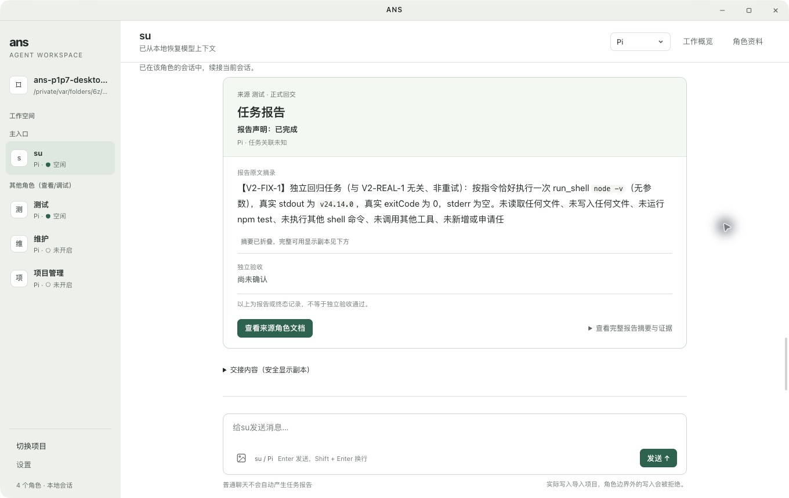

# ANS —— 受治理会话链路（CLI + 桌面应用）

<p align="center">
  
</p>

图标采用产品与 UI/UX 对照应用整体风格联合设计的「双括号字印」：暖灰底与炭灰图形
呼应工作台的浅色分区和克制线框，相向括号表达职责与授权边界，独立短横桥表达边界内的协作。
README 与桌面窗口、macOS 运行中 Dock 共用同一张透明背景 PNG。

一个**基于 role-first（RFSG），可选择 Pi、Codex 或 Claude 执行**的 agent 系统：
**role-first（RFSG）管「谁负责、允许改什么」，ANS 公共工具在执行前检查权限，所选引擎执行会话。**
它把「角色 + 边界」变成一次可审计、fail-closed 的会话：写入**在发生之前**被拦截，
边界（角色的 Section 1 写入白名单）是**唯一的写授权来源**；治理会话的落盘以**客户确认为前提**（确认制）。

## ANS 是什么

- **ANS 是一套受 [Role-First Software Governance（RFSG）](https://zenodo.org/records/22824700) 论文启发的
  AI 开发技能**（技能仓库名就叫 **ANS Skill**——它是个名字，**不是缩写**）。本仓库是把它落成一个
  **可运行的工具**：CLI（`ans`）与 Electron 桌面应用——**执行层可选 Pi、Codex 或 Claude**；CLI 另保留不调用模型的 demo。
- **它从 RFSG 吸收的三点**（技能 README 原文）：
  1. **先确定责任，再确定代码归属。** 先问谁对这项业务行为负责，再明确它需要哪些模块和文件。
  2. **按需广泛阅读，在授权范围内修改。** 排查时可以在实际读取权限内跨模块了解情况，当前上下文只加载任务需要的内容。
  3. **发现问题后，交给负责的角色处理。** 理解另一个模块的问题，不会自动获得修改它的权限。
- **在本项目里，这三点落成了**：**角色卡**（谁负责）+ **`boundary.yaml` 的 Section 1**（允许改什么）
  + **门禁**（在写之前拒绝越界）+ **跨角色协作规则**。论文出处：Wang, Zhongren. 2026.
  *Role-First Software Governance: Asymmetric Authority Boundaries for AI-Native Agent Systems*（DOI 10.5281/zenodo.22824700）。

## 这是什么

- **核心主张**：每个角色只能写它 Section 1（`角色卡/<角色>/boundary.yaml`）里列出的路径。
  完全越界的写、以及「边界内但不在本次任务 writeSet 内」的写，都在**写入之前被拒**，
  拒绝信息按根（`skill:` / `project:`）分组列出允许路径。凡不能确证的，一律 **fail-closed**：拒绝，而不是放行。
- **客户确认制**：治理会话（su）**写盘前**必须先用 `request_confirmation` 把预览（含**将要写出的具体路径**）
  摆给客户；客户确认后，编排把「预览里列出且校验在会话边界内」的路径**发行进本次会话的 writeSet**
  （未确认路径被 F4 拒）。**ANS 层的确认等待不设超时**，等待期间暂停该轮硬超时。原生引擎仍有上游限制：
  Claude MCP 约 24.8 天；Codex dynamicTools 的上游期限未建立，不能承诺无限等待。拒绝 / 通道不可用 → **不写**（fail-closed）。
- **分层**（相邻层单向调用）：
  **入口（装配）→ Interface → Pipeline → Service → Provider**；`Model` 为各层共享的冻结类型。
  入口只持有 Interface 层句柄（`runRoleCommand` / `governCommand`），不导入 Service/Provider 对象、
  不建「导入全部层」的中央工厂；下游模块按需**动态导入**。
- **两个前端，同一受治理核心**：CLI（`ans`）与桌面应用共用同一套 Pipeline / Service / Provider；
  治理会话引擎（`openGovernanceSession`）对二者是**同一个**（杜绝两份实现）。

## 桌面运行包与发布构建

运行包由 [Release 工作流](.github/workflows/release.yml)分别在 macOS arm64、macOS x64 和 Windows x64 原生环境生成 ZIP；解压后打开 `ANS Studio.app` 或 `ANS Studio.exe`，无需另外安装 Node.js。macOS 最低版本为 **13.0**，Windows 为 **10/11 x64**。运行包不包含开发机的密钥或会话，首次运行从左下角「设置」填写引擎配置；安装版配置保存在用户数据目录的 `.env`，开发启动继续使用仓库根 `.env`。

工作流默认生成待审核的 draft Release，全部平台验证后才发布到 [GitHub Releases](https://github.com/wangzhongren/ans-studio/releases)。当前构建来源为固定的 `v1.0.0` 加 manifest 明确列出的打包适配 overlay，既有 tag 不移动；每个平台同时提供来源、实际构建 tree、测试结果和 SHA256 清单。产物未签名、未公证，系统可能显示来源确认提示，下载后请先核对校验值。

维护者在 GitHub Actions 手动运行 `Build and verify release`，`source_ref` 固定 `v1.0.0`。本地可用 `npm ci`、`npm run package -- --mac --arm64 --publish never`（或匹配本机的 `--mac --x64` / `--win --x64`）构建，输出到 `release-output/`。实际发布要求匹配架构的包启动检查通过；跨平台生成文件不等于该平台已测试。

## 快速开始

运行环境：**Node ≥ 23.6**（本机验证 **v24.14.0**）。CLI **免构建**——`bin/ans.js` 直接
`import('../src/index.ts')`，由 Node 原生 TypeScript 类型擦除运行。**依赖仍需安装**：
`npm install`（固定安装 Pi `1.1.0`、Codex CLI `0.162.1`、Claude Agent SDK `0.3.299`、MCP `1.32.1`、Zod `4.6.7` 与 Anthropic SDK `0.93.0`；桌面另需 `electron`）。SDK 按选定引擎懒加载，help/doctor 不开启模型或原生会话。

### 桌面应用（主推路径）

```bash
npm install
npm run app        # 等价于 electron app/main.ts
```

桌面应用是一个**治理会话工作台**，已按产品与 UI/UX 确认的 V2 统一布局与交互：左侧为项目与角色导航，底部是「导入项目 / 切换项目」和「设置」；会话头部显示当前角色与上下文状态，右侧提供引擎选择、「工作概览」和「角色资料」。正文集中阅读，底部输入区分为消息编辑与操作两层。

1. **先导入文件夹，再选择引擎和角色。** 未导入项目时，引擎选择器禁用；导入后可选 **Pi、Codex、Claude**，默认 Pi。键盘方向键 / Home / End 移动候选，Enter 确认，Esc 取消。demo 只保留为 CLI 和测试入口。点击角色即可开启或续接会话；导入不扩大角色的写入边界，越界操作在聊天流内提示。
2. **检查引擎配置。** 选择 Claude 等引擎后，缺少必需配置会显示缺项提示及「打开 … 设置」按钮；点击打开对应配置抽屉，也可从左下角「设置」进入。秘密只显示是否已设置，开发模式保存到仓库根 `.env`，运行包保存到用户数据目录 `.env`；面板显示有效来源与应用状态，保存成功不代表账号或端点可连接。关闭抽屉回到实际入口并保留草稿；角色与引擎各自保留草稿。
3. **空文件夹从 su 开始。** 没有项目角色时，聊天空态引导与内置治理角色 **su** 对话。su 根据需求建立角色，左树随轮次结束刷新。写盘前，su 用聊天交互卡展示具体路径与预览；你同意后，编排才把边界内的已确认路径发行到本轮 writeSet。符合条件的治理写入完成后自动收尾，写入 `.ans/project.json`（SHA-256 pin）、治理边界文档和 `docs/bootstrap-manifest.md`；拒绝或通道不可用时不写、不收尾。详见「角色链」。
4. **普通聊天与正式任务分开。** 普通聊天不会自动生成「未报告」任务回交。su 通过 `dispatch_task` 将正式任务送入目标角色会话，未开启时自动开启，忙时排队；派发成功不等于完成，也不增加写权限。角色的 `submit_report` 报告与正式任务的实际终态回交按来源分别展示，并自动投递给 su；失败保留实际状态与可用的重试入口。报告声明「已完成」不等于独立验收通过。
5. **工作、确认与队列各有入口。** 「工作概览」分开显示当前工作、待处理请求、排队消息和最近回交；忙时手动消息也按到达顺序入队，可查看、撤回尚未执行项，或定位原交互卡。选择候选不会自动提交，需单独确认。忙碌时「停止本轮」只停止当前轮次，使旧决定失效，保留排队消息、草稿和资料。抽屉支持 Tab / Shift + Tab 循环与 Esc 关闭回焦。
6. **先读摘要，再查执行与来源。** 报告用浅绿信息头和白色正文分层呈现来源、类型、结论、摘要及真实关联；关联未知、错误和截断如实标明。完整安全摘要、原始交接及已关联回复原文可展开，不把展示副本当完整模型输入。工具按真实调用身份合并阶段，可展开查看目标、输出、错误与退出码；缺字段不猜测补全。报告来源按钮或「角色资料」进入可信文档清单，明确选择文件后阅读正文；返回保留阅读位置、展开状态、草稿与入口焦点。越界、不可读、非法 UTF-8 和超限文件明确拒读，文档按安全静态内容展示。
7. **历史与模型上下文分别说明。** 会话按 `<项目>/.ans/sessions/<角色>/<runtime>/` 隔离，`ans/index.json` 与 `ans/replay.jsonl` 保存 ANS 索引 / 回放，`native/` 保存对应引擎上下文；该目录已被 `.gitignore` 忽略。只有适配器确认原生恢复成功才标记「已恢复」；可读历史或文件存在不证明模型恢复。旧 Pi JSONL 仅用于 Pi 兼容，Codex / Claude 不用它恢复。应用关闭后未决确认失效。

输入区支持 **Enter 发送、Shift + Enter 换行**，忙时发送进入队列。可附加 png / jpeg / webp / gif 图片（单张 ≤ 5MB），图片与文字一并送进模型；主进程校验解码、魔数与限额，任一图片不合格则整条拒发，入队时定格附件。助手消息与角色文档按安全 Markdown 渲染（`html:false`）；左树状态区分未开启、空闲、工作中、等待确认、已停止、错误和已恢复。



设计与验收：[V2 设计规范](角色卡/UIUX设计师/docs/design/2026-10-15_design_visual-convergence.md)、[UIUX 落地评审](角色卡/UIUX设计师/docs/design/2026-10-15_design_visual-v2-implementation-review.md)、[真实桌面独立验证](角色卡/测试/docs/change/2026-10-15_change_visual-v2-independent-verification.md)。

### CLI

```bash
node bin/ans.js doctor                              # 装配自检（无需其余角色落盘）
node bin/ans.js role run 编排 --task T-1            # 受治理角色会话（默认 demo 假 runtime）
node bin/ans.js govern <空目录>                      # 真治理会话：对目标目录发起 bootstrap（确认走终端问答）
node bin/ans.js --help
```

### 两道门（交付前必过）

```bash
node --test "test/**/*.test.ts"   # 全量测试（实际结果以本次候选证据为准）
npm run typecheck                 # tsc --noEmit，零类型错误
```

> `test/*/*.test.ts` 这类**两层**写法会漏掉 `test/项目管理/shared/` 等**三层**路径，必须带引号走 Node glob。
> 部分无网络集成用例需要监听 `127.0.0.1`；限制本地 listen 的沙箱会返回 EPERM。首次失败和允许回环后的重测须分别保留。

## Pi 配置

**需要哪几项**（桌面面板键 == `.env` 键名；**3 项必填 + 1 项可选，收在「高级」里**）：

- **必填**——凭据（机密）：`ANTHROPIC_AUTH_TOKEN`（掩码）；
  非机密：`ANS_PI_BASE_URL`（**拒绝回落任何默认端点**，故必须显式给）、`ANS_PI_MODEL`。
- **可选、可留空**：`ANS_PI_CONTEXT_WINDOW`——**可选 + 保守默认**：留空 = 不下发该键，Pi适配器回落到
  默认 **`32768`**（缺失**不硬失败**，只在日志与事件流给一条可见提示）；知道确切值可用它覆盖。取 32768 是
  因为它须**严格大于** Pi 压缩的 `reserveTokens`（16384），否则压缩阈值 ≤ 0、几乎每轮都触发而退化；且宁可
  偏小（压缩提前，良性）不可偏大（窗口设大使长会话炸掉）。
- **`ANS_PI_PROVIDER` 不在面板里**：它在代码里**有默认值**（`ans-gateway`）、是**内部标签**，不是用户该做的
  决定；底层**仍支持该环境变量**（`resolvePiProviderConfig` 照读），只是不再占一个输入框——保存面板时也不写它
  （`.env` 里已有的那行原样保留）。

**从哪填**：

- **桌面**：导入项目后在引擎选择器选 Pi，再打开左下角「设置」 → **保存到仓库根 `.env`**。只改所选引擎的面板键、**保留注释与未知键**、原子写；
  token 字段掩码且**绝不回显**（只示「已设置 / 未设置」）；`ANS_PI_CONTEXT_WINDOW` 收在可折叠的「高级」里、
  **可留空**（留空 = 用保守默认）；面板给出应用状态。忙碌 Pi 轮次不换凭据，待所有旧 Pi 轮次结束后，在下一输入或重开时安全应用新配置。
- 桌面**启动时**会把仓库根 `.env` 载入 `process.env`（补上 Electron 进程缺失的 `--env-file`），
  之后 `resolvePiProviderConfig(opts, process.env)` 原样复用（单一来源，无第二份读取逻辑）。

**CLI 怎么读**（同一个 `.env` 文件）：

```bash
node --env-file=.env bin/ans.js role run 编排 --task T-1 --runtime pi
```

`.env` 已被 `.gitignore` 忽略；仓库只提供占位符 `.env.example`。凭据纪律见「安全与凭据」。

## Codex 与 Claude 配置

CLI 的 `role run` 和 `govern` 均支持 `--runtime demo|pi|codex|claude`；桌面正式选择器提供 Pi/Codex/Claude，设置抽屉随当前选择变化。配置保存方式沿用 `.env`；从 CLI 使用 `node --env-file=.env bin/ans.js …`。示例见 [`.env.example`](.env.example)，秘密值只留占位符。

| 引擎 | 必填 | 可选与默认 |
| --- | --- | --- |
| Pi | `ANTHROPIC_AUTH_TOKEN`、`ANS_PI_BASE_URL`、`ANS_PI_MODEL` | `ANS_PI_CONTEXT_WINDOW` 默认 32768；地址和模型没有默认值 |
| Codex | `CODEX_API_KEY`（可由 `OPENAI_API_KEY` 替代）、`ANS_CODEX_MODEL` | `ANS_CODEX_BASE_URL` 默认 `https://api.openai.com/v1`，自定义地址须兼容 Responses API |
| Claude | `ANTHROPIC_API_KEY` | `ANS_CLAUDE_MODEL`、`ANTHROPIC_BASE_URL` 留空使用 SDK 默认 |

Codex 使用固定 CLI 的 app-server JSON-RPC 运输和实验 dynamicTools ANS 代理；代理校验 thread/turn/call 身份后调用真实 MCP handler。它先检查有效配置并关闭全部 native MCP 和原生命令/浏览器等旁路，原生线程使用 read-only/never。这里没有 TS SDK 的审核 callback，也不读取全局登录状态。Claude 使用官方 Agent SDK 的进程内 MCP，只发布传入的 ANS 工具；原生 builtin tools 为空，未知工具拒绝。实际 CLI 的 bare 会抑制 SDK hooks，因此生产不使用 bare，而用 `settings.disableAllHooks:true` 禁用设置/插件 hooks 并保留显式 SDK callbacks。三引擎的实际写入均由核心 handler 在副作用前执行同一门禁。

Claude 必须使用 API key，不使用订阅/OAuth 回退。客户等待暂停 ANS prompt 计时，但 Claude 原生 MCP 仍有约 24.8 天硬上限；超时会失败并取消旧请求，不自动同意。Codex dynamic request 的上游期限未由当前协议建立，也不能承诺原生无限等待。原生上下文恢复只有引擎确认成功才标记“已恢复”；ANS 回放只是可读记录。新存储按 `.ans/sessions/<角色>/<runtime>/native` 与 `ans` 隔离，旧 Pi 记录由 Pi 适配器迁移。

正常安装和无网络协议/门禁测试的结果见 [装配验证](角色卡/装配/docs/change/2026-10-14_change_multi-runtime-assembly.md)。Claude 原生 hook/input 更新已用 bundled CLI `2.1.299`、假凭据和严格本地回环验证，详见 [原生验证](角色卡/Claude适配器/docs/fix/2026-10-14_fix_claude-native-hook-identity.md)。

## 验证现状（2026-10-15）

- **真实 Electron 桌面**：在 macOS 上以 1360×860、960×860 走查，覆盖导入前禁选、下拉键盘操作、Claude 缺配置入口、抽屉焦点与草稿保持、普通聊天、请求选择、队列撤回、停止、工具详情、来源文档阅读及正式派发 / 回交。
- **真实在线 Pi + p-limit 项目**：正式任务在隔离项目副本内实际运行 `npm test`，**31 项通过、退出码 0**，授权报告文档实际落盘；修复后的独立任务复验派发与回交，无额外匿名工具行。p-limit 四个业务文件在本轮界面验收中保持不变。普通聊天未产生任务报告。
- **全仓自动验证**：1385 项，**1384 通过、0 失败、1 跳过**（macOS 下的既有 Windows 专用路径用例）；`npm run typecheck` 与 diff 检查通过。独立 Electron 渲染、锚点与行距脚本通过。
- **范围**：在线模型验证为 Pi；Claude 的缺配置与设置入口经过真实桌面验证，Codex / Claude 的协议与适配器验证使用受控测试、本地回环等各自记录的方法，不等同于在线模型或全平台验收。不同原生走查步骤的实际候选版本见详细记录。

最终证据见[独立验证记录](角色卡/测试/docs/change/2026-10-15_change_visual-v2-independent-verification.md)与[版本 / 结果清单](角色卡/测试/docs/change/2026-10-15-visual-v2-implementation-evidence/final-verification.json)，整体验收见[项目管理报告](角色卡/项目管理/docs/change/2026-10-15_change_visual-convergence-implementation.md)。早期多运行时无网络接线结果仍保留在[历史验证](角色卡/测试/docs/change/2026-10-14_change_multi-runtime-independent-verification.md)，不作为当前结果。

## 角色链

- **客户 ↔ su**：`su` 是内置治理角色（id 由门禁引擎枚举给出，**代码不硬编码**）。桌面里 su 是主入口
  （置顶、默认选中）；其他角色保留可聊，定位为次级（查看 / 调试）。
- **su 主导的 bootstrap（有界创世）**：**导入空文件夹 → 与 su 对话 → su 请你确认（交互卡）→ 同意落盘 →
  自动收尾 → 项目转正**。空项目上 su 的写权限来自「项目根治理种子边界」，**只**允许 `角色卡/`、`docs/`、`.ans/`——
  写 `src/` 或项目根之外一律被拒。这是一次性、有界、条件化的创世授权，**不是** blanket；su 一旦写出项目
  自己的治理边界文档，创世授权**结构性自终止**，此后 su 改由该文档治理。
- **确认制（写盘的前提）**：预览（含将写出的路径）→ 你确认（桌面交互卡 / CLI 终端问答，`1` = 单选、
  `1,3` = 多选，空 = 拒）→ 编排把已预览且校验在边界内的路径发行进本次会话 writeSet → 写入照旧过门禁。
  **ANS 层不设确认等待超时**（等待时暂停该轮硬超时）；原生工具仍受上述 Claude/Codex 上游限制，不能承诺所有引擎无限等待。通道不可用 / EOF / 拒绝 → 不写。**当前只给治理角色 su**（设计登记 O-A2：
  其它角色要问客户时再开）；项目角色会话按自身 Section 1 + 任务 writeSet 受门禁约束。已知残留：
  确认保证的是「**路径**已确认」，「预览内容 ≠ 写出内容」的内容漂移**关不住**（客户已裁定不采纳内容哈希比对）。
- **自动收尾**：客户同意并写入后，su 一轮 settle 时由代码自动写 `.ans`(pin) + 治理边界文档 +
  `docs/bootstrap-manifest.md`；此后**每轮 su settle 自动重算 pin**，所以「加一个角色」不会让 pin 过时。收尾
  **不影响 su 后续工作**（仍可增删改角色）。
- **回交报告**：项目角色用 `submit_report`（结论 / 摘要 / 证据）交回结构化报告；正式任务的兜底终态回交与模型主动报告区分来源，普通聊天不自动产生「未报告」回交。
  桌面自动投递给 su 验收，报告、历史保存、目标输入保存和目标处理结果分别如实表达；失败保留，重试按实际允许状态提供。CLI 一次性前端暂无同等投递。
- **su 派发任务**：`dispatch_task` 把任务送进目标角色会话（未开会话自动开、忙则排队、回执写明队列位次）；
  **派发 ≠ 授权**——写权仍只来自目标角色自己的 Section 1。派发失败如实回报，不假设已开工。
- **文档纪律**：建角色时**文档面随边界一并授予**（feature-map / memo / changelog / functional-description /
  api-spec + docs 四目录 + 测试目录），且**代码与文档同批交回**；未通过 / 返工产物进 `temp/<角色>/`
  暂存区（附 `REVIEW.md` 记「谁退的 / 为什么 / 要求什么」）；**被门禁拒的写入不入 temp**（拒绝 = 零副作用）。
- **`ans init` 已废除**：建项目只保留 su 对话这一条路（CLI `ans govern` 与桌面 su 是**同一个治理会话引擎**的两个前端）。

## 命令表

| 命令 | 说明 |
| --- | --- |
| `ans role run <角色> --task <任务> [--runtime demo\|pi\|codex\|claude]` | 运行一个受治理角色会话（roleId 严格校验：未登记角色报「未知角色」并以 2 结束）。默认 `demo`（装配自有的演示假 runtime）；`--runtime pi|codex|claude` 使用所选受治理引擎，缺依赖或配置时非 0 退出，不自动切换引擎。 |
| `ans govern [<目录>] [--task <任务>] [--role <角色id>]… [--runtime demo\|pi\|codex\|claude]` | **治理会话**（CLI 前端，与桌面 su 同一引擎；未给选择时默认 Pi）。**接受目标目录**：对无 `.ans` 的 `<目录>` 发起 bootstrap（有界创世授权 + 确认制：终端问答 `y/放行` / 其它 = 拒）；同意并写入后**自动收尾**写 `.ans`(pin) + 治理边界文档 + manifest。缺省 = ans-cli 自身；目标目录不存在 / 非目录 → 码 2、明确报错（**不新建、不回退** ans-cli）。 |
| `ans doctor` | 装配自检：打印运行时及其来源、`projectRoot` / `skillRoot`、配置来源（`.ans` 或内置回退）、pin 来源、内嵌演示角色表。 |
| `ans help` | 用法（含当前运行时）。 |

`ans init` **不存在**（客户决定废除；现落到「未知命令」分支，退出码 2）。

运行时选择优先级：命令行 `--runtime` > 环境变量 `ANS_RUNTIME` > 命令默认（`role run` 为 `demo`，`govern` 为 `pi`；桌面默认 Pi，正式可选 Pi/Codex/Claude）。显式设置 `ANS_RUNTIME` 时会影响两个命令。

## 目录与职责

全项目共 **13 个角色**。CLI 无 `.ans` 时的内嵌回退登记原六个和运行时组的三个角色，引用各自真实边界；演示任务写集保持原来的单文件收窄。每个角色只写自己 Section 1（`角色卡/<角色>/boundary.yaml`）内列出的路径。

| 角色 | 主要路径 |
| --- | --- |
| **项目管理（pm）** | `src/common/shared/`（**跨角色共享组件，唯一属主**）、`test/项目管理/shared/`、`docs/scheduling/`、`docs/audit/`（条件 `shell-gate`）、`角色卡/项目管理/docs/**`（整体架构、全项目工程法案、设计 / 变更 / 修复记录） |
| **编排** | `src/interface/cli/run.ts`、`src/interface/cli/govern.ts`、`src/pipeline/orchestration/**`（含 `govern-session.ts` 唯一治理会话引擎、`pm-reviewer.ts`、`shell-arming.ts`）、`src/common/编排/**`、`test/编排/**` |
| **门禁引擎** | `src/model/boundary.ts`、`role.ts`、`decision.ts`（自身共享类型）、`src/service/gate/`、`role/`、`boundary/`、`shell/`（`resolve-role` / `resolve-boundary` / `resolve-write` / `shell-rules`）、`src/common/门禁引擎/**`、`test/门禁引擎/**` |
| **运行时核心** | `src/model/runtime.ts`、`src/service/runtime/session.ts`、`src/provider/runtime/`（公共工具、schema、store）、`src/common/runtime-core/`、`test/runtime-core/` |
| **Codex适配器** | `src/provider/codex/session.ts`、`src/common/codex-adapter/`、`test/codex-adapter/` |
| **Claude适配器** | `src/provider/claude/session.ts`、`src/common/claude-adapter/`、`test/claude-adapter/` |
| **Pi适配器** | `src/provider/pi/session.ts`、`src/provider/pi/tools.ts`、`src/common/pi-adapter/**`、`test/pi-adapter/**` |
| **桌面UI** | `app/renderer/`（桌面渲染前端：界面展示与交互，含 vendored 前端库）、`test/桌面应用/`（渲染侧用例） |
| **桌面窗口** | `app/main.ts`、`app/preload.cjs`、`app/desktop/`（Electron 主进程、窗口生命周期、preload 受限桥、桌面会话装配）、`test/桌面应用/`（窗口侧用例） |
| **测试** | `test/测试/**`（跨角色联调、完整流程与回归用例） |
| **装配** | `src/index.ts`、`bin/ans.js`、`package.json`、`tsconfig.json`、`README.md`、`.env` / `.env.example` / `.gitignore`、`src/common/装配/**`、`test/装配/**`、`.ans/`（条件 `project-init`） |
| **产品** | `角色卡/产品/**`（产品视角：把 CLI 与桌面客户端当整体做评审与提案；不写产品代码） |
| **UIUX设计师** | `角色卡/UIUX设计师/**`（桌面界面布局、交互方案、可检查的 HTML 设计原型与设计规范；设计产物由实现角色接入正式应用） |

- **共享组件 `src/common/shared/`**：跨角色共享的**单一来源**——`.ans` 载入器（`config-loader.ts`）、
  `.env` 读写（`env-file.ts`）、原子写（`atomic-write.ts`）、以及路径 / argv / runtime 原语
  （`path-primitives.ts`、`argv-primitives.ts`、`runtime-shared.ts`、`runtime-settings.ts`）。**属主 pm**；消费方（**装配、桌面窗口**）
  **只读导入、不得留第二份实现**，登记在 `角色卡/项目管理/docs/architecture/shared-components.md`。
- 层间调用方向：**入口（装配）→ Interface → Pipeline → Service → Provider**（`Model` 各层共享）；**仅相邻层可调用**。

## 安全与凭据

- 凭据**只**放 `.env`（已被 `.gitignore` 忽略），**绝不**写进任何入库文件；`.env.example` 只含占位符、可入库。
- 凭据**绝不回显**：桌面运行时设置对机密键恒返回空串，只给「已设置 / 未设置」；保存回报只含**键名**；
  日志 / 错误信息只记键名、不记值。
- `.env` 读写的**唯一实现**在共享模块：逐行解析、只替换命中键、保留注释与未知键、原子写（同目录临时文件 + rename）、失败显式报错。
- **持久化会话记录保留在项目内**：各引擎的 ANS 索引/回放与原生记录落在 `<项目>/.ans/sessions/<角色>/<runtime>/ans/` 和 `native/`；旧 Pi JSONL 只作 Pi 兼容。
  整个 `.ans/sessions/` 已 `.gitignore` 忽略，不会随 `git add .` 入库。
- 写入落盘在门禁之上还有一道 `writeRoot = projectRoot` 的硬收窄：门禁即便放行某条 **skill 根**的写，写层仍会拒绝
  （只可能更严，不会让边界之外的写通过——有意的纵深防御）。
- **边界文件格式**：只认 YAML（`role:` + `entries:`）。文件存在但 Section 1 解析为 0 条 → **响亮报错**
  （记为解析失败、拒一切写），不再静默成空集；给被拒写入的提示会带「本会话可能持有旧边界快照，请重开会话」
  线索——**边界修订需重开会话才生效**。

## 已知范围外 / 未验证

- **shell 闸（`run_shell`）**：**桌面已 arm**（(c) 规则集实件与 (a) 确认通道**两件同备才 arm**——缺件即不注册，
  能力缺席即 fail-closed）。**项目角色**走三层链：`run_shell` → **(c) 确定性硬地板**（明显危险 / 写类直接拒）
  → **(b) su 模型审读**（结论经 `report_shell_verdict` 工具交回；「危险」类即使 (b) 判放行也**必过 (a)**；
  拿不准 / 不可用 → 升 (a)；判拒 / 不可解析 ⇒ **直接拒绝、不打扰客户**）→
  **(a) 客户确认**（看命令原文放行 / 拒绝；关窗 / 不答 / 超时 = **不放行**，fail-closed）→ 执行
  （cwd 钉项目根、spawn 时剥离凭据环境变量、逐条审计留痕）。已授权项目的**精确常规检查**
  （窄匹配 `npm test` / `npm run typecheck` / 项目内 `node --test test/*.test.ts`）在 (b) 明确放行后
  **自动执行、不再逐条打扰**。**su 走只读档**（客户裁定「su 也要有 shell，但是只读」）：只接 (c)——
  命中只读白名单**直接放行执行**，`risky` / `review` / `deny` 一律拒；**不接 (b)/(a)**、
  不弹任何对话框（审读者不自审、不打扰客户）。
  **已知风险（如实登记）：无 OS 沙箱**——被放行的命令，其文件写入**不受写门禁约束**（靠 (c) 硬地板 + su 审读守卫）。
  **CLI 入口仍未 arm**（`src/index.ts` 不注入 `ShellGate` ⇒ `run_shell` 不注册、模型无 shell 能力）——
  启用须新的裁定，**不会自行生效**。
- **CLI 与桌面的差异**：CLI 无图形交互卡（确认走终端问答）、无回交/派发投递机（一次性会话，登记待议）、
  无任务队列显示；`ans govern` 的确认通道在无人值守（EOF）时 → 不完成、零副作用。
- **多任务派发引擎仍是二期**：su 可 `dispatch_task` **逐条**把任务送进角色队列，但
  「pm 产出派发计划 → 编排按拓扑序自动执行」的**多任务派发引擎未实现**。
- **模型行为与测试范围**：确定性门禁、确认、恢复和投递测试不证明模型在任意需求下都能正确建角色或完成代码任务。已完成的真实 Pi 桌面与 p-limit 验收见上方「验证现状」；Codex / Claude 在线任务、全平台表现及未在记录中实际执行的场景仍未验证。

本项目采用 MIT 许可证，详见 [LICENSE](LICENSE)。
