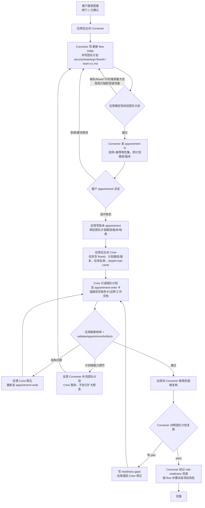
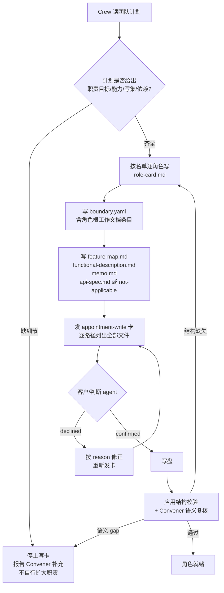
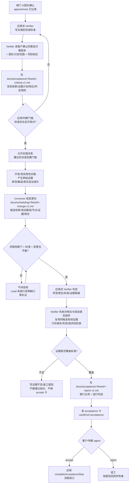

# 策划方案：优化治理分工第 1、3、5 项

（团队计划归统筹、Crew 只写卡；验收先写标准并按风险档位判定；Crew 写卡补齐能力与工作流描述）

- 日期：2026-10-22
- 角色：ANS 策划（Planning）
- 状态：**草案 v1（待闸门 1 方案确认）**；本文件是设计候选，**未实施、未测试、未验收**
- 风险档位：**T3（治理/权限变更）**。依据技能 `references/testing.md`「Risk-Based Verification and Change Packages」：治理或权限变更属于 T3，即使只改文档也不能压成 T0
- 闸门 0 依据：`docs/communication/2026-10-22_intent_governance-split-1-3-5.md`（客户已确认：只优化第 1、3、5 项；第 2、4 项及其余差异不改）
- 代码事实快照：2026-10-22 只读检索。文中 `path:line` 行号是检索时快照，实施时应以符号名和实际代码为准
- 标记约定：
  - **[现状]** 已核实的当前代码行为；
  - **[设计候选]** 本方案提议、尚未实施；
  - **[待客户决定]** 见 §13，方案不替客户拍板

---

## 1. 摘要

客户要求只优化 ANS 治理分工的第 1、3、5 项：

1. **第 1 项（团队计划归统筹）**：团队判断与团队计划从 Crew（Nominator）移到 Steward / 统筹（Convener）；Convener 写团队计划并发起客户任命卡（`cardKind=appointment`，闸门 2）；Crew 只读客户确认后的团队计划，写 `角色卡/<id>/**`，不再选角色、不改边界。
2. **第 5 项（Crew 写卡补内容）**：Crew 写卡时必须补齐能力描述、职责与功能导航、必读资料、交接输入输出、执行原则、`feature-map.md`、`functional-description.md`、必要时 `api-spec.md`、`memo.md` 和工作流说明；内容以团队计划为准，计划缺能力细节只报告 Convener 补充。
3. **第 3 项（验收先写标准、按风险档位判定）**：独立验收（Verifier）在实施前按客户确认的策划方案版本把完成标准写入 `docs/acceptance/`；实施后按同一版本判定 pass / rework / insufficient evidence；先核对 T0–T3 档位，按档位选择检查、复用同一候选的有效证据，全量回归只在 T3 或证据不足时执行；报告首行记录档位、依据、选定检查、复用证据和全量回归理由。

第 1 项与第 5 项是同一回路的两端（谁定计划、谁写卡、写什么），必须一起设计；第 3 项是验收侧变更，可独立实施，但同样属于 T3。

本方案不改变第 2 项（客户入口不唯一、多个治理角色可直接发客户卡）与第 4 项（派发权分散）。所有代码位置均为现状；所有行为变化均为设计候选，须经闸门 1、团队计划、闸门 2、实施和独立验收后才成立。

---

## 2. 基线与范围

### 2.1 需求基线与确认状态

| 项 | 状态 | 记录 |
| --- | --- | --- |
| 闸门 0：意图确认 | **已确认** | `docs/communication/2026-10-22_intent_governance-split-1-3-5.md` |
| 客户原话 | — | 「1，5优化，其他的暂时不改。」「3 也加一下」 |
| 本轮范围 | 第 1、3、5 项 | 同上「沟通的意图理解」 |
| 本轮非目标 | 第 2、4 项及其余差异 | 同上「暂不修改（客户明确）」 |
| 闸门 1：方案确认 | **待确认** | 本文件（提交沟通后由客户确认） |
| 闸门 2：角色指派/写集确认 | 未开始 | 本文件确认后由统筹写团队计划、沟通提交客户 |
| 实施授权 | 未给 | 闸门 1、闸门 2 通过后另行取得 |

本轮是治理/权限变更（角色职责、写权、流程步骤、任命卡发起人都变），按 **T3** 管理，需要：策划方案（本文件）→ 闸门 1 → 统筹团队计划 → 闸门 2 → 实施 → 独立测试 → 独立验收。未确认前不改代码。

### 2.2 验收基线

客户在**闸门 1**确认的**本文件版本**是后续独立验收的基线。独立验收在实施前基于该版本把正式完成标准写入 `docs/acceptance/`；本文件 §11 的完成标准是方案自带的可核对标准，供闸门 1 确认和验收引用，**不是**正式验收结论或验收文档。团队计划、角色指派和实现安排都不是验收基线。

### 2.3 范围边界

**本轮必须覆盖：**

- 第 1 项：团队计划产物、Convener 发起 appointment、Crew 只写卡、客户决定后应用把计划+名单交给 Crew、Crew 完成后校验并派 Convener、流程步骤/账本/写权/UI 同步。
- 第 5 项：角色卡与配套工作文档的必填内容、确定性结构校验、能力语义复核、计划缺细节时的报告回路。
- 第 3 项：实施前完成标准、T0–T3 风险档位、同一候选证据复用、按档位选择检查、报告首行五项、Verifier 与测试角色边界、acceptance 卡与账本记录。

**本轮明确不改：**

- 第 2 项：客户入口不唯一（多个治理角色可直接发客户卡）——不改。
- 第 4 项：派发权分散（Convener/Liaison/应用都能派）——不改；本方案不新增或转移派发权。
- 角色命名/内部 id/路径（`liaison` / `rapporteur` / `nominator` / `convener` / `verifier` 及其显示名）——不改；仅更新与第 1、3 项直接相关的角色卡文本和 UI 文案。
- 其他与第 1、3、5 项无关的治理结构、验收流程差异——不改。
- 工程法案既有 `ENGINEERING_QUALITY_BASELINE` 的文本（含「验收前必须真实启动应用并演示」）——不改；只改证据来源和核对方式（见 §7.5）。

---

## 3. 现状（已核实的事实）

以下事实均来自 2026-10-22 只读检索；不表示本方案已改变它们。

### 3.1 第 1 项相关现状

| # | 事实 | 证据 |
| --- | --- | --- |
| 1-1 | Nominator（Crew）卡同时拥有「提名权——选择角色、组建团队」和写卡；工作流是「读提案与流程 → 提名 → 任命卡 → appointment-write 逐路径写卡 → 角色就绪」。 | `src/common/门禁引擎/governance-roles.ts:325-428`（提名权 `:328`；工作流 `:336-341`） |
| 1-2 | Convener（Steward）卡明确「你不写角色卡、不创建角色；角色由 Crew 在任命决定后经 appointment-write 写入」。 | `src/common/门禁引擎/governance-roles.ts:430-544`（`:444-446`） |
| 1-3 | Convener 卡明确「Steward 不用 request_choice 出治理卡」，其确认卡只允许 `schedule-write` / `write`。 | `src/common/门禁引擎/governance-roles.ts:464-466` |
| 1-4 | 注册表写权：Nominator 有 `角色卡/`、`docs/nominations/`、`docs/skills/`、`docs/mcp/`、`docs/governance/nominator/`；Convener 只有 `docs/flows/`、`docs/workflow.md`、`docs/governance/convener/`，并禁写 `docs/nominations/`、`角色卡/`。 | `src/common/门禁引擎/governance-roles.ts:693-755`（Nominator entries `:693-699`、Convener entries `:730-734`、禁写 `:736-743`） |
| 1-5 | 客户任命卡由 Nominator 用 `request_choice(cardKind=appointment)` 发出；候选选项是项目角色 id；判断上下文从 `docs/nominations/<flowId>-v1.md` 解析推荐集。 | `src/pipeline/orchestration/run-role.ts:2323-2381`（`judgeArtifactsForCard` appointment→nomination `:2354-2355`）、`:2423-2431`（读提名文件解析推荐集） |
| 1-6 | appointment 决定由应用推导为「派 Convener 排程」；若目标角色未写出，先派 Nominator 用 appointment-write 写卡，写完再派 Convener。 | `app/desktop/governance-advance.ts:673-677`（appointment→convener）、`:810-816`（写卡补救任务）；`app/desktop/interface.ts:2941-3036`（任命后先写卡再派 Convener） |
| 1-7 | 写卡后的确定性校验 `validateAppointmentArtifacts` 只检查：`role-card.md` 存在/非空/有 Markdown 标题；`boundary.yaml` 可解析、顶层 `role` 与目录一致、`entries` 非空；外加 `listProject` 警告。 | `app/desktop/interface.ts:1784-1858` |
| 1-8 | 流 YAML 的步骤 `kind` 只有 `dispatch` / `customer-decision` / `artifact` / `acceptance`，它们是**证据种类**，不是角色/职责枚举；Model 里另有一个未被运行时代码消费的旧类型 `GovernanceStepKind = proposal / nomination / dispatch / acceptance`。 | `src/common/编排/flow-state.ts:26-34`；`src/model/runtime.ts:221` |
| 1-9 | `flow-service.ts` 的 `artifactPowerOf` 把 owner 映射为账本 power：liaison/rapporteur/nominator/convener/verifier → 各自职能，其他 → project。 | `src/common/编排/flow-service.ts:751-767` |
| 1-10 | 写路径路由把 `docs/nominations/**` 路由为 `write-nomination`（只允许 nominator），把 `角色卡/<id>/**` 路由为 `write-role-card`（也只允许 nominator）。 | `src/pipeline/orchestration/run-role.ts:1778-1805`；`src/common/编排/governance-gate.ts:84-92` |
| 1-11 | 内置角色允许的 choice 卡种：nominator 含 `appointment`；convener 不含 `appointment`，且 choice 卡默认卡种对 convener 不猜。 | `src/pipeline/orchestration/run-role.ts:1988-1997`、`:1858-1875` |
| 1-12 | 任命决定的账本 `power` 来自发起卡的治理角色职能；当前由 Nominator 发起，所以是 `nomination`；`findDecisionArtifact` 把 appointment 决定的 `artifactPath` 绑定到 `docs/nominations` 最新版本。 | `src/pipeline/orchestration/run-role.ts:2185`、`:2243-2246` |

### 3.2 第 3 项相关现状

| # | 事实 | 证据 |
| --- | --- | --- |
| 3-1 | Verifier 卡的标准工作流是「读流程/提案/契约 → 用审批档 shell 真实跑测试 → 真实启动应用并演示 → 逐条核对 → 发验收卡」；写区只有 `docs/verification/`、`docs/governance/verifier/`。 | `src/common/门禁引擎/governance-roles.ts:546-609`（工作流 `:555-562`；写区 `:583-584`；注册表 `:761-766`） |
| 3-2 | 应用只在流程收尾门通过后自动派 Verifier；没有「实施前先派 Verifier 写完成标准」的触发。 | `app/desktop/interface.ts:1469-1691`（`dispatchAcceptanceForFlow`） |
| 3-3 | 验收任务消息硬编码要求 Verifier 自己按质量基线逐项核对、自己真实启动/演示、把演示证据写入 `docs/verification/<flowId>-v1.md`。 | `app/desktop/governance-advance.ts:474-496` |
| 3-4 | 验收卡的机械门槛只核对流程收尾门（YAML 收尾/证据对账）；不要求实施前标准文件，也不要求风险档位。 | `src/common/编排/governance-judge.ts:197-259` |
| 3-5 | 判断上下文的规范物证只有 `proposalPath` / `nominationPath` / `flowPath`；acceptance 卡要求 proposal + flow，不要求 `docs/acceptance/` 标准或报告。 | `src/model/runtime.ts:1261`；`src/common/编排/governance-judge-facts.ts:209-275`；`src/common/编排/governance-judge-evidence.ts:698-711` |
| 3-6 | 工程法案 §二.9 已固化「验收先判风险档位」：统筹在变更包标注 T0–T3；验收先核对档位并记录；T0 只查文档、T1 只跑受影响单测、T2 补受影响集成、全量回归只在 T3 或证据不足时执行；报告首行五项。 | `角色卡/项目管理/docs/project-rules.md:48` |
| 3-7 | 工程质量基线要求「验收前必须真实启动应用并演示」，五张内置治理角色卡逐字复用；该基线未区分证据由谁生产。 | `src/common/门禁引擎/governance-roles.ts:155-167`（交付条 `:166`） |
| 3-8 | 当前没有风险档位字段/账本事件；`qualityTier` 是 `prototype` / `production` 的质量档位，**不是** T0–T3 风险档位。 | `src/common/编排/flow-state.ts:22-24`、`:131-141` |

### 3.3 第 5 项相关现状

| # | 事实 | 证据 |
| --- | --- | --- |
| 5-1 | Nominator 的写卡要求集中在 `role-card.md` 存在/非空/标题、`boundary.yaml` schema 与 `validateAppointmentArtifacts`；没有完整能力/工作流描述清单。 | `src/common/门禁引擎/governance-roles.ts:362-381`；`app/desktop/interface.ts:1784-1858` |
| 5-2 | 技能角色卡模板要求：工作立场、系统功能导航、必读资料、执行原则、质量约束、执行检查点；配套文件 `functional-description.md`、`api-spec.md`（不适用时记 `not-applicable` 理由）、`memo.md`、`feature-map.md`；每个 worker 角色的 Section 1 必须显式覆盖角色根目录的工作文档。 | 技能 `references/role-card.md`（模板与 Deliverables、Work-document permissions 节） |
| 5-3 | 当前项目的 worker 角色实际已有这些文件（例如 `角色卡/运行时核心/` 下 role-card、boundary、feature-map、functional-description、api-spec、memo），但 Crew 卡没有要求逐项产出/校验。 | `角色卡/运行时核心/` 目录；`角色卡/运行时核心/role-card.md` |
| 5-4 | `validateAppointmentArtifacts` 只做结构最低门槛；「文件存在」不等于「能力描述已完成」。 | `app/desktop/interface.ts:1801-1855` |

---

## 4. 目标与完整流程

### 4.1 角色职责总览（目标）

| 产物/动作 | Convener（Steward / 统筹） | Crew（Nominator / 组队） | Verifier（Proof / 验收） | 应用 | 客户 |
| --- | --- | --- | --- | --- | --- |
| 团队计划（角色清单、职责、写集、依赖、推荐集） | **写**（`docs/scheduling/`） | 只读 | 只读（验收时了解范围，不作标准来源） | 校验、读取、绑定 | 通过 appointment 确认角色指派 |
| appointment 卡（闸门 2） | **发**（`request_choice`，`cardKind=appointment`） | 不发 | 不发 | 呈现/记录决定/把计划+名单交 Crew | 选择/拒绝 |
| 角色卡与边界 | **不写**、不创建角色 | **写**（`appointment-write` 逐路径确认） | 不写 | 确定性校验、刷新枚举、派 Convener | 写盘确认 |
| 角色能力语义复核 | **做**（对照团队计划写 readiness 记录） | 按 gap 修正 | 不代替 | 读 readiness、路由 gap | — |
| 完成标准（实施前） | 只读 | 只读 | **写**（`docs/acceptance/`） | 触发、门槛、绑版本 | — |
| 实现/测试原始证据 | 收齐、组变更包 | 提供角色卡侧证据 | 核对、按档位补证 | 记录/派发/汇总 | — |
| 验收报告与 acceptance 卡 | 不写、不发 | 不写、不发 | **写报告、发卡** | 机械核对、派发、收口 | 验收决定 |
| 风险档位 | 在团队计划/变更包标注 | 不标 | **先核对并记录**；可升档 | 读取、传入判断/报告 | — |

### 4.2 第 1 项完整流程（团队计划 → appointment → Crew 写卡 → Convener 排程）



**步骤表：**

| 序 | 触发 | 角色 | 输入 | 输出/动作 | 成功 | 失败/阻塞分支 |
| --- | --- | --- | --- | --- | --- | --- |
| 1 | 客户接受提案（闸门 1） | 应用 → Convener | 客户确认的提案版本、flowId、意图 | 后台打开 Convener，投递唯一一条任务：写 flow YAML + 团队计划，然后发 appointment 卡 | Convener 产出 flow YAML 与团队计划，卡片待客户 | Convener 未写出/校验失败：应用不弹卡，系统行给 Lead，等 Convener 修正；不循环重试 |
| 2 | Convener 调用 `request_choice(cardKind=appointment)` | Convener → 应用 | 团队计划路径/版本、推荐集、flowId、`stepId=role-cards` | 应用在**触达客户前**确定性校验：计划存在、flowId 一致、推荐集非空且不含内置角色、每个推荐角色有职责/写集/依赖行、卡选项与推荐集一致 | 卡片呈现给客户（镜像主入口） | 校验失败：不生成客户卡、不镜像、不写账本、不判断；把具体问题退回 Convener 修正 |
| 3 | 客户作答 appointment | 应用 | 客户选中的角色 id | 写 `customer.decision{decisionKind:"appointment", targetRoleIds}`；`artifactPath/artifactVersion/artifactSha256` 绑定团队计划；派 Crew（不是 Convener） | Crew 收到写卡任务 | 客户拒绝/取消：记账 `unclassified/none`，不派 Crew；Convener 按反馈修订计划（v2）并重发卡 |
| 4 | Crew 收到写卡任务 | Crew | 团队计划、任命名单、flow YAML、flowId、stepId | 读计划；只对名单内角色发 `appointment-write` 确认卡，逐路径写 role-card/boundary/feature-map/functional-description/memo/api-spec（或 not-applicable）及工作流说明；boundary 内容严格按团队计划写集，不自行增删；不改计划/其他角色 | 卡片确认后写盘完成 | `appointment-write` 被 declined：按 reason 修正后重新发卡；计划缺能力细节：停止写卡，报告 Convener 补充，不自行扩大职责 |
| 5 | Crew 写盘完成 | 应用 | 文件、listing、账本 appointment 决定 | 强制刷新 listing；跑 `validateAppointmentArtifacts`（结构+必填工作文档）；问题按来源分流：Crew 文件 → Crew；团队计划 → Convener | 通过则派 Convener | 结构问题：反馈 Crew 修正，重发 appointment-write；重试有界，最终失败落 Lead 系统行，不派 Convener |
| 6 | 应用派 Convener | 应用 → Convener | 已通过校验的角色卡、团队计划、flow YAML | Convener 逐角色对照计划写 `role-readiness` 记录（pass/gaps） | pass：标记步骤完成并派发项目角色 | gaps：应用把 gap 退回 Crew 修正；Convener 不直接派发、不代写卡 |
| 7 | Convener 派发 | Convener | flow YAML 中已批准步骤 | `dispatch_task` 项目角色（不是治理角色） | 实施开始 | 目标未任命/未写卡：门禁拒绝；回到第 4-6 步 |

**必须说明的回路（当前最容易漏）：** 现状是 Nominator 发 appointment 卡，客户决定自然回到 Nominator，所以应用只需在 appointment 决定后派 Convener。拆开后，卡片在 Convener 会话里结算，**客户决定不会自动回到 Crew**；应用必须在 `deriveGovernanceNextStep`/`advanceGovernanceFlow` 中显式把 appointment 决定转换为「派 Crew 写卡」任务，并用账本+运行期双重去重保证重启/重复事件不重复派、也不漏派。具体设计见 §5.3。

### 4.3 第 5 项完整流程（Crew 写卡内容）

第 5 项是第 1 项第 4-6 步的展开：



### 4.4 第 3 项完整流程（实施前标准 → 实施证据 → 按档位判定）



**步骤表：**

| 序 | 触发 | 角色 | 输入 | 输出/动作 | 成功 | 失败/阻塞分支 |
| --- | --- | --- | --- | --- | --- | --- |
| 1 | appointment 决定已记录（闸门 2 等价） | 应用 → Verifier | 客户确认的策划方案版本、团队计划、flowId、风险档位 | 派 Verifier 写完成标准（不是验收卡） | `docs/acceptance/<flowId>-criteria-v1.md` 落盘 | 方案版本/团队计划缺失：应用不派，Lead 系统行；Verifier 退回策划补充，不自造标准 |
| 2 | 标准已落盘 | 应用 | 标准文件 | 建议在实施派发前做确定性门槛：标准存在、flowId 一致、含验收表/档位/判定规则 | 允许实施派发 | 标准缺失：拒绝实施派发或由 Convener 先安排写标准；不把「待补」当通过 |
| 3 | 实施/测试完成 | 开发/测试角色 → Convener | 当前候选、改动路径、任务节点、原始证据、风险档位 | 角色交原始证据；Convener 组变更包并写 `docs/scheduling/<flowId>-change-v1.md` | 变更包完整、候选哈希可复算 | 候选不清/证据缺失/档位未标：不派验收；补证或退回 |
| 4 | 收尾门 + 标准 + 变更包齐备 | 应用 → Verifier | 变更包、标准、证据链接、flow YAML | 派 Verifier 判定 | Verifier 出具报告 | 流程未齐备：应用不派，Lead 系统行；不循环 |
| 5 | Verifier 核对 | Verifier | 标准、变更包、原始证据 | 先核对档位；复用同候选有效证据；按档位选检查，只补缺失/失效/高风险；真实启动/演示证据必须存在 | 逐行 pass/fail/insufficient evidence | 证据不足：报告写 insufficient evidence 并列出缺什么；不弹 accept 卡 |
| 6 | 判定完成 | Verifier → 应用 | 报告、标准版本/哈希、候选 | 发 `request_choice(cardKind=acceptance, accept/reject)`；报告写 `docs/acceptance/` | 客户/判断 agent 决定 | 拒收/返工：按报告回到所有者；不把工具成功当通过 |
| 7 | accept | 应用 | 账本验收决定 | `completeAcceptanceStep` 收口；账本记录验收决定 | 流程完成 | 候选变化/报告过期：结论失效，重新判定受影响部分 |

### 4.5 端到端闸门顺序

| 阶段 | 入口 | 出口 | 本方案相关动作 |
| --- | --- | --- | --- |
| 闸门 0 意图确认 | 客户提出 1/3/5 | 客户确认意图记录 | 已完成 |
| 闸门 1 方案确认 | 本文件交沟通 | 客户确认本文件版本 | 本文件当前状态 |
| 团队计划 | 闸门 1 确认 | `docs/scheduling/` 团队计划 | 统筹写计划，含角色/写集/档位/依赖 |
| 闸门 2 角色指派 | 团队计划写盘 | 客户确认参与角色/范围/写集 | Convener 发 appointment 卡（本方案第 1 项） |
| 实施前标准 | 闸门 2 确认 | `docs/acceptance/<flowId>-criteria-v1.md` | Verifier 写标准（第 3 项） |
| 实施 | 标准+授权+预留 | 候选+原始证据 | Crew 写卡（第 1/5 项）后再派实施 |
| 验收 | 收尾门+标准+变更包 | 通过/返工/证据不足 | Verifier 按档位判定（第 3 项） |
| 交付 | 验收通过 | 客户回报 | 验收通过不授权提交/推送/发布 |

---

## 5. 第 1 项详细设计：团队计划归统筹，Crew 只写卡

### 5.1 团队计划产物

**推荐路径：`docs/scheduling/<flowId>-team-v1.md`（v2…）。**

理由：

1. 技能默认把统筹调度的工作范围定为 `docs/scheduling/`，团队计划本来就属于调度产物。
2. 与 `docs/proposals/<flowId>-v1.md`、`docs/nominations/<flowId>-v1.md` 的「flowId + 版本」命名一致，便于应用按 flowId 精确派生路径、绑定版本和哈希，不扫描目录猜测。
3. 与验收标准、变更包同属调度侧可追溯产物，便于变更包引用。
4. 不与提案（Draft 写区）、角色卡（Crew 写区）混在一起，职责清晰。

**备选 B：复用 `docs/nominations/<flowId>-v1.md`。** 优点是可复用现有判断物证和 `latestVersionedArtifact` 解析；缺点是语义仍是「提名」，作者会变成 Convener，与「Crew 只写卡」冲突；且 Convener 当前禁写 `docs/nominations/`，必须改禁写表。若客户希望最小代码改动，可作为过渡，但不推荐作为长期结构。

**备选 C：`docs/governance/convener/<flowId>-team-v1.md`。** 优点是不用给 Convener 增加新目录；缺点是不符合技能默认的团队计划位置，其他角色/验收不易发现，且与 Convener 的治理工作记录混在一起。不推荐。

**团队计划格式（设计候选）：**

```markdown
---
flowId: <flowId>
version: 1
status: draft            # 人读字段；客户确认以账本 appointment 决定为准
riskTier: T3             # T0–T3；与 qualityTier 无关
recommended: [role-a, role-b]
---

# 团队计划：<flowId>

## 1. 判断结果
不变 / 改边界 / 拆分 / 新增 / 合并；依据（客户确认的方案版本、架构、现状、工作量）。

## 2. 参与角色与职责
| roleId | 类型 | 职责目标 | 能力要求 | 唯一写集 | 依赖 | 组别 | apiSpec |
| --- | --- | --- | --- | --- | --- | --- | --- |
| role-a | new / existing / changed | … | … | 精确路径/目录 | … | … | required / not-applicable + 理由 |

## 3. Section 1 覆盖图与写集
逐角色列精确写入边界；声明不重叠；列出与现有角色的边界变化。

## 4. 角色调整方案（如需）
新建/修改/拆分/合并的精确清单；无调整时写「不变」。

## 5. 验证与证据安排
每个角色的验证办法、需要产出的原始证据、真实启动/演示责任。

## 6. 客户确认状态（闸门 2）
以 `docs/communication/` 的确认记录为准；本文件不自行宣称客户已确认。

## 7. 风险档位与理由
T0–T3、依据、是否预期全量回归。
```

**机器可读字段的硬要求：**

- `flowId` 必须与文件名、flow YAML、appointment 卡一致。
- `recommended` 必须是**同一行内联数组**（`recommended: [role-a, role-b]`）或固定行 `推荐：role-a、role-b`，与现有 `parseRecommendedRoleIds` 兼容；不要用 YAML 块数组（`- role-a`），现有解析器只按行解析，会得到空推荐集并回落手动。
- `version` 是正整数；新版本写 `-team-v2.md`，不原地改已确认版本。
- `riskTier` 是 T0–T3 之一；团队计划阶段可以先标计划档位，候选阶段由变更包复核（见 §7.3）。
- 角色行必须给出 `roleId`、职责目标、能力要求、唯一写集、依赖；缺任一项视为计划不完整，不能发 appointment 卡。

**谁写、谁读：**

- **写**：Convener（唯一作者）。
- **读**：Crew（写卡依据）、应用/判断 agent（卡片物证与版本绑定）、Verifier（了解范围与写集，但**不是**验收标准来源）、Lead（可见性）。
- **客户**：通过 appointment 卡查看计划摘要并选择角色；客户确认的是角色指派，不是把团队计划变成验收基线。
- **确认记录**：团队计划的 `status` 不是客户确认；产品内以账本 appointment 决定作为机器记录，项目管理层仍按技能把闸门 2 确认记录写入 `docs/communication/`。

### 5.2 角色职责与写权

**Convener（Steward / 统筹）**

- 新增职责：判断团队、写团队计划、发起 appointment 卡、在 Crew 写卡后做角色就绪复核（readiness）。
- 保留职责：写 flow YAML、`docs/workflow.md`、治理工作记录；派发项目角色；收证据。
- 明确不改：仍**不写角色卡、不创建角色**；仍只派项目角色，不派治理角色；仍不用 `request_choice` 做 appointment 以外的客户选择（本方案只新增 appointment 一种治理选择卡）。

**Crew（Nominator / 组队）**

- 新职责：读取客户确认后的团队计划；按任命名单写角色卡/边界/配套工作文档；发 appointment-write 确认卡；写完后交应用校验。
- 移除职责：不再选择角色、不再组建团队、不再写 `docs/nominations/**`、不再发 appointment 卡、不改团队计划中的边界决定/写集（boundary 文件本身按计划写，但不自行增删）。
- 保留职责：技能/MCP 安装能力（与本项无关）；写 `角色卡/**`（仍须 appointment + 写盘确认）。
- 明确不改：内部 id、显示名、`GovernanceFunction="nomination"` 保持（避免本轮做角色重命名）；只在卡文本和 UI 提示中更新语义说明。

**写权前后对照（仅列本项涉及的角色）：**

| 角色 | 现状 entries | 设计候选 entries | 现状禁写（新增/保留） | 说明 |
| --- | --- | --- | --- | --- |
| Convener | `docs/flows/`、`docs/workflow.md`、`docs/governance/convener/` | **增加 `docs/scheduling/`**；其余不变 | 保留 `角色卡/`、`docs/proposals/`、`docs/nominations/`、`docs/skills/`、`docs/mcp/` | 只增加团队计划/readiness/变更包写区；不获得角色卡写权 |
| Crew | `角色卡/`、`docs/nominations/`、`docs/skills/`、`docs/mcp/`、`docs/governance/nominator/` | **移除 `docs/nominations/`**；其余不变 | 增加 `docs/scheduling/`（防止改计划） | 仍保留 `角色卡/` 写卡权；不获得团队计划写权 |
| Verifier | `docs/verification/`、`docs/governance/verifier/` | 见第 3 项，增加 `docs/acceptance/` | 保留既有禁写 | 只增加验收标准/报告写区 |
| Lead / Rapporteur | 不变 | 不变 | 不变 | 不扩大其他角色写权 |

**边界纪律：**

- 不为 Convener 增加 `角色卡/` 写权；不为 Crew 增加 `docs/scheduling/` 写权。
- 不改变 Liaison/Rapporteur/Verifier 的其他写权（Verifier 的第 3 项变更是独立的一处）。
- `docs/scheduling/` 在受治理项目中可能同时被项目自己的调度/记录使用；团队计划必须声明唯一写入者（Convener）和文件命名，避免与 `task_ops` 记录或其他角色重叠。若项目已有自己的调度角色，团队计划必须先列明重叠和处理方式（本方案不替项目决定）。

### 5.3 appointment 卡与客户决定后的应用回路

**发起人：Convener（推荐）。**

理由：

1. 团队判断与团队计划是统筹的职责；任命卡是客户对团队计划的确认，由计划作者发起最自然。
2. 客户拒绝/要求修改时，决定回到 Convener，Convener 可以直接修订团队计划并发新版；不需要跨角色转交。
3. Crew 只写卡，符合第 1 项目标；若 Crew 发任命卡，它仍在选择角色，目标没有实现。
4. 与技能流程「统筹写团队计划 → 闸门 2 客户确认角色指派」一致。

**备选：** 仍由 Crew 发 appointment 卡（现状）——代码改动最小，但违背第 1 项；应用代发——会把治理决定从角色职责中抽走，且无法让计划作者自然接收拒绝反馈，不推荐。

**卡片内容（设计候选）：**

- `request_choice`，`cardKind=appointment`，`flowId=<flowId>`，`stepId=role-cards`（显式，供账本/流程步骤去重）。
- `multiple=true`（推荐角色多于一个时）。
- 选项 id = 团队计划 `recommended` 集合中的项目角色 id；每个选项 label/description 写角色名、职责目标、写集摘要。
- 标题/预览：说明这是客户对团队计划的确认（闸门 2），列出计划路径/版本、角色清单、每个角色的职责与写集摘要；声明「不选/拒绝则计划退回 Convener 修订」。
- 不包含内置治理角色 id；不包含 `su`。

**应用在呈现卡之前的确定性守卫（推荐新增）：**

在 `run-role.ts` 的治理卡包装器中、`raw` 客户通道之前，对 Convener 的 `request_choice cardKind=appointment` 做与确认卡同级的严格校验：

1. `flowId` 合法；
2. 团队计划存在且可读；
3. 计划 frontmatter `flowId` 与卡片一致；
4. `recommended` 非空、无重复、不含内置治理角色；
5. 卡片选项覆盖 `recommended` 且不包含内置角色；
6. 计划包含每个推荐角色的职责目标/能力要求/写集/依赖行（缺任一项 → 计划不完整）。

失败时：**不生成客户卡、不镜像、不调判断、不写账本、不占 pending**，把具体问题退回 Convener 修正。这与 2026-10-22 已落地的「无效治理卡守卫」同一口径（缺项不呈现、直接退回）。

**客户 appointment 决定后的应用动作（最关键回路）：**

1. `deriveGovernanceNextStep` 对 `cardKind="appointment"` 不再返回 `schedule/convener`，而是返回一个**明确的 Crew 写卡下一步**（建议新增 `nextFunction="role-card-write"` / `roleId="nominator"`，或沿用 `"nomination"` 但文案改为「写卡」；选项见 §5.3 与 §13）。
2. `advanceGovernanceFlow` 在 appointment 决定后：
   - 先等来源 Convener 本轮 settle（沿用现有 `waitForRoleSettle`）；
   - 强制刷新 listing；
   - 读账本最新 appointment 决定，取 `targetRoleIds` 和团队计划路径（优先账本 `artifactPath`；缺失时按 flowId 派生最新 `-team-vN.md`；仅 legacy 才回落 nomination，绝不猜）；
   - 后台打开 Crew，投递唯一一条写卡任务；
   - 任务文本必须包含：flowId、团队计划路径/版本、任命名单、`stepId=role-cards`、只写名单内角色、逐路径确认、计划缺细节报告 Convener、不自行扩大职责；
   - 投递成功后写 `dispatch.accepted{actorRoleId:"app", power:"app", targetRoleId:"nominator", stepId:"role-cards", trigger:"customer-decision"}`。
3. **去重与重启恢复（双重）：**
   - 运行期 Set 键：`<projectRoot>\0<flowId>\0appointment-crew`，投递前占位、成功保留、失败释放；
   - 账本键：同一 flowId 已有 `dispatch.accepted{targetRoleId:"nominator", stepId:"role-cards"}` ⇒ 不重复派；
   - 若 Crew 尚未写出角色卡，后续 `runPostWriteAdvanceCheck`/导入检查可以在账本 appointment 决定后重新派写卡任务（有界，不循环）；已经写过的不重复。
4. **不是派 Convener。** appointment 决定后直接派 Convener 会让它在角色未写出时反复报「未枚举」；现状代码已经有「先派 Nominator 写卡、再派 Convener」的补救逻辑（`interface.ts:2941-3036`），本方案把它从「补救」提升为「主路径」，只是发起人从 Nominator 的 appointment 卡改为 Convener 的 appointment 卡。
5. **客户拒绝/取消：** 不派 Crew；`customer.decision` 记 `unclassified/none`；Convener 收到 declined 原因，修订团队计划（v2）后重发 appointment 卡；应用不自动重发、不猜客户意图。
6. **客户手选与推荐集不同：** 判断代批只允许选择恰等于推荐集；客户手选可以不同。应用按实际选择记录 `targetRoleIds`；Convener 应修订团队计划为 v2 以反映实际任命，避免计划与名单长期不一致；Crew 只按实际名单写卡。

**Crew 写卡后的校验与派 Convener：**

- 应用刷新 listing，对 appointment 名单逐角色跑 `validateAppointmentArtifacts`（见 §6）。
- 校验通过：派 Convener 做角色就绪复核；任务文本带团队计划路径、role-readiness 步骤、角色清单。
- 校验失败：按问题来源分流：
  - `role-card.md` / `boundary.yaml` / 工作文档问题 → 反馈 Crew，要求修正后重发 appointment-write；
  - 团队计划缺职责/能力/写集 → 反馈 Convener 补充计划；Crew 暂停，不自行补计划。
- 重试有界：沿用现有「同 flow+问题哈希去重、不刷屏、不循环」；最终仍未通过时落 Lead 系统行，不派 Convener、不把 appointment 步骤标 done。
- 成功后写 `dispatch.accepted{targetRoleId:"convener", stepId:"role-readiness"}`（或复用现有 appointment→convener 去重键），并保留现有运行期+账本双重去重。

### 5.4 流程步骤、账本与 UI 同步

**结论：不新增 `FlowStepKind` 枚举值；用新的步骤 id + 现有证据种类表达。**

理由：`FlowStepKind` 是**证据种类**（dispatch / customer-decision / artifact / acceptance），不是角色/职责枚举。把 `team-plan` 或 `scheduling` 加成新的 `kind` 会重复表达「artifact」，并牵动 `flow-state.ts` 解析、序列化、`validateFlowEvidence`、所有测试夹具和 `observeFlowArtifacts`，收益低、风险高。

**推荐的 flow YAML 模板（新流程）：**

```yaml
flowId: <flowId>
version: 1
qualityTier: production
steps:
  - id: team-plan
    title: 团队计划
    owner: convener
    kind: artifact
    status: pending
  - id: appointment
    title: 客户任命（闸门 2）
    owner: convener
    kind: customer-decision
    status: pending
  - id: role-cards
    title: Crew 写角色卡与边界
    owner: nominator
    kind: dispatch
    status: pending
  - id: role-readiness
    title: 角色就绪复核
    owner: convener
    kind: artifact
    status: pending
  - id: acceptance-criteria
    title: 实施前完成标准
    owner: verifier
    kind: artifact
    status: pending
  - id: delivery-server
    title: 服务端交付
    owner: <项目角色 id>
    kind: dispatch
    status: pending
  - id: verification-evidence
    title: 真实启动应用并演示
    owner: <项目角色 id>
    kind: artifact
    status: pending
  - id: change-package
    title: 变更包
    owner: convener
    kind: artifact
    status: pending
  - id: verification
    title: 验收
    owner: app
    kind: acceptance
    status: pending
```

完成时各步骤 `evidence`：

- `team-plan` → `{kind: artifact, ref: docs/scheduling/<flowId>-team-v1.md}`；
- `appointment` → `{kind: customer-decision, ref: appointment}`；
- `role-cards` → `{kind: dispatch, ref: role-cards}`（应用派 Crew 时写 `dispatch.accepted`）；
- `role-readiness` → `{kind: artifact, ref: docs/scheduling/<flowId>-readiness-v1.md}`；
- `acceptance-criteria` → `{kind: artifact, ref: docs/acceptance/<flowId>-criteria-v1.md}`；
- `verification-evidence` → 实现/测试角色产出的真实启动/演示证据路径；
- `change-package` → `{kind: artifact, ref: docs/scheduling/<flowId>-change-v1.md}`；
- `verification` → 保留验收步骤，由应用按客户验收决定收口。

步骤状态权限按现有 `flow-service`：`pending→dispatched`、`delivered→done` 由工作流管理者（Convener/Lead）标记；owner 只把 `dispatched→delivered`。`acceptance-criteria` 由应用/Convener 派发后，Verifier 交付 artifact 并记 `delivered`；`done` 由 Convener 核对 artifact 证据后标记。

**同步项：**

| 位置 | 现状/设计候选 |
| --- | --- |
| `flow-state.ts` | 枚举不变；新增步骤 id 使用现有 kind；`parseFlowStateYaml` 的保留 id 规则不变 |
| `flow-service.ts::artifactPowerOf` | 不变：convener→`schedule`、nominator→`nomination`、verifier→`verification`；团队计划由 Convener 写，账本 power 自然是 `schedule` |
| `governance-ledger.ts::GovernancePower` | **不新增** `team-plan`；团队计划/readiness/变更包走 `artifact.observed`，power 按 owner 现有映射；appointment 决定的 power 由发起角色决定，本方案下是 `schedule`（这是行为变化，测试需同步） |
| `governance-ledger.ts::GovernanceDecisionKind` | 不新增：appointment 仍是 `appointment`；验收标准/报告不是客户决定，走 artifact/写盘确认 |
| `governance-gate.ts::ACTION_ROLE` | 新增 `write-team-plan`→`convener`（或把 `write-nomination` 保留为 legacy，新增独立动作）；`write-team-plan` 复用 `evaluateProposalGate`（团队计划也必须在提案接受后写）；`write-role-card` 仍→`nominator` |
| `run-role.ts::governanceActionForPath` | 新增 `docs/scheduling/<flowId>-team-vN.md` → `write-team-plan` + flowId 解析；`docs/nominations/**` 保留 legacy 路由 |
| `flow-service.ts::observeFlowArtifacts` | 不变；团队计划/readiness/变更包/标准都是普通项目相对路径，可被 `artifact.observed` 观察（`角色卡/` 仍被排除，符合设计） |
| UI 状态 | 更新 appointment 卡徽标/提示（从「提名」改为「任命」）；更新 Crew 角色提示（从「流程单提名步骤打开」改为「客户任命后打开写卡」）；保持角色显示名与内部 id 不变 |
| `GovernanceNextStepPayload` | 建议新增 `nextFunction="role-card-write"`（或复用 `"nomination"`，见 §13 Q3）；渲染侧映射同步 |

**两段式链路的去留：** 现状 `proposal accept` 被接受时，应用先派 Convener 写 flow YAML，YAML 落盘且可解析后再派 Nominator（`followUp:"nomination-after-flow"`；`src/common/编排/governance-advance.ts:648-693`、`app/desktop/interface.ts:3079-3170`）。新设计下 Convener 在同一轮写完 flow YAML + 团队计划并直接发 appointment 卡，**不需要第二段派 Nominator**。建议新流程不再产生 `followUp`；旧 flow/旧会话的 `followUp` 路径保留为迁移兼容，或在明确迁移后删除。实施时须同步 `deriveGovernanceNextStep`、`buildGovernanceAdvanceMessage`、`advanceGovernanceFlow` 与对应 e2e 测试（`b-proposal-accept-timing`、`i-full-chain`）。

**旧 `GovernanceStepKind`：** 该类型目前只被 `test/runtime-core/governance-flow-metadata.test.ts` 引用，运行时代码不消费。建议**保留原值并标注 legacy/deprecated**，不新增 `team-plan`，避免制造第二个流程枚举；如果实施时发现需要类型表达，可在该旧类型中加 `team-plan` 并补测试，但不要改 `FlowStepKind`。

### 5.5 校验与失败分支

| 校验点 | 何时 | 谁执行 | 失败处理 |
| --- | --- | --- | --- |
| 团队计划结构 | Convener 发 appointment 卡前 | 应用（编排卡守卫） | 不弹卡；退回 Convener 修正 |
| appointment 选项/推荐集一致 | 发卡前 + 判断上下文 | 应用/判断 driver | 不弹卡或回落 manual；提示修正 |
| appointment 决定绑定计划 | 客户决定后 | 应用（`findDecisionArtifact`） | 计划缺失/不可读：不派 Crew，Lead 系统行；不入假证据 |
| Crew 写卡结构 | Crew 写盘后 | 应用 `validateAppointmentArtifacts` | 反馈 Crew 修正；重发 appointment-write；不派 Convener |
| 角色能力语义 | 写卡结构通过后 | Convener readiness 复核 | gaps 退回 Crew；计划缺细节退回 Convener |
| 角色就绪 → 派发 | Convener 派发前 | 门禁（任命名单/角色存在） | 未任命/未写卡：拒绝派发 |

**阻塞分支的可见性：** 所有失败都要有 Lead（主入口）系统行和诊断；不静默、不循环、不把「已派发」写成「已完成」。沿用现有 `reportAppointmentArtifactIssues` 的去重与系统行模式。

### 5.6 兼容与迁移

- **旧提名文件**：`docs/nominations/<flowId>-v1.md` 保留为历史/迁移兼容；新流程优先读团队计划；旧流程在过渡期可回落到提名文件（判断物证和推荐集），但团队计划是目标结构。是否保留回落、保留多久，见 §13 Q2/Q11。
- **旧 flow YAML**：已有 `nomination` 步骤的流程继续有效；不强制改写。新流程使用 `team-plan`/`appointment`/`role-cards`/`role-readiness` 步骤 id。`flowStepEvidenceKind` 的 legacy Markdown 映射需增加 `team-plan*`→artifact（旧的 `nomination*`→decision 保留）。
- **已有角色卡**：第 5 项的新内容要求默认只对团队计划标记为 `new` / `changed` 的角色强制；`existing` 角色只做存在/格式检查和 readiness 记录，避免一次性重写全部历史卡。若客户要求所有角色都补齐，需另列迁移工作量和边界（见 §13 Q9）。
- **`docs/scheduling/` 重叠**：受治理项目若已有自己的调度记录/角色，团队计划必须声明唯一写入者和文件命名；本方案不替项目决定，由统筹在团队计划中处理。
- **UI 文案**：appointment 徽标从「提名」改为「任命」、Crew 提示改为「客户任命后打开写卡」；不改角色显示名、内部 id、路径。
- **五张卡的文件命名段**：Liaison / Rapporteur 卡也提到 `docs/nominations/<flowId>-v1.md`；新流程应把团队计划路径加入命名说明，并把 nominations 标为 legacy（只读历史/过渡）。不改变提案 / flow / intent 的命名规则。

---

## 6. 第 5 项详细设计：Crew 写卡补齐能力与工作流描述

### 6.1 必填内容清单

以下清单来自技能 `references/role-card.md` 与客户第 5 项要求；**内容以团队计划的职责目标/能力/写集/依赖为准**。

| # | 产物/章节 | 是否必填 | 最低内容 | 确定性校验 | 语义复核（Convener） |
| --- | --- | --- | --- | --- | --- |
| 1 | `role-card.md` 角色名/组别/工作立场 | 必填 | 角色名、组别、长期维护者立场 | 有 `#` 标题；含组别/工作立场章节或等价文本 | 与团队计划角色定位一致 |
| 2 | 能力描述 | 必填 | 能做什么、需要什么知识/技能、与现有角色的区别 | 含「能力描述」或「职责与能力」章节（标题存在） | 覆盖团队计划的能力要求 |
| 3 | 职责与功能导航 | 必填 | 职责、`feature-map.md` 链接；无直接功能时如实声明 | 含「系统功能导航」/「职责与功能导航」章节；链接文件存在 | 与团队计划职责目标一致；无功能不编造 |
| 4 | 必读资料 | 必填 | 边界、技能、层参考、测试、项目规则、本角色 memo/feature 文档 | 含「必读资料」章节且非空 | 与实际职责匹配，不抄无关内容 |
| 5 | 交接输入输出 | 必填 | 上游输入、下游输出、交接条件、失败/阻塞如何报告 | 含「交接」章节且非空 | 与团队计划依赖/接口一致 |
| 6 | 执行原则 | 必填 | Section 1 唯一写权、只改任务需要、跨角色走统筹、不自行扩权 | 含「执行原则」章节且非空 | 不扩大职责/边界 |
| 7 | 质量职责 | 必填 | 继承工程质量基线；本角色的测试/真实演示/负例责任 | 含「质量」章节且非空；测试角色须含负例/边界/重启/权限 | 与基线一致，不弱化 |
| 8 | 标准工作流 | 必填 | 本角色的按序步骤（输入→动作→交付→回交），与治理流程不冲突 | 含「工作流」/「标准工作流」章节且非空 | 步骤可执行，不替其他角色行动 |
| 9 | 交付物清单 | 必填 | feature-map、functional-description、memo、api-spec（或 not-applicable） | 章节存在；对应文件存在 | 文件内容与职责一致 |
| 10 | `boundary.yaml` | 必填 | 现有最小 schema + 角色根工作文档条目 + 实际写集 | 现有 `validateBoundaryYamlText` + `role` 一致 + `entries` 非空 + 必填文件条目（至少 `角色卡/<id>/feature-map.md`、`functional-description.md`、`memo.md`、`api-spec.md`，加实际写集） | 写集与团队计划一一对应、不重叠 |
| 11 | `feature-map.md` | 必填 | 功能导航表或「无直接负责的系统功能」声明 | 存在、非空、有标题；有功能时至少有表格/列表行 | 不编造功能；状态如实 |
| 12 | `functional-description.md` | 必填 | 实际职责、交接输入输出、文档/代码位置 | 存在、非空、有标题；含职责/交接/位置章节或等价文本 | 与 role-card 不矛盾 |
| 13 | `memo.md` | 必填 | 简短、带日期的续接线索和已核事实 | 存在、非空；至少一行 `YYYY-MM-DD` | 不是角色定义/任务状态/验收结论 |
| 14 | `api-spec.md` | **按角色**：有导出/共享/装配接口时必填；否则必填但写 `not-applicable` + 理由 | 导出、依赖、装配、契约版本、证据；或 `apiSpec: not-applicable` + 非空理由 | 文件存在、非空；有导出时含接口章节；无导出时含 `not-applicable` | 不虚构 API；不适用理由可核对 |
| 15 | `docs/feature/<feature-id>.md` | 仅拥有系统功能的角色 | 用途、流程图、历史链接 | 不强制存在；feature-map 有链接时必须存在 | 功能描述与实际一致 |
| 16 | `docs/design/`、`docs/change/`、`docs/fix/` | 仅有实际工作记录时 | 按文档类型指南 | 不强制 | 如实记录，不把计划写成结果 |

**必填 vs 不适用：**

- 1–14 对所有 worker 角色适用；`api-spec.md` 的文件必填，但内容可为 `not-applicable`（理由必须非空、可核对）。
- 15–16 按角色实际功能和实际工作决定；无功能/无记录时如实声明，不创建空目录/空文件冒充交付。
- 内置治理角色（五个管理角色）不需要项目角色卡；本清单只用于 Crew 按团队计划创建/修改的 worker 角色。

### 6.2 落在 prompt 还是确定性校验

**推荐两层：**

1. **Prompt（Crew 卡文本 + 应用写卡任务）**：完整列出 §6.1 清单、以团队计划为准、不得自行扩大职责/改边界、计划缺细节只报告 Convener。Prompt 负责「知道要写什么」。
2. **确定性校验（应用）**：只校验**结构最低门槛**——文件存在、非空、必需章节标题、必填文件条目、api-spec 的 not-applicable 理由、boundary schema。确定性校验负责「不能漏文件/漏章节」。校验器读取团队计划，按角色的 `new` / `changed` / `existing` 类型决定强制范围：`new`/`changed` 应用完整 §6.1 清单；`existing` 只做存在/格式检查并记录 warning（迁移策略见 §13 Q9/Q11）。
3. **语义复核（Convener readiness）**：角色卡内容是否真的覆盖团队计划的职责目标/能力/写集/交接；这是语义判断，不能由「文件存在」代替。应用只做结构校验，Convener 做 readiness 记录，避免把「模板存在」当成「能力描述已完成」。

**备选：**

- 只放 prompt：实现最轻，但当前问题（写卡内容不全）会继续依赖模型自觉，不推荐。
- 全放确定性校验：无法判断能力描述是否真实、是否覆盖职责；会导致「模板存在=完成」的假阳性，不推荐。
- 由应用调用 LLM 做语义校验：不是确定性，且会引入新的判断上下文/权限问题；本方案不采用。

### 6.3 如何避免「模板存在」当成「能力描述已完成」

- 应用校验成功文案只写「结构校验通过（文件/章节齐全），能力内容待 Convener 角色就绪复核」，不写「能力描述已完成」。
- Convener 的 `role-readiness` 记录按角色逐项核对：职责目标、能力要求、写集、依赖、交接、质量责任；每项给 pass/gap 和证据（role-card 行号/文件）。
- readiness 有 gap 时，应用把 gap 退回 Crew 修正；不派发项目角色。
- 独立验收（第 3 项）在验收本产品变更时，抽查代表性角色卡，核对「结构齐全」与「内容覆盖团队计划」是两件事；不能只查文件存在。
- 团队计划缺能力细节时，Crew 停止写卡并报告 Convener；应用把该类问题路由到 Convener（不是 Crew 自行补计划）。

### 6.4 建议的 readiness 记录

`docs/scheduling/<flowId>-readiness-v1.md`（Convener 写，设计候选）：

```markdown
---
flowId: <flowId>
version: 1
status: pass | gaps
---
# 角色就绪复核：<flowId>

| roleId | 职责目标 | 能力要求 | 写集/边界 | 依赖/交接 | 质量责任 | 结论 | 证据 |
| --- | --- | --- | --- | --- | --- | --- | --- |
| role-a | pass | pass | pass | pass | pass | pass | role-card.md:... |
```

- 应用可读 `status`/`gaps` 做路由；如果客户不希望新增 readiness 文件，可退化为 Convener 在任务文本中报告 gap（选项见 §13 Q10）。
- readiness 记录不是验收标准，也不是客户确认；它只是 Convener 的角色就绪判断和返工依据。

---

## 7. 第 3 项详细设计：验收先写标准、按风险档位判定

### 7.1 产物与路径

| 产物 | 路径（设计候选） | 作者 | 性质 |
| --- | --- | --- | --- |
| 验收完成标准（实施前） | `docs/acceptance/<flowId>-criteria-v1.md`（v2…） | Verifier | 验收标准；基于客户确认的策划方案版本 |
| 验收报告（实施后） | `docs/acceptance/<flowId>-report-v1.md`（v2…） | Verifier | 验收表+结论；首行五项 |
| 详细证据附件 | `docs/verification/<flowId>-v1.md`（或按检查分文件） | Verifier / 产出角色 | 原始命令输出、截图/录屏清单、详细核对；**不是**验收结论 |
| 变更包 | `docs/scheduling/<flowId>-change-v1.md`（v2…） | Convener | 候选哈希、改动路径、任务节点、证据链接、风险档位 |
| 验收决定 | 治理账本 `customer.decision{decisionKind:"acceptance"}` | 应用（客户/判断 agent） | 客户验收决定；沿用现有收口 |

**`docs/acceptance/` 与 `docs/verification/` 的关系（推荐）：**

- `docs/acceptance/`：验收标准与验收报告（结论、逐行判定、首行五项）。这是技能内置验收的默认写区，也是本项目人类独立验收已使用的路径。
- `docs/verification/`：详细的原始证据/核对附件（命令输出、截图、录屏、逐项核对草稿），以及历史验收核对报告；不再作为「唯一的验收结论」来源。
- 两者不互相复制标准；报告链接标准版本/哈希，附件链接报告。

**备选：** 报告继续放 `docs/verification/`，只在 `docs/acceptance/` 放标准；缺点是「标准」和「结论」分居两处，报告首行/版本绑定更难核对，不推荐。或全部迁到 `docs/acceptance/`、停用 `docs/verification/`；迁移噪音大，且现有 Verifier settle 提示/测试依赖该路径，不推荐本轮做。

### 7.2 实施前完成标准

**触发：** 闸门 2/团队确认（appointment 决定）后、实施派发前。应用派 Verifier 写标准；可以在 Crew 写卡/角色就绪期间并行，但必须在实施派发前完成。

**输入：**

- 客户在闸门 1 确认的策划方案版本（路径 + 版本/哈希）；
- 闸门 0 意图记录（上位依据）；
- 团队计划（范围/写集/角色，不是标准来源）；
- 风险档位与理由（团队计划/变更包）；
- 现有架构、工程法案、测试条件。

**内容：**

1. 基线：客户确认的方案版本、意图记录、团队计划/gate 2 记录（只作范围依据）。
2. 范围：要交付什么、不做什么、写集、非目标。
3. 验收表：ID、方案条目/标准、需要的证据、实际证据路径/哈希、候选版本、产出角色、结果、验收判断（pass/fail/insufficient evidence/not applicable）。
4. 风险档位与判定依据、选定检查、复用证据规则、全量回归条件。
5. 成功/失败/边界情形；候选身份（哈希/版本）；证据失效规则；环境事实。
6. 判定规则：什么情况 pass、fail、insufficient evidence；not applicable 必须写依据。
7. 标准版本冻结：实施开始后不得改标准适配候选；确需变更 → 递增版本、记录理由、交沟通/统筹确认，受影响证据重新核对。

**应用确定性门槛（推荐）：**

- 标准文件存在、非空、flowId 与 flow 一致；
- 含验收表（表头/ID）和风险档位（T0–T3）；
- 含「pass / fail / insufficient evidence」判定规则或等价文本；
- 版本/哈希可复算。
- 不满足 → 不派实施或退回 Verifier 补充；不把「标准待补」当通过。

**实施派发前置门槛（建议，待客户确认）：** 在 `evaluateDispatchGate` 中，对已有 appointment 决定的 flow，派发项目角色前要求 `docs/acceptance/<flowId>-criteria-v1.md` 存在且通过上述结构检查。这样「先写标准」是机械保证，不只靠任务顺序。代价：会改变派发时序，需同步测试；对 `accept-quick`/旧流程可豁免或按旧路径，避免破坏既有流程。选项见 §13 Q6。

### 7.3 风险档位与变更包

**档位定义：** 以技能 `references/testing.md`「Risk-Based Verification and Change Packages」为唯一口径：

| 档位 | 变更 | 默认验证 |
| --- | --- | --- |
| T0 | 纯文档/注释/格式，非行为性，且不涉及治理/权限 | 链接/格式/一致性/受影响文档检查；无代码回归 |
| T1 | 单角色内局部实现，无跨角色契约变化 | 受影响单测/层测试 + 最窄改动路径检查 |
| T2 | 跨角色、接口/契约、数据模型、流水线、集成或 shared 变更 | 受影响角色测试 + 跨契约集成检查；调用方复测 |
| T3 | 发布、共享抽象、治理或权限变更，或不确定/证据不足 | 适用的全量回归 + 发布/共享抽象检查 |

**关键纪律：** 治理或权限变更永远是 T3，即使只改文档；不得为省检查压低档位。`qualityTier`（`prototype`/`production`）是质量档位，**不是**风险档位，不得混用。

**档位载体（推荐）：变更包 `docs/scheduling/<flowId>-change-v1.md`。**

```markdown
---
flowId: <flowId>
version: 1
riskTier: T3
candidate: <git hash-object / sha256>
changedPaths: [path-a, path-b]
evidence: [docs/verification/..., test/...]
---
# 变更包：<flowId>
## 候选与范围
## 任务节点
## 证据链接
## 档位依据
## 复用证据与失效说明
```

- 团队计划先标计划档位；变更包按当前候选复核实际档位。两者不一致时，**取更高档位**并记录理由；不得低于团队计划档位。
- Verifier 可以**升档**（证据不足/风险更高），不能降档；升档写入报告首行与理由。
- 判断/应用可以把变更包 `riskTier` 放进 `GovernanceJudgeFacts`，供 acceptance 卡判断；报告首行必须与变更包档位一致或更高。

**备选：** 在 flow YAML 顶层加 `riskTier`（schema 变更、每版 flow 都能带）；优点是应用读取确定，缺点是冻结的 flow schema 变更、所有夹具更新，且风险档位更像验收/变更包属性而非流程状态。或只在团队计划/任务文本写档位（改动最小，但没有候选级确定性）。见 §13 Q5。

### 7.4 证据复用与检查选择

Verifier 的默认行为（设计候选）：

1. 读变更包：候选哈希、改动路径、任务节点、证据链接、风险档位。
2. 先核对档位与改动是否相符；不符 → 退回 Convener 或按更高档补证；记录在报告首行。
3. 只跑/只核对**受影响路径**的检查：
   - T0：文档/链接/格式检查；不跑代码回归。
   - T1：受影响角色单测/层测试；最窄改动路径检查。
   - T2：受影响角色测试 + 跨改动契约的集成检查；受影响调用方复测。
   - T3：适用的全量回归 + 发布/共享抽象检查。
4. 复用证据：同候选、同输入/依赖、同命令的证据可复用；候选/输入/依赖/契约/夹具/配置变化 → 受影响证据失效，只补失效部分。
5. 证据不足/变更包不完整/候选不清 → 判 `insufficient evidence`，列出缺什么、由谁补；必要时升档，最高到全量回归。
6. 不因为「有任务」就重跑无关套件；不因为别的角色跑过就跳过必需检查。

**报告首行模板：**

```text
风险档位：T3｜判定依据：治理/权限变更（治理变更即使只改文档也非 T0，依据 references/testing.md）｜选定检查：<...>｜复用证据：<来源/候选/仍有效理由，或「无」>｜全量回归：<已执行/ N/A + 理由>
```

### 7.5 Verifier 与测试角色的边界

**推荐：Verifier 核对开发/测试角色的原始证据，只补缺失、失效或高风险检查；不默认自己跑全部测试，也不把真实启动/演示当成自己的唯一职责。**

| 证据/检查 | 默认产出者 | Verifier 的行为 |
| --- | --- | --- |
| 单元/层契约测试 | 开发角色（自有代码） | 核对原始输出；缺失/失效时补跑受影响部分 |
| shared 测试 | 项目管理角色（如已建立） | 核对；缺失/失效时要求补证或补跑 |
| 跨角色/完整流程/回归 | 固定测试角色（如已建立）或团队计划指定的角色 | 核对；T3 或证据不足时确认全量回归证据 |
| 构建/启动/接线检查 | 装配角色 | 核对启动命令/输出 |
| 真实启动应用并演示 | 实施/装配/测试角色（按团队计划） | 核对启动命令、访问地址、截图/录屏；缺失/失效/高风险时要求补做或亲自复跑 |
| 架构/质量基线逐项核对 | Verifier | 亲自核对，给出结论与证据出处 |

**与工程基线的关系：** `ENGINEERING_QUALITY_BASELINE` 的「验收前必须真实启动应用并演示」**不变**；变的是证据来源——由实施/测试角色按任务要求产出，Verifier 核对并要求补齐；Verifier 仍可用审批档 shell 亲自复跑（尤其证据缺失/失效/高风险时）。没有真实启动/演示证据，仍不得建议 accept。

**是否新增固定测试角色：** 本轮**不新增**。理由：第 3 项的目标是改变验收的证据来源与档位，不是重组团队；新增测试角色会触发团队判断、闸门 2、人事写卡，扩大本轮范围，并可能触碰第 2/4 项。已有测试角色则按既有职责产出跨角色/回归证据；没有测试角色时，团队计划必须写明谁产出集成/回归证据（不能默认 Verifier 承担）。若客户希望把「固定测试角色」作为独立演进，另开需求/闸门 0。

### 7.6 acceptance 卡、账本与 UI

- **发起人/时机：** 仍由 Verifier 在报告完成后发 `request_choice(cardKind=acceptance, accept/reject)`；实施前的 Verifier 只写标准，不发验收卡。
- **判断门槛（推荐增强）：** 判断上下文为 acceptance 卡增加 `acceptanceCriteriaPath`、`acceptanceReportPath`、`changePackagePath`、`riskTier`；`verifyAcceptanceMechanics` 在流程收尾门之外要求：
  - 标准文件存在、flowId 一致；
  - 报告文件存在，首行含五项标签（风险档位/判定依据/选定检查/复用证据/全量回归）；
  - 报告档位不低于变更包档位；
  - 缺失/不一致 → `insufficient-evidence`/manual，不 auto-approve。
- **账本：**
  - appointment / acceptance 决定不变；
  - 标准/报告/变更包是 `artifact.observed`（flow 步骤 evidence）或普通文件，不是客户决定；
  - 应用派 Verifier 写标准时记 `dispatch.accepted{targetRoleId:"verifier", stepId:"acceptance-criteria"}`；判定时沿用 `dispatch.accepted{targetRoleId:"verifier", stepId:"verification"}`；
  - 验收卡决定仍写 `customer.decision{decisionKind:"acceptance"}`。
- **UI：** Verifier settle 提示的报告路径改为 `docs/acceptance/<flowId>-report-v1.md`（附件仍在 `docs/verification/`）；验收卡徽标/提示补档位/标准版本；不改客户入口（第 2 项）。
- **写盘确认：** Verifier 写标准/报告仍用 `request_confirmation(cardKind=write, flowId, 逐路径)`，与现有核对报告写盘一致；不新增 cardKind。

### 7.7 与工程法案 §二.9 的一致性

| §二.9 要求 | 本方案落点 |
| --- | --- |
| 统筹在变更包标注 T0–T3 | 变更包 `docs/scheduling/<flowId>-change-v1.md` 的 `riskTier`；团队计划先标计划档位 |
| 档位定义以 `references/testing.md` 唯一口径 | §7.3 表；不新增 T4/T0.5 等档位 |
| 不得为省检查压低档位 | 团队计划档位是下限；Verifier 只能升档；报告记录不一致处理 |
| 验收先核对档位并记录 | 报告首行五项；`verifyAcceptanceMechanics`/判断门槛核对 |
| T0 只查文档、T1 单测、T2 集成、全量只在 T3/证据不足 | §7.4 检查选择表 |
| 报告首行五项 | §7.4 模板；报告结构要求 |
| 不扩张写权 | §5.2/§7.1 只增加本项所需写区；其他角色不变 |

本方案不重复、不弱化 §二.9；§二.9 是验收侧规则的唯一项目来源，本方案只把它落到产品行为与检查。

---

## 8. 架构设计与契约

### 8.1 分层与模块

| 层 | 模块/文件 | 本方案职责 |
| --- | --- | --- |
| Model | `src/model/runtime.ts`、`src/model/role.ts` | 新增判断上下文物证字段（`teamPlanPath`/`acceptanceCriteriaPath`/`acceptanceReportPath`/`changePackagePath`）、可选 `riskTier`/recommended 事实；`GovernanceFunction` 不变 |
| 门禁引擎 | `src/common/门禁引擎/governance-roles.ts` | 角色卡文本、Section 1、预授权目录、禁写路径的唯一数据源；五张卡与注册表同步 |
| 编排 common | `src/common/编排/flow-state.ts`、`flow-service.ts`、`governance-gate.ts`、`governance-ledger.ts`、`governance-judge*.ts` | 流程 schema/步骤、写门禁、账本 power、判断物证/推荐集/风险档位、收尾门 |
| Pipeline | `src/pipeline/orchestration/run-role.ts`、`govern-session.ts` | 卡种白名单/默认卡种、卡前守卫、判断上下文、写路径路由、治理会话提示 |
| Provider | `src/provider/runtime/tools.ts`、`schema.ts` | 卡片工具参数/描述；本方案不新增 cardKind，只更新角色允许卡种的说明文案 |
| Desktop | `app/desktop/governance-advance.ts`、`interface.ts`、`session.ts`、`customer-input.ts` | appointment→Crew、写卡后→Convener、标准/变更包/验收派发、确定性校验、系统行 |
| Renderer | `app/renderer/src/chat/governance-view.ts`、`role-view.ts` | 卡片徽标/角色提示/下一步文案；不改客户入口 |

### 8.2 数据契约（设计候选）

**团队计划 frontmatter：**

```yaml
flowId: <flowId>          # 必须与文件名/flow YAML/卡片一致
version: 1                # 正整数
status: draft             # 人读；客户确认以账本 appointment 为准
riskTier: T3              # T0–T3
recommended: [role-a]     # 必须内联数组或固定行，兼容现有解析器
```

**变更包 frontmatter：**

```yaml
flowId: <flowId>
version: 1
riskTier: T3
candidate: <hash>
changedPaths: [path-a]
evidence: [docs/verification/...]
```

**判断上下文新增字段（`GovernanceJudgeRequest.artifacts` / `GovernanceJudgeContext.artifacts`）：**

```ts
artifacts?: {
  proposalPath?: string;
  nominationPath?: string;       // legacy
  teamPlanPath?: string;         // 第 1 项
  flowPath?: string;
  acceptanceCriteriaPath?: string; // 第 3 项
  acceptanceReportPath?: string;   // 第 3 项
  changePackagePath?: string;      // 第 3 项
};
riskTier?: "T0" | "T1" | "T2" | "T3"; // 或 facts.riskTier
```

**判断事实（`GovernanceJudgeFacts`）可选新增：**

```ts
riskTier?: "T0" | "T1" | "T2" | "T3";
teamPlanConfirmed?: boolean; // 最新 appointment 决定是否有团队计划物证
```

**流程步骤模板：** 见 §5.4。

**共享与复用：**

- 复用 `parseRecommendedRoleIds` 解析团队计划推荐集（不写第二份 parser）；如果团队计划需要更多机器字段，扩展现有 frontmatter 解析而不是另建 JSON。
- 复用 `latestVersionedArtifact`/`findDecisionArtifact` 绑定 appointment 决定与团队计划版本；扩展目录/文件名模式，不复制哈希逻辑。
- 复用 `parseFlowStateYaml`/`evaluateFlowCompletion`/`validateFlowEvidence`；不新增第二套流程状态解析。
- 复用 `validateBoundaryYamlText`/`listProject` 的边界解析；不写第二份 boundary parser。
- 复用 `atomicWrite` 写团队计划/标准/报告/变更包（如应用代写）。

### 8.3 共有业务契约（角色间）

| 契约 | 提供方 | 消费方 | 输入/输出 | 交接条件 | 失败/变更语义 |
| --- | --- | --- | --- | --- | --- |
| 团队计划 | Convener | Crew、应用/判断 agent、Verifier（只读） | 输入：客户确认的提案/架构、现状、写集约束；输出：`flowId/version/riskTier/recommended/角色行/写集/依赖` | 计划结构通过卡前守卫，客户 appointment 决定记录后才可作为 Crew 写卡依据 | 计划缺项 → 不发 appointment 卡；客户拒绝 → Convener 修订 v2；实质变更重开闸门 2 |
| 角色卡与配套工作文档 | Crew | 应用（结构校验）、Convener（readiness）、项目角色（使用） | 输入：已确认团队计划、任命名单；输出：`role-card/boundary/feature-map/functional-description/memo/api-spec` 与工作流说明 | appointment-write 逐路径确认 + 应用结构校验通过 + Convener readiness pass | 结构问题 → Crew 修正；计划缺细节 → Convener 补充；未就绪不得派发 |
| 实施前验收标准 | Verifier | 应用、Convener、开发/测试角色、客户（可见） | 输入：客户确认的方案版本、意图、团队计划/范围、档位；输出：`docs/acceptance/<flowId>-criteria-v1.md` | 闸门 2/团队确认后、实施派发前写盘并通过结构门槛 | 方案缺可验收标准 → 退回策划；标准缺失 → 不派实施；标准变更 → 递增版本并重判受影响部分 |
| 变更包 | Convener | 应用、Verifier | 输入：候选、改动路径、任务节点、原始证据、档位；输出：`docs/scheduling/<flowId>-change-v1.md` | 流程收尾门通过且变更包完整、候选可复算 | 候选不清/证据缺失/档位未标 → 不派验收；补证或升档 |
| 验收报告与验收卡 | Verifier | 应用、客户/判断 agent、Convener | 输入：标准、变更包、原始证据；输出：`docs/acceptance/<flowId>-report-v1.md`（首行五项 + 验收表）、acceptance 卡 | 报告完成且判断门槛通过后发卡；客户决定后应用收口 | 证据不足 → 不建通过结论、不弹 accept 卡；报告/候选过期 → 重新判定受影响部分 |

**共享术语：**

- **团队计划**：统筹的团队判断与实施安排，**不是验收基线**；验收基线是客户在闸门 1 确认的策划方案版本。
- **推荐集**：团队计划 `recommended` 中的项目角色 id；appointment 卡选项和判断代批都以它为准，不含内置治理角色。
- **风险档位**：T0–T3，定义以 `references/testing.md` 为唯一口径；**不是** `qualityTier`（prototype/production）。
- **变更包**：当前候选的候选哈希、改动路径、任务节点、证据链接、风险档位；不是客户批准。
- **验收判断**：pass / fail / insufficient evidence / not applicable；总体结论为通过 / 返工 / 证据不足。
- **证据复用**：同候选、同输入/依赖、同命令的证据可复用；候选/输入/依赖/契约/夹具/配置变化使受影响证据失效。

**版本与变更：** 团队计划、验收标准、验收报告、变更包均用 `-vN` 版本化，不原地改已确认版本。方案实质变更重开闸门 1；角色指派实质变更重开闸门 2；意图/范围实质变化先重开闸门 0。变更时列出受影响角色、失效证据和需要重新确认的范围。

### 8.4 调用与数据流（文字）

1. `run-role` 的治理卡包装器：Convener 的 appointment choice 经 `TRIO_CARD_KINDS`/默认卡种识别 → 卡前守卫读团队计划 → `customerInput` → 判断 driver（如开启）→ 账本写入。
2. `recordCustomerDecision`：appointment 决定写 `customer.decision`，`findDecisionArtifact` 绑定团队计划；`power` 由 Convener 职能决定（`schedule`）。
3. `customer-input`/`governance-advance`：结算后推导下一步 → 应用派 Crew（不是 Convener）。
4. `interface.advanceGovernanceFlow`：投递 Crew 写卡任务、写 `dispatch.accepted`；Crew 完成后 `runPostWriteAdvanceCheck` 校验并派 Convener。
5. `run-role` 判断上下文：为 Crew 的 appointment-write 提供团队计划 + flow 物证；为 Verifier 的 acceptance 提供标准/报告/变更包/flow 物证。
6. `interface.dispatchAcceptanceForFlow`：读 flow 收尾门 + 标准 + 变更包 → 派 Verifier；判断门槛核对报告首行/档位。

### 8.5 技术选型与权衡

- **团队计划用 Markdown + frontmatter**：人可读、机器可解析、与现有提案/提名文件一致；不引入数据库/JSON 双份。
- **不新增 `FlowStepKind`**：避免污染「证据种类」枚举和全部夹具；用 step id 表达角色/阶段。
- **风险档位放变更包**：与技能「变更包」概念一致，不动冻结的 flow schema；代价是应用要读一个额外文件。
- **标准/报告分文件**：标准冻结后不被报告修改；报告引用标准版本/哈希；避免单文件原地改导致标准漂移。
- **Verifier 保留 shell 能力**：可在证据缺失/失效/高风险时补跑；但默认核对原始证据，避免重复劳动。

### 8.6 验证要点

- 团队计划结构/推荐集/卡前守卫的负例（缺失、flowId 不符、含内置角色、选项不一致）。
- appointment 决定 → Crew 派发恰一次；重启/重复事件不重派；Crew 未写卡时派 Convener 被拒。
- Crew 写卡结构校验的每个负例（缺 role-card、空文件、无标题、boundary 非法、role 不一致、entries 空、缺工作文档、api-spec 缺 not-applicable 理由）。
- Convener readiness gap → Crew 修正回路；计划缺细节 → Convener 补充回路。
- 旧 nomination/旧 flow/旧角色卡的兼容路径。
- 实施前标准门槛；T0–T3 检查选择；证据复用/失效；报告首行；acceptance 卡判断门槛。
- 非目标：第 2/4 项行为不变（客户入口、派发权）。

---

## 9. 关键选择与备选

### 9.1 团队计划路径

| 选项 | 优点 | 缺点 | 结论 |
| --- | --- | --- | --- |
| **A. `docs/scheduling/<flowId>-team-v1.md`** | 技能默认；flowId+版本；与提案/提名命名一致；易绑定 | 需给 Convener 增加 `docs/scheduling/` 写区；与项目自有调度记录可能重叠 | **推荐** |
| B. `docs/nominations/<flowId>-v1.md` | 复用现有物证/解析；改动小 | 语义仍是提名；作者与职责冲突；Convener 需改禁写 | 过渡可选，不作长期 |
| C. `docs/governance/convener/<flowId>-team-v1.md` | 不加新目录 | 不符合技能默认；不易发现；与工作记录混杂 | 不推荐 |

### 9.2 appointment 卡发起人

| 选项 | 优点 | 缺点 | 结论 |
| --- | --- | --- | --- |
| **A. Convener** | 计划作者发起；拒绝反馈自然回到作者；符合闸门 2 | 应用必须新增 appointment→Crew 回路 | **推荐** |
| B. Crew（现状） | 代码改动最小；结果自然回 Crew | 违背第 1 项（Crew 仍在选角色）；计划与任命分离 | 不推荐 |
| C. 应用代发 | 自动 | 抽走角色职责；无法自然接收拒绝；治理决定来源不清 | 不推荐 |

### 9.3 步骤种类

| 选项 | 优点 | 缺点 | 结论 |
| --- | --- | --- | --- |
| **A. 不新增 `FlowStepKind`；用 step id + 现有 kind** | 不动证据枚举/解析；新增步骤 id 即可表达 | 需要约定 step id 命名 | **推荐** |
| B. 新增 `team-plan`/`scheduling` kind | 语义显式 | 与 `artifact` 重复；改 schema/解析/序列化/全部夹具；收益低 | 不推荐 |
| C. 把 `nomination` 步骤 owner 改 Convener | 复用旧步骤 id | 名字与职责不符；历史混淆；仍需新增 appointment/role-cards 步骤 | 仅迁移兼容 |

### 9.4 验收是否保留 Verifier 自跑

| 选项 | 优点 | 缺点 | 结论 |
| --- | --- | --- | --- |
| **A. 核对原始证据；只补缺失/失效/高风险检查** | 减少重复测试；责任清晰；符合客户目标 | 依赖开发/测试角色证据质量；证据不足时仍需补跑 | **推荐** |
| B. Verifier 默认全跑 | 独立性强 | 重复劳动；与客户目标冲突；T0/T1 过度验证 | 不推荐 |
| C. Verifier 只读报告、不跑任何检查 | 最省 | 可能橡皮图章；证据缺失时无法判定 | 不推荐 |

### 9.5 角色卡内容是否硬校验

| 选项 | 优点 | 缺点 | 结论 |
| --- | --- | --- | --- |
| **A. 结构硬校验 + Convener 语义复核** | 机械保证不漏文件/章节；语义有人负责 | 需要 readiness 步骤/记录 | **推荐** |
| B. 只 prompt | 改动小 | 依赖模型自觉，当前问题会复发 | 不推荐 |
| C. 应用做语义校验/LLM 判断 | 看起来自动 | 非确定性；新增判断上下文/权限；易假阳性 | 不推荐 |

### 9.6 风险档位载体

| 选项 | 优点 | 缺点 | 结论 |
| --- | --- | --- | --- |
| **A. 变更包 `docs/scheduling/<flowId>-change-v1.md`** | 与技能变更包一致；候选级；不动 flow schema | 应用要读额外文件；Convener 要写 | **推荐** |
| B. flow YAML 顶层 `riskTier` | 应用读取确定；随 flow 版本 | 改冻结 schema/解析/夹具；混淆流程状态与验收元数据 | 备选 |
| C. 只在团队计划/任务文本 | 改动最小 | 没有候选级确定性；报告与候选难绑定 | 不推荐 |

### 9.7 `docs/acceptance/` 与 `docs/verification/` 关系

| 选项 | 优点 | 缺点 | 结论 |
| --- | --- | --- | --- |
| **A. 标准/报告进 `docs/acceptance/`；`docs/verification/` 保留详细证据附件** | 符合技能默认；标准与结论同处；兼容现有证据路径 | 两目录职责要写清 | **推荐** |
| B. 报告留 `docs/verification/`，只标准进 `docs/acceptance/` | 改动小 | 标准/结论分居；报告首行/版本绑定更难 | 备选 |
| C. 全部迁 `docs/acceptance/`，停用 `docs/verification/` | 最干净 | 迁移噪音；现有提示/测试要改 | 本轮不做 |

### 9.8 选装候选与确认状态

以下选装均有稳定编号；**默认勾选/推荐不等于客户批准**，客户在闸门 1 明确选择后才进入实施范围。

| ID | 选装 | 收益 | 代价/风险 | 状态 |
| --- | --- | --- | --- | --- |
| O1 | Convener 写 `role-readiness` 记录（`docs/scheduling/<flowId>-readiness-v1.md`） | 让「能力语义完整性」有可核对载体；应用可按 status 路由 gap | 多一个文件/步骤；Convener 写区再多一处 | 推荐，待确认 |
| O2 | 实施派发前硬性要求验收标准已存在 | 把「先写标准」变成机械保证 | 改变派发时序；需处理 `accept-quick`/旧流程豁免 | 推荐，待确认 |
| O3 | 验收报告迁 `docs/acceptance/`，`docs/verification/` 只留证据附件 | 标准/结论同处；符合技能默认 | 现有 Verifier settle 提示/测试要改 | 推荐，待确认 |
| O4 | 旧 nomination 回落窗口（过渡期） | 不打断在途旧流程 | 需双解析/双物证；有陈旧风险 | 推荐一次性过渡，待确认 |
| O5 | appointment 徽标/提示从「提名」改为「任命」 | 语义准确 | 渲染层文案变更 | 推荐，待确认 |
| O6 | 新增固定测试角色 | 集成/回归证据更独立 | 触发团队判断/闸门 2/人事写卡，扩大本轮范围 | 本轮不选；如需另开需求 |

---

## 10. 受影响文件、类型、函数与测试（精确清单）

> 行号为 2026-10-22 只读快照；实施时以符号名为准。**本清单是设计候选，不代表已修改。**

### 10.1 产品代码

| 文件 | 符号/区域 | 设计候选改动 |
| --- | --- | --- |
| `src/common/门禁引擎/governance-roles.ts` | `NOMINATOR_CARD_TEXT`（`:325-428`） | 移除「提名权/选择角色/组建团队」；改为「读客户确认后的团队计划 → 写角色卡/边界/工作文档 → appointment-write」；写区移除 `docs/nominations/`；增加第 5 项内容清单；保留技能/MCP 能力 |
| 同上 | `CONVENER_CARD_TEXT`（`:430-544`） | 增加团队计划/readiness/变更包职责；允许 `request_choice(cardKind=appointment)`；保留不写角色卡；写区增加 `docs/scheduling/`；更新卡参数纪律 |
| 同上 | `VERIFIER_CARD_TEXT`（`:546-609`） | 增加实施前标准、风险档位、证据核对/复用；写区增加 `docs/acceptance/`；保留真实启动/演示证据要求（来源改为产出角色） |
| 同上 | `LIAISON_CARD_TEXT`/`RAPPORTEUR_CARD_TEXT` 的「治理文件命名」段（`:215-217`、`:290-292`） | 增加团队计划路径说明，把 nominations 标为 legacy；不改其他命名规则 |
| 同上 | `BUILT_IN_GOVERNANCE_ROLES` 注册表（Nominator `:693-711`、Convener `:730-743`、Verifier `:761-766`） | entries/preauthorizedDirs/forbiddenWritePaths 按 §5.2/§7.1 调整；不扩大其他角色 |
| 同上 | `LIAISON_WRITE_OWNER_HINTS`（`:910-937`） | 增加 `docs/scheduling/`→Convener、`docs/acceptance/`→Verifier；更新 Crew 提示（移除 nominations） |
| `src/model/runtime.ts` | `GovernanceAppointmentStepPayload`（`:257-266`） | 增加 `teamPlanPath?`（保留 `nominationPath?` legacy） |
| 同上 | `GovernanceJudgeRequest`/`GovernanceJudgeContext` 的 `artifacts`（`:1181`、`:1261`） | 增加 `teamPlanPath?`/`acceptanceCriteriaPath?`/`acceptanceReportPath?`/`changePackagePath?` |
| 同上 | `GovernanceJudgeFacts`（`:1270-1283`） | 可选增加 `riskTier?`/`teamPlanConfirmed?` |
| 同上 | `GovernanceStepKind`（`:221`） | 建议保留/标注 legacy；不新增（推荐）或仅加 `team-plan`（备选） |
| `src/common/编排/governance-gate.ts` | `GovernanceGateAction`（`:39`）、`ACTION_ROLE`（`:84-92`）、switch（`:120-130`） | 新增 `write-team-plan`→convener（或保留 `write-nomination` legacy）；`write-role-card` 仍 nominator |
| 同上 | `evaluateRoleCardGate`（`:230-247`）、`evaluateDispatchGate`（`:250-326`） | 错误文案从 Nominator 改为 Crew/Convener 分工；可选增加「实施派发前标准存在」前置门槛 |
| `src/common/编排/governance-ledger.ts` | `GovernancePower`（`:33-46`）、`GovernanceDecisionKind`（`:49-61`） | 不新增 power/decision kind（推荐）；团队计划/标准/报告走 artifact；appointment power 变为 schedule（行为变化，测试同步） |
| `src/common/编排/flow-state.ts` | `FLOW_STEP_KINDS`（`:33`）、`FlowState`（`:135-141`）、`TOP_LEVEL_KEYS`（`:200`） | 枚举不变；若选 flow `riskTier` 备选则改这里；新增步骤 id 约定写入注释/模板 |
| `src/common/编排/flow-service.ts` | `artifactPowerOf`（`:751-767`）、`observeFlowArtifacts`（`:790-916`） | 不改变映射；团队计划/标准/变更包作为 artifact 被观察；不观察 `角色卡/` |
| `src/common/编排/governance-judge-facts.ts` | `requiredArtifactPaths`（`:209-275`）、`parseRecommendedRoleIds`（`:509-540`） | appointment 用 teamPlan；appointment-write 用 teamPlan+flow；acceptance 增加 criteria/report/change package；复用推荐集解析 |
| `src/common/编排/governance-judge-evidence.ts` | `EvidenceArtifactKind`（`:91`）、`artifactRequired`（`:698-711`）、`artifactExcerpts`、`addSpec`（`:1050-1053`）、recommended 解析（`:1102-1104`） | 新增 `team-plan`/`acceptance-criteria`/`acceptance-report`/`change-package` 物证及摘录；映射按 §7 |
| 同上 | `expectedNomination`/acceptance 物证（`:1246-1257`、`:1024-1030`） | 错误文案「提名文件」→「团队计划」；acceptance 要求标准/报告 |
| `src/common/编排/governance-judge.ts` | `verifyAcceptanceMechanics`（`:197-259`） | 增加标准/报告存在、首行五项、档位不低于变更包；缺失给 `insufficient-evidence` |
| `src/common/编排/governance-judge-verdict.ts` | `SOURCE_WRITE_ROOTS`（`:53-59`） | convener 增加 `docs/scheduling/`；verifier 增加 `docs/acceptance/`；appointment 文案改团队计划 |
| `src/common/编排/governance-judge-prompt.ts` | verifier/convener 写区提示（`:118`、`:145`、`:269-271`） | 更新团队计划/验收标准/档位提示；appointment 推荐集来源改团队计划 |
| `src/pipeline/orchestration/run-role.ts` | `TRIO_CARD_KINDS`（`:1988-1997`） | nominator 移除 `appointment`；convener 增加 `appointment` |
| 同上 | `defaultGovernanceChoiceCardKind`（`:1858-1875`） | convener 对 appointment 形状的选项默认为 appointment；nominator 不再默认 appointment |
| 同上 | `judgeArtifactsForCard`（`:2323-2381`） | appointment→teamPlan；appointment-write→teamPlan+flow；acceptance→proposal+flow+criteria/report/change package；Convener 的 `write` 可选带 teamPlan（若已存在） |
| 同上 | `computeJudgeContext`（`:2388-2465`） | 推荐集从团队计划解析；暴露新物证/档位 |
| 同上 | `findDecisionArtifact`（`:2235-2280`）、`latestVersionedArtifact`（`:2282-2307`） | appointment 绑定 `docs/scheduling/<flowId>-team-vN.md`；扩展版本扫描 |
| 同上 | `governanceActionForPath`（`:1778-1805`） | `docs/scheduling/<flowId>-team-vN.md`→`write-team-plan`；nominations 保留 legacy |
| 同上 | 治理卡包装器（`:742-853`） | Convener appointment choice 的卡前团队计划守卫；严格 cardKind/flowId/stepId |
| 同上 | `recordCustomerDecision`（`:2110-2225`） | 行为变化：appointment power=schedule；无需改分类逻辑 |
| `src/pipeline/orchestration/govern-session.ts` | `STANDARD_WORKFLOW_PROMPT`（`:606-619`）、verifier 写区提示（`:796`） | 同步第 1/3 项的角色工作流与证据来源 |
| `src/provider/runtime/tools.ts` / `schema.ts` | `request_choice`/`request_confirmation` 描述（schema `:208-294`） | 更新「提名/任命」文案与角色允许卡种说明；不新增 cardKind |
| `app/desktop/governance-advance.ts` | `GovernanceNextFunction`（`:36`）、`GovernanceNextRoleId`（`:39`） | 增加 `role-card-write`（或复用 nomination） |
| 同上 | `deriveGovernanceNextStep`（`:648-693`） | appointment→Crew 写卡（不再→Convener） |
| 同上 | `buildGovernanceAdvanceMessage`（`:717-777`） | proposal accept→Convener 写 flow+团队计划+发 appointment；appointment→Crew 写卡；新增团队计划/readiness/标准/变更包文案 |
| 同上 | `buildAppointmentWriteReminderMessage`（`:810-816`）、`buildNominationAlreadyDoneMessage`（`:780-786`） | 更新为团队计划/写卡语义 |
| 同上 | `buildAcceptanceTaskMessage`（`:474-496`）、`flowStepEvidenceKind`（`:241-245`） | 第 3 项任务文案；legacy 映射增加 `team-plan*`→artifact |
| `app/desktop/interface.ts` | `validateAppointmentArtifacts`（`:1784-1858`）、`buildAppointmentArtifactFeedback`（`:1861-1867`）、`reportAppointmentArtifactIssues`（`:1874-1935`） | 扩展第 5 项结构校验；问题按 Crew/Convener 来源分流；文案更新 |
| 同上 | `runPostWriteAdvanceCheck`（`:2121-2322`） | 读团队计划/readiness；校验后派 Convener；去重键 |
| 同上 | `advanceGovernanceFlow`（`:2714-3172`，appointment 分支 `:2941-3036`，`followUp` 两段式 `:3079-3170`） | appointment→Crew 主路径；写卡→Convener；重启/去重；新流程不再产生 `followUp:"nomination-after-flow"`（旧路径保留迁移兼容） |
| 同上 | `dispatchAcceptanceForFlow`（`:1469-1691`） | 增加 criteria/变更包门槛；派 Verifier 写标准；读 riskTier；报告路径 |
| 同上 | `noteVerifierSettle`（`:1097-1155`） | 报告路径改 `docs/acceptance/...`，附件提示 `docs/verification/...` |
| `app/desktop/session.ts` | 能力注入/卡种路由（`:1795-1890`、`:1976-2035`） | 无新增能力；确认 Convener customerInput、Crew customerInput 仍注入；卡种由 run-role 单点决定 |
| `app/desktop/customer-input.ts` | `notifyNextStep`（`:393-423`） | 透传 appointment 计划上下文（如需）；nextFunction 映射 |
| `app/renderer/src/chat/governance-view.ts` | 角色提示（`:125-132`）、卡徽标（`:591-598`） | appointment 徽标「提名」→「任命」；Crew 提示改为任命后写卡 |
| `app/renderer/src/chat/role-view.ts` | nomination 标签（`:27`） | 如显示名不改，仅更新说明文案；不改 id/名称 |

### 10.2 测试清单

| 测试文件 | 受影响原因 |
| --- | --- |
| `test/门禁引擎/governance-trio.test.ts` | 注册表 entries/preauthorized/forbidden、卡文本断言、写权负例（`:160-190`、`:320-448`、`:492-516`、`:606-648`、`:963-1020`） |
| `test/门禁引擎/governance-standard-workflow.test.ts` | Crew/Steward 标准工作流、appointment-write 校验、角色就绪（`:110-132`、`:293-404`、`:432-454`） |
| `test/编排/governance-gate.test.ts` | `write-nomination`→`write-team-plan`、dispatch 门槛、错误文案 |
| `test/编排/governance-judge.test.ts` | appointment/acceptance 物证与推荐集 |
| `test/编排/flow-state.test.ts` | 若选 flow `riskTier` 备选；新增步骤模板/证据 |
| `test/runtime-core/governance-flow-metadata.test.ts` | 若改 `GovernanceStepKind`/appointment payload |
| `test/桌面应用/interface.test.ts` | `validateAppointmentArtifacts`、post-write 推进、appointment 分支、验收派发（`:3634-3870` 等） |
| `test/桌面应用/acceptance-dispatch.test.ts` | 验收任务文案、criteria/变更包门槛、报告路径 |
| `test/桌面应用/session.test.ts` | 角色能力/卡种、next step 映射 |
| `test/桌面应用/operator-wiring.test.ts` | 推进消息/文案 |
| `test/测试/governance-e2e-auto/c-appointment-timing.test.ts` | 任命时序整链（appointment→Crew→Convener） |
| `test/测试/governance-e2e-auto/i-full-chain.test.ts` | 完整链路（proposal→Convener→Crew→实施→验收） |
| `test/测试/governance-e2e-auto/l-crew-write-validation.test.ts` | 写卡结构校验负例/修正回路 |
| `test/测试/governance-e2e-auto/d-dispatch-listing.test.ts` | 角色枚举/派发时序 |
| `test/测试/governance-e2e-auto/f-acceptance-gate.test.ts` | 验收收尾门/派发 |
| `test/测试/governance-e2e-auto/b-proposal-accept-timing.test.ts` | 提案接受后 Convener 任务文案 |
| `test/测试/governance-trio-verify/a-listing-sessions-writes.test.ts` | 内置角色 listing/写权 |
| `test/测试/governance-trio-verify/b-gates-dispatch-ledger.test.ts` | 门禁动作、appointment power/物证 |
| `test/测试/governance-judge-cards-verify/b-card-kinds.test.ts` | 卡种白名单/默认卡种 |
| `test/测试/governance-liaison-verify/a-roles-writes-caps.test.ts` | 角色写区/能力矩阵 |
| 新增测试（建议） | 团队计划卡前守卫、appointment→Crew 去重/重启、readiness gap 回路、criteria 门槛、T0–T3 选择、报告首行/档位不匹配 |

### 10.3 明确不改的文件/行为

- `src/model/role.ts::GovernanceFunction` 的值与内置角色 id/显示名——不改。
- 第 2 项客户入口、卡镜像路由、`request_choice`/`request_confirmation` 的客户通道——不改。
- 第 4 项派发能力矩阵（`dispatchTask`、`coordinate` 门、应用后台派发）——不改；只增加 appointment→Crew 这一**治理卡后续任务**，不是派发权转移。
- 工程基线文本、`docs/project-rules.md` §二.9 文本——不改。
- 历史 `docs/nominations/**` 文件、历史 flow YAML——不删除、不重写。

---

## 11. 完成标准（本方案验收基线，T3）

> 本节是**策划方案的完成标准**，供闸门 1 确认和独立验收引用。正式 `docs/acceptance/<flowId>-criteria-v1.md` 由独立验收在实施前基于客户确认的本文件版本另行写盘；两者冲突时，以客户确认的正式标准为准，但不能弱于本节。

**风险档位：T3（治理/权限变更）。** 本方案改变角色职责、写权、步骤归属、任命卡发起人和验收证据来源，属于治理/权限变更；即使部分改动只涉及文档/角色卡文本，也不能压成 T0。全量回归：本变更涉及 `src/common/门禁引擎`、`src/common/编排`、`src/pipeline/orchestration`、`app/desktop` 和治理角色卡文本，按 T3 执行适用的全量回归；若某项无代码面（例如仅文案），在报告中写 N/A + 理由，不得用 N/A 掩盖代码面。

| ID | 标准 | 需要的证据 | 失败/证据不足示例 |
| --- | --- | --- | --- |
| P1 | 团队计划由 Convener 写、放 `docs/scheduling/<flowId>-team-v1.md`；Crew 只读；Crew 不再发 appointment/不再写 `docs/nominations/` | 角色注册表 entries/禁写 diff；角色卡文本；写权负例测试 | Convener 仍无团队计划写权；Crew 仍能写 nominations/发 appointment |
| P2 | appointment 卡由 Convener 发起；卡前守卫校验计划存在、flowId 一致、推荐集/选项/角色行完整；失败不弹卡、不写账本 | 卡种白名单/默认卡种 diff；守卫负例；账本无无效决定 | 无效计划仍弹卡；appointment 仍由 Crew 发起 |
| P3 | 客户 appointment 决定后应用派 Crew（不是 Convener），带团队计划路径/名单/stepId；账本绑定计划版本/哈希；重启/重复事件不重派、不漏派；拒绝/取消不派 | 应用回路 diff；e2e 时序；账本 `dispatch.accepted`/`artifactPath`；重启/重复测试 | 决定后直接派 Convener；Crew 未收到任务；重复派；拒绝仍派 |
| P4 | Crew 写卡后应用结构校验；通过才派 Convener；失败反馈 Crew/Convener 按来源分流；不把 appointment 步骤标 done | `validateAppointmentArtifacts` 扩展测试；系统行；状态断言 | 校验失败仍派 Convener；问题全推给 Crew；自动标 done |
| P5 | flow/账本同步：团队计划/readiness/标准/变更包作为 artifact 步骤可观察；appointment 决定 power/物证更新；不新增 `FlowStepKind`（或按客户选择的新枚举一致） | flow-state/flow-service 测试；账本条目；flow YAML 模板 | 新增枚举但未同步解析/夹具；artifact 无法观察；旧 flow 被破坏 |
| P6 | 写权只按本项调整：Convener +`docs/scheduling/`；Crew −`docs/nominations/`；Verifier +`docs/acceptance/`；其他角色不变 | 注册表 diff；写权正/负例；`resolveBoundarySection` 测试 | 扩大其他角色写权；Convener 获得 `角色卡/`；Crew 获得 `docs/scheduling/` |
| P7 | 第 5 项内容清单落地：Crew 卡文本/任务要求 + 确定性结构校验（role-card 必需章节、feature-map/functional-description/memo、api-spec 或 not-applicable、boundary 必填条目） | 角色卡文本断言；校验器负例矩阵；代表性角色卡样例 | 只查文件存在；缺章节仍通过；api-spec 无理由 |
| P8 | 能力语义完整性由 Convener readiness 复核；gap 退回 Crew；计划缺细节退回 Convener；应用不宣称「能力描述已完成」 | readiness 记录模板/测试；系统行文案；gap/计划缺失回路测试 | 结构通过即宣称完成；gap 无处可去；Crew 自行补计划 |
| P9 | 实施前标准：Verifier 在实施派发前写 `docs/acceptance/<flowId>-criteria-v1.md`；标准含验收表/档位/判定规则/证据计划；版本/flowId 可核对；实施开始后标准冻结规则明确 | 标准文件样例；派发门槛测试；版本/哈希；负例（无标准） | 实施先于标准；标准无验收表/档位；标准可随手改 |
| P10 | 风险档位：变更包 `docs/scheduling/<flowId>-change-v1.md` 标 T0–T3；团队计划档位为下限；Verifier 可升不可降；报告首行五项；档位不符退回/升档；全量回归只在 T3/证据不足 | 变更包样例；报告首行；判断门槛；档位不符负例 | 无档位；为省检查压 T0；报告首行缺项；T3 不跑全量且无理由 |
| P11 | 证据复用/检查选择：Verifier 核对开发/测试原始证据，只补缺失/失效/高风险；同候选有效证据可复用；候选/输入/依赖变化使受影响证据失效；真实启动/演示证据必须存在 | 报告复用证据栏；失效矩阵；真实启动/演示证据样例；测试日志 | 默认全跑或只读报告；复用过期证据；无演示仍 pass |
| P12 | acceptance 卡/账本/路径：Verifier 在报告后发卡；`docs/acceptance/` 放标准/报告，`docs/verification/` 放详细证据；acceptance 决定仍走 `customer.decision{acceptance}`；判断门槛核对标准/报告/档位/收尾门 | 判断门槛测试；账本条目；报告路径；UI 提示 | 卡先于报告；标准/报告混放/缺失；账本新增假决定 |
| P13 | 与 §二.9/工程基线一致：不重复、不弱化；真实启动/演示要求保留；T0–T3 定义引用 testing.md；不扩张写权 | 规则对照表；报告；测试 | 自创档位；弱化演示；规则冲突 |
| P14 | 非目标不变：第 2 项客户入口、第 4 项派发权、角色命名/路径、其他无关差异均未改 | 相关测试/代码 diff；客户入口/派发权回归 | 顺手改客户入口/派发权/其他角色 |
| P15 | 测试与证据：受影响单测/层测试/集成/e2e 更新并通过；T3 适用全量回归；原始输出可复算；不弱化断言；文档状态如实（未实施/未测试/未验收） | 测试清单/命令/输出；全量回归记录；diff/哈希；文档状态 | 只跑单测；跳过 e2e；改断言保绿；把计划写成结果 |

**判定规则：**

- 每行 `pass` / `fail` / `insufficient evidence` / `not applicable`；`not applicable` 必须写依据。
- 全部适用行 pass 且证据为当前候选 → 通过；任一行 fail → 返工；无 fail 但有 insufficient evidence → 证据不足；两者都有 → 按返工并列出待补证据。
- 通过只表示当前候选满足本方案标准；不授权提交、推送、合并、发布或对外操作。

**证据计划（本方案自身）：**

- 设计/实施文档：本文件、团队计划、角色卡文本 diff、flow 模板、标准/报告样例。
- 代码：受影响文件 diff；写权/卡种/判断物证/卡前守卫/回路/派发门槛/校验器的单测与集成测试。
- e2e：提案接受→Convener→appointment→Crew→写卡→Convener→实施→标准/变更包→Verifier→acceptance 至少一条完整链路；拒绝/取消、计划缺失、Crew 未写卡、校验失败、证据不足、档位不符等负例。
- 回归：T3 适用的全量回归；若某项确无代码面，报告写 N/A + 理由。
- 复用：同候选、同输入/依赖、同命令的既有证据可复用；候选变化后受影响证据失效。

---

## 12. 非目标（本轮明确不做）

1. **第 2 项不改**：客户入口仍不唯一；多个治理角色可直接发客户卡；不把入口收窄到 Lead。
2. **第 4 项不改**：派发权仍按现矩阵（Convener/Liaison/应用）；不新增/转移派发权；appointment→Crew 是治理卡后续任务，不是派发权转移。
3. **不改角色命名/内部 id/路径**：`liaison` / `rapporteur` / `nominator` / `convener` / `verifier`、显示名、`GovernanceFunction` 值不变；只更新相关文案。
4. **不改其他治理差异**：与第 1、3、5 项无关的验收流程、客户入口、派发结构、卡镜像、判断开关等不改。
5. **不改工程基线文本**：`ENGINEERING_QUALITY_BASELINE` 与 §二.9 不改；只改证据来源/核对方式。
6. **不新增固定测试角色**：本轮不改团队结构；需要集成/回归证据时由既有测试角色或团队计划指定角色产出。
7. **不实现代码**：本文件只是方案；不改源码、测试、角色卡、边界或验收文档。
8. **不删除历史**：旧 nomination 文件、旧 flow YAML、旧角色卡保留；迁移兼容另行处理。
9. **不扩大写权**：除 §5.2/§7.1 明确列出的 Convener/Crew/Verifier 调整外，不扩大任何角色写权。

---

## 13. 需要客户拍板的开放问题

> 以下问题不替客户决定；括号内是本方案的推荐，供客户选择。

**Q1. 团队计划路径与旧提名兼容**
- 选择 A（推荐）：团队计划放 `docs/scheduling/<flowId>-team-v1.md`；`docs/nominations/` 保留只读历史，过渡期可回落。
- 选择 B：继续用 `docs/nominations/<flowId>-v1.md`，只把作者改为 Convener。
- 需确认：旧 nomination 回落保留多久、是否允许双写。

**Q2. Crew 的 `docs/nominations/` 写权**
- 选择 A（推荐）：移除；Crew 只写 `角色卡/**` 和工作文档。
- 选择 B：保留为可选工作记录（但不得作为 appointment 物证）。
- 需确认：是否接受移除后旧流程的迁移影响。

**Q3. appointment 卡发起人**
- 选择 A（推荐）：Convener 发起，Crew 只写卡。
- 选择 B：Crew 发起（现状），第 1 项目标部分落空。
- 需确认：客户是否同意 Convener 拥有 `request_choice(cardKind=appointment)`。

**Q4. 步骤种类**
- 选择 A（推荐）：不新增 `FlowStepKind`，用 `team-plan`/`appointment`/`role-cards`/`role-readiness` 步骤 id + 现有 kind。
- 选择 B：新增 `team-plan`/`scheduling` 枚举值（需同步解析/夹具）。
- 需确认：是否接受 step id 约定而非新枚举。

**Q5. 风险档位载体与谁定档**
- 选择 A（推荐）：变更包 `docs/scheduling/<flowId>-change-v1.md` 标 `riskTier`；团队计划先标计划档位；Verifier 可升不可降。
- 选择 B：flow YAML 顶层 `riskTier`。
- 选择 C：只写团队计划/任务文本。
- 需确认：档位由 Convener 还是 Verifier 最终确认；档位变化是否需客户确认。

**Q6. 实施派发是否硬性要求「标准已写」**
- 选择 A（推荐）：应用在派发项目角色前要求 `docs/acceptance/<flowId>-criteria-v1.md` 存在且结构合格（`accept-quick`/旧流程豁免）。
- 选择 B：只靠 Convener 任务顺序/提示，不加派发门槛。
- 需确认：是否接受新增派发前置条件（不改变派发权归属）。

**Q7. Verifier 是否仍自己跑测试/真实启动**
- 选择 A（推荐）：默认核对开发/测试/装配角色的原始证据；只补缺失/失效/高风险；真实启动/演示证据必须存在，缺失时补做/复跑。
- 选择 B：Verifier 仍默认全跑。
- 选择 C：Verifier 只读报告。
- 需确认：真实启动/演示的默认产出角色（实施/装配/测试）。

**Q8. `docs/acceptance/` 与 `docs/verification/` 的分工**
- 选择 A（推荐）：标准/报告进 `docs/acceptance/`；`docs/verification/` 保留详细证据附件。
- 选择 B：报告留 `docs/verification/`，只标准进 `docs/acceptance/`。
- 选择 C：全部迁 `docs/acceptance/`，停用 `docs/verification/`。
- 需确认：报告路径与现有 Verifier settle 提示/测试的迁移。

**Q9. 角色卡内容硬校验的范围**
- 选择 A（推荐）：结构硬校验（文件/章节/必填条目）+ Convener 语义 readiness；`api-spec.md` 必填但可 `not-applicable` + 理由。
- 选择 B：只 prompt。
- 选择 C：对所有既有角色也强制补齐（迁移量大）。
- 需确认：新内容要求只对 `new`/`changed` 角色，还是所有任命角色；`api-spec.md` 是否接受 `not-applicable` 文件形式。

**Q10. 角色就绪复核的载体**
- 选择 A（推荐）：Convener 写 `docs/scheduling/<flowId>-readiness-v1.md`（`status: pass|gaps`），应用按 status 路由。
- 选择 B：只在 Convener 任务文本/flow 步骤 note 中报告，不加新文件。
- 需确认：是否接受新增 readiness 文件与 `docs/scheduling/` 写区。

**Q11. 旧流程/旧角色卡迁移**
- 选择 A（推荐）：新流程用新结构；旧 nomination/旧 flow/旧角色卡保留兼容，旧角色卡只做最低格式检查，不强制补齐第 5 项。
- 选择 B：一次性迁移所有既有角色卡/flow（工作量大，需另列写集与验收）。
- 需确认：迁移窗口与是否允许旧路径回落。

**Q12. UI 文案与角色命名**
- 选择 A（推荐）：只改 appointment 徽标/提示（「提名」→「任命」）和 Crew 提示；角色显示名/内部 id/路径不变。
- 选择 B：顺便把 Crew / 组队 改名（本轮明确非目标，需另开需求）。
- 需确认：是否接受只改文案、不改角色名。

---

## 14. 风险、前置阻塞与迁移注意

1. **闸门 1 未确认**：本文件是草案；客户确认前不进入团队计划/实施。
2. **回路遗漏风险（最高）**：appointment 卡从 Crew 移到 Convener 后，客户决定不会自然回到 Crew；必须在 `deriveGovernanceNextStep`/`advanceGovernanceFlow` 显式派 Crew，并用运行期+账本双去重覆盖重启/重复事件。验收 P3 专门覆盖。
3. **判断物证管线扩散**：`GovernanceJudgeContext.artifacts`/`requiredArtifactPaths`/`artifactRequired`/`addSpec`/`SOURCE_WRITE_ROOTS`/prompt 多处联动；漏一处会导致自动判断回落 manual 或错误物证。建议以「物证种类」为单位逐处清单核对（§10.1）。
4. **推荐集解析格式**：团队计划必须用内联 `recommended: [...]` 或固定行；YAML 块数组会被现有解析器当作空推荐集，自动判断回落手动。可在实施时扩展解析器，但不要静默接受空集。
5. **版本扫描**：`latestVersionedArtifact` 目前只扫 `docs/proposals|nominations` 的 `<flowId>-vN.md`；团队计划 `-team-vN.md` 需扩展匹配，否则 appointment 决定绑不到计划哈希。
6. **写权重叠**：`docs/scheduling/` 在受治理项目可能已有调度记录/角色；团队计划必须声明唯一写入者/命名；不替项目决定。
7. **旧角色卡兼容**：第 5 项硬校验若套到所有既有角色，可能一次性要求重写大量卡片；推荐只对 `new`/`changed` 强制（Q9）。
8. **真实启动/演示证据来源**：Verifier 不再默认自己跑，必须确保团队计划把该证据分配给实施/装配/测试角色；否则验收会被「无演示证据」卡住。工程基线不降。
9. **测试面大**：当前测试大量冻结角色卡文本、写权、appointment 时序、验收消息；本变更是 T3，必须更新并跑适用全量回归，不能只跑新增测试。
10. **`docs/` 未跟踪**：本仓库 `docs/` 整体未跟踪；本方案/后续标准/团队计划在 `docs/` 下，候选身份以产品代码/角色卡文件哈希和已跟踪 diff 为准，不把 `docs/` 管理记录混入产品候选。
11. **角色命名遗留**：`GovernanceFunction="nomination"` 与显示名「Crew / 组队」在本轮保留；语义已变为「写卡/组队」，未来是否改名是独立决策（Q12）。
12. **无 task_ops**：本仓库没有 `.ans/project.json` 任务配置；团队计划/变更包以文件+账本为证据，不伪造任务令牌/锁/审批。

---

## 15. 交付状态与下一步

- **已完成**：本策划方案（草案 v1），基于 2026-10-22 只读检索；未改任何源码、测试、角色卡、边界、验收文档。
- **未做**：闸门 1 确认、团队计划、闸门 2、实施、独立测试、独立验收；不声称已实施/已测试/已验收。
- **下一步**：交沟通 → 客户闸门 1 确认本文件版本 → 统筹写团队计划（含写集/档位/依赖）→ 沟通提交闸门 2 → 实施前 Verifier 写正式验收标准 → 实施 → 独立测试/验收。
- **版本**：`2026-10-22 v1`（本文件写盘即冻结为待确认版本；实质变更递增版本并重开闸门 1）。

---

## 附录 A：关键现状索引（便于实施核对）

| 主题 | 位置 |
| --- | --- |
| Crew 卡/提名权/写卡 | `src/common/门禁引擎/governance-roles.ts:325-428` |
| Convener 卡/不写卡/不用 request_choice | `src/common/门禁引擎/governance-roles.ts:430-544` |
| Verifier 卡/自跑测试/写区 | `src/common/门禁引擎/governance-roles.ts:546-609` |
| 注册表写权/禁写 | `src/common/门禁引擎/governance-roles.ts:618-792` |
| appointment 判断物证 | `src/pipeline/orchestration/run-role.ts:2323-2381`、`:2423-2431` |
| appointment→Convener/写卡补救 | `app/desktop/governance-advance.ts:673-677`、`:810-816`；`app/desktop/interface.ts:2941-3036` |
| 写卡校验 | `app/desktop/interface.ts:1784-1858` |
| flow 步骤 kind | `src/common/编排/flow-state.ts:26-34` |
| artifactPowerOf | `src/common/编排/flow-service.ts:751-767` |
| 写路径路由/门禁动作 | `src/pipeline/orchestration/run-role.ts:1778-1805`；`src/common/编排/governance-gate.ts:84-92` |
| 卡种白名单/默认 | `src/pipeline/orchestration/run-role.ts:1988-1997`、`:1858-1875` |
| 任命决定 power/物证 | `src/pipeline/orchestration/run-role.ts:2185`、`:2243-2246` |
| 验收派发 | `app/desktop/interface.ts:1469-1691` |
| 验收任务文案 | `app/desktop/governance-advance.ts:474-496` |
| 验收机械门槛 | `src/common/编排/governance-judge.ts:197-259` |
| 工程基线/§二.9 | `src/common/门禁引擎/governance-roles.ts:155-167`；`角色卡/项目管理/docs/project-rules.md:48` |
| 技能角色卡模板/配套文件 | `C:\Users\51054\.claude\skills\ans-governed-construction\references\role-card.md` |
