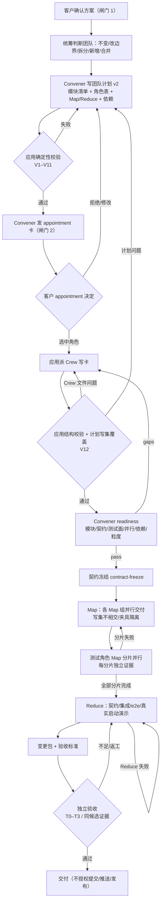

# 策划方案：角色粒度（bounded context）与 MapReduce 并行测试

（按模块/服务建角色，不按前端/后端整层；团队计划与流程标出 Map/Reduce；测试按模块分片并行、Reduce 合并）

- 日期：2026-10-22
- 角色：ANS 策划（Planning）
- 状态：**草案 v1（待闸门 1 方案确认）**；本文件是设计候选，**未实施、未测试、未验收**
- 风险档位：**T3（治理/权限/流程设计变更）**。依据技能 `references/testing.md`「Risk-Based Verification and Change Packages」：治理或权限变更属于 T3，即使只改文档也不能压成 T0
- 闸门 0 依据：`docs/communication/2026-10-22_intent-role-granularity-parallel-testing.md`（客户明确要求按 bounded context/模块 + 微服务经验 + MapReduce 并行测试修改；已确认）
- 上轮基线：治理分工第 1、3、5 项已实施并通过独立验收（团队计划归 Convener、Crew 只写卡、readiness、Verifier 标准/档位/证据复用）；本方案在其团队计划与角色表 hooks 上扩展，不重做上轮
- 代码事实快照：2026-10-22 只读检索。文中 `path:line` 行号是检索时快照，实施时应以符号名和实际代码为准
- 标记约定：
  - **[现状]** 已核实的当前代码行为；
  - **[设计候选]** 本方案提议、尚未实施；
  - **[待客户决定]** 见 §13，方案不替客户拍板

---

## 1. 摘要

客户指出：现在创建角色时偏向「前端 / 后端」这种整层划分，角色太大、太宽泛；应吸收微服务经验，按 **bounded context / 模块或服务** 建角色，一个服务不要太复杂，粒度不要太粗；同时要有 **MapReduce** 的并行测试思维，模块化。

当前产品已经有团队计划和角色表（roleId / 类型 / 职责目标 / 能力要求 / 唯一写集 / 依赖 / 组别 / apiSpec），也有「一个模块只归一个项目角色」的 prompt，但：

1. **没有定义模块粒度/大小**：没有模块字段、模块清单、模块覆盖检查；
2. **没有契约、测试面、并行组、机器可读依赖字段**；
3. **角色表校验只做表格结构与非空检查**，不检查跨模块/整层角色、写集重叠、依赖环或过细拆分；
4. **flow 步骤没有并行组/依赖语义**，dispatch 门禁也不检查前置步骤是否完成；
5. **测试没有按模块分片、Reduce 合并的约定**，验收也没有 Map/Reduce 证据规则。

本方案提出：

- **角色粒度模型**：一个角色 = 一个 bounded context / 模块或服务；单一职责、明确契约、独立写集、独立测试面；太大要拆、太小不建角色；用五维协调成本约束；禁止纳米角色/函数级拆分。用 ANS 自身角色（门禁引擎、编排、运行时核心、Pi/Codex/Claude 适配器、桌面窗口/桌面 UI）作为粒度示例。
- **团队计划 schema v2**：在现有角色表上增加 `module`/`boundedContext`、`公开契约`、`测试面`、`并行组`、`dependsOn`、可选 `粒度理由`；增加模块清单与模块覆盖检查；写集不相交、依赖无环、并行组内独立；确定性硬校验 + Convener readiness 语义复核。
- **MapReduce 并行**：团队计划标出 Map 组（独立模块、写集不相交、夹具隔离、可同组并行）与 Reduce 阶段（契约冻结/集成/e2e/验收）；flow 用现有 `kind` + step id/title（可选增加 `parallelGroup`/`dependsOn` 字段，**不新增 `FlowStepKind`**）表达；测试角色按模块分片并行、每分片独立证据，Reduce 合并并跑契约/集成/e2e；验收复用同候选证据，按 T0–T3 决定强度。
- **兼容与迁移**：用 `teamPlanSchema: 2` 标记新计划；旧团队计划、旧 flow、旧角色卡保持原行为；不重写历史文件。

本方案不改变第 2 项客户入口、第 4 项派发权、角色 id/显示名/路径、工程基线文本；不引入纳米角色；不把角色拆到函数级。所有行为变化均为设计候选，须经闸门 1、团队计划、闸门 2、实施和独立验收后才成立。

**客户可见的结果（设计候选）：**

- 任命卡/团队计划展示的是 **模块清单 + 每个模块的契约/测试面/并行组/依赖**，不再是「前端/后端」整层角色；
- 每个角色卡写明自己的 bounded context、公开契约、测试面和上下游依赖，写集互不重叠；
- Map 组可以并行实现/测试，Reduce 阶段统一跑契约/集成/e2e，验收报告能看到每个模块分片的原始证据和合并结果；
- 太宽（整层/多模块）或太细（纳米/函数级）的角色会在计划/readiness 阶段被退回，而不是等到实现后才发现。

---

## 2. 基线与范围

### 2.1 需求基线与确认状态

| 项 | 状态 | 记录 |
| --- | --- | --- |
| 闸门 0：意图确认 | **已确认** | `docs/communication/2026-10-22_intent-role-granularity-parallel-testing.md` |
| 客户原话 | — | 「现在这个角色创建，是不是太大，喜欢前端后端这种建立，应该和ans 一样 不要太宽泛的分，需要吸收微服务的经验，主要一个服务不要太复杂，颗粒度不要太粗。同时兼具map reduce 这种，能并行的测试思维。模块化的。」「按照这个思路去修改」 |
| 本轮范围 | 角色粒度 + 团队计划字段/校验 + MapReduce 并行测试 + flow/UI/测试/验收同步 | 同上「沟通的意图理解」 |
| 本轮非目标 | 第 2 项客户入口、第 4 项派发权、角色 id/显示名/路径、工程基线文本、历史文件、纳米角色 | 同上「非目标」 |
| 闸门 1：方案确认 | **待确认** | 本文件（提交沟通后由客户确认） |
| 闸门 2：角色指派/写集确认 | 未开始 | 本文件确认后由统筹写团队计划、沟通提交客户 |
| 实施授权 | 未给 | 闸门 1、闸门 2 通过后另行取得 |

上轮基线链接：方案 `docs/planning/2026-10-22_design_governance-split-1-3-5.md`；验收报告 `docs/acceptance/governance-split-1-3-5-report-v1.md`（通过，当前候选）；团队计划 `docs/scheduling/2026-10-22-governance-split-1-3-5-team-plan.md`。本方案只扩展其团队计划/角色表 hooks，不重做上轮。

本轮是治理/权限/流程设计变更（角色粒度规则、团队计划 schema、团队计划校验、flow 并行语义、测试分片与验收证据规则），按 **T3** 管理：策划方案（本文件）→ 闸门 1 → 统筹团队计划 → 闸门 2 → 实施 → 独立测试 → 独立验收。未确认前不改代码。

### 2.2 验收基线

客户在**闸门 1**确认的**本文件版本**是后续独立验收的基线。独立验收在实施前基于该版本把正式完成标准写入 `docs/acceptance/`；本文件 §11 的完成标准是方案自带的可核对标准，供闸门 1 确认和验收引用，**不是**正式验收结论或验收文档。团队计划、角色指派和实现安排都不是验收基线。

### 2.3 范围边界

**本轮必须覆盖：**

- 角色粒度模型：bounded context / 模块或服务的定义、太大/太细的判断、五维协调成本、ANS 示例、最小字段。
- 团队计划 schema v2：模块清单、角色表新字段、模块覆盖、写集不相交、契约/测试面必填、并行组、依赖无环、粒度理由。
- 确定性校验与 Convener readiness 语义复核的分工；应用不做 LLM 语义判断。
- Map/Reduce 阶段在团队计划与 flow 步骤/任务文本中的表达；测试角色按模块分片并行、独立证据、Reduce 合并；验收证据复用与 T0–T3。
- 受影响面：Convener/Crew 卡文本、团队计划角色表校验、Model 类型/物证、门禁/flow/judge、桌面 readiness/UI、测试。
- 旧流程/旧角色卡/旧团队计划的兼容与迁移窗口。

**本轮明确不改：**

- 第 2 项：客户入口不唯一（多个治理角色可直接发客户卡）——不改。
- 第 4 项：派发权分散（Convener/Liaison/应用都能派）——不改；本方案不新增或转移派发权。
- 角色命名/内部 id/路径（`liaison` / `rapporteur` / `nominator` / `convener` / `verifier` 及其显示名）——不改。
- 工程法案既有 `ENGINEERING_QUALITY_BASELINE` 文本（含「验收前必须真实启动应用并演示」）——不改。
- 历史 `docs/nominations/**`、旧 flow YAML、旧团队计划、既有角色卡——不删除、不重写。
- 不引入纳米角色/函数级拆分；不新增固定测试角色；不新增 `cardKind`、`FlowStepKind`、`GovernancePower`、`GovernanceDecisionKind`。
- 本文件只是方案；不改源码、测试、角色卡、边界、团队计划、验收或沟通文档。

---

## 3. 现状与问题（代码事实）

以下事实均来自 2026-10-22 只读检索；不表示本方案已改变它们。

### 3.1 团队计划角色表已有字段，但没有模块粒度

| # | 事实 | 证据 |
| --- | --- | --- |
| 3-1 | Convener 卡要求团队计划含「roleId/类型/职责目标/能力要求/唯一写集/依赖/组别/apiSpec」，并写「每个推荐角色必须有 roleId、职责目标、能力要求、唯一写集、依赖行」。 | `src/common/门禁引擎/governance-roles.ts:469-470`（`CONVENER_CARD_TEXT`） |
| 3-2 | Crew 卡要求读团队计划，确认「职责目标、能力要求、唯一写集、依赖」；写卡内容以这些为准。 | `src/common/门禁引擎/governance-roles.ts:348-350` |
| 3-3 | Crew 卡有「每个模块必须有明确属主（一个模块只归一个项目角色）」的质量职责，但这是 **prompt 文本**，不是可核对字段或校验。 | `src/common/门禁引擎/governance-roles.ts:437` |
| 3-4 | 团队计划角色表校验 `teamPlanRoleRowIssues` 只要求表头含 roleId 与 `职责` / `能力` / `写集|边界` / `依赖` 列，且每个**推荐角色**有行、四列非空；不做模块、契约、测试面、并行组、写集重叠、依赖环检查。 | `src/pipeline/orchestration/run-role.ts:2044-2107` |
| 3-5 | 桌面侧 `parseTeamPlanInfo` 额外要求「类型」列（new/changed/existing），但仍只检查 frontmatter 推荐集、表头必需列、角色行四列非空；没有模块/契约/测试面/并行组/dependsOn。 | `app/desktop/interface.ts:841-1002` |
| 3-6 | `apiSpec` 只在 Convener 卡文本和模板中出现；`teamPlanRoleRowIssues`/`parseTeamPlanInfo` 都不校验它，也没有 `not-applicable` 理由检查。 | `src/common/门禁引擎/governance-roles.ts:469`；`run-role.ts:2044-2107`；`interface.ts:907-1002` |
| 3-7 | 产品团队计划模板/夹具的角色表头是 `roleId | 类型 | 职责目标 | 能力要求 | 唯一写集 | 依赖 | 组别 | apiSpec`，没有模块、契约、测试面、并行组、dependsOn；本仓库团队计划 §4.2 用同等字段的逐角色条目。 | `test/测试/governance-e2e-auto/fixture.ts:245-292`；`docs/scheduling/2026-10-22-governance-split-1-3-5-team-plan.md` §4.2；方案模板 `docs/planning/2026-10-22_design_governance-split-1-3-5.md` §5.1 |
| 3-8 | `依赖` 是自由文本（例如「契约冻结后（`src/model/runtime.ts`）」），不能解析成角色 id DAG。 | 同上团队计划 §4.2；`run-role.ts:2071-2074` 只匹配「依赖」列 |

**结论：** 一个角色只要在角色表里写成「前端」「后端」或「整层」，并填上职责/能力/写集/依赖四列，就能通过当前确定性校验。当前没有任何字段或检查能判断它跨了几个无关模块、是否整层、模块是否全覆盖、写集是否重叠、依赖是否成环。

### 3.2 没有契约、测试面、并行组、机器可读依赖

| # | 事实 | 证据 |
| --- | --- | --- |
| 3-9 | `TeamPlanRoleRow` 类型只有 `roleId/roleType/duty/ability/writes/deps`；`TeamPlanInfo` 只有推荐集、角色行、计划问题。 | `app/desktop/interface.ts:841-859` |
| 3-10 | 团队计划没有模块清单/模块 id；没有「一个模块只归一个角色」的机器字段。 | `run-role.ts:2044-2107`；`interface.ts:907-1002` |
| 3-11 | 没有「公开契约」字段；角色与 `docs/contracts/<name>-v1.md` 的对应关系只靠 Convener/Crew 的 prompt 和流程 `contract-freeze` 步骤，不在团队计划角色表里。 | `governance-roles.ts:478`、`:573`（流程必须有 contract-freeze 和集成/端到端步骤）；团队计划字段无 contract |
| 3-12 | 没有「测试面」字段；角色的测试目录在 boundary/角色卡里，但没有和模块/角色行绑定，无法做模块分片。 | `app/desktop/interface.ts:2422-2460`（只检查角色根工作文档，不检查测试面） |
| 3-13 | 没有「并行组」字段；团队计划里的并行只是文字说明（如旧设计文档「可并行组」），不是 schema。 | `src/common/编排/flow-state.ts` 全文；`docs/planning/2026-10-22_design_governance-split-1-3-5.md` 无并行组字段 |
| 3-14 | `dependsOn` 没有机器字段；`依赖` 列是自由文本，不能做拓扑排序/环检测。 | `run-role.ts:2071-2074`；`interface.ts:963` |

### 3.3 flow 没有并行组/依赖语义

| # | 事实 | 证据 |
| --- | --- | --- |
| 3-15 | `FlowStateStep` 只有 `id/title/owner/kind/status/evidence/supersedes/supersededBy`；`STEP_KEYS` 是固定集合，未知字段一律校验失败。 | `src/common/编排/flow-state.ts:126-143`、`:215` |
| 3-16 | `FLOW_STEP_KINDS` 只有 `dispatch / customer-decision / artifact / acceptance`，它们是**证据种类**，不是并行/阶段枚举。 | `src/common/编排/flow-state.ts:47` |
| 3-17 | 派发门禁 `evaluateDispatchGate` 只检查 flowId/stepId、目标不是内置角色、提案已接受、目标在任命名单/快捷路径、实施前标准、步骤存在、同 flowId+stepId 未派发；**不检查前置步骤是否完成、不检查并行组**。 | `src/common/编排/governance-gate.ts:356-437` |
| 3-18 | flow 状态更新由 `flow-service` 串行化（同 projectRoot 的 mutation chain），但这是**写盘并发安全**，不是 Map/Reduce 调度语义。 | `src/common/编排/flow-service.ts:201-217`、`:179-199` |
| 3-19 | 流程模板要求 `contract-freeze`、集成/端到端、`verification-evidence` 步骤，但没有 Map/Reduce 分组或依赖字段。 | `governance-roles.ts:504-544`、`:573` |

### 3.4 测试与验收没有模块分片约定

| # | 事实 | 证据 |
| --- | --- | --- |
| 3-20 | 测试角色负责跨角色 e2e/完整流程/回归；工程基线要求真实启动/演示；但没有「按模块分片并行、每分片独立证据、Reduce 合并」的字段/规则。 | 技能 `references/testing.md`「Who Owns Tests」；`governance-roles.ts:590-596`（Verifier 核对原始证据） |
| 3-21 | 验收按 T0–T3 复用同候选证据已有规则；但没有 Map shard 证据失效/合并规则。 | `references/testing.md`；`governance-judge.ts:197-259`；上轮验收报告 |
| 3-22 | 团队计划的「验证与证据安排」是文字章节，不是可核对的角色-测试面映射。 | `docs/planning/2026-10-22_design_governance-split-1-3-5.md` §5.1 团队计划模板 §5/§6 |

### 3.5 现有测试冻结了当前结构

| # | 事实 | 证据 |
| --- | --- | --- |
| 3-23 | 任命卡卡前守卫负例只有 7 项：计划缺失、flowId 不一致、推荐集为空、推荐集含内置角色、卡选项未覆盖、卡选项含内置角色、推荐角色缺职责目标；没有模块/写集/环/过细负例。 | `test/测试/governance-e2e-auto/p-team-plan-guard.test.ts:36-75` |
| 3-24 | 测试夹具 `teamPlanDoc` 只生成 roleId/类型/职责/能力/写集/依赖/组别/apiSpec 列。 | `test/测试/governance-e2e-auto/fixture.ts:245-292` |
| 3-25 | 新流程步骤模板测试只覆盖 `team-plan/appointment/role-cards/role-readiness/acceptance-criteria/change-package` 用现有 kind，不含并行字段。 | `test/编排/flow-state.test.ts:157-268` |
| 3-26 | 桌面写卡校验测试只覆盖计划缺行/缺职责等四列，不覆盖模块覆盖/写集重叠/依赖环。 | `test/桌面应用/interface.test.ts:4294-4359`；`test/门禁引擎/governance-standard-workflow.test.ts:110-199` |

---

## 4. 角色粒度模型

### 4.1 定义：一个角色 = 一个 bounded context / 模块或服务

**[设计候选]** 一个项目角色必须是一个 **bounded context / 模块或服务**，并同时满足：

1. **单一职责**：只有一个主要变化原因；不是多个无关业务能力的集合。
2. **明确契约**：有公开入口/接口/数据契约/事件契约（或明确声明 `internal` 内部模块 + 理由）；其他角色只通过契约消费，不读私有实现。
3. **独立写集**：拥有唯一、精确、可与其他角色不相交的写入路径；共享文件必须有唯一属主。
4. **独立测试面**：有自己的单元/层契约测试路径或测试命令；测试面与模块契约对应，可独立运行、独立出证据。
5. **高内聚、低耦合**：模块内部强相关；跨模块依赖是有向、可说明、尽量少的契约依赖。

微服务经验的具体落点：

- **按业务能力/子域拆，不按技术层拆**：前端/后端/UI/服务端是层，不是 bounded context；一个模块可以同时有 UI + API + 存储，但它必须是一个内聚的业务能力。
- **数据库/共享状态不共享**：模块之间通过契约交互；不因为「都在一个仓库」就把多个模块塞进一个角色。
- **独立可验证**：每个模块角色能独立跑自己的测试并交原始证据；跨模块验证放 Reduce。
- **避免分布式单体**：不是角色越细越好；拆得太细会产生大量交接、契约冻结和协调成本，必须用五维判断约束。

### 4.2 「不要太大、也不要太细」

| 情况 | 判断 | 处理 |
| --- | --- | --- |
| 角色跨多个**无关**模块/整层（前端、后端、UI、服务端、全栈） | 太大 | 拆成多个 bounded context 角色；除非有明确边界理由并经 readiness 语义复核 |
| 角色覆盖一个模块，但模块本身是多个子域/多个契约/多个独立变化原因 | 模块太大 | 先在架构/模块清单层面拆模块，再为每个模块建角色；不要用「一个角色」硬扛 |
| 角色只做一次性/临时工作 | 不建角色 | 按五维协调成本，任务分配或顺序执行 |
| 角色只做函数级/单文件/单个按钮/单个 API 端点 | 太细（纳米角色） | 合并到所属模块角色；不建独立角色 |
| 角色只做「协调/汇总/传话」 | 不是模块 | 由统筹/测试/装配等既有职责承担，不建项目角色 |
| 新角色协调成本大于并行收益 | 不建 | 现有角色承接或顺序执行 |

**判断依据（五维，沿用 `references/scheduler.md`）：**

1. **责任独立性**：是否有独立的变化原因、是否需要不同知识和契约？
2. **范围归属**：涉及文件/模块是否已有 owner？是否缺失或重叠？
3. **契约影响**：是否新增或改变公开契约或共享抽象？谁做唯一 primary owner？
4. **证据独立性**：是否需要独立测试或验收？一个角色能否被独立核对？
5. **协调成本**：新增角色/上下文/交接的成本是否值得？看并行收益、沟通成本和风险。

**硬规则（设计候选）：**

- 默认 **一个模块只归一个角色，一个角色只覆盖一个模块**。
- 一个模块不能被拆给两个角色（除非模块本身先在架构上拆分）。
- 一个角色不能覆盖多个模块，除非在团队计划中写 `粒度理由` 并经 Convener readiness 明确批准（例如既有角色复用、共享内核迁移等过渡情形）。
- 禁止函数级/单文件级角色；单文件模块只有在它本身就是 bounded context（有独立契约/测试面/变化原因）时才允许。

### 4.3 用 ANS 自身角色作为粒度示例

以下用本仓库 ANS 产品的角色作为**正例**（不是本方案要改这些角色；它们展示「一个角色 = 一个上下文」的粒度）：

| 角色 | bounded context / 模块 | 公开契约 | 唯一写集（摘要） | 测试面 | 为什么不是一个「前端/后端」层角色 |
| --- | --- | --- | --- | --- | --- |
| 门禁引擎 | 角色/边界/写入判定与治理角色注册表 | `src/model/{boundary,role,decision}.ts` 共享类型 + `governance-roles.ts` 卡/注册表数据 | `src/common/门禁引擎/`、`src/service/{boundary,role,gate}/`、`test/门禁引擎/` | `test/门禁引擎/` | 有独立的判定契约和负例矩阵；与编排/运行时核心解耦 |
| 编排 | 会话编排、flow 状态、治理门禁/账本/judge | `src/model/runtime.ts`（只读类型）、`flow-state.ts` schema、pipeline 公共出口 | `src/common/编排/`、`src/pipeline/orchestration/{run-role,govern-session}.ts`、`test/编排/` | `test/编排/` | 变化原因是流程/门禁/判断，不是 UI 或适配器 |
| 运行时核心 | 中立运行时类型、公共工具契约、会话持久化 | `src/model/runtime.ts`、`src/provider/runtime/{tools,schema}.ts` | `src/model/runtime.ts`、`src/provider/runtime/`、`src/common/runtime-core/`、`test/runtime-core/` | `test/runtime-core/` | 跨适配器共享的契约层，必须唯一主属 |
| Pi 适配器 | Pi 运行时适配 | Pi adapter 公共接口 | `src/provider/pi/`、`test/pi-adapter/` | `test/pi-adapter/` | 每个运行时适配器是一个独立模块；三个适配器可并行 |
| Codex 适配器 | Codex 运行时适配 | Codex adapter 公共接口 | `src/provider/codex/`、`test/codex-adapter/` | `test/codex-adapter/` | 与 Pi/Claude 适配器契约相同、实现不同、测试面独立 |
| Claude 适配器 | Claude 运行时适配 | Claude adapter 公共接口 | `src/provider/claude/`、`test/claude-adapter/` | `test/claude-adapter/` | 同上；三个适配器是 `map-adapters` 并行组的典型 |
| 桌面窗口 | Electron 主进程 Interface、会话/装配/IPC、项目文档读取 | preload IPC 通道 + `src/model/project-document.ts` 类型 | `app/main.ts`、`app/preload.cjs`、`app/desktop/`、`src/{model,pipeline,service,provider}/project-document/`、精确测试文件 | `test/桌面应用/` 精确文件 | 主进程逻辑与渲染 UI 是不同上下文、不同契约、不同写集 |
| 桌面 UI | 渲染进程 React/样式/交互 | preload 暴露的受限 IPC + 渲染组件契约 | `app/renderer/`、`test/桌面UI/` | `test/桌面UI/` | 不能直接触 Node/文件系统；与桌面窗口可并行但写集不相交 |
| 测试 | 跨角色集成/e2e/回归/证据合并 | 测试命令、证据 manifest | `test/测试/`、证据目录 | `test/测试/` | Reduce 角色，不拥有产品模块；依赖所有 Map 角色 |
| 装配 | 构建、打包、启动接线 | `package.json`/tsconfig/入口/构建脚本 | 装配相关配置与脚本 | 装配测试 | Reduce 角色；依赖所有 Map 角色 |

**反例（会被粒度模型拒绝）：**

- `前端` 角色同时拥有 `app/renderer/` + `app/desktop/` + `test/桌面应用/` + `test/桌面UI/`：跨两个契约（IPC 与渲染组件）、两个测试面、两个变化原因；应拆成桌面窗口 + 桌面 UI。
- `后端` 角色拥有 `src/common/门禁引擎/` + `src/common/编排/` + `src/provider/*`：跨多个无关模块；应拆成门禁引擎、编排、运行时核心、各适配器。
- `checkout-button` 角色只拥有一个 React 组件/一个函数：纳米角色；应合并到 `checkout-web` 模块角色。
- `订单系统` 角色同时拥有目录、购物车、结算、支付：多个子域/契约；应按模块清单拆成多个 bounded context。

### 4.4 可核对的最小字段

**[设计候选]** 团队计划 v2 的每个角色行至少包含：

| 字段 | 含义 | 硬校验 | 语义复核（Convener readiness） |
| --- | --- | --- | --- |
| `module` / `boundedContext` | 该角色负责的模块/上下文 id；一个模块一个角色；`reduce` 表示非产品模块的 Reduce 角色 | 必填；必须在模块清单内（或 `reduce`）；默认恰好一个；多模块需 `粒度理由` | 模块是否真正内聚、是否与客户确认的架构模块对应 |
| `职责目标` | 该模块的业务职责 | 必填非空 | 是否单一职责、是否覆盖模块目标 |
| `能力要求` | 需要的知识/技能 | 必填非空 | 是否足以完成模块 |
| `唯一写集` | 精确路径/目录列表 | 必填；语法合法；跨角色不相交；不写治理路径/他人角色卡 | 是否覆盖模块实现与测试；是否越界 |
| `公开契约` | 公开接口/数据/事件契约路径，或 `internal` + 理由 | 必填非空 | 是否真实、完整、与消费方一致 |
| `测试面` | 该角色的测试路径/目录/命令范围 | 必填非空；Map 角色至少一个测试路径；Reduce 角色至少集成/e2e/装配检查之一 | 是否覆盖模块契约与关键边界 |
| `依赖` | 人类可读依赖说明 | 必填非空 | 依赖方向是否符合架构 |
| `dependsOn` | 机器可读依赖：`无` 或角色 id 列表 | 语法合法；目标存在；无自依赖/重复；无环 | 是否只依赖必要角色；是否与契约方向一致 |
| `并行组` | `map-<slug>` 或 `reduce` | 必填；语法合法；Map 组内无依赖；Reduce 依赖全部 Map | 组划分是否真的可并行；是否有隐藏共享写 |
| `apiSpec` | 该角色是否有导出/共享/装配接口 | 必填；`required` 或 `not-applicable` + 非空理由 | 是否与实际接口一致 |
| `粒度理由` | 为什么这个粒度合适/例外原因 | 可选；例外（多模块、整层名、既有角色复用）必填 | 是否满足五维协调成本；是否过细/过粗 |

### 4.5 不用任意行数/文件数硬阈值；启发式的局限

**不采用**「超过 N 行就拆」「少于 M 个文件就合并」这类硬阈值：模块大小取决于契约、变化原因、团队协调成本，不是行数/文件数。一个 50 行的适配器可以是完整 bounded context；一个 5000 行的模块也可能高度内聚。

**允许的启发式（只做 tripwire，不做最终判断）：**

- 模块 id 命中通用层名黑名单（`frontend`、`backend`、`web`、`server`、`client`、`ui`、`fullstack`、`all`、`common`、`shared`、`utils` 等）且 `粒度理由` 为空 → **硬拒**；有理由 → 标记 `exception-review`，必须 readiness 明确批准。
- 模块 id 含 `+`（多模块）且 `粒度理由` 为空 → **硬拒**；有理由 → readiness 例外。
- 模块清单的「架构来源」为空或不是可追溯引用 → **硬拒**；readiness 核对引用的架构章节。
- 角色写集只有一个文件且模块清单没有对应契约/测试面 → **warning**，readiness 判断是否纳米角色；不硬拒（单文件模块可能是合法的）。
- 计划角色数明显多于模块数 + Reduce 角色数（例如出现多个 Map 角色共享同一模块） → 由「一个模块一个角色/模块覆盖恰好一次」硬规则直接拒绝，不需要额外阈值。

**局限：** 启发式只能抓明显的整层名/多模块/空引用，不能判断「这个模块是否真的内聚」。因此必须有 Convener readiness 语义复核和验收抽查；不能把「字段齐全」当成「粒度正确」。

---

## 5. 团队计划 schema v2 与校验

### 5.1 schema 标记与兼容

**[设计候选]** 团队计划 frontmatter 增加：

```yaml
flowId: <flowId>
version: 1
teamPlanSchema: 2          # 1 = legacy（缺省）；2 = 本方案
riskTier: T3
recommended: [role-a, role-b]
modules: [module-a, module-b]
```

- **缺省/`teamPlanSchema: 1`**：旧计划，只跑现有校验（结构 + 推荐角色四列非空）；不强制新字段；桌面只记一条迁移 warning。
- **`teamPlanSchema: 2`**：跑 §5.4 的全部确定性校验；缺字段/冲突直接拒绝，不弹 appointment 卡。
- 旧计划不原地改；新流程由 Convener 按 v2 写；旧 flow/旧角色卡/旧提名文件保持可读。
- 计划实质变更（角色/模块/写集变化）递增 `-team-v2.md`；若变化涉及角色指派或写集范围，重开闸门 2（由统筹/沟通按既有规则判断）。只调整执行顺序/并行组且不改变角色/写集时，可写新版本但不重开闸门 2。

### 5.2 模块清单（新增，v2 必填）

frontmatter `modules` 是机器可读模块 id 列表；正文增加「模块清单」表，提供人类可读职责与架构来源：

```markdown
## 模块清单

| module | 职责 | 公开契约 | 架构来源 |
| --- | --- | --- | --- |
| checkout-api | 结算 API、订单状态、价格计算 | `docs/contracts/checkout-v1.md` | `docs/proposals/shop-checkout-v1.md` §4.2 |
| checkout-web | 结算页面、表单、错误展示 | `docs/contracts/checkout-v1.md`（消费） | 同上 §4.3 |
| payment-gateway | 支付渠道适配与回调 | `docs/contracts/payment-v1.md` | 同上 §4.4 |
```

**硬校验：**

- `modules` 必须写成同一行内联数组 `modules: [checkout-api, checkout-web]`（或固定行「模块：checkout-api、checkout-web」），不要用 YAML 块数组——与现有 `recommended` 解析器同口径；空集/重复/歧义不接受。
- `modules` 非空、无重复、每项是 ASCII slug（`^[a-z][a-z0-9-]*$`，便于映射 flow step id）。
- 模块清单表恰好覆盖 `modules` 集合：不多、不少、不重复；每行职责/契约/架构来源非空。
- 每个模块在角色表中恰好被一个 Map 角色覆盖；不能有孤儿模块（清单有、角色没有），也不能有未声明模块（角色有、清单没有）。
- `reduce` 是保留模块值，只用于不拥有产品模块的 Reduce 角色；不进入模块覆盖计数。

**阶段标记：** 角色表的 `并行组` 列就是 Map/Reduce 标记：`map-*` 为 Map 组，`reduce` 为 Reduce；团队计划可在「五维判断」后加一段文字说明每个 Map 组的并行理由、Reduce 的覆盖范围和进入条件。flow 用相同值标步骤（见 §6.2），应用做一致性检查（V11）。

### 5.3 角色表（扩展列）

**[设计候选]** v2 角色表：

```markdown
| roleId | 类型 | module | 职责目标 | 能力要求 | 唯一写集 | 公开契约 | 测试面 | 依赖 | dependsOn | 并行组 | 组别 | apiSpec | 粒度理由 |
| --- | --- | --- | --- | --- | --- | --- | --- | --- | --- | --- | --- | --- | --- |
| checkout-api | new | checkout-api | 结算 API 与订单状态 | 后端/契约/测试 | `src/checkout/api/`; `test/checkout/api/` | `docs/contracts/checkout-v1.md` | `test/checkout/api/` | 无 | 无 | map-a | 结算 | required | — |
| checkout-web | new | checkout-web | 结算页面与交互 | 前端/契约/测试 | `app/web/checkout/`; `test/checkout/web/` | `docs/contracts/checkout-v1.md`（消费） | `test/checkout/web/` | 无 | 无 | map-a | 结算 | required | — |
| payment-gateway | new | payment-gateway | 支付渠道适配与回调 | 支付/适配器/测试 | `src/payment/gateway/`; `test/payment/gateway/` | `docs/contracts/payment-v1.md` | `test/payment/gateway/` | 依赖 checkout-api 契约 | checkout-api | map-b | 结算 | required | — |
| integration-test | existing | reduce | 契约/集成/e2e/证据合并 | 测试/环境/证据 | `test/测试/`; `docs/verification/` | `docs/contracts/checkout-v1.md`; `docs/contracts/payment-v1.md`（消费） | `test/测试/` | 依赖全部 Map 角色 | checkout-api, checkout-web, payment-gateway | reduce | 测试 | not-applicable | — |
```

**列语义：**

- 字段英文名与中文列名的对应：`module`/`boundedContext` = module；`contract` = 公开契约；`testSurface` = 测试面；`parallelGroup` = 并行组；`dependsOn` = dependsOn；`granularityRationale` = 粒度理由。解析器按别名匹配，同名列不得重复。
- `module`：一个模块 id（来自 `modules`）或 `reduce`；多模块只在过渡/例外时用 `a+b`，并必须写 `粒度理由`；多模块例外时以第一个模块为主模块，flow 交付步骤 id 用 `delivery-<主模块>`，`粒度理由` 必须写明主模块与其他模块及原因。
- `唯一写集`：分号分隔的精确路径/目录；目录以 `/` 结尾；**不支持通配符/省略号/散文**；不得包含 `.ans/`、`docs/scheduling/`、`docs/acceptance/`、`docs/communication/`、`docs/flows/`、`docs/nominations/`、`角色卡/`（角色根工作文档由第 5 项清单另行要求，不进入模块写集）。
- `公开契约`：`docs/contracts/<name>.md` 路径或 `internal` + 非空理由；可多个，分号分隔。
- `测试面`：测试路径/目录（如 `test/checkout/api/`）；命令写在角色卡/证据里；可多个，分号分隔。
- `依赖`：人类可读说明；`无` 合法；可与 `dependsOn` 重复，用于解释。
- `dependsOn`：`无` 或角色 id 列表（逗号/顿号分隔）；只引用本计划角色行；外部既有角色依赖写在 `依赖` 说明里，不进入 DAG（见 §5.4 局限）。
- `并行组`：`map-<slug>` 或 `reduce`。
- `组别`：只作分类，不产生组长/派发层级。
- `apiSpec`：`required` 或 `not-applicable` + 理由；与 `api-spec.md` 一致。
- `粒度理由`：可选；多模块、整层名、既有角色跨模块复用等例外必填。

### 5.4 校验规则：确定性硬校验 vs readiness 语义复核

#### 5.4.1 确定性硬校验（应用执行，不调用 LLM）

| ID | 规则 | 失败处理 |
| --- | --- | --- |
| V1 | frontmatter `flowId` 与卡片/flow/文件名一致；`version` 正整数；`riskTier` 为 T0–T3；`recommended` 非空、无重复、不含内置角色；`modules` 非空、无重复、slug、不含保留值 `reduce` | 不弹 appointment 卡；退回 Convener |
| V2 | `teamPlanSchema: 2` 时角色表含全部必需列：roleId、类型、module、职责目标、能力要求、唯一写集、公开契约、测试面、依赖、dependsOn、并行组、组别、apiSpec；同名列不得重复/歧义 | 同上 |
| V3 | 类型只能是 `new/changed/existing`；每个推荐角色有且只有一行；角色行不重复；必填单元格非空（`粒度理由` 除外）；`apiSpec` 为 `required` 或 `not-applicable` + 理由 | 同上 |
| V4 | 模块清单集合 = `modules`；每行职责/契约/架构来源非空；Map 角色的 module 必须恰好一个模块 id（多模块例外见 V9）；每个模块在角色表中恰好被一个 Map 角色覆盖；Reduce 角色 module 必须为 `reduce`；无孤儿/重复模块 | 同上 |
| V5 | 写集语法合法（精确路径/目录、分号分隔、无通配符/散文/`..`/绝对路径）；写集跨角色两两不相交（文件相等或目录前缀重叠都算重叠）；不得写治理路径/他人角色卡。写集**全局**不相交，因此并行组内必然不相交；只读契约不算写集 | 同上 |
| V6 | `公开契约`/`测试面` 非空；Map 角色测试面至少含一个测试路径；Reduce 角色测试面至少含集成/e2e/装配检查之一；`internal`/`not-applicable` 需理由 | 同上 |
| V7 | `dependsOn` 目标必须是本计划角色行；无自依赖、无重复、无环（拓扑排序/Kahn 或 DFS）；`依赖` 说明非空 | 同上 |
| V8 | `并行组` 只能是 `map-<slug>` 或 `reduce`；module 为产品模块的角色必须是 `map-*`，module 为 `reduce` 的角色必须是 `reduce`；同一 `map-*` 组内角色之间不得有依赖路径；Map 角色不得依赖 Reduce 角色；每个 Reduce 角色的 `dependsOn` 必须直接或传递覆盖全部 Map 角色；Reduce 角色之间可以顺序依赖（如测试分片→集成），但不得被 Map 角色依赖 | 同上 |
| V9 | 模块 id 命中通用层名黑名单且 `粒度理由` 为空 → 拒绝；多模块 `a+b` 且 `粒度理由` 为空 → 拒绝；`粒度理由` 非空 → 标记 `exception-review`，继续 readiness；单文件写集/极小模块 → warning（不硬拒），交 readiness 判断是否纳米角色 | 同上 |
| V10 | 计划含「五维判断/协调成本」章节且非空（确定性存在性检查；内容由 readiness 判断） | 同上 |
| V11 | 若 flow 已写：Map 角色的交付步骤 id 必须是 `delivery-<module>`（多模块例外用第一个模块/主模块；module id 为 slug），owner=roleId、`parallelGroup`=计划组、`dependsOn` 精确等于 `{contract-freeze} ∪ 依赖角色的 delivery-*`；Reduce 步骤必须**直接或传递**依赖全部 Map 交付；`contract-freeze` 存在且被所有 Map 交付直接或传递依赖；保留 `verification`/`acceptance` 步骤不变 | 同上 |
| V12 | 计划写集必须被角色边界覆盖（Crew 写卡后）：new/changed 角色的 `boundary.yaml` entries 覆盖计划写集；existing 角色的既有边界也必须覆盖计划写集；不覆盖 → 退回 Crew/Convener | 不派 readiness |

**说明：**

- V1–V10 在 Convener 发 appointment 卡之前的卡前守卫执行；V11 如果 flow 已存在也在卡前守卫执行；V12 在 Crew 写卡后的 `validateAppointmentArtifacts` 执行。
- V9 是启发式，不是语义判断；黑名单只做 tripwire，最终由 readiness 决定例外是否成立。
- 应用不调用 LLM 做语义判断；所有语义判断由 Convener readiness 记录。应用只解析 `status: pass|gaps` 和结构化问题。

#### 5.4.2 Convener readiness 语义复核（v2 必填）

Convener 在 `docs/scheduling/<flowId>-readiness-v1.md` 逐角色/逐计划核对：

| 复核项 | 要回答什么 | 证据 |
| --- | --- | --- |
| 模块清单与架构 | 每个模块是否对应客户确认的方案/架构章节？有没有把技术层伪装成模块？ | 方案/架构引用、模块清单、角色卡 |
| 内聚/耦合 | 每个模块是否单一职责、一个主要变化原因？是否跨多个无关子域？ | 角色卡、契约、写集 |
| 粒度大小 | 是否太大（整层/多子域）或太细（纳米/函数级）？协调成本是否值得？ | 五维判断、`粒度理由` |
| 契约 | 公开契约是否真实、完整、可消费？消费方是否只依赖契约？ | `公开契约`、`api-spec.md`、`docs/contracts/` |
| 写集 | 是否精确覆盖模块实现与测试？是否与其他人共享文件？ | `唯一写集`、`boundary.yaml` |
| 测试面 | 是否覆盖模块契约、边界、负例？能否独立跑、独立出证据？ | `测试面`、角色卡质量职责 |
| 并行组 | 同组是否真的独立？Reduce 是否覆盖全部 Map？ | `并行组`、`dependsOn`、flow |
| 例外 | 整层名/多模块/既有角色复用是否有明确边界理由？ | `粒度理由`、readiness 例外记录 |

readiness 记录沿用上轮格式（frontmatter `flowId/version/status: pass|gaps`），新增列 `module/contract/testSurface/parallel/dependsOn/granularity`。gap 退回 Crew 修正；计划缺细节退回 Convener 补充；readiness 不是验收标准、不是客户确认。

#### 5.4.3 为什么不让应用做 LLM 语义判断

- 非确定性：同一文本不同模型/温度可能给出不同结论，无法作为门禁。
- 权限问题：应用调用 LLM 会产生新的判断上下文、凭据和审计面。
- 假阳性：模型可能把「模板齐全」当成「粒度正确」，反而掩盖问题。
- 正确分工：应用做结构/覆盖/重叠/环等确定性检查；Convener readiness 做语义判断并写记录；验收抽查语义结论是否有证据。

### 5.5 旧流程/旧角色卡/旧团队计划的兼容与迁移

| 对象 | 兼容策略 |
| --- | --- |
| 旧团队计划（无 `teamPlanSchema: 2`） | 按 v1 只跑现有校验；不强制新字段；桌面记 warning「建议迁移 team-plan v2」；不阻塞旧流程 |
| 旧 flow（无并行字段） | `flow-state.ts` 可选字段不改变旧解析；旧 flow 不要求 `parallelGroup`/`dependsOn`；dispatch 门禁不新增前置检查 |
| 旧角色卡 | 保持第 5 项既有策略：`existing` 只做最低格式检查 + warning；不一次性重写历史卡；新/变更角色才强制模块/契约/测试面内容 |
| 旧 nomination/旧提案 | 不删除、不重写；legacy 回落保留（上轮 O4） |
| 迁移窗口 | 新流程默认 v2；旧流程可在下一次实质变更时迁移；迁移前不强制。是否设截止时间由客户决定（§13 Q6） |
| 计划版本 | v2 计划用 `-team-v2.md` 递增；不原地改已确认版本；角色/写集实质变化重开闸门 2 |

---

## 6. MapReduce 并行执行与测试

### 6.1 角色：Map 与 Reduce

**[设计候选]**

- **Map 阶段**：独立模块角色并行实现/测试。进入条件：
  - 契约已冻结（`contract-freeze` 步骤 `done`，`docs/contracts/<name>-v1.md` 存在）；
  - 各 Map 角色写集两两不相交；
  - 同组角色之间没有依赖路径；
  - 每个角色有独立测试面、独立临时夹具/证据路径；
  - 不共享可变夹具、不并发写同一文件。
- **Reduce 阶段**：契约/集成/e2e/验收证据合并。进入条件：
  - 所有 Map 交付步骤 `done`（不是仅 dispatched/delivered）；
  - 所有 Map 测试分片完成并留下原始证据；
  - 契约未在 Map 期间变更；若变更，受影响 Map 证据失效，回到契约冻结/重派。
- **契约冻结的位置**：`contract-freeze` 是 Map 的入口条件（先冻结契约，Map 才能并行），也是 Reduce 的边界（Reduce 复核契约未变、跑契约测试）；不是「Map 期间可以随便改契约」。客户所说的「Reduce 阶段（契约冻结/集成/e2e/验收）」在本方案中落为：冻结在 Map 入口、契约复核/集成/e2e/验收在 Reduce。
- **测试维度的 Map/Reduce**：测试角色按模块分片并行跑（测试的 Map），再由测试角色合并 manifest、跑契约/集成/e2e（测试的 Reduce）；测试角色在团队计划里仍是 Reduce 角色，因为它的分片依赖所有实现 Map 的交付。
- **不是**数据处理的 MapReduce；它是「独立分片并行 + 统一合并验证」的调度/验证模式。

### 6.2 flow 步骤与任务文本如何表达

#### 推荐方案 A：团队计划 + 现有 step id/title + 可选 `parallelGroup`/`dependsOn` 字段（推荐）

**不新增 `FlowStepKind`。** 在 `FlowStateStep` 上增加两个**可选**字段（v2 新流程使用，旧 flow 不填）：

```yaml
- id: delivery-checkout-api
  title: Map A｜checkout-api 交付
  owner: checkout-api
  kind: dispatch
  status: pending
  parallelGroup: map-a
  dependsOn: [contract-freeze]
```

- `parallelGroup?: string`：`map-<slug>` 或 `reduce`；用于显示和静态校验。
- `dependsOn?: string[]`：前置 step id 列表；用于静态环检测和 dispatch 前置检查。
- 旧 flow 不填这两个字段 → 行为逐字不变；未知字段仍然校验失败（严格 schema 不放松）。
- 静态校验（`flow-state.ts`）：
  - `parallelGroup` 语法合法；
  - `dependsOn` 目标存在、无自依赖、无环；
  - 同一 `map-*` 组内步骤之间不得有依赖路径；
  - 每个 `reduce` 步骤（`dispatch`/`artifact`，验收除外）必须有到所有 `map-*` `dispatch` 步骤的依赖路径；
  - Map 步骤不得依赖 Reduce 步骤；
  - 新契约 flow 的 Map 交付步骤必须依赖 `contract-freeze`。
- dispatch 门禁（`governance-gate.ts`）：
  - 若步骤声明 `dependsOn`，所有前置步骤必须 `status: done` 才允许派发；
  - 不改变派发权归属（仍由 Convener 派发）；
  - 旧步骤无 `dependsOn` → 不新增检查。
- 任务文本：
  - Map 组任务写明「同组可并行、写集不相交、只依赖 contract-freeze/前置组、不得写对方路径」；
  - Reduce 任务写明「等所有 Map `done` 后运行契约/集成/e2e；测试按模块分片并行；每分片独立证据；合并 manifest」。

**任务文本示例（设计候选）：**

```text
Map A（可并行）：checkout-api 与 checkout-web。前置：contract-freeze 已 done。
约束：两者写集不相交；只读契约；不得写对方目录；各自跑本模块测试并回交原始输出与候选哈希。
```

```text
Reduce：等 checkout-api / checkout-web / payment-gateway 全部 done。
步骤：① 按模块并行跑测试分片（每分片独立临时根/端口/日志，不共享可变夹具）；
② 合并 docs/verification/<flowId>/manifest.md；③ 跑契约/集成/e2e 与真实启动演示；
④ 失败保留原始日志并交对应 owner；⑤ 不修改产品代码。
```

**代价/影响：** `FlowStateStep`/`STEP_KEYS`/`flow-service` 序列化与视图/`FlowToolStepView`/`flow_step_supersede` 输入/`govern-session` flow 模板/`flow-state.test.ts`/`flow-service.test.ts`/`governance-gate.test.ts` 需要同步；旧 flow 不受影响。**夹具影响：** 现有 flow 夹具不填新字段、按 legacy 行为断言；新增夹具只覆盖 Map/Reduce、依赖环、前置未完成、旧 flow 不变，不需要批量改所有既有夹具。**不新增 `FlowStepKind`**，证据种类仍只有四种。

#### 备选 B：只用现有 step id/title，不新增 flow 字段

- Map/Reduce 只写在团队计划和任务文本；flow 用 `delivery-<module>`/`integration-e2e` 等 id 和 title 表达。
- 优点：flow schema 零改动，风险最小。
- 缺点：无法静态校验依赖环/Reduce 前置；dispatch 门禁不能强制前置完成；只能靠 Convener 排程、readiness 和验收抽查。适合客户不想动 flow schema 的情形。
- 如果选 B，V11 的 flow-plan 一致性检查降级为 warning/readiness 检查；§9 中 flow 相关改动变为可选。

#### 备选 C：新增 `FlowStepKind`（不推荐）

- 例如 `map` / `reduce` 作为新的 `kind`。
- 缺点：`FlowStepKind` 是**证据种类**，与 `dispatch/artifact/...` 重复表达；要改 `FLOW_STEP_KINDS`、证据映射、`validateFlowEvidence`、序列化、全部测试夹具；收益低、风险高。
- 只有在客户明确要求「并行阶段必须是一等 kind」时才考虑，且需要单独评估。

### 6.3 测试角色按模块分片并行

**[设计候选]**

- 团队计划中每个 Map 角色有 `测试面`（如 `test/checkout/api/`）；测试角色有 Reduce 测试面（如 `test/测试/`）。
- 测试角色的任务文本要求：
  1. **Map 分片**：按模块并行运行各模块测试面；每个分片用独立临时项目根/端口/数据库命名空间/输出目录；
  2. **独立证据**：每个分片写独立原始日志（如 `docs/verification/<flowId>/map-<module>.log`），记录命令、环境、候选哈希、退出码、pass/fail/skip、失败原文；不得多个进程追加同一文件；
  3. **不共享可变夹具**：共享只读夹具必须 pin 哈希；不得共享可变项目根、同一端口、同一数据库、同一构建输出目录；不得并发 `npm install`；
  4. **失败隔离**：一个分片失败不阻塞其他独立分片；失败分片保留原始日志，交模块 owner 修复；修复后只重跑该分片和受影响下游；
  5. **Reduce 合并**：所有分片完成后，按顺序合并成 `docs/verification/<flowId>/manifest.md`（候选哈希、分片清单、命令、日志路径、结果、环境）；然后运行契约/集成/e2e 和真实启动/演示；最终 `verification-evidence` 步骤指向 manifest；
  6. **不得改模块代码**：测试角色只读模块代码、写自己的测试/证据；失败交 owner 修，不代改。

- 证据所有权：
  - `docs/verification/`（或团队计划声明的证据根）必须只归测试角色写；模块角色写自己的测试路径，不写证据根。
  - 如果项目已有独立测试角色边界不含 `docs/verification/`，团队计划必须把它加入测试角色写集，或改用测试角色已有证据目录（如 `角色卡/测试/docs/`）；不能在计划里写一个角色边界外的路径。
  - 证据根在写集不相交检查中只归一个角色，避免并发写。

### 6.4 验收复用同候选证据与 T0–T3

- Map 分片证据带候选哈希（产品代码/测试/契约/夹具的当前版本）和模块标识。
- 验收复用条件：同候选、同输入/依赖、同命令、同环境；模块代码/测试/契约/夹具/配置变化 → 该分片和受影响 Reduce 证据失效，只补失效部分。
- 档位沿用 `references/testing.md` 唯一定义：
  - T0：纯文档/格式，不跑代码回归；
  - T1：单角色局部实现，跑该角色受影响单测/层测试；
  - T2：跨角色/契约/数据模型/pipeline/shared，跑受影响角色测试 + 集成；
  - T3：发布/共享抽象/治理或权限变更，跑适用全量回归 + 发布/共享抽象检查。
- 本方案自身是 T3；Map/Reduce 变更涉及治理/流程/共享 Model，验收默认 T3 全量回归。
- Verifier 核对 manifest + 分片原始日志；不把测试角色摘要当原始证据；缺失/失效 → `insufficient evidence`，不通过。

### 6.5 示例：前端/后端拆成模块角色

**背景：** 提案包含「前端 / 后端」两个整层角色。当前角色表可以写成：

```markdown
| roleId | 类型 | 职责目标 | 能力要求 | 唯一写集 | 依赖 | 组别 | apiSpec |
| --- | --- | --- | --- | --- | --- | --- | --- |
| frontend | new | 负责整个前端 | React/UI | `app/` | 无 | 开发 | not-applicable |
| backend | new | 负责整个后端 | Node/DB | `src/` | 无 | 开发 | not-applicable |
```

这两行**能通过当前校验**：四列非空、写集非空、没有模块/契约/测试面/并行组/重叠检查。但它们跨了多个模块，无法并行验证。

**v2 拆分：**

- 原「前端」拆成 `checkout-web`（结算页面/交互，消费 checkout 契约）和 `desktop-shell`（如果需要桌面壳；本例不展开）。
- 原「后端」拆成 `checkout-api`（结算 API/订单状态，拥有 checkout 契约）和 `payment-gateway`（支付渠道适配，拥有 payment 契约）。
- `integration-test` 作为 Reduce 角色，拥有 `test/测试/` 和证据根。

**拆分理由：**

- `checkout-api` 与 `checkout-web` 是不同 bounded context（一个提供契约、一个消费契约），变化原因/测试面不同；它们可以同组并行。
- `payment-gateway` 有独立支付契约/外部渠道适配/安全边界，不能塞进 `checkout-api`；它依赖 checkout 契约，放在后一波 Map。
- `integration-test` 不拥有产品模块，负责 Reduce 合并/契约/集成/e2e/证据，不能和 Map 角色混在一起。

**团队计划（节选）：**

```markdown
---
flowId: shop-checkout
version: 1
teamPlanSchema: 2
riskTier: T3
recommended: [checkout-api, checkout-web, payment-gateway, integration-test]
modules: [checkout-api, checkout-web, payment-gateway]
---

## 模块清单

| module | 职责 | 公开契约 | 架构来源 |
| --- | --- | --- | --- |
| checkout-api | 结算 API、订单状态、价格计算 | `docs/contracts/checkout-v1.md` | `docs/proposals/shop-checkout-v1.md` §4.2 |
| checkout-web | 结算页面、表单、错误展示 | `docs/contracts/checkout-v1.md`（消费） | 同上 §4.3 |
| payment-gateway | 支付渠道适配与回调 | `docs/contracts/payment-v1.md` | 同上 §4.4 |

## 参与角色与职责

| roleId | 类型 | module | 职责目标 | 能力要求 | 唯一写集 | 公开契约 | 测试面 | 依赖 | dependsOn | 并行组 | 组别 | apiSpec | 粒度理由 |
| --- | --- | --- | --- | --- | --- | --- | --- | --- | --- | --- | --- | --- | --- |
| checkout-api | new | checkout-api | 结算 API 与订单状态 | 后端/契约/测试 | `src/checkout/api/`; `test/checkout/api/` | `docs/contracts/checkout-v1.md` | `test/checkout/api/` | 无 | 无 | map-a | 结算 | required | — |
| checkout-web | new | checkout-web | 结算页面与交互 | 前端/契约/测试 | `app/web/checkout/`; `test/checkout/web/` | `docs/contracts/checkout-v1.md`（消费） | `test/checkout/web/` | 无 | 无 | map-a | 结算 | required | — |
| payment-gateway | new | payment-gateway | 支付渠道适配与回调 | 支付/适配器/测试 | `src/payment/gateway/`; `test/payment/gateway/` | `docs/contracts/payment-v1.md` | `test/payment/gateway/` | 依赖 checkout-api 契约 | checkout-api | map-b | 结算 | required | — |
| integration-test | existing | reduce | 契约/集成/e2e/证据合并 | 测试/环境/证据 | `test/测试/`; `docs/verification/` | `docs/contracts/checkout-v1.md`; `docs/contracts/payment-v1.md`（消费） | `test/测试/` | 依赖全部 Map | checkout-api, checkout-web, payment-gateway | reduce | 测试 | not-applicable | — |

## 五维判断与协调成本

- 责任独立性：checkout-api / checkout-web / payment-gateway 各自有独立变化原因和契约；integration-test 是独立证据责任。
- 范围归属：三个模块写集不相交；integration-test 只写测试/证据，不写产品模块。
- 契约影响：checkout 契约由 checkout-api 唯一主属；payment 契约由 payment-gateway 唯一主属；checkout-web 只消费。
- 证据独立性：每个 Map 角色有独立测试面；integration-test 独立跑 Reduce。
- 协调成本：四个角色比「前端/后端」多两个交接，但换来了 Map A 两个模块并行、契约冻结后可独立验证；没有拆到函数级。
```

**flow（节选）：**

```yaml
flowId: shop-checkout
version: 1
qualityTier: production
steps:
  - id: team-plan
    title: 团队计划
    owner: convener
    kind: artifact
    status: done
    evidence: { kind: artifact, ref: docs/scheduling/shop-checkout-team-v1.md }
  - id: appointment
    title: 客户任命（闸门 2）
    owner: convener
    kind: customer-decision
    status: done
    evidence: { kind: customer-decision, ref: appointment }
  - id: role-cards
    title: Crew 写角色卡与边界
    owner: nominator
    kind: dispatch
    status: done
    evidence: { kind: dispatch, ref: role-cards }
  - id: role-readiness
    title: 角色就绪复核
    owner: convener
    kind: artifact
    status: done
    evidence: { kind: artifact, ref: docs/scheduling/shop-checkout-readiness-v1.md }
  - id: contract-freeze
    title: 冻结结算与支付契约
    owner: checkout-api
    kind: artifact
    status: done
    evidence: { kind: artifact, ref: docs/contracts/checkout-v1.md }
  - id: delivery-checkout-api
    title: Map A｜checkout-api 交付
    owner: checkout-api
    kind: dispatch
    status: pending
    parallelGroup: map-a
    dependsOn: [contract-freeze]
  - id: delivery-checkout-web
    title: Map A｜checkout-web 交付
    owner: checkout-web
    kind: dispatch
    status: pending
    parallelGroup: map-a
    dependsOn: [contract-freeze]
  - id: delivery-payment-gateway
    title: Map B｜payment-gateway 交付
    owner: payment-gateway
    kind: dispatch
    status: pending
    parallelGroup: map-b
    dependsOn: [contract-freeze, delivery-checkout-api]
  - id: test-map-shards
    title: Map 测试分片（按模块并行）
    owner: integration-test
    kind: dispatch
    status: pending
    parallelGroup: reduce
    dependsOn: [delivery-checkout-api, delivery-checkout-web, delivery-payment-gateway]
  - id: integration-e2e
    title: Reduce｜契约/集成/端到端
    owner: integration-test
    kind: dispatch
    status: pending
    parallelGroup: reduce
    dependsOn: [test-map-shards]
  - id: verification-evidence
    title: Reduce｜合并证据与真实启动演示
    owner: integration-test
    kind: artifact
    status: pending
    parallelGroup: reduce
    dependsOn: [integration-e2e]
  - id: change-package
    title: 变更包
    owner: convener
    kind: artifact
    status: pending
  - id: verification
    title: 验收
    owner: app
    kind: acceptance
    status: pending
```

**Reduce 检查：**

1. 所有 Map 交付步骤 `done`（不是仅 dispatched/delivered），且 `dependsOn` 全部满足。
2. `test-map-shards` 的每个模块分片有独立日志/结果；失败分片已修复或明确阻塞。
3. `integration-e2e` 跑契约测试（checkout 契约消费方/提供方）、checkout → payment 集成、端到端结算流程；真实启动/演示证据存在。
4. `verification-evidence` manifest 含候选哈希、分片清单、命令、环境、日志路径；无共享可变夹具/同文件并发写。
5. Verifier 按 T3 核对；缺证据判 `insufficient evidence`，不通过。

### 6.6 不允许共享可变夹具/同一文件并发写

**硬规则：**

- 团队计划写集跨角色两两不相交（V5）；共享文件必须有唯一属主，其他角色通过依赖/契约消费，不并发写。
- 同一角色同一时间只有一个写入会话；调度按角色预留，不并发开两个写会话。
- 测试分片：独立临时项目根/端口/数据库命名空间/输出目录；独立日志文件；共享只读夹具 pin 哈希；不并发 `npm install`/构建到同一输出目录。
- 流程状态写入由 `flow-service` 串行化（现有 mutation chain）；账本只由应用追加；测试角色不得写 `.ans/`。
- 如果两个 Map 角色确实需要改同一共享文件，方案是：在契约冻结前由唯一属主改；或把共享文件所在模块拆出来作为一个角色；或让一个角色依赖另一个角色的交付并顺序执行。不能靠「同时写、事后合并」绕过。

---

## 7. 完整流程（输入输出、成功/失败/阻塞）

### 7.1 输入输出

| 阶段 | 输入 | 输出 |
| --- | --- | --- |
| 团队判断 | 客户确认的方案/架构、现有角色/边界/工作量、风险档位、现状 | 判断结果（不变/改边界/拆分/新增/合并）、模块清单、角色表 v2、并行组/依赖、五维判断 |
| 团队计划校验 | 团队计划 v2、flow（如已写） | 通过 → appointment 卡；失败 → 结构化问题退回 Convener |
| 角色指派 | 团队计划、推荐集 | 客户 appointment 决定（闸门 2） |
| 写卡 | 团队计划、任命名单 | role-card/boundary/feature-map/functional-description/memo/api-spec；结构校验 |
| readiness | 角色卡、团队计划、flow | `readiness-v1.md`（pass/gaps；模块/契约/测试面/并行/依赖/粒度） |
| Map | 冻结契约、角色卡、写集 | 各模块交付 + 模块测试证据；可并行 |
| Map 测试分片 | 模块测试面 | 每分片原始日志/结果/manifest 草稿；可并行 |
| Reduce | 所有 Map done、分片证据 | 契约/集成/e2e/真实启动演示证据；manifest |
| 变更包 | 候选、改动路径、证据、档位 | `change-v1.md` |
| 验收 | 标准、变更包、manifest、原始日志 | pass / rework / insufficient evidence |

### 7.2 端到端流程



### 7.3 成功、失败、阻塞分支

| 场景 | 分支 | 处理 |
| --- | --- | --- |
| 团队计划缺模块/角色表/契约/测试面/并行组/依赖 | 失败 | 卡前守卫不弹 appointment 卡、不写账本；退回 Convener 补齐 |
| 模块清单有孤儿/重复/未声明模块 | 失败 | 同上；Convener 修正模块清单或角色表 |
| 写集重叠/路径非法/写治理路径 | 失败 | 同上；拆分/重划唯一属主；不靠并发写绕过 |
| `dependsOn` 目标不存在/自依赖/成环 | 失败 | 同上；修正依赖 DAG |
| 同 Map 组有依赖路径/Map 依赖 Reduce/Reduce 未覆盖全部 Map | 失败 | 同上；调整分组或依赖 |
| 整层名/多模块无 `粒度理由` | 失败 | 同上；补理由或拆分 |
| 整层名/多模块有理由但 readiness 认为不成立 | 失败 | readiness gaps；退回 Convener/Crew；不得派发 |
| Crew 写卡缺章节/工作文档/边界写集 | 失败 | 反馈 Crew 修正；重发 appointment-write；不派 readiness |
| 计划缺细节/类型不可识别 | 失败 | 反馈 Convener 补充计划；Crew 暂停，不自行补计划 |
| readiness pass，Map 某角色失败 | 失败（局部） | 只阻塞该角色及其依赖组；其他独立 Map 组继续；修复后重跑该组；受影响证据失效 |
| 契约在 Map 期间变更 | 阻塞 | 重新冻结契约（新版本）；受影响 Map/测试分片证据失效；supersede 步骤；角色/写集实质变化重开闸门 2 |
| Map 测试分片失败 | 失败（局部） | 保留原始日志；交模块 owner 修复；只重跑该分片和受影响 Reduce；其他分片不受影响 |
| Reduce 失败 | 失败 | Reduce 角色修复；必要时回到 Map owner；不派验收 |
| 证据缺失/候选不一致/manifest 不完整 | 证据不足 | Verifier 判 `insufficient evidence`；补证或升档；不通过 |
| 旧流程/旧计划 | 兼容 | 按 v1 行为；不强制新字段；迁移 warning；不删除历史 |
| 客户拒绝 appointment/验收 | 失败 | 按客户意见修订计划/返工；不自动重发、不猜意图 |

---

## 8. 架构设计与契约

### 8.1 分层与模块（本方案涉及的代码面）

| 层 | 模块/文件 | 本方案职责 |
| --- | --- | --- |
| Model | `src/model/runtime.ts` | 可选 flow step 字段（`parallelGroup`/`dependsOn`）的公共类型；可选 judge facts（`teamPlanSchema`/模块摘要）；不改 `GovernanceStepKind`/`cardKind` |
| 门禁引擎 | `src/common/门禁引擎/governance-roles.ts` | Convener/Crew 卡文本：模块粒度、契约/测试面/并行/依赖、MapReduce、readiness 例外 |
| 编排 common | `src/common/编排/flow-state.ts`、`flow-service.ts`、`governance-gate.ts`、`governance-judge*.ts`、新增 `team-plan.ts`（建议） | flow 可选字段/静态校验；dispatch 前置依赖；团队计划解析/校验单一实现；judge 事实/提示（可选） |
| Pipeline | `src/pipeline/orchestration/run-role.ts`、`govern-session.ts` | 任命卡前守卫调用团队计划 v2 校验；flow-plan 一致性；标准工作流提示 |
| Desktop | `app/desktop/interface.ts`、`governance-advance.ts` | 团队计划结构读取/写卡校验（V12）；Convener/Crew/readiness/验收任务文案；renders |
| Renderer | `app/renderer/src/chat/governance-view.ts`、`role-view.ts` | 可选文案：模块/并行提示；不改客户入口/角色 id |
| Tests | `test/编排/`、`test/测试/`、`test/桌面应用/`、`test/门禁引擎/`、`test/桌面UI/` | 见 §9.2 |

### 8.2 数据契约

**团队计划 v2 frontmatter：**

```yaml
flowId: <flowId>
version: 1
teamPlanSchema: 2
riskTier: T3
recommended: [role-a, role-b]
modules: [module-a, module-b]
```

**团队计划 v2 角色表列（契约）：**

```text
roleId | 类型 | module | 职责目标 | 能力要求 | 唯一写集 | 公开契约 | 测试面 | 依赖 | dependsOn | 并行组 | 组别 | apiSpec | 粒度理由
```

**flow step 可选字段（方案 A）：**

```ts
// 设计候选，不是当前代码
interface FlowStateStepV2Fields {
  parallelGroup?: string;   // map-<slug> | reduce
  dependsOn?: string[];     // 前置 step id
}
```

**readiness 记录（沿用上轮格式，新增列）：**

```markdown
---
flowId: <flowId>
version: 1
status: pass | gaps
---
| roleId | module | 职责目标 | 能力要求 | 写集/边界 | 契约 | 测试面 | 依赖/交接 | 并行/粒度 | 结论 | 证据 |
```

**MapReduce 证据 manifest（测试角色写，验收读）：**

```markdown
---
flowId: <flowId>
candidate: <hash>
environment: <OS/Node/命令>
---
# MapReduce 证据

## Map 分片
| module | command | log | result |
| --- | --- | --- | --- |
| checkout-api | ... | docs/verification/<flowId>/map-checkout-api.log | pass |

## Reduce
| check | command | log | result |
| --- | --- | --- | --- |
| contract | ... | docs/verification/<flowId>/reduce-contract.log | pass |
| integration | ... | docs/verification/<flowId>/reduce-integration.log | pass |
| e2e | ... | docs/verification/<flowId>/reduce-e2e.log | pass |
| real-start-demo | ... | docs/verification/<flowId>/demo/ | pass |
```

- manifest 是 artifact 路径，`verification-evidence` 步骤引用它；分片日志是原始证据，不被 manifest 替代。
- 候选/输入/依赖/契约/夹具变化 → 受影响分片/Reduce 证据失效。

### 8.3 调用与数据流

1. Convener 写 `docs/scheduling/<flowId>-team-v1.md`（v2）和 `docs/flows/<flowId>.yaml`。
2. Convener 发 `request_choice(cardKind=appointment)`；`run-role.ts::validateConvenerAppointmentCard` 读团队计划 + flow，跑 V1–V11；失败不触达客户/不写账本。
3. 客户 appointment 决定 → 应用派 Crew；Crew 按计划写角色卡/边界。
4. `interface.ts::validateAppointmentArtifacts` 跑 V12（计划写集 vs 边界）和第 5 项结构校验；问题按 Crew/Convener 来源分流。
5. 应用派 Convener readiness；Convener 写 `readiness-v1.md`（模块/契约/测试面/并行/粒度）；应用读 `status`/gaps 路由。
6. Convener 按 flow 派 Map 步骤（`delivery-<module>`）；`governance-gate.ts::evaluateDispatchGate` 检查 `dependsOn` 全部 `done`（方案 A）。
7. 测试角色按模块分片并行跑；写独立日志/manifest；Reduce 合并并跑契约/集成/e2e/演示。
8. Convener 写变更包；应用派 Verifier；Verifier 按标准/T0–T3/manifest/原始日志判定。

### 8.4 共享术语与复用

**共享术语：**

| 术语 | 含义 |
| --- | --- |
| bounded context / 模块 | 一个角色负责的内聚业务/技术边界；有公开契约、独立写集、独立测试面 |
| 团队计划 v2 | `teamPlanSchema: 2` 的团队计划；含模块清单/角色表新字段/MapReduce |
| legacy v1 | 没有 `teamPlanSchema: 2` 的旧团队计划；只跑旧校验 |
| Map 组 | `parallelGroup: map-<slug>` 的角色/步骤；组内写集不相交、无依赖，可并行 |
| Reduce 角色 | `module: reduce`、`parallelGroup: reduce` 的角色；依赖全部 Map，负责集成/e2e/证据合并 |
| 分片（shard） | 测试角色按模块并行运行的一个测试单元；有独立临时根/日志/结果 |
| manifest | 测试角色在 Reduce 合并的 MapReduce 证据索引；含候选/命令/日志/结果/环境 |
| 证据根 | 团队计划声明的单一所有者证据目录（默认 `docs/verification/`）；只归测试角色写 |
| 粒度理由 | `granularityRationale`；多模块/整层名/既有角色复用等例外的边界理由 |

- **单一团队计划解析器（推荐）**：当前 `run-role.ts::teamPlanRoleRowIssues` 和 `interface.ts::parseTeamPlanInfo` 是两份解析；v2 语法（模块/写集/DAG）复杂，建议抽到 `src/common/编排/team-plan.ts`（编排私有），经 `src/pipeline/orchestration/run-role.ts` 或 `govern-session.ts` 公共出口给桌面消费；桌面不直接 import 私有 common。若客户/统筹不希望新增模块，保留两份解析但必须加 parity 测试（同一计划文本两边结论一致）。
- **复用现有 flow 解析/校验**：`flow-state.ts` 的 `parseFlowStateYaml`/`validateFlowEvidence`/`evaluateFlowCompletion` 不复制；只扩展 optional 字段。
- **复用现有团队计划路径/版本扫描**：`latestVersionedArtifact`/`findLatestVersionedArtifact` 已支持 `-team-vN.md`；不新增目录/命名。
- **复用现有 readiness/验收/变更包**：不新增 cardKind/decision kind/power；readiness/标准/报告/变更包走 artifact。
- **不复制推荐集解析**：继续用 `parseRecommendedRoleIds`；模块清单解析新函数与它同风格（内联数组/固定行）。

### 8.5 技术选型与权衡

- **Markdown + frontmatter**：与现有团队计划/提案/标准一致；人可读、机器可解析；不引入数据库/JSON 双份。
- **模块 id 用 ASCII slug**：便于映射 flow step id（`delivery-<module>`）；显示名用中文放在模块清单职责列。
- **写集用精确路径/目录，不支持通配符**：让重叠检查确定、可复算；代价是计划更啰嗦，但避免了 glob 重叠歧义。
- **两级校验**：应用确定性 + Convener 语义；不把语义判断塞进应用。
- **可选 flow 字段**：不新增 `FlowStepKind`；旧 flow 不受影响；代价是 flow schema/序列化/测试同步。
- **schema 标记**：`teamPlanSchema: 2` 让旧计划保持原行为；代价是 Convener 必须写标记，漏写会按 legacy 处理（readiness warning）。

---

## 9. 受影响面（精确清单）

> 行号为 2026-10-22 只读快照；实施时以符号名为准。**本清单是设计候选，不代表已修改。**

### 9.1 产品代码（必改/可选）

| 文件 | 符号/区域 | 设计候选改动 | 必改/可选 |
| --- | --- | --- | --- |
| `src/common/门禁引擎/governance-roles.ts` | `CONVENER_CARD_TEXT`（`:449-578`） | 团队计划 v2 字段/模块清单/MapReduce/并行组/readiness 例外；flow 模板加 `parallelGroup`/`dependsOn`（方案 A） | 必改 |
| 同上 | `NOMINATOR_CARD_TEXT`（`:335-447`） | Crew 读 module/contract/testSurface/dependsOn/粒度理由；角色卡写 bounded context/契约/测试面；boundary 按计划写集；不纳米/不整层 | 必改 |
| 同上 | `VERIFIER_CARD_TEXT`（`:580-609`） | 可选：验收核对模块覆盖/MapReduce manifest/分片证据；不改变真实启动/演示基线 | 可选 |
| 同上 | `BUILT_IN_GOVERNANCE_ROLES`（`:730-770`） | **不改** entries/forbidden/preauthorized；不扩大写权 | 不改 |
| 同上 | `ENGINEERING_QUALITY_BASELINE`（`:155-167`） | **不改**文本 | 不改 |
| `src/pipeline/orchestration/run-role.ts` | `teamPlanRoleRowIssues`（`:2044-2107`） | 扩展/替换为 v2 解析与 V1–V10；保留 legacy 分支 | 必改 |
| 同上 | `validateConvenerAppointmentCard`（`:2121-2213`） | 调用 v2 校验；读 flow 做 V11；失败不弹卡/不写账本 | 必改 |
| 同上 | `latestVersionedArtifact`/`judgeArtifactsForCard`/`computeJudgeContext`（`:2540-2760`） | 可选：暴露 `teamPlanSchema`/模块事实给 judge/prompt；不改物证路径 | 可选 |
| 新增 `src/common/编排/team-plan.ts`（建议） | 团队计划 v2 单一解析/校验 | 解析 frontmatter/模块清单/角色表；V1–V10；导出给 run-role/interface 公共出口 | 可选（推荐） |
| `src/model/runtime.ts` | `FlowToolStepView`（`:801-810`）、`FlowToolStep`/`FlowToolView` | 方案 A：可选 `parallelGroup`/`dependsOn` 字段 | 可选（方案 A 必改） |
| 同上 | `FlowStepSupersedeFn`（`:853-865`） | 方案 A：新步骤可带 `parallelGroup`/`dependsOn` | 可选（方案 A 必改） |
| 同上 | `GovernanceJudgeFacts`（`:1325-1348`） | 可选 `teamPlanSchema`/模块摘要；不改 `GovernanceStepKind` | 可选 |
| 同上 | `GovernanceJudgeRequest/Context.artifacts`（`:1206-1219`、`:1304-1318`） | **物证沿用** `teamPlanPath`；不新增 evidence artifact kind；模块/并行摘要如需暴露放 `facts` | 不改（物证） |
| `src/common/编排/flow-state.ts` | `FlowStateStep`（`:126-143`）、`STEP_KEYS`（`:215`）、`parseFlowStateYaml` | 方案 A：可选字段、语法/环/Map-Reduce 静态校验；`FLOW_STEP_KINDS` 不变 | 可选（方案 A 必改） |
| `src/common/编排/flow-service.ts` | `viewOf`（`:128-150`）、`serializeFlow`（`:153-171`）、`flowStepSupersede` | 方案 A：视图/序列化/替代步骤带字段 | 可选（方案 A 必改） |
| `src/common/编排/governance-gate.ts` | `evaluateDispatchGate`（`:356-437`） | 方案 A：`dependsOn` 前置全部 `done`；不改变派发权/动作 | 可选（方案 A 必改） |
| `src/common/编排/governance-judge-facts.ts`/`-evidence.ts`/`-prompt.ts` | 团队计划物证/提示 | 可选：模块/并行事实与提示；不新增 cardKind/decision | 可选 |
| `src/pipeline/orchestration/govern-session.ts` | `STANDARD_WORKFLOW_PROMPT`（`:606-620`）、Convener/Crew 提示（`:756-790`） | 同步模块粒度/MapReduce/flow 字段/readiness 例外 | 必改 |
| `app/desktop/interface.ts` | `TeamPlanRoleRow`/`TeamPlanInfo`（`:841-859`）、`parseTeamPlanInfo`（`:907-1002`） | v2 字段/模块清单/写集/DAG；legacy 分支；改用共享解析器（若采用） | 必改 |
| 同上 | `validateAppointmentArtifacts`（`:2264-2460`） | V12 计划写集 vs boundary；模块/契约/测试面/依赖/并行问题来源分流；existing 只 warning | 必改 |
| `app/desktop/governance-advance.ts` | `buildProposalAcceptMessage`（`:840-856`）、`buildAppointmentWriteMessage`（`:874-887`）、`buildRoleReadinessTaskMessage`（`:969-986`）、`buildAcceptanceTaskMessage`（`:997+`） | 任务文案：模块清单/v2 字段/MapReduce/测试分片/验收 manifest | 必改 |
| `app/renderer/src/chat/governance-view.ts`/`role-view.ts` | 角色提示/卡徽标 | 可选文案：模块粒度/并行提示；不改角色 id/显示名/客户入口 | 可选 |
| `src/provider/runtime/{tools,schema}.ts` | 卡种/参数描述 | **不改**：不新增 cardKind/参数；文案如无必要不改 | 不改 |
| `src/model/{boundary,role,decision}.ts` | 共享类型 | **不改** | 不改 |

### 9.2 测试清单

| 测试文件 | 受影响原因 | 必改/新增 |
| --- | --- | --- |
| `test/测试/governance-e2e-auto/p-team-plan-guard.test.ts` | 扩负例：缺 module/模块清单、模块重复/孤儿、写集重叠、环、同组依赖、整层名、多模块无理由、Reduce 未覆盖 Map、legacy 通过 | 必改 |
| `test/测试/governance-e2e-auto/fixture.ts` | `teamPlanDoc` 生成 v2 字段/模块清单；保留 v1 夹具 | 必改 |
| `test/测试/governance-e2e-auto/i-full-chain.test.ts` | 完整链路加 v2 计划/MapReduce/readiness；旧 v1 链路保留 | 必改 |
| `test/测试/governance-e2e-auto/c-appointment-timing.test.ts` | appointment 文本/计划 v2 守卫 | 必改 |
| `test/测试/governance-e2e-auto/b-proposal-accept-timing.test.ts` | Convener 任务文案（模块清单/MapReduce） | 必改 |
| `test/测试/governance-e2e-auto/d-dispatch-listing.test.ts` | 派发步骤/依赖/listing | 必改 |
| 新增 `test/测试/governance-e2e-auto/q-role-granularity.test.ts` | v2 计划正向/负向矩阵（模块/写集/环/过细/整层/legacy） | 新增 |
| 新增 `test/测试/governance-e2e-auto/r-mapreduce-parallel.test.ts` | Map 组并行派发、Reduce 等 Map done、测试分片独立证据、失败隔离 | 新增 |
| `test/编排/flow-state.test.ts` | 方案 A：optional 字段/语法/环/同组/Reduce 前置；legacy flow 不变 | 必改（方案 A） |
| `test/编排/flow-service.test.ts` | 方案 A：view/serialize/supersede 字段 | 必改（方案 A） |
| `test/编排/governance-gate.test.ts` | 方案 A：dependsOn 未完成拒绝、完成后允许；旧步骤不变 | 必改（方案 A） |
| 新增 `test/编排/team-plan.test.ts` | v2 解析/校验单测（若抽单一解析器） | 新增（推荐） |
| `test/编排/governance-judge.test.ts` | 可选 facts/prompt/物证；若改 judge | 可选 |
| `test/编排/governance-session.test.ts` | 标准工作流/flow 模板提示 | 必改 |
| `test/桌面应用/interface.test.ts` | `parseTeamPlanInfo` v2、V12 写集覆盖、来源分流、legacy warning | 必改 |
| `test/桌面应用/acceptance-dispatch.test.ts` | 验收任务 manifest/档位/证据；若文案变 | 可选 |
| `test/桌面应用/operator-wiring.test.ts` | 任务文案/系统行 | 可选 |
| `test/门禁引擎/governance-trio.test.ts` | 卡文本断言、写权不变 | 必改 |
| `test/门禁引擎/governance-standard-workflow.test.ts` | Convener/Crew 卡文本新要求 | 必改 |
| `test/桌面UI/governance-view.test.ts`/`role-view.test.ts` | 可选文案 | 可选 |
| `test/runtime-core/governance-flow-metadata.test.ts` | 若 `FlowToolStepView` 类型变化 | 可选 |
| `test/测试/governance-trio-verify/*`、`governance-judge-cards-verify/*`、`governance-liaison-verify/*` | 任务文本/夹具/卡种不变；如文案断言变则同步 | 可选 |

### 9.3 明确不改

- 第 2 项客户入口/卡镜像/`request_choice`/`request_confirmation` 客户通道。
- 第 4 项派发能力矩阵（`dispatchTask`、`coordinate` 门、应用后台派发）；`ACTION_ROLE.dispatch` 仍是 `convener`。
- 角色 id/显示名/路径（`liaison`/`rapporteur`/`nominator`/`convener`/`verifier` 及中文显示名）。
- `GovernanceFunction` 值、`GovernancePower`、`GovernanceDecisionKind`、`cardKind`、`FlowStepKind`、`GovernanceStepKind` 值。
- `ENGINEERING_QUALITY_BASELINE` 与工程法案 §二.9 文本。
- `BUILT_IN_GOVERNANCE_ROLES` entries/forbidden/preauthorized（不扩大写权）。
- 历史 `docs/nominations/**`、旧 flow、旧团队计划、既有角色卡（不删除/不重写）。
- 本文件不改代码、测试、角色卡、边界、团队计划、验收或沟通文档。

---

## 10. 关键选择与备选

### 10.1 粒度校验：硬结构校验 + readiness 语义复核 vs 只 prompt

| 选项 | 优点 | 缺点 | 结论 |
| --- | --- | --- | --- |
| **A. 硬结构校验（模块/覆盖/写集/环/并行）+ Convener readiness 语义复核** | 机械保证模块覆盖/不重叠/无环；语义有人负责；可审计 | 需要 v2 schema/readiness 记录；旧计划需兼容 | **推荐** |
| B. 只 prompt | 改动最小 | 当前「前端/后端」问题会复发；无法机械核对 | 不推荐 |
| C. 应用调用 LLM 做语义校验 | 看起来自动 | 非确定性；新增判断上下文/权限；假阳性 | 不推荐 |

### 10.2 新字段 vs 复用 `apiSpec`/组别

| 选项 | 优点 | 缺点 | 结论 |
| --- | --- | --- | --- |
| **A. 新增 `module`/`公开契约`/`测试面`/`并行组`/`dependsOn`/`粒度理由`** | 语义明确；可做模块覆盖/写集/环检查；与现有字段不混用 | 表格变宽；Convener 要写更多 | **推荐** |
| B. 复用 `apiSpec` 表达契约、`组别` 表达并行 | 不加列 | `apiSpec` 是角色接口声明，不是模块契约；`组别` 只是分类，无组长/并行语义；会混淆 | 不推荐 |
| C. 用 `唯一写集` 推断模块，不新增 module | 不加列 | 写集路径不等于 bounded context；无法表达模块清单/覆盖/契约/测试面 | 不推荐 |

### 10.3 并行组表达：团队计划 + flow step id/字段 vs 新 `FlowStepKind`

| 选项 | 优点 | 缺点 | 结论 |
| --- | --- | --- | --- |
| **A. 团队计划字段 + flow step id/title + 可选 `parallelGroup`/`dependsOn` 字段（不新增 kind）** | 机器可检查；旧 flow 兼容；不污染证据枚举 | 需要 flow schema/序列化/测试同步 | **推荐** |
| B. 团队计划 + 现有 step id/title，不新增 flow 字段 | flow 零改动；风险最小 | 无法静态检查依赖环/Reduce 前置；只能靠排程/readiness/验收 | 备选（客户不想动 flow schema 时） |
| C. 新增 `FlowStepKind`（`map`/`reduce`） | 阶段是一等枚举 | 与现有证据种类重复；改解析/序列化/全部夹具；收益低 | 不推荐 |
| D. 只写在团队计划，不改 flow | 最小 | flow 看不到 Map/Reduce；派发顺序无表达 | 不推荐 |

### 10.4 旧流程/旧角色兼容窗口

| 选项 | 优点 | 缺点 | 结论 |
| --- | --- | --- | --- |
| **A. `teamPlanSchema: 2` 标记；旧计划/flows/卡保持原行为；新流程 v2；不重写历史** | 不打断在途流程；迁移可控 | 双解析/双路径；有陈旧风险 | **推荐** |
| B. 一次性迁移所有旧计划/flow/角色卡 | 结构统一 | 工作量大；触发大量写集/验收；风险高 | 本轮不做 |
| C. 不设标记，按字段存在推断 | 不加 frontmatter | 半新半旧计划歧义；无法确定性判断 | 不推荐 |

### 10.5 其他需要客户拍板的选择

见 §13。

---

## 11. 验收标准与证据计划（T3）

> 本节是**策划方案的完成标准**，供闸门 1 确认和独立验收引用。正式 `docs/acceptance/<flowId>-criteria-v1.md` 由独立验收在实施前基于客户确认的本文件版本另行写盘；两者冲突时，以客户确认的正式标准为准，但不能弱于本节。

**风险档位：T3（治理/权限/流程设计变更）。** 本方案改变角色粒度规则、团队计划 schema/校验、flow 并行语义、测试分片与验收证据规则；即使部分改动只涉及文档/角色卡文本，也不能压成 T0。全量回归：涉及 `src/common/门禁引擎`、`src/common/编排`、`src/pipeline/orchestration`、`src/model/runtime.ts`、`app/desktop` 和治理角色卡文本，按 T3 执行适用的全量回归；若某项无代码面，报告写 N/A + 理由。

| ID | 标准 | 需要的证据 | 失败/证据不足示例 |
| --- | --- | --- | --- |
| P1 | 团队计划 v2 schema：frontmatter `teamPlanSchema: 2`、`modules` 内联数组、模块清单表；角色表含 module/公开契约/测试面/并行组/dependsOn/粒度理由；旧计划按 v1 兼容 | schema/解析 diff；样例计划；legacy 测试；哈希 | 缺字段仍通过；旧计划被强制迁移；模块清单与 frontmatter 不一致 |
| P2 | 模块覆盖：每个模块恰好一个 Map 角色；无重复/孤儿/未声明模块；Reduce 角色 module=reduce 且不计入覆盖 | 正/负例测试；模块清单样例 | 模块重复/遗漏；角色覆盖两个模块无理由；Reduce 角色被算作模块 |
| P3 | 写集不相交：路径语法合法；跨角色两两不相交；不写治理路径/他人角色卡；计划写集被角色边界覆盖（V12） | 写集解析/重叠负例；boundary 覆盖测试；接口测试 | 写集重叠仍通过；写 `.ans/`/`docs/scheduling/`；计划写集超出边界 |
| P4 | 依赖/并行：`dependsOn` 目标存在、无自依赖/重复/环；同 Map 组无依赖路径；Map 不依赖 Reduce；Reduce 覆盖全部 Map | DAG/环/同组负例；计划样例 | 环仍通过；同组互相依赖；Reduce 先于 Map |
| P5 | 粒度：整层名/多模块无 `粒度理由` 被拒；有理由进入 readiness 例外；readiness 逐角色记录模块/契约/测试面/并行/粒度；应用不宣称语义完成 | 负例矩阵；readiness 记录样例；卡文本断言；系统行 | 前端/后端整层通过；纳米角色通过；结构通过即宣称粒度正确 |
| P6 | Map/Reduce flow：方案 A 的 optional `parallelGroup`/`dependsOn` 解析/序列化/静态校验；旧 flow 不变；dispatch 前置 `done`；不新增 `FlowStepKind`（若客户选方案 B，本行降为任务文本/readiness 检查，不要求 flow schema 变化） | flow-state/flow-service/gate 测试；旧 flow 夹具；flow 样例 | 新增 kind；旧 flow 被破坏；前置未完成仍派发 |
| P7 | 测试分片与 Reduce 合并：测试角色按模块并行；每分片独立日志/证据；不共享可变夹具/同文件并发写；Reduce 合并 manifest 并跑契约/集成/e2e；失败隔离/只重跑受影响分片 | 测试任务文案；分片证据样例；并发/隔离测试；manifest | 共享同一日志/临时根；分片失败阻塞全部；manifest 缺失 |
| P8 | 验收复用：同候选证据复用；模块/契约/夹具变化使受影响分片失效；T0–T3 档位；T3 全量回归；缺失判 insufficient evidence | 验收标准/报告；证据失效矩阵；T3 回归日志 | 复用过期证据；为省检查压档；缺证据仍 pass |
| P9 | 兼容：旧团队计划/旧 flow/旧角色卡/旧提名保持可读；不删除/不重写；existing 只 warning；迁移 window 明确 | legacy 测试；diff/文件清单；迁移说明 | 旧流程被打断；历史文件被删/改；existing 被强制补齐 |
| P10 | 非目标不变：第 2 项客户入口、第 4 项派发权、角色 id/显示名/路径、工程基线文本、历史文件；不新增 cardKind/FlowStepKind/power/decision kind；不引入纳米角色 | 相关测试/diff；id/路径 grep；基线文本 diff；e2e | 顺手改入口/派发权/命名；新增枚举；纳米角色 |
| P11 | 测试与证据：受影响单测/层测试/集成/e2e 更新并通过；T3 适用全量回归；原始输出可复算；不弱化断言；文档状态如实（未实施/未测试/未验收） | 测试清单/命令/输出；全量回归记录；diff/哈希；文档状态 | 只跑单测；跳过 e2e；改断言保绿；把计划写成结果 |
| P12 | 与 §二.9/工程基线一致：不重复、不弱化；真实启动/演示保留；T0–T3 定义引用 testing.md；不扩张写权 | 规则对照；报告；测试 | 自创档位；弱化演示；写权扩张 |

**判定规则：**

- 每行 `pass` / `fail` / `insufficient evidence` / `not applicable`；`not applicable` 必须写依据。
- 全部适用行 pass 且证据为当前候选 → 通过；任一行 fail → 返工；无 fail 但有 insufficient evidence → 证据不足；两者都有 → 按返工并列出待补证据。
- 通过只表示当前候选满足本方案标准；不授权提交、推送、合并、发布或对外操作。

**证据计划（本方案自身）：**

- 设计/实施文档：本文件、团队计划 v2 样例、flow 样例、readiness 记录、manifest、角色卡文本 diff。
- 代码：受影响文件 diff；计划解析/校验、flow 字段/门禁、桌面校验、任务文案的单测/层测试/集成测试。
- e2e：一条 v2 完整链路（团队计划 v2 → appointment → Crew 写卡 → readiness → Map 并行 → 测试分片 → Reduce → 变更包 → Verifier → acceptance）；至少一条 legacy v1 链路保持通过。
- 负例：模块缺失/重复/孤儿、写集重叠、依赖环、同组依赖、整层名、多模块无理由、纳米/过细（warning + readiness 拒绝）、Reduce 未覆盖 Map、flow 前置未完成、分片共享夹具、证据失效。
- 回归：T3 适用的全量回归；Windows 既有失败按基线对照；若某项无代码面写 N/A + 理由。
- 复用：同候选、同输入/依赖/同命令证据可复用；候选变化后受影响证据失效。

---

## 12. 非目标（本轮明确不做）

1. **第 2 项不改**：客户入口仍不唯一；多个治理角色可直接发客户卡；不把入口收窄到 Lead。
2. **第 4 项不改**：派发权仍按现矩阵；不新增/转移派发权；dispatch 前置依赖检查不改变派发权归属。
3. **不改角色命名/内部 id/路径**：`liaison` / `rapporteur` / `nominator` / `convener` / `verifier`、显示名、`GovernanceFunction` 值不变。
4. **不改工程基线文本**：`ENGINEERING_QUALITY_BASELINE` 与 §二.9 不改；真实启动/演示要求不降。
5. **不新增固定测试角色**：Reduce 角色由团队计划指定（可以是既有测试角色）；需要新角色时由统筹判断、闸门 2、人事写卡，不在本方案自动创建。
6. **不新增枚举**：不新增 `cardKind`、`FlowStepKind`、`GovernancePower`、`GovernanceDecisionKind`。
7. **不引入纳米角色**：不做函数级/单文件级拆分；不把角色拆到按钮/端点级。
8. **不实现代码**：本文件只是方案；不改源码、测试、角色卡、边界、团队计划、验收或沟通文档。
9. **不删除历史**：旧 nomination/旧 flow/旧团队计划/旧角色卡保留；迁移兼容另行处理。
10. **不扩大写权**：除为测试角色声明证据根（若需要）外，不扩大任何角色写权；具体写集由团队计划/闸门 2 确认。

---

## 13. 需要客户拍板的开放问题

> 以下问题不替客户决定；括号内是本方案的推荐，供客户选择。

**Q1. 模块粒度硬规则**
- 选择 A（推荐）：默认 **一个模块一个角色、一个角色一个模块**；多模块/整层例外必须写 `粒度理由` 并经 readiness 明确批准。
- 选择 B：允许多模块角色，只要写理由（较弱）。
- 选择 C：允许整层角色，只要写理由（不推荐，当前问题会复发）。
- 需确认：既有角色复用跨多模块时，是否允许过渡例外、过渡多久。

**Q2. 模块清单来源**
- 选择 A（推荐）：团队计划 frontmatter `modules` + 正文模块清单表（职责/契约/架构来源）；readiness 对照客户确认的方案/架构章节。
- 选择 B：只从方案/架构文档解析模块（应用不做 LLM，难以确定性；不推荐）。
- 选择 C：只靠角色行 module，不做模块清单/覆盖（无法查孤儿/重复；不推荐）。
- 需确认：模块清单是否必须逐项引用方案/架构章节。

**Q3. 并行组/依赖的 flow 表达**
- 选择 A（推荐）：团队计划 v2 + flow step id/title + **可选** `parallelGroup`/`dependsOn` 字段；不新增 `FlowStepKind`；dispatch 门禁检查前置 `done`。
- 选择 B：只写团队计划 + flow step id/title，不改 flow schema（零 flow 改动；依赖靠排程/readiness/验收）。
- 选择 C：新增 `FlowStepKind`（不推荐）。
- 需确认：客户是否接受 flow YAML 增加两个可选字段（方案 A 的 schema/测试成本）。

**Q4. 整层名/纳米启发式的强度**
- 选择 A（推荐）：通用层名/多模块无理由 → **硬拒**；有理由 → readiness 例外；单文件/小写集只 warning。
- 选择 B：全部只 warning，由 readiness 判断（更灵活，但可能复发）。
- 选择 C：全部硬拒（可能误伤合法 `shared`/`common` 模块）。
- 需确认：黑名单是否包含 `common`/`shared`/`api` 等可能有合法用途的名字。

**Q5. 测试证据根与所有权**
- 选择 A（推荐）：团队计划声明一个证据根（默认 `docs/verification/`），只归测试角色写；模块角色写自己的测试路径；分片日志/ manifest 都由测试角色写。
- 选择 B：各角色写各自角色文档下的证据，测试角色只写 manifest（证据分散，验收要汇总）。
- 选择 C：证据放 `docs/verification/`，模块角色也可写各自文件（需要按文件细分写集，重叠风险高）。
- 需确认：证据根路径，以及现有测试角色边界是否包含它（不包含时需要团队计划加写集/闸门 2 确认）。

**Q6. 旧流程兼容窗口**
- 选择 A（推荐）：`teamPlanSchema: 2` 标记；旧计划/flow/卡保持原行为；新流程默认 v2；迁移不设硬截止（或由客户给一个日期）。
- 选择 B：设定迁移截止日，到期旧流程必须迁移。
- 选择 C：一次性迁移所有历史（不推荐）。
- 需确认：是否设截止日；旧流程在截止日前是否允许继续用 v1。

**Q7. 既有角色跨多模块**
- 选择 A（推荐）：允许 `granularityRationale` + readiness 例外；下一次实质变更时再拆。
- 选择 B：立即拆分所有跨多模块既有角色（触发大量写集/闸门 2/验收）。
- 选择 C：不拆也不写理由（不推荐）。
- 需确认：哪些既有角色属于过渡例外。

**Q8. Reduce 角色与测试角色**
- 选择 A（推荐）：每个 v2 计划至少一个 Reduce 角色（通常是既有测试角色），拥有跨模块/e2e 测试面和证据根；不新增固定角色。
- 选择 B：没有测试角色时由 Convener/装配兼任 Reduce（会混淆职责，不推荐）。
- 选择 C：本方案强制新建固定测试角色（触发团队判断/闸门 2，超出范围）。
- 需确认：Reduce 角色是否必须独立于 Map 角色（推荐是）。

**Q9. 团队计划解析器**
- 选择 A（推荐）：抽一个 `src/common/编排/team-plan.ts` 单一解析器，经 pipeline 公共出口给桌面；避免两份解析漂移。
- 选择 B：保留 run-role/interface 两份解析，加 parity 测试。
- 需确认：是否接受新增一个编排私有模块/公共出口。

**Q10. 语义粒度抽查**
- 选择 A（推荐）：验收对本次新增/变更角色逐个核对模块/契约/测试面；对旧计划只做 legacy 兼容检查。
- 选择 B：只抽查代表性角色（更快，但可能漏）。
- 需确认：T3 验收是否要求逐角色核对。

**Q11. 模块 id 形状**
- 选择 A（推荐）：模块 id 用 ASCII slug（便于 `delivery-<module>` step id 映射），中文显示名放模块清单职责列。
- 选择 B：允许中文模块 id（不能直接映射 flow step id，需要额外映射表）。
- 需确认：客户是否接受 ASCII 模块 id。

**Q12. Reduce 前置的执行强度**
- 选择 A（推荐）：dispatch 门禁硬检查 `dependsOn` 全部 `done`；flow 静态校验 Reduce 覆盖全部 Map。
- 选择 B：只在 readiness/验收检查，不硬拦 dispatch（更灵活，但可能先跑 Reduce）。
- 需确认：是否接受硬拦（不改变派发权，只增加前置条件）。

---

## 14. 风险、前置阻塞与迁移注意

1. **闸门 1 未确认**：本文件是草案；客户确认前不进入团队计划/实施。
2. **模块清单可被“伪造”**：Convener 可以写一个看似合理但实际是层的模块名（如 `web-app` 覆盖桌面窗口+UI）。确定性检查只能抓黑名单/覆盖/重叠/环；真正的内聚判断靠 readiness 对照客户确认的架构章节 + 验收抽查。不要把“字段齐全”当成“粒度正确”。
3. **双解析漂移**：`run-role.ts` 与 `interface.ts` 现在是两份团队计划解析；v2 语法更复杂。推荐单一解析器；若不做，必须 parity 测试，否则卡前守卫与写卡后校验可能结论不一致。
4. **flow schema 改动面**：方案 A 给 `FlowStateStep` 加字段会触及 `flow-state.ts`/`flow-service.ts`/`runtime.ts`/`govern-session`/多个测试；旧 flow 不受影响，但必须用 legacy fixtures 钉住。若客户不想动 flow schema，选方案 B。
5. **旧计划兼容**：`teamPlanSchema: 2` 缺省按 v1；如果 Convener 漏写标记，新计划会被当 legacy 放过。卡文本/模板必须明确要求写标记；readiness 必须核对。
6. **写集精确性**：不支持通配符会让计划更啰嗦；如果项目已有大量 glob 写集，需在迁移时逐项展开或由团队计划声明精确路径。不要在解析器里接受 glob 后做模糊重叠判断，容易漏。
7. **证据根所有权**：`docs/verification/` 可能不在既有测试角色边界内；团队计划若写它，必须走闸门 2/人事改边界，否则 worker 会越界。不能靠“测试角色本来就会写证据”假设。
8. **并行测试的宿主限制**：Windows 既有 symlink EPERM、并发下桌面测试偶发（上轮验收残余观察）；Map 分片并行会放大并发敏感。分片必须隔离临时根/端口/输出目录，失败分类要区分“分片自身失败”和“宿主并发偶发”。
9. **Reduce 前置过严**：要求 Reduce 依赖全部 Map，可能让一个慢模块阻塞所有 Reduce。这是 MapReduce 的正确语义；若客户希望“部分 Reduce 先跑”，需要显式声明 reduce scope（本方案不做，避免复杂度）。
10. **角色/写集变化重开闸门 2**：模块拆分/写集变化属于角色指派实质变化；团队计划 v2 不能绕过闸门 2。只调整并行组/顺序且不改变角色/写集时，可按统筹规则处理。
11. **无 task_ops**：本仓库没有 `.ans/project.json` 任务配置；团队计划/变更包以文件+账本为证据，不伪造任务令牌/锁/审批。
12. **`docs/` 跟踪状态**：当前 `docs/` 多为未跟踪；候选身份以产品代码/测试文件哈希和已跟踪 diff 为准，不把管理记录混入产品候选。
13. **测试冻结**：大量测试冻结角色卡文本/任务文案/计划结构；T3 全量回归必须更新断言对应真实行为变化，不得删测试/放松断言保绿。
14. **纳米角色反向风险**：过度强调“一个模块一个角色”可能诱导把模块拆得过细。必须同时用五维协调成本、模块清单架构来源、readiness 抽查约束；不要把“模块数多”当成“粒度好”。

---

## 15. 交付状态与下一步

- **已完成**：本策划方案（草案 v1），基于 2026-10-22 只读检索；未改任何源码、测试、角色卡、边界、团队计划、验收或沟通文档。
- **未做**：闸门 1 确认、团队计划、闸门 2、实施、独立测试、独立验收；不声称已实施/已测试/已验收。
- **下一步**：交沟通 → 客户闸门 1 确认本文件版本 → 统筹写团队计划（含模块清单/角色表/写集/并行组/dependsOn/档位）→ 沟通提交闸门 2 → 实施前 Verifier 写正式验收标准 → 实施 → 独立测试/验收。
- **版本**：`2026-10-22 v1`（本文件写盘即冻结为待确认版本；实质变更递增版本并重开闸门 1）。
