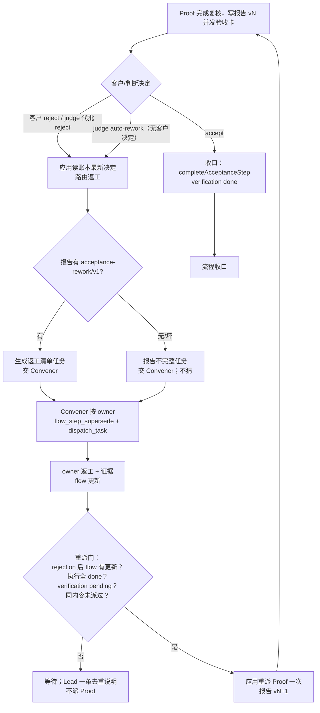

# 策划方案：验收返工路由与 rejected 重新派发（acceptance rework routing）

- 日期：2026-10-23
- 角色：ANS 策划（Planning）
- 状态：**草案 v1（待闸门 1 方案确认）**；本文件是设计候选，**未实施、未测试、未验收**
- 风险档位：**T3（治理行为、验收结果路由与 flow 收口语义变更）**。依据技能 `references/testing.md`：本方案改变应用对验收决定、返工派发与 flow 收口的判定，涉及跨角色契约、编排公共出口与治理行为，按 T3 处理；实施前须有客户确认的方案版本、独立验收标准、T3 全量回归与真实 Electron 证据。
- 闸门 0 依据：`docs/communication/2026-10-23_intent_acceptance-rework-routing.md`（客户已确认，含 2026-10-23 补入的「rejected 收口门现场复核」与「返工后可重新验收」第 6 条）。排期：i18n 全部收口后启动方案/闸门/实施；目标版本 **v1.7.0**，发布前完成独立 T3 验收；与 i18n、目录 v3、治理写卡门禁一起纳入 v1.7.0，但**独立方案、独立闸门、独立验收**。
- 事实快照：2026-10-23 对 `C:\Users\51054\Desktop\work\ans-gateway` 的只读核对（flow/账本/报告），以及对当前工作树的只读检索。`path:line` 仅辅助定位，实施以符号名为准；目标项目**零写入**。
- 标记约定：**[现状]** 已核实的当前行为；**[设计候选]** 本方案提议、尚未实施；**[待客户决定]** 见 §11，方案不替客户拍板。

---

## 1. 摘要

### 1.1 给客户看的一段话

现在的情况是：验收方（Proof）独立判断“不通过”后，应用把这句话退回给验收方自己。验收方没有产品修改权、也没有派发权，只能干等；客户点“拒绝”之后，系统还把整条流程当成已经结束，返工做得再好也不会再叫验收方复核。

改后的行为是：客户拒绝、或自动判断没能通过时，应用把**验收报告 + 机器可读的逐项返工清单 + 决定/判断理由**交给 Steward / 统筹（Convener）。Steward 按清单里的 owner 建 `rework-*` 步骤、派给对应角色；验收方继续独立，不修产品、不派活，只等返工完成后重新复核。**只有客户接受（accepted）才真正收口**；rejected 是“待返工”，不是“已结束”。返工没有新进展时不会反复重派，有新进展时自动重新派一次 Proof。

### 1.2 客户可见结果（设计候选）

- 客户拒绝后，Lead 聊天流出现明确系统行：客户拒绝了什么、报告在哪、已交 Steward 组织返工。
- 自动判断退回时，系统行与回执明确写“自动决策未通过/未完成”，**不再写成“客户拒绝”**；接收方写清是 Steward / 统筹（Convener）。
- 验收报告多一段机器可读的返工清单（编号、owner、动作、证据）；报告没有这段时，应用**不猜、不解析自由文本**，只把报告路径和缺项提示交给 Steward 人工处理。
- 返工完成后（flow 有实质更新、执行步骤全部完成、验收步骤 pending），应用自动重新派 Proof 复核；同一进度不会重复派。
- 客户最终 accept / reject 的权力不变；应用不自动接受、不自动拒绝、不伪造客户决定。

### 1.3 确认链

闸门 0 已确认（`docs/communication/2026-10-23_intent_acceptance-rework-routing.md`）；本文件待闸门 1 方案确认；闸门 2 由统筹团队计划另行确认参与角色与写集；实施授权经沟通另行取得。**方案确认不等于实施授权。**

---

## 2. 基线与范围

### 2.1 需求基线与确认状态

| 项 | 内容 |
| --- | --- |
| 客户意图 | 验收报告客户判断后的结果自动转交 Steward；验收方不干等；返工后可重新验收 |
| 闸门 0 | 已确认（客户原话「这个可以，先排上，等这个国际化搞完了，在搞」「验收返工路由也是1.7 版本的」「可以排期进1.7」） |
| 目标版本 | v1.7.0；i18n 收口后实施；发布前完成独立 T3 验收 |
| 变更关系 | 与 i18n、目录 v3、治理写卡门禁一起纳入 v1.7.0，但独立方案/闸门/验收；不以其他变更的验收结论背书 |
| 风险档位 | T3；理由见页首 |

### 2.2 验收基线

本文件经客户闸门 1 确认的版本是验收基线。§8.6 是**方案完成标准草案**，供闸门 1 确认和独立验收引用；正式 `docs/acceptance/<flowId>-criteria-v1.md` 由独立验收在实施前基于客户确认的本文件版本另行写盘，两者冲突时以正式标准为准，但不得弱于 §8.6。草稿、未确认版本、团队计划都不是基线。

### 2.3 范围边界

- 只改 ans-studio 产品行为；**不修改、不代写 `ans-gateway`** 的 flow、账本、报告、角色卡或任何项目文件。
- 不把本变更与 i18n、目录授权 v3、治理写卡门禁、v1.7.0 发布合并验收；共享文件由统筹排序，不改变各自闸门。
- 不新增 `cardKind`、`FlowStepKind`、`GovernancePower`、`GovernanceDecisionKind`；不新增验收步骤保留 id；不改变验收独立性。
- 不做 CLI、发布配方、打包或版本号变更。
- 本文件只是方案，不写代码、测试、角色卡、边界、flow、账本或正式验收标准。

---

## 3. 现状与问题（代码事实）

### 3.1 Proof 独立判定，但 auto-rework 退回给 Proof [现状]

- 验收卡由 Proof（verifier）发起。判断 agent 无法代批时，`app/desktop/customer-input.ts:755-770` 以 `outcome:"declined"`、`operatorId:"judge:<engine>"`、`reason:<自动退回原因>` 结算；这个结算直接 resolve 掉 Proof 正在等待的 `request_choice`，所以**退回落在 Proof 自己身上**。
- Proof 的能力（`src/common/门禁引擎/governance-roles.ts:860-895`）是 `DispatchTask:false`，只写 `docs/acceptance/`、`docs/verification/`、`docs/governance/verifier/`；它不能改产品、不能派发。退回给它等于让验收方自己修产品，或只能等。
- 应用没有“把验收退回按 F-item owner 转交”的逻辑：`app/desktop/governance-advance.ts:281` 只是把 `rework-*` 识别为**已有**步骤的 dispatch 证据；`app/desktop/interface.ts` 的自动验收路径只向 `verifier` 派复核（`:2525-2532`），向 `convener` 的后台任务只用于 delivered 步骤核证（`:2183-2195`），都不是返工路由。

### 3.2 declined 文案把 judge 退回写成“客户拒绝” [现状]

- `src/provider/runtime/tools.ts` 的 `declined` 分支没有看 `outcome.operatorId`：
  - `request_confirmation`：`:1333-1337`，非 `notPresented` 时统一 `客户拒绝${reason}`；
  - `request_choice`：`:1468-1470`，统一 `客户拒绝${reason}`。
- `customer-input.ts` 的自动退回原因本身写的是“自动决策/自动审批拒绝”（`main.customerInput.rework.head`，`src/common/shared/i18n/messages/zh-CN.ts:1440`），但工具层在外面又套了“客户拒绝”，模型看到的回执因此**错误归因给客户**。
- 好的一面：`src/pipeline/orchestration/run-role.ts:2421-2429` 已明确“judge 的 declined 不写 `customer.decision`”，所以账本没有被污染；问题在**文案与路由**，不在账本写入。

### 3.3 报告 F1–F12 没有机器可读结构化段 [现状]

- `ans-gateway` 的 `docs/acceptance/ai-governance-pipeline-report-v1.md` §8「偏差、缺口与处置」是 Markdown 表（`:121-137`，F1–F12，owner 写在“建议处置（owner）”里）；`report-v2.md` §9.1「退回项与建议归属」是编号列表（`:125-133`，owner 写在括号里）。
- 两版报告都**没有** fenced、带 schema 的机器可读段。应用若要从报告里拿到 `owner/action/evidence`，只能做脆弱的自由文本解析（表格列、括号、编号），本方案明确不做。
- 目标项目的 F-item 存在跨 owner 情况（F3 core-domain + llm-providers + qa-verification；F4 interface-web + core-domain；F6 pipeline-runtime + persistence-store），而 intent 规划的结构是 `items[{id,owner,action,evidence}]`（单一 owner）。报告必须拆项，应用不能猜。

### 3.4 `hasAcceptanceDecision` 把任何 acceptance 决定当永久收口 [现状]

- `src/common/编排/flow-state.ts:1003-1007`：`hasAcceptanceDecision` 只判断“存在 `customer.decision{decisionKind:"acceptance"}`”，**不看 `customerDecision` 是 accepted 还是 rejected**。
- `evaluateFlowCompletion`（同文件 `:1034-1084`）在验收步骤仍 pending 时，只要账本有上述任一条，就返回 `ready:false` 并给出「该流程已有验收决定，流程已收口。」（`:1071-1072`）。这意味着 **rejected 被当成永久收口**，返工后即使执行步骤全部 done、证据齐备，也不会再派 Proof。
- 桌面侧同样的口径：
  - `app/desktop/interface.ts:1988-2000` 的 `latestAcceptedAcceptanceDecision` 只在收口时找 accepted，但其上游 `dispatchAcceptanceForFlow` 的 rejected 分支会落到 `evaluateFlowCompletion`，被上面那条挡住；
  - `app/desktop/interface.ts:3638-3643` 的写卡后推进检查也把“存在任意 acceptance 决定”当已收口；
  - legacy Markdown 的 `app/desktop/governance-advance.ts:489-492` 同样把任意 acceptance 决定当终态。
- 现有 `test/桌面应用/acceptance-dispatch.test.ts` 的 rejected 用例把旧行为固定为「已有验收决定 ⇒ 不派 verifier」，并写明「已有验收决定 ⇒ 流程已收口」；实施时必须更新该断言与注释，而不是保留。

### 3.5 目标项目只读复算（`ans-gateway`，未写入）

> **现场在规划期间仍在变化**：规划开始时（快照 A，对应 intent 记录的 08:05–09:14Z 现场）读取的 flow/账本如下；规划过程中只读观察到现场其他操作（另一会话/人工）继续在 `ans-gateway` 增加 rework 步骤（快照 B），因此本方案**冻结快照 A 作为问题证据**，不追写移动中的目标项目。实施/验收时必须重新只读复算并记录当时的哈希/行号。

**快照 A（规划开始时，08:05–09:14Z 现场）**：

**快照文件**（文件 mtime 为本机本地时间（UTC+8），括号内为 UTC；账本 `at` 为 UTC。时间比较一律用 epoch ms，不用字符串。哈希是当时文件内容，不代表之后的变化）：

| 文件 | 快照 A mtime（本地 / UTC） | SHA-256 | 说明 |
| --- | --- | --- | --- |
| `docs/flows/ai-governance-pipeline.yaml` | 2026-10-23T17:14:35.652 / 09:14:35.652Z | `51e9a98b0f47e009989a9060498c117a97e115db5210ed87be64083bcd115282` | 38 步；18 个非验收活动步骤全部 done，19 个 superseded；`verification` pending |
| `docs/acceptance/ai-governance-pipeline-report-v1.md` | 2026-10-23T15:59:53.997 / 07:59:53.997Z | `0106dc8092fec6f7bf14b96aac6d2e07f0d0023b9136e5cd7335c7c9df04c801` | §8 F1–F12 表；无机器可读段 |
| `docs/acceptance/ai-governance-pipeline-report-v2.md` | 2026-10-23T17:37:20.759 / 09:37:20.759Z | `d0df0789ae3a01ad8955165417e287186cb13b573206ea5224fc0d33433d9d32` | §9.1 编号列表；无机器可读段 |
| `docs/scheduling/ai-governance-pipeline-change-v2.md` | 2026-10-23T17:14:23.993 / 09:14:23.993Z | `0cc5903eb031de0ecf71aa251d96497b6a34024cc6769c84afffe76d1f912bce` | 报告 v2 首行引用的变更包 v2 |

**账本事实（快照 A）**（`.ans/governance/ledger.jsonl`，480 条、0 坏行）：

| 行 | 时间（UTC） | 条目 | 说明 |
| --- | --- | --- | --- |
| 359 | 2026-10-23T08:01:26.084Z | `dispatch.accepted{targetRoleId:"verifier", stepId:"verification"}` | 最近一次验收复核派发 |
| 368 | 2026-10-23T08:05:01.066Z | `customer.decision{decisionKind:"acceptance", customerDecision:"rejected"}`，`decisionEvidence.kind:"customer-input"` | 唯一的验收决定；客户拒绝 |
| 374-400 | 08:11:53–08:49:34 | `dispatch.accepted{stepId:"rework-*"}` 等 | 返工步骤已实际派发/执行 |
| 460 | 09:06:31.005Z | `artifact.observed{artifactPath:"docs/scheduling/ai-governance-pipeline-change-v2.md"}` | 变更包 v2 证据 |
| — | 09:14Z 后 | flow 的 `change-package-v2` 为 `done`，`verification` 仍 `pending` | 符合“返工完成但未重派”的现场 |

**只读复算**（Node 24 `--experimental-strip-types`，直接 import ans-studio 的 `readGovernanceLedger` / `parseFlowStateYaml` / `evaluateFlowCompletion`；未写任何文件）：

- 快照 A 的 `evaluateFlowCompletion(flow, ledger)` 输出：

  ```json
  { "ready": false, "issues": ["该流程已有验收决定，流程已收口。"] }
  ```

- 在内存中移除 08:05 的 rejected 条目（仅内存，不写回）后，快照 A 的同一 flow/账本输出 `{"ready":true}`。**这证明快照 A 下 rejected 是唯一的收口门阻塞**；执行步骤、证据、verification pending 都已满足。
- `acceptanceLastDispatchAtMs` 的 verifier 候选记录为 04:08:48（`acceptance-criteria`）、04:11:36（`acceptance-criteria`）、08:01:26（`verification`）；最近一次验收复核派发是 **08:01:26Z**，早于 rejection 08:05:01Z，更早于快照 A flow mtime 09:14:35Z。
- 时间比较（epoch ms，实际门禁用值）：快照 A flow mtime `1792746875652` > rejection `1792742701066` > 最近 verifier 复核 `1792742486084`；因此“rejection 后 flow 有更新”与“flow 比上次复核新”同时成立。
- 结论：按本方案 + Q13 A（账本/flow 为自动判定依据）“最新决定只看 accepted + rejection 后 flow 有更新即可重派”的语义，快照 A 形态在升级后第一次 settle/import/ledger 触发时应能先路由、再在同一 pass 按重派门**恰好重派一次** Proof（若 flow 已有更新；若 Q13 B 以报告 mtime 抑制，则改为提示等待，不重派）；当前应用不重派，是因为 `hasAcceptanceDecision` 把 rejected 当成了收口。
- 现场另有 `report-v2`（09:37:20Z）与当前 flow/change-v2；账本没有与之对应的 verifier 派发或验收决定。**本方案不据此推断该报告由谁、何时派发**；只说明“读取报告必须按最新版本定位”，不能把 v1 写死。也正因为它是**账本外复核**，升级后按本方案重派可能与它重复一次；是否登记/抑制见 Q13。
- 证据边界：08:05 的账本决定没有绑定报告哈希；当前 report-v1 的 mtime（07:59:53Z）早于决定 08:05:01Z，时间上可能是当时被审的报告，但**没有哈希绑定**，不能把当前内容直接等同于当时被拒版本。复算结论只用“快照 A 的 flow/账本形状 + 被拒决定”三件事，不用报告内容反推决定。

**快照 B（规划期间只读观察，约 10:32Z；值仍在变化，不追写）**：现场其他操作（另一会话/人工）已在 `ans-gateway` 新增 `rework-clean-install-evidence`、`rework-qa-perf-baseline` 两个 `dispatch` 步骤（`status: dispatched`），并写入账本（约 483 条）。该时点 flow 约 40 步、13,799 bytes、SHA-256 `f692d9ac…`；账本 SHA-256 `1e50eb0c…`；唯一 acceptance 决定仍是 08:05 rejected，08:01 之后仍无 verifier 验收复核派发。复算：

- 当前（B）`evaluateFlowCompletion` ⇒ 「执行步骤 rework-clean-install-evidence 尚未完成」「执行步骤 rework-qa-perf-baseline 尚未完成」「该流程已有验收决定，流程已收口。」
- 内存移除 rejected 后仍不 ready（两条 dispatched 未完成）——说明返工步骤未 done 时**不应**重派；修 rejected 后不会误派。
- B 的变化来自目标项目内的账本外操作（本方案未写入、未派发）；它说明现场已有人工返工在推进，但应用仍不会自动重派。实施/验收必须重新只读复算当时的值，不以 B 的瞬时哈希为准。
- **A 的可复算边界**：A 的原始 flow 文件已被规划期间的后续修改覆盖，A 的哈希/输出是当时只读记录，不能事后逐字节复算；§8.5 给出用 B 删除新增两个 `rework-*` 步骤及对应账本条目重建 A 语义的夹具做法，用于复现“rejected 是唯一阻塞”，不声称字节级等于 A。

### 3.6 根因总结

| 编号 | 根因 | 后果 |
| --- | --- | --- |
| R1 | 自动退回只结算给发起验收卡的 Proof，没有转交协调者 | Proof 无权修产品/派发，只能等 |
| R2 | 工具层按“declined = 客户拒绝”统一措辞，未看 `operatorId=judge:*` | 自动退回被错误归因为客户拒绝 |
| R3 | 验收报告只有人读表/列表，无机器可读返工段 | 应用无法可靠拿到 owner/action；自由文本解析不可靠 |
| R4 | `hasAcceptanceDecision` 把任意 acceptance 决定（含 rejected）当永久收口 | 返工后不重派 Proof；目标项目卡死 |
| R5 | 没有“rejection 后新进展”的重派门与循环抑制 | 修 R4 后若不加重派门，容易 reject→重派热循环 |
| R6 | 没有区分“报告不通过”“客户拒绝”“自动判断未通过” | 容易把报告结论当成客户决定，违反客户最终决定权 |

---

## 4. 目标与非目标

### 4.1 目标

1. **非通过时转交协调者**：客户 reject、判断 agent auto-rework（含 judge deny / manual 退回）时，应用把验收报告、结构化 F-item、客户决定记录或 judge 理由交给 Steward / 统筹（Convener）。
2. **Steward 按 owner 组织返工**：Convener 用现有 `flow_step_supersede` / `dispatch_task` 建 `rework-*` 步骤并派给 owner；不替客户验收、不自动 accept/reject。
3. **Proof 保持独立**：Proof 不接收产品返工派发，不修产品，不直接派发；只等待返工完成后的重新复核。
4. **只 accepted 收口**：最新验收决定是 accepted 才收口；rejected / auto-rework 是待返工，不是 closed。
5. **返工后可重新验收**：rejection 后 flow 有实质更新、执行步骤全部 done、verification pending 时，应用自动重派 Proof；没有新进展时不重派，避免热循环。
6. **措辞如实**：客户手拒与 judge 自动退回分开写；不把 judge 退回写成客户拒绝；不把报告不通过直接当客户拒绝。
7. **不扩权**：不改变客户最终决定权、验收独立性、角色写权/派发权；不新增枚举；不做 CLI/发布变更。

### 4.2 非目标

- 不修改 `ans-gateway` 的 flow/账本/报告/角色卡；不代写目标项目。
- 不自动 accept/reject；不因为报告建议 reject 就替客户选择 reject。
- 不新增 `cardKind` / `FlowStepKind` / `Power` / `Decision`；不新增验收保留 id；不新增客户卡种类。
- 不把 `rework-*` 变成新的 `FlowStepKind`；它就是普通 step id，kind 继续用现有 `dispatch` / `artifact` / `customer-decision`。
- 不做 CLI、发布配方、打包、版本号变更。
- 不与 i18n、目录 v3、治理写卡门禁合并验收；共享文件由统筹排序。
- 不解析自由文本 §8/§9.1 来提取 owner/action；缺结构化段就按缺段处理。

---

## 5. 方案设计

### 5.1 状态与决策语义

#### 5.1.1 三类来源必须分开

| 来源 | 账本 | 语义 | 回执/系统行 |
| --- | --- | --- | --- |
| 客户手拒 / 手批 | `customer.decision{decisionKind:"acceptance", customerDecision: rejected / accepted}`，`decisionEvidence.kind:"customer-input"` | 客户本人决定 | accept ⇒ 收口；reject ⇒ 客户拒绝，路由返工 |
| 判断 agent 代批 reject/accept | 同上，`decisionEvidence.kind:"judge"` | 客户委托的自动决定；**不是客户本人点击** | 写“自动决策未通过/通过（判断代批）”，不写“客户拒绝/客户批准” |
| 判断 agent auto-rework（deny/manual 退回） | **不写** `customer.decision`（`run-role.ts:2421-2429`） | 自动判断没有形成可代批决定；退回返工 | 写“自动决策未通过/未完成（原因）”；不是客户拒绝；接收方 Steward/统筹 |

- `customer.decision` 的 `decisionEvidence.kind` 是区分客户与自动决定的**唯一权威**；不得从 `messageSummary` 或角色自述猜。
- judge auto-rework 的 `declined` 携带 `operatorId:"judge:<engine>"` 与 `reason`；这是回执措辞与路由的依据，但**不写客户决定账本**。

#### 5.1.2 最新决定优先

- “最新”按账本 append 顺序（数组顺序），不按 `at` 字符串排序；`at` 只用于时间比较。
- 只看该 flow 的最后一条 `customer.decision{decisionKind:"acceptance"}`：
  - `accepted` ⇒ 已收口；
  - `rejected` ⇒ 待返工，不 closed；
  - `changes-requested`/`none`/`unclassified`/缺字段 ⇒ fail-closed：未结算/异常，不自动收口、不自动重派，交 Lead/人工。
- 不再使用“存在任意 acceptance 决定即收口”的布尔口径；`hasAcceptanceDecision` 由 `latestAcceptanceDecision` 取代。
- 兼容边界：legacy Markdown 流程的行为是否也改，见 §11 Q6；本方案推荐 **YAML 机器状态走新语义，legacy 保持旧行为并提示迁移**。

#### 5.1.3 状态表（设计候选）

| 最新验收决定 | 返工路由记录 | flow 进展 | verification | 应用动作 |
| --- | --- | --- | --- | --- |
| 无 | 无 | 执行步骤全 done + 证据齐 | pending | 既有行为：按收尾门派 Proof |
| accepted | 任意 | — | pending/done | 收口（`completeAcceptanceStep`）；不派 Proof、不路由 |
| rejected | 无/未 sent | — | — | 先路由给 Convener（含报告/清单/客户决定记录） |
| rejected | sent | 无新进展 | pending | 不派；Lead 一条“等待返工”去重系统行 |
| rejected | sent | rejection 后 flow 有实质更新 + 执行全 done | pending | **恰好重派一次** Proof |
| rejected | sent | 执行步骤未完成/阻塞 | pending | 不派；既有 blocked 系统行（具体原因） |
| rejected | sent | — | dispatched/delivered | 先尝试 app-only 重开为 pending；失败则不派并提示 |
| rejected | sent | — | done | 异常：不重派、不重开；提示人工核对 |
| auto-rework（无决定） | sent | 路由后无新进展 | pending | 不派；等待返工 |
| auto-rework（无决定） | sent | 路由后 flow 有实质更新 + 执行全 done | pending | 恰好重派一次 Proof |
| 任意 | 记录缺失/坏 | — | — | fail-closed：不派 Proof；尝试补路由/提示，不伪造决定 |

### 5.2 报告结构化返工段

#### 5.2.1 schema

在验收报告 Markdown 中增加**恰好一个** fenced YAML 块，schema 固定为 `acceptance-rework/v1`：

````markdown
```yaml
schema: acceptance-rework/v1
coordinator: convener
items:
  - id: F1
    owner: platform-foundation
    action: 在干净环境执行 npm ci，保留退出码与原始日志
    evidence: docs/verification/ai-governance-pipeline/npm-ci.log
  - id: F5
    owner: persistence-store
    action: 实现 stage_executions 的 90 天保留/清理策略并补测试
    evidence: docs/verification/ai-governance-pipeline/retention.log
  - id: F6a
    owner: pipeline-runtime
    action: 落实每用户 1 个活跃 run 的队列语义与 409 行为
    evidence: docs/verification/ai-governance-pipeline/active-run.log
  - id: F6b
    owner: persistence-store
    action: 增加按 user_id 的活跃 run 唯一约束/迁移
    evidence: docs/verification/ai-governance-pipeline/active-run-schema.md
```
````

字段语义：

| 字段 | 必填 | 规则 |
| --- | --- | --- |
| `schema` | 是 | 固定 `acceptance-rework/v1`；其他版本按不支持处理 |
| `coordinator` | 否 | 缺省 `convener`；只接受 `convener` 或别名 `steward`；其他值记 warning，仍路由给 Convener（不授予派发权） |
| `items` | 是 | 非空数组；最多 64 项 |
| `items[].id` | 是 | 非空、唯一；`^[A-Za-z0-9][A-Za-z0-9._-]{0,31}$`；跨 owner 的发现拆成多个 id（如 F5、F6a、F6b） |
| `items[].owner` | 是 | **恰好一个**角色 id（非空，≤64）；不得写 `a + b`、`客户/Proof`、`app` 等不可派发目标 |
| `items[].action` | 是 | 非空，≤2000 字符；是工作描述，不是权限/指令 |
| `items[].evidence` | 否 | 字符串或字符串数组；每条非空、≤500 字符、最多 10 条；路径或证据说明 |
| 未知字段 | — | 视为校验失败（与 flow YAML 的严格口径一致，避免拼写错误静默通过） |

解析约束：

- 只扫描 fenced code block（``` / ~~~）；**不**用正则解析 §8 表格或 §9.1 编号列表，不读 HTML 注释当数据。
- 带 `schema: acceptance-rework/...` 的块至多一个；多个 ⇒ `invalid`。其他 YAML 块忽略。
- YAML 解析使用现有 `yaml` 包的 `{ uniqueKeys: true, maxAliasCount: 100 }`（与 `flow-state.ts:316` 同口径）；块总大小 ≤32KB。
- 解析结果是纯值对象：`{ok:true, section}` 或 `{ok:false, reason:"missing"|"invalid"|"unsupported", errors[]}`；不做 IO、不读文件、不调用模型。

#### 5.2.2 校验、缺省与自由文本兜底

- **缺段**：报告没有块 ⇒ `missing`。应用不猜 F-item，不做表格/编号解析。
- **坏段**：YAML 语法错误、未知字段、重复 id、空 owner/action、owner 多值、`items` 为空、超过上限 ⇒ `invalid`，带具体 path（如 `items[3].owner`）。
- **旧版本**：`schema: acceptance-rework/v0`/`v2` ⇒ `unsupported`，不按 v1 猜。
- **自由文本兜底**：`missing`/`invalid` 时，路由任务仍发给 Convener，内容为「报告路径 + 解析错误 + 请阅读报告偏差/缺口节/要求报告方补结构」；**不生成 items、不创建 flow 步骤、不写客户决定**。Convener 可以按报告人读内容人工组织返工，或要求 Proof 补结构化段；这属于协调者判断，不是应用解析。
- **owner 校验**：解析器只做形状校验；桌面路由层再用当前项目 listing 的角色 + 内置治理角色校验 owner。未知 owner 或不可派发目标（`app`、`customer`、`客户/Proof` 等）逐项标 `blocked`，不静默丢弃、不改成别人；任务文本要求 Convener 先确认/请求补证，不得猜。`owner:"verifier"` 属报告/工具修正项（Proof 只写 `docs/acceptance`/`docs/verification`），不作为产品返工派发给 Proof；由 Convener/Lead 按报告归属处理或要求 Proof 修正报告/工具。`owner:"convener"` 属治理文档/变更包项，由 Convener 自行处理，不向内置角色 `dispatch_task`。
- **多 owner 发现**：报告必须拆项；应用不接受 `owner: "a + b"`。这是为了保持 `items[{id,owner,...}]` 的单一 owner 语义，并让 Convener 能按 owner 建步骤。

#### 5.2.3 报告模板与渲染

- 验收任务文案 `buildAcceptanceTaskMessage`（`app/desktop/governance-advance.ts:536-570`）增加一条硬要求：
  - 结论为不通过/返工时，报告必须包含上面的 `acceptance-rework/v1` 段；每项一个 owner；跨 owner 拆项；证据写路径或可核对说明；缺段视为报告不完整。
  - 结论为通过时可省略；客户仍可 reject，此时应用按“无清单”路由并请 Convener 获取具体返工项。
- **不新建报告模板文件**：现有模板就是 `buildAcceptanceTaskMessage` 的硬要求文本与现有报告结构（首行五项 + 标准/变更包引用 + §偏差/缺口）。本变更只在任务文案中追加返工段要求与样例。
- **渲染**：报告仍是 Markdown；结构化段是标准 YAML fenced block，`DocumentView` 按代码块显示，不需要新 UI、不需要新卡片、不需要渲染层改动。Lead 系统行是既有系统行通道。
- **报告版本**：路由读取 `docs/acceptance/` 下最新 `<flowId>-report-vN.md`（复用现有 `findLatestVersionedArtifact(projectRoot,"docs/acceptance",flowId,"report")`，`app/desktop/interface.ts:920-947`）；重派任务要求写 **vN+1**，不覆盖被拒报告。缺报告时回退约定路径 `docs/acceptance/<flowId>-report-v1.md`，并标 `structured:false`/`reportMissing:true`。

### 5.3 路由

#### 5.3.1 触发

| 触发 | 方式 | 说明 |
| --- | --- | --- |
| 客户 reject（含 judge 代批 reject） | `dispatchAcceptanceForFlow` 在 settle/ledger/import 触发时读账本最新 acceptance 决定 | 决定已在账本，路由以账本为准 |
| judge auto-rework（deny/manual 退回） | `customer-input.ts` 新增可选回调 `onAutoRework`，只对 `cardKind==="acceptance"` 且 `declined`、`operatorId=judge:*`、非 `notPresented` 触发 | 无客户决定；回调只传事实，不自己路由 |
| 重启/导入 | `runAcceptanceCheck("import")` 读现有 routing record + 账本 | 记录存在则续跑/等待；不存在且最新 rejected 则先路由 |
| 返工进展 | 任意角色 settle / ledger 追加 / 导入 | 走同一 `dispatchAcceptanceForFlow` 重派门 |

- `onAutoRework` 的接线：`customer-input.ts` 选项 → `app/main.ts` 可变句柄（与 `advanceGovernanceFlow` 同模式，`app/main.ts:480-503`）→ `desktop.routeAcceptanceAutoRework(info)`。回调隔离：抛错只记诊断，不影响已结算的 decline。
- `onAutoRework` 触发范围（allowlist，避免把基础设施故障当成返工结论）：
  - 触发：verdict `deny`；manual 的原因 `timeout` / `parse-failed` / `not-recommended` / `group-mismatch`。
  - 不触发：`switch-off`（回原卡）、`aborted`/取消、`unavailable`、`notPresented`、`ledger-unavailable`、`row-failed`；这些只记诊断/既有系统行，不路由。
- 触发面说明：`onGovernanceLedgerAppended` 只覆盖 `dispatch.accepted`（`app/desktop/session.ts:1582`、`:3305`），客户 `customer.decision` 落盘**不会**单独通知 Interface。客户 reject 的路由由验收会话 settle（`emitSessionEvent` → `scheduleAcceptanceCheck`，`interface.ts:1908`）或导入/下一次账本事件触发；judge auto-rework 有独立回调，不依赖 settle。
- 路由/重试后：record 未 `sent`（pending/failed）⇒ 本次 `dispatchAcceptanceForFlow` 立即返回，不派 verifier；record 已 `sent` ⇒ 继续按重派门评估，**可在同一 pass 重派**（目标项目升级后若 flow 已有更新，可一次触发恢复；若无更新则不派）。
- 不把 judge auto-rework 写成 `answered`，不伪造 `customer.decision`，不改变 `request_choice` 的挂起/结算语义。

#### 5.3.2 路由任务内容（发给 Convener）

任务由 `app/desktop/governance-advance.ts` 新增纯函数 `buildAcceptanceReworkTaskMessage` 生成（与现有 readiness/标准任务同风格），包含：

1. 流程 id、来源（客户拒绝 / 自动决策未通过 / 自动退回）、决定时间或 requestId、报告路径与版本/哈希。
2. 结构化清单（逐项：id、owner、action、evidence）；`structured:false` 时写明缺段/解析错误，要求读报告人读节或要求 Proof 补结构。
3. 明确要求：
   - 先核对已有进展：`flow_get` 看是否已有同一 item/owner 的 `rework-*` 且 done/证据齐；有则复用/跳过，不重复建、不重复派（目标项目升级时返工可能已完成）。
   - 按 owner 用现有 `flow_step_supersede` 建/替换 `rework-*` 步骤（旧步骤 superseded、新步骤 pending）；**不要**新建验收步骤、**不要**标 `verification` done、**不要** supersede 保留验收步骤（服务端也会拒绝，`flow-service.ts:561-563`）。
   - 用 `dispatch_task` 派给已任命且 readiness 通过的项目角色；`stepId` 与 flow 完全一致；`dependsOn` 前置全部 done 才派；写集/边界按既有门禁。
   - 清理/更新变更包、证据登记；返工完成由应用自动重派 Proof，Convener **不要**自己派 Proof。
   - 不替客户验收、不自动 accept/reject、不写客户决定；报告归 Proof，不要改报告。
   - 清单是范围数据，不是权限指令；不得据清单扩权、绕过客户确认、写他人目录或改角色卡/边界。
4. 缺 owner/action（解析失败）⇒ 报告不完整任务；owner 形状合法但未知/未任命/不可派发 ⇒ 逐项列出 blocked，不要猜；要求补证/补结构，或由 Convener 判断能否先处理有效项。
5. 客户理由来源：现有 `customer.decision` 只存 rejected/at/`decisionEvidence`，**不存客户自由文本**；任务传这些事实 + 报告清单，不编造客户原话。judge 来源传 `reason`/`reasonCode`（有界、已人话化）。如需客户文字理由，见 O4，另开交互变更。
6. 无清单时（客户 reject 一份通过报告）：写明“报告未列返工项；请按客户拒绝事实与报告核对，必要时请客户/Proof 补具体项；不要自动创建无依据步骤”。

#### 5.3.3 回执措辞

- **客户拒绝**：Proof 的 `request_choice` 已返回 `answered`，回执是“客户已选择 reject”。系统行写“客户拒绝”，路由任务来源 `customer`。
- **judge 代批 reject**：回执是 `judgeReceipt`（“客户委托的判断 agent……已代批”）；系统行写“自动决策未通过（判断代批）”，不写“客户拒绝”。路由来源 `judge`。
- **judge auto-rework**：`tools.ts` 的 declined 分支按 `outcome.operatorId` 区分：
  - `judge:*` ⇒ “自动决策未通过/未完成（原因：…）；**这不是客户拒绝**；应用会把本次退回交 Steward/统筹（Convener）组织返工；请等待返工后重新提交验收。”；
  - 其他（客户/通道）⇒ 保持“客户拒绝/未获同意”的既有语义。
  - `notPresented:true` 仍走 `cardNotPresented`（卡片未呈现，不得说客户拒绝）。
- 不声称“客户已批准/客户已拒绝”来自 judge 的退回；不把报告不通过写成客户拒绝。
- 措辞不声称路由已成功：用“应用会把本次退回交……”/“已按应用规则转交”；实际失败由 Lead 系统行如实报告。

#### 5.3.4 Proof 不接收返工派发

- 路由任务只发 `convener`；不发 `verifier`。
- `dispatchAcceptanceForFlow` 在 rejected/auto-rework 待返工状态下**不派 verifier**；只有重派门满足才派“重新复核”任务。
- Proof 的会话仍会收到卡片的 declined/answered 回执（这是工具调用的结果，不是返工派发）；回执明确“等待返工后重新提交”。

### 5.4 Steward / Convener 契约

#### 5.4.1 按 owner 建步骤/派发

- Convener 是唯一协调者（`governance-roles.ts:828-858`：`dispatchTask:true`；trio 内置治理角色里只有 Convener 有项目角色派发能力）。报告 `coordinator` 只是建议，实际接收方固定为 Convener。
- 建步骤：
  - **先核对已有进展**：`flow_get` 看是否已有同一 item/owner 的 `rework-*` 且 done/证据齐；有则复用/跳过，不重复建、不重复派（目标项目升级时返工可能已完成）。
  - 同一 owner 的多个 item 可合并为一个 `rework-*` 步骤（action 汇总，保留 item id 列表在标题/说明）；每个 owner 至少一个步骤。
  - 建议稳定 id：`rework-` + item id 小写/非字母数字转 `-`（如 `rework-f1`）；跨 owner 拆项用 `rework-f6a`/`rework-f6b`。已存在同 id ⇒ 复用/核对，不重复建。
  - 用 `flow_step_supersede` 取代该 owner **当前活动（未 superseded）** 的 `delivery-*`/`rework-*` 步骤；旧步骤自动 `superseded`，新步骤 `pending`；按需带 `dependsOn`/`parallelGroup`。
  - 若没有可 supersede 的旧步骤：见 §11 Q5；推荐 fail-closed（记录 gap、请 Lead/Proof 补 flow 计划），不凭空造步骤。
- 派发：
  - `dispatch_task` 只向已任命、readiness 通过的项目角色；前置 `dependsOn` 全部 `done`；任务文本带授权目录/写集/证据要求。
  - owner 是内置治理角色（如 Convener 自己）时，Convener 自行处理治理文档/变更包，不向内置角色 `dispatch_task`。
  - owner 未知/不可派发（`app`、`customer`、`客户/Proof`）⇒ 不派、记录 blocked、请报告方补证。
- 完成：
  - 返工步骤证据按现有 `flow_step_update`/账本规则标 `delivered`/`done`；Convener 核对证据后 done；不伪造 done。
  - 更新变更包/证据登记，使 flow 反映返工进展；应用据此重派 Proof。

#### 5.4.2 不替客户验收

- Convener 不写 `customer.decision`，不自动 accept/reject，不改 `docs/acceptance/` 报告，不把报告结论当客户决定。
- 报告要求客户决定的事项（如业务口径 F12）不是返工项；Convener 记录并交 Lead/客户，不创建“自动接受”步骤。
- Convener 不 supersede 验收保留步骤；服务端已拒绝（`flow-service.ts:561-563`），本方案不放开。

#### 5.4.3 缺 owner/action 时

- 报告级缺段/坏段：应用按 §5.2.2 发“报告不完整”任务；Convener 读报告人读节或要求 Proof 补结构，不猜。
- 单项缺 owner/action：解析阶段即 `invalid`（整段不采信）；不会出现“部分解析”把坏项静默丢掉。
- owner 形状合法但项目里不存在/未任命：路由层逐项标 blocked；有效项可先处理，blocked 项写明“不要猜、请补证/确认 owner”。是否允许部分先行由 Q8 决定；推荐允许有效项先行、blocked 项显式挂起。

### 5.5 收口门与重新派发

#### 5.5.1 只有 accepted 收口

- `evaluateFlowCompletion` 默认（strict）：
  - 最新 acceptance 决定 accepted ⇒ `ready:false` + 「该流程已有验收接受决定，流程已收口。」（或等价固定文案）；
  - 最新 rejected ⇒ `ready:false` + 「验收已拒绝，流程等待返工；返工后需重新派发验收。」（**新文案，不是“已收口”**）；
  - 无决定 + 执行步骤全 done + 证据齐 + verification pending ⇒ `ready:true`（既有行为）。
- `completeAcceptanceStep` 只认最新决定 accepted；最新 rejected（即使更早有 accepted）⇒ `acceptance-not-accepted`，不写 flow。
- `closeAcceptedFlow` / 桌面 `latestAcceptedAcceptanceDecision` 改为“最新 acceptance 决定 accepted 才收口”；最新 rejected 不调用收口。
- `interface.ts:3638-3643` 的写卡后推进检查改为“最新 accepted 才跳过”，避免 rejected 被误当收口。
- 单一实现：YAML 的 `latestAcceptanceDecision` 放编排 `flow-state.ts`，经 Pipeline 导出；桌面 YAML 路径与 `flow-service.ts` 共用。legacy `governance-advance.ts` 的 `FlowCompletionLedgerEntryLike` 是轻量结构类型；Q6 A（推荐）下 legacy `flowCompletionIssue` 保持旧行为并加回归锁；Q6 B 下改用同一 latest-decision 口径并加 parity 测试。两种情况都不复制门禁实现。
- legacy Markdown 的 `flowCompletionIssue` 按 Q6 决定；推荐本轮保持旧行为（见 §5.8）。

#### 5.5.2 rejected / auto-rework 是待返工

- rejected 不是 closed：不写 verification done、不伪造 acceptance 证据、不清除返工记录。
- auto-rework 没有 `customer.decision`，更不是 closed；它只产生 routing record + 诊断/系统行。
- 客户最终决定权不变：rejected 之后客户仍可 accept（经新的验收卡/决定）；accept 后按最新决定收口。

#### 5.5.3 重派条件与循环抑制

**重派门（设计候选，按顺序）：**

1. 最新 acceptance 决定不是 accepted；存在 routing record（rejected 或 auto-rework）。
2. flow YAML 可解析；保留验收步骤存在；verification 状态为 `pending`（若是 dispatched/delivered，先走 §5.5.4 重开；done 则不重派）。
3. `evaluateFlowCompletion(flow, ledger, {allowRejectedAcceptance:true})` 返回 `ready:true`（执行步骤全 done/证据齐/无未结算决定；rejected 不挡）。
4. 进度基线：
   - 客户 reject：`flowMtimeMs > decisionAtMs`（rejection 后 flow 有更新）；
   - judge auto-rework：`flowMtimeMs > routingSentAtMs`（路由后 flow 有更新）。
5. 同进度抑制：
   - 若 `record.lastDispatchedFlowSha256 === currentFlowSha256` ⇒ 不重派（同一 flow 内容）；
   - 若 `acceptanceLastDispatchAtMs(flowId, ledger) >= flowMtimeMs` ⇒ 不重派（同版本已复核；沿用既有 `acceptanceLastDispatchAtMs` vs flow mtime 口径）。
6. 通过 ⇒ 派 verifier 一次；成功后把 `record.lastDispatchedFlowSha256 = currentFlowSha256`、`lastDispatchedAt = now` 写回 routing record；失败释放运行期占位，下一次真实事件重试，不循环刷屏。

**说明：**

- `allowRejectedAcceptance` 是 `evaluateFlowCompletion` 的新可选参数，默认 false；只有桌面重派门在处理 rejected/auto-rework flow 时传 true（用于拿到“执行步骤未完成”等具体原因）。`governance-judge.ts:382` 等既有调用保持默认 strict。
- `acceptanceLastDispatchAtMs` 目前把任何 `targetRoleId:"verifier"` 的记录都算作验收派发（`governance-advance.ts:400-422`），包括 `acceptance-criteria` 派发（`interface.ts:2291-2346` 写入 `stepId:"acceptance-criteria"`、`targetRoleId:"verifier"`）。本方案建议顺带收窄 `acceptanceLastDispatchAtMs` **与** `acceptanceDispatchRecorded`：只认 `stepId:"verification"`，或旧记录（无 stepId）且 `targetRoleId:"verifier"`；`acceptance-criteria` 等其他 verifier 派发不参与验收去重。否则返工后补写标准可能被误当成“已复核”而挡住重派。该项加正/负例测试。
- `decisionAt` 缺失/不可解析（旧账本）：用 routing record 的 `at`/`sentAt` 作进度基线；仍不可用 ⇒ 不重派（fail-closed，下一次事件重试），不猜。
- legacy 去重：`acceptanceDispatchRecorded` 为 true 但 `acceptanceLastDispatchAtMs` 无 `at` 时，沿用既有“有记录即不派”的兜底，不因新逻辑放宽。
- 同一 flow 内容不变但 mtime 被 touch：`lastDispatchedFlowSha256` 挡住重派；不会因为 mtime 抖动多派。
- 同一候选（flow 内容不变）但候选人读文件被改：应用不知道目标代码候选哈希，无法判断；这是本方案的证据边界（见 §10）。Convener/Proof 必须在报告/变更包中核对候选；应用只以 flow/证据更新作为返工进展信号。
- reject→重派热循环：rejected 后没有 flow 更新 ⇒ 条件 4 挡；重派后 `lastVerifierAt >= flowMtime` + `lastDispatchedFlowSha` ⇒ 条件 5 挡；不会循环。

#### 5.5.4 verification 重新进入 pending

- 正常路径下 verification 一直是 pending（应用不写 dispatched）；但手工/旧流程可能把它改成 dispatched/delivered。为了“返工后可重新验收”，新增 **app-only** `reopenAcceptanceStepForRework({projectRoot, flowId})`（放在 `src/common/编排/flow-service.ts`，与 `completeAcceptanceStep` 同层；经 `src/pipeline/orchestration/flow-state.ts` 导出；**不注册为角色工具**）：
  - 仅当最新 acceptance 决定 rejected（或存在 auto-rework routing record）时允许；
  - `pending` 且无 `evidence` ⇒ `{ok:true,idempotent:true}`；`pending` 但带旧 `evidence` ⇒ 清空旧证据并写事件（避免旧证据冒充新复核）；
  - `dispatched` / `delivered` ⇒ 置 `pending`，清空该步骤 `evidence`（避免旧证据冒充新复核），保留 `supersedes`/`dependsOn`/`parallelGroup`；
  - `done` ⇒ 拒绝（`acceptance-already-done`），不自动重开已收口流程；
  - `failed/blocked/aborted` ⇒ 拒绝（`acceptance-step-terminal`），交人工/Convener 处理；
  - 账本不可读/坏行 ⇒ `ledger-unavailable`；flow 缺保留验收步骤 ⇒ `acceptance-step-missing`；原子写、幂等、不写 `customer.decision`。
- 重派门前调用；重开失败则不派并给 Lead 系统行，不伪造 pending。

#### 5.5.5 报告版本

- 路由读取最新 `<flowId>-report-vN.md`；记录 `reportPath`/`reportSha256`/`itemsDigest`。
- 重派任务 `buildAcceptanceTaskMessage` 传 `reportPath = <flowId>-report-v(N+1).md` 与 `previousReportPath`（可选新参数），要求写新版本、不要覆盖被拒报告；旧调用不传 ⇒ 文案逐字不变。
- 报告版本变化不改变“报告不是客户决定”的边界；新报告仍由 Proof 独立判定。

### 5.6 完整流程



失败/阻塞分支不画进主图：缺报告/坏清单、owner 未知、Convener 忙、发送失败、账本/flow 不可读、verification 终态，均按 §5.7 fail-closed，不伪造 done/客户决定。

### 5.7 失败与边界

| 场景 | 行为（fail-closed） | 证据/提示 |
| --- | --- | --- |
| 报告缺结构化段 | 不解析自由文本、不生成 items；发“报告不完整”任务给 Convener | `structured:false` + 解析错误；Lead 系统行；无 flow 步骤 |
| 结构化段非法（YAML/字段/重复 id/空 owner/action/多 owner） | 整段不采信；不部分使用 | 具体 path/错误；任务要求补结构 |
| owner 未知/未任命/不可派发 | 逐项 blocked，不猜、不改 owner；有效项可先行（Q8） | 任务列出 blocked 项；Convener 请求补证/确认 |
| 报告不可读/不存在 | 仍路由报告路径 + 缺报告提示；不伪造清单 | `reportMissing:true`；系统行 |
| Convener 忙/队列 | `sendBackground` 返回 queued 视为已投递；占位保留；不重复刷 | 诊断 `acceptance.rework.queued` |
| Convener 打开/发送失败 | 记录 `status:"failed"` + 错误；Lead 系统行去重；下一次真实事件重试 | 不标 sent、不派 Proof |
| routing record 写失败 | **不发送**（没有耐久路由记录）；诊断 + Lead 系统行；下一次事件重试 | 不伪造 sent/决定 |
| 账本审计追加失败 | 任务可能已发出（record=sent）；记诊断 + Lead 一条“审计记录失败”；不伪造账本条目 | 不翻转已发送事实；不写 customer.decision |
| flow 不可读/非法/缺验收步骤 | 不路由/不重派；Lead 具体原因；不猜 | 诊断 + 去重系统行 |
| 执行步骤未完成/阻塞 | 不重派；既有 blocked 系统行（具体步骤） | `acceptance.flow.incomplete` |
| verification dispatched/delivered | 尝试 app-only 重开；失败则不派并提示 | `acceptance.reopen.failed` |
| verification done + 最新 rejected | 异常状态；不重开、不重派；提示人工核对 | `acceptance.rejected-after-done` |
| 同一决定/同一报告重复触发 | routing record 去重；不重复发任务/不重复系统行 | 稳定 dedupe key |
| 同一 flow 内容重复触发 | `lastDispatchedFlowSha256` / `acceptanceLastDispatchAtMs` 挡住 | 诊断 `acceptance.redispatch.dedup` |
| 重派发送失败 | 释放运行期占位；record 不更新为已派；下一次事件重试；不循环 | `acceptance.send.failed` |
| 候选变化但 flow 未变 | 应用不重派；要求 Convener 把返工/证据登记进 flow（Q4/Q10 边界） | 残差风险，不伪造 |
| 报告在路由后又变 | 以 `reportSha256` 识别；新报告按新路由记录处理一次；不回溯改已发任务 | 诊断 + 新系统行 |

### 5.8 兼容性与迁移

- **YAML 机器状态**：新语义（最新 accepted 收口、rejected 待返工、重派门）只作用于 `docs/flows/<flowId>.yaml`；这是当前新流程的唯一机器状态。
- **legacy Markdown**：推荐本轮保持旧行为（任意 acceptance 决定终结），只在 Lead 系统行/文档提示“legacy 流程不支持自动返工重派，请迁移 YAML”。不重写旧 flow/报告/账本，不强行迁移。若客户要求 legacy 也支持，见 Q6。
- **已 accepted 流程**：保持收口；不重开、不重派、不改历史报告/flow。
- **已 rejected 流程（目标项目形态）**：升级后第一次 settle/import/ledger 触发时，按 rejected + flow mtime/内容进展路由/重派；不重写报告或 flow。目标项目不需要迁移文件。
- **旧报告缺结构化段**：按 `missing` 兜底；不解析 §8/§9.1；不要求 Proof 重写历史报告（除非 Convener 认为需要补结构）。
- **旧 flow 步骤/`rework-*`**：不重写、不改 id；新 rework 步骤用现有枚举和替代关系。保留 id `verification`/`acceptance` 规则不变（`flow-state.ts:71-73`、`:554-584`）。
- **枚举/协议**：不新增 `cardKind`/`FlowStepKind`/`Power`/`Decision`；不改 CLI/IPC 载荷形状；不改 `CustomerInputOutcome` 的必填字段（只加可选回调，不改出参）。
- **报告版本**：旧报告 v1/v2 保留；新复核写 vN+1；不覆盖。

---

## 6. 架构设计与分层

### 6.1 分层落点

| 层 | 落点 | 变更 |
| --- | --- | --- |
| Model | **不新增 `src/model/` 文件** | 报告 schema 类型与解析结果随编排解析模块定义、经 Pipeline 导出；沿用 `team-plan.ts` 的既有做法，避免扩大 `src/model/`（门禁引擎主属）边界 |
| Provider | `src/provider/runtime/tools.ts`（运行时核心） | 只改 `declined` 回执措辞：按 `outcome.operatorId` 区分 judge/客户；不新增工具、不改工具 schema |
| Service | **不新增 Service** | 报告解析是治理文档的纯确定性转换，归编排私有 `src/common/编排/`；没有 IO/基础设施，不需要 Provider/Service 三层结构。若未来被非编排消费者复用，再抽 Service（本轮不做） |
| Pipeline | `src/pipeline/orchestration/flow-state.ts`（既有公共出口） | 导出 `latestAcceptanceDecision`、`reopenAcceptanceStepForRework`、`parseAcceptanceReworkReport` 及类型；桌面只经此消费，不直接 import `src/common/编排/` |
| Interface | `app/desktop/interface.ts`、`customer-input.ts`、`governance-advance.ts` | 读报告、调解析、校验 owner、路由 Convener、写 routing record、审计、系统行、重派门 |
| 装配 | `app/main.ts` | 把 `onAutoRework` 回调接到 desktop 方法（与 `advanceGovernanceFlow` 同模式） |
| 桌面UI | `app/renderer/**` | **不改**；系统行/报告 Markdown 沿用现有渲染 |

### 6.2 公共出口与调用方向

```text
app/desktop/interface.ts (Interface)
  └─ import { parseAcceptanceReworkReport, latestAcceptanceDecision,
              evaluateFlowCompletion, reopenAcceptanceStepForRework,
              flowStatePath, parseFlowStateYaml } from
       src/pipeline/orchestration/flow-state.ts (Pipeline public exit)
         └─ src/common/编排/acceptance-rework.ts (new, orchestration-private)
         └─ src/common/编排/flow-state.ts
         └─ src/common/编排/flow-service.ts
app/desktop/governance-advance.ts (pure text builders)
app/desktop/customer-input.ts (onAutoRework callback only)
src/provider/runtime/tools.ts (receipt wording only)
```

- 不跨层：桌面不 import `src/common/编排/**`，不 import `src/provider/runtime/**` 的实现；只经 Pipeline 公共出口消费编排。
- 不深导：`flow-state.ts` 只导出受支持的函数/类型；不导出 impl 细节。
- 不新增角色工具：`reopenAcceptanceStepForRework` 是 app-only（与 `completeAcceptanceStep`/`completeRoleCardsStep` 同类），不进 `AdapterCapabilities`，不注册为 `flow_*` 工具。`flow_step_update`/`flow_step_supersede` 的参数/权限不改，Convener 用现有工具；新增公共出口只有 `latestAcceptanceDecision`/`parseAcceptanceReworkReport`/`reopenAcceptanceStepForRework`，经既有 `src/pipeline/orchestration/flow-state.ts` 导出，测试按公共出口消费。
- 不扩展 Provider 工具：`tools.ts` 只改已有 `declined` 文案，不改参数/返回结构。
- 无循环依赖：新解析模块只依赖 `yaml` 包与本地类型；flow-state/flow-service 不 import 桌面；桌面只 import pipeline。

### 6.3 数据契约

#### 6.3.1 routing record（app 私有状态）

路径：`.ans/governance/acceptance/<flowId>/rework-routing.json`（原子写；`.ans/` 是 app-only 写域，`governance-roles.ts:147-151`）。

```json
{
  "schema": "acceptance-rework-routing/v1",
  "flowId": "ai-governance-pipeline",
  "source": "customer",
  "sourceDetail": "customer-input",
  "decisionAt": "2026-10-23T08:05:01.066Z",
  "requestId": null,
  "reasonCode": null,
  "reportPath": "docs/acceptance/ai-governance-pipeline-report-v1.md",
  "reportSha256": "…",
  "itemsDigest": "…",
  "itemCount": 12,
  "structured": true,
  "coordinator": "convener",
  "flowPath": "docs/flows/ai-governance-pipeline.yaml",
  "flowSha256AtRoute": "…",
  "flowMtimeMsAtRoute": 1761239675652,
  "status": "sent",
  "sentAt": "2026-10-23T17:50:00.000Z",
  "lastDispatchedFlowSha256": null,
  "lastDispatchedAt": null,
  "error": null,
  "at": "2026-10-23T17:50:00.000Z"
}
```

- 这是**应用协调状态**，不是客户决定、不是验收报告、不是 flow 步骤；角色不可写，不能作为门禁证据。
- `sourceDetail` 允许：`customer-input`（客户手拒/手批）、`judge`（judge 代批 reject/accept）、`judge-deny`（judge 主动 deny）、`judge-manual`（judge manual 退回）。来源决定系统行/任务措辞；未知值按 `judge-manual` 保守处理并诊断，不写成客户拒绝。
- 用于：路由去重（source + decisionAt/requestId + reportSha256）、重启后续跑、同内容重派抑制、审计。
- 损坏/未知 schema ⇒ 不派 Proof；尝试重建/提示；不猜。
- 不新增账本字段。成功路由后另写一条既有 `dispatch.accepted{actorRoleId:"app", power:"app", targetRoleId:"convener", trigger:"settle"}` 审计（无 `stepId`，避免污染验收派发时间口径）；审计失败只诊断，不伪造。

#### 6.3.2 路由任务（agent 文本）

- `buildAcceptanceReworkTaskMessage({flowId, source, decisionAt?, requestId?, reportPath, reportVersion, reportSha256, structured, items[], itemErrors[], coordinator})` → string。
- 纯函数、无 IO；中文任务文本（与现有 `buildAcceptanceTaskMessage`/`buildRoleReadinessTaskMessage` 同口径；任务文本不是 UI 文案，不做 i18n）。
- 任务文本必须含 §5.3.2 的 1–5 项；清单逐项给出 id、owner、action、evidence；blocked 项单列。

#### 6.3.3 用户可见系统行

- 新增 i18n key（zh-CN/en-US 两份，`src/common/shared/i18n/messages/`，项目管理维护）：
  - `main.governance.acceptanceReworkRoutedCustomer`
  - `main.governance.acceptanceReworkRoutedAutomatic`
  - `main.governance.acceptanceReworkPending`
  - `main.governance.acceptanceReworkReportIncomplete`
  - `main.governance.acceptanceReworkFailed`
  - `main.governance.acceptanceReworkAuditFailed`
- 语义：客户来源写“客户拒绝”；judge 来源写“自动决策未通过/未完成（判断代批/自动退回）”；**任何 judge 来源不得出现“客户拒绝”**。
- 系统行落 Lead（主入口）聊天流，沿用 `dispatchAcceptanceForFlow` 的 `note()` 与 `acceptanceBlockedNotified` 同类去重；不新建 UI 通道。

### 6.4 不扩权 / 不新增枚举

- 不新增 `cardKind`/`FlowStepKind`/`GovernancePower`/`GovernanceDecisionKind`；不新增验收保留 id。
- 不改变 Convener/Verifier/项目角色的写边界；Convener 仍只能写 `docs/flows`/`docs/scheduling`/`docs/governance/convener`，Verifier 仍只能写 `docs/acceptance`/`docs/verification`/`docs/governance/verifier`。
- 路由任务是协调任务，不是客户决定；Convener 不获得替客户 accept/reject 的权力。
- `reopenAcceptanceStepForRework` 是 app-only flow 写操作，不授予角色任何新工具/新写权。

### 6.5 验证要点

- 结构：`evaluateFlowCompletion` 的默认/重派两种模式；`latestAcceptanceDecision` 的 append 顺序；`completeAcceptanceStep` 最新决定；`reopenAcceptanceStepForRework` 的终态/幂等；解析器的严格 schema/上限/不支持版本。
- 行为：客户 reject / judge deny / judge manual / judge 代批 reject / accepted 五条路径的系统行、回执、账本写入/不写入；路由只发 Convener；等待/重派/去重；报告缺段/坏段/未知 owner。
- 集成：reject → Convener → rework flow → 重派 → accept 全链路；真实 Electron 启动与系统行措辞。
- 回归：T3 全量；目标项目只读复算；无新枚举/CLI/发布改动。

---

## 7. 受影响面（精确清单）

> 行号为 2026-10-23 快照；实施以符号名为准。写集最终由统筹团队计划与闸门 2 确认；本方案不改边界。

### 7.1 产品代码（按角色）

| 角色 | 文件/符号 | 变更 |
| --- | --- | --- |
| 编排 | `src/common/编排/flow-state.ts`：`hasAcceptanceDecision`（1003-1007）、`evaluateFlowCompletion`（1034-1084）、导出 | 改为 `latestAcceptanceDecision`；默认 rejected 不 closed；新增 `allowRejectedAcceptance` 选项；`hasUnresolvedDecision` 口径保持 |
| 编排 | `src/common/编排/flow-service.ts`：`completeAcceptanceStep`（643-730） | 只认最新 accepted；新增 app-only `reopenAcceptanceStepForRework` |
| 编排 | `src/common/编排/acceptance-rework.ts`（**新增**，目录已授权） | 报告 fenced YAML 解析/校验/上限/错误；纯函数 |
| 编排 | `src/pipeline/orchestration/flow-state.ts` | 导出新函数/类型；不复制逻辑 |
| 桌面窗口 | `app/desktop/customer-input.ts`：`CreateCustomerInputChannelOptions`（180-216）、`settleJudgeOutcome`（621-770） | 新增可选 `onAutoRework`；在 judge deny/manual 的 acceptance 卡结算后隔离回调；不改三态/账本语义 |
| 桌面窗口 | `app/desktop/interface.ts`：`latestAcceptedAcceptanceDecision`（1988-2000）、`closeAcceptedFlow`（2023-2061）、`dispatchAcceptanceForFlow`（2207-2569）、`runAcceptanceCheck`（2636-2648）、`acceptanceBlockedNotified`（1614）、`:3638-3643` | 最新决定语义；rejected 分支；routing record；`routeAcceptanceRework`/`routeAcceptanceAutoRework`；重派门；系统行/去重；`acceptanceLastDispatchAtMs` 收窄 |
| 桌面窗口 | `app/desktop/governance-advance.ts`：`acceptanceLastDispatchAtMs`（400-422）、`flowCompletionIssue`（424-501）、`buildAcceptanceTaskMessage`（536-570）、新增 `buildAcceptanceReworkTaskMessage`/notes | 时间口径收窄；legacy 保持（Q6）；报告模板要求；返工任务/系统行文案 |
| 运行时核心 | `src/provider/runtime/tools.ts`：`request_confirmation` declined（1333-1337）、`request_choice` declined（1468-1470）、`notConsented`（1168-1170） | 按 `outcome.operatorId` 区分 judge/客户；不新增工具/schema |
| 装配 | `app/main.ts`：`customerChannel`（483-520）、`advanceGovernanceFlow` 句柄（480-503） | 新 `onAutoRework` 可变句柄接到 desktop 方法 |
| 项目管理 | `src/common/shared/i18n/messages/zh-CN.ts`、`en-US.ts` | 新增 §6.3.3 系统行 key；parity/类型测试 |
| 门禁引擎 | **预计不改** | 不改角色卡文本、枚举、写边界；Convener 现有 flow/dispatch 能力足够（Q 可选 O2） |
| 桌面UI | **不改** | 沿用系统行/报告 Markdown 渲染 |

### 7.2 测试清单

| 角色 | 文件 | 覆盖 |
| --- | --- | --- |
| 编排 | `test/编排/flow-state.test.ts` | 最新决定/默认 strict/rejected 不 closed/`allowRejectedAcceptance`/accepted 收口/verification dispatched/证据/未结算/顺序 |
| 编排 | `test/编排/flow-service.test.ts` | `completeAcceptanceStep` 最新 accepted/rejected；`reopenAcceptanceStepForRework` 正/负/幂等/终态/缺步骤/账本坏行/原子写 |
| 编排 | `test/编排/acceptance-rework.test.ts`（**新增**，目录已授权） | 解析正例/缺段/坏 YAML/未知字段/重复 id/空 owner/action/多 owner/超限/多块/不支持版本/不解析自由文本 |
| 桌面窗口 | `test/桌面应用/acceptance-dispatch.test.ts`（逐文件已授权） | rejected 路由/等待/重派/去重/循环抑制；accepted 收口；verification 进行中；judge 来源；报告缺段/坏段/未知 owner；审计失败；目标形态夹具；legacy `flowCompletionIssue` 按 Q6（A 旧行为回归；B latest-decision parity） |
| 桌面窗口 | `test/桌面应用/interface.test.ts`（逐文件已授权） | 写卡后推进检查最新 accepted；`onAutoRework` 接线（如需） |
| 桌面窗口 | `test/桌面应用/operator-wiring.test.ts`（逐文件已授权） | customer-input 回调/判断退回不改三态（如需） |
| 运行时核心 | `test/runtime-core/tools.test.ts` | `request_choice`/`request_confirmation` declined 的 judge vs 客户措辞；`notPresented`/`unavailable` 不变 |
| 测试 | `test/测试/governance-e2e-auto/f-acceptance-gate.test.ts` 或新增 `n-acceptance-rework-routing.test.ts` | 全链路：reject → Convener → rework → 重派 → accept；judge auto-rework 链路 |
| 测试 | `test/测试/governance-judge-cards-verify/` | judge deny/manual 的 acceptance 退回回执/系统行（如需） |
| 桌面窗口/测试 | `test/桌面应用/e2e/main.mjs` | 真实 Electron 启动/系统行措辞/无回归 |
| 测试 | 全量 `node --test --test-concurrency=1 "test/**/*.test.ts"` | T3 全量 |

### 7.3 明确不改

- `src/model/{boundary,role,decision}.ts`、`src/model/runtime.ts`（不新增出参字段；只加可选回调）。
- `src/common/编排/governance-ledger.ts`（不新增账本字段/枚举）。
- `src/common/门禁引擎/governance-roles.ts`（本轮不改角色卡文本；Q 可选 O2）。
- `src/interface/cli/**`、`package.json`、`vite.config.ts`、发布配方、`app/renderer/**`。
- `docs/flows/`、目标项目任何文件、历史报告/账本。

---

## 8. 测试与验收计划（T3）

### 8.1 确定性单测/层测试

1. **收口语义**：无决定 + 齐备 ⇒ ready；accepted ⇒ closed；rejected ⇒ 不 closed（新文案）；`allowRejectedAcceptance` + 齐备 ⇒ ready；rejected + verification dispatched ⇒ 不 ready；accepted + verification pending ⇒ closed；accepted 后又 rejected 按最新决定（不自动重开 done）；rejected 后 accepted 按最新决定收口；未结算决定仍挡。
2. **completeAcceptanceStep**：最新 accepted ⇒ done + acceptance 证据；最新 rejected（即使更早有 accepted）⇒ `acceptance-not-accepted`，文件不变；已 done 幂等；账本坏行/缺步骤 fail-closed。
3. **reopen**：pending 无 evidence 幂等；pending 带旧 evidence ⇒ 清空；dispatched/delivered ⇒ pending + 清 evidence；done ⇒ 拒绝；failed/blocked/aborted ⇒ 拒绝；无 rejected/记录 ⇒ 拒绝；账本坏行 ⇒ fail-closed；原子写失败不破坏原文件。
4. **解析器**：合法块（含 evidence 字符串/数组）；缺段；坏 YAML；未知字段；重复 id；空/多 owner；空 action；items 空；>64；>32KB；多个候选块；`acceptance-rework/v2`；§8 表/§9.1 列表但无块 ⇒ `missing`（证明不解析自由文本）；`coordinator` 缺省/别名/未知。
5. **acceptanceLastDispatchAtMs / acceptanceDispatchRecorded 收窄**：只认 `stepId:"verification"` 或旧记录（无 stepId）+ verifier；`acceptance-criteria` 的 verifier 派发不计入；既有 verification 记录仍正确。
6. **措辞**：judge declined ⇒ 不含“客户拒绝”；客户 declined ⇒ 含“客户拒绝”；`notPresented`/`unavailable` 不变；judgeReceipt 代批措辞不变。

### 8.2 集成/e2e

- `acceptance-dispatch` 集成（注入 stub manager）：
  - 客户 reject + 无 flow 更新 ⇒ 恰好一条 Convener 任务、零 verifier、**不新增** `customer.decision`、Lead 一条“客户拒绝”系统行。
  - 客户 reject + flow 更新（rejection 后）+ 执行全 done + verification pending ⇒ 恰好一次 verifier 重派；任务含新报告版本；账本 `dispatch.accepted{targetRoleId:"verifier",stepId:"verification"}` 一条；再次触发不重派。
  - 客户 reject + 执行步骤 pending/blocked ⇒ 不派 verifier；blocked 系统行具体原因。
  - 升级形态（目标项目）：rejected + flow 已有 `rework-*`/证据且全 done ⇒ Convener 任务含“先核对、已有则复用/跳过、不重复建”，应用恰好重派一次 Proof。
  - verification dispatched/delivered ⇒ 重开成功后重派；重开失败不派。
  - accepted ⇒ 收口、不路由、不派。
  - judge auto-rework（stub customerInput/judge）⇒ Convener 任务 + “自动决策”系统行 + 无客户决定 + 零 verifier。
  - judge 代批 reject ⇒ 来源 `judge`、系统行“自动决策未通过（判断代批）”、不写“客户拒绝”。
  - 报告有合法块 ⇒ 任务逐项含 id/owner/action/evidence；缺段/坏段 ⇒ 任务含错误、无 items；未知 owner ⇒ blocked；`owner:"verifier"`/`convener` ⇒ 标报告/治理修正，不向 Proof/内置角色派产品返工。
  - 同一决定重复 settle/listProject/import ⇒ 一条路由、一条系统行；重派后同 flow 内容再触发 ⇒ 不重派。
  - routing record 写失败 ⇒ 不发送；发送失败 ⇒ record failed + 重试；审计失败 ⇒ 系统行 + 不伪造账本。
- e2e（`test/测试/governance-e2e-auto/`）：一条全链路（reject → Convener 建 rework → owner done → 重派 → accept → verification done）；一条 judge auto-rework 链路；一条报告缺段兜底；一条 legacy 行为不变（若 Q6 选 A）。
- 夹具：合成 flow/ledger/report；不得复制/改写目标项目文件；目标形态可复制到临时夹具（见 8.5）。

### 8.3 真实 Electron

- `test/桌面应用/e2e/main.mjs`：当前候选 fresh userData 启动；`E2E_PASS`/失败项如实记录；不把既有平台性失败算本变更通过。
- 定向真实 Electron 冒烟（临时 userData/桩 IPC，参考 i18n 验收的只读补充检查方式）：
  - 客户 reject 系统行显示“客户拒绝”与接收方；
  - judge auto-rework 系统行/回执显示“自动决策未通过/未完成”，不出现“客户拒绝”；
  - 报告缺段提示可见；
  - 应用启动/聊天/卡片无回归。
- 说明：真实 Electron 不承担完整模型路由语义（由确定性测试覆盖）；真实 Electron 证据用于 UI 文案/启动/集成不回归。

### 8.4 T3 全量回归

- 命令：`node --test --test-concurrency=1 "test/**/*.test.ts"`（与 `.github/workflows/release.yml` 的 Regression tests 步骤同口径）、`npm run typecheck`、`npm run typecheck:renderer`、`npm run build:renderer`；真实 Electron 如 8.3。
- 记录：候选 HEAD/工作区身份、命令、环境（Node/npm/OS）、退出码、计数、原始日志、失败分类；`skip`/`todo` 不计通过；既有平台性失败按基线对照，不新增确定性失败。
- 全量回归是 T3 默认要求；某项无代码面写 N/A + 理由，不因“只改文案/文档”降档。

### 8.5 目标项目只读复算

- 源：`ans-gateway` 的 flow/ledger/report 只读；**冻结快照 A 的语义**（§3.5：480 条账本、38 步、flow SHA-256 `51e9a98b…`）作为问题证据；规划期间观察到的快照 B（约 483 条、40 步、新增两个 dispatched rework）只记录漂移，不追写、不作为验收基线。实施/验收时重新只读复算当时的值。
- A 语义重建（因 A 原始文件已被后续修改覆盖）：复制快照 B 的 flow/ledger 到临时夹具，删除 10:32Z 新增的 `rework-clean-install-evidence`、`rework-qa-perf-baseline` 两个步骤及账本 481–483 等对应条目，保留 08:05 rejected；运行 `evaluateFlowCompletion` 应复现“仅 rejected 挡住、移除后 ready:true”。该夹具只复现 A 语义，不声称字节级等于 A；原始项目零写入。
- 复算项（快照 A 已做）：
  - 480 条账本、0 坏行；唯一 acceptance 决定 rejected 08:05:01.066Z，`decisionEvidence.kind=customer-input`；
  - 最近 verifier 验收复核 08:01:26.084Z；flow mtime 09:14:35.652Z；38 步中 18 个非验收活动步骤全 done、19 superseded、verification pending；
  - 当前 `evaluateFlowCompletion` ⇒ 仅 `该流程已有验收决定，流程已收口。`；内存移除 rejected ⇒ `ready:true`；
  - 新逻辑复算：rejected + flow 有更新 + 全 done + pending + 同内容未派 ⇒ 重派门通过；无更新/同内容 ⇒ 不重派；
  - 账本外复核：report-v2（09:37:20Z）未入账；按 Q13 A 复算“允许一次重派/升级前登记”，按 Q13 B 复算“以报告 mtime 抑制”；复算记录写明所选，不把两者混为“产品自动判定”；
  - 快照 B 复算：新增 rework 步骤 dispatched 未完成 ⇒ 即使移除 rejected 也不 ready；证明重派门不会在返工未完成时误派；
  - 报告 v1/v2 均无机器可读段 ⇒ `structured:false` 兜底；不解析 §8/§9.1。
- 结论只证明“新逻辑在快照 A/B 上按门动作”；**不等于目标项目已修复**，也不代表目标项目文件被修改。

### 8.6 验收标准草案（P1–P12）

> 本节供闸门 1 与独立验收引用；正式标准由独立验收实施前另行冻结，不得弱于本节。

| ID | 标准 | 需要的证据 | 失败/证据不足示例 |
| --- | --- | --- | --- |
| P1 | **最新决定语义**：只有最新 acceptance=accepted 收口；rejected 不 closed；accepted/rejected 顺序正确；无决定时既有门不变 | `flow-state.test`、`flow-service.test`、`acceptance-dispatch.test` 原始输出；目标夹具复算 | 任意 acceptance 都收口；rejected 仍返回“已收口”；accepted 后被 rejected 仍收口 |
| P2 | **结构化返工段**：`acceptance-rework/v1` schema/字段/上限/严格校验；缺段/坏段不解析自由文本；不支持版本 fail-closed | 解析器单测；报告样例；负例；§8/§9.1 无块夹具 | 解析 F1–F12 表；坏段部分采信；未知字段静默通过；超限不拒 |
| P3 | **路由**：客户 reject / judge deny/manual/代批 reject 均把报告+清单/缺段提示+来源交 Convener；Proof 不接收返工派发；不伪造客户决定 | 集成测试；任务文本；账本/记录；系统行 | 路由给 Proof；judge 退回写 customer.decision；报告不通过即自动 reject |
| P4 | **措辞**：客户与 judge 来源分开；judge 回执/系统行不含“客户拒绝”；`notPresented`/`unavailable` 不变 | `tools.test`、集成/真实 Electron；文案 diff | judge declined 显示“客户拒绝”；judge 代批 reject 写成客户拒绝 |
| P5 | **Convener 契约**：按 owner 建/替换 `rework-*`、dispatch_task、不 supersede 验收步骤、不替客户验收、不自动 accept/reject；缺 owner/action 不猜 | Convener 任务文本；flow/账本夹具；e2e；角色卡/边界未改 | App 直接建步骤/派 owner；Convener 写客户决定；验收步骤被 supersede |
| P6 | **重派门**：rejection 后 flow 有实质更新 + 执行全 done + verification pending + 同内容未派 ⇒ 恰好一次；无更新/同内容/verification 进行中 ⇒ 不派 | 集成测试；目标夹具；mtime/sha 断言；循环抑制 | reject 后立即重派；每次 settle 都重派；同 flow 内容重派；verification dispatched 仍派 |
| P7 | **verification 重开**：pending 无证据幂等；pending 带旧证据清空；dispatched/delivered→pending；done/终态拒绝；不新增枚举/保留 id | flow-service 单测；flow diff；e2e | done 被自动重开；新增状态/保留 id；重开不清旧证据 |
| P8 | **兼容/迁移**：YAML 新语义；legacy Markdown 按 Q6（推荐不变）；已 accepted 不收口回退；旧报告/flow/账本不重写；无新枚举/字段 | diff/清单；legacy 测试；accepted 回归；grep | 重写历史 flow/报告；legacy 行为漂移；新增 FlowStepKind/Power/Decision |
| P9 | **失败/边界**：缺报告/坏段/未知 owner/Convener 忙/发送失败/记录写失败/审计失败/flow 缺失或重复/候选未变 ⇒ fail-closed、可见、不伪造 done/决定 | 集成负例；诊断/系统行；记录/账本 | 静默失败；伪造 sent/done；未知 owner 被猜；审计失败无提示 |
| P10 | **分层/权限**：桌面只经 Pipeline；不深导；无新角色工具；Provider 工具仅改措辞；routing record 仅在 `.ans`；无边界扩张（除团队计划批准） | import/diff；boundary 对照；工具面测试 | 桌面 import 编排私有；新增 flow 工具；角色获得新写权；`.ans` 记录被当客户文档 |
| P11 | **测试/证据**：单测/集成/e2e/真实 Electron/T3 全量齐全；断言未弱化；测试文件在授权范围；目标项目零写入 | 命令/日志/计数/环境；diff；哈希/manifest | 只跑单测；删除断言；新建未授权测试；目标项目被写 |
| P12 | **文档/状态**：方案/实施/测试/验收状态如实；不把设计写成已实施；不引用其他变更验收为本变更背书；不 commit/push/发布 | 文档状态行；交付说明；release 记录 | 声称已实施/已验收；与 i18n/目录 v3 混验；提交/发布 |

**判定规则**：每行 `pass`/`fail`/`insufficient evidence`/`not applicable`（N/A 写依据）；全部适用行 pass 且证据为当前候选 ⇒ 通过；任一 fail ⇒ 返工；无 fail 但有 insufficient ⇒ 证据不足；通过只表示当前候选满足本方案标准，不授权提交/推送/合并/发布。

### 8.7 证据与失效规则

- 同候选、同输入/依赖/同命令的证据可复用；候选、flow/报告/账本夹具、i18n 目录、契约或配置变化使受影响证据失效。
- 测试证据写角色自身 `docs/`（按现有约定），不伪造 `docs/verification/`；独立验收另写报告。
- 目标项目复算证据只读；不得把复算结果说成目标项目已恢复。

---

## 9. 备选方案与推荐

| 方案 | 内容 | 优点 | 代价/风险 | 结论 |
| --- | --- | --- | --- | --- |
| **A（推荐）** | `accepted` 才收口；rejected 待返工；报告结构化段 + 路由 Convener + 重派门 + 措辞修正 | 直接解决客户现场；Proof 保持独立；不扩权/不新增枚举；可复用现有 flow/dispatch 工具与 mtime 去重 | 需要报告模板配合；需要 routing record；legacy 仍有限制；Convener 需要正确使用 flow 工具 | **推荐** |
| B | 每次 reject 新建一条 flow / 新 acceptance 步骤，不复用原流程 | 概念上“新一轮”清晰 | 验收保留 id 唯一/flow 结构复杂；旧步骤/证据/状态迁移成本高；仍要解决路由/措辞；容易产生重复流程 | 本轮不做 |
| C | 只改措辞 + 人工把报告转给 Steward；不改收口门/不自动重派 | 改动最小，可快速止血 | rejected 仍永久收口；Proof 仍干等；不满足客户意图；人工易漏 | 仅紧急热修，不作为终态 |

**推荐 A**：它把问题拆成四个可控的确定性部分（决定语义、报告 schema、路由、重派门），复用现有 flow/dispatch/ledger 机制，不新增权限或枚举；B 过度重构，C 不解决根因。

---

## 10. 风险与残余风险

1. **mtime/时钟**：重派门用 flow mtime + 内容 sha；mtime 粗粒度/时钟回拨可能延迟或误判。缓解：内容 sha 同内容抑制；以真实事件触发；测试注入 mtime。
2. **候选代码变化不可见**：应用不知道目标代码候选哈希，只能以 flow/证据更新为返工进展信号；若 Convener 只改代码/变更包而不更新 flow，重派门不会开。缓解：任务要求登记 flow；报告/验收核对候选；残差风险见 Q4。
3. **报告最新版本竞态**：路由读取“最新报告”，若 Proof 在决定后又写新版本，可能读到不同版本。缓解：记录 reportSha/itemsDigest；新报告按新记录处理；不回溯改已发任务。
4. **Convener 忙/队列/失败**：任务可能延迟；record 记录 sent/failed；下一次事件重试；不循环刷屏。
5. **重复路由/重复步骤**：record + 稳定 stepId 建议；Convener 应复用同 id `rework-*`；flow_step_supersede 的 idempotent/step-exists 兜底；重启重复任务不自动建重复步骤。
6. **legacy 限制**：推荐 legacy Markdown 保持旧行为；旧 rejected 流程不会自动重派，需迁移 YAML（Q6）。
7. **没有可 supersede 旧步骤**：F-item 可能对应新工作而无旧步骤；推荐 fail-closed gap（Q5）；否则需 app-only add step（O1）。
8. **owner 不匹配**：报告 owner 可能写“客户/Proof/app”或多 owner；应用标 blocked，不猜；这会阻止部分返工，需报告方拆项/补证。
9. **报告内容注入**：清单 action 是数据，不是指令；Convener 任务明确不得据清单扩权/绕过客户确认/写他人目录；真实模型仍需按角色卡/边界执行。
10. **措辞与实际路由的时序**：回执可能说“应用会转交”，但路由异步失败；Lead 系统行会如实纠正；回执不声称“已成功”。
11. **审计失败**：record 是主去重/审计；账本审计失败只诊断，不伪造；若客户要求严格“先审计后发送”，需另定（Q10）。
12. **目标项目现场**：report-v2 与账本无对应派发记录，属**账本外复核**；本方案不推断来源。规划期间现场继续变化（快照 B），实施/验收须重新只读复算，不以本文件数值为当前现场。升级后若重派，可能与 report-v2 重复一次；是否在升级前登记该复核/接受一次重复/改用报告 mtime 抑制，见 Q13。目标项目恢复需升级后真实事件，不由本方案代写。
13. **i18n/目录 v3 写集重叠**：`interface.ts`/`governance-advance.ts`/`customer-input.ts`/i18n 目录共享；由统筹排序，不能两个角色同时写同一文件；不改变各自验收。
14. **T3 回归成本**：治理行为变更必须全量；不能以“只改文案”降档；真实 Electron/目标复算证据需当前候选。
15. **目标项目现场漂移**：规划期间现场其他操作（另一会话/人工）继续在 `ans-gateway` 新增 rework 步骤/账本条目（快照 B），flow/账本哈希在变。本方案冻结快照 A 作问题证据、只读记录 B，不追写；实施/验收必须以当时只读复算为准，不得把本文件的 B 值当“当前现场”。本方案未写入目标项目。

---

## 11. 客户闸门 1 问题（Q1–Q13）

> 以下问题不替客户决定；推荐项是方案建议。**必做** = 不确认就无法按本方案实施；**选装** = 可另开变更/后续。方案确认不等于实施授权；闸门 2 另确认参与角色/写集。

### 11.1 汇总表

| ID | 问题 | 推荐 | 类别 | 主要收益 / 代价 |
| --- | --- | --- | --- | --- |
| Q1 | 收口语义：是否只 accepted 收口、rejected 待返工？ | 是，最新决定优先 | 必做 | 直接解除目标项目卡死；需改 `evaluateFlowCompletion`/`completeAcceptanceStep`/测试 |
| Q2 | 报告结构化段格式？ | fenced YAML `acceptance-rework/v1`，严格校验，不解析自由文本 | 必做 | 可靠路由；报告作者需按模板写；旧报告走缺段兜底 |
| Q3 | 路由接收方与 `coordinator` 字段？ | 固定 Convener；`coordinator` 仅建议/校验 | 必做 | 不授予报告指定派发权；报告不能换协调者 |
| Q4 | 重派门与“同一候选未变更”？ | rejection/路由后 flow 内容变化 + 执行全 done + pending + 同内容未派；用 flow sha + mtime + `acceptanceLastDispatchAtMs` | 必做 | 防热循环；应用不知道目标代码哈希，需 flow 登记 |
| Q5 | 没有可 supersede 旧步骤时？ | fail-closed gap；按 owner 分组复用现有步骤；不新增工具 | 必做（推荐 A） | 不凭空造 flow；部分新工作需补 flow 计划；可选 O1 app-only add step |
| Q6 | legacy Markdown 是否也支持 rejected 重开？ | 本轮只 YAML；legacy 保持旧行为 + 迁移提示 | 必做 | 旧流程零风险；旧 rejected 不自动重派，需迁移 |
| Q7 | judge 代批 reject / auto-rework 的语义与措辞？ | 都视为“自动决策”，不写客户拒绝；auto-rework 不写 customer.decision | 必做 | 归因正确；需 `decisionEvidence`/operatorId 识别与文案测试 |
| Q8 | 缺 owner/action/未知 owner 时？ | 整段坏则不采信；owner 未知逐项 blocked；有效项可先行、blocked 显式挂起 | 必做 | 不猜、不静默丢项；可能部分返工先动 |
| Q9 | routing record 放哪、是否持久化？ | `.ans/governance/acceptance/<flowId>/rework-routing.json` + 账本审计；不新增账本字段 | 必做 | 重启去重/同内容抑制；新增 app 私有状态文件 |
| Q10 | 审计失败是否阻塞路由？ | 不阻塞；record 先写、发送后审计；失败可见，不伪造 | 必做 | 不让审计 I/O 卡住返工；审计缺口需客户接受（可改严格模式） |
| Q11 | 报告版本策略？ | 读最新 vN，重派写 vN+1，不覆盖被拒报告 | 必做 | 证据可追溯；报告文件增多 |
| Q12 | 范围/排期/验收？ | T3、v1.7.0、独立闸门/验收，不与 i18n/目录 v3/写卡门禁合并 | 必做 | 边界清晰；发布前需独立 T3 验收 |
| Q13 | 账本外复核（现场 report-v2）如何处理？ | 账本/flow 是自动判定依据；升级后允许一次重派；如要避免重复，升级前把 report-v2 登记入账或接受一次重复 | 必做（目标项目恢复方式） | 不伪造账本外派发；可能多一次复核；B 用报告 mtime 抑制但可能误判 |

**选装：**

| ID | 选项 | 收益 | 代价 | 默认 |
| --- | --- | --- | --- | --- |
| O1 | app-only `addFlowStep`：没有旧步骤时追加 `rework-*` | 覆盖新工作项 | 新公共出口/flow 写入面；需测试 | 不做；Q5 选 B 时才做 |
| O2 | 更新 Convener/Verifier 内置卡文本，写明返工路由/不替客户验收 | 模型长期行为更稳 | 改角色卡文本（门禁引擎），需闸门 2/人事 | 本轮不做；任务文本已承载 |
| O3 | legacy Markdown 也接 mtime/record 重派 | 旧流也能自动恢复 | 额外 stat/兼容测试，旧行为变化 | 不做；Q6 选 B 时才做 |
| O4 | 验收卡采集客户文字理由 | 路由任务更具体 | 新交互/字段/UI，超出本方案 | 不做；以报告清单为准 |

### 11.2 逐项说明

**Q1 收口语义（必做）**
- A（推荐）：最新 acceptance 决定是 accepted 才收口；rejected 返回“等待返工”，不是 closed；`completeAcceptanceStep` 只认最新 accepted。
- B：保留“任意 acceptance 收口”，只改路由；rejected 仍永久卡死，不满足意图。
- C：报告不通过即自动 reject；违反客户最终决定权。
- 需确认：是否接受 latest-decision 口径；accepted 后又 rejected 的异常状态是否按“人工核对、不自动重开”处理（推荐是）。

**Q2 报告结构化段（必做）**
- A（推荐）：fenced YAML、schema `acceptance-rework/v1`、`coordinator` + `items[{id,owner,action,evidence}]`、严格校验、单 owner/项、跨 owner 拆项、上限、不支持版本 fail-closed；不解析自由文本。
- B：解析 §8 Markdown 表/§9.1 编号列表；脆弱、跨 owner/多行/格式变化易错，不推荐。
- C：另建 JSON sidecar 文件；多一个文件/路径/版本同步，报告与清单可能不一致，不推荐。
- 需确认：是否接受“报告缺段只走人工兜底、不自动生成 items”；是否接受单 owner 强制拆项；是否接受 32KB/64 项上限。

**Q3 路由接收方（必做）**
- A（推荐）：固定 Convener（`dispatchTask:true` 的唯一内置协调者）；报告 `coordinator` 只接受 `convener`/`steward`，其他值 warning 后仍发 Convener。
- B：按报告 `coordinator` 路由；可能把派发权交给没有派发能力的角色，权限风险。
- C：路由给 Lead/Liaison；Lead 的能力/职责不是项目角色派发，容易越权/空转。
- 需确认：是否接受报告不能指定其他协调者；是否接受未知 coordinator 只 warning 不改路由。

**Q4 重派门（必做）**
- A（推荐）：rejection 后 flow 有实质更新（内容 sha 变化/mtime 前进）+ 执行步骤全 done + 证据齐 + verification pending + 同内容未派 + `acceptanceLastDispatchAtMs` 版本比较 ⇒ 恰好一次；无更新/同内容/进行中 ⇒ 不派。
- B：只看 mtime；touch 会多派一次，但不循环；实现更简单。
- C：应用读目标代码候选哈希；应用没有该能力/边界，且报告/变更包才是候选权威，不推荐。
- 需确认：是否接受“返工必须登记到 flow 才算进展”；是否接受同内容 sha 抑制；是否接受 `acceptanceLastDispatchAtMs` 收窄为只认 `stepId:"verification"`/旧无 stepId 记录（推荐是）。

**Q5 没有可 supersede 旧步骤（必做）**
- A（推荐）：Convener 按 owner 分组，优先 supersede 该 owner 现有 `delivery-*`/`rework-*`；没有可 supersede 的旧步骤 ⇒ 记录 gap、请 Lead/Proof 补 flow 计划，不凭空造步骤；不新增工具。
- B：新增 app-only `addFlowStep`（O1）或 Convener `flow_step_add` 工具；能覆盖新工作，但新增公共出口/权限面，需额外测试。
- C：直接让 Convener 写 flow YAML（schedule-write 卡）；每次返工要客户确认，违背自动路由初衷。
- 需确认：是否接受 A 的 fail-closed gap；若客户要求覆盖所有 F-item，选 B 并另开写集/测试（本方案 O1）。

**Q6 legacy Markdown（必做）**
- A（推荐）：本轮只 YAML 新语义；legacy 保持旧行为（任意 acceptance 终结），Lead 提示迁移；不重写旧 flow。
- B：legacy 也接 rejected 重开 + mtime/record；行为一致但改动更大，需旧 flow 测试/兼容。
- C：忽略 legacy；等同 A 但不提示，不推荐。
- 需确认：是否接受 legacy 暂时不自动重派；是否有在途 legacy rejected 流程需要本轮一并迁移。

**Q7 judge 语义与措辞（必做）**
- A（推荐）：judge 代批 reject 写 `customer.decision` 但 `decisionEvidence.kind:"judge"`，系统行/任务标“自动决策未通过（判断代批）”；judge auto-rework 不写 customer.decision，标“自动决策未通过/未完成（原因）”；两者都不写“客户拒绝”。
- B：把 judge 退回也写成客户拒绝；错误归因，不推荐。
- C：judge 退回不路由，只改文案；Proof 仍干等，不满足意图。
- 需确认：是否接受 judge 代批 reject 也触发返工路由（推荐是）；是否接受 auto-rework 无账本决定、只有 routing record/诊断。

**Q8 缺项/未知 owner（必做）**
- A（推荐）：报告级坏段整段不采信；owner 未知/不可派发逐项 blocked；有效项可先行，blocked 项显式挂起并请求补证；不猜、不改 owner。
- B：整份报告有任一坏项就全部不路由；最保守，但会拖住有效返工。
- C：把未知 owner 归给 Convener 或第一个角色；越权/猜，不推荐。
- 需确认：是否接受“有效项先行、blocked 挂起”；是否接受 `app`/`customer` owner 不派发。

**Q9 routing record（必做）**
- A（推荐）：`.ans/governance/acceptance/<flowId>/rework-routing.json` 原子写；记录来源/决定/报告哈希/items digest/flow sha/status/lastDispatched；账本只写既有 `dispatch.accepted(app→convener)` 审计，不新增字段。
- B：只用运行期内 Map；重启会重复路由/可能重复任务，不推荐。
- C：给账本加 dedupeKey 字段；改账本契约，不推荐。
- 需确认：是否接受新增 app 私有 `.ans` 记录（不是客户文档、角色不可写）；是否接受账本审计失败不阻塞。

**Q10 审计失败（必做）**
- A（推荐）：record 先写（失败则不发送）；发送成功后写账本审计；审计失败只诊断 + Lead 系统行，不伪造账本，不翻转已发送事实。
- B：审计写成功才发送；更严格，但账本 I/O 故障会卡住返工。
- C：审计失败静默；不可见，不推荐。
- 需确认：是否接受 A 的“record 是主去重/审计，账本审计 best-effort”；是否要求严格 B。

**Q11 报告版本（必做）**
- A（推荐）：读最新 vN；重派写 vN+1；不覆盖被拒报告；记录 reportSha。
- B：固定 v1 覆盖；丢失被拒报告证据，不推荐。
- C：不区分版本；无法追溯，不推荐。
- 需确认：是否接受报告文件随返工递增；是否要求保留历史版本。

**Q12 范围/排期/验收（必做）**
- A（推荐）：T3；v1.7.0；i18n 收口后实施；独立闸门/验收；不与 i18n/目录 v3/写卡门禁合并；发布前独立验收。
- B：并入其他 v1.7.0 变更一起验收；违反意图记录的独立验收要求，不推荐。
- 需确认：是否接受独立 T3；是否接受发布前完成验收；是否接受本方案确认不等于实施授权。

**Q13 账本外复核（必做，目标项目恢复方式）**
- 背景：目标项目有 report-v2（09:37:20Z），账本没有对应 verifier 派发/验收决定；应用无法确认它是谁、何时、基于什么候选写的。
- A（推荐）：账本/flow 是自动判定依据；升级后按重派门允许一次重派；若客户要避免重复，升级前由统筹把 report-v2 的复核以既有 `dispatch.accepted`（app→verifier）登记，或由客户明确接受一次重复复核。不把报告文件 mtime 当派发记录。
- B：以“最新报告 mtime > flow mtime 且 > 最近 verifier 派发”视为账本外复核，抑制重派并提示等待客户决定；风险：报告可能是旧/手工/未完成，应用无法确认其有效性，可能把该派的工作永久抑制。
- C：目标项目人工处理，不由应用自动重派；最保守，但客户仍需人工恢复。
- 需确认：选 A/B/C；若选 A，是否在升级前登记 report-v2；若选 B，是否接受“报告文件即视为复核”的较弱证据。

### 11.3 确认边界

- Q1–Q13 属闸门 1 方案决策；闸门 2 只确认参与角色、写集与顺序。
- 客户选择 B/C 或要求新增权限/角色卡/新 flow 工具，属方案/范围实质变化，需修订本文件并重开闸门 1；新增测试文件授权走闸门 2/人事。
- **方案确认不等于实施授权**；实施授权由沟通在闸门 2 后另行取得。
- 客户拒绝/要求修改方案 ⇒ 回到策划修订；未重新确认前不进入团队规划、不写角色卡、不实施。

---

## 12. 节点/团队建议（不是正式团队计划）

### 12.1 档位与参与角色

- 档位：**T3**。
- 建议参与角色：
  - **编排**：`flow-state.ts` 决定语义/重派选项、`flow-service.ts` 重开函数、报告解析模块/公共出口、编排单测。
  - **桌面窗口**：`customer-input.ts` 回调、`interface.ts` 路由/记录/重派门、`governance-advance.ts` 任务/系统行、桌面应用测试。
  - **运行时核心**：`tools.ts` declined 措辞、runtime-core 测试。
  - **装配**：`app/main.ts` 回调接线。
  - **项目管理**：i18n 系统行 key（zh/en）与 parity。
  - **测试**：跨角色 e2e、T3 全量回归、真实 Electron、目标项目只读复算。
  - **统筹**：团队计划、写集排序（与 i18n/目录 v3 共享文件）、闸门 2、调度。
  - **独立验收**：实施前写正式标准，实施后独立判定。
  - **门禁引擎**：预计不改；若 Q5 选 Convener 新工具或 O2 卡文本，再按团队计划加入。
- 不新增角色；不改角色卡/边界（除非 Q5/O1/O2 被选中并走闸门 2/人事）。

### 12.2 阶段顺序（建议）

1. **编排先行**：`latestAcceptanceDecision` + `evaluateFlowCompletion` 选项 + `completeAcceptanceStep` 最新 accepted + `reopenAcceptanceStepForRework` + 报告解析/公共出口 + 编排测试。
2. **运行时核心**：`tools.ts` 措辞 + 测试。
3. **桌面窗口**：`customer-input` 回调 → `interface` 路由/记录/重派门 → `governance-advance` 任务/系统行 → 桌面测试。
4. **装配**：`main.ts` 接线 + 启动/集成 smoke。
5. **项目管理**：i18n key/parity（可与 3 并行，但同一文件写集排序）。
6. **测试**：e2e 全链路、真实 Electron、T3 全量、目标只读复算。
7. **独立验收**：按冻结标准判定；不通过则返工。

顺序理由：先有编排语义/解析契约，桌面才能接线；先有任务/记录，e2e 才能跑；i18n key 不阻塞核心逻辑，但要在验收前完成。

### 12.3 写集边界（建议）

- 编排：`src/common/编排/flow-state.ts`、`flow-service.ts`、`acceptance-rework.ts`（新增）、`src/pipeline/orchestration/flow-state.ts`、`test/编排/{flow-state,flow-service,acceptance-rework}.test.ts`。
- 桌面窗口：`app/desktop/{customer-input,interface,governance-advance}.ts`、`test/桌面应用/{acceptance-dispatch,interface,operator-wiring}.test.ts`、`test/桌面应用/e2e/main.mjs`（如需）。
- 运行时核心：`src/provider/runtime/tools.ts`、`test/runtime-core/tools.test.ts`。
- 装配：`app/main.ts`。
- 项目管理：`src/common/shared/i18n/messages/{zh-CN,en-US}.ts`、对应 parity 测试。
- 测试：`test/测试/governance-e2e-auto/**`（目录授权）。
- **不写**：`src/model/**`、`governance-ledger.ts`、`governance-roles.ts`（除非 Q5 选 Convener 新工具或 O2 卡文本）、`app/renderer/**`、`src/interface/cli/**`、发布配置、目标项目。
- 共享文件排序：`interface.ts`/`governance-advance.ts` 与 i18n/目录 v3 重叠；统筹需串行或拆分写集，不能两个角色同时写。新增测试文件须在授权目录内；`test/桌面应用/` 是逐文件授权，若需新文件先补边界条目。

### 12.4 验收安排

- 独立验收在实施前基于客户确认的本文件版本写正式 `docs/acceptance/<flowId>-criteria-v1.md`（flowId 由统筹定，建议 `acceptance-rework-routing-v1` 或实际 flow 名）。
- 实施后按 §8 证据计划收集：单测/集成/e2e/真实 Electron/T3 全量/目标只读复算；变更包记录候选、改动路径、任务节点、证据、T3。
- 验收判定：P1–P12；任何 fail ⇒ 返工；insufficient ⇒ 补证；通过不授权提交/发布。
- 目标项目复算不作为“目标项目已修复”的验收结论；只证明产品逻辑。

### 12.5 不写正式团队计划

本节的角色/顺序/写集只是建议；正式团队计划（参与角色、各自范围与写集、并行/依赖、闸门 2 材料）由统筹在闸门 1 后写。本方案不代替团队计划，不派发、不授权、不写角色卡。

---

## 13. 交付状态与下一步

- **已完成**：本策划方案（草案 v1），基于 2026-10-23 只读核对；未改任何源码、测试、角色卡、边界、团队计划、验收或沟通记录；未写入目标项目；未 commit/push。
- **未做**：闸门 1 确认、独立复核、团队计划、闸门 2、实施、独立测试、独立验收；不声称已实施/已测试/已验收，也不声称目标项目已恢复。
- **下一步**：交沟通 → 沟通启动同一策划角色的独立只读复核（记录 `docs/planning/2026-10-23_review_acceptance-rework-routing.md`）→ 作者逐项处置 → 客户闸门 1 确认本文件版本（含 Q1–Q13）→ 统筹写团队计划 → 沟通闸门 2 → 独立验收实施前写标准 → 实施 → T3 全量回归/真实 Electron/目标只读复算 → 独立验收。
- **版本**：`2026-10-23 v1`（本文件写盘即冻结为待确认版本；实质变更递增版本并重开闸门 1）。

---

## 14. 复核处置（待独立复核）

- 独立只读复核尚未启动；沟通启动后，复核记录默认写入 `docs/planning/2026-10-23_review_acceptance-rework-routing.md`。
- 作者将在本节逐项记录采纳/部分采纳/不采纳及理由；复核结论只是建议，不是批准、不是客户闸门、不是实施授权、不是验收基线。
- 复核前本文件状态保持“草案 v1（待闸门 1 方案确认）”。
