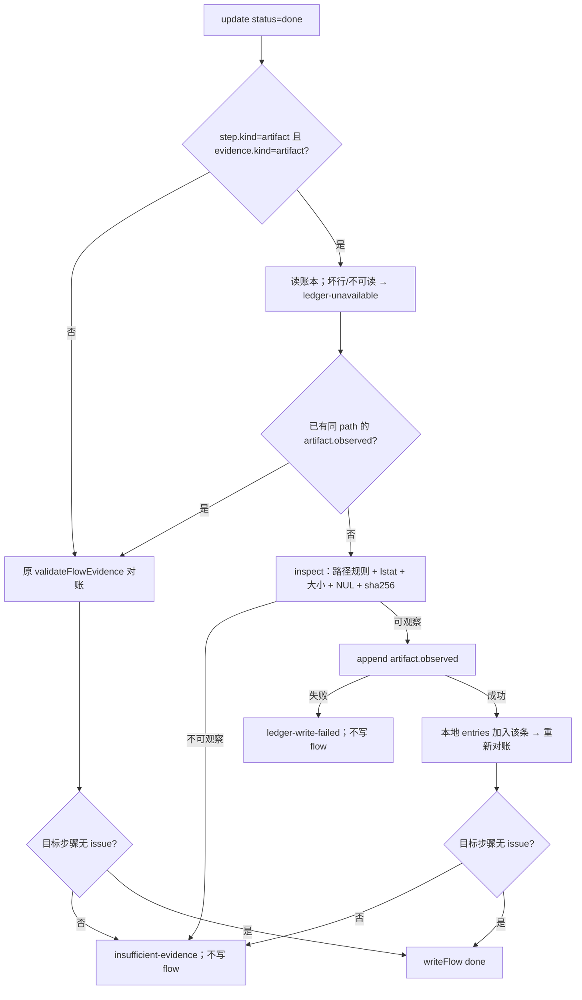

# 策划方案：flow_step_update 的 artifact 观测时序修复（最小 T2）

- 日期：2026-10-23
- 角色：ANS 策划（Planning）
- 状态：**草案 v1（供闸门 1 方案确认）**；本文件是设计候选，**未实施、未测试、未验收**
- 风险档位：**T2**。按技能 `references/testing.md`：本次只修编排 `flow-service` 的收口时序，不新增账本 kind/power/decision、不改证据模型、不扩角色权限或公共出口；属 pipeline/集成行为修复，受影响套件 + typecheck 即可。若实施发现必须改证据模型/枚举/权限或写目标项目，停止并按 T3/重开闸门处理。
- 闸门 0 依据：`docs/communication/2026-10-23_intent_artifact-observation-race.md`（客户贴出现场错误并明确「这个顺带修复一下」；闸门 0 已确认）。
- 事实快照：2026-10-23 对当前工作树与目标项目 `ans-gateway` 的只读核对；`path:line` 仅辅助定位，实施以符号名为准。目标项目零写入。
- 标记约定：**[现状]** 已核实；**[设计候选]** 本方案提议、未实施；**[待确认]** 见 §10。
- 范围声明：本文件只写 `docs/planning/`；不改代码、测试、角色卡、边界、flow、账本、团队计划或目标项目；不 commit/push。

---

## 1. 摘要

**问题 [现状]**：`flow_step_update` 把 `kind: artifact` 的步骤从 `delivered` 标 `done` 时，应用读取治理账本并用 `validateFlowEvidence` 对账；若账本还没有该证据路径的 `artifact.observed`，调用被拒为 `insufficient-evidence`，flow 不写盘。与此同时，`run-role.ts` 的 `artifact.observed` 是在角色事件流结束后的 `settled` 阶段才扫描追加的，因此「同一轮先写盘、再标 done」会稳定地输给扫描时序。目标现场 `change-package-v5` 正是这个状态：文件存在（14,400 B），账本没有该路径的 observation，错误落在 `steps[62].evidence`。

**客户可见结果 [设计候选]**：

- 同一个 `flow_step_update(status=done, kind=artifact)` 调用中，应用按现有安全规则读取声明的证据文件、计算 sha256、追加一条 `artifact.observed`，然后重新对账并完成本次更新；不需要客户手工等待下一轮扫描或额外重试。
- 只在证据路径安全且文件为常规文件时补观测；缺失、符号链接/非普通文件、项目外、`.ans`/`角色卡`/`.git`/`node_modules`、超大、二进制、账本追加失败一律保持失败（`insufficient-evidence` / `ledger-write-failed`），**不伪造 done**。
- 不新增账本字段/枚举/权限/角色工具；不写 `customer.decision`；不改变 `artifact.observed` 的证据模型；不自动 accept/reject。

**非目标**：不把「文件存在」当成「步骤完成」；不改目标项目、`run-role` 扫描时机、批次观察/对账语义；不并入其他 v1.7.0 变更。详见 §3。

---

## 2. 现场事实与根因

### 2.1 现场事实 [现状]

| 事实 | 内容 |
| --- | --- |
| 目标步骤 | `ans-gateway/docs/flows/ai-governance-pipeline.yaml`：`change-package-v5` 为 `delivered`，`kind: artifact` |
| 证据文件 | `docs/scheduling/ai-governance-pipeline-change-v5.md` 存在，14,400 B，2026-10-23 21:51 本地 |
| 账本 | 已有该变更包写盘的 `customer.decision`（13:49:21Z、13:51:07Z），但**没有**该路径的 `artifact.observed` |
| 调用结果 | `ok=false`，`code=insufficient-evidence`，`revision=1dd21a24…`，`issues=steps[62].evidence: 账本缺少 artifact.observed（path=docs/scheduling/ai-governance-pipeline-change-v5.md）` |
| 目标项目写入 | 本次规划只读；未改 flow、账本、报告或角色卡 |

`customer.decision` 不能替代 `artifact.observed`：`validateFlowEvidence` 的 artifact 分支只匹配 `artifact.observed.artifactPath`（`src/common/编排/flow-state.ts:930-940`），写盘决定里的 `paths` 不参与证据匹配。

### 2.2 根因链 [现状]

| 编号 | 根因 | 代码位置 | 后果 |
| --- | --- | --- | --- |
| R1 | `flow_step_update` 的 done 对账只读账本，不补观测 | `src/common/编排/flow-service.ts:473-497`（读账本 476，`validateFlowEvidence` 483，missing issue 487-495） | 账本缺 observation 时直接返回 `insufficient-evidence`，flow 不写 |
| R2 | `artifact.observed` 由角色 `settled` 后扫描追加 | `src/pipeline/orchestration/run-role.ts:1628-1667`（扫描/追加 1644-1667） | 同一轮「写文件→标 done」发生在扫描之前；内置治理角色这一路只处理新增/变更的 `.md`，不会提前满足收口 |
| R3 | `update` 与 `observeFlowArtifacts` 都在 per-project 串行队列内 | `flow-service.ts:374`（update 的 `serialize`）、`flow-service.ts:1650`（observe 的 `serialize`） | update 内不能直接调用现有批量观察函数：嵌套 `serialize` 会等待自身完成而死锁 |
| R4 | 账本已有同路径 observation 时更新本可通过 | `flow-state.ts:930-940` | 问题不是文件不存在、权限不足或证据路径错误，而是观测晚于收口调用 |

**结论**：这是确定的时序竞争。目标文件 14,400 B、文本 `.md`，按现有观察规则（常规文件、非符号链接、≤2 MiB、无 NUL）可安全观察；缺少的只是「在 done 对账前补这一次观测」的应用动作。

---

## 3. 目标与非目标

**目标**：

1. `update` 在 `status=done && step.kind=artifact` 时，若目标证据文件已安全存在但账本没有同路径 `artifact.observed`，由应用补一次观测（hash 同现有规则），再对账并完成本次更新。
2. 所有不安全的路径/文件/账本情形继续 fail-closed，错误可解释，但不放宽门槛、不伪造 done。
3. 只改 `ans-studio` 的 `src/common/编排/flow-service.ts` 与 `test/编排/flow-service.test.ts`；不新增公共出口、枚举、权限或角色工具。
4. 保持 `observeFlowArtifacts` 的批量行为、`validateFlowEvidence` 的判定与现有证据模型不变。

**非目标**：

- 不自动把目标项目当前的 `delivered` 步骤改成 `done`；修复上线后由客户/Convener 重试同一更新。
- 不处理手工编辑导致的「已 done 但无 observation」；`update` 的幂等短路仍按现状返回 `idempotent`。
- 不新增「观察所有 flow artifact」的后台任务，不改变 `run-role` 的扫描范围与时机。
- 不新增角色对 `.ans/governance/ledger.jsonl` 的写权；账本仍只由应用写。

---

## 4. 推荐方案 A：done 时单 ref 补观测后对账

### 4.1 触发条件

在 `update` 内，候选 flow 已完成解析（`flow-service.ts:456-472`）、账本已成功读取且无坏行（`:473-483`）之后，仅当以下全部成立时尝试补观测：

- `input.status === "done"`；
- `step.kind === "artifact"`；
- `nextEvidence !== undefined && nextEvidence.kind === "artifact"`（`:432-454` 已先行校验 kind 对应）；
- `nextEvidence.ref` 是非空字符串；
- 账本中**没有**能通过 `validateFlowEvidence` 的 `artifact.observed`：即 `artifactPath` 归一化后等于 `nextEvidence.ref`，且 `flowId` 缺省或等于当前 `flowId`（镜像 `flow-state.ts:930-940`，不另立判定）。

只观察**目标步骤**的 `nextEvidence.ref`，不扫描其他步骤、不扫描目录、不观察无关文件。

### 4.2 处理顺序



补观测成功不等于完成：仍以重新对账结果为准；对账仍失败就不写 flow。

### 4.3 单 ref helper

在 `flow-service.ts` 观察区（`looksBinaryObserve`/`artifactPowerOf` 附近，约 1591-1617）新增两个**模块私有**函数，不导出、不注册为角色工具：

```ts
inspectObservableArtifact(projectRoot, ref):
  | {ok:true; rel; sha256} | {ok:false; path; reason:"path-invalid"|"missing"|"too-large"|"binary"|"read-failed"}
ensureArtifactObserved({projectRoot, flowId, step, ref, entries}):
  | {status:"already-observed"} | {status:"observed"; entry} | {status:"skipped"; reason} | {status:"append-failed"; message}
```

`ensureArtifactObserved` 的步骤：

1. 先按 §4.1 的路径/flowId 语义检查账本；已有可匹配 observation ⇒ `already-observed`，不读文件。
2. 调 `inspectObservableArtifact`：复用 `observeRelPath`（`:1575-1589`）、`lstat` 常规文件且非符号链接、`OBSERVE_ARTIFACT_MAX_BYTES`（`:1564`）、`readFile`、`looksBinaryObserve`（`:1591-1594`）、`sha256`（`:113-115`）。
3. 只在该观测将来能被对账接受时追加：要求 `normalizeRelPath(ref) === rel`（本地 2 行归一化，镜像 `flow-state.ts:252-254`：`\`→`/`、去掉一个前导 `./`）。这样不会追加一条 `artifactPath` 与 `evidence.ref` 匹配不上的账本记录（例如 ref 带首尾空格）。
4. 同 path+sha 且 `flowId` 缺省/相等的 observation 已存在（并发扫描可能刚写入）⇒ `already-observed`。
5. 追加条目：`{at, kind:"artifact.observed", actorRoleId: step.owner, power: artifactPowerOf(step.owner), artifactPath: rel, artifactSha256: sha, flowId}`。`power` 内置角色按 function、其他 `project`；`rel` 与 `evidence.ref` 归一化后一致。
6. 不写 `stepId`（与现有 `observeFlowArtifacts` 一致）、不写 `customer.decision`、不改 flow；追加失败返回 `append-failed`，不抛、不回滚（账本 append-only）。

### 4.4 复用与抽取

- 从 `observeFlowArtifacts` 循环中抽取 `inspectObservableArtifact`，批量观察改为调用它；**保留**批量循环现有的幂等键（精确 `artifactPath\0artifactSha256`，`:1678-1689`、`:1727-1739`）与 skipped 语义，现有测试不得放宽。
- 新增单 ref helper 只复用检查逻辑；批量的匹配/追加代码不强行合并，避免改变 `observeFlowArtifacts` 的可观察行为。
- `artifactPowerOf`、`OBSERVE_SKIP_SEGMENTS`、`OBSERVE_ARTIFACT_MAX_BYTES`、`OBSERVE_IMAGE_EXTENSIONS` 全部保持不变。
- `validateFlowEvidence` 不改；`flow-state.ts` 不改；`pipeline/orchestration/flow-state.ts` 不新增再导出。

### 4.5 幂等、并发与死锁

- `update` 已在该项目的 per-project `serialize` 队列内（`:374`）。新 helper **不得**调用 `serialize`，否则会等待当前任务自身完成而死锁；这是本方案最关键的实施约束。
- `appendGovernanceLedger` 自带的 per-project append 链只等待更早的账本追加，不等待 flow serialize；锁方向为「flow serialize → ledger append」，无反向等待，不引入死锁。
- `run-role` 的扫描追加不经过 flow serialize，可能在「读账本」与「追加」之间插入同 path+sha 记录；最坏产生一条重复 observation（append-only 审计可接受），不影响门禁。测试用并发用例锁定「不挂起、最终恰一条或不重复到影响判定」。
- 追加成功后把该条加入本地 `entries` 视图再对账（先例：`completeRoleCardsArtifact` 的 `entries = [...entries, observedEntry]`，`:1269-1329`）；不需要二次读盘。若追加返回失败但行可能已因 fsync 失败落盘，下一次重试会在开头重新读账本，按同 path 幂等命中，不会无限重复。
- 追加成功但 `writeFlow` 失败：账本多一条事实记录，flow 未变；重试同一更新会命中已有 observation，不会再追加，随后写 flow。该顺序可接受，需在测试中锁定。

### 4.6 失败与安全矩阵

| 情形 | 检测 | 本次结果 | 写 flow | 新 observation |
| --- | --- | --- | --- | --- |
| 已有同 path observation（任意 sha） | 账本路径匹配（`flowId` 缺省/相等） | 正常对账；通常成功 | 可写 | 不追加 |
| 文件缺失 `ENOENT` | `lstat` | `insufficient-evidence` | 否 | 否 |
| 符号链接/非普通文件 | `lstat`：`!isFile() || isSymbolicLink()` | `insufficient-evidence` | 否 | 否 |
| 词法项目外（绝对/盘符/URL/`..`） | flow 解析 `isProjectRelativePath`（`flow-state.ts:256-263`）先行拒绝；`observeRelPath` 第二道拒绝 | `invalid-flow` 或 `insufficient-evidence` | 否 | 否 |
| `.ans`/`角色卡`/`.git`/`node_modules` | `observeRelPath` + `OBSERVE_SKIP_SEGMENTS` | `insufficient-evidence` | 否 | 否 |
| 超过 2 MiB | `info.size > OBSERVE_ARTIFACT_MAX_BYTES` | `insufficient-evidence` | 否 | 否 |
| 文本含 NUL（非图片扩展） | `looksBinaryObserve` | `insufficient-evidence` | 否 | 否 |
| 读取失败 | `readFile` 抛错 | `insufficient-evidence` | 否 | 否 |
| ref 归一化后与可观察 rel 不一致 | §4.3 第 3 步 | `insufficient-evidence` | 否 | 否（避免写一条对不上账的记录） |
| 追加失败 | `appendGovernanceLedger` 返回 `{ok:false}` | `ledger-write-failed` | 否 | 否/可能部分落盘，重试幂等 |
| 补观测后仍对账失败 | 重新 `validateFlowEvidence` | `insufficient-evidence` | 否 | 是（事实记录，已尽力） |

补充：

- **图片扩展**：`.png/.jpg/.jpeg/.webp` 按现有规则不做 NUL 探测；这是 `looksBinaryObserve` 的既有行为，本次不收紧（见 §10 Q2）。
- **不做临时文件/目录扫描**：只读 `nextEvidence.ref` 这一个路径。
- **错误与审计**：skipped 时保留 `validateFlowEvidence` 原 `issues` 形状，只在 `error` 前缀说明「证据文件 X 无法安全补观测（reason）」；追加失败用既有 `ledger-write-failed` code（先例 `completeRoleCardsArtifact`，`:1287-1290`）。不输出绝对路径或文件内容；成功可记诊断 `flow.artifact.observed-on-done`（仅诊断，不新增客户可见状态）。

---

## 5. 分层、接口与不变量

| 项 | 结论 |
| --- | --- |
| 分层 | `flow-service.ts` 属编排私有 common；新 helper 是内部能力，不是新 Service/Provider，不新增目录 |
| 公共出口/工具 | 不新增导出；`pipeline/orchestration/flow-state.ts` 不改；`FlowStepUpdateFn`/`FlowToolResult` 形状与 `flow_step_update` 参数/回执不变；不扩 AdapterCapabilities |
| 证据模型/对账 | `artifact.observed` 仍是 artifact 证据唯一来源；kind/power/decision 枚举不变；不写 `customer.decision`；`validateFlowEvidence` 不变，补观测后仍由它裁决 |
| 账本写者/写盘 | 账本仍只由应用写；角色只能声明 flow `evidence.ref`，路径安全先于读文件；flow 原子写、账本 append-only+fsync，二者失败不互相回滚 |
| 批量观察 | `observeFlowArtifacts` 仍可批量补记；行为、错误码、skipped 语义保持不变 |
| 目标项目 | 零写入；本方案只改 ans-studio 产品代码与测试 |

**写入集**：`src/common/编排/flow-service.ts`、`test/编排/flow-service.test.ts`。测试 helper/临时目录都在既有测试文件内，不新建生产文件；不需要改 `run-role.ts`、`flow-state.ts`、renderer、preload、Provider 或目标项目。

---

## 6. 测试矩阵（T2）

### 6.1 新增/调整用例（`test/编排/flow-service.test.ts`）

沿用现有 `withRoot` / `writeFile` / `writeLedger` / `ledgerEntry` / `sha256` / `steward` helper（`:20-101`），新增一个 done-artifact 夹具（owner=`convener`，ref=`docs/scheduling/flow-a-change-v5.md`，status=`delivered`）。

| ID | 场景 | 断言 |
| --- | --- | --- |
| A1 | 文件存在、账本无 observation，`delivered→done` | `ok=true`；flow done；账本恰一条 `artifact.observed`：`actorRoleId=convener`、`power=schedule`、`artifactPath` 精确、`artifactSha256` 匹配文件、`flowId=flow-a`；无新增 `customer.decision` |
| A2 | 账本已有同 path observation（无 sha 或不同 sha），文件缺失/内容不同 | 更新照常成功；账本条数不变（证明「已有 observation 即不读文件、不重复追加」）；扩展现有用例 `:390-410` |
| A3 | 文件存在、账本无 observation，并发 `observeFlowArtifacts` | `Promise.all` 正常结束（不死锁）；更新成功；最终恰一条同 path+sha observation |
| A4 | 文件缺失 | `insufficient-evidence`；flow 字节不变；零新 observation |
| A5 | 符号链接指向项目内/外文件 | `insufficient-evidence`；零新 observation；无法创建 symlink 的平台（Windows 权限）用 `t.skip` 并记录原因 |
| A6 | 排除段 `.ans/`、`角色卡/`、`.git/`、`node_modules/` | 每个 ref 均 `insufficient-evidence`；零新 observation |
| A7 | 文件 2 MiB + 1 B | `insufficient-evidence`；零新 observation |
| A8 | 非图片 `.md` 含 NUL | `insufficient-evidence`；零新 observation |
| A9 | 账本文件只读（append 失败），随后恢复重试 | 首次 `ledger-write-failed`、flow 字节不变；恢复后同一更新成功且恰一条 observation；`finally` 恢复权限；root 宿主无法制造只读失败时跳过并记录 |
| A10 | 补观测成功但 flow 原子写失败，再用正常 writer 重试 | 首次 `write-failed`；账本已有 observation；重试成功且不重复追加 |
| A11 | dispatch/customer-decision/acceptance 的 done | 不触发 artifact 观察；账本无新增 `artifact.observed`（既有用例 + 一条断言） |
| A12 | `observeFlowArtifacts` 批量观察 | 既有 `:691`、`:742`、`:809`、`:886` 全部保持；不因抽取检查 helper 放宽 skipped/幂等 |
| A13 | 非法/不可对账 ref（首尾空格）| `insufficient-evidence`；零新 observation（避免追加一条对不上账的记录） |

项目外路径（`../`/绝对路径）在 flow 解析阶段已由 `isProjectRelativePath` 拒绝，现有 `:886` 用例保持；新单 ref 路径继承 `observeRelPath` 的第二道词法检查，不新增旁路。

### 6.2 回归与命令

- 受影响套件：`node --test --test-concurrency=1 test/编排/flow-service.test.ts`；相邻对账套件 `node --test --test-concurrency=1 test/编排/flow-state.test.ts`。
- 受影响调用方转发（回执形状不变）：`node --test --test-concurrency=1 test/runtime-core/flow-tools.test.ts test/pi-adapter/flow-tools.test.ts`。
- 静态：`npm run typecheck`。不默认跑全量 T3；不跑 Electron/e2e（本变更不触桌面/渲染/Provider）；独立验收若要求集成证据，再按确认版本补定向检查。
- 证据记录：命令、cwd、时间、执行者、环境、退出码、pass/fail/skip 计数、失败原文、候选文件哈希。

---

## 7. 验收标准草案（P1–P6，供独立验收冻结）

| 编号 | 标准 | 证据 |
| --- | --- | --- |
| P1 | **时序修复**：artifact 步骤文件存在、账本无 observation 时，`delivered→done` 成功；flow done；账本恰一条 observation，path/sha/actor/power/flowId 可核对 | 目标形态夹具 + `flow-service.test.ts` 原始输出 + flow/账本快照 |
| P2 | **安全 fail-closed**：missing/symlink/排除段/词法项目外/超大/二进制/ref 不可对账 ⇒ `insufficient-evidence`；flow 字节不变；零新 observation | A4–A8、A13 输出 + 文件字节/账本行对照 |
| P3 | **追加失败**：`ledger-write-failed`，flow 不变；恢复后重试成功且不重复；fsync 部分落盘场景重试幂等 | A9/A10 输出 + 账本行数 |
| P4 | **幂等/无副作用**：已有同 path observation 不重复追加；重复 done 幂等；不写 `customer.decision`；不新增 kind/power/decision/权限/工具 | A2/A11/A12 + 类型/导出检查 + 账本 kind 统计 |
| P5 | **兼容/边界**：`observeFlowArtifacts` 批量行为、`validateFlowEvidence`、dispatch/customer-decision/acceptance done 路径均不回归；写集仅两文件；目标项目零写入 | 受影响套件 + typecheck + `git diff --stat`/文件哈希 + 目标只读核对 |
| P6 | **证据与文档状态**：命令与结果可复核；本方案版本/状态可追溯；独立验收按确认版本给出结论；未实施前不声称已修复目标现场 | 测试报告、change package、闸门记录、本文件版本 |

**目标现场说明**：P1 的夹具复现目标形态，但**不等于**目标项目已被修复；v1.7.0 部署后仍需客户/Convener 对 `change-package-v5` 重试一次 `flow_step_update(done)`，届时应用补观测并完成。目标项目在验收期间保持零写入。

---

## 8. 备选、风险与残余

### 8.1 备选

| 方案 | 做法 | 问题 | 结论 |
| --- | --- | --- | --- |
| **A（推荐）** | done 时对目标 ref 单次安全观测，再对账 | 改动集中、无额外扫描、不嵌套串行队列 | 推荐 |
| B | update 前调用 `observeFlowArtifacts` 观察全部 artifact | 需嵌套 `serialize`（死锁）或提前出队（revision 竞争）；会观察无关步骤/文件，产生额外账本副作用 | 不采用 |
| C | 只改 Convener 文案/提示「等下一轮再重试」 | 不修根因；每次同轮收口仍失败，依赖人工重试 | 不作为修复 |
| D（后续） | 在 `run-role` settle/收尾前同步观察 | 触及 pipeline/runtime 与扫描范围，范围更大；且不覆盖其他 update 调用方 | 可作后续加固，不在本 T2 |

### 8.2 风险与残余

1. **顺序副作用**：`run-role` 扫描与 update 追加可能交错，产生同 path+sha 的重复审计行（append-only 可接受，门禁不读重复数）；账本成功但 flow 失败时账本多一条事实、flow 未完成，重试幂等、不重复追加。测试锁定不死锁/不影响判定。
2. **actor/power 归属**：按 `step.owner`/`artifactPowerOf(owner)` 记，而不是调用 update 的管理者或 `app`；与 `observeFlowArtifacts` 一致，`power` 只是审计标记，门禁不读。若客户要求改归属，属证据语义变更（§10 Q3）。
3. **已有宽松规则不收紧**：图片扩展免 NUL 探测；中间目录符号链接不在现有 `lstat` 最终组件检查内。两者都是既有观察规则的残余，本 T2 不扩大安全策略；若需收紧，另开安全变更（会改变 `observeFlowArtifacts` 行为，可能升 T3）。
4. **历史与目标现场**：`update` 的幂等短路（`:410-414`）不会为已 done 步骤补 observation；只修「转换到 done」的时序（目标步骤仍是 delivered，故适用）。修复也不追溯写目标账本，v1.7.0 后需重试一次。
5. **抽取回归**：批量观察改调 `inspectObservableArtifact` 时，必须逐条保持 skipped reason、路径展示（path-invalid 用原 ref，其他用 rel）与幂等键；现有 A12 用例是硬门槛。

---

## 9. 闸门、排期与下一步

- **闸门 0/本文件**：闸门 0 已确认（`docs/communication/2026-10-23_intent_artifact-observation-race.md`）；本文件是最小 T2 方案草案 v1，供沟通走**闸门 1 方案确认**。客户已明确要求修复，但不把「已写完」当成「已确认」。
- **角色/写集**：无需新增角色或改边界；参与方为编排（`flow-service.ts`）与测试（`flow-service.test.ts`）。统筹按现行流程写团队计划/任务书；本策划文件不代替团队计划。
- **排期**：按 intent，角色根文档 S1 基线快照完成后实施，避免快照期间改 `src/`；不阻塞角色根文档方案/闸门 2。
- **版本/授权**：纳入 v1.7.0，但作为**独立候选/独立结论**，不与 i18n、目录 v3、治理写卡门禁、验收返工路由合并验收。实施授权由沟通取得；独立验收在实施前基于本文件确认版本写完成标准，实施后按同一版本判定。写盘即冻结为待确认版本，实质变更递增版本并重开闸门 1。
- **纪律**：策划不直接给工作角色派活、不授权、不 commit/push。

---

## 10. 待确认事项（供沟通/客户/验收）

| 编号 | 事项 | 推荐 | 说明 |
| --- | --- | --- | --- |
| Q1 | 追加失败的 code | `ledger-write-failed`（既有 code，先例 role-cards） | 与 `insufficient-evidence` 区分「证据不存在」与「账本写失败」；两者都 fail-closed |
| Q2 | 二进制口径 | 复用 `looksBinaryObserve`，图片扩展仍免 NUL 探测 | 与「hash 同现有规则」一致；若要所有二进制都拒绝，属策略变更 |
| Q3 | observation 的 actor/power | `step.owner` + `artifactPowerOf(owner)` | 与 `observeFlowArtifacts` 一致；不按调用者或 `app` 记，避免审计归属漂移 |
| Q4 | 错误文案 | 保留 `issues` 原形状，仅在 `error` 增加「无法安全补观测（reason）」 | 不新增 UI/字段；便于客户理解为何仍失败 |
| Q5 | 目标现场/历史 done | v1.7.0 后重试同一更新；不自动补历史、不自动写目标 | 目标零写入；历史异常需人工核对，避免扩大自动写账本面 |

未发现与 intent 的实质冲突；Q1–Q4 是实现/验收口径，建议在闸门 1 一并确认。若客户要求自动修复目标历史账本、改证据模型或新增权限，属范围实质变化，需重开闸门 0/1 并按 T3 处理。

---

## 11. 复核处置与交付状态

- **复核**：尚未启动独立只读复核；沟通启动后，复核记录按 `docs/planning/2026-10-23_review_artifact-observation-race.md` 命名并在本节链接，作者逐项记录采纳/不采纳理由。
- **状态**：本方案草案 v1；只读核对现场与代码；未改任何源码、测试、角色卡、边界、flow、账本、团队计划或目标项目；未 commit/push。闸门 1 确认、团队计划、实施、独立测试、独立验收均未做；不声称目标现场已恢复。
- **版本**：`2026-10-23 v1`。
