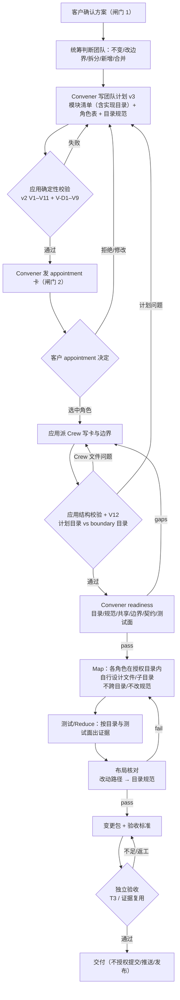

# 策划方案：目录级授权与目录规范

（上层只分配目录并给出目录规范；执行角色在目录内自行设计文件/子目录；不跨目录、不改规范、不碰他人目录）

- 日期：2026-10-23
- 角色：ANS 策划（Planning）
- 状态：**草案 v1（待闸门 1 方案确认）**；本文件是设计候选，**未实施、未测试、未验收**
- 风险档位：**T3（治理/权限/流程设计变更）**。依据技能 `references/testing.md`「Risk-Based Verification and Change Packages」：本方案改变团队计划的写集语义与授权模型（目录条目、目录规范、边界对齐、实际布局验收），属于治理/权限变更，即使部分改动只涉及文档/卡文本也不能压成 T0。
- 闸门 0 依据：`docs/communication/2026-10-23_intent_i18n-and-directory-ownership.md`（客户已确认，2026-10-23）
- 代码事实快照：2026-10-23 只读检索。文中 `path:line` 是检索时快照，实施时以符号名和实际代码为准
- 标记约定：
  - **[现状]** 已核实的当前代码行为；
  - **[设计候选]** 本方案提议、尚未实施；
  - **[待客户决定]** 见 §13，方案不替客户拍板

---

## 1. 摘要

客户指出：上层（统筹/团队计划）划分范围时**不用划分得非常细**，只划分**目录**，并给一份**目录规范**；让执行角色**自己去设计文件位置或子目录**。

当前产品已经有：
- **边界引擎的目录授权**：`BoundaryEntry.kind` 支持 `file` / `directory` / `conditional-directory`；`resolveWrite` 对目录条目下的任意路径放行（`src/model/boundary.ts:9-19`；`src/service/gate/resolve-write.ts:41-44`）。
- **团队计划 v2**：角色表有 `module`/`唯一写集`/`公开契约`/`测试面`/`dependsOn`/`并行组` 等字段；`team-plan.ts` 做 V1–V11 确定性校验（`src/common/编排/team-plan.ts`），桌面做 V12（计划写集 vs 角色边界覆盖，`app/desktop/interface.ts:1048-1067,2493-2517`）。

但当前 v2 的 `唯一写集` 仍以**精确文件/目录**为主，尤其是跨角色的单文件（如 `src/model/runtime.ts`、`app/desktop/interface.ts`）；上层要在计划里逐个列文件，执行角色不能自行新增文件/子目录；`resolveWrite` 的**任务写集 `TaskScope.writeSet` 是精确匹配**（`src/model/decision.ts:23-26`；`src/service/gate/resolve-write.ts:120-124,160-176`），而桌面派发当前以 `scope: undefined` 开目标会话（授权上界 = 角色边界，`app/desktop/session.ts:31-36,1997-2003`），因此“目录内自行设计文件”在**计划层**还没有正式模型，在**运行期**只有边界目录这一层授权。

本方案提出：

- **团队计划 schema v3**：v2 + `授权目录` 列 + `目录规范`表；每个目录有唯一 owner、用途、命名、允许子目录/文件类型、契约、测试面、依赖、禁写区、共享边界；角色表保留 `精确写集` 用于治理关键/单例文件。v1/v2 计划保持原行为，不强制迁移。
- **目录条目模型**：目录是授权单位；任务/证据/验收以目录为粒度。执行角色可在目录规范允许的范围内自行创建文件/子目录；不能跨目录、不能改规范、不能写他人目录。
- **确定性校验 + readiness 语义复核**：应用校验目录覆盖、owner 唯一、互不重叠、规范存在、路径逃逸、治理关键路径精确授权；Convener readiness 复核目录是否内聚、规范是否合理；验收核对**实际布局**是否符合规范（改动路径 → 目录 → 规则）。
- **与边界 Section 1 对齐**：计划的目录必须被该角色 `boundary.yaml` 的目录条目覆盖；`new` 角色在 v3 下边界目录应与计划目录一致（角色根工作文档除外），使运行期门禁与计划授权重合；`changed`/`existing` 的计划目录必须被边界覆盖，边界更宽部分只能落在该角色模块实现目录/既有职责内（越出 warning + readiness），不强制重写历史边界。
- **运行时策略**：本轮不重写会话/任务 scope 模型；运行期仍由角色边界（目录条目）拦截越界写，计划目录的更细约束由任务文本 + readiness + 验收的实际布局核对保证。若客户要求“写盘时按任务目录硬拦”，需要任务级 `writeDirs` 与会话 scope 改造，属另一个更大的设计（§10.4/§13 Q5）。

**客户可见的结果（设计候选）：**

- 任命卡/团队计划展示“每个角色拿到哪些目录 + 每个目录的规范”，不再需要逐文件列写集（治理关键/单例文件除外）。
- 执行角色可以在自己的目录里新建文件/子目录（在规范允许的类型/命名/子目录范围内），不需要每加一个文件就改团队计划或边界。
- 跨目录、写他人目录、改目录规范、在禁写区写文件会被计划校验/readiness/验收拒绝；不是“事后没人知道”。
- 旧 v1/v2 计划、旧 flow、旧角色卡继续可读；不一次性重写历史边界。

---

## 2. 基线与范围

### 2.1 需求基线与确认状态

| 项 | 状态 | 记录 |
| --- | --- | --- |
| 闸门 0：意图确认 | **已确认（2026-10-23）** | `docs/communication/2026-10-23_intent_i18n-and-directory-ownership.md` |
| 客户原话 | — | 「……和这个划分范围的时候上层应该不用划分的非常细，而是只划分目录，并且有一份目录规范。让执行角色，自己去设计文件位置，或者子目录。」「可以」 |
| 本轮范围 | 团队计划目录级授权 + 目录规范；唯一 owner；共享目录策略；治理关键路径继续精确授权；校验/readiness/验收实际布局；旧精确写集保留 | 同上「变更 B」 |
| 本轮非目标 | 一次性重写历史边界；放宽治理关键路径/共享/密钥；把两个变更合并；直接改代码 | 同上「非目标」 |
| 闸门 1：方案确认 | **待确认** | 本文件（提交沟通后由客户确认） |
| 闸门 2：角色指派/写集确认 | 未开始 | 本文件确认后由统筹写团队计划、沟通提交客户 |
| 实施授权 | 未给 | 闸门 1、闸门 2 通过后另行取得 |

本方案与「国际化（i18n）」方案（`docs/planning/2026-10-23_design_i18n.md`）是**两个独立变更**：分别走闸门 1/2、分别实施与验收；不合并。两份方案在实现期可能触及同一批文件（见 §14.1），由统筹安排顺序与写集。

### 2.2 验收基线

客户在**闸门 1**确认的**本文件版本**是后续独立验收的基线。独立验收在实施前基于该版本把正式完成标准写入 `docs/acceptance/`；本文件 §11 的完成标准是方案自带的可核对标准，供闸门 1 确认和验收引用，**不是**正式验收结论或验收文档。团队计划、角色指派和实现安排都不是验收基线。

### 2.3 范围边界

**本轮必须覆盖：**

- 目录条目/目录规范的数据模型与字段；每目录唯一 owner；共享目录唯一 owner 或显式子目录 owner。
- 团队计划 v3：schema 标记、角色表列、目录规范表、覆盖/重叠/规范/路径逃逸/治理关键路径校验。
- 与团队计划 v2 的关系：v3 不是改写 v2，而是版本化扩展；v2/v1 计划继续可读。
- 与边界 Section 1 的对齐：计划目录 vs `boundary.yaml` 目录条目；`new` 一致、`changed`/`existing` 覆盖（更宽部分限于模块实现目录/既有职责）。
- readiness 语义复核与验收**实际布局符合规范**的检查；确定性硬校验 vs 语义复核分工。
- 旧精确写集保留/迁移窗口；不一次性重写历史边界。
- 受影响文件/角色/测试精确清单；T3 完成标准与证据计划。
- 客户需拍板的开放问题（§13）。

**本轮明确不做：**

- 不一次迁移/重写所有历史角色边界、旧 v2 团队计划、旧 flow、旧角色卡。
- 不用目录级授权放宽治理关键路径（角色卡/边界、release/packaging、`.ans`、shared、密钥相关）；这些继续精确授权。
- 不把两个变更（i18n + 目录授权）合并成一个巨大改动。
- 不新增 `cardKind`、`FlowStepKind`、`GovernancePower`、`GovernanceDecisionKind`、artifact kind。
- 不改变派发权归属、客户入口、角色 id/显示名/路径、工程基线文本。
- 不重写会话/任务 scope 模型（除非客户在 §13 Q5 选择“任务级硬拦”，届时另开设计）。
- 不直接改代码/测试/角色卡/边界；本文件只是方案。

---

## 3. 现状与问题（代码事实）

以下事实均来自 2026-10-23 只读检索；不表示本方案已改变它们。

### 3.1 边界引擎已经支持目录授权

| # | 事实 | 证据 |
| --- | --- | --- |
| 3-1 | `BoundaryEntry.kind` 支持 `file` / `directory` / `conditional-directory`；`path` 是相对根的路径；`directory` 条目覆盖其下任意路径。 | `src/model/boundary.ts:9-19` |
| 3-2 | `resolveWrite` 判定顺序：F6 接受门 → 根归属/真实路径逃逸（F7）→ 边界条目匹配（`pathCovers`）→ 条件目录激活 → F4 任务写集收窄。目录条目下任意路径通过 `isUnderOrEqual` 放行。 | `src/service/gate/resolve-write.ts:41-44,126-282` |
| 3-3 | 现有角色边界已经大量使用目录条目：如编排的 `src/common/编排/`、`test/编排/`、`角色卡/编排/docs/*/`；桌面窗口的 `app/desktop/`；桌面UI 的 `app/renderer/`。 | `角色卡/编排/boundary.yaml:26-31`；`角色卡/桌面窗口/boundary.md:9-11`；`角色卡/桌面UI/boundary.md:9` |
| 3-4 | 因此“执行角色在目录内自行设计文件”在**运行期**已经成立：只要边界有目录条目，新增文件不需要改边界；`references/module-boundary.md` 也明确“已接受目录内新增文件不需要重写边界”。 | 同上；技能 `references/module-boundary.md` |

### 3.2 但团队计划 v2 仍以精确写集为主

| # | 事实 | 证据 |
| --- | --- | --- |
| 3-5 | v2 角色表列固定为 `roleId/类型/module/职责目标/能力要求/唯一写集/公开契约/测试面/依赖/dependsOn/并行组/组别/apiSpec/粒度理由`；`唯一写集` 是分号分隔的精确路径/目录（目录以 `/` 结尾），不支持通配符/省略号/散文。 | `src/common/编排/team-plan.ts:149-199,271-337`；`governance-roles.ts:483-484` |
| 3-6 | V5 跨角色写集两两不相交；文件相等/目录前缀重叠都算重叠。 | `src/common/编排/team-plan.ts:1039-1061` |
| 3-7 | V12（桌面写卡后校验）：计划写集必须被该角色 `boundary.yaml` entries 覆盖；new/changed 阻塞，existing 只 warning。 | `app/desktop/interface.ts:1048-1067,2493-2517` |
| 3-8 | v2 计划里很多角色写集是**精确单文件**（如 `src/model/runtime.ts`、`app/desktop/interface.ts`、`app/desktop/governance-advance.ts`），因为它们是跨角色共享契约/装配面；执行角色不能在同一目录内自行新增文件而不改计划。 | `docs/scheduling/2026-10-22-role-granularity-parallel-testing-team-plan.md` §4.3 |
| 3-9 | 团队计划 v2 的 `module` 是概念模块，不是目录；没有“模块实现目录”字段，目录与模块的对应关系只靠 `唯一写集` 路径推断。 | `src/common/编排/team-plan.ts:25-31,857-919`；模块清单表列 `module/职责/公开契约/架构来源` |

### 3.3 任务级写集是精确匹配，派发不带 scope

| # | 事实 | 证据 |
| --- | --- | --- |
| 3-10 | `TaskScope.writeSet` 是“本项目相对路径的精确集合，必须是角色边界的子集”；F4 对不在 writeSet 内的路径拒绝一切写入。 | `src/model/decision.ts:23-26`；`src/service/gate/resolve-write.ts:120-124,160-176` |
| 3-11 | 桌面派发 `dispatch_task` 只投递任务文本，目标角色会话以 `scope: undefined` 打开（聊天无任务收窄；授权上界 = 角色边界）；`routeDispatch` 不构造 per-task writeSet。 | `app/desktop/session.ts:31-36,1997-2003,3142-3266`；`src/model/runtime.ts:411-437` |
| 3-12 | 内置治理角色有“预授权写目录”机制（把目标路径并入本次 writeSet），但这是内置角色专用，项目角色没有。 | `src/pipeline/orchestration/run-role.ts:1724-1777` |
| 3-13 | 结论：运行期“不能跨目录”只在**边界目录**层面硬拦；团队计划的更细目录划分目前是计划/文本/验收约束，不是写盘时的 F4 硬拦。 | 3-1、3-10、3-11 |

### 3.4 团队计划 schema 版本与兼容

| # | 事实 | 证据 |
| --- | --- | --- |
| 3-14 | `parseTeamPlan` 只识别 `teamPlanSchema: 1`（legacy，缺省）或 `2`；其他值报 V1 错误。 | `src/common/编排/team-plan.ts:607-619` |
| 3-15 | `TeamPlanParseResult.teamPlanSchema` 类型是 `1 \| 2`；`TeamPlanInfo`/`GovernanceJudgeFacts`/`governance-advance` 的选项类型也都是 `1 \| 2`。 | `src/common/编排/team-plan.ts:87-101`；`app/desktop/interface.ts:877-892`；`src/model/runtime.ts:1369-1371`；`app/desktop/governance-advance.ts:781,962,1002` |
| 3-16 | 卡前守卫 `validateConvenerAppointmentCard` 调 `parseTeamPlan` + V11（flow-plan 一致性）；返回 `teamPlanSchema: 1 \| 2`。 | `src/pipeline/orchestration/run-role.ts:2078,2191-2214` |
| 3-17 | 桌面 `parseTeamPlanInfo` 只适配 v2/legacy；`governance-advance.ts` 多处按 `=== 2` 分支写任务文案。 | `app/desktop/interface.ts:1005-1046`；`app/desktop/governance-advance.ts:885-891,972,1007` |
| 3-18 | v2 的 14 列/模块清单/V1–V12 已由 2026-10-22 方案实施并通过验收；v1.6.0 已发布。 | `docs/planning/2026-10-22_design_role-granularity-parallel-testing.md`；`docs/acceptance/role-granularity-parallel-testing-report-v1.md`；`角色卡/装配/docs/change/2026-10-23_change_release-v1.6.0-prepare.md` |

### 3.5 治理关键路径与共享属主

| # | 事实 | 证据 |
| --- | --- | --- |
| 3-19 | 写集禁止治理路径：`.ans`、`docs/scheduling`、`docs/acceptance`、`docs/communication`、`docs/flows`、`docs/nominations`、`角色卡`。 | `src/common/编排/team-plan.ts:138-147` |
| 3-20 | `src/common/shared/` 唯一写入者是项目管理；共享组件不得复制第二份实现。 | `角色卡/项目管理/docs/project-rules.md:24-26` |
| 3-21 | 构建/配置归属装配：`src/index.ts`、`bin/ans.js`、`package.json`、`tsconfig.json`、`README.md`；`vite.config.ts` 归装配。 | `角色卡/项目管理/docs/project-rules.md:32,65`；`角色卡/装配/boundary.md:14` |
| 3-22 | 发布/packaging（`electron-builder.yml`、`.github/workflows/`、`src/common/装配/release-*`）与 `.env` 属装配/发布关键路径；`release-policy.mjs` 冻结源与 overlay 白名单明确不接受 `app/` 变更（v1.6.0 语境）。 | `角色卡/装配/docs/change/2026-10-23_change_release-v1.6.0-prepare.md:50-54`；`electron-builder.yml` |
| 3-23 | 角色卡/边界/YAML/根 changelog 由人事维护；任何角色不写自己的角色定义。 | 技能 `references/team-formation.md`；`角色卡/桌面窗口/boundary.md:3` |

### 3.6 测试冻结了当前计划/边界结构

| # | 事实 | 证据 |
| --- | --- | --- |
| 3-24 | 团队计划 v2 的负例矩阵、模块覆盖、写集重叠、依赖环、V12 覆盖已有测试；新增 v3 不能破坏这些 v2 断言。 | `test/测试/governance-e2e-auto/p-team-plan-guard.test.ts`、`fixture.ts`；`test/编排/team-plan.test.ts`；`test/桌面应用/interface.test.ts` |
| 3-25 | 桌面 `test/桌面应用/` 是逐文件授权；`test/编排/`、`test/测试/`、`test/门禁引擎/` 是目录授权。 | `角色卡/桌面窗口/boundary.md:20-43`；`角色卡/编排/boundary.yaml:29-31`；`角色卡/测试/boundary.md` |
| 3-26 | 冒烟/完整链路测试会读取团队计划文本/任务文案；v3 的卡文本/任务文案变化必须同步测试。 | `test/测试/governance-e2e-auto/i-full-chain.test.ts` 等 |

---

## 4. 目录级授权模型

### 4.1 定义

**[设计候选]**

| 术语 | 定义 |
| --- | --- |
| 目录条目（directory entry） | 一个项目相对路径，以 `/` 结尾，表示一个被授权写入的目录树；执行角色可在规范允许的范围内创建/修改其下文件与子目录。 |
| 目录规范（directory spec） | 每个目录条目一条规范：owner、用途、命名、允许子目录/文件类型、契约、测试面、依赖、禁写区、共享边界。 |
| owner | 该目录的唯一写入角色（roleId）。每个目录恰好一个 owner；共享目录也必须唯一 owner 或拆成显式子目录 owner。 |
| 精确写集（precise writeset） | 仍按精确文件给出的写权限，用于治理关键路径、单例共享文件、根配置等不能按目录放开的文件。 |
| 共享目录 | 只读共享或显式拆子目录 owner 的目录；不允许两个角色同时写同一目录。 |
| 治理关键路径 | 角色卡/边界、release/packaging、`.ans`、`src/common/shared/`、密钥相关路径等；只能精确授权，不能整目录分配给执行角色。 |
| 实际布局（actual layout） | 候选变更中实际新增/修改/删除的文件路径；验收按规范逐条核对。 |

### 4.2 授权模型

**[设计候选]** 一个角色的写入授权 = `授权目录`（目录条目，主要授权）+ `精确写集`（可选，补充/例外）。两者合起来必须：

1. **每个目录唯一 owner**：一个目录在计划中只能出现在一个角色的 `授权目录` 里；不得两个角色共同拥有同一目录。
2. **目录不重叠**：不同角色的目录不能相同、不能互为祖先/子目录（除非父目录是共享容器且子目录各有 owner；见 §4.4）。
3. **执行角色可在目录内自行设计**：在规范允许的命名、文件类型、允许子目录范围内，执行角色可新增文件/子目录，不需要改团队计划或边界。
4. **不能跨目录**：执行角色不能写自己授权目录之外的路径；不能写他人目录；不能用 `..`/符号链接逃逸；不能借共享只读目录写。
5. **不能改规范**：目录规范是团队计划的一部分，只有 Convener（上层）能写；执行角色只读。规范变更需新计划版本（并视情况重开闸门 2/readiness）。
6. **治理关键路径继续精确**：角色卡/边界、release/packaging、`.ans`、shared、密钥相关文件不能作为普通目录条目分配给执行角色；必须精确文件条目 + 原有治理授权。
7. **目录 → 模块**：目录必须属于该角色 `module` 的实现/测试/文档面；模块清单新增 `实现目录` 字段（可选/推荐），目录必须是其子目录，防止“一个大目录包打天下”。
8. **兼容旧精确写集**：v3 仍允许 `精确写集`；旧 v2 计划不迁移，继续按 v2 校验；迁移窗口见 §5.6。

### 4.3 目录规范字段

**[设计候选]**

```markdown
## 目录规范

| 目录 | owner | 类型 | 用途 | 命名 | 允许子目录 | 允许文件类型 | 公开契约 | 测试面 | 依赖 | 禁写区 | 共享 |
| --- | --- | --- | --- | --- | --- | --- | --- | --- | --- | --- | --- |
| src/checkout/api/ | checkout-api | implementation | 结算 API 与订单状态 | kebab-case | handlers/; models/; * | .ts | docs/contracts/checkout-v1.md | test/checkout/api/ | 无 | `.env`; `*.log`; `dist/` | none |
| test/checkout/api/ | checkout-api | tests | 结算 API 单元/层测试 | `*.test.ts` | fixtures/ | .ts | internal（消费 checkout 契约） | test/checkout/api/ | src/checkout/api/ | `dist/`; `*.log` | none |
| docs/checkout/ | checkout-api | docs | 模块说明/变更记录 | kebab-case | design/; change/ | .md | internal（文档目录） | — | src/checkout/api/ | `.env`; 密钥 | none |
```

**字段语义：**

| 字段 | 必填 | 机器校验 | 语义复核（readiness） |
| --- | --- | --- | --- |
| `目录` | 是 | 项目相对路径、以 `/` 结尾、无通配符/`..`/绝对路径/空格；不与治理关键路径重叠；不与他人目录重叠 | 是否与模块/架构对应 |
| `owner` | 是 | 必须是推荐角色 id；一个目录恰好一个 owner；owner 的角色行必须含该目录 | 是否与职责一致 |
| `类型` | 是 | `implementation` / `tests` / `docs` / `evidence` / `shared` | 类型是否合理（实现目录不塞文档/测试） |
| `用途` | 是 | 非空 | 是否单一职责、是否与模块目标一致 |
| `命名` | 是 | `any` / `kebab-case` / `camelCase` / `snake_case` / `*.test.ts` 等固定枚举或简单正则（唯一实现） | 是否与代码库约定一致 |
| `允许子目录` | 是 | `—`（不许新建）/ 显式相对名列表 / `*`（限一层）/ `**`（任意层）；不得含 `..`/绝对路径 | 子目录划分是否合理 |
| `允许文件类型` | 是 | 分号分隔扩展名（`.ts`/`.tsx`/`.md`/`.json` 等）；`*` 仅限 docs/evidence | 是否覆盖实际需要、是否过宽 |
| `公开契约` | 是（`docs`/`evidence` 可写 `internal` + 理由） | `docs/contracts/<name>.md` 路径或 `internal` + 非空理由 | 是否真实、完整、消费方一致 |
| `测试面` | `implementation`/`tests` 必填；`docs`/`evidence` 可写 `—` | 测试目录/路径（`tests` 类型必填；`implementation` 可引用角色测试面） | 是否覆盖契约/边界/负例 |
| `依赖` | 是 | `无` 或本计划目录/外部契约路径列表；目标必须存在；无自依赖/重复；目录依赖 DAG 无环（与角色 `dependsOn` 方向一致） | 依赖方向是否符合架构；是否只依赖必要目录/契约 |
| `禁写区` | 是 | 相对目录的路径前缀/文件名/`*.ext`；必须落在目录内；不得与允许类型冲突 | 是否覆盖密钥/构建产物/生成物 |
| `共享` | 是 | `none` / `read-only` / `split`；`split` 时父目录不得被直接分配，子目录各行有 owner | 是否真的需要共享；是否应拆分 |

**说明：**

- `类型` 让规范可以区分“实现目录可写代码”“测试目录只写测试”“文档目录只写文档”，避免一个规范同时套所有目录。
- `允许子目录` 的 `*` 表示允许在该目录下**新建一层**子目录；`**` 表示任意层；`—` 表示只能直接在目录下建文件。默认建议 `—` 或显式列表，防止目录无限扩张。
- `禁写区` 是目录内的额外禁止（如 `.env`、`dist/`、`*.log`、密钥文件）；它不替代全局禁写。
- `共享` 的 `split` 表示父目录只是容器：父目录本身不能写入，子目录各行有各自 owner；这解决了“共享目录唯一 owner 或显式子目录 owner”的要求。

### 4.4 共享目录策略

**[设计候选]** 三选一（默认 S1）：

| 策略 | 规则 | 适用 |
| --- | --- | --- |
| **S1. 单一 owner**（推荐） | 整个目录一个 owner；其他角色只读（通过契约/导入消费）。 | `src/common/shared/`、`app/desktop/`、`app/renderer/`、各角色私有目录 |
| S2. 显式子目录 owner | 父目录标记 `shared: split`、本身不分配；每个子目录一行规范、一个 owner；父目录只允许治理/上层创建子目录。 | 大型共享树（如 `test/` 若确需多角色） |
| S3. 多 owner 共写（不推荐） | 两个角色都可写同一目录，按文件精确写集区分。 | 仅历史过渡；v3 不接受新计划使用 |

- **默认 S1**：共享代码/共享测试仍由唯一 owner 写，其他角色只读。需要多角色协作时，优先拆子目录（S2）或由一个 owner 代改。
- **不允许多 owner 共写**：这与“每目录唯一 owner”冲突，也会让重叠/并发写无法确定性校验。
- `src/common/shared/` 继续由项目管理唯一 owner；v3 计划不应把整个 shared 目录分配给其他角色；需要改 shared 的角色通过契约/任务请求项目管理。
- 共享目录的“共享边界”字段：`read-only` 表示其他角色只读；`split` 表示子目录 owner；`none` 表示私有。

### 4.5 粒度规则

**[设计候选]**

- **目录必须属于模块**：模块清单表新增 `实现目录`（可选但推荐）；角色的每个 `implementation`/`tests`/`docs` 目录必须是其模块实现目录的子目录（或模块目录本身）。没有 `实现目录` 的 v3 计划，目录仍必须与 `module` 语义一致，由 readiness 复核。
- **禁止整层/整应用目录**：不能把 `src/`、`app/`、`test/` 整个分配给一个角色；目录必须落到模块级（如 `src/checkout/api/`、`app/desktop/`、`test/checkout/api/`）。通用层名黑名单（`src`、`app`、`common`、`shared`、`utils` 等）作为 tripwire：无理由硬拒，有理由交 readiness 例外。
- **禁止纳米目录**：只有一个文件且无独立契约/测试面的目录 → warning，readiness 判断是否应合并到模块目录；不硬拒（单文件模块可能是合法的）。
- **一个角色可以有多目录**：实现、测试、文档、证据目录各自一行规范；它们同属一个模块，写集不重叠他人。
- **精确写集例外**：治理关键/单例文件（如 `src/model/runtime.ts`、`package.json`、`electron-builder.yml`）必须用精确文件条目；`文件条目` 可以落在某个目录内（作为更严格约束）或目录外（单例）。
- **不硬性要求“一个目录一个角色”**：一个角色可以有多个目录；但一个目录只能一个角色。角色/模块仍按 v2 的“一个模块一个 Map 角色”约束。

---

## 5. 团队计划 v3：schema 与校验

### 5.1 版本选择：v3，而不是 v2 扩展

**[设计候选] 推荐 `teamPlanSchema: 3`。**

| 选项 | 优点 | 缺点 | 结论 |
| --- | --- | --- | --- |
| **A. v3 新版本标记，继承 v2 字段 + 目录字段/规范** | 语义明确；v2 计划/测试/已确认版本不受影响；解析器可按版本分支；迁移可控 | Convener/Crew/桌面/测试要同步 v3 分支；文档更长 | **推荐** |
| B. 在 v2 上加可选字段（v2.1，不升版本） | 不加版本号 | 半新半旧计划歧义；无法确定性判断“目录授权是否生效”；v2 校验会被放松 | 不推荐 |
| C. 直接改 v2 语义（把唯一写集解释为目录） | 改动小 | 破坏已确认 v2 计划/证据；历史计划含义变化；T3 风险大 | 不推荐 |

**兼容原则：**

- `teamPlanSchema` 缺省/`1` → legacy v1（只跑旧四列检查）。
- `2` → 现有 V1–V12 逐字不变。
- `3` → 继承 v2 的 V1–V11，增加目录规范/目录覆盖/目录重叠/边界对齐（V-D 系列），V12 扩展。
- 旧 v2/v1 计划不原地改；新流程默认 v3（由 Convener 在卡文本/模板中要求）；旧流程迁移窗口见 §5.6。

### 5.2 v3 frontmatter、模块清单、角色表、目录规范

**frontmatter（新增/变化）：**

```yaml
flowId: shop-checkout
version: 1
teamPlanSchema: 3
riskTier: T3
recommended: [checkout-api, checkout-web, integration-test]
modules: [checkout-api, checkout-web]
directories: [src/checkout/api/, test/checkout/api/, app/web/checkout/, test/checkout/web/]
```

- `directories`：机器可读目录清单（内联数组；项目相对路径，以 `/` 结尾，无通配符）；必须与「目录规范」表、角色 `授权目录` 完全一致。
- 如果不写 `directories`，则从目录规范表/角色表推导；但推荐显式写，便于覆盖检查。**是否强制 frontmatter `directories` 由 §13 Q1 决定；推荐强制。**

**模块清单（v2 + 可选 `实现目录`）：**

```markdown
## 模块清单

| module | 职责 | 公开契约 | 架构来源 | 实现目录 |
| --- | --- | --- | --- | --- |
| checkout-api | 结算 API、订单状态、价格计算 | `docs/contracts/checkout-v1.md` | `docs/proposals/shop-checkout-v1.md` §4.2 | `src/checkout/api/` |
| checkout-web | 结算页面、表单、错误展示 | `docs/contracts/checkout-v1.md`（消费） | 同上 §4.3 | `app/web/checkout/` |
```

**角色表（v2 列 + `授权目录`；`唯一写集` 语义调整为精确文件）：**

```markdown
| roleId | 类型 | module | 职责目标 | 能力要求 | 授权目录 | 精确写集 | 公开契约 | 测试面 | 依赖 | dependsOn | 并行组 | 组别 | apiSpec | 粒度理由 |
| --- | --- | --- | --- | --- | --- | --- | --- | --- | --- | --- | --- | --- | --- | --- |
| checkout-api | new | checkout-api | 结算 API 与订单状态 | 后端/契约/测试 | `src/checkout/api/`; `test/checkout/api/` | 无 | `docs/contracts/checkout-v1.md` | `test/checkout/api/` | 无 | 无 | map-a | 结算 | required | — |
| checkout-web | new | checkout-web | 结算页面与交互 | 前端/契约/测试 | `app/web/checkout/`; `test/checkout/web/` | 无 | `docs/contracts/checkout-v1.md`（消费） | `test/checkout/web/` | 无 | 无 | map-a | 结算 | required | — |
| integration-test | existing | reduce | 契约/集成/e2e/证据合并 | 测试/环境/证据 | `test/测试/` | 无 | 契约（消费） | `test/测试/` | 全部 Map | … | reduce | 测试 | not-applicable | — |
| release | existing | reduce | 发布/打包 | 发布/配置 | 无（目录例外） | `package.json`; `electron-builder.yml`; `.github/workflows/release.yml` | internal（发布配置） | 装配检查 | 全部 | … | reduce | 装配 | not-applicable | 发布关键路径，仅精确授权 |
```

- **`授权目录`**：分号分隔目录条目；每个必须在 `directories` 与目录规范表中出现，owner 一致。
- **`精确写集`**：分号分隔精确文件路径（也可写目录，但目录应优先放 `授权目录`）；`无` 合法；用于治理关键/单例文件；不得写全局治理路径。
- **列名兼容**：v3 中旧 `唯一写集` 可作为 `精确写集` 的别名接受（带 warning），但不推荐；模板直接写 `精确写集`。v3 解析器先匹配 `授权目录`（目录列），再把 `精确写集`/`唯一写集` 作为文件列；v2 的 `边界` 别名在 v3 中不再接受（避免与目录列歧义），出现即报列名错误。
- **`apiSpec`/`粒度理由`** 等 v2 字段不变。

**目录规范表：** 见 §4.3；表头匹配 `目录/owner/类型/用途/命名/允许子目录/允许文件类型/公开契约/测试面/依赖/禁写区/共享`；可接受英文别名（`dir/owner/kind/purpose/naming/subdirs/extensions/contract/testSurface/dependencies/forbidden/shared`）。

### 5.3 确定性硬校验（应用执行，不调用模型）

**[设计候选]** 在 v2 V1–V11 基础上新增 `V-D1`–`V-D9`；V12 扩展。

| ID | 规则 | 失败处理 |
| --- | --- | --- |
| V-D1 | frontmatter `directories` 非空、无重复；每项项目相对、以 `/` 结尾、无通配符/`..`/绝对路径/空格；不与治理关键路径重叠（§5.5）；不与角色根目录（`角色卡/`）重叠 | 不发 appointment 卡；退回 Convener |
| V-D2 | 目录规范表存在且恰好覆盖 `directories`：不多、不少、不重复；每行 owner 必须是推荐角色；每个目录恰好一个 owner；必填字段（类型/用途/命名/允许子目录/允许文件类型/公开契约/测试面/依赖/禁写区/共享）非空（`docs`/`evidence` 的测试面可 `—`）；枚举值合法 | 同上 |
| V-D3 | 角色表的每个 `授权目录` 项必须在 `directories` 中；owner 与规范行一致；每个目录至少被一个角色行引用（无孤儿）；推荐角色至少有一个 `授权目录` 或 `精确写集`（文件例外需 `粒度理由`） | 同上 |
| V-D4 | **目录/写集不重叠**：不同角色的授权目录不得相同/互为祖先/子目录（`shared: split` 的父目录除外，父目录不得被直接分配）；精确文件不得落在他人目录内；精确文件之间不得相等；目录与精确文件重叠时按包含关系判重叠 | 同上 |
| V-D5 | 目录规范的 `命名`/`允许子目录`/`允许文件类型`/`依赖`/`禁写区` 语法合法；禁写区必须是目录内相对路径/文件名/简单 `*.ext`；不得与允许类型冲突；`依赖` 目标必须存在（本计划目录或外部契约路径）、无自依赖/重复、目录依赖 DAG 无环；`shared: split` 的父目录不得有 `owner` 角色行直接分配；子目录行必须有 owner | 同上 |
| V-D6 | **模块/目录一致**：若模块清单有 `实现目录`，角色 `implementation`/`tests`/`docs` 目录必须在对应模块实现目录内；目录不能是整层/整应用（黑名单 tripwire）；单文件目录 warning 交 readiness | 同上（黑名单/无理由硬拒；warning 不阻断） |
| V-D7 | **治理关键路径精确授权**：`.ans`、`角色卡/`、`docs/scheduling/`、`docs/acceptance/`、`docs/communication/`、`docs/flows/`、`docs/nominations/`、`src/common/shared/`、release/packaging、`.env`/密钥路径不得作为 `授权目录`（只能精确文件，且只在既有治理授权范围内）；v3 计划本身不授予这些路径 | 同上 |
| V-D8 | **共享策略**：`shared: none` 目录不得被其他角色引用；`read-only` 目录只能一个 owner；`split` 父目录本身不分配、子目录各有 owner；不允许两个角色 owner 同一目录 | 同上 |
| V-D9 | **路径逃逸/大小写/Windows**：目录/文件路径规范化为 posix；拒绝 `..`、空段、盘符、UNC、尾随空格/点；对已存在祖先做 realpath 检查，确保不逃出项目根；大小写不敏感比较但保留显示 | 同上 |
| V12（扩展） | **计划 → 边界覆盖**：每个 `授权目录` 必须被该角色 `boundary.yaml` 的 `directory`（或 `conditional-directory`，条件已声明）条目覆盖（same/ancestor）；每个 `精确写集` 文件必须被 `file` 或 `directory` 条目覆盖。**`new` 角色**：边界目录条目（排除 `角色卡/<roleId>/` 角色根）必须与计划 `授权目录` 集合一致（边界由本计划创建，不得更宽）；**`changed`/`existing` 角色**：计划 ⊆ 边界即可，边界可以因长期职责更宽，但更宽部分必须落在该角色模块实现目录/既有职责范围内；越出模块实现目录或多模块扩张 → warning + readiness 复核；`existing` 的宽边界只 warning + 迁移提示 | 不派 readiness；Crew/Convener 修正 |

**说明：**

- V-D1–V-D9 在 Convener 发 appointment 卡之前的卡前守卫执行（`run-role.ts::validateConvenerAppointmentCard`）；V12 在 Crew 写卡后的 `validateAppointmentArtifacts` 执行。
- 应用不调用 LLM；语义判断由 Convener readiness 记录。
- 黑名单 tripwire 只抓 `src`/`app`/`test`/`common`/`shared`/`utils` 等整层名；有 `粒度理由` → `exception-review` 交 readiness，不硬拒。
- `directories` 未写但规范表完整时，是否接受由 §13 Q1 决定；推荐强制 `directories`，便于覆盖检查。

### 5.4 readiness 语义复核（v3 必填）

**[设计候选]** Convener 在 `docs/scheduling/<flowId>-readiness-v1.md` 逐角色/逐目录核对：

| 复核项 | 要回答什么 | 证据 |
| --- | --- | --- |
| 目录与模块 | 每个目录是否对应客户确认架构的模块？是否整层/过宽？ | 方案/架构引用、模块清单、实现目录 |
| 目录规范 | 用途/命名/允许子目录/文件类型是否合理？是否覆盖实际需要又不过宽？禁写区是否覆盖密钥/生成物？ | 目录规范表、角色卡、实际目录 |
| 契约 | 目录提供的公开契约是否真实、完整？消费方是否只依赖契约？ | `公开契约`、`api-spec.md`、`docs/contracts/` |
| 测试面 | 测试目录是否覆盖契约/边界/负例？能否独立跑、独立出证据？ | `测试面`、角色卡质量职责 |
| owner/共享 | 每个目录是否唯一 owner？共享目录是否真的需要共享/拆分？ | 目录规范、boundary |
| 边界对齐 | 计划目录是否被角色边界覆盖？`new` 是否一致？`changed`/`existing` 的更宽边界是否仍在该角色模块实现目录/既有职责内？ | boundary.yaml、V12 结果 |
| 例外 | 整层名/单文件/文件例外是否有明确理由？ | `粒度理由`、readiness 例外记录 |

- readiness 记录沿用 v2 格式（frontmatter `flowId/version/status: pass|gaps`），新增列 `directories/spec/shared/layout`。
- `gap` 退回 Crew 修正；计划缺目录/规范细节退回 Convener 补充；readiness 不是验收标准、不是客户确认。
- **结构校验通过 ≠ 目录规范合理**：应用只证明字段/覆盖/不重叠/无环/边界覆盖；语义由 readiness 记录并交验收抽查。

### 5.5 治理关键路径清单（精确授权）

**[设计候选]** 以下路径**不得**作为普通 `授权目录` 分配给执行角色；只能按原有治理授权精确文件，或在治理角色自己的边界内按既有规则处理：

- 角色治理：`角色卡/**`（角色卡、boundary、YAML、feature-map、memo、api-spec、changelog、docs）；角色根工作文档由 Crew/人事按既有规则写；项目角色不能写自己的角色定义。
- 治理状态/记录：`.ans/**`（含账本）、`docs/scheduling/**`、`docs/acceptance/**`、`docs/communication/**`、`docs/flows/**`、`docs/nominations/**`、`docs/verification/**`（证据根按测试角色/验收角色既有归属）。
- 共享代码：`src/common/shared/**`（项目管理唯一 owner；其他角色只读；需要改由项目管理执行）。
- 发布/打包：`package.json`、`package-lock.json`、`electron-builder.yml`、`.github/workflows/**`、`src/common/装配/release-*`、`bin/ans.js`、`tsconfig.json`、`vite.config.ts`（装配唯一 owner）。
- 密钥/环境：`.env`、`.env.*`、userData 下的凭据/配置文件、`app/desktop/pi-config.ts`/`env-file` 相关写入路径（装配指定写入者；其他角色不直接写）。
- 根级单例契约：`src/model/{boundary,role,decision}.ts`（门禁引擎主属）、`src/model/runtime.ts`（运行时核心主属）等；这些可以作为 `精确写集` 分配给主属角色，但**不能**作为目录的一部分被其他角色写。

> 注：`src/model/runtime.ts` 等单例文件所在的目录（`src/model/`）不应整体分配给一个角色；只能用精确文件条目。否则会把整个 Model 目录的写入权扩大给一个角色。

> 注：S1（单 owner）描述的是**角色边界**的长期 owner 模型；v3 团队计划仍不把 `src/common/shared/` 作为项目执行角色的 `授权目录`。项目管理对 shared 的写入按工程法案既有规则执行；其他角色需要改 shared 时通过契约/任务请求项目管理。

### 5.6 兼容与迁移

| 对象 | 兼容策略 |
| --- | --- |
| v1 团队计划（无 `teamPlanSchema`/`1`） | 按 v1 旧校验；不强制新字段；桌面记迁移 warning |
| v2 团队计划（`2`） | 按 v2 V1–V12 逐字不变；不强制目录规范；可继续用精确写集 |
| v3 团队计划（`3`） | 跑 v2 规则 + V-D1–V9 + V12 扩展；目录规范必填 |
| 旧 flow | `parallelGroup`/`dependsOn` 行为不变；v3 不改变 flow schema；`delivery-<module>` 约定不变 |
| 旧角色卡/边界 | 不重写；existing 角色允许宽边界（V12 warning）；new/changed 角色按 v3 写目录条目 |
| 旧精确写集 | v3 保留 `精确写集`；v2 计划继续有效；不要求迁移 |
| 迁移窗口 | 新流程默认 v3；旧 v2 计划在下一次实质变更时迁移；是否设截止日由客户决定（§13 Q4） |
| 计划版本 | 实质变更递增 `-team-v2.md`/`-team-v3.md`；不原地改已确认版本；角色/写集/目录实质变化重开闸门 2 |

---

## 6. 实际布局核对与验收

### 6.1 改动路径如何核对

**[设计候选]** 验收（以及 Map 角色自检）用**候选变更清单**核对实际布局：

1. 输入：候选变更路径（`git status --short`、`git diff --name-only`、未跟踪文件）、v3 计划（解析后的目录规范）、角色映射。
2. 对每个改动路径：
   - 跳过管理记录（`docs/communication`、`docs/planning`、`docs/scheduling`、`docs/acceptance`）——它们不是产品候选；
   - 跳过角色根工作文档（`角色卡/<roleId>/...`）——由角色卡/边界规则管，不在目录规范内；
   - 找到 owner：最长前缀匹配 `授权目录`；若没有 → **fail**（路径不在任何授权目录）；
   - 若匹配到多个不同 owner → **fail**（目录重叠，计划本身应被 V-D4 拒绝）；
   - 检查文件类型：扩展名在 `允许文件类型` 内（`*` 仅 docs/evidence）；
   - 检查子目录：路径相对目录的第一层/多层子目录必须匹配 `允许子目录`（`—` 表示不允许子目录；`*` 一层；`**` 任意层）；
   - 检查命名：文件名匹配 `命名`（`kebab-case`/`camelCase`/`snake_case`/`*.test.ts`/显式正则）；目录名同样按规则；
   - 检查禁写区：路径不得命中 `禁写区`（前缀/文件名/`*.ext`）；
   - 检查路径安全：无 `..`、无绝对路径、无符号链接逃逸（复用 `path-primitives`/`resolveWrite` 的规范化与 realpath 口径）；
   - 删除/重命名：按新路径核对；删除只能在自己目录内；重命名视为删除+新增，新路径必须合规。
3. 输出布局核对表（见 §6.3）；任一 fail → 验收不能通过（返工或证据不足）。
4. 生成物/忽略文件（`app/renderer/dist/`、`release-output/`、`node_modules/`）不在 git 候选；若出现在候选，按禁写区/允许类型处理。

### 6.2 确定性 vs 语义

| 检查 | 谁做 | 性质 |
| --- | --- | --- |
| 目录覆盖/唯一 owner/不重叠/规范存在/路径逃逸/治理路径/边界覆盖 | 应用（`team-plan.ts` + `interface.ts`） | 确定性硬校验 |
| 目录是否内聚、规范是否合理、共享是否必要、契约/测试面是否真实 | Convener readiness | 语义复核（写记录） |
| 实际布局是否符合规范（路径/类型/子目录/命名/禁写区） | 验收（或测试角色预检） | 确定性核对（脚本/测试）+ Verifier 判断 |
| 目录规范变更是否影响已交付证据 | 统筹/验收 | 变更管理（新计划版本/证据失效） |

**不把语义判断塞进应用**：应用只做路径/覆盖/重叠/枚举/正则等确定性检查；readiness 记录语义结论；验收核对记录与证据。

### 6.3 布局核对报告格式

**[设计候选]**

```markdown
# 布局核对：<flowId> / <candidate>

- 候选：<hash>
- 计划：docs/scheduling/<flowId>-team-vN.md（teamPlanSchema: 3）
- 检查时间/环境：<...>

| 改动路径 | owner | 目录 | 类型检查 | 子目录 | 命名 | 禁写区 | 结果 |
| --- | --- | --- | --- | --- | --- | --- | --- |
| src/checkout/api/handlers/create.ts | checkout-api | src/checkout/api/ | .ts ✓ | handlers/ ✓ | kebab-case ✓ | ✓ | pass |
| src/checkout/api/models/order.ts | checkout-api | src/checkout/api/ | .ts ✓ | models/ ✓ | kebab-case ✓ | ✓ | pass |
| app/web/checkout/App.tsx | checkout-web | app/web/checkout/ | .tsx ✓ | — ✓ | PascalCase ✗（规范 kebab-case） | ✓ | fail: naming |
| src/checkout/api/.env | checkout-api | src/checkout/api/ | — | — | — | 命中禁写区 | fail: forbidden |
```

- 报告是验收证据的一部分；Verifier 读报告 + 原始 `git status`/diff，不把报告摘要当原始证据。
- 报告可由测试角色或验收脚本生成；实现位置建议 `test/测试/`（跨角色）或 `src/common/编排/` 的纯函数 + 测试调用。

### 6.4 实际布局核对的实现位置

**[设计候选]**

- 纯函数/解析：`src/common/编排/team-plan.ts`（v3 解析/校验）+ 新增 `src/common/编排/directory-conformance.ts`（改动路径 → 目录规范核对）；经 `src/pipeline/orchestration/run-role.ts` 或 `govern-session.ts` 公共出口给桌面/测试消费。
- 桌面：`app/desktop/interface.ts` 显示计划目录/规范与 V12 结果；不复制核对实现。
- 测试/验收：`test/测试/` 的 e2e/验收脚本调用纯函数；测试夹具生成临时项目根与 v3 计划。
- 不在验收角色内写产品代码；Verifier 只读报告/原始证据。

### 6.5 失败分支

| 场景 | 分支 | 处理 |
| --- | --- | --- |
| 改动路径不在任何授权目录 | fail | 退回执行角色；若路径本应授权，Convener 新计划版本 + readiness/闸门 2（若角色/范围变化） |
| 改动路径落在他人目录 | fail | 退回；严重时按越界处理（门禁/边界问题另行报告） |
| 文件类型/子目录/命名不符合规范 | fail | 执行角色在目录内调整；或 Convener 修订规范（新计划版本） |
| 命中禁写区 | fail | 删除/移出；安全相关路径另报 |
| 删除/重命名跨目录 | fail | 退回；重命名必须在 own 目录内或走计划变更 |
| 计划目录与边界不一致（未覆盖 / `new` 更宽 / 更宽越出模块） | 失败或 warning | 未覆盖：Crew 修边界；`new` 更宽：Crew 收窄/Convener 修计划；`changed`/`existing` 更宽越出模块：warning + readiness |
| 规范缺失/重复/owner 不唯一 | fail（卡前） | Convener 修计划；不发 appointment 卡 |
| 目录重叠 | fail（卡前） | 拆分/重划 owner；不能靠并发写绕过 |
| 共享目录被两个 owner 写 | fail（卡前） | 改 S1/S2；拆子目录 |
| 实际布局合规但语义不合理（目录过大/契约缺失） | readiness/验收 | readiness gap 或验收 insufficient evidence；不由应用宣称 |
| 旧 v2 计划 | 兼容 | 不跑 v3 目录规则；按 v2 行为；记迁移 warning |

---

## 7. 完整流程（输入输出、成功/失败/阻塞）

### 7.1 输入输出

| 阶段 | 输入 | 输出 |
| --- | --- | --- |
| 团队判断 | 客户确认的方案/架构、现有角色/边界/模块 | 判断结果、模块清单（含实现目录）、角色表 v3、目录规范、五维判断 |
| 计划校验 | v3 计划文本、flow（如已写） | 通过 → appointment 卡；失败 → 结构化问题退回 Convener |
| 角色指派（闸门 2） | 计划、推荐集 | 客户 appointment 决定 |
| 写卡 | 计划、任命名单 | 角色卡/边界（目录条目 + 精确文件）、工作文档；V12 |
| readiness | 角色卡、计划、目录规范 | `readiness-v1.md`（pass/gaps；目录/规范/共享/边界） |
| 派发 | 计划目录 + 规范、flow 步骤 | 任务文本含“授权目录 + 规范 + 不得跨目录/改规范”；目标角色按边界执行 |
| 实施 | 任务、边界目录 | 目录内自选文件/子目录；新增文件不必改计划/边界 |
| 布局核对 | 候选改动路径、计划规范 | 布局核对表（pass/fail） |
| 验收 | 标准、变更包、布局报告、原始证据 | pass / rework / insufficient evidence |

### 7.2 端到端流程



### 7.3 成功、失败、阻塞分支

| 场景 | 分支 | 处理 |
| --- | --- | --- |
| 计划缺目录/规范/模块实现目录 | 失败 | 卡前守卫不弹 appointment 卡、不写账本；退回 Convener |
| 目录重复/多 owner/重叠 | 失败 | 同上；拆分/重划 owner |
| 目录规范字段缺失/语法非法 | 失败 | 同上；Convener 补齐/修正 |
| 治理关键路径被当作目录授权 | 失败 | 同上；改为精确文件或移除 |
| 目录不在模块实现目录内/整层名无理由 | 失败 | 同上；补理由或拆分（有理由 → readiness 例外） |
| `directories`/规范/角色行不一致 | 失败 | 同上；以单一来源对齐 |
| 计划目录未被角色边界覆盖 | 失败（所有角色） | Crew 补 boundary 目录；existing 记录迁移 |
| `new` 角色边界目录比计划宽 | 失败 | Crew 收窄边界或 Convener 修计划；不得用宽边界冒充计划授权 |
| `changed`/`existing` 边界更宽且越出模块实现目录/既有职责 | warning + readiness | readiness 复核；必要时收窄或说明长期职责 |
| readiness gap（目录不内聚/规范不合理/共享不必要） | 失败 | 退回 Crew/Convener；不派发 |
| 执行角色写了目录外/他人目录 | 失败 | 运行期边界拦截（若在边界外）；若在边界内但不在计划目录，布局核对 fail → 返工/报告；计划变更或约束 |
| 执行角色改了目录规范 | 失败 | 规范只读；计划文件不在角色写集；按越界处理 |
| 新增子目录不在允许范围 | 失败 | 布局核对 fail；执行角色调整或 Convener 修订规范 |
| 共享目录两个 owner | 失败 | 卡前拒绝；改 S1/S2 |
| 旧 v2 计划 | 兼容 | 按 v2 行为；迁移 warning；不阻塞 |
| 计划/规范在实施中变更 | 阻塞 | 新计划版本；受影响目录/证据失效；角色/范围变化重开闸门 2；重新 readiness |
| 实际布局合规但目录语义差 | 证据不足/返工 | readiness/验收判断；不由应用宣称 |

---

## 8. 架构设计与契约

### 8.1 分层与模块

| 层/模块 | 本方案职责 | 边界 |
| --- | --- | --- |
| `src/common/编排/team-plan.ts` | v3 解析/类型/V-D1–D9/V12 结果；目录规范解析；单一实现 | 不写盘、不调用模型 |
| 新增 `src/common/编排/directory-conformance.ts`（建议） | 改动路径 → 目录规范核对（纯函数） | 不读 git/不写报告；输入输出纯数据 |
| `src/pipeline/orchestration/run-role.ts` | 卡前守卫调用 v3 校验；返回 schema 3；错误分流 | 不改变派发权 |
| `src/pipeline/orchestration/govern-session.ts` | 标准工作流/Convener/Crew 提示同步 v3 | 不改流程工具语义 |
| `src/common/门禁引擎/governance-roles.ts` | Convener/Crew/Verifier 卡文本：目录授权、规范、共享、布局核对、治理关键路径 | 不改注册表 entries/forbidden/preauthorized、工程基线 |
| `app/desktop/interface.ts` | `TeamPlanInfo` v3、目录/规范展示、V12 扩展、布局核对结果呈现（可选） | 不复制 v3 解析 |
| `app/desktop/governance-advance.ts` | Crew/readiness/验收任务文案：目录与规范、布局核对 | 不改客户入口/派发权 |
| `src/model/runtime.ts` | 可选：`GovernanceJudgeFacts.teamPlanSchema?: 1\|2\|3`、目录摘要 | 不新增 artifact kind/枚举 |
| `src/model/decision.ts` + `src/service/gate/resolve-write.ts` | **默认不改**；仅当客户选“任务级硬拦”时增加 `writeDirs`（另开设计） | 不改现有 F4 语义（默认） |

### 8.2 数据契约

**v3 frontmatter：**

```yaml
flowId: <flowId>
version: 1
teamPlanSchema: 3
riskTier: T3
recommended: [role-a, role-b]
modules: [module-a, module-b]
directories: [src/a/, test/a/, app/b/]
```

**v3 角色表列：**

```text
roleId | 类型 | module | 职责目标 | 能力要求 | 授权目录 | 精确写集 | 公开契约 | 测试面 | 依赖 | dependsOn | 并行组 | 组别 | apiSpec | 粒度理由
```

**v3 目录规范表列：**

```text
目录 | owner | 类型 | 用途 | 命名 | 允许子目录 | 允许文件类型 | 公开契约 | 测试面 | 依赖 | 禁写区 | 共享
```

**物证与 judge facts：** 继续沿用 `GovernanceJudgeRequest/Context.artifacts.teamPlanPath` 指向 v3 计划，**不新增 artifact kind**；`GovernanceJudgeFacts` 可选增加 `teamPlanSchema: 3` 与有界目录摘要（`teamPlanDirectories?: string[]`），缺失时不假定 v3。V11（flow-plan 一致性）仍按模块 → `delivery-<module>`，不因目录授权改变。

**布局核对输入/输出（纯函数）：**

```ts
interface DirectorySpec {
  dir: string;                 // "src/checkout/api/"
  owner: string;
  kind: "implementation" | "tests" | "docs" | "evidence" | "shared";
  purpose: string;
  naming: string;              // enum/regex
  subdirs: string[] | "*" | "**" | "—";
  extensions: string[];
  contract: string;            // path or "internal: reason"
  testSurface: string[];
  dependencies: string[];      // 本计划目录或外部契约路径；无则空数组
  forbidden: string[];
  shared: "none" | "read-only" | "split";
}

interface LayoutCheckInput {
  changedPaths: string[];
  specs: DirectorySpec[];
  roleDirs: Map<string, string[]>; // roleId -> dirs
}

interface LayoutCheckRow {
  path: string;
  owner?: string;
  dir?: string;
  checks: { type: boolean; subdir: boolean; naming: boolean; forbidden: boolean; pathSafe: boolean };
  result: "pass" | "fail";
  reason?: string;
}
```

- 路径规范化/大小写/realpath 复用 `src/common/shared/path-primitives.ts` 与 `resolveWrite` 口径，不另写第二份。
- 报告是证据，不是授权；不因为“报告 pass”改变写入权。

### 8.3 调用与数据流

1. Convener 写 `docs/scheduling/<flowId>-team-vN.md`（v3）与 flow；目录规范在计划内。
2. `run-role.ts::validateConvenerAppointmentCard` 调 `parseTeamPlan`，跑 v2 V1–V11 + V-D1–D9；失败不弹卡/不写账本。
3. 客户 appointment → 应用派 Crew；Crew 按计划写角色卡/边界（目录条目 + 精确文件）。
4. `interface.ts::validateAppointmentArtifacts` 跑 V12：计划目录 vs boundary 目录；`new` 一致；`changed`/`existing` 计划 ⊆ 边界（更宽限于模块职责）；existing warning + 迁移。
5. Convener readiness 按目录/规范/共享/边界/契约/测试面逐项记录；gap 退回。
6. Convener 派 Map 任务：任务文本写明授权目录、规范要点、不得跨目录/改规范；flow 步骤/`dependsOn` 不变。
7. 执行角色在目录内自行设计文件/子目录；运行期由 boundary 目录拦截越界写；计划目录的更细约束由任务文本/布局核对保证。
8. 测试/Reduce 按目录与测试面出证据；布局核对脚本/测试产出报告。
9. Convener 写变更包；Verifier 按标准 + 布局报告 + 原始证据判定。

### 8.4 共享术语

| 术语 | 含义 |
| --- | --- |
| 目录条目 | `授权目录` 中的项目相对路径（以 `/` 结尾）；目录内可自选文件/子目录 |
| 目录规范 | 每个目录的 owner/类型/用途/命名/子目录/类型/契约/测试面/禁写区/共享 |
| 精确写集 | 仍按精确文件给出的写权限；用于治理关键/单例文件 |
| owner | 目录唯一写入角色 |
| 共享目录 | `none`/`read-only`/`split`；不允许共写 |
| 实际布局 | 候选变更的实际新增/修改/删除路径 |
| 布局核对 | 改动路径 → 目录规范逐条核对 |
| 模块实现目录 | 模块清单新增字段，限定目录归属 |
| v3 计划 | `teamPlanSchema: 3` 的团队计划 |

### 8.5 技术选型与权衡

| 选择 | 采用 | 理由 | 代价 |
| --- | --- | --- | --- |
| v3 版本标记 vs v2 扩展 | **v3** | 语义明确、旧计划/证据不失效、可分支 | 多版本解析/文档/测试 |
| 目录规范放团队计划表 vs 独立文件 | **计划内表** | 单一版本/单一来源；无需新增 artifact/目录；V12 可直接解析 | 计划变长；执行角色不能改（正确） |
| 目录规范放每个目录的 `DIRECTORY.md` | **不作为权威** | 执行角色可能改自己的规范；新目录尚不存在；多份同步 | 可选作为人读镜像，但非权威 |
| 运行期硬拦 vs 边界+验收 | **边界+任务文本+验收**（本轮） | 现有会话/任务 scope 是精确写集且派发不带 scope；改任务级 scope 是大改 | 计划目录的更细约束不是写盘时硬拦；靠边界+验收 |
| 共享目录单 owner vs 子目录 owner | **单 owner 默认，split 例外** | 唯一 owner 可确定性校验；split 支持大型共享树 | 多角色协作需拆目录/由 owner 代改 |
| 精确文件 vs 目录 | **目录为主 + 精确例外** | 客户要求目录级；治理关键/单例仍需精确 | 计划需区分两类；Crew 写边界要覆盖两类 |

---

## 9. 受影响面（精确清单）

> 行号为 2026-10-23 只读快照；实施时以符号名为准。**本清单是设计候选，不代表已修改。**

### 9.1 产品代码

| 文件 | 符号/区域 | 设计候选改动 | 必改/可选 |
| --- | --- | --- | --- |
| `src/common/编排/team-plan.ts` | `TEAM_PLAN_SCHEMA_V2`/`parseTeamPlan`/`TeamPlanRoleRow`/`TeamPlanParseResult`/V1–V11 | 新增 `TEAM_PLAN_SCHEMA_V3`、`DirectorySpec`/目录表解析、`授权目录`/`精确写集`列、V-D1–D9、V12 扩展；v1/v2 分支逐字保留 | 必改 |
| 新增 `src/common/编排/directory-conformance.ts`（建议） | 布局核对纯函数 | 改动路径 → 目录规范核对；输出行/原因；复用 path 原语 | 必改（推荐） |
| `src/pipeline/orchestration/run-role.ts` | `teamPlanRoleRowIssues`/`validateConvenerAppointmentCard`/`teamPlanFlowConsistencyIssues` | 支持 schema 3；返回 `teamPlanSchema: 1\|2\|3`；卡前守卫跑 V-D；V11 不变 | 必改 |
| `src/pipeline/orchestration/govern-session.ts` | `STANDARD_WORKFLOW_PROMPT`/Convener/Crew 提示 | v3 写法/目录规范/布局核对/治理关键路径；v2 兼容说明 | 必改 |
| `src/common/门禁引擎/governance-roles.ts` | `CONVENER_CARD_TEXT`/`NOMINATOR_CARD_TEXT`/`VERIFIER_CARD_TEXT` | Convener 写 v3 计划/目录规范；Crew 按目录写边界；Verifier 核对布局报告 | 必改 |
| `app/desktop/interface.ts` | `TeamPlanRoleRow`/`TeamPlanInfo`/`parseTeamPlanInfo`/`validateAppointmentArtifacts`/`boundaryCoversPlanWriteset` | v3 目录/规范字段；V12 目录覆盖 + `new` 反向子集检查（边界目录不得比计划宽）；布局结果（可选） | 必改 |
| `app/desktop/governance-advance.ts` | `buildRoleReadinessTaskMessage`/`buildAppointmentWriteMessage`/验收任务文案 | v3 目录/规范/布局核对；`teamPlanSchema` 类型 1\|2\|3 | 必改 |
| `src/model/runtime.ts` | `GovernanceJudgeFacts.teamPlanSchema`/目录摘要（可选） | 可选 `3` 与目录摘要；不新增 artifact/枚举 | 可选 |
| `src/model/decision.ts`/`src/service/gate/resolve-write.ts` | `TaskScope`/F4 | **默认不改**；仅当客户选任务级硬拦时增加 `writeDirs`（另开设计） | 默认不改 |
| `src/provider/runtime/{tools,schema}.ts` | dispatch_task 参数 | **默认不改**；若任务级硬拦才加参数 | 默认不改 |

### 9.2 测试清单

| 测试文件 | 受影响原因 | 必改/新增 |
| --- | --- | --- |
| `test/编排/team-plan.test.ts` | v3 解析/V-D1–D9/V12；v1/v2 不变 | 必改 |
| 新增 `test/编排/directory-conformance.test.ts` | 布局核对纯函数正/负例 | 新增（`test/编排/` 目录授权） |
| `test/测试/governance-e2e-auto/p-team-plan-guard.test.ts` | 卡前守卫 v3 负例（缺规范/重复/多 owner/重叠/治理路径/整层名） | 必改 |
| `test/测试/governance-e2e-auto/fixture.ts` | `teamPlanDoc` 生成 v3（目录/规范）；保留 v1/v2 夹具 | 必改 |
| `test/测试/governance-e2e-auto/i-full-chain.test.ts` | v3 完整链路（计划→任命→写卡→readiness→目录内新增文件→布局核对→验收）；v2 链路保留 | 必改 |
| `test/测试/governance-e2e-auto/q-role-granularity.test.ts`/`r-mapreduce-parallel.test.ts` | v3 目录/共享/布局；Map/Reduce 不变 | 必改/按需 |
| `test/桌面应用/interface.test.ts` | `parseTeamPlanInfo` v3、V12 目录覆盖/一致性、legacy warning | 必改（既有精确文件） |
| `test/桌面应用/acceptance-dispatch.test.ts`/`operator-wiring.test.ts` | 任务文案/验收提示含目录/规范 | 按需 |
| `test/门禁引擎/governance-trio.test.ts`/`governance-standard-workflow.test.ts` | 卡文本 v3 要求；写权不变 | 必改 |
| `test/桌面UI/governance-view.test.ts`/`role-view.test.ts` | 可选：目录/规范提示 | 可选 |
| 新增 `test/测试/directory-layout-e2e.test.ts`（或并入现有 e2e） | 临时项目根：v3 计划 + 两角色；目录内新增文件通过；跨目录/禁写区/命名不符失败 | 新增（`test/测试/` 目录授权） |
| `test/测试/real-entry.test.ts` 等 | 若任务文案/计划文本断言变化 | 按需 |
| `test/编排/flow-state.test.ts`/`governance-gate.test.ts` | **默认不改**（v3 不改 flow schema） | 不改 |

### 9.3 角色与写集

| 角色 | 本方案相关写集 | 说明 |
| --- | --- | --- |
| 门禁引擎 | `src/common/门禁引擎/governance-roles.ts`、`test/门禁引擎/` | 卡文本/流程提示；不改注册表 entries/forbidden/preauthorized、工程基线 |
| 编排 | `src/common/编排/team-plan.ts`、新增 `directory-conformance.ts`、`src/pipeline/orchestration/{run-role,govern-session}.ts`、`test/编排/` | v3 解析/校验/布局核对/卡前守卫/提示 |
| 桌面窗口 | `app/desktop/interface.ts`、`governance-advance.ts`、`test/桌面应用/` 既有精确文件 | v3 读取/V12/任务文案 |
| 桌面UI | `app/renderer/src/chat/governance-view.ts`/`role-view.ts`（可选）、`test/桌面UI/` | 可选目录/规范提示 |
| 测试 | `test/测试/`（e2e/布局核对/回归） | 跨角色 e2e、v3 完整链路、布局核对报告 |
| 项目管理 | 无必然改动；若需在工程法案/共享文档登记 v3 规则，由项目管理在自己的 `角色卡/项目管理/docs/` 写 | 本方案不改 `src/common/shared/` |
| 人事 | **默认无角色/边界变更**；不写卡。若客户要求立刻迁移现有角色边界，才按闸门 2/人事流程 | 不一次性重写历史 |

**边界注意：**

- `test/桌面应用/` 逐文件授权：新断言并入 `interface.test.ts` 等既有文件；确需新文件先走闸门 2/人事。
- 新增 `src/common/编排/directory-conformance.ts`、`test/编排/directory-conformance.test.ts` 位于既有目录授权内，不需重写边界。
- 不新增角色；本方案不改变工作团队结构，只改变产品团队计划/治理行为。

### 9.4 明确不改

- `src/model/boundary.ts`、`src/model/role.ts`、`src/model/decision.ts`（默认不改；任务级硬拦另开设计）。
- `src/service/gate/resolve-write.ts`（默认不改）。
- `src/common/shared/**`、`src/provider/**`、`src/service/**`（除上述默认不改外）。
- 角色 id/显示名/路径、客户入口、派发权、`cardKind`/`FlowStepKind`/`GovernancePower`/`GovernanceDecisionKind`。
- `ENGINEERING_QUALITY_BASELINE`/工程法案既有文本（可新增 v3 规则条目由项目管理在自身文档写，但不改基线文本）。
- 历史 `docs/nominations/**`、旧 flow、旧 v1/v2 团队计划、既有角色卡边界。
- 发布配方/冻结源（v1.6.0 语境）；发布另走流程。

---

## 10. 关键选择与备选

### 10.1 目录条目 vs 精确文件

| 选项 | 优点 | 缺点 | 结论 |
| --- | --- | --- | --- |
| **A. 目录为主 + 精确文件例外** | 执行角色自治；减少计划变更；治理关键仍精确 | 需要目录规范/布局核对；计划更长 | **推荐** |
| B. 全部精确文件（现状 v2） | 精确、易审查 | 每加文件改计划；执行角色不能自设计 | 不采用（不满足客户要求） |
| C. 全部目录（无精确文件） | 最简单 | 治理关键/单例/根配置无法安全表达；一个目录可能覆盖过多 | 不推荐 |

### 10.2 目录规范格式

| 选项 | 优点 | 缺点 | 结论 |
| --- | --- | --- | --- |
| **A. 团队计划内 Markdown 表** | 单一来源/版本；无需新文件/artifact；机器可解析；执行角色不可改 | 计划更长；表宽 | **推荐** |
| B. 独立 `docs/scheduling/<flowId>-dirs-v1.md` | 可读性好；计划短 | 第二版本/同步；V12/校验需读两份 | 备选 |
| C. 每个目录 `DIRECTORY.md` | 就近可读 | 执行角色可能改自己的规范；新目录不存在；多份漂移 | 不推荐作为权威（可作人读镜像） |
| D. YAML 独立文件 | 机器友好 | 新增 artifact/路径/版本；人读差 | 不推荐本轮 |

### 10.3 是否引入 `directorySpec` 文件

- **推荐不引入权威 `directorySpec` 文件**：规范在团队计划内；避免第二来源与执行角色改规范。
- 若客户要求“每个目录有一份规范文件”，可作为**只读渲染产物**（由 Convener/上层生成，执行角色只读），并在计划中记录其路径/哈希；不作为校验唯一来源。该选项列入 §13 Q1。

### 10.4 运行期强制力：边界 vs 任务 scope

| 选项 | 优点 | 缺点 | 结论 |
| --- | --- | --- | --- |
| **A. 边界目录硬拦 + 任务文本 + 布局核对**（本轮） | 复用现有 `resolveWrite`；不改会话/任务 scope；风险可控 | 计划目录若比边界窄，写盘时不能硬拦；靠验收发现 | **推荐** |
| B. 任务级 `writeDirs`（派发时把计划目录传给目标会话） | 写盘时按计划目录硬拦 | 目标会话当前 `scope: undefined`；session 复用/重建/恢复语义要改；跨角色契约（model/decision/desktop）大改；T3 更大 | 另开设计（§13 Q5） |
| C. 只靠任务文本/验收，不改边界 | 最小 | 连边界目录都不保证；越界写只能事后发现 | 不推荐 |

**A 的前提**：`new` 角色的边界目录与计划目录一致（V12）；`changed`/`existing` 的计划目录必须被边界覆盖，边界更宽部分只能落在该角色模块实现目录/既有职责内（越出则 warning + readiness）。这样新角色在写盘时就能被边界拦住；旧角色由边界 + 布局核对兜底。

### 10.5 共享目录策略

| 选项 | 优点 | 缺点 | 结论 |
| --- | --- | --- | --- |
| **A. 单 owner（默认）** | 唯一 owner；确定性校验；并发安全 | 多角色协作需 owner 代改 | **推荐** |
| B. 显式子目录 owner（split） | 支持大型共享树；每子目录唯一 owner | 父目录容器规则更复杂；需要更多规范行 | 备选（§13 Q3） |
| C. 多 owner 共写 | 灵活 | 无法确定性重叠/并发校验；违反唯一 owner | 不推荐 |

### 10.6 迁移范围

| 选项 | 优点 | 缺点 | 结论 |
| --- | --- | --- | --- |
| **A. 新流程 v3；旧 v2/v1 不强制迁移；下一次实质变更时迁移** | 不打断在途流程；风险低 | 双版本解析/文档；有陈旧风险 | **推荐** |
| B. 立即迁移本仓库全部角色到 v3 | 结构统一 | 大量边界/计划/测试改动；触发大量闸门 2/验收 | 本轮不做 |
| C. 设截止日强制迁移 | 有明确收敛 | 需客户定日期；在途流程风险 | 由客户决定（§13 Q4） |

---

## 11. 验收标准与证据计划（T3）

> 本节是**策划方案的完成标准**，供闸门 1 确认和独立验收引用。正式 `docs/acceptance/<flowId>-criteria-v1.md` 由独立验收在实施前基于客户确认的本文件版本另行写盘；两者冲突时，以客户确认的正式标准为准，但不能弱于本节。

**风险档位：T3（治理/权限/流程设计变更）。** 本方案改变团队计划写集语义/授权模型/边界对齐/验收布局规则；受影响角色：门禁引擎、编排、桌面窗口、桌面UI（可选）、测试、项目管理（文档/规则登记）、人事（仅当客户要求立即迁移边界）。T3 默认执行适用的全量回归 + 治理/共享抽象检查；若某项无代码面，报告写 N/A + 理由。不得以“只改卡文本/文档”压成 T0/T1/T2。

| ID | 标准 | 需要的证据 | 失败/证据不足示例 |
| --- | --- | --- | --- |
| P1 | **v3 schema**：frontmatter `teamPlanSchema: 3`/`directories`；角色表 `授权目录`/`精确写集`；目录规范表完整；v1/v2 计划行为逐字不变 | schema/解析 diff；v3 样例；v1/v2 legacy 测试；哈希 | 缺字段仍通过；v2 计划被强制迁移；规范表与 frontmatter 不一致 |
| P2 | **目录覆盖/唯一 owner/不重叠**：每个目录恰好一个 owner；角色行/规范/frontmatter 一致；跨角色目录与精确文件不重叠；无孤儿/未声明目录 | 正/负例测试；计划样例；重叠矩阵 | 两个角色同目录；目录嵌套未拆分；孤儿目录 |
| P3 | **目录规范**：必填字段/枚举/语法；命名/子目录/文件类型/依赖/禁写区可校验；依赖目标存在、无自依赖/环；`shared: split` 规则 | 规范解析/负例；布局核对测试 | 规范缺失/空；允许类型过宽；禁写区不在目录内；依赖目标不存在/成环 |
| P4 | **治理关键路径**：`.ans`/角色卡/release/packaging/shared/密钥等不能作为普通目录授权；只能精确文件/既有治理授权 | 负例；写集/边界对照；相关测试 | `.ans/` 或 `角色卡/` 作为目录被分配；shared 整目录给非 PM；release 目录给执行角色 |
| P5 | **边界对齐（V12）**：计划目录被边界目录覆盖；`new` 边界目录与计划一致（角色根除外）；`changed`/`existing` 计划 ⊆ 边界，更宽部分限于模块实现目录/既有职责（越出 warning + readiness）；精确文件被 file/dir 覆盖 | V12 正/负例；boundary 覆盖测试；接口测试 | 计划目录未覆盖仍通过；`new` 角色边界比计划宽；`changed`/`existing` 被强制重写 |
| P6 | **实际布局核对**：改动路径 → 目录规范逐条核对；跨目录/他人目录/禁写区/命名/类型/子目录 fail；报告可复算 | 布局核对单测；e2e 临时项目；报告样例；原始 `git status`/diff | 只靠计划文本不看实际路径；报告与候选不符；fail 仍 pass |
| P7 | **共享目录**：单 owner/`read-only`/`split` 规则；多 owner 共写被拒；子目录 owner 明确 | 正/负例；共享样例；重叠测试 | 两个 owner 同目录；split 父目录被直接分配；共享目录被越权写 |
| P8 | **迁移/兼容**：v1/v2/v3 共存；旧计划/flow/角色卡不重写；迁移 window/触发条件明确；旧精确写集保留 | legacy 测试；diff/文件清单；迁移说明 | 旧 v2 计划被改；历史边界被重写；v2 链路失败 |
| P9 | **卡文本/任务文案/readiness**：Convener/Crew/Verifier 卡文本含 v3 目录/规范/布局；任务文案写明授权目录与限制；readiness 逐目录记录；应用不宣称语义正确 | 卡文本 diff/断言；readiness 样例；任务文案；系统行 | 卡文本仍只讲 v2 精确写集；readiness 无目录列；结构通过即宣称规范合理 |
| P10 | **非目标**：不改派发权/客户入口/角色 id/显示名/路径/工程基线；不新增 cardKind/FlowStepKind/power/decision；默认不改 model/decision/resolve-write；不一次性重写历史 | diff/清单；相关测试；id/路径 grep；基线文本 diff | 顺手改派发权/入口/命名；新增枚举；改 F4 语义未声明 |
| P11 | **测试与证据**：受影响单测/层测试/集成/e2e 更新并通过；T3 适用全量回归；原始输出可复算；不弱化断言；不新建 `test/桌面应用/` 文件 | 测试清单/命令/输出；全量回归记录；diff/哈希；候选清单 | 只跑单测；跳过 e2e；改断言保绿；新建逐文件测试未授权 |
| P12 | **文档状态**：方案/实施/测试/验收状态如实；不把设计写成已实施；未确认项标候选；与 v1.6.0 发布记录不混 | 文档状态行；交付说明；版本记录 | 声称“已支持目录授权”但只有设计；把 v1.6.0 发布候选混入本轮 |

**判定规则：**

- 每行 `pass` / `fail` / `insufficient evidence` / `not applicable`；`not applicable` 必须写依据。
- 全部适用行 pass 且证据为当前候选 → 通过；任一行 fail → 返工；无 fail 但有 insufficient evidence → 证据不足；两者都有 → 按返工并列出待补证据。
- 通过只表示当前候选满足本方案标准；不授权提交、推送、合并、发布或对外操作。

**证据计划（本方案自身）：**

- 设计/实施文档：本文件、v3 计划样例、目录规范样例、布局核对报告样例、卡文本 diff、readiness 样例。
- 代码：`team-plan.ts`/`directory-conformance.ts`/`run-role.ts`/`interface.ts`/`governance-advance.ts`/`governance-roles.ts` 的 diff；单测/层测试/集成测试原始输出。
- e2e：v3 完整链路（计划 v3 → appointment → Crew 写卡/目录边界 → readiness → Map 目录内新建文件/子目录 → 布局核对 pass → 变更包 → Verifier）；至少一条 v2 链路保持通过。
- 负例：缺规范/重复目录/多 owner/目录重叠/治理路径目录/整层名/跨目录写/他人目录/禁写区/命名不符/子目录越界/共享多 owner/边界不一致（new vs existing）/v2 兼容。
- 回归：T3 适用的全量回归；Windows 既有失败按基线对照；若某项无代码面写 N/A + 理由。
- 证据复用：同候选、同输入/依赖/同命令的证据可复用；候选/计划/规范/边界变化使受影响证据失效。
- 候选/证据：变更包候选哈希、改动路径、任务节点、证据链接、T3；测试证据按现有约定写角色自身 docs，不伪造 `docs/verification/`。

---

## 12. 非目标（本轮明确不做）

1. 不一次性重写/迁移全部历史角色边界、旧 v2 团队计划、旧 flow、旧角色卡。
2. 不用目录级授权放宽治理关键路径（角色卡/边界、release/packaging、`.ans`、shared、密钥）；这些继续精确授权。
3. 不把 i18n 与目录授权合并成一个改动。
4. 不新增 `cardKind`、`FlowStepKind`、`GovernancePower`、`GovernanceDecisionKind`、artifact kind。
5. 不改变派发权归属、客户入口、角色 id/显示名/路径、工程基线文本。
6. 默认不改 `src/model/{boundary,role,decision}.ts`、`resolve-write.ts`、`TaskScope`/F4；任务级硬拦另开设计。
7. 不新增固定测试角色；不改变工作团队结构（除非客户要求立即迁移边界，另走闸门 2/人事）。
8. 不删除/重写历史管理记录；不改 v1.6.0 发布配方/冻结源。
9. 不直接改代码/测试/角色卡/边界；本文件只是方案。

---

## 13. 需要客户拍板的开放问题

> 以下问题不替客户决定；括号内是本方案的推荐，供客户选择。

**Q1. 目录规范格式与位置**
- 选择 A（推荐）：团队计划内 Markdown 表（单一来源/版本；不新增文件）；frontmatter `directories` 强制。
- 选择 B：独立 `docs/scheduling/<flowId>-dirs-v1.md`（计划短，但两份同步）。
- 选择 C：每个目录一份只读 `DIRECTORY.md`（人读镜像，不作为权威），计划记录路径/哈希。
- 需确认：是否接受计划内表；是否强制 frontmatter `directories`；是否要目录级规范文件。

**Q2. 是否允许执行角色创建子目录**
- 选择 A（推荐）：允许在 `允许子目录` 声明的范围内（`—`/显式列表/`*` 一层/`**` 任意层）；超出即失败。
- 选择 B：只允许预列子目录，不允许新建（更严格，但执行角色自治受限）。
- 选择 C：允许任意子目录（过宽，不推荐）。
- 需确认：默认 `允许子目录` 取值；是否允许 `**`。

**Q3. 共享目录策略**
- 选择 A（推荐）：单 owner 默认；大型共享树用 `shared: split` 显式子目录 owner；不允许共写。
- 选择 B：只允许单 owner（最简单；共享树只能拆成多个顶层目录）。
- 选择 C：允许多 owner 共写（不推荐）。
- 需确认：`src/common/shared/`、`test/` 等共享树是否用 split；哪些目录属于共享。

**Q4. 迁移范围/窗口**
- 选择 A（推荐）：新流程 v3；旧 v2/v1 不强制；下一次实质变更时迁移；不设硬截止。
- 选择 B：设截止日强制迁移。
- 选择 C：立即迁移本仓库全部角色（工作量大，触发大量闸门 2/验收）。
- 需确认：是否设截止日；本仓库现有角色是否本轮迁移。

**Q5. 运行期强制力**
- 选择 A（推荐）：边界目录硬拦 + 任务文本 + 布局核对；`new` 边界与计划目录一致；`changed`/`existing` 计划 ⊆ 边界，更宽部分限于模块实现目录/既有职责。
- 选择 B：任务级 `writeDirs`（派发时把计划目录传给目标会话，写盘按计划目录硬拦）；需改 `TaskScope`/session/desktop/model，另开设计。
- 选择 C：只靠任务文本/验收（最弱，不推荐）。
- 需确认：是否接受“计划目录比边界窄时，写盘由边界拦、越界由验收发现”；是否要求写盘时严格按计划目录。

**Q6. 治理关键路径清单**
- 选择 A（推荐）：按 §5.5 清单（角色卡、`.ans`、scheduling/acceptance/communication/flows/nominations/verification、shared、release/packaging、密钥、根单例契约）继续精确授权。
- 选择 B：客户增删清单项（需逐项确认）。
- 需确认：`src/model/` 是否整体禁止目录授权（推荐是，只允许精确文件）；`docs/verification/` 是否归测试/验收专用。

**Q7. 文件例外/单文件角色**
- 选择 A（推荐）：允许 `精确写集` 例外（如 release 角色），但必须写 `粒度理由`；文件例外不能覆盖治理关键路径的既有归属。
- 选择 B：所有角色必须有至少一个目录（release 类角色也要造目录；不自然）。
- 需确认：哪些角色允许文件例外。

**Q8. 目录命名/文件类型默认值**
- 选择 A（推荐）：代码/测试目录 ASCII kebab-case；允许扩展名 `.ts/.tsx/.css/.md/.json` 等按类型；角色根文档目录（中文）不在计划目录内。
- 选择 B：允许中文目录名（与现有 `角色卡/` 一致，但代码目录不推荐）。
- 需确认：是否允许中文目录；默认允许扩展名清单。

**Q9. 模块实现目录**
- 选择 A（推荐）：模块清单新增 `实现目录`，角色目录必须在其下；防止“大目录包打天下”。
- 选择 B：不加字段，靠 readiness 语义判断。
- 需确认：是否强制 `实现目录`。

**Q10. 规范变更流程**
- 选择 A（推荐）：只有 Convener 能改计划/规范；新计划版本 + readiness 重跑；角色/范围实质变化重开闸门 2；受影响证据失效。
- 选择 B：允许执行角色在自己的目录内调整规范（不推荐；规范会漂移）。
- 需确认：规范变更是否必须新计划版本/重开闸门。

**Q11. 空目录/尚未创建的目录**
- 选择 A（推荐）：规范可先于目录存在；首次写入时创建；边界目录条目不要求目录已存在。
- 选择 B：目录必须已存在（Crew 先建空目录；git 不跟踪空目录）。
- 需确认：是否接受“规范先于目录”。

**Q12. 布局核对由谁执行**
- 选择 A（推荐）：测试角色/验收脚本用纯函数核对；Verifier 读报告 + 原始证据。
- 选择 B：Convener 在 readiness 时核对（但此时无实际改动）。
- 选择 C：应用自动核对并阻断派发（应用不做语义，只做路径；可作为辅助）。
- 需确认：布局核对报告归属与证据路径。

---

## 14. 风险、前置阻塞与迁移注意

1. **闸门 1 未确认**：本文件是草案；客户确认前不进入团队计划/实施。
2. **目录过大/变成新的“整层”**：目录级授权可能把一个大目录（如 `src/`）分配给一个角色，重演“前端/后端”问题。缓解：模块实现目录约束 + 整层名黑名单 + readiness + 布局核对。不要把“目录数少”当成“粒度好”。
3. **计划目录与运行期边界不一致**：当前派发不带 scope，运行期只认边界；若计划目录比边界窄，执行角色可能写了边界内但计划外的路径。缓解：`new` 角色边界目录与计划一致（V12）；`changed`/`existing` 的计划目录必须被边界覆盖、更宽部分限于模块实现目录/既有职责 + 布局核对；客户若要写盘硬拦，选 Q5 B（更大改动）。
4. **共享目录共写**：两个角色写同一目录会导致重叠/并发问题；v3 默认禁止。若客户坚持共写，需要按文件精确写集 + 额外校验，且不能宣称“每目录唯一 owner”。
5. **规范漂移**：执行角色可能想改规范来“合法化”自己的布局。规范只读、计划由 Convener 写；变更需新版本/readiness/闸门 2。布局核对以计划版本为准，不接受执行角色自述。
6. **实际布局核对依赖候选清单**：`git status`/diff 必须覆盖未跟踪文件；忽略文件/生成物可能漏检。报告必须附原始命令输出与候选哈希；不把摘要当原始证据。
7. **Windows 路径/大小写/符号链接**：必须复用 `path-primitives`/`resolveWrite` 的规范化与 realpath 口径；大小写不敏感比较；拒绝尾随空格/点/`..`/盘符/UNC。
8. **目录删除/重命名**：git 不跟踪空目录；删除/重命名要在自己目录内；跨目录重命名按越界/计划变更处理；不要用“移动文件”绕过目录归属。
9. **测试夹具/历史计划**：v3 解析器改动不能破坏 v2 夹具；新增 v3 夹具独立 flowId/临时项目根；不覆盖本仓库既有调度记录。
10. **双解析漂移**：v3 语法只在 `team-plan.ts` 单一实现；桌面经 pipeline 公共出口消费，不复制解析（沿用 v2 的 Q9 A 决定）。若无法抽出，必须 parity 测试并回报统筹。
11. **卡文本/任务文案同步**：Convener/Crew/Verifier 卡文本、`governance-advance.ts` 任务文案、`govern-session.ts` 提示必须同步 v3；否则模型仍按 v2 逐文件写计划，功能形同未上线。
12. **治理关键路径误伤**：如果把 `src/model/` 或 `src/common/shared/` 整目录分配给执行角色，会扩大写权；V-D7/V12 必须硬拒。单例文件只能精确授权给主属角色。
13. **迁移风险**：不一次性重写历史；existing 角色宽边界只 warning；v2 计划继续有效；迁移窗口由客户定。
14. **与 i18n 方案的写集重叠**：两个方案都可能改 `app/desktop/interface.ts`、`governance-advance.ts`、`test/桌面应用/interface.test.ts`、门禁卡文本/任务文案。若同批实施，需顺序或拆分写集（见 §14.1）；不能两个角色同时写同一文件。
15. **发布**：v1.7.0 目标；本方案改变治理/产品行为，发布前需 T3 全量回归；不改 v1.6.0 冻结源/发布配方；发布另走装配流程。

### 14.1 与 i18n 方案的实现顺序（不是方案依赖）

两份方案独立，但共享文件：

- `app/desktop/interface.ts`：i18n 改用户文本；目录授权改 v3 解析/V12。
- `app/desktop/governance-advance.ts`：i18n 改用户可见提示；目录授权改 Crew/readiness/验收任务文案。
- `test/桌面应用/interface.test.ts`：两者都可能新增断言。
- `src/common/门禁引擎/governance-roles.ts`：目录授权改卡文本；i18n 本轮**不**翻译卡文本（非目标），因此不冲突。
- `src/common/编排/team-plan.ts`：仅目录授权。

推荐顺序（若两个方案都获确认）：**i18n B0 基础设施 → 目录授权实施 → i18n B3 主进程文案迁移**。这样 v3 新增的任务文案可以直接用 i18n key 写，避免先迁移再改写。若客户要求先做目录授权，则 i18n B3 迁移时以 v3 文案为准；若先做 i18n，则目录授权新增文案必须同时 key 化（增加工作量）。由统筹在团队计划中排顺序，不改变两份方案各自的闸门/验收。

---

## 15. 交付状态与下一步

- **已完成**：本策划方案（草案 v1），基于 2026-10-23 只读检索；未改任何源码、测试、角色卡、边界、团队计划、验收或沟通文档。
- **未做**：闸门 1 确认、团队计划、闸门 2、实施、独立测试、独立验收；不声称已实施/已测试/已验收。
- **下一步**：交沟通 → 客户闸门 1 确认本文件版本（含 §13 Q1–Q12）→ 统筹写团队计划（参与角色/写集/阶段/档位）→ 沟通提交闸门 2 → 实施前独立验收写正式标准 → 实施 → 独立测试/验收。
- **版本**：`2026-10-23 v1`（本文件写盘即冻结为待确认版本；实质变更递增版本并重开闸门 1）。
