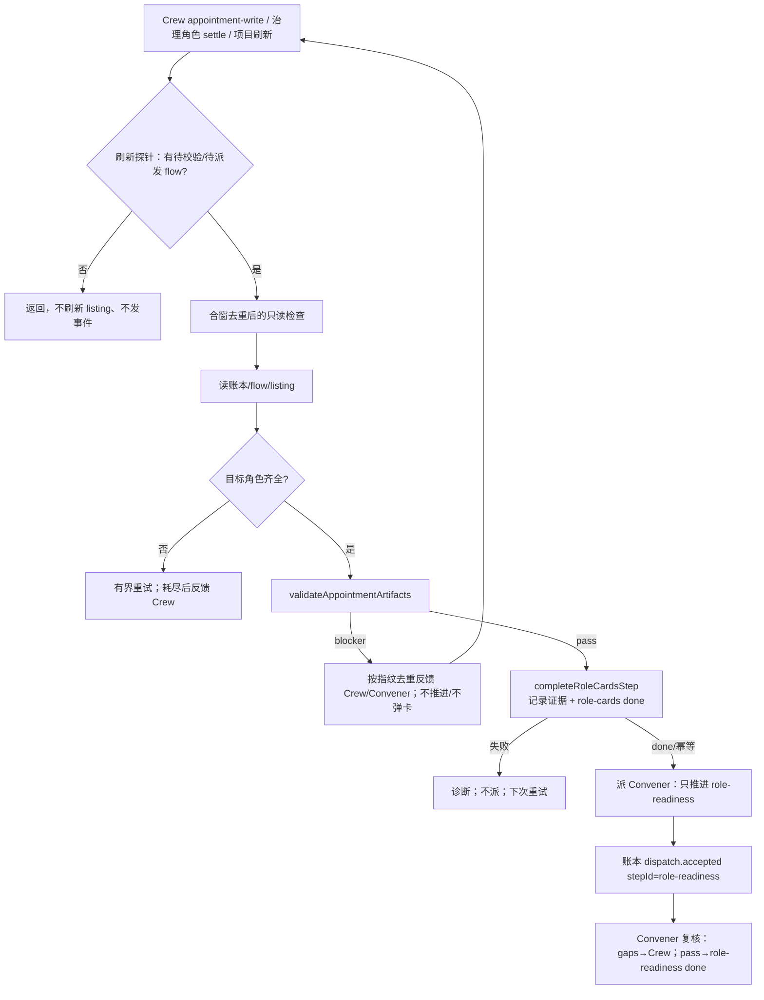

# 策划方案：治理写卡推进的可重入门禁闭环（governance-advance redispatch）

- 日期：2026-10-23
- 角色：ANS 策划（Planning）
- 状态：**草案 v1（待闸门 1 方案确认）**；本文件是设计候选，**未实施、未测试、未验收**
- 风险档位：**T3（治理行为与 flow 状态变更）**。依据技能 `references/testing.md` 的 T0–T3 口径：本方案改变应用推进治理流程的判定与 flow 写入行为，涉及跨角色契约与编排公共出口；即使不扩权，也按“治理变更”取 T3，实施前须有客户确认的方案版本、独立验收标准、全量回归与真实 Electron 证据。
- 闸门 0 依据：`docs/communication/2026-10-23_intent_governance-advance-redispatch.md`（客户已确认，2026-10-23）；客户补充“组队写完卡之后应有门禁验证，不对就让组队修改”。
- 事实快照：2026-10-23 对 `ans-gateway` 的 `ai-governance-pipeline` 只读核对，以及对当前工作树的只读检索；`path:line` 仅辅助定位，实施以符号名为准。目标项目未做任何写入。
- 标记约定：**[现状]** 已核实的当前行为；**[设计候选]** 本方案提议、尚未实施；**[待客户决定]** 见 §11，方案不替客户拍板。

---

## 1. 摘要

**问题**：Crew 写完/重写角色卡后，应用的结构校验与自动推进闭环在“第一次派发”后停住，表现为：校验不再重新进入、`role-cards` flow 步骤长期停在 `dispatched`、Convener 收不到应用派发的 readiness 任务；手工修正后刷新项目也不会重新校验。

**客户可见结果（设计候选）**：

- Crew 每次写卡（含修正重写）或用户刷新项目，应用都会做一次去重的只读结构校验。
- 不合格：应用自动把逐文件问题反馈给 Crew 修改；不推进、不弹客户卡、不伪造任何决定；Crew 再写后能再次进入校验。
- 合格：应用记录确定性校验证据、把 `role-cards` 标为 `done`，再派 Convener 做 `role-readiness`；同一内容状态不重复反馈、不重复派发。
- 权限模型不变：Crew 仍只通过既有 appointment-write 写 `角色卡/`，应用仍是中介与 flow 唯一写者。

**确认链**：闸门 0 已确认（`docs/communication/2026-10-23_intent_governance-advance-redispatch.md`）；本文件待闸门 1 确认；闸门 2 由统筹团队计划另行确认参与角色与写集；实施授权未给。

**非目标**：

- 不新增角色对 `角色卡/` 的写权限；不放开治理角色互相派发；不新增 `cardKind`/`FlowStepKind`/`Power`/`Decision` 枚举。
- 不重构治理流程或角色权限；不把 Convener 的语义 readiness 判定改成应用判定。
- 不迁移/修改 `ans-gateway` 的角色卡、flow 或账本；本方案只改 ans-studio 产品，目标项目只读复算。
- 不并入 i18n B1–B4 或目录级授权 v3 的现有改动；三者独立变更、独立验收。
- 不新增文件系统 watcher；手工改文件后仍需“刷新项目/重新导入”触发（是否接受见 Q2）。

---

## 2. 现场事实与根因

### 2.1 目标项目只读快照 [现状]

| 事实 | 内容 |
| --- | --- |
| flow | `role-cards`=dispatched；`role-readiness`=done；`acceptance-criteria`=pending；`role-cards` 为 `kind: artifact` 且无 `evidence.ref` |
| 账本 | 04:08:29 appointment（entry 15）；04:08:45 app→Convener（entry 17，无 stepId）；04:13:56 app→nominator/stepId=role-cards（entry 31）；最后 Crew 写卡 04:50:46（entry 81）；04:51:05 Liaison→Convener；04:52:41 Convener 写 readiness（entry 83） |
| 诊断 | 04:50:52 `advance.post-write.source-settle` 之后无 `advance.appointment.*` / `advance.post-write.dispatched` |
| boundary | 7 个角色边界当前均为 role-card → feature-map → functional-description → memo → api-spec → 写集；当前解析器与 ②b 检查遍历全部 `file` 条目，不依赖顺序 |

### 2.2 根因 [现状]

| 编号 | 根因 | 代码位置 | 后果 |
| --- | --- | --- | --- |
| R1 | Convener 运行期去重键成功后不清理 | `interface.ts` `postWriteAdvanceDispatched`（1481）、`applicationConvenerDispatchKey`（1484）、成功后仅失败路径删除（3337、3348–3368） | 同一进程内每个 flow 只可能派一次 Convener；Crew 重写、校验重跑都不放行 |
| R2 | `applicationDispatchCommitted` 用同一进程内永久键做账本侧去重 | 1483、`appendApplicationDispatch`（1571–1621，早退 1590、登记 1597） | 即便重新派发，也不会再写第二条 app→Convener 审计；账本锚点失真，且调用方误以为已记 |
| R3 | 账本 `afterwards` 只看“最新 appointment 之后是否有 app→Convener 派发” | 3241–3251、3285–3298 | 目标账本 entry 17（04:08:45，app→Convener，无 stepId）落在 appointment 之后、Crew 写卡之前，被当成 readiness 已派发；之后每次检查都 `continue`，重启也挡 |
| R4 | 没有项目刷新/手工改文件触发 | 触发仅治理角色 settle（1723）、appointment-write answered（3880）、Crew 派发后（4202）；`listProject`（3470+）不排检查 | 手工修正后刷新/重新导入不会重新校验；重启后也要等下一次治理事件 |
| R5 | `role-cards` 没有应用侧完成路径 | `completeAcceptanceStep` 只处理验收（`flow-service.ts:643`）；`observeFlowArtifacts` 跳过 `角色卡/`（735、773）；目标 flow 的 role-cards 无 `evidence.ref` | 应用不标 done；Convener 若补 done 只能拿不相干 artifact（如团队计划）顶替，语义错误；收尾门要求所有执行步骤 done，流程无法收口 |
| R6 | 反馈去重只看 issuesHash，不看角色卡内容 | `appointmentArtifactFeedback`（2478）、哈希去重（2936–2945、2995） | Crew 改了内容但问题集相同 ⇒ 不再反馈；同内容重复触发时行为也不一致 |
| R7 | readiness 文案不告知 role-cards 状态 | `governance-advance.ts:1047–1099` | Convener 可在 role-cards 未 done 时先完成 readiness（目标已发生），flow 状态不一致 |

**结论**：R1–R5 任意一条都足以让闭环停住；目标账本可证明 R3 是跨重启的确定性阻塞，R1/R2 是同进程的二次阻塞，R4/R5 解释了为什么“手工修正 + 刷新”和“flow 收口”都恢复不了。修复必须同时处理触发、去重、证据与收口，只改其中一项会留下其它阻塞。

---

## 3. 推荐方案 A：可重入门禁闭环 [设计候选]

### A1 触发与合窗

- 保留既有三个触发：治理角色 settle、appointment-write answered、Crew 派发后。
- 新增**项目刷新触发**：`listProject` 更新 listing 缓存后，先做一次**廉价探针**（读账本 + flow 状态 + 当前指纹验证记录/派发锚点）；只有存在“待校验或待派发”的 flow 才排完整检查。刷新触发使用 250ms 合窗，与既有 running/pending 合并逻辑共用，不吞信号。
- **防自激**：完整检查只在 (a) listing 角色/警告签名变化，或 (b) 实际发出反馈/派发/完成动作时 `emitProjectChanged`；避免 `listProject → 检查 → projectChanged → renderer 再 listProject` 的循环。诊断新增 `advance.post-write.probe`（仅诊断，不对客户展示）。
- 不引入文件系统 watcher；手工改文件需要用户刷新/重新导入（Q2）。

### A2 指纹、去重键与账本放行规则

**角色卡状态指纹**（内容指纹，不含时间/mtime）：

```text
sha256({
  schema: "role-cards-gate/v1",
  flowId,
  appointment: { path, version? },
  teamPlan: { path, version, sha256 } | null,
  roles: [ { roleId,
    files: ["role-card.md","boundary.yaml","feature-map.md",
            "functional-description.md","memo.md","api-spec.md"]
      .map(name => ({ name, sha256 | "missing" })) } ]  // 按 roleId 排序
})
```

- 目标角色取**最新 appointment** 的 `targetRoleIds`；团队计划内容变化也改变指纹。
- **反馈去重**：`appointmentArtifactFeedback` 以 `projectRoot\0flowId` 为键，值改为当前指纹；同指纹不重复反馈，指纹变化（含问题集相同但内容已改）重新反馈；通过后清除。
- **派发去重**：运行期键改为 `${canonicalRoot}\0${flowId}\0convener\0${fingerprint}\0${latestCrewWriteIndex}`；同一 flow 出现新键时清理旧键，避免 Set 无限增长。`applicationDispatchCommitted` 使用同一版本化键。
- **账本放行规则**（跨重启）：以“当前指纹的通过记录（`artifact.observed`，见 A5）”为锚；锚之后已有 app→Convener readiness 派发 ⇒ 跳过；否则放行。无通过记录的 legacy 流程以“最近 Crew appointment-write（无则最近 appointment）”为锚。**appointment 链早期无 stepId 的 Convener 派发不再算作 readiness 已派发**。
- 有 `role-cards` 步骤的流程，同内容重写不会重复派发；内容变化产生新指纹/新通过记录后放行。无该步骤的 legacy 流程以“最近 Crew 写卡”为锚，极端同内容重写可能重派一次，属可接受的迁移期成本。发出去但账本追加失败时释放运行期占位，下一次触发可重试。

### A3 校验与不合格反馈

- 继续使用现有 `validateAppointmentArtifacts`（目标角色 + listing + flowId + appointment artifact）。它按 Set/覆盖关系判定，**顺序无关**；新增一条 boundary 条目逆序回归测试锁定该事实。
- 不合格（存在非 warning blocker）：
  1. 记 `advance.appointment.artifacts-invalid`；
  2. 经既有 `reportAppointmentArtifactIssues` 按来源反馈 Crew / Convener；
  3. **不写 flow、不派 Convener、不弹客户卡、不写任何 customer.decision**；
  4. 反馈按 A2 指纹去重；发送失败不登记去重，下一次触发重试。
- warning-only（existing/legacy 的迁移提醒）保持现状：只记诊断，不阻塞、不派任务。

### A4 合格后的收口与派发

1. 复核目标角色已在最新 listing；否则沿用有界重试（100/300/600ms），耗尽后反馈 Crew。
2. 调应用专用 `completeRoleCardsStep`（A5）完成 `role-cards`：
   - 成功或幂等 done ⇒ 继续；
   - 失败（flow 缺步骤、证据缺失、文件在校验后又变、写盘失败）⇒ 只记诊断，**不派 Convener**，下一次触发重试；
   - 团队计划存在但 flow 缺 `role-cards` 步骤 ⇒ 视为 flow 缺陷，经既有后台反馈通道提示 Convener 修正（不弹客户卡、不新增 cardKind），不派 readiness；
   - legacy（无团队计划）且无该步骤 ⇒ 保持旧行为，直接按旧文案派 Convener。
3. 用 `buildRoleReadinessTaskMessage`（新增 `roleCardsDone` 选项）构造任务：role-cards 已 done 时只要求推进 `role-readiness`；若 flow 中 role-readiness 已 done（目标项目现状），文案明确“不要重做，核对后继续推进后续步骤”。
4. 派 Convener（沿用现有 runtime 优先级与后台会话），成功后追加 `dispatch.accepted{actorRoleId:"app", power:"app", trigger:"customer-decision", dedupeKey:版本化键}`；有团队计划时带 `stepId:"role-readiness"`，legacy 保持现状不带 stepId；失败释放占位并记诊断。
5. 成功后写 Lead 系统行（沿用 `governanceReadinessNote`），不表示客户批准。

### A5 应用专用 `completeRoleCardsStep`（新增）

- 与 `completeAcceptanceStep` 同层放在 `src/common/编排/flow-service.ts`，**不注册为角色工具**（不进 AdapterCapabilities），经 `src/pipeline/orchestration/flow-state.ts` 公共出口导出；桌面只经该出口消费。
- 输入（设计候选）：
  ```text
  completeRoleCardsStep({
    projectRoot, flowId, roleIds,
    validatedFiles: [{ path, sha256 }],   // 仅 角色卡/<roleId>/ 六个文件
    fingerprint, appointmentArtifactPath?
  })
  ```
- 行为：
  1. 校验 `roleIds` 非空且 `validatedFiles` 只落在目标角色目录的六个文件内；重新读取并核对 sha256（防止校验后文件又变）⇒ 不一致返回 `role-cards-stale`。
  2. 读 flow；找 `id: "role-cards"` 的步骤。缺失 ⇒ `role-cards-step-missing`；已 done ⇒ `{ok:true, idempotent:true}`；`superseded/failed/blocked/aborted` ⇒ `role-cards-step-terminal`，不覆盖终态。
  3. 按步骤 `kind` 生成证据（不改 kind）：
     - `dispatch`：要求账本已有 `dispatch.accepted{flowId, stepId:"role-cards"}`（应用派 Crew 时写入），候选 flow 再用同一 `validateFlowEvidence` 对账；证据 `{kind:"dispatch", ref:"role-cards"}`；
     - `artifact`：写应用私有验证记录并追加 `artifact.observed{actorRoleId:"app", power:"app", artifactPath, artifactSha256, flowId}`（幂等：同 path+sha 不重复），证据 `{kind:"artifact", ref:记录路径}`；
     - 其它 kind ⇒ `role-cards-kind-unsupported`。
  4. 验证记录（应用机器状态，非客户文档）：
     - 路径 `.ans/governance/role-cards/<flowId>/<fingerprint>.json`；
     - 内容含 `schema/flowId/at/roleIds/appointmentArtifactPath/teamPlan/fingerprint/files[{path,sha256}]/result:"structure-pass"/semantic:"pending"`；明确标注“结构校验通过，不代表 readiness/验收”；
     - 选 `.ans` 的理由：应用自有写入域，不碰 `角色卡/` 观察排除规则，不新增角色写权，也不需要新增项目文档归属。
  5. 与 `completeAcceptanceStep` 共用 per-project 串行队列、候选 YAML 复核与原子写；写 flow 事件 `flow.role-cards.completed`，view actor `app/app`；**不写 customer.decision、不写客户批准**。
- 该函数只记录确定性结构校验结果；能力的语义判断仍由 Convener readiness 负责（与现有注释“结构校验通过不等于判定粒度正确”一致）。

### A6 readiness 任务文案

- `buildRoleReadinessTaskMessage` 增加可选参数（如 `roleCardsDone?: { evidenceRef: string }`、`roleReadinessAlreadyDone?: boolean`）；未传时 v1/v2/v3 文案保持逐字不变，现有调用方与测试不受影响。
- 传入时追加一句：应用已在结构校验通过后把 `role-cards` 标 done（证据路径），只推进 `role-readiness`；不要重写角色卡、不要重新派 Crew；role-readiness 已 done 时只核对并继续后续步骤。

### A7 v2 / legacy 兼容

- 无团队计划的 legacy 流程：校验保持最低结构检查；无 `role-cards` 步骤时走旧派发文案与旧行为；不写验证记录、不改账本种类。
- 有团队计划（v2/v3）但 flow 缺 `role-cards` 步骤：不派 readiness，反馈 Convener 补 flow（新流程的 flow 缺陷，不静默通过）。
- 目标项目不迁移：其 `role-cards` 是 artifact 且无 evidence.ref，`completeRoleCardsStep` 在 done 时补 evidence；不修改目标项目的 flow/账本，也不要求其重写角色卡。

---

## 4. 契约与不变量

| 契约 | 内容 |
| --- | --- |
| 校验者 | 应用是唯一结构校验者；复用 `validateAppointmentArtifacts`，不复制第二套解析/校验 |
| flow 写者 | 应用仍是 flow 唯一写者；`completeRoleCardsStep` 不注册为角色工具，角色 flow 工具权限不变 |
| Crew | 只按既有 appointment-write 写 `角色卡/<id>/**` 与工作文档；不新增写权、不互相派发 |
| Convener | 只做 `role-readiness` 语义复核与后续调度；不代写角色卡、不补 flow 步骤证据 |
| 证据 | role-cards 完成证据是应用确定性结构校验记录（或既有 Crew dispatch 记录）；**不是**客户决定、不是 readiness、不是验收 |
| 账本 | 不新增 kind/power/decision 枚举；新增条目使用既有 `artifact.observed`（power=app）与 `dispatch.accepted` |
| 幂等/重试 | 同指纹不重复反馈/派发；发送/写盘失败释放占位；下一次触发重试，不循环 |
| 重启 | 运行期 Set 可丢；账本锚点（通过记录/最近 Crew 写卡）保证跨重启正确放行或跳过 |

---

## 5. 完整流程



状态边界：不合格只回到“等待 Crew/手工修正”；合格只前进到 readiness；任何分支都不写 `customer.decision`，不弹客户卡。

---

## 6. 权限与边界

- 不新增角色对 `角色卡/` 的写权限；Crew 仍只经 appointment-write 写卡，写门禁仍是唯一判定。
- 不放开角色互相派发；应用仍是唯一中介与 flow 写者；`completeRoleCardsStep` 是应用内部函数，不是角色工具。
- 不新增 `cardKind`/`FlowStepKind`/`Power`/`Decision` 枚举；不改变 `OBSERVE_SKIP_SEGMENTS`（`角色卡/` 仍不被常规 artifact 观察）。
- `.ans/governance/role-cards/**` 是应用机器状态，角色不可写；验证记录不是客户文档，不进入 `docs/` 归属。
- 目标项目只读：不在本变更中代写 `ans-gateway` 的 flow/账本/角色卡。

---

## 7. 受影响面（精确清单）

| 角色 | 文件 / 符号 | 变更 |
| --- | --- | --- |
| 桌面窗口 | `app/desktop/interface.ts`：`postWriteAdvanceDispatched`/`applicationDispatchCommitted`/`applicationConvenerDispatchKey`（1481–1485）、`appendApplicationDispatch`（1571–1621）、`appointmentArtifactFeedback`（2478）、`reportAppointmentArtifactIssues`（2922–3020）、`runPostWriteAdvanceCheck`（3207–3440）、`listProject`（3470+）、deps `completeRoleCardsStepFn`（607 附近）与静态导入（149–157） | 版本化去重键、指纹、账本锚点、刷新探针、完成/派发顺序、防自激 |
| 桌面窗口 | `app/desktop/governance-advance.ts`：`buildRoleReadinessTaskMessage`（1047–1099） | 新增 role-cards done / readiness 已 done 文案选项；旧调用逐字不变 |
| 桌面窗口 | `test/桌面应用/interface.test.ts`（既有授权单文件） | 新增可重入门禁正/负例、指纹去重、刷新触发、旧账本放行、逆序 boundary、legacy/v2 不变 |
| 桌面窗口 | `test/桌面应用/acceptance-dispatch.test.ts`（既有授权单文件，如需） | 触发面/去重回归；**不得新建文件** |
| 编排 | `src/common/编排/flow-service.ts`：新增 `completeRoleCardsStep`（与 643 `completeAcceptanceStep` 同层）及内部 helper | 验证文件哈希、写验证记录、按 kind 证据、done/幂等/终态 |
| 编排 | `src/pipeline/orchestration/flow-state.ts`：再导出 `completeRoleCardsStep`（与 21–24 现有导出一致） | 桌面唯一公共出口；**不**在 `run-role.ts` 注册为角色工具（该文件预计无功能改动） |
| 编排 | `test/编排/flow-service.test.ts`（既有目录授权） | 完成函数正/负例、幂等、终态、stale、路径越界、无 customer.decision |
| 测试 | `test/测试/governance-e2e-auto/`（目录授权；建议在既有 `l-crew-write-validation.test.ts` 或新增用例） | 全链路 e2e：错误→反馈→重写→通过→role-cards done→readiness 派发 |
| 装配 | `app/main.ts` | **预计不改**：`completeAcceptanceStepFn` 同样由 interface 默认静态导入，新函数沿用该模式 |
| 桌面UI | `app/renderer/**` | **不改**；刷新触发由既有 `refreshProject → listProject` 承担 |

**测试授权**：`test/桌面应用/` 是逐文件授权，实施只能改上表既有文件；若确需新文件，先由统筹/闸门 2/人事补边界条目，不得直接新建。其余目标文件均在现有 `boundary.yaml` 的目录/单文件授权内，**本方案不要求角色边界变更**。

---

## 8. 测试与验收

### 8.1 桌面窗口（`test/桌面应用/interface.test.ts`）

1. **可重入正/负例**：连续两次错误写卡（内容不同）⇒ 两次反馈；修正后 ⇒ 通过；`role-cards` 恰好一次 done，Convener readiness 恰好一次派发；全程无客户卡、无 customer.decision。
2. **指纹去重**：同内容重复 settle/刷新 ⇒ 不重复反馈、不重复派发；内容变化 ⇒ 允许再次反馈/派发。
3. **手工修改 + 刷新**：没有 Crew 事件，仅改文件后 `listProject` ⇒ 探针排检查；不合格反馈，合格推进。
4. **跨重启账本锚点**：构造 appointment 后有旧 app→Convener、之后又有 Crew appointment-write 的账本（目标项目形态）⇒ 不挡；“当前指纹通过记录之后”的 readiness 派发 ⇒ 挡，不重复。
5. **role-cards 完成**：artifact 与 dispatch 两种 kind；缺步骤（有/无团队计划）；已 done 幂等；终态拒绝；校验后文件变化 ⇒ stale，不派。
6. **逆序 boundary**：条目按写集→工作文档逆序书写仍通过（锁定顺序无关）。
7. **防自激**：检查不发任务时不产生新的 projectChanged；listProject 刷新不会形成循环。
8. **legacy/v2 不变**：无团队计划的旧文案、旧最低校验、旧派发路径逐字/逐行为保持；现有测试零放宽。

### 8.2 编排（`test/编排/flow-service.test.ts`）

`completeRoleCardsStep`：done + evidence；幂等；终态拒绝；stale 哈希；越界路径拒绝；artifact.observed 幂等；不写 customer.decision；候选 YAML 重新解析与原子写失败不破坏原文件。

### 8.3 集成、T3 与目标项目

- **e2e**：`test/测试/governance-e2e-auto/` 增加一条全链路用例（错误写卡→反馈→重写→通过→role-cards done→readiness 派发→不重复）。
- **T3 全量回归** + `npm run typecheck` + 真实 Electron `test/桌面应用/e2e/main.mjs`；记录候选版本、命令与输出。
- **目标项目只读复算**：把 `ans-gateway` 的 flow/账本复制到临时夹具，运行新逻辑断言“旧条目不再挡、当前指纹可放行”；原项目零写入；复算结果不等于目标项目已被修复。
- **独立验收要点**：① 不合格不推进且只反馈一次；② Crew 重写能重新触发；③ 合格后 role-cards done 且证据可核对；④ readiness 恰一次、账本恰一条、无客户决定；⑤ 权限/边界/枚举无扩张；⑥ legacy/v2 与逆序 boundary 行为不变；⑦ 目标项目无写入。

---

## 9. 备选方案 B / C

**B：只修去重/重新校验，不补 role-cards 收口。** 优点是改动最小，可快速解除“应用不再派 Convener”；缺点是 `role-cards` 仍是 `dispatched`，收尾门要求所有执行步骤 done，流程仍无法收口；Convener 只能拿团队计划等不相干 artifact 充当 role-cards 证据（语义错误）或继续卡住。适合作为紧急热修；不作为推荐终态。

**C：只加显式“重新校验/推进”动作，无自动刷新。** 优点是无后台读盘、行为可预测；缺点是每次 Crew 重写或手工修正都要用户手动点一次，容易漏、也无法满足客户“写完卡就应验证”的预期。若客户拒绝 Q2 自动刷新，或刷新频率实测不可接受，再选 C（可作为 A 的补充动作，而非替代）。

| 方案 | 重新触发 | role-cards 收口 | 重复派发控制 | 适用 |
| --- | --- | --- | --- | --- |
| A（推荐） | 事件 + 刷新探针（去重） | 应用专用完成 | 指纹 + 账本锚点 | 目标形态 |
| B | 事件 | 无（仍卡 flow） | 指纹 | 紧急热修 |
| C | 仅手动 | 有（若配完成函数） | 指纹 | 自动刷新被拒时 |

---

## 10. 风险与权衡

1. **重复派发/重复账本**：版本化键 + 通过记录锚点 + `applicationDispatchCommitted` 同键；并发触发用 running/pending 合窗；测试覆盖双击/连续 settle。
2. **指纹读取成本**：每 flow 约 7 角色 × 6 文件 + 团队计划；只在“有待校验/待派发”时读取，刷新 250ms 合窗；role-cards done 且 readiness 已派发后探针不再读文件。
3. **刷新触发频率/自激**：廉价探针先于 listing 刷新；`emitProjectChanged` 仅在 listing 签名变化或实际动作时发出；否则会形成刷新循环，这是本方案必须验证的回归点。
4. **flow 证据语义**：artifact kind 的 role-cards 用 `.ans` 应用记录作为证据，只证明结构校验，不证明 readiness；记录与文案都要写明，避免被误读为客户批准或语义通过。
5. **目标项目现状**：其 role-readiness 已 done、role-cards 仍 dispatched；完成后应用派 Convener 时文案必须说明“不要重做 readiness”；目标项目不在本变更中写入，实际结果以其只读复算为准。
6. **终态不可回退**：role-cards done 后文件再被改坏，flow 步骤不会自动 reopen；由 readiness/后续验收与 flow supersede 处理，本轮不新增 reopen 语义。
7. **同类 Crew 键限制**：`appointment-crew` 与 appointment 后的 nominator 账本去重仍是“一次任命一次派发”；同一 flow 重新任命可能被旧键挡住，属同一类缺陷但不在本轮范围，列为后续（若客户要求可另开变更）。
8. **重启反馈重复**：反馈去重是内存态，重启后同指纹可能再反馈一次；可接受；若要持久化，需在 `.ans` 记录 last-rejected 指纹（选装，未默认）。
9. **不扩权**：不新增角色写权/派发权/枚举；若实施中发现必须改边界或权限，停止并重开闸门 2，不自行扩权。

---

## 11. 闸门 1/2 待确认项（Q1–Q8）

| 编号 | 问题 | 推荐 | 备选 |
| --- | --- | --- | --- |
| Q1 | 是否接受“应用专用完成 role-cards”（新增 `completeRoleCardsStep`）？ | **接受**：应用是结构校验者与 flow 唯一写者，证据可核对，不伪造客户决定 | B：只修去重，由 Convener 补 done（证据语义不成立，仅热修） |
| Q2 | 是否接受项目刷新自动触发重新校验？ | **接受**：`listProject` 后廉价探针 + 250ms 合窗 + 指纹去重；手工改文件后刷新即可 | 仅事件触发；或仅显式动作（C） |
| Q3 | 指纹口径？ | **六个角色文件 sha256 + 团队计划 sha256 + validator schema 版本**；不含 mtime/时间 | 只 role-card/boundary；或含 mtime（不推荐，易误重发） |
| Q4 | 去重键与账本放行口径？ | **版本化运行期键（指纹 + 最近 Crew 写卡位置）+ 通过记录/最近 Crew 写卡为账本锚**；早期 appointment 链派发不算 readiness | 只用运行期键（重启仍可能被旧条目挡）；或给 `dispatch.accepted` 加指纹字段（改账本语义，不推荐） |
| Q5 | 是否加显式“重新校验/推进”动作？ | **本轮不加**；先以自动触发满足客户预期 | 选装 O1（待客户确认）：无新枚举的应用动作/IPC；或方案 C |
| Q6 | role-cards 完成证据放哪？ | **`.ans/governance/role-cards/<flowId>/<fingerprint>.json` + `artifact.observed(power=app)`**；不碰 `角色卡/` 观察排除 | 以 `角色卡/<roleId>/boundary.yaml` 作 artifact 证据（语义不完整）；或新增项目文档（改归属，不推荐） |
| Q7 | readiness 文案如何表达 role-cards 状态？ | **role-cards 已 done 时只推进 role-readiness；role-readiness 已 done 时明确“不要重做，核对后继续”** | 不改文案，由 Convener 自行读 flow |
| Q8 | 证据范围？ | **T3 全量回归 + 真实 Electron + 目标项目只读复算 + 夹具全链路 e2e**；不代写目标项目 | 只跑受影响单测（不满足 T3）；或要求目标项目现场复演（本轮不做） |

Q1–Q7 属闸门 1 方案决策；闸门 2 只需确认参与角色（桌面窗口、编排、测试）与写集；本方案不要求角色边界变更。若客户选择 B/C、要求新增权限/边界/动作，或改变“应用校验、Convener 语义复核”的分工，属方案/范围实质变化，需修订本文件并重开闸门 1；若只是新增 `test/桌面应用/` 文件授权，走闸门 2/人事。

---

## 12. 交付状态与下一步

- **已完成**：本策划方案（草案 v1），基于 2026-10-23 只读核对；未改任何源码、测试、角色卡、边界、团队计划、验收或沟通记录；未写入目标项目。
- **未做**：闸门 1 确认、团队计划、闸门 2、实施、独立测试、独立验收；不声称已实施/已测试/已验收，也不声称目标项目已恢复。
- **下一步**：交沟通 → 客户闸门 1 确认本文件版本（含 Q1–Q8）→ 统筹写团队计划（角色/写集/顺序/档位）→ 沟通提交闸门 2 → 独立验收在实施前按确认版本写完成标准 → 实施 → T3 全量回归与真实 Electron → 独立验收。
- **版本**：`2026-10-23 v1`（写盘即冻结为待确认版本；实质变更递增版本并重开闸门 1）。
