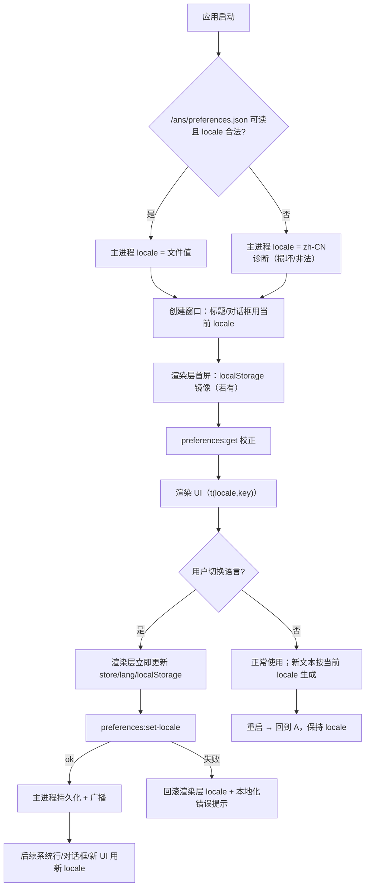

# 策划方案：国际化（i18n）

（用户可见文案默认 `zh-CN`，增加 `en-US`；运行时切换、持久化、缺失 key 回退；机器标识不翻译）

- 日期：2026-10-23
- 角色：ANS 策划（Planning）
- 状态：**草案 v1（待闸门 1 方案确认）**；本文件是设计候选，**未实施、未测试、未验收**
- 风险档位：**T2（跨角色/接口/契约/shared 变更）**。依据技能 `references/testing.md`「Risk-Based Verification and Change Packages」：本方案同时触及渲染层、主进程、共享元数据与新增 IPC 契约，属于跨角色/接口契约/shared 变更，不是 T1 局部实现；它**不**改变治理/权限/角色边界，因此不是 T3。若实施中决定改动 `src/common/shared/` 的属主或角色边界，档位升为 T3 并重开闸门 2。
- 闸门 0 依据：`docs/communication/2026-10-23_intent_i18n-and-directory-ownership.md`（客户已确认，2026-10-23）
- 代码事实快照：2026-10-23 只读检索。文中 `path:line` 是检索时快照，实施时以符号名和实际代码为准
- 标记约定：
  - **[现状]** 已核实的当前代码行为；
  - **[设计候选]** 本方案提议、尚未实施；
  - **[待客户决定]** 见 §13，方案不替客户拍板

---

## 1. 摘要

客户要求：增加国际化支持——先覆盖**用户可见文案**，默认中文 `zh-CN`，增加英文 `en-US`；运行时可切换、持久化、缺失 key 回退中文；不散落硬编码字符串；不国际化机器标识（roleId、cardKind、协议字段、日志码、测试断言标识）。角色提示词、系统提示、文档是否翻译作为第二阶段单独决定。

当前产品**没有任何 i18n 基础设施**：`package.json` 无 i18n 依赖；`app/renderer/src` 与 `app/desktop` 的用户可见文案直接写在中英文混排的字符串里；主进程把大量**人类可读文本**（系统行、派发失败原因、会话历史错误、对话框标题）直接推给渲染层；`src/common/shared/runtime-settings.ts` 的字段标签/帮助文本是主进程与渲染层共用的中文常量；渲染层偏好只持久化侧栏宽度/收起状态（localStorage），主进程另有 userData 下的引擎选择持久化先例，但没有语言设置；渲染层 `index.html` 固定 `lang="zh-CN"`；CLI 帮助/错误也是中文硬编码。

本方案提出：

- **单一消息目录 + 单一翻译实现**：`src/common/shared/i18n/` 作为物理唯一目录，包含 `zh-CN` 参考目录、`en-US` 目录、key 类型、插值/复数/回退实现；渲染层通过一个**只做再导出的 facade** `app/renderer/src/i18n/index.ts` 消费，主进程与 CLI 直接导入共享模块；不复制第二份翻译实现。渲染层私有文案也进同一目录（`ui.*` 命名空间），避免“第二份文案”。
- **key 规范**：`<area>.<component>.<purpose>`（小写 ASCII、点分隔），参考目录 `zh-CN` 定义 key 全集，`en-US` 用 `Record<MessageKey, ...>` 编译期强制齐全；插值 `{name}`；复数用 `Intl.PluralRules` + `{one, other}` 变体；缺失 en-US key 回退 zh-CN，zh-CN 也缺则返回 key 并记稳定诊断码。
- **运行时切换与持久化**：应用级 `locale` 偏好存 `<userData>/ans/preferences.json`（主进程唯一权威，`atomicWrite`），渲染层用 `localStorage["ans.locale"]` 仅作首屏镜像；新增 preload/IPC 读写与广播；启动、切换、重启、项目切换、多窗口行为明确；默认 `zh-CN`，不跟随 OS 语言。
- **分层归属**：用户可见文案按“谁生成谁负责”分层——共享元数据与跨层文案归 `src/common/shared/i18n/`（项目管理唯一写入）；渲染层 chrome 归 `ui.*`；主进程生成的人类可读文本归 `main.*`；CLI 若本轮纳入则归 `cli.*`（建议第二阶段）。主进程在发送前用同一目录翻译；渲染层只呈现，不维护第二套主进程文案。
- **分批迁移**：基础设施 → 渲染层外壳 → 渲染层聊天/面板 → 主进程用户可见文本 → 共享设置元数据；每批保持 zh-CN 输出逐字不变，旧测试断言不需要改；新增 en-US 断言与布局/回退测试；用“禁止新增硬编码中文”的 AST 守卫 + 允许清单逐批收紧，不一次性重写全部字符串。
- **布局风险**：英文通常更长；覆盖最小窗口 960×620、侧栏 208、标题栏 36px、设置保存条 64px、200% zoom；真实 Electron 下做溢出/截断/title/aria 检查并留截图证据。

**客户可见的结果（设计候选）：**

- 桌面应用设置里可以切换中文/English，立即生效；下次启动、切换项目后仍保持；重启后不回退。
- 默认仍是中文；英文缺词条时自动显示中文，不出现空白或报错；缺词条会在诊断里留稳定代码（不翻译日志码）。
- 界面 chrome、按钮、状态、提示、错误、对话框标题显示所选语言；聊天历史里已经生成的文本不会追溯翻译。
- `roleId`、角色卡路径、`cardKind`、flow step id、事件/日志码、测试断言标识保持原样。

本方案不翻译角色提示词/角色卡/文档/模型输出，不把机器协议字段改成显示文案，不引入第三方 i18n 运行时，不改变治理/权限/角色边界。

---

## 2. 基线与范围

### 2.1 需求基线与确认状态

| 项 | 状态 | 记录 |
| --- | --- | --- |
| 闸门 0：意图确认 | **已确认（2026-10-23）** | `docs/communication/2026-10-23_intent_i18n-and-directory-ownership.md` |
| 客户原话 | — | 「下一步，我需要增加国际化的支持……」「可以」 |
| 本轮范围 | 用户可见文案 `zh-CN`/`en-US`、运行时切换、持久化、缺失 key 回退、插值/复数、布局测试 | 同上「变更 A」 |
| 本轮非目标 | 机器标识、角色提示词/系统提示/文档（第二阶段）、模型输出、治理/权限/边界 | 同上「非目标」 |
| 闸门 1：方案确认 | **待确认** | 本文件（提交沟通后由客户确认） |
| 闸门 2：角色指派/写集确认 | 未开始 | 本文件确认后由统筹写团队计划、沟通提交客户 |
| 实施授权 | 未给 | 闸门 1、闸门 2 通过后另行取得 |

本方案与「目录级授权 + 目录规范」方案（`docs/planning/2026-10-23_design_directory-ownership.md`）是**两个独立变更**：分别走闸门 1/2、分别实施与验收；不合并成一个巨大改动。两份方案在实现期可能触及同一批文件（见 §14.3），由统筹安排顺序与写集，不因此合并方案。

### 2.2 验收基线

客户在**闸门 1**确认的**本文件版本**是后续独立验收的基线。独立验收在实施前基于该版本把正式完成标准写入 `docs/acceptance/`；本文件 §11 的完成标准是方案自带的可核对标准，供闸门 1 确认和验收引用，**不是**正式验收结论或验收文档。团队计划、角色指派和实现安排都不是验收基线。

### 2.3 范围边界

**本轮必须覆盖：**

- 用户可见文案：桌面渲染层 chrome 与聊天/面板文案；桌面主进程生成、最终显示给用户的文本（系统行、提示、应用生成的错误、对话框标题、窗口标题、设置元数据）。
- 默认 `zh-CN`；新增 `en-US`；运行时切换；跨重启持久化；项目切换不改变语言；缺失 key 回退 `zh-CN`。
- 单一消息目录、key 规范、插值、复数、类型安全、按层归属；不散落硬编码字符串（分批 + 守卫）。
- 布局/截断/窄屏/200% zoom 风险与测试；英文长度导致的 UI 溢出治理。
- 受影响文件/角色/测试精确清单；T2 完成标准与证据计划。
- 客户需拍板的开放问题（§13）。

**本轮明确不做：**

- 不国际化 `roleId`、`cardKind`、`GovernanceFunction`、协议字段、flow step id、事件名/日志码、诊断字段、测试断言标识、文件路径、环境变量名、模型工具名。
- 不翻译角色提示词、角色卡文本、系统提示、工程法案、文档、README、`site/`、发布说明；这些是**第二阶段**（§10.5）。
- 不翻译模型输出、模型生成的卡片标题/预览/报告内容；只翻译应用生成的 UI 外壳。
- 不把机器协议字段改成人类文案；不新增 `cardKind`、`FlowStepKind`、`GovernancePower`、`GovernanceDecisionKind`。
- 不改变治理/权限/角色边界；不改变默认语言之外的任何业务行为。
- CLI 默认不在本轮范围（见 §13 Q3）；若客户要求纳入，按 §9.3 增加受影响面与测试。
- 不一次性重写全部历史字符串；不为了迁移改 zh-CN 文案本身。

---

## 3. 现状与问题（代码事实）

以下事实均来自 2026-10-23 只读检索；不表示本方案已改变它们。

### 3.1 没有 i18n 基础设施

| # | 事实 | 证据 |
| --- | --- | --- |
| 3-1 | `package.json` 的 dependencies/devDependencies 没有 i18n 库（无 i18next/react-i18next/@formatjs 等）；仓库也没有 `locales/`、`messages/`、`i18n` 模块。 | `package.json:20-58` |
| 3-2 | 渲染层 HTML 固定 `lang="zh-CN"`，标题固定中文。 | `app/renderer/index.html:2,11` |
| 3-3 | 没有任何语言偏好/切换入口；设置面板只有引擎配置（Pi/Codex/Claude）。 | `app/renderer/src/shell/SettingsPanel.tsx:377-517` |
| 3-4 | 主进程没有语言偏好文件；已有 userData 持久化先例是引擎选择与投递队列（明确“不写项目 `.ans`、不碰治理账本”）。 | `app/desktop/interface.ts:512-520`；`app/main.ts:617` |

### 3.2 用户可见文案大量硬编码、跨层分散

| # | 事实 | 证据 |
| --- | --- | --- |
| 3-5 | `app/renderer/src` 中 58 个 `.ts/.tsx` 文件、1782 行含中文（原始行计数，含注释/测试夹具文案）；典型 UI 文案直接写在组件与纯逻辑里。 | 2026-10-23 `rg -c '\p{Han}' app/renderer/src` 快照 |
| 3-6 | `app/desktop` 中 24 个 `.ts` 文件、4064 行含中文；大量是主进程生成、最终显示给用户的系统行/错误/提示，也有注释与模型提示词。 | 2026-10-23 `rg -c '\p{Han}' app/desktop` 快照 |
| 3-7 | 渲染层典型硬编码：标题栏品牌/窗口按钮、会话头 tab、状态徽标、设置面板字段/保存条、治理面板、确认卡按钮。 | `app/renderer/src/shell/TitleBar.tsx:50-96`；`app/renderer/src/shell/ChatHeader.tsx:90-148`；`app/renderer/src/chat/status.ts:28-103`；`app/renderer/src/chat/governance-view.ts:41-143`；`app/renderer/src/shell/SettingsPanel.tsx:79-505` |
| 3-8 | 渲染层纯逻辑模块也直接返回中文文案（不是只在 JSX 里）：`runtimeLabel`、`configWarningText`、`savedStatusText`、`applicationLabel`、`fieldLabelText`、`statusBadge`、`roleDisplayName` 等。 | `app/renderer/src/chat/runtime-config.ts:47-55,248-384`；`app/renderer/src/chat/status.ts:28-103`；`app/renderer/src/chat/role-view.ts:57-77` |
| 3-9 | 主进程直接生成人类可读文本并经 IPC/系统行交给渲染层：派发失败/未受理原因、写卡反馈、验收推进提示、会话历史错误、对话框标题、窗口标题。 | `app/desktop/session.ts:3149-3245`；`app/desktop/interface.ts:2576-2598`；`app/desktop/runtime-history.ts`（`历史请求须指定项目、角色与运行时。` 等）；`app/main.ts:107,619-621,676-678,882` |
| 3-10 | `src/common/shared/runtime-settings.ts` 是主进程与渲染层共用的用户可见元数据：字段 `label`、`help`、`choiceLabels` 全是中文，由主进程构造成设置视图后推给渲染层。 | `src/common/shared/runtime-settings.ts:41-102`；`app/desktop/runtime-config.ts:63,101,171` |
| 3-11 | 引擎显示名是共享常量（`RUNTIME_LABELS`），其中 `demo: "演示"` 是用户可见中文；渲染层另有一份本地 `RUNTIME_LABELS`（本阶段未标注为第二实现，但 i18n 后必须收敛）。 | `src/common/shared/runtime-shared.ts:22-28`；`app/renderer/src/chat/runtime-config.ts:47-55` |
| 3-12 | 治理角色显示名/权力说明是渲染层硬编码的中英混排；普通项目角色显示名直接取 `roleId`（本仓库 roleId 是中文，如 `编排`、`门禁引擎`）。 | `app/renderer/src/chat/role-view.ts:16-42,57-61` |
| 3-13 | CLI 帮助/doctor/错误也是中文硬编码；`src/index.ts` 是装配入口，`src/interface/cli/*` 是编排的 Interface 文件。 | `src/index.ts:343-356,399-424`；`src/interface/cli/run.ts:23-28`；`src/interface/cli/govern.ts:62-63` |

**结论：** 当前不存在“文案层”；同一句用户可见文本可能同时出现在渲染层组件、渲染层纯逻辑、主进程系统行、共享设置元数据与 CLI。直接全量替换会同时触碰多个角色的写集和大量测试断言，必须分层、分批、可回退。

### 3.3 设置持久化现状

| # | 事实 | 证据 |
| --- | --- | --- |
| 3-14 | 渲染层视图偏好用 localStorage：`ans.sidebar.width`、`ans.sidebar.collapsed`；注释明确只承载视图偏好，不持久化治理事实。 | `app/renderer/src/stores/ui-store.ts:8-11,19-20,46-68` |
| 3-15 | 主进程有 userData 持久化先例：`<userData>/ans/runtime-selection.json`（per-project 引擎选择），以及同目录投递队列；明确不写项目 `.ans`、不写 `.env`。 | `app/desktop/interface.ts:512-520`；`app/main.ts:617` |
| 3-16 | 渲染层运行时选择（Pi/Codex/Claude）只存在内存 `ui-store`，默认 Claude；项目切换会清空设置视图状态。 | `app/renderer/src/stores/ui-store.ts:29-36,85-106`；`app/renderer/src/stores/settings-store.ts:414-430` |
| 3-17 | 没有“应用级偏好”文件抽象；`preferences.json` 这个名字在代码中不存在。 | 2026-10-23 只读检索 |

### 3.4 构建/类型边界

| # | 事实 | 证据 |
| --- | --- | --- |
| 3-18 | 渲染层有独立 `app/renderer/tsconfig.json`，`include: ["src"]`、`paths: {"@/*": ["./src/*"]}`；根 `tsconfig.json` `include: ["src","test","app"]` 但 `exclude: ["app/renderer"]`。 | `app/renderer/tsconfig.json`；`tsconfig.json` |
| 3-19 | Vite 只构建渲染层，`root: "app/renderer"`，alias `@` 指向 `app/renderer/src`；主进程/preload 无构建。 | `vite.config.ts:31-63` |
| 3-20 | 因此渲染层消费 `src/common/shared/` 必须走相对导入或新增 alias/include；新增 alias 会同时触碰装配的 `vite.config.ts` 与桌面UI 的渲染层 tsconfig，属于跨角色构建配置变更。 | 同上 |
| 3-21 | `src/common/shared/` 的唯一写入者是项目管理；共享组件不得复制第二份实现（工程法案 §一.5）。 | `角色卡/项目管理/docs/project-rules.md:24-26` |

### 3.5 测试冻结了中文文案

| # | 事实 | 证据 |
| --- | --- | --- |
| 3-22 | 渲染层纯逻辑测试直接断言中文：如 `statusBadge("working",2).label === "工作中 · 2 待办"`、`roleDisplayName(null) === "未选择角色"`。 | `test/桌面UI/status.test.ts:28-38`；`test/桌面UI/role-view.test.ts:43-46` |
| 3-23 | 设置面板测试断言 `configWarningText`、`savedStatusText`、`fieldLabelText`、`applicationLabel` 等中文输出。 | `test/桌面UI/runtime-config.test.ts`（整文件） |
| 3-24 | 主进程与 e2e 测试也大量断言中文系统行/任务文案；测试总数 350 个 `.test.ts`（不含 `.mjs` smoke）。 | `test/桌面应用/*`、`test/测试/governance-e2e-auto/*` 等 |
| 3-25 | 测试目录归属：渲染层纯逻辑在 `test/桌面UI/`（目录授权）；主进程测试在 `test/桌面应用/`（逐文件授权，新文件需边界变更）；共享组件测试在 `test/项目管理/shared/`。 | `角色卡/桌面UI/boundary.md:10-15`；`角色卡/桌面窗口/boundary.md:20-43`；`test/项目管理/shared/` |

### 3.6 布局与尺寸约束

| # | 事实 | 证据 |
| --- | --- | --- |
| 3-26 | 窗口最小 960×620；侧栏宽度 208–360、默认 248；标题栏 36px（CSS）；设置保存条固定 64px；这些是英文变长的硬约束。 | `app/main.ts:103-108`；`app/renderer/src/stores/ui-store.ts:15-17`；`app/renderer/src/shell/SettingsPanel.tsx:9`（注释）与 `:496-515` |
| 3-27 | 已有真实 Electron 冒烟/回归脚本（`test/桌面UI/phase*.mjs`、`test/桌面应用/e2e/main.mjs`），可扩展语言/缩放检查；渲染层单测只测无 DOM 的纯逻辑。 | `test/桌面UI/`、`test/桌面应用/e2e/main.mjs`；工程法案 §三（UI 平台化构建与依赖宪法） |
| 3-28 | 存在截断/省略逻辑（角色卡首句 42 字截断、工具行摘要等），英文长度会改变截断位置与可见性。 | `app/renderer/src/chat/role-view.ts:68-77`；`app/renderer/src/chat/tool-summary.ts` |

---

## 4. 设计

### 4.1 设计原则

1. **单一消息目录、单一翻译实现**：所有用户可见文案（应用生成的）只存在于一份目录；翻译/插值/复数/回退只有一个实现。渲染层、主进程、CLI 只消费，不各写一套。
2. **key 是稳定标识，不是文案**：key 不随文案改写而改名；测试断言标识、日志码、协议字段继续用原标识，不参与翻译。
3. **谁生成谁翻译**：应用生成的文本在生成层用当前 locale 翻译；渲染层不维护主进程文案的第二份。
4. **默认中文、缺失回退中文**：默认 `zh-CN`；`en-US` 缺 key 回退中文；两者都缺返回 key 并记稳定诊断码，不让界面空白。
5. **不改机器标识**：`roleId`、`cardKind`、`GovernanceFunction`、flow step id、事件名、诊断码、环境变量、文件路径、工具名保持原样。
6. **zh-CN 输出逐字不变**：迁移期默认语言输出与现状一致，旧测试断言保持有效；文案改写与 key 化分开做。
7. **分批可回退**：每批独立可验证、可回退；不一次性重写全部字符串。

### 4.2 目录结构与归属

**[设计候选] 推荐方案 A：单一物理目录 + 渲染层 facade。**

```text
src/common/shared/i18n/
  index.ts                 # 公共出口：类型、translate、createTranslator、locale 工具
  locales.ts               # Locale 类型、SUPPORTED_LOCALES、DEFAULT_LOCALE、resolveLocale
  keys.ts                  # MessageKey / MessageParams 类型（由 zh-CN 目录推导）
  messages/
    zh-CN.ts               # 参考目录（key 全集、中文文案）
    en-US.ts               # 英文目录（Record<MessageKey, MessageTemplate>，编译期齐全）
  translate.ts             # 插值、复数、回退、诊断钩子（纯函数，不依赖 Node/DOM）
  format.ts                # Intl.NumberFormat/DateTimeFormat/PluralRules 的薄封装
app/renderer/src/i18n/
  index.ts                 # 仅再导出 shared 的 API；渲染层组件只 import "@/i18n"
  locale-store.ts          # 渲染层 locale 状态 + localStorage 镜像 + IPC 同步（zustand）
app/desktop/
  preferences.ts           # <userData>/ans/preferences.json 读写（locale 等应用级偏好）
  i18n.ts                  # 主进程侧 translator 绑定（当前 locale + t）
```

- **归属**：
  - `src/common/shared/i18n/` 属**项目管理**（`src/common/shared/` 唯一写入者）；共享组件增删登记到 `角色卡/项目管理/docs/architecture/shared-components.md`。
  - `app/renderer/src/i18n/` 属**桌面UI**；只再导出共享实现，不复制目录/翻译逻辑。
  - `app/desktop/preferences.ts`、`app/desktop/i18n.ts` 属**桌面窗口**（`app/desktop/` 目录内）。
  - CLI 若纳入，目录放 `src/interface/cli/i18n.ts`（编排）或直接消费 shared；不新增第二份目录。
- **为什么渲染层用 facade**：渲染层 tsconfig 只 include `app/renderer/src`，根 tsconfig exclude `app/renderer`；从 `app/renderer/src/i18n/index.ts` 相对导入 `../../../../src/common/shared/i18n/index.ts` 可被 TS 作为依赖拉入、被 Vite 打包，**不需要改 `vite.config.ts`/渲染层 tsconfig**（避免装配+桌面UI 的构建配置改动）。facade 只有 `export ... from` 与渲染层 store，不是第二份文案。
  - 实施时须先验证 Vite dev/build 能解析并打包 `app/renderer` 之外的 shared 模块（Vite 默认 `server.fs.allow` 以 workspace root 为界，通常允许；若被限制，需装配在 `vite.config.ts` 增加 `server.fs.allow`，这属于构建配置变更，写集要包含装配）。这是 B0 的退出条件之一。
- **备选方案 B：分层目录**：`src/common/shared/i18n/` 只放共享运行时与跨层文案；渲染层私有文案放 `app/renderer/src/i18n/messages.*`，主进程私有文案放 `app/desktop/i18n/messages.*`，CLI 放各自目录。优点是保留各角色文案自治、避免项目管理成为文案瓶颈；缺点是物理目录多份、key 全集/类型统一更难，跨层重复文案需要额外检查。**默认推荐 A**；若客户/统筹认为“UI 文案变更必须经项目管理”不可接受，再选 B（§13 Q4）。
- **不推荐方案 C**：把所有文案放渲染层、主进程只发 key。理由是主进程目前直接生成并持久化人类文本（系统行/历史/队列），改成 key+参数会触及大量 IPC/持久化协议与历史数据，超出 T2，且旧历史无法回填。

### 4.3 key 规范

**[设计候选]**

```text
<area>.<component>.<purpose>[.<variant>]
area      = ui | main | shared | cli（与生成层对应）
component = 小写 kebab-case，如 status / settings / dispatch / runtime-settings
purpose   = 小写 kebab-case，如 label / title / help / error / empty / action
variant   = 可选，如 one / other（仅复数模板内部使用，不单独成 key）
```

示例：

```text
ui.status.working.label                 "工作中"
ui.status.pendingCount                  "{count} 项待办"
ui.settings.save.action                 "保存到 .env"
ui.confirm.reject.action                "拒绝"
main.dispatch.rejected.roleNotFound     "派发未受理：角色 {roleId} 不在本项目"
main.session.history.invalidRequest     "历史请求须指定项目、角色与运行时。"
shared.runtimeSettings.pi.token.label   "访问令牌"
shared.runtimeSettings.reasoning.help   "留空＝维持平台默认……"
```

规则：

- key 只含小写 ASCII、数字、点、连字符；不以数字开头；不得用中文/空格。
- key 一旦发布不改名；文案改写只改目录值。删除 key 必须同时删除所有引用（编译期可查）。
- 不允许运行时拼接 key（如 `t("ui." + name)`）；需要动态选择时用显式映射表，保持静态可查。
- 同一个 zh-CN 文案原则上只对应一个 key；通用短词（“取消”“关闭”“重试”）允许共享 key。重复文案检查见 §4.9。
- 机器标识**不得**作为 key 的一部分（如不要 `ui.role.编排`）；角色显示名的处理见 §4.10。

### 4.4 消息模板：插值、复数、格式化、回退

**[设计候选]**

```ts
export type Locale = "zh-CN" | "en-US";
export const DEFAULT_LOCALE: Locale = "zh-CN";
export const SUPPORTED_LOCALES: readonly Locale[] = ["zh-CN", "en-US"];

export type PluralCategory = "zero" | "one" | "two" | "few" | "many" | "other";
export type MessageTemplate = string | Partial<Record<PluralCategory, string>>;
export type Catalog = Record<string, MessageTemplate>;

export function translate<K extends MessageKey>(
  locale: Locale,
  key: K,
  params?: MessageParams[K],
): string;
```

- **插值**：`{name}` 占位符；参数值先 `String()`；缺失参数保留占位符原文并记诊断 `i18n.missing-param`（诊断码不翻译）。不做 HTML 转义（输出走 React 文本节点/纯文本，不拼 `dangerouslySetInnerHTML`）；若未来有富文本，另设显式分段 API，不默认可注入 HTML。
- **复数**：模板可以是对象 `{one, other}`；用 `Intl.PluralRules(locale).select(count)` 选变体。中文恒为 `other`；英文按 `one/other`。参数必须包含 `count`（整数或 `Intl.NumberFormat` 可格式化的数）；变体缺失时回退 `other`。
- **数字/日期**：用 `Intl.NumberFormat(locale)`、`Intl.DateTimeFormat(locale)` 的薄封装；不要在文案里硬拼中文单位或千分位。时间/时长等已有纯格式化函数（如 `formatDurationMs`）不在本轮强制改造，但新增文案必须使用封装。
- **回退顺序**：
  1. 当前 locale 的 key；
  2. `zh-CN` 的 key；
  3. key 本身（如 `ui.status.working.label`），并记诊断 `i18n.missing-key`（含 locale/key，不翻译）。
- **locale 解析**：`resolveLocale(raw)` 只接受 `SUPPORTED_LOCALES` 精确值；非法/缺失 → `DEFAULT_LOCALE` + 诊断 `preferences.locale.invalid`（若来自偏好文件）。
- **不翻译的片段**：路径、命令、环境变量、工具名、错误原文（作为参数插入时原样保留）；不对外部错误信息做机器翻译。

### 4.5 类型安全

**[设计候选]**

- `zh-CN.ts` 用 `satisfies Catalog` / `as const` 定义参考目录；`MessageKey = keyof typeof zhCN`。
- `en-US.ts` 类型为 `Record<MessageKey, MessageTemplate>`；缺 key、多 key 都是编译错误。
- `MessageParams` 用显式接口按 key 映射（可选实现）：

```ts
export interface MessageParams {
  "ui.status.pendingCount": { count: number };
  "main.dispatch.rejected.roleNotFound": { roleId: string };
  "shared.runtimeSettings.reasoning.help": Record<string, never>;
}
export type ParamsOf<K extends MessageKey> = K extends keyof MessageParams ? MessageParams[K] : undefined;
```

- 模板占位符与参数名的对应由**测试**校验（扫描 `{name}` 与 `MessageParams`），避免类型系统过度复杂。
- key 的引用只允许静态字面量；`t()` 的 key 参数类型为 `MessageKey`，拼写错误编译失败。
- 渲染层 facade 再导出同一 `MessageKey`/`t` 类型；主进程与 CLI 直接使用 shared 类型。

### 4.6 locale 状态与优先级

**[设计候选]**

应用级 locale，不按项目、不按角色、不按引擎。优先级（高→低）：

1. 本次运行中用户显式切换（渲染层调用 `setLocale`）；
2. `<userData>/ans/preferences.json` 的 `locale`；
3. 渲染层 `localStorage["ans.locale"]` 镜像（仅首屏快速读取；若与偏好文件不一致，以偏好文件为准并回写镜像）；
4. `DEFAULT_LOCALE = "zh-CN"`。

- **不跟随 OS 语言**：客户意图是默认中文；`app.getLocale()`/`navigator.language` 不作为默认来源（可作为将来“跟随系统”选项，不在本轮）。
- **非法值**：偏好文件中的非法 locale → 回退 `zh-CN`，回写为 `zh-CN` 或保留非法值并诊断？推荐**回写规范化值**（fail-safe），并记诊断。
- **多窗口**：当前应用只有一个主窗口；若未来多窗口，主进程广播 `preferences:locale-changed`，所有窗口跟随。

### 4.7 持久化与 IPC

**[设计候选]**

偏好文件：

```json
{
  "version": 1,
  "locale": "zh-CN"
}
```

- 路径：`<userData>/ans/preferences.json`（与 `runtime-selection.json` 同目录；不写项目 `.ans`、不写 `.env`、不写治理账本）。
- 写入：`atomicWrite`（共享原语，Windows 瞬时 EPERM 已有有界重试）；读取失败/文件损坏 → 默认 `zh-CN` + 诊断，不阻塞启动；不因偏好文件损坏阻止应用启动。
- 文件权限：沿用 userData 目录权限（主进程启动时 `mkdir(..., {recursive:true, mode:0o700})` 的既有做法，见 `app/main.ts:820-822`）；不存凭据，只存 locale 等非敏感偏好。

IPC（新增，preload 白名单）：

```ts
// preload 暴露（桌面窗口实现；渲染层只按名消费）
getPreferences(): Promise<{ version: 1; locale: "zh-CN" | "en-US"; supported: string[] }>;
setLocale(locale: string): Promise<{ ok: boolean; locale: "zh-CN" | "en-US"; error?: string }>;
onLocaleChanged(callback: (payload: { locale: "zh-CN" | "en-US" }) => void): () => void;
```

- 通道名建议 `preferences:get`、`preferences:set-locale`、`preferences:locale-changed`；与现有 `runtime-config:*` 同风格。
- `setLocale` 只接受白名单值；非法值返回 `{ok:false, error}`，不持久化、不广播。渲染层收到失败时保留旧 locale 并显示本地化错误。
- 渲染层启动顺序：
  1. 同步读 `localStorage["ans.locale"]`（若有合法值）设置首屏 locale；
  2. `getPreferences()` 返回后校正（文件权威）；若不同，更新 store、`document.documentElement.lang`、localStorage；
  3. 订阅 `onLocaleChanged`；
  4. 用户切换：立即更新 store/`lang`/localStorage，再 `setLocale`；失败则回滚并提示。
- 主进程启动：读取偏好文件得到 locale；窗口创建时用该 locale 设置窗口标题/对话框标题；`preferences:get` 返回同一值。启动早期错误框（`dialog.showErrorBox`）使用持久化 locale；若无，默认中文。
- **历史不追溯**：已写入 session history / 系统行 / 报告中的文本保持生成时语言；切换语言只影响新生成文本与 UI chrome。测试必须覆盖“切换后旧行不变、新行变”。

### 4.8 分层职责

| 层 | 负责 | 不负责 |
| --- | --- | --- |
| `src/common/shared/i18n/`（项目管理） | 目录、key 类型、翻译/插值/复数/回退、共享命名空间、共享设置元数据的 key | 不生成 UI、不读偏好文件、不依赖 Node/DOM |
| `app/renderer/src/i18n/`（桌面UI） | facade、locale store、DOM `lang`、渲染层组件/纯逻辑的 `t()` 调用、语言开关 UI | 不复制目录、不翻译主进程文本、不改主进程协议 |
| `app/desktop/`（桌面窗口） | 偏好文件读写、IPC、主进程文本翻译、系统行/对话框/窗口标题、设置视图元数据解析 | 不维护第二份渲染层 UI 文案、不改共享目录 |
| `src/interface/cli/*` + `src/index.ts`（编排/装配） | 若纳入：CLI 帮助/错误按 `--lang`/env 翻译 | 不持久化、不改桌面偏好 |
| `test/*` | 新增/更新测试；测试断言标识保持稳定 | 不把测试标识本地化 |

### 4.9 如何避免第二份文案实现

**[设计候选]**

1. **单一目录**：所有用户可见文案在 `src/common/shared/i18n/messages/{zh-CN,en-US}.ts`；渲染层 facade 只 `export`，主进程直接 import。
2. **共享元数据 key 化**：`src/common/shared/runtime-settings.ts` 的 `label`/`help`/`choiceLabels` 改为 `labelKey`/`helpKey`/`choiceLabelKeys`（或等价 key 字段），由主进程在构造设置视图时用当前 locale 解析成 `label/help/choiceLabels` 再推给渲染层；渲染层契约不变。这样设置文案也只有一份。
3. **禁止第二份 resolver**：任何层不得自行实现插值/复数/回退；只能调用 shared。
4. **重复文案检查**：测试扫描两个目录中相同的非短文案（长度 ≥ 4 个字符、非通用词白名单），若同一文案出现在不同 key，要求合并或写明理由；避免“同一句话两处维护”。
5. **硬编码守卫（ratchet）**：
   - 用 TypeScript AST 扫描 `app/renderer/src/**`、`app/desktop/**`、`src/index.ts`、`src/interface/cli/**`、`src/common/shared/runtime-settings.ts` 中的字符串字面量/模板字面量/JSX 文本，检测中文（Han）字符；
   - 允许清单按**文件**列出尚未迁移的文件；每完成一批就从允许清单移除；
   - 新增未列入允许清单的中文字面量 → 测试失败；
   - 排除：注释、测试文件、`src/common/shared/i18n/messages/**`、模型提示词/卡文本所在文件（如 `src/common/门禁引擎/governance-roles.ts`，它们不是 UI 文案）。
   - 守卫必须在迁移**第一批**就落地（只针对新增文件/已迁移文件），防止“边迁移边新增硬编码”。
6. **测试不复制文案**：测试断言可以使用 zh-CN 目录的 `t()` 结果，或保留现有中文字面量作为行为断言；不得为了测试在测试里维护第三份目录。

### 4.10 角色名、治理标签与机器标识

- **项目角色名**：`roleDisplayName` 对普通角色返回 `roleId`（本仓库为中文，如 `编排`）。本轮**不翻译 roleId**；en-US 界面仍显示中文角色名。若客户希望英文角色名，需要单独的数据模型（`displayName`/本地化名）与角色卡/边界变更，属于第二阶段（§13 Q7）。
- **内置治理角色**：`GOVERNANCE` 映射里的 `name`/`power`/`builtinNote` 是 UI 标签，应进目录（如 `ui.role.governance.lead.name`），按 `governanceFunction` 选择；`governanceFunction` 值本身不翻译。
- **治理状态**：`governanceModelStatusText`、`governanceFlowStatusText`、`governanceRoleEmptyHint` 等是 UI 标签，进目录；底层枚举值（`single`/`trio`/`awaiting-customer`/`liaison` 等）不翻译。
- **流步骤标题/角色卡首句**：来自模型/角色卡，属于工作内容，不翻译；`roleSubtitle` 截断逻辑保留，只对 UI 兜底文案（“N 条边界条目”“内置治理角色”）做 key 化。
- **机器标识清单（明确不翻译）**：`roleId`、`cardKind`、`GovernanceFunction`、`GovernancePower`、`GovernanceDecisionKind`、`FlowStepKind`、flow step id、`evidence.kind`、事件名、诊断事件码、环境变量名、IPC 通道名、文件路径、工具名、协议字段、测试断言标识、fixture id。

### 4.11 用户可见文本的分类与处理规则

| 类别 | 例子 | 本轮处理 |
| --- | --- | --- |
| 渲染层静态 chrome | 按钮、tab、标题、空态、占位符、aria-label、title | key 化，按当前 locale |
| 渲染层纯逻辑生成的文案 | 状态徽标、配置提示、保存状态、错误前缀 | 改为接受 `locale` 参数（默认 `zh-CN`）或调用 `t`；保留 zh 默认以稳定旧测试 |
| 主进程应用生成的用户文本 | 派发失败系统行、写卡反馈、验收提示、会话历史错误 | 在生成点用 `t`；持久化后不追溯 |
| 主进程对话框/窗口标题 | 导入项目、选择图片、启动失败、窗口标题 | 启动时/调用时用当前 locale |
| 共享设置元数据 | 字段 label/help/choiceLabels | 改为 key，由主进程解析 |
| 模型/工具输出 | 聊天回复、卡片标题/预览、报告正文、flow 标题 | 不翻译 |
| 外部错误原文 | Provider/SDK 错误 `err.message` | 保留原文；外面套本地化前缀/后缀 |
| CLI 帮助/错误 | `ans` usage、doctor、命令错误 | 本轮可选（§13 Q3） |
| 日志/诊断 | 事件码、字段、错误栈 | 不翻译；只翻译用户可见的短提示 |

### 4.12 错误语义

- 应用生成的错误使用 `main.<area>.<error>` key；如果错误来自外部（SDK、文件系统），显示本地化前缀 + 原文（原文作为参数，不翻译），例如 `main.error.externalDetail`: `操作失败：{detail}`。
- 稳定错误码（诊断事件、`error.code`）不翻译；测试断言错误码而不是翻译文案。
- 缺失 key/参数是**开发期缺陷**，生产环境回退不抛错；诊断码 `i18n.missing-key` / `i18n.missing-param` 记录 locale/key/param，便于测试抓出。

---

## 5. 数据契约

### 5.1 Locale 契约

```ts
type Locale = "zh-CN" | "en-US";
const DEFAULT_LOCALE = "zh-CN";
const SUPPORTED_LOCALES = ["zh-CN", "en-US"] as const;
```

- 新增语言时扩展类型与目录；未支持的值一律回退默认。
- locale 是**应用级**，不是项目级；切换项目不清空、不重载。

### 5.2 偏好文件契约

```json
{ "version": 1, "locale": "zh-CN" }
```

- `version` 用于未来迁移；未知版本按默认值读取并诊断，不覆盖写坏文件（读取失败时保持内存默认，写入时创建新版本）。
- 文件损坏/权限失败不阻止启动；只影响语言偏好。

### 5.3 IPC 契约

| 通道 | 输入 | 输出 | 失败 |
| --- | --- | --- | --- |
| `preferences:get` | 无 | `{version:1, locale, supported}` | 读失败 → `{version:1, locale:"zh-CN", supported}` + 诊断 |
| `preferences:set-locale` | `{locale: string}` | `{ok:true, locale}` | 非法值 → `{ok:false, locale:当前, error}`；写失败 → `{ok:false, error}` |
| `preferences:locale-changed`（推送） | — | `{locale}` | 推送失败只诊断，不影响主流程 |

- 渲染层只通过 preload 白名单访问；不直接读文件。
- 现有 IPC 载荷形状不变（主进程继续发已翻译的文本）；本轮不把系统行改成 key。

### 5.4 目录契约

```ts
type MessageTemplate = string | Partial<Record<PluralCategory, string>>;
interface Catalog { [key: string]: MessageTemplate }
// zh-CN.ts: satisfies Catalog
// en-US.ts: Record<MessageKey, MessageTemplate>
```

- 参考目录是 `zh-CN`；`en-US` 必须齐全。
- 文案中允许 `{param}`；参数名 `[a-zA-Z][a-zA-Z0-9_]*`。
- 复数模板必须包含 `other`；中文可只写字符串。

### 5.5 回退矩阵

| 场景 | 结果 | 诊断 |
| --- | --- | --- |
| locale = en-US，key 存在 | en-US 文案 | 无 |
| locale = en-US，key 缺 en-US、有 zh-CN | zh-CN 文案 | `i18n.missing-key`（warning） |
| locale = en-US，key 两目录都缺 | key 文本 | `i18n.missing-key`（error 级测试失败） |
| 参数缺失 | 保留 `{param}` 原文 | `i18n.missing-param` |
| locale 非法 | zh-CN | `preferences.locale.invalid` |
| 偏好文件损坏 | zh-CN | `preferences.read.invalid` |

---

## 6. 完整流程

### 6.1 输入输出

| 阶段 | 输入 | 输出 |
| --- | --- | --- |
| 启动（主进程） | userData 偏好文件 | 当前 locale；窗口标题/对话框标题语言 |
| 启动（渲染层） | localStorage 镜像、`preferences:get` | 首屏 locale、`<html lang>`、UI 文案 |
| 用户切换 | 语言选择控件 | 立即重渲染；`preferences:set-locale`；持久化；广播 |
| 生成文本（主进程） | locale + key + params | 已翻译文本（系统行/错误/提示） |
| 生成文本（渲染层） | locale + key + params | 已翻译文本（chrome/纯逻辑） |
| 重启 | 偏好文件 | 保持上次 locale |
| 项目切换 | 无 | locale 不变 |
| 缺 key | locale + key | zh-CN 回退或 key + 诊断 |

### 6.2 端到端流程



### 6.3 成功、失败、边界分支

| 场景 | 分支 | 处理 |
| --- | --- | --- |
| 首次启动无偏好 | 成功 | 默认 `zh-CN`；不写文件直到用户切换（或写入默认值？见 §13 Q6） |
| 偏好文件损坏 | 降级 | `zh-CN` + 诊断；不阻塞启动；用户切换时覆盖写 |
| 偏好文件不可写 | 降级 | 本次运行仍可切换；重启回默认/旧值；UI 提示“无法保存语言偏好” |
| 非法 locale | 拒绝 | `setLocale` 返回 `ok:false`；不改内存/文件 |
| en-US 缺 key | 回退 | 显示 zh-CN；诊断 warning；测试要求零缺失 |
| zh-CN 缺 key | 缺陷 | 显示 key；诊断 error；测试失败 |
| 缺参数 | 缺陷 | 保留占位符；诊断；测试失败 |
| 切换语言时历史已存在 | 边界 | 历史不追溯；新文本用新语言 |
| 切换项目 | 边界 | locale 不变；设置面板视图状态可清空，但 locale 不清空 |
| 多窗口（未来） | 边界 | 主进程广播；各窗口跟随 |
| IPC 不可用（旧 preload/测试替身） | 降级 | 渲染层只用 localStorage 镜像 + 默认；不阻塞 UI；诊断 |
| 主进程文本已持久化 | 边界 | 保持生成时语言；报告/历史不追溯 |
| CLI（若纳入） | 边界 | `--lang` > `ANS_LANG`/`ANS_LOCALE` > `zh-CN`；不持久化 |

---

## 7. 迁移

### 7.1 分批策略

**[设计候选]** 按“面”分批，不按文件扫荡；每批完成后 zh-CN 输出保持不变、旧测试通过，再进入下一批。

| 批次 | 内容 | 主要角色 | 退出条件 |
| --- | --- | --- | --- |
| **B0 基础设施** | `src/common/shared/i18n/` 目录与实现；渲染层 facade/locale store；主进程 preferences/IPC/preload；语言开关 UI 骨架；不迁移业务文案（最多迁移标题栏/设置里的语言项本身） | 项目管理、桌面UI、桌面窗口 | 单元测试：目录齐全/回退/插值/复数；typecheck 双端；重启持久化 e2e；zh-CN 现有测试全绿 |
| **B1 渲染层外壳** | `TitleBar`、`Sidebar`、`ChatHeader`、`Composer`、`Drawer`、`EngineSelect`、`SettingsPanel`、`status.ts`、`role-view.ts`、`governance-view.ts`、`work-view.ts` 等 | 桌面UI | 现有 `test/桌面UI` zh 断言不变；新增 en-US 断言；布局冒烟 |
| **B2 渲染层聊天/面板** | `ChatRow`、`ChatStream`、`tool-summary`、`report-view`、`document-view`、`runtime-view`、`operator-view`、`confirm-logic`、`events`、`judge`、`markdown`、`report-store`/`drawer-store` 等 | 桌面UI | 同上 |
| **B3 主进程用户可见文本** | `session.ts` 系统行/派发失败、`interface.ts` 反馈/提示、`governance-advance.ts` 用户可见系统行、`runtime-history.ts`/`session-history.ts` 错误、`project.ts`/`runtime-config.ts`/`pi-config.ts`/`composer-images.ts`/`confirm-card.ts`/`customer-input.ts`/`operator-channel.ts`/`recovery-channel.ts`/`watchdog.ts`/`judge-reason.ts` 的用户提示 | 桌面窗口 | 现有 `test/桌面应用` zh 断言不变；新增 en-US 测试；系统行 e2e |
| **B4 共享设置元数据** | `runtime-settings.ts` 的 label/help/choiceLabels key 化；主进程解析 | 项目管理 + 桌面窗口 | 设置面板两种语言；`test/测试/g5-*` 等键集测试更新但不改语义 |
| **B5（可选/第二阶段）** | CLI 帮助/错误；角色提示词/卡文本/文档 | 编排、装配、门禁引擎等 | 单独闸门与验收；本轮不默认做 |

- **每批允许清单**：B0 落地 AST 守卫，允许清单 = 全部现有文件；B1 完成后移除 B1 文件，依此类推。B3 文件多，按模块再分 2–3 小批（会话/派发、设置/历史、对话框/其他）。
- **不一次性重写**：每批只改本批文件；不顺手改文案；不改 key 之外的逻辑。
- **回退**：每批可独立 revert；B0 的目录/偏好/IPC 在无消费方时是死代码，可安全保留或回退。

### 7.2 旧测试/断言如何保持稳定

- **zh-CN 默认参数**：纯逻辑函数（`statusBadge`、`configWarningText`、`roleDisplayName` 等）增加可选 `locale` 参数，默认 `DEFAULT_LOCALE`；现有调用与测试不传 locale，输出逐字不变。
- **不改变 zh-CN 文案**：迁移只把字符串搬到目录并替换为 `t()`；除非客户单独批准，不顺手改写中文措辞。测试断言因此继续成立。
- **测试标识不翻译**：测试名称、fixture id、断言里的 key 不变；新增 en-US 测试单独命名（如 `... en-US`）。
- **主进程文本**：默认 locale 下生成的文本与现状逐字一致；现有 `assert.equal` 断言不需要改。若某条文本必须改写（例如为了英文语法拆句），在该批内同步更新对应测试并记录，不跨批。
- **e2e 快照**：`test/测试/governance-e2e-auto` 等如果按中文文本匹配，默认 zh-CN 下继续通过；新增 en-US 用例只跑新增断言，不改旧用例。
- **测试中的中文 fixture**：夹具数据（角色名、任务文本）不是 UI 文案，保持原样。

### 7.3 英文长度导致的布局/截断/窄屏/200% 风险与测试

**风险点：**

- 侧栏最小 208px：角色名/分组名/状态徽标在 en-US 下更长（roleId 仍是中文，但治理标签是英文）。
- 标题栏 36px：品牌副标题、窗口按钮 title/aria。
- 设置保存条 64px：保存状态两行文本；英文更长，可能溢出或挤压按钮。
- 抽屉/工作概览/队列/报告卡片：按钮组、tab、徽标。
- 确认卡：标题/按钮/预览；按钮“Reject”/“Approve”比“拒绝”/“同意”长。
- 工具行/摘要：英文状态词更长，可能改变截断与 title。
- 200% zoom：有效 CSS 视口减半，所有上述约束放大。

**测试标准（[设计候选]）：**

1. 真实 Electron（临时 userData）启动，locale=en-US，窗口 960×620，侧栏 208；检查：
   - 主区域无水平滚动（`document.documentElement.scrollWidth <= clientWidth + 1`）；
   - 关键容器（titlebar、sidebar、header、settings save bar、confirm card、drawer tabs）无内容溢出（`scrollWidth <= clientWidth + 1`，允许内部滚动容器）；
   - 被截断的文本必须有 `title` 或 `aria-label`；不允许关键操作按钮文字被裁掉；
   - 按钮可点击区域不被遮挡。
2. 同一组检查在 200% zoom（`webContents.setZoomFactor(2)`）下重复；若设计允许换行，断言换行后容器高度/滚动可见，而不是裁切。
3. 截图证据：en-US 正常/最小宽度/200% 三组，存 `角色卡/桌面UI/docs/change/...-evidence/`（本仓库测试证据路径；不写产品 `docs/verification/`）。
4. 纯逻辑层：为变长文案提供 `title` 生成函数（如 `truncateWithTitle`）并单测；不在组件里散落截断逻辑。
5. 伪 locale（可选）：测试专用 `qps`（在每条文案前后加长标记）只用于布局压力测试，不进入生产目录；若引入，必须仅测试构建可见。

**修复策略（设计候选）：**

- 优先让容器可伸缩/换行（flex-wrap、min-width:0、overflow-wrap），而不是缩短英文。
- 固定高度区域（titlebar/save bar）只在必要时增加高度；改高度需 UIUX/桌面UI 评估并更新设计基线。
- 对确实无法容纳的标签使用省略号 + `title`/`aria-label`，并保证操作可达。
- 不为英文单独写一套布局；同一布局兼容两种语言。

### 7.4 文案改写与 key 化分离

- B0–B4 只做 key 化，不改中文；en-US 是新增翻译。
- 如果英文翻译需要调整中文措辞（例如中文句子结构不适合直译），作为**单独的小批**记录并更新对应 zh 测试；不与 key 化混在一起，避免“测试为什么变了”无法追溯。
- 不把“翻译得更好”作为迁移批次的验收条件；验收是覆盖、回退、布局与稳定性。

---

## 8. 架构设计与契约

### 8.1 分层与模块

| 层/模块 | 职责 | 边界 |
| --- | --- | --- |
| `src/common/shared/i18n/` | 目录、类型、翻译、复数、格式化、回退 | 纯函数；不依赖 Node/DOM；不读偏好；不生成 UI |
| `app/renderer/src/i18n/` | 渲染层 facade、locale store、DOM lang、IPC 同步 | 只再导出 shared；不复制目录 |
| `app/desktop/preferences.ts` | 应用级偏好文件读写 | 只读写 userData；不写项目文件 |
| `app/desktop/i18n.ts` | 主进程 translator（当前 locale + t） | 只消费 shared |
| `app/desktop/{session,interface,...}.ts` | 在生成用户文本处调用 `t` | 不翻译模型输出/机器标识 |
| `app/main.ts` / `app/preload.cjs` | 窗口标题、对话框、IPC 白名单 | 不承载业务文案目录 |
| `src/index.ts` / `src/interface/cli/*` | CLI 输出（可选） | 不持久化语言 |

### 8.2 调用与数据流

1. 主进程启动：`preferences.ts` 读 `<userData>/ans/preferences.json` → `resolveLocale` → `setMainLocale`。
2. 创建窗口：`app/main.ts` 用 `t(mainLocale, "ui.window.title")` 设置标题；对话框标题同理。
3. 渲染层启动：`locale-store` 读 localStorage 镜像 → 首屏 `t`；`preferences:get` 校正 → 更新 store/`lang`；订阅 `onLocaleChanged`。
4. 用户切换：组件调用 `setLocale` → 立即更新 store → IPC `preferences:set-locale` → 主进程持久化/广播。
5. 主进程生成系统行：`t(currentLocale, key, params)` → 文本进入既有 IPC 载荷；渲染层原样显示。
6. 渲染层生成 chrome：组件/纯逻辑 `t(locale, key, params)`。
7. 缺 key：`translate` 回退 zh-CN → key；诊断钩子记录。

### 8.3 契约

- **Locale 契约**：§5.1。
- **偏好文件契约**：§5.2。
- **IPC 契约**：§5.3（新增 3 个通道/方法；现有载荷不变）。
- **目录契约**：§5.4。
- **不新增**：`cardKind`、`FlowStepKind`、`GovernancePower`、`GovernanceDecisionKind`、artifact kind、model 协议字段。
- **共享组件登记**：`src/common/shared/i18n/` 作为新共享组件登记到 `角色卡/项目管理/docs/architecture/shared-components.md`（项目管理维护）。

### 8.4 共享与复用

- 翻译/插值/复数/回退**唯一实现**在 shared；渲染层 facade 只再导出。
- `RUNTIME_LABELS`：`demo: "演示"` 改为 key 或保留语言中性值；渲染层本地 `RUNTIME_LABELS` 删除或改为从 shared 导入（避免第二份）。`Pi`/`Codex`/`Claude` 是品牌名，不需要翻译。
- `RUNTIME_SETTINGS` 的 label/help/choiceLabels 改为 key；主进程解析；渲染层契约不变。
- 错误码/诊断码继续用 shared 常量/字符串，不进目录。

### 8.5 技术选型与权衡

| 选择 | 采用 | 理由 | 代价 |
| --- | --- | --- | --- |
| 自研轻量 catalog vs i18n 库 | **自研**（`Intl.PluralRules`/`Intl.NumberFormat` 内置） | 只有 2 个 locale；无需异步加载/框架绑定；主进程/渲染层/CLI 都能用；不增加依赖与打包体积 | 需要自己实现插值/复数/回退与测试；复杂 ICU 特性（性别/选择）不支持 |
| 单一目录 vs 分层目录 | **单一目录**（推荐 A） | 真正单一来源；重复文案检查简单；主进程/渲染层共用 | 项目管理成为文案唯一写入者；UI 文案变更需 PM 参与 |
| 主进程翻译 vs 主进程发 key | **主进程翻译** | 现有 IPC/历史/系统行已是文本；改 key 会触及协议与历史 | 历史不追溯；主进程需知道 locale |
| 偏好存 userData vs localStorage vs 项目 `.ans` | **userData 文件（权威）+ localStorage 镜像** | 跨重启、跨项目、主进程启动可读；不碰治理文件 | 新增文件/IPC；需要处理损坏/权限失败 |
| 默认 zh-CN vs 跟随系统 | **zh-CN** | 客户明确默认中文 | 英文系统用户首次需手动切换 |

### 8.6 验证要点

- 目录齐全/类型安全/回退/插值/复数；
- locale 优先级/持久化/重启/项目切换/多窗口；
- 渲染层与主进程两种语言的 UI；
- 机器标识未变；
- 布局/截断/200%；
- zh-CN 输出逐字不变；旧测试全绿；
- 无第二份 resolver/目录；硬编码守卫。

---

## 9. 受影响面（精确清单）

> 行号为 2026-10-23 只读快照；实施时以符号名为准。**本清单是设计候选，不代表已修改。**

### 9.1 产品代码（按批次）

#### B0 基础设施（必改/新增）

| 文件 | 符号/区域 | 设计候选改动 | 角色 |
| --- | --- | --- | --- |
| 新增 `src/common/shared/i18n/index.ts` | 公共出口 | 导出类型、`translate`、`createTranslator`、locale 工具 | 项目管理 |
| 新增 `src/common/shared/i18n/locales.ts` | Locale/默认/解析 | `Locale`、`SUPPORTED_LOCALES`、`DEFAULT_LOCALE`、`resolveLocale` | 项目管理 |
| 新增 `src/common/shared/i18n/messages/zh-CN.ts` | 参考目录 | key 全集与中文文案（B0 可为空骨架 + 语言开关项） | 项目管理 |
| 新增 `src/common/shared/i18n/messages/en-US.ts` | 英文目录 | `Record<MessageKey, MessageTemplate>` | 项目管理 |
| 新增 `src/common/shared/i18n/translate.ts` | 翻译/插值/复数/回退 | 纯函数；诊断钩子可注入 | 项目管理 |
| 新增 `src/common/shared/i18n/format.ts` | Intl 封装 | 数字/日期/复数选择 | 项目管理 |
| 新增 `app/renderer/src/i18n/index.ts` | 渲染层 facade | 只再导出 shared；可加 `useT`/context 绑定 | 桌面UI |
| 新增 `app/renderer/src/i18n/locale-store.ts` | locale 状态 | localStorage 镜像、IPC 同步、`document.documentElement.lang` | 桌面UI |
| 新增 `app/desktop/preferences.ts` | 应用偏好 | 读写 `<userData>/ans/preferences.json`；原子写；损坏降级 | 桌面窗口 |
| 新增 `app/desktop/i18n.ts` | 主进程 translator | 当前 locale + `t`；初始化/切换 | 桌面窗口 |
| `app/desktop/interface.ts` | 依赖注入/IPC 注册 | 接入 preferences；新增 `preferences:*` 处理器；主进程文本逐步用 `t` | 桌面窗口 |
| `app/main.ts` | 窗口/对话框 | `title`、`showOpenDialog` title、`showErrorBox`、preferences 路径/初始化 | 桌面窗口 |
| `app/preload.cjs` | contextBridge 白名单 | 新增 `getPreferences`/`setLocale`/`onLocaleChanged` | 桌面窗口 |
| `app/renderer/src/lib/platform.ts` | `DesktopBridge` 类型 | 新增三个方法声明 | 桌面UI |
| `app/renderer/src/App.tsx` | 根组件 | 初始化 locale store；`lang` 更新 | 桌面UI |
| `app/renderer/src/shell/SettingsPanel.tsx` / `Drawer.tsx` | 设置面板 | 新增“通用/语言”区或语言选择器 | 桌面UI |
| `app/renderer/index.html` | 静态 HTML | `lang="zh-CN"` 保留默认；运行时由 store 更新 | 桌面UI |

#### B1 渲染层外壳（必改，示例）

| 文件 | 设计候选改动 |
| --- | --- |
| `app/renderer/src/shell/TitleBar.tsx` | 品牌副标题、窗口按钮 title/aria/禁用说明 |
| `app/renderer/src/shell/Sidebar.tsx`、`QueuePanel.tsx`、`QueueSubview.tsx`、`WorkOverview.tsx` | 分组名、空态、队列/状态标签 |
| `app/renderer/src/shell/ChatHeader.tsx`、`Composer.tsx`、`Drawer.tsx`、`EngineSelect.tsx`、`SettingsPanel.tsx` | tab、输入区、抽屉、引擎选择、设置字段/保存条 |
| `app/renderer/src/shell/GovernancePanel.tsx`、`ReportCard.tsx`、`DocumentView.tsx`、`ProfilePanel.tsx` | 治理动作/空态、报告/文档、角色资料 |
| `app/renderer/src/chat/status.ts`、`runtime-config.ts`、`role-view.ts`、`governance-view.ts`、`work-view.ts`、`confirm-logic.ts`、`confirm-store.ts` | 纯逻辑文案：增加 locale 参数/`t`；默认 zh-CN |
| `app/renderer/src/stores/settings-store.ts`、`ui-store.ts`、`drawer-store.ts`、`governance-store.ts`、`report-store.ts` | 状态文案/提示；locale 不清空（仅设置视图状态按项目清空） |
| `app/renderer/src/App.tsx`、`main.tsx` | 初始化文案/错误（`缺少 #root 挂载点` 是开发错误，可保留或 key 化） |

#### B2 渲染层聊天/面板（必改，示例）

| 文件 | 设计候选改动 |
| --- | --- |
| `app/renderer/src/chat/ChatRow.tsx`、`ChatStream.tsx`、`VirtualPane.tsx`、`BusySpinner.tsx` | 行标签、空态、撤回/错误提示 |
| `app/renderer/src/chat/tool-summary.ts`、`reasoning.ts`、`row-model.ts`、`reading-anchor.ts`、`anchor-view.ts`、`replay.ts` | 工具/推理/回放标签 |
| `app/renderer/src/chat/report-view.ts`、`document-view.ts`、`runtime-view.ts`、`operator-view.ts`、`events.ts`、`judge.ts`、`markdown.ts` | 报告/文档/操作者/事件/判断提示 |
| `app/renderer/src/chat/ipc.ts`、`chat-store.ts`、`types.ts` | 系统行/提示/错误；默认 locale 参数 |

> 具体每个文件的中文字面量以 B0 落地的 AST 扫描清单为准；上表是 2026-10-23 的抽样，不是穷举。实施时以扫描清单驱动，避免漏项。

#### B3 主进程用户可见文本（必改，示例）

| 文件 | 设计候选改动 |
| --- | --- |
| `app/desktop/session.ts` | 派发未受理/去重/投递失败/系统行/看护提示；在生成点用 `t` |
| `app/desktop/interface.ts` | 写卡反馈、验收推进、项目枚举错误、系统行；在生成点用 `t` |
| `app/desktop/governance-advance.ts` | **仅用户可见系统行/提示**；发给 agent 的任务文案本轮不翻译（见 §4.11） |
| `app/desktop/runtime-history.ts`、`session-history.ts` | 历史读取错误提示（用户可见）；解析诊断保持原文/码 |
| `app/desktop/project.ts`、`runtime-config.ts`、`pi-config.ts`、`composer-images.ts` | 设置/项目/图片错误提示；`RUNTIME_SETTINGS` 解析 |
| `app/desktop/confirm-card.ts`、`customer-input.ts`、`operator-channel.ts`、`recovery-channel.ts` | 用户可见失效/失败提示；机器码不变 |
| `app/desktop/watchdog.ts`、`judge-reason.ts`、`navigation-policy.ts`、`push-batcher.ts`、`runtime-resolution.ts`、`chat-adapter.ts`（demo） | 用户提示；demo 文案可保留或 key 化 |
| `app/main.ts`、`app/preload.cjs` | 窗口/对话框标题、IPC |

#### B4 共享设置元数据（必改）

| 文件 | 设计候选改动 | 角色 |
| --- | --- | --- |
| `src/common/shared/runtime-settings.ts` | `label/help/choiceLabels` → key 字段（或 main 解析后的本地化值）；字段键/必填/choices 不变 | 项目管理 |
| `src/common/shared/runtime-shared.ts` | `RUNTIME_LABELS.demo` → key 或语言中性；其余品牌名不变 | 项目管理 |
| `app/desktop/runtime-config.ts` | 构造视图时用 `t` 解析 key 为 `label/help/choiceLabels`；渲染层契约不变 | 桌面窗口 |
| `app/renderer/src/chat/runtime-config.ts` | 删除本地 `RUNTIME_LABELS` 或改为 shared/传入；文案函数增加 locale | 桌面UI |

#### B5（可选）CLI / 提示词 / 文档

| 文件 | 设计候选改动 | 角色 |
| --- | --- | --- |
| `src/index.ts` | USAGE/doctor/错误按 `--lang`/env 翻译（若纳入） | 装配 |
| `src/interface/cli/run.ts`、`govern.ts` | 命令用法/错误（若纳入） | 编排 |
| `src/common/门禁引擎/governance-roles.ts`、`src/pipeline/orchestration/govern-session.ts` | 角色卡/提示词翻译（第二阶段，单独方案） | 门禁引擎、编排 |
| `角色卡/**`、`docs/**`、`README.md`、`site/**` | 文档翻译（第二阶段） | 各 owner |

### 9.2 测试清单

| 测试文件 | 受影响原因 | 必改/新增 |
| --- | --- | --- |
| 新增 `test/项目管理/shared/i18n.test.ts` | 目录齐全、回退、插值、复数、类型/参数校验 | 新增 |
| 新增 `test/项目管理/shared/i18n-guard.test.ts` | AST 硬编码守卫、重复文案检查、允许清单 | 新增 |
| 新增 `test/桌面UI/locale-store.test.ts` | localStorage 镜像、IPC 校正、切换/回滚 | 新增（`test/桌面UI/` 目录授权） |
| 新增 `test/桌面UI/i18n-view.test.ts` | 纯逻辑 en-US 输出、默认 zh-CN 参数 | 新增 |
| 新增 `test/桌面UI/i18n-electron-smoke.mjs` | 真实 Electron：启动/切换/重启/最小宽度/200% zoom/溢出检查/截图 | 新增（`test/桌面UI/`） |
| 新增/并入 `test/桌面应用/interface.test.ts` 或 `multi-runtime.test.ts` | 偏好读写/IPC/主进程文本；`test/桌面应用/` 是逐文件授权，**默认不新建文件**，新断言并入既有文件 | 必改（既有文件） |
| `test/桌面UI/status.test.ts`、`runtime-config.test.ts`、`role-view.test.ts`、`governance-view.test.ts`、`work-view.test.ts`、`tool-summary.test.ts`、`report-view.test.ts`、`document-view.test.ts`、`confirm-logic.test.ts`、`operator-view.test.ts`、`runtime-view.test.ts`、`events`/`judge`/`markdown` 等 | 纯逻辑函数增加 locale 参数；现有 zh 断言保持；新增 en-US 断言 | 必改/按需 |
| `test/桌面应用/*`（session/interface/runtime-history/project/runtime-config/pi-config/composer-images 等） | 默认 zh-CN 输出不变；新增 en-US 断言 | 按需 |
| `test/测试/g5-reasoning-verify/f-settings.test.ts`、`test/测试/t29-pi-config-roundtrip.test.ts`、`test/桌面应用/multi-runtime.test.ts` | `RUNTIME_SETTINGS` label/help 变 key；字段集/必填/choices 不变 | 必改 |
| `test/测试/governance-e2e-auto/*` | 若系统行/任务文案断言受影响；默认 zh-CN 不变 | 按需 |
| `test/项目管理/shared/runtime-settings.test.ts`、`runtime-shared.test.ts` | 共享元数据 key 化 | 必改 |

### 9.3 若 CLI 纳入本轮（可选）

| 文件 | 改动 | 角色 |
| --- | --- | --- |
| `src/index.ts`、`src/interface/cli/run.ts`、`govern.ts` | `--lang` 解析、env `ANS_LANG`/`ANS_LOCALE`、USAGE/doctor/错误 key 化 | 装配、编排 |
| `src/common/装配/cli-parse.ts`、`src/common/编排/args.ts` | 新增 `--lang` 参数解析（若不在既有 argv 路由中） | 装配、编排 |
| `test/装配/*`、`test/编排/*` | CLI 输出两种语言/优先级/非法值 | 必改 |

### 9.4 角色与写集

| 角色 | 写集（本方案相关） | 说明 |
| --- | --- | --- |
| 项目管理 | `src/common/shared/i18n/`、`src/common/shared/runtime-settings.ts`、`runtime-shared.ts`、`test/项目管理/shared/` | 共享目录/元数据/测试唯一 owner |
| 桌面UI | `app/renderer/`（含 `src/i18n/`）、`test/桌面UI/` | 渲染层 facade/store/组件/测试 |
| 桌面窗口 | `app/main.ts`、`app/preload.cjs`、`app/desktop/`、`test/桌面应用/` 既有精确文件 | 主进程偏好/IPC/文本/窗口对话框 |
| 装配 | `src/index.ts`、`package.json`（仅当新增依赖；本方案不新增） | CLI（若纳入）；构建配置默认不改 |
| 编排 | `src/interface/cli/*`（仅当 CLI 纳入） | CLI 输出 |
| 测试 | `test/测试/`（跨角色 e2e/回归） | 语言切换/重启/布局 e2e（若不由桌面UI 的 smoke 覆盖） |

**边界注意：**

- `test/桌面应用/` 对桌面窗口/桌面UI 是**逐文件授权**；新增主进程测试默认并入既有精确文件，确需新文件时先由统筹/人事按闸门 2 补条目，不默认新建。
- `app/renderer/src/i18n/`、`app/desktop/preferences.ts`、`app/desktop/i18n.ts` 位于既有目录授权内，新增文件不需要重写边界（`references/module-boundary.md` 口径）。
- `src/common/shared/i18n/` 位于项目管理 `src/common/shared/` 目录授权内；组件登记由项目管理更新 `角色卡/项目管理/docs/architecture/shared-components.md`。
- 不新增依赖（自研），因此 `package.json` 默认不改；若客户选 i18n 库，`package.json` 归装配，需单独评审依赖宪法。

### 9.5 明确不改

- 根 `vite.config.ts`、根 `tsconfig.json`、`app/renderer/tsconfig.json`（推荐 A 不需要改；若选 alias 方案才改，届时属装配+桌面UI 的构建配置变更）。
- `src/model/**`、`src/common/门禁引擎/**`、`src/pipeline/**`、`src/service/**`、`src/provider/**`（本轮不翻译提示词/卡文本/协议）。
- 角色卡/边界/`docs/scheduling`/`docs/acceptance`/`docs/communication`（管理记录）。
- 发布配方 v1.6.0 的冻结源/overlay（发布流程另走；本方案只影响产品代码候选）。

---

## 10. 关键选择与备选

### 10.1 轻量自研 catalog vs 引入 i18n 库

| 选项 | 优点 | 缺点 | 结论 |
| --- | --- | --- | --- |
| **A. 自研轻量 catalog + 内置 Intl** | 无依赖；主进程/渲染层/CLI 共用；可完全类型化；打包体积小 | 需自己实现插值/复数/回退；无高级 ICU（性别/选择） | **推荐** |
| B. `i18next`/`react-i18next` | 功能全（插值/复数/命名空间/懒加载）；社区成熟 | 新增依赖与打包体积；主进程/CLI 各自初始化；React 绑定只覆盖渲染层；与“单一实现”目标有张力 | 备选（若客户要求高级 i18n） |
| C. `@formatjs/intl` / ICU MessageFormat | 标准 ICU；复数/日期强 | 依赖/构建复杂度；主进程/渲染层都要初始化；本轮文案简单，收益低 | 不推荐 |

### 10.2 单一共享目录 vs 分层目录

| 选项 | 优点 | 缺点 | 结论 |
| --- | --- | --- | --- |
| **A. 单一物理目录 `src/common/shared/i18n/` + 渲染层 facade** | 真正单一来源；重复文案检查简单；主进程/渲染层共用；符合“单一消息目录” | 项目管理是文案唯一写入者；UI 文案变更需 PM 参与 | **推荐** |
| B. 分层目录（shared 运行时 + renderer/main/cli 各自 messages） | 保留各角色文案自治；PM 不成为瓶颈 | 目录多份；key 全集/类型统一难；跨层重复文案需额外检查 | 备选（§13 Q4） |
| C. 全放渲染层，主进程发 key | 渲染层完全控制文案 | 改动大量 IPC/持久化/历史；旧历史无法回填；超出 T2 | 不推荐 |

### 10.3 主进程翻译 vs 主进程发 key

| 选项 | 优点 | 缺点 | 结论 |
| --- | --- | --- | --- |
| **A. 主进程在生成点翻译（现有载荷继续发文本）** | 不改 IPC 形状/历史格式；主进程可用同一目录；改动最小 | 历史不追溯；主进程需 locale | **推荐** |
| B. 主进程发 `{key, params}`，渲染层翻译 | 切换语言可追溯已显示文本（未持久化部分） | 大量协议/持久化改动；历史数据/系统行格式变化；测试面巨大 | 不推荐本轮 |
| C. 主进程只发英文/中文固定，渲染层不翻译 | 最简单 | 无法切换/混合语言 | 不推荐 |

### 10.4 locale 持久化位置

| 选项 | 优点 | 缺点 | 结论 |
| --- | --- | --- | --- |
| **A. userData `preferences.json`（权威）+ localStorage 镜像** | 跨重启/跨项目；主进程启动可读；不碰治理文件 | 新增文件/IPC；需处理损坏 | **推荐** |
| B. 只 localStorage | 改动最小 | 主进程启动早期读不到；多窗口/未来主进程文本不同步 | 不推荐 |
| C. 项目 `.ans/project.json` | 随项目 | 语言是用户偏好不是项目治理；会碰治理配置/pin；项目切换会变 | 不推荐 |

### 10.5 CLI / 提示词 / 文档是否本轮做

| 选项 | 优点 | 缺点 | 结论 |
| --- | --- | --- | --- |
| **A. 本轮只做桌面用户可见文案；CLI/提示词/文档第二阶段** | 范围可控；T2；不影响模型行为 | CLI 仍是中文；en-US 用户用 CLI 会混合 | **推荐** |
| B. 桌面 + CLI 本轮 | CLI 也一致 | 增加装配/编排写集与 `--lang` 契约；测试面扩大 | 备选（§13 Q3） |
| C. 连提示词/角色卡/文档一起翻译 | “全英文体验” | 影响模型行为、token、测试快照、所有角色卡/文档；工作量与风险远超 T2 | 第二阶段，单独闸门 |

### 10.6 语言开关位置

| 选项 | 优点 | 缺点 | 结论 |
| --- | --- | --- | --- |
| **A. 设置面板新增“通用/语言”区** | 可发现；与现有设置一致；不挤占主界面 | 设置面板当前按引擎分 tab，需要新增“通用”tab/区 | **推荐** |
| B. 标题栏/顶栏语言按钮 | 快捷 | 占空间；与窗口按钮/品牌混在一起；窄屏更挤 | 备选 |
| C. 首次启动向导 | 明确 | 增加 onboarding；本轮不必要 | 不推荐 |

---

## 11. 验收标准与证据计划（T2）

> 本节是**策划方案的完成标准**，供闸门 1 确认和独立验收引用。正式 `docs/acceptance/<flowId>-criteria-v1.md` 由独立验收在实施前基于客户确认的本文件版本另行写盘；两者冲突时，以客户确认的正式标准为准，但不能弱于本节。

**风险档位：T2（跨角色/接口/契约/shared）。** 受影响角色：项目管理（shared 目录/设置元数据）、桌面UI（渲染层）、桌面窗口（主进程/IPC/窗口）、装配（仅 CLI 若纳入）、编排（仅 CLI 若纳入）、测试（e2e/回归）。T2 检查：受影响角色的单元/层测试 + 跨角色集成检查（主进程↔渲染层 IPC、shared 目录↔两个消费方）+ 受影响的渲染构建/typecheck；不默认全量回归。若实施中发现需要改角色边界/shared 属主/治理权限，升 T3 并按 T3 全量回归。

| ID | 标准 | 需要的证据 | 失败/证据不足示例 |
| --- | --- | --- | --- |
| P1 | **单一目录/实现**：`zh-CN`/`en-US` 目录齐全、key 类型安全、翻译/插值/复数/回退唯一实现；渲染层 facade 只再导出，不复制目录/resolver | 文件清单；typecheck 双端；目录 parity 测试；facade diff；共享组件登记 | 出现第二份目录/resolver；en-US 缺 key 仍编译通过；渲染层复制翻译逻辑 |
| P2 | **运行时切换/持久化**：设置面板可切换；立即生效；`<userData>/ans/preferences.json` 持久化；重启保持；项目切换保持；多窗口（若有）跟随 | Electron e2e（临时 userData）：切换→重启→仍为 en-US；项目切换；IPC 测试；偏好文件原子写/损坏降级测试 | 重启回中文；切换项目重置；只改 localStorage；偏好文件写坏导致启动失败 |
| P3 | **覆盖范围**：本轮范围内的用户可见文案全部 key 化；AST 守卫允许清单逐批收紧；范围外（提示词/卡/文档/模型输出）未误改 | 扫描清单；允许清单 diff；守卫测试；逐批文件 diff；范围外文件零改动 | 仍有硬编码 UI 文案；误翻译 roleId/cardKind/日志码；把模型输出/提示词改了 |
| P4 | **插值/复数/回退**：`{param}`、`count` 复数（en one/other、zh other）、en-US 缺 key→zh-CN、zh 缺 key→key+诊断；缺失参数行为明确 | 单元测试矩阵（存在/缺失/非法/复数 0/1/2/多）；回退测试；诊断断言 | 缺 key 显示空白/抛错；复数英文用错；参数未替换 |
| P5 | **机器标识不变**：roleId/cardKind/GovernanceFunction/flow step id/事件名/日志码/测试断言标识/协议字段保持原样 | grep/diff；相关测试；协议 fixture；日志码清单 | roleId 被翻译/改名；cardKind 变文案；诊断码本地化；测试标识被改 |
| P6 | **布局/截断/200%**：en-US 在 960×620、侧栏 208、标题栏 36px、设置保存条 64px、200% zoom 下无关键溢出；截断有 title/aria；按钮可操作 | 真实 Electron e2e 的几何断言（scrollWidth/clientWidth/rect）；截图组；手工/自动检查清单 | 保存按钮被挤出；tab/徽标裁切无 title；200% 下无法操作 |
| P7 | **zh-CN 输出逐字不变**：迁移不改中文文案；旧测试断言全部通过；默认参数为 zh-CN | 旧测试原始输出；zh 文案 diff（应为零）；默认 locale 测试 | 旧测试需要改断言但无记录；中文措辞被顺手改 |
| P8 | **主进程覆盖**：系统行/应用错误/对话框/窗口标题按当前 locale；外部错误原文保留；历史不追溯；切换后新文本正确 | 主进程测试；系统行 e2e；历史切换测试；错误码断言 | 主进程仍硬编码中文系统行；切换后新系统行仍旧语言；把 SDK 错误机翻 |
| P9 | **共享元数据**：`RUNTIME_SETTINGS` label/help/choiceLabels 不再有第二份中文；主进程解析后渲染层契约不变；字段集/必填/choices 不变 | 设置面板两种语言 e2e；`RUNTIME_SETTINGS` 测试；字段键集对比 | 渲染层仍显示中文 label；字段集变了；`RUNTIME_SETTINGS` 出现两份文案 |
| P10 | **测试与证据**：受影响单测/层测试/集成/e2e 更新并通过；typecheck 双端；`build:renderer`；原始输出可复算；不弱化断言 | 测试清单/命令/输出；退出码；候选哈希；截图/日志 | 只跑单测；跳过 e2e；改断言保绿；无原始输出 |
| P11 | **非目标**：不改治理/权限/角色边界；不新增 cardKind/FlowStepKind/power/decision；不翻译提示词/卡/文档/模型输出；不新增依赖（自研） | diff/清单；相关测试；依赖 diff；治理文件零改动 | 顺手改治理/边界；新增枚举；引入 i18n 库未评审 |
| P12 | **文档状态如实**：方案/实施/测试/验收状态区分；不把设计写成已实施；未确认项标候选 | 文档状态行；交付说明；版本记录 | 声称“已支持 i18n”但只有设计 |

**判定规则：**

- 每行 `pass` / `fail` / `insufficient evidence` / `not applicable`；`not applicable` 必须写依据（例如 CLI 未纳入本轮 → P9 的 CLI 部分 N/A，但桌面部分仍适用）。
- 全部适用行 pass 且证据为当前候选 → 通过；任一行 fail → 返工；无 fail 但有 insufficient evidence → 证据不足；两者都有 → 按返工并列出待补证据。
- 通过只表示当前候选满足本方案标准；不授权提交、推送、合并、发布或对外操作。

**证据计划（本方案自身）：**

- 设计/实施文档：本文件、实施记录、批次清单、允许清单、语言开关截图、偏好文件样例、目录 diff。
- 代码：共享 i18n 实现/目录、渲染层 facade/store、主进程 preferences/IPC 的 diff；单元测试/集成测试原始输出。
- e2e：启动→切换 en-US→重启→仍 en-US；项目切换；zh-CN 回切；en-US 缺 key 回退（测试注入）；960×620/侧栏 208/200% zoom 几何断言；截图组。
- 回归：受影响角色测试 + 旧 zh-CN 测试；T2 不做全量回归，但若 shared 改动导致 `src/common/shared` 消费者受影响，按 T2 重测所有消费者（装配、桌面窗口、编排、Pi适配器、门禁引擎中实际导入 shared 的部分）。
- 负例：非法 locale、偏好文件损坏/不可写、IPC 失败、缺 key/参数、复数变体缺失、切换时历史存在、项目切换、200% 溢出。
- 候选/证据：变更包候选哈希、改动路径、命令、环境、退出码、测试计数；证据目录按测试角色现有约定（`角色卡/测试/docs/`）或桌面UI 证据目录；不伪造 `docs/verification/`。

---

## 12. 非目标（本轮明确不做）

1. 不翻译角色提示词、系统提示、角色卡文本、工程法案、文档、README、`site/`、发布说明（第二阶段）。
2. 不翻译模型输出、模型生成的卡片标题/预览/报告正文/flow 标题/任务文本。
3. 不国际化 `roleId`、`cardKind`、`GovernanceFunction`、`GovernancePower`、`GovernanceDecisionKind`、`FlowStepKind`、flow step id、协议字段、事件名/日志码、诊断字段、环境变量、文件路径、工具名、测试断言标识。
4. 不改治理/权限/角色边界；不新增/删除角色；不改 `src/model/**`、`src/common/门禁引擎/**`、`src/pipeline/**`、`src/service/**`、`src/provider/**`（除非 CLI 纳入的 Interface 文件）。
5. 不引入第三方 i18n 库（自研）；不改 `package.json`（除非客户选库，另走依赖评审）。
6. 不一次性重写全部字符串；不为了英文改写中文文案；不改历史管理记录。
7. CLI 默认不做（可选项，§13 Q3）；若做，不持久化语言、不改桌面偏好。
8. 不改变 v1.6.0 发布配方/冻结源；发布另走流程。
9. 不把本方案当成已实施/已测试/已验收。

---

## 13. 需要客户拍板的开放问题

> 以下问题不替客户决定；括号内是本方案的推荐，供客户选择。

**Q1. 语言集合与默认**
- 选择 A（推荐）：本轮只做 `zh-CN`（默认）+ `en-US`；架构可扩展，但不预做其他语言。
- 选择 B：同时做更多语言（需要翻译资源/校对，工作量成倍）。
- 选择 C：默认跟随系统语言（与客户“默认中文”意图不一致，不推荐）。
- 需确认：英文是否作为唯一新增语言；默认是否始终中文。

**Q2. 覆盖层**
- 选择 A（推荐）：桌面渲染层 + 桌面主进程用户可见文本（系统行、应用错误、对话框、窗口标题、设置元数据）。
- 选择 B：只做渲染层（主进程系统行仍中文，会出现混合语言；不推荐）。
- 选择 C：桌面 + CLI（见 Q3）。
- 需确认：主进程系统行/对话框是否属于本轮“用户可见文案”。

**Q3. CLI 是否本轮纳入**
- 选择 A（推荐）：本轮不做 CLI，第二阶段随提示词/文档一起做。
- 选择 B：本轮同时做 CLI（`--lang`/`ANS_LANG`；不持久化）；增加装配/编排写集与测试。
- 需确认：CLI 的用户群与优先级。

**Q4. 目录/归属**
- 选择 A（推荐）：单一物理目录 `src/common/shared/i18n/`，项目管理唯一写入；渲染层 facade 只再导出。
- 选择 B：分层目录（shared 运行时 + renderer/main/cli 各自 messages），保留各角色文案自治。
- 需确认：UI 文案变更是否接受经项目管理；是否要求“字面意义上的单一目录”。

**Q5. 语言开关位置与生效方式**
- 选择 A（推荐）：设置面板新增“通用/语言”区；切换立即生效，无需重启；历史不追溯。
- 选择 B：顶栏快捷按钮；立即生效。
- 选择 C：切换后重启生效（实现简单，但体验差；不推荐）。
- 需确认：开关位置、是否立即生效、历史是否接受不追溯。

**Q6. 持久化位置与首次写入**
- 选择 A（推荐）：`<userData>/ans/preferences.json` 权威 + localStorage 镜像；首次启动不写文件，用户切换时写。
- 选择 B：首次启动即写默认值（文件更早存在，但会创建无意义文件）。
- 选择 C：只 localStorage（不推荐）。
- 需确认：是否接受 userData 新文件；是否要求首次启动即落盘。

**Q7. 角色显示名**
- 选择 A（推荐）：本轮不翻译项目 `roleId`（中文角色名在 en-US 界面保留）；只翻译内置治理角色标签。
- 选择 B：为项目角色增加本地化 `displayName`（需要角色卡/边界/数据模型变更；第二阶段）。
- 需确认：en-US 界面显示中文角色名是否可接受。

**Q8. 英文布局标准**
- 选择 A（推荐）：960×620、侧栏 208、200% zoom 下无关键溢出；截断必须有 title/aria；允许非关键文本换行。
- 选择 B：只测 100% zoom/默认窗口（较弱）。
- 选择 C：为英文单独调整最小窗口/侧栏宽度（改变设计基线，需 UIUX 评估）。
- 需确认：最小窗口/侧栏是否允许为英文调整；截断的可接受标准。

**Q9. 文案改写与翻译质量**
- 选择 A（推荐）：迁移只 key 化，不改中文；英文翻译按产品术语表，不追求文学化；翻译质量由客户/产品抽检。
- 选择 B：迁移同时润色中文（会改测试断言，需单独批次）。
- 需确认：是否接受中文文案保持不变；英文术语表由谁定。

---

## 14. 风险、前置阻塞与迁移注意

1. **闸门 1 未确认**：本文件是草案；客户确认前不进入团队计划/实施。
2. **文案量被低估**：原始行计数包含大量注释/提示词；真正用户可见字符串需在 B0 用 AST 扫描清单化。不要把“行数”当“字符串数”，也不要用一次性正则替换（会误伤注释/提示词/测试）。
3. **主进程/渲染层混合语言**：如果只做渲染层，系统行/错误仍是中文；如果主进程和渲染层各自维护目录，会出现两份文案。推荐单一目录 + 主进程生成点翻译。
4. **历史不追溯**：已持久化的系统行/会话历史/报告不会随语言切换翻译。客户需接受；若要求追溯，需要把历史文本改为 key+params，属于更大的协议变更（不推荐本轮）。
5. **渲染层构建边界**：推荐 A 用渲染层 facade 相对导入 shared，不需要改 `vite.config.ts`/tsconfig；若选 alias，需装配+桌面UI 同时改构建配置，属额外跨角色变更。
6. **`test/桌面应用/` 逐文件授权**：主进程新测试默认并入既有文件；确需新文件先走闸门 2/人事补条目，不默认新建。
7. **共享属主瓶颈**：单一目录意味着项目管理是所有文案的写入者；如果 UI 文案迭代频繁，可能成为瓶颈。客户可在 Q4 选分层目录。
8. **英文长度**：固定高度/宽度区域（titlebar 36px、save bar 64px、sidebar 208px）最易溢出；不要在英文里随意缩写到失去可读性；用布局/换行/title 解决。
9. **复数/语法**：英文复数、冠词、大小写与中文不同；不要用字符串拼接（`"Saved " + n + " keys"`），必须用完整模板 + 复数变体。
10. **错误原文**：Provider/SDK 错误可能是英文/中文混合；机翻会误导。保留原文 + 本地化前缀，错误码稳定。
11. **测试断言**：旧测试大量断言中文；迁移必须保持 zh-CN 输出逐字不变，否则会把“文案改写”混进“i18n”，无法审计。新增 en-US 测试独立。
12. **翻译质量**：英文翻译可能改变产品语气/术语；建议建立术语表（role、card、boundary、flow、acceptance 等），由客户/产品确认；不做机器翻译直接上线。
13. **locale 文件损坏/权限**：不能因偏好文件损坏阻止启动；降级路径必须测试。
14. **多窗口/未来**：当前单窗口；广播机制先留好，避免以后再加一套。
15. **发布**：v1.7.0 目标；本方案只影响产品代码候选，发布配方/冻结源另走装配流程；不要在 i18n 批次中顺手改发布配置。

---

## 15. 交付状态与下一步

- **已完成**：本策划方案（草案 v1），基于 2026-10-23 只读检索；未改任何源码、测试、角色卡、边界、团队计划、验收或沟通文档。
- **未做**：闸门 1 确认、团队计划、闸门 2、实施、独立测试、独立验收；不声称已实施/已测试/已验收。
- **下一步**：交沟通 → 客户闸门 1 确认本文件版本（含 §13 Q1–Q9）→ 统筹写团队计划（参与角色/写集/批次/档位）→ 沟通提交闸门 2 → 实施前独立验收写正式标准 → 按 B0→B1→B2→B3→B4 分批实施 → 独立测试/验收。
- **版本**：`2026-10-23 v1`（本文件写盘即冻结为待确认版本；实质变更递增版本并重开闸门 1）。
