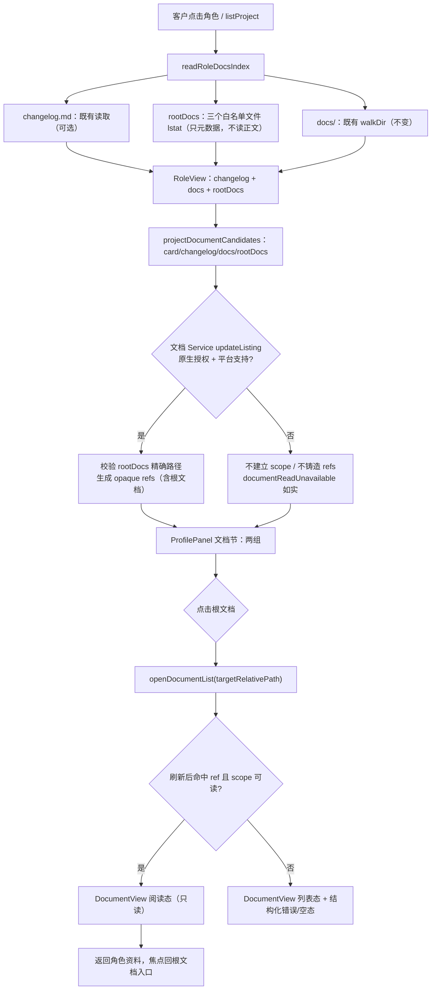

# 策划方案：角色根文档在详情面板展示（v1.7.0）

（角色详情“文档”区增加 `feature-map.md`、`functional-description.md`、`api-spec.md` 三个根文档的只读入口；`memo.md` 默认不展示；`changelog.md` 保持可选）

- 日期：2026-10-23
- 角色：ANS 策划（Planning）
- 状态：**草案 v1（待独立只读复核、待闸门 1 方案确认）**；本文件是设计候选，**未实施、未测试、未验收**
- 风险档位：**T2（跨角色/接口/契约变更）**。依据技能 `references/testing.md`「Risk-Based Verification and Change Packages」：本方案同时触及 Model/Service 候选契约、桌面 Interface 的 `listProject` 视图形状、渲染层展示与测试，属于跨角色/接口/契约变更；它**不**改变治理、权限、角色边界、验收要求或文档归属，因此不是 T3。若实施中决定修改 Windows 受限读取 Provider、角色边界或文档归属，停止并重开闸门/升档。
- 闸门 0 依据：`docs/communication/2026-10-23_intent_role-root-docs-display.md`（客户已确认，2026-10-23）
- 目标版本：**v1.7.0**；按意图记录，在 i18n 收口后启动方案/闸门/实施，发布前完成独立验收。
- 代码事实快照：2026-10-23 只读检索。文中 `path:line` 是检索时快照，实施时以符号名和实际代码为准。
- 标记约定：
  - **[现状]** 已核实的当前代码行为；
  - **[设计候选]** 本方案提议、尚未实施；
  - **[待客户决定]** 见 §10，方案不替客户拍板。

---

## 1. 摘要

客户希望点击角色后，在详情面板里能直接看到该角色目录下的三份根文档：`feature-map.md`（功能导航）、`functional-description.md`（模块视图/代码位置）、`api-spec.md`（接口/实现报告；内容为 `not-applicable` 也能读）。当前“文档”区只索引 `changelog.md` 与 `docs/` 子目录，目标项目的角色目录通常只有 `role-card.md`、`boundary.yaml`、`feature-map.md`、`functional-description.md`、`memo.md`、`api-spec.md` 六个文件，没有 `changelog.md`/`docs/`，因此“变更记录”和“文档”两栏必然为空。

本方案提出：

- **只扩展“索引 + 候选 + 展示”**，不修改任何角色文档内容、角色卡、边界、权限、验收或目标项目。
- `readRoleDocsIndex` 增加**角色根文档精确白名单**：`feature-map.md`、`functional-description.md`、`api-spec.md`；按固定顺序返回；`memo.md` 永不入索引；`changelog.md` 仍保留在独立的“变更记录”字段；`docs/` 现有递归遍历不变。
- 索引只返回**元数据（文件名/项目相对路径）**，不读取根文档正文；正文仍经既有受限文档读取链路（opaque 引用 + 项目授权 + 只读 Provider）打开，避免出现第二套读取器或第二条内容来源。
- `RoleView` 增加可选的 `rootDocs`；`ProjectDocumentRoleCandidates` 增加可选的 `rootDocs`，由受限文档 Service 校验精确白名单后生成 opaque 文档引用；**不新增 IPC 通道**，`listProject` 载荷向后兼容。
- `ProfilePanel`“文档”区分成两组：**角色根文档**与 **`docs/` 目录**；根文档按固定顺序显示，点击在既有 `DocumentView` 中只读打开；`memo.md` 不渲染；`role-card`/`boundary` 保持现有专门栏，不重复塞入“文档”。
- 空态修正：有根文档但没有 `docs/` 时，不再把整个“文档”区显示成完全空；内置角色/没有根文档的角色显示诚实空态，不伪造条目。
- 新增 7 个 `ui.profile.*` 标签 key（4 个分组/空态/按钮 key + 3 个可选副标签，中文/英文），物理目录仍为 `src/common/shared/i18n/messages/`，**项目管理维护 key，桌面UI 消费**；文件名、路径、`not-applicable` 等机器/内容值不翻译。

**给客户的短说明：**

> 点击角色后，“文档”区会列出该角色根目录下的 `feature-map.md`、`functional-description.md`、`api-spec.md`，点一下可在只读文档视图里打开；`memo.md` 不显示；`changelog.md` 有就仍显示在“变更记录”，没有也不要求补写。角色卡/边界仍在原来的栏里。全程只读，不改任何文件、权限或边界。
>
> **需要提前说明的平台限制**：当前产品在 Windows 上按既有安全取舍拒绝读取项目文档（`UNSUPPORTED_ENVIRONMENT`，见 §3.6）。因此 Windows 上能看到三个文件名，但点开时只会显示“当前环境暂不支持安全读取项目文档”，不会读出正文；正文可读需 macOS/Linux。是否接受这一点，见 §10 Q9。

本方案不要求每个角色新增 `changelog.md`/`docs/`，不迁移现有角色，不展示 `memo.md`，不复制/搬运文档内容到第二个位置，不改目标项目。

---

## 2. 基线与范围

### 2.1 需求基线与确认状态

| 项 | 状态 | 记录 |
| --- | --- | --- |
| 闸门 0：意图确认 | **已确认（2026-10-23）** | `docs/communication/2026-10-23_intent_role-root-docs-display.md` |
| 客户原话 | — | 「现在这个changgelog，要不要也无所谓，看来。」「展示 feature-map.md、functional-description.md、api-spec.md；memo.md 默认不展示 这个排期，进 1.7」 |
| 本轮范围 | 角色根文档索引、只读入口、渲染分组、空态、路径安全、测试与文档 | 同上「意图理解」1–5 |
| 本轮非目标 | 展示 memo；要求补 changelog/docs；改角色卡/边界/权限/验收/文档归属/文件内容；迁移现有角色；复制内容；改目标项目 | 同上「非目标」 |
| 闸门 1：方案确认 | **待确认** | 本文件（提交沟通后由客户确认） |
| 闸门 2：角色指派/写集确认 | 未开始 | 本文件确认后由统筹写团队计划、沟通提交客户 |
| 实施授权 | 未给 | 闸门 1、闸门 2 通过后另行取得 |

本方案与「国际化（i18n）」`docs/planning/2026-10-23_design_i18n.md`、「目录级授权与目录规范」`docs/planning/2026-10-23_design_directory-ownership.md` 是**三个独立变更**：分别走闸门、分别实施与验收；不合并成一个改动。实现期可能触及同一批文件（见 §7.5），由统筹安排顺序与写集。

**基线说明：** 意图记录要求 i18n 收口后启动。当前工作树已有 i18n 目录、`useT`/`useLocaleState` 消费和 `ui.profile.*` key，但本方案不以未提交的工作树代替已验收基线；实施应从 i18n 变更独立验收/提交后的状态开始，本方案新增 key 沿用同一机制。若届时 key 命名/目录有变化，按实际基线调整 key 名，不改变本方案语义。

### 2.2 验收基线

客户在**闸门 1**确认的**本文件版本**是后续独立验收的基线。独立验收在实施前基于该版本把正式完成标准写入 `docs/acceptance/`；本文件 §8.5 的完成标准是方案自带的可核对标准，供闸门 1 确认和验收引用，**不是**正式验收结论或验收文档。团队计划、角色指派和实现安排都不是验收基线。

### 2.3 与意图记录的已知冲突（需客户决定）

意图记录写的是“只读展示、点击角色可读”，但代码事实是：现有受限文档 Provider 在 Windows 明确按 `UNSUPPORTED_ENVIRONMENT` 拒绝读取（§3.6）。客户当前环境是 Windows，因此本方案在 Windows 上只能做到“列出文件名 + 点开显示既有不支持提示”，不能读出正文；正文可读需 macOS/Linux。**这是本方案与“可读”字面目标之间唯一的实质冲突**，不隐藏在技术细节里，必须由客户在 §10 Q9 选择：接受现状（推荐）、另开 Windows 安全读取设计，或改变读取模型（方案 D）。其余意图项（三份文件、memo 不展示、changelog 可选、只读、不改权限/边界）与代码事实一致，无冲突。

### 2.4 范围边界

**本轮必须覆盖：**

- 角色根文档的精确白名单、索引形状、固定顺序、`memo.md` 排除、`changelog.md` 独立保留、`docs/` 不回归。
- 根文档元数据从 `listProject` 到渲染层的契约；根文档正文经既有受限文档 Service/Provider 的 opaque 引用读取；路径穿越、项目外、符号链接逃逸的拒绝。
- `ProfilePanel`“文档”区两组展示、标签/顺序/数量/空态；点击根文档打开 `DocumentView`；`memo` 不渲染；`role-card`/`boundary` 不重复。
- 内置角色、无根文档角色、只有部分根文档、只有根文档没有 `docs/`、只有 `docs/` 没有根文档等边界。
- 只读、无新写路径、无新 IPC 通道、不改权限/边界/验收/文档内容。
- 受影响文件/角色/测试精确清单；T2 完成标准与证据计划。
- 客户需拍板的开放问题（§10），尤其是 Windows 读取限制。

**本轮明确不做：**

- 不展示、不索引 `memo.md`；不把内部备忘当客户文档。
- 不要求每个角色新增 `changelog.md`/`docs/`；不把 `changelog.md` 当 docs 索引；不要求补写。
- 不修改角色卡、边界、模板、验收标准、文档归属或任何文档正文。
- 不迁移现有角色目录；不重命名/移动文件；不在目标项目创建任何文件。
- 不复制/搬运文档内容到第二个位置；不新增重复文档；不在 `RoleView` 里嵌入根文档正文。
- 不改 `app/preload.cjs`、不新增 IPC 通道、不改 `project:document-read` 请求形状。
- 不改变 Windows 受限读取 Provider 的既有安全取舍；不新增明文/旁路读取。
- 不把本变更与 i18n、目录 v3、治理写卡门禁、验收返工路由合并验收。

---

## 3. 现状与问题（代码事实）

以下事实均来自 2026-10-23 只读检索；不表示本方案已改变它们。

### 3.1 索引只认 `changelog.md` 与 `docs/`

| # | 事实 | 证据 |
| --- | --- | --- |
| 3-1 | `DocsIndexEntry` 只有 `path`（相对角色目录）与 `kind`（`file`/`directory`）两个字段。 | `app/desktop/project.ts:333-336` |
| 3-2 | `RoleDocsIndex` 只有 `changelog` 与 `docs` 两个字段：`changelog` 是 `changelog.md` 是否存在及正文，`docs` 是 `docs/` 目录索引。 | `app/desktop/project.ts:338-343` |
| 3-3 | `readRoleDocsIndex` 只做两件事：读 `<roleDir>/changelog.md`；从 `<roleDir>/docs/` 递归 `walkDir`。**完全不索引角色根目录下的其他文件。** | `app/desktop/project.ts:374-405` |
| 3-4 | `walkDir` 只遍历 `docs/` 下的目录/文件，跳过隐藏文件，最多 500 条；不涉及角色根。 | `app/desktop/project.ts:345-368` |
| 3-5 | `projectDocumentCandidates` 只把 `cardPath`、`changelogPath`（若有）、`docs` 交给文档 Service，没有根文档入口。 | `app/desktop/project.ts:409-415`；`src/model/project-document.ts:12-14` |

### 3.2 目标项目角色目录没有 `changelog.md`/`docs/`

| # | 事实 | 证据 |
| --- | --- | --- |
| 3-6 | 目标项目 `ans-gateway` 的 7 个项目角色目录（`core-domain`、`interface-web`、`llm-providers`、`persistence-store`、`pipeline-runtime`、`platform-foundation`、`qa-verification`）每个都恰好是六个文件：`api-spec.md`、`boundary.yaml`、`feature-map.md`、`functional-description.md`、`memo.md`、`role-card.md`；没有 `changelog.md`，也没有 `docs/`。 | 2026-10-23 只读列目录 |
| 3-7 | 因此对目标项目角色，`readRoleDocsIndex` 返回 `changelog: null`、`docs: []`；“变更记录”和“文档”必然为空。这是本变更要解决的核心。 | 3-3、3-6 |

### 3.3 文档候选与读取 scope 只放行角色卡/changelog/docs

| # | 事实 | 证据 |
| --- | --- | --- |
| 3-8 | 受限文档 Service 的 `updateListing` 只为以下路径铸造 opaque 引用：`cardPath`；精确等于 `<roleDir>/changelog.md` 的 `changelogPath`；`docs` 中以 `docs/` 开头且 `kind === "file"` 的条目（拼成 `<roleDir>/<docs path>`）。 | `src/service/project-document/impl/read-project-document.ts:33-60`，尤其 `:49` |
| 3-9 | `eligible` 拒绝绝对路径、反斜杠、冒号、NUL、非规范路径、任何以 `.` 开头的路径段；`format` 只接受 `.md`/`.txt`。 | `src/service/project-document/impl/read-project-document.ts:9-12` |
| 3-10 | Provider 的 `inspect` 对根、每一级祖先和文件做 `lstat`，拒绝符号链接；`realpath` 必须仍在根内；打开使用 `O_NOFOLLOW`；并校验 inode/size/mtime 未变化。 | `src/provider/project-document/impl/file-reader.ts:30-48,54-83` |
| 3-11 | 候选类型 `ProjectDocumentRoleCandidates` 只有 `roleId`、`builtIn`、`cardPath`、`changelogPath?`、`docs`，没有根文档字段。 | `src/model/project-document.ts:12-14` |

### 3.4 `RoleView` 与渲染层只消费 `docs`

| # | 事实 | 证据 |
| --- | --- | --- |
| 3-12 | `RoleView` 暴露 `cardText`、`boundary`、`builtIn`、`governanceFunction?`、`changelog`、`docs`、`documents?`；没有根文档字段。 | `app/desktop/interface.ts:232-247` |
| 3-13 | `listProject` 对非内置、`cardPath` 非空的角色调用 `readRoleDocsIndex`，只把 `changelog` 与 `docs` 装进 `RoleView`；内置角色明确跳过索引。 | `app/desktop/interface.ts:4771-4803` |
| 3-14 | `ProfilePanel` 的“文档”节只根据 `role.docs` 渲染：`docs.length === 0` 就显示“无 docs/ 目录或为空”，数量只算 `docs` 中的 file；根文档没有入口。 | `app/renderer/src/shell/ProfilePanel.tsx:100-110,203-205,284-306` |
| 3-15 | `role-card` 已有独立“角色卡”节，`boundary` 已有独立“边界条目”节；`changelog` 已有独立“变更记录”节。 | `app/renderer/src/shell/ProfilePanel.tsx:226-282` |

### 3.5 现有“查看已列文档”清单

| # | 事实 | 证据 |
| --- | --- | --- |
| 3-16 | `roleDocumentRefs` 从 `role.documents` 读取 opaque 引用；`DocumentView` 列表只展示这些引用，不接收路径/root。 | `app/renderer/src/chat/document-view.ts:83-105`；`app/renderer/src/shell/DocumentView.tsx:101-176` |
| 3-17 | 当前清单包含角色卡、`changelog.md`（若有）、`docs/` 下的文件；根文档不在其中。 | 3-8、3-16 |

### 3.6 平台限制：Windows 当前不可读

| # | 事实 | 证据 |
| --- | --- | --- |
| 3-18 | 受限文档 Provider 的 `supported()` 只在 `darwin`/`linux` 且 `O_NOFOLLOW` 可用时通过；Windows 明确失败为 `UNSUPPORTED_ENVIRONMENT`。 | `src/provider/project-document/impl/file-reader.ts:25-29` |
| 3-19 | 在 Windows 上，`updateListing` 返回 `documentReadUnavailable: "UNSUPPORTED_ENVIRONMENT"`，不建立 scope、不铸造任何引用；读取返回同一结构化错误，不返回正文。 | `test/桌面应用/project-document.test.ts:103-117`；`test/测试/p1p7-document-integration.test.ts:46-55,112-130`；`test/桌面应用/interface.test.ts:909-917` |
| 3-20 | 这是 v1 已接受的平台安全取舍，有历史记录；不是本变更引入的缺陷。 | `角色卡/项目管理/docs/change/2026-10-15_change_v1-release-packaging.md:51`；`角色卡/桌面窗口/docs/fix/2026-10-15_fix_windows-document-test-oracles.md` |

> **重要：** 客户当前环境是 Windows。按本方案，Windows 上“文档”区能列出三个根文档名，但点开后 `DocumentView` 会显示既有的“当前环境暂不支持安全读取项目文档”，不会显示正文。正文可读只能在 macOS/Linux 上验证。若客户要求 Windows 也必须读出正文，必须另开安全 Provider/读取模型设计（很可能升 T3），不能在 T2 中顺手放宽。见 §10 Q9。

### 3.7 为什么只改索引与展示，不改文件内容

- 根文档已经存在（目标项目 7 个角色都有三份；本仓库角色也有），缺的是**索引入口**和**展示入口**，不是文件。
- 文件内容、归属、命名、角色卡/边界都由各角色/治理维护；本变更只读，不改内容，避免触发文档迁移、边界变更、验收重开。
- 根文档正文继续走既有受限读取链路；索引只给元数据，不读取正文，因此不会产生“第二份内容”或绕过 Provider 的读取路径。
- `memo.md` 是角色私有续接备忘，不属于客户文档；`changelog.md` 是可选的变更记录，二者都不应因本变更被强制生成或迁移。

---

## 4. 目标与非目标

### 4.1 目标

1. 角色详情“文档”区展示该角色根目录下**实际存在**的 `feature-map.md`、`functional-description.md`、`api-spec.md`，顺序固定。
2. 三者均可点击，在既有 `DocumentView` 中以只读方式打开；读取仍使用 opaque `documentId`/`projectViewId` 与既有 scope 校验。
3. `memo.md` 默认且本轮永久不展示、不入索引。
4. `changelog.md` 保持可选：存在则继续在“变更记录”显示，不存在不要求补写，也不进入“文档”索引。
5. `role-card.md`/`boundary.yaml` 保持现有专门栏，不重复进入“文档”列表。
6. 没有 `docs/` 但有根文档时，“文档”区不再显示为完全空；内置角色/无根文档角色显示诚实空态，不伪造条目。
7. 路径只允许角色目录根下的三个精确文件名；路径穿越、项目外、符号链接逃逸继续被拒绝；不扫描任意根文件。
8. 不新增 IPC 通道；`listProject` 形状向后兼容；旧 renderer/旧 main 组合不崩。
9. 只读；不改变角色权限、边界、验收、文档归属、文件内容；不改目标项目。
10. 测试覆盖后端索引/候选、渲染分组/空态/点击、真实 Electron（含 Windows fail-closed）、i18n、布局；T2 受影响检查，不默认全量 T3。

### 4.2 非目标

- 不展示 `memo.md`，不提供“显示 memo”的开关（若客户以后要，另开需求）。
- 不要求/不自动创建 `changelog.md`、`docs/`；不把 `changelog.md` 纳入 docs 索引。
- 不修改任何角色卡、边界、模板、验收标准、文档正文或文档归属。
- 不迁移现有角色目录；不重命名/移动/复制根文档。
- 不复制根文档正文到 `RoleView` 或第二个文件；不在 ProfilePanel 内嵌正文（正文只在 `DocumentView`）。
- 不新增写路径、IPC 通道、preload 方法或权限。
- 不改变 Windows 受限读取的既有安全取舍；不降级 realpath/符号链接检查。
- 不把本变更与 i18n/目录 v3/治理写卡门禁/验收返工路由合并验收。
- 不修改目标项目 `ans-gateway` 或任何外部项目文件。

---

## 5. 方案设计

### 5.1 索引形状：推荐 A（独立 `rootDocs` + 项目相对路径）

**[设计候选] 推荐方案 A。**

`RoleDocsIndex` 增加独立字段，而不是把根文件混进 `docs` 数组：

```ts
// app/desktop/project.ts（桌面窗口）
export interface RoleRootDocEntry {
  /** 规范文件名，来自唯一白名单。 */
  name: RoleRootDocName;
  /** 项目相对路径，如 "角色卡/编排/feature-map.md"；用于与 opaque ref.relativePath 精确匹配。 */
  path: string;
  kind: "file";
}

export interface RoleDocsIndex {
  changelog: { path: string; text: string } | null; // 不变
  docs: DocsIndexEntry[];                           // 不变：docs/ 索引，path 相对角色目录
  rootDocs: RoleRootDocEntry[];                     // 新增：固定顺序，仅实际存在的文件
}
```

`DocsIndexEntry` **保持不变**，继续只描述 `docs/` 下的条目（`path` 相对角色目录）。根文档用单独的 `RoleRootDocEntry`，因为两者的路径基准不同：

| 字段 | `docs[].path` | `rootDocs[].path` |
| --- | --- | --- |
| 基准 | 角色目录（如 `docs/design/x.md`） | 项目根（如 `角色卡/编排/feature-map.md`） |
| 来源 | `walkDir(roleDir/docs)` | 角色目录根下精确文件名 |
| 用途 | 现有 docs 列表 + Service 拼 `<roleDir>/<path>` | 与 `documents[].relativePath` 精确匹配，避免渲染层拼路径 |

**为什么根文档用项目相对路径：** 渲染层已有 `role.documents[].relativePath`（项目相对）和 `RoleView.cardPath`；如果 `rootDocs.path` 也是项目相对，渲染层只需**精确字符串比较**即可找到对应 opaque 引用，不需要自行拼目录/路径，符合“渲染侧不构造文件系统路径”的既有纪律。Service 则用 `roleDir + "/" + name` 校验，不信任任意路径。

**白名单唯一来源：**

```ts
// src/model/project-document.ts（桌面窗口主属）
export const ROLE_ROOT_DOC_FILENAMES = [
  "feature-map.md",
  "functional-description.md",
  "api-spec.md",
] as const;
export type RoleRootDocName = (typeof ROLE_ROOT_DOC_FILENAMES)[number];
```

- `app/desktop/project.ts`、`src/service/project-document/impl/read-project-document.ts` 都从该 Model 常量消费，不各写一份白名单。
- 顺序即数组顺序；ProfilePanel 不再排序，缺失项直接不出现。
- `memo.md`、`role-card.md`、`boundary.yaml`、`changelog.md` 都不在白名单内；`memo.md` 连 `lstat` 都不做。

**兼容性：**

- `RoleDocsIndex.rootDocs` 为新增字段；`readRoleDocsIndex` 的所有调用点（仅 `interface.ts` 与一处测试）同步装配；旧测试夹具缺少该字段时按 `[]` 处理（类型上可在 `RoleView` 用可选字段）。
- `docs` 的遍历、排序、500 条上限、隐藏文件跳过、`changelog` 读取逻辑均不变。
- `RoleView.rootDocs?` 可选；旧 renderer 不识别时忽略；新 renderer 连旧 main 时没有该字段，根文档组不显示，不崩。
- `documents` 数组会新增根文档引用（追加在既有条目之后），既有 card/changelog/docs 引用的 `documentId` 与顺序前缀不变；相关测试若断言总数需更新并说明原因。

### 5.2 精确白名单与取舍

| 文件 | 本轮处理 | 理由 |
| --- | --- | --- |
| `feature-map.md` | 入索引、可读 | 客户点名；功能导航 |
| `functional-description.md` | 入索引、可读 | 客户点名；模块视图/代码位置 |
| `api-spec.md` | 入索引、可读；内容为 `not-applicable` 也按普通 Markdown 文本读 | 客户点名；不特殊解析、不加状态机 |
| `memo.md` | **永不入索引、永不渲染、Service 拒绝伪造候选** | 角色私有续接备忘，不是客户文档；客户明确“默认不展示” |
| `changelog.md` | 保持独立 `changelog` 字段；“变更记录”有则显示，无则“（无 changelog.md）”；不进入 docs/rootDocs | 客户明确“要不要也无所谓”；可选、不强制补写 |
| `role-card.md` | 保持“角色卡”专门栏；不进入 rootDocs | 已有专门栏，避免重复 |
| `boundary.yaml` / `boundary.md` | 保持“边界条目”专门栏；不进入 rootDocs | 已有专门栏，避免重复 |
| 其他根文件（如临时稿、归档说明） | 不索引 | 精确白名单，避免把内部/私有文件暴露成客户文档 |

**“默认不展示”的含义：** 本方案在 v1.7.0 不提供显示 memo 的开关；若未来要做，需要单独讨论“哪些角色/哪些内容可给客户看”的产品与权限语义，不能靠一个 UI toggle 顺带放开。

### 5.3 路径与读取安全

#### 5.3.1 索引阶段（`readRoleDocsIndex`）

**[设计候选]** 只做元数据读取，不读正文：

1. 由 `cardPath` 取 `roleDirRel = posixDirname(cardPath)`；若为空、绝对路径、含 `\`、含 `:`、含空段/`.`/`..`，返回空索引（`rootDocs: []`、`docs: []`、`changelog: null`），不抛错。
2. 对 `roleDirAbs` 做 `lstat`；若不是目录或是符号链接，返回空索引。可选再做一次 `realpath` 包含性检查（复用既有路径原语口径），但不改变现有合法路径行为。
3. 对白名单中的每个文件名，`lstat(roleDirAbs/name)`：
   - 只接受 `isFile()` 且非符号链接（`lstat` 下符号链接不会 `isFile`）；
   - 存在则 `push({ name, path: roleDirRel + "/" + name, kind: "file" })`；
   - 不存在/权限错误/其他异常：跳过，不伪造条目，不抛错。
4. **不对角色根目录 `readdir`/glob**，不读取 `memo.md`，不读取根文档正文；索引最多 3 条。
5. `changelog` 与 `docs` 的现有读取逻辑保持不变（`changelog` 仍是正文；`docs` 仍是 `walkDir`）。

这保证：索引阶段不会成为绕过受限 Provider 的第二条内容读取路径；即使根目录里有符号链接/私有文件，也不会被列为客户文档。

#### 5.3.2 候选/Service 阶段

`ProjectDocumentRoleCandidates` 增加可选字段：

```ts
// src/model/project-document.ts
export interface ProjectDocumentRoleCandidates {
  roleId: string;
  builtIn: boolean;
  cardPath: string;
  changelogPath?: string;
  docs: readonly { path: string; kind: "file" | "directory" }[];
  /** 新增：项目相对路径，只允许 roleDir + "/" + 白名单文件名。 */
  rootDocs?: readonly { path: string; kind: "file" }[];
}
```

Service 的 `updateListing` 只接受精确期望路径：

```ts
const roleDir = role.cardPath.slice(0, Math.max(0, role.cardPath.lastIndexOf("/")));
const expectedRootPaths = new Set(
  ROLE_ROOT_DOC_FILENAMES.map((name) => roleDir + "/" + name),
);
const rootPaths = (role.rootDocs ?? [])
  .filter((d) => d.kind === "file" && expectedRootPaths.has(d.path))
  .map((d) => d.path);
```

- `memo.md`、任意根文件、`../feature-map.md`、绝对路径、反斜杠、大小写变体、`docs/feature-map.md` 都不在 `expectedRootPaths` 中，**静默拒绝，不铸造引用**；`roleDir` 为空时同样不接受任何 `rootDocs`。
- 合法的根路径追加到既有 `paths` 集合（`cardPath`、`changelogPath`、`docs` 文件之后），继续经过 `eligible()`、`format()`、Set 去重。
- 既有 `docs` 路径处理不变（仍为 `roleDir + "/" + d.path`，仍只接受 `docs/` 前缀）。
- Service 仍只在原生授权成功、scope 可用时铸造引用；Windows 上不建立 scope、不铸造任何引用（与现状一致）。
- 不新增 Provider/写路径；正文读取仍由既有 `ProjectFileReader` 执行 `lstat`/`realpath`/`O_NOFOLLOW`/有界读/UTF-8 校验。

#### 5.3.3 路径安全验收要点

- 项目外/`..`/绝对路径/盘符/UNC/反斜杠/空段/NUL：索引跳过；Service 不铸造；Provider 若收到仍拒绝（既有）。
- 符号链接根目录/根文档：索引不列出；Service 不铸造（候选不会出现）；Provider 读取拒绝 `SYMLINK_NOT_ALLOWED`。
- 不扫描任意根文件：代码中只有角色目录一次 + 三个白名单文件各一次 `lstat`，没有根目录 `readdir`。
- 不读取根文档正文到 `RoleView`：索引返回值只有元数据；正文只能通过 `DocumentView` 的 opaque 读取。

### 5.4 IPC / 视图契约

| 契约 | 变化 | 兼容性 |
| --- | --- | --- |
| `listProject` IPC 载荷 | `RoleView` 增加可选 `rootDocs`；`documents` 增加根文档 refs | additive；旧 renderer 忽略未知字段；旧 main→新 renderer 无 `rootDocs` 时根文档组不显示 |
| `RoleView`（`app/desktop/interface.ts`） | `rootDocs?: RoleRootDocEntry[]` | 可选；内置角色为 `[]` |
| `ProjectDocumentRoleCandidates` | 增加可选 `rootDocs` | additive；旧调用方不传时行为不变 |
| `ProjectDocumentRef` | 不改变形状；根文档 ref 的 `relativePath` 为项目相对、`label` 为文件名、`format` 为 `markdown` | 既有 UI/Store 可直接消费 |
| `project:document-read` | **不改**请求/回包 | 无新通道、无 preload 变更 |
| `api-spec.md` 内容为 `not-applicable` | 作为普通 Markdown 文本读取/展示 | 不新增状态、不特殊解析、不隐藏 |

`RoleView` 仍由 `listProject` 一次性返回；不新增“读根文档正文”的 IPC。渲染层只拿 `rootDocs` 元数据和 `documents` opaque 引用，不拿路径列表之外的任何能力。

### 5.5 渲染层设计

#### 5.5.1 分组与顺序

**[设计候选]**

“文档”节内部分两组；只有实际存在内容的组才渲染：

```text
文档  [count]
├─ 角色根文档
│  ├─ feature-map.md          功能导航             [只读打开]
│  ├─ functional-description.md 模块视图与代码位置  [只读打开]
│  └─ api-spec.md             接口 / 实现报告       [只读打开]
└─ docs/ 目录
   └─ （沿用现有 docs 索引列表/目录树）
```

- **顺序**：严格按 `RoleDocsIndex.rootDocs` 数组（白名单顺序）渲染；不按 locale 排序、不按文件名重排。
- **缺失**：只显示实际存在的条目；缺失的文件不显示“未提供”占位，也不伪造。若三个都不存在，根文档组整体不渲染。
- **`docs/` 组**：只在 `docs.length > 0` 时渲染；内容/顺序沿用现有 `docsIndex()` 的 Markdown 列表（目录带尾 `/`），不改变现有遍历结果。
- **`changelog`**：仍在独立的“变更记录”节，位置/内容/空态不变。
- **`role-card`/`boundary`**：仍在各自专门节，不进入“文档”组。
- **`memo`**：不渲染；即使后端异常传入，渲染层也不显示（见 5.5.4 的显示过滤）。

#### 5.5.2 数量与空态

- 节标题 count = `rootDocs` 中 file 数 + `docs` 中 file 数（不把目录计入）；为 0 时显示既有 `shared.common.none`（“无”）。
- 两组都为空（含内置角色、无任何根文档/docs 的角色）：节内显示新的 `ui.profile.noRoleDocs`（“（暂无角色文档）”，暂定文案）；不显示“有根文档但无 docs/”这种误导性完全空态。
- 只有根文档、没有 `docs/`：显示根文档组；不显示 `docs/` 组；不显示“（无 docs/ 目录或为空）”作为整节内容。
- 只有 `docs/`、没有根文档：显示 `docs/` 组；根文档组不渲染。
- 部分根文档缺失：显示存在的条目；不显示缺失项，也不把整组隐藏（只要至少一条存在）。
- 内置角色（`builtIn: true`，`cardPath` 为空）：`rootDocs: []`、`docs: []`，显示空态；不读项目根、不伪造。

#### 5.5.3 点击打开 `DocumentView`

- 根文档行渲染为按钮（键盘可达），`title`/`aria-label` 使用 `ui.profile.openRootDoc` + 文件名。
- 点击时调用桌面UI 内部动作（建议扩展既有 `openDocumentList`）：

```ts
// 现有签名（不改调用方）
openDocumentList(roleId, origin): Promise<void>
// 建议新增可选第三参数（desktopUI 内部，不是 IPC）
openDocumentList(roleId, origin, targetRelativePath?: string): Promise<void>
```

  流程：
  1. 用当前 `role.documents` 的 opaque refs 建立初始列表/临时 scope（与现有行为一致）；
  2. 刷新 `listProject` 获得权威 `documentScope` 与最新 refs；
  3. 若 `targetRelativePath` 存在，在刷新后的 refs 中按 **`ref.relativePath === targetRelativePath` 精确匹配**；
  4. 命中且 scope 可读：调用既有 `readDocument(ref)`，直接进入阅读态；
  5. 未命中/无 scope/平台不支持：停留在 `DocumentView` 列表态，显示既有结构化错误（`documentReadUnavailable` / `listError`），不伪造正文、不自动重试风暴；
  6. 不构造文件系统路径、不自行生成 `documentId`；只使用后端给的 opaque 引用。

- 返回行为：从阅读态返回角色资料时，焦点回到触发该根文档的按钮（建议加 `data-root-doc-path` 或等价标记）；若无法定位，回退到现有“查看已列文档”按钮。现有 Phase 4A 的焦点回归测试需同步扩展。
- “查看已列文档”按钮继续保留；根文档也会出现在该清单中（因为 Service 现在为它们铸造 refs）。两个入口指向同一 opaque 引用/同一内容，不复制正文；是否保留清单中的根文档见 §10 Q10（推荐保留）。

#### 5.5.4 显示过滤与安全

- 根文档是后端白名单产物；渲染层不复制白名单/解析器，只按 `rootDocs` 数组显示。
- 渲染层对明显畸形条目做显示层过滤：`path` 非空字符串、`kind !== "directory"`；不根据用户输入拼路径、不发任意读取请求。
- 根文档标签使用 React 文本节点，**不使用 `dangerouslySetInnerHTML`**；`docs/` 现有 Markdown 索引继续走既有受控 `renderMarkdown`（html:false）。
- `memo.md` 即使出现在 `rootDocs` 中也不显示（显示过滤可按文件名排除；这是显示兜底，不是安全边界）；Service 已拒绝其引用。

#### 5.5.5 布局与长文

- 根文档行使用可伸缩布局：`min-width: 0`、允许换行、文件名 `overflow-wrap: anywhere`；文件名本身短，风险低。
- 整个“文档”节继续使用现有 `.card-text` 内层滚动（`max-height: 240px`）和每节滚动位置保存；新增组不改变节开合/滚动键。
- 长文档在 `DocumentView` 内滚动，已有行为不变；不在 ProfilePanel 内展开正文。
- 960×620、侧栏 208、200% zoom：检查无水平溢出、按钮可点击、标签不被裁切；截断时有 `title`/`aria-label`。
- 不新增固定高度/固定宽度；不为中英文各写一套布局。

#### 5.5.6 i18n 标签归属

物理目录：`src/common/shared/i18n/messages/{zh-CN,en-US}.ts`；`ui.*` 是渲染层命名空间，但 key 物理上在共享目录，**项目管理维护，桌面UI 消费**，不创建第二份目录/resolver。

建议新增 key（最终名称以项目管理现有命名规范为准，语义不变）：

| key | zh-CN（建议） | en-US（建议） | 用途 |
| --- | --- | --- | --- |
| `ui.profile.docsGroupRoot` | 角色根文档 | Role root documents | 分组标题 |
| `ui.profile.docsGroupSubdir` | docs/ 目录 | docs/ directory | 分组标题（`docs/` 保持原样，不翻译） |
| `ui.profile.noRoleDocs` | （暂无角色文档） | (no role documents) | 整节空态 |
| `ui.profile.openRootDoc` | 只读打开 {name} | Open {name} read-only | 按钮 title/aria |
| `ui.profile.rootDoc.featureMap` | 功能导航 | Feature map | 可选副标签 |
| `ui.profile.rootDoc.functionalDescription` | 模块视图与代码位置 | Module view and code locations | 可选副标签 |
| `ui.profile.rootDoc.apiSpec` | 接口 / 实现报告 | API / implementation report | 可选副标签 |

- 文件名 `feature-map.md`、`functional-description.md`、`api-spec.md`、`docs/` 是路径/内容标识，**不翻译**。
- `changelog.md` 现有 `ui.profile.changelogTab`、`ui.profile.noChangelog` 不改。
- `not-applicable` 是文件内容，不是 UI 文案；不翻译、不加 badge（除非客户在 Q8 另行要求）。
- `en-US` 必须与 `zh-CN` key 全集一致（现有 i18n parity 测试会强制）；新增 key 不改变现有 zh 文案（除新增）。

### 5.6 只读/权限/边界

- 只读：索引 `lstat`/`readdir`（仅 docs）不写；`DocumentView` 读取既有只读链路；没有新写路径。
- 不修改 `boundary.yaml`/`boundary.md`/角色卡/文档内容；不改变 `resolveWrite`、`TaskScope`、验收推进、派发权。
- 不改角色边界或文档归属；新增代码都在已授权文件/目录内（见 §7）。
- 不新增 `cardKind`、`FlowStepKind`、`GovernancePower`、`GovernanceDecisionKind`、artifact kind。
- 目标项目 `ans-gateway` 仅作为只读样例；实施不写它。

### 5.7 完整流程



**输入输出：**

| 阶段 | 输入 | 输出 |
| --- | --- | --- |
| 索引 | `projectRoot`、`cardPath` | `changelog`（可选）、`docs`（不变）、`rootDocs`（最多 3 条元数据） |
| 契约 | `RoleView` 装配 | `rootDocs?`、`documents`（含根文档 refs） |
| 候选 | `projectDocumentCandidates` | `rootDocs?` 项目相对路径 |
| Service | 候选 + 原生授权/平台 | opaque refs / `documentReadUnavailable`（不变语义） |
| UI | `rootDocs`、`docs`、`documents` | 两组列表、空态、点击打开 |
| 读取 | opaque `projectViewId`/`documentId` | 正文或既有安全错误码 |

**失败/边界分支：**

| 场景 | 分支 | 处理 |
| --- | --- | --- |
| 无根文档、无 docs | 空态 | 显示 `ui.profile.noRoleDocs`；不伪造 |
| 只有根文档、无 docs | 正常 | 只显示根文档组；不显示误导性“无 docs/”整节空态 |
| 部分根文档缺失 | 正常 | 只显示存在的；不显示缺失占位 |
| `api-spec.md` 为 `not-applicable` | 正常 | 当普通 Markdown 读取；无特殊错误 |
| 根文档超过 256 KiB / 非 UTF-8 / 二进制 | 读取错误 | 文件名仍列出；`DocumentView` 显示既有 `TOO_LARGE`/`INVALID_UTF8`/`BINARY_CONTENT`；不返回 partial 正文 |
| 根文档是符号链接/根目录是符号链接 | 安全 | 索引跳过；Service 不铸造；Provider 读取拒绝 |
| 候选含 memo/任意根文件/`../` | 安全 | Service 精确校验拒绝；不铸造 |
| 文件在列目录后被删除 | 读取错误 | `DocumentView` 显示既有 `NOT_FOUND`；下次 listProject 刷新索引 |
| 无原生授权/项目未导入 | 读取不可用 | 索引仍显示文件名；打开显示既有 `PROJECT_NOT_GRANTED` 类错误 |
| Windows | 平台限制 | 索引仍显示文件名；打开显示 `UNSUPPORTED_ENVIRONMENT`；不伪造正文 |
| 旧 renderer/旧 main | 兼容 | 可选字段缺失/忽略，不崩；旧行为不变 |
| 内置角色 | 空态 | `rootDocs: []`、`docs: []`；不读项目根 |

---

## 6. 分层与接口

### 6.1 分层落点

| 层/模块 | 本方案职责 | 边界 |
| --- | --- | --- |
| **Model** `src/model/project-document.ts`（桌面窗口主属） | 增加 `ROLE_ROOT_DOC_FILENAMES`/`RoleRootDocName`；`ProjectDocumentRoleCandidates.rootDocs?` 契约 | 不写盘、不读文件；不复制白名单到别处 |
| **Service** `src/service/project-document/impl/read-project-document.ts`（桌面窗口） | `updateListing` 校验根文档精确路径并追加 paths；仍只铸造 opaque refs | 不改变 scope/grant/错误语义；不新增读取能力 |
| **Service abstract/public**（桌面窗口） | 不改变接口签名；类型经 Model 透传 | 默认不改 |
| **Provider** `src/provider/project-document/**`（桌面窗口） | **不改**；继续执行 lstat/realpath/O_NOFOLLOW/有界读/编码校验 | 不因本变更放宽 Windows/符号链接 |
| **Pipeline** `src/pipeline/project-document/read-project-document.ts`（桌面窗口） | **默认不改**；仅透传既有 reader | 不新增编排 |
| **桌面 Interface** `app/desktop/project.ts`（桌面窗口） | `readRoleDocsIndex` 增加根文档元数据；`projectDocumentCandidates` 透传 `rootDocs` | 不做写入判定、不读正文 |
| **桌面 Interface** `app/desktop/interface.ts`（桌面窗口） | `RoleView.rootDocs?`；`listProject` 装配索引与候选 | 不复制 Service 校验/Provider 读取 |
| **渲染层** `app/renderer/src/chat/types.ts`、`chat/profile-docs.ts`、`shell/ProfilePanel.tsx`、`stores/drawer-store.ts`（桌面UI） | 分组/空态/标签/点击动作/焦点 | 不读写文件、不拼路径、不生成 refs、不新增 IPC |
| **渲染层** `shell/DocumentView.tsx`（桌面UI） | 既有只读阅读态；必要时焦点回归 | 不改 scope/错误码语义 |
| **i18n** `src/common/shared/i18n/messages/*`（项目管理） | 新增 `ui.profile.*` key（zh/en） | 单一目录/单一 resolver；文件名不翻译 |
| **测试** 各角色测试目录 | 后端索引/候选、渲染纯逻辑、真实 Electron、跨层 | 不新建未授权测试文件；不改断言保绿 |

### 6.2 调用与数据流

1. `listProject`（桌面 Interface）调用门禁引擎枚举 → 对每个非内置角色调用 `readRoleDocsIndex(projectRoot, cardPath)`。
2. `readRoleDocsIndex` 返回 `changelog`、`docs`（不变）与 `rootDocs`（新增；只 `lstat` 三个精确文件）。
3. `listProject` 装配 `RoleView`（`rootDocs` 可选）→ `projectDocumentCandidates` 把 `rootDocs` 路径传给文档 Service。
4. `documentReader.updateListing`（既有 Pipeline/Service）校验候选、生成 opaque refs；只有原生授权成功且平台支持时才有 scope/refs。
5. `listProject` 把 `documents` 挂到 `RoleView`。
6. `ProfilePanel` 从 `RoleView.rootDocs`/`docs` 分组渲染；点击根文档时调用既有 `openDocumentList` 的扩展参数，由 `drawer-store` 刷新 listing、精确匹配 `relativePath`、调用既有 `readDocument`。
7. `DocumentView` 仅用 opaque `documentId`/`projectViewId` 读取；Provider 执行既有安全读取。

### 6.3 契约单一来源

- **白名单**：`src/model/project-document.ts` 的 `ROLE_ROOT_DOC_FILENAMES`；桌面索引、Service 校验都消费它；渲染层不复制。
- **路径基准**：`docs[].path` 角色相对、`rootDocs[].path` 项目相对；在类型注释、测试和文档中明确，避免实施者混用。
- **读取资格**：仍由 Service 的 `eligible`/`format` + Provider 决定；本方案不新增第二套路径校验器。
- **文档引用**：唯一来源仍是 `ProjectDocumentRef`；不新增 `documentId` 生成逻辑或前端拼路径。

### 6.4 不跨层/不深导

- 渲染层不 import `src/service/project-document/**`、`src/provider/**`、`src/model/project-document.ts`；只消费 `RoleView`/`documents` 形状。
- 桌面 Interface 不 import Provider 实现；只经既有 `createProjectDocumentReader`/Service 公共入口消费。
- `app/desktop/project.ts` 不复制门禁边界判定；只做展示索引。
- 不新增 `app/renderer` 对 `src/common/shared` 之外的第二份 resolver/catalog；i18n 仍走既有 facade。

---

## 7. 受影响面与写集建议

> 行号为 2026-10-23 只读快照；实施时以符号名为准。本清单是设计候选，不代表已修改。

### 7.1 产品代码

#### 桌面窗口（`app/desktop/` + B 文档精确文件）

| 文件 | 符号/区域 | 设计候选改动 | 必改/可选 |
| --- | --- | --- | --- |
| `src/model/project-document.ts` | `ProjectDocumentRoleCandidates` | 增加 `rootDocs?: readonly { path: string; kind: "file" }[]`；新增 `ROLE_ROOT_DOC_FILENAMES`/`RoleRootDocName` | 必改 |
| `src/service/project-document/impl/read-project-document.ts` | `updateListing`（`:33-60`，尤其是 `paths` `:49`） | 校验 `rootDocs` 精确路径并追加到 `paths`；不改变现有 card/changelog/docs 逻辑 | 必改 |
| `app/desktop/project.ts` | `DocsIndexEntry`/`RoleDocsIndex`（`:333-343`）、`readRoleDocsIndex`（`:374-405`）、`projectDocumentCandidates`（`:409-415`） | 新增 `RoleRootDocEntry`/`rootDocs`；白名单 `lstat`；透传候选 | 必改 |
| `app/desktop/interface.ts` | `RoleView`（`:232-247`）、`listProject` 角色装配（`:4771-4803`） | `rootDocs?`；装配 `idx.rootDocs`；不新增 IPC | 必改 |
| `app/preload.cjs` | — | **不改**（无新通道） | 不改 |
| `src/service/project-document/abstract/document-reader.ts`、`public/read-project-document.ts`、`src/pipeline/project-document/read-project-document.ts` | 接口/公共入口 | 默认不改；若类型透传需要，仅最小改动 | 默认不改 |
| `src/provider/project-document/**` | 读取 Provider | **不改**；保持安全取舍 | 不改 |

#### 桌面UI（`app/renderer/`）

| 文件 | 符号/区域 | 设计候选改动 | 必改/可选 |
| --- | --- | --- | --- |
| `app/renderer/src/chat/types.ts` | `RoleView`（`:11-23`） | 增加 `rootDocs?: unknown[]` | 必改 |
| `app/renderer/src/chat/profile-docs.ts`（建议新增） | 纯展示分组逻辑 | 根文档/`docs/` 分组、顺序、count、空态、memo 显示过滤 | 必改（新增文件，桌面UI 目录内） |
| `app/renderer/src/shell/ProfilePanel.tsx` | `docsIndex`（`:100-110`）、`fileDocs`（`:204`）、文档节（`:284-306`） | 两组渲染；根文档按钮；空态；count；点击动作；焦点 | 必改 |
| `app/renderer/src/shell/DocumentView.tsx` | 列表/阅读态、返回焦点 | 若需要，支持从根文档直接阅读后的焦点回归；不改 scope/错误语义 | 按需 |
| `app/renderer/src/stores/drawer-store.ts` | `openDocumentList`（`:327-426`）、类型（`:87-92`） | 可选第三参数 `targetRelativePath`；刷新后精确匹配 ref 并读取；失败保留列表/错误 | 必改 |
| `app/renderer/src/shell/phase4a.css` | 文档节样式（`:748-780` 等） | 新增分组/行/按钮样式；不新增固定高度；`min-width:0`/换行 | 必改 |
| `app/renderer/src/chat/document-view.ts` | `roleDocumentRefs`（`:83-105`） | 如需按 `relativePath` 精确匹配的纯 helper，可在此增加；不复制解析器 | 按需 |

#### 项目管理（i18n）

| 文件 | 改动 | 必改/可选 |
| --- | --- | --- |
| `src/common/shared/i18n/messages/zh-CN.ts` | 新增 `ui.profile.docsGroupRoot` 等 key（见 §5.5.6） | 必改 |
| `src/common/shared/i18n/messages/en-US.ts` | 与 zh 全集一致的英文 key | 必改 |
| `test/项目管理/shared/i18n.test.ts` | 如需，新增 key 存在/值断言（parity 已有） | 按需 |

### 7.2 测试清单

| 测试文件 | 受影响原因 | 必改/新增 |
| --- | --- | --- |
| `test/桌面应用/project.test.ts` | `readRoleDocsIndex` 新字段；根文档顺序/memo 排除/changelog 可选/docs 不回归 | 必改（既有文件） |
| `test/桌面应用/project-document.test.ts` | Service 候选校验：合法根文档、memo/任意/`../` 拒绝、refs 生成、旧 docs 不回归、Windows fail-closed | 必改（既有文件） |
| `test/桌面应用/interface.test.ts` | `RoleView.rootDocs` 装配、内置角色空态、`documents` 含根文档 refs、无新 IPC | 必改（既有文件） |
| `test/桌面应用/e2e/main.mjs` | 真实 Electron：点击角色显示根文档；Windows 打开显示结构化不可用；不写 fixture | 必改（既有文件） |
| `test/桌面UI/profile-docs.test.ts`（建议新增） | 分组/顺序/count/空态/memo 过滤/精确路径匹配 | 新增（`test/桌面UI/` 目录授权） |
| `test/桌面UI/document-view.test.ts` | 若新增 ref 匹配 helper/焦点参数，补纯逻辑断言 | 按需 |
| `test/桌面UI/phase4a-electron-smoke.mjs` | 夹具增加 `rootDocs`；点击根文档 → DocumentView；memo 不出现；count/空态/焦点；960/200% 布局 | 必改 |
| `test/桌面UI/phase4a-smoke-preload.cjs` | 若夹具 shape 变化需要，补根文档 ref 的受控回包 | 按需 |
| `test/测试/i18n-integration.test.ts` | 新增 key 的 zh/en parity/值；文件名不翻译 | 按需（`test/测试/` 目录授权） |
| `test/测试/p1p7-document-integration.test.ts` | 根文档候选的独立三层集成（POSIX 实读/Windows fail-closed） | 按需 |
| `test/桌面UI/source-guard.test.ts` | 若新增样式/组件触发单一管线/无 Node 导入守卫，保持通过 | 按需 |

> `test/桌面应用/` 是逐文件授权：新增断言优先并入既有 `project.test.ts`/`project-document.test.ts`/`interface.test.ts`；确需新文件先由统筹/人事按闸门 2 补条目，不默认新建。`test/桌面UI/`、`test/测试/` 为目录授权，可在目录内新增文件。

### 7.3 角色与写集

| 角色 | 本方案相关写集 | 说明 |
| --- | --- | --- |
| 桌面窗口 | `src/model/project-document.ts`；`src/service/project-document/impl/read-project-document.ts`；`app/desktop/project.ts`；`app/desktop/interface.ts`；`test/桌面应用/project.test.ts`、`project-document.test.ts`、`interface.test.ts`、`e2e/main.mjs` | 索引/候选/Service/Interface 契约与测试 |
| 桌面UI | `app/renderer/src/chat/types.ts`、`chat/profile-docs.ts`（新）、`chat/document-view.ts`（按需）、`shell/ProfilePanel.tsx`、`shell/DocumentView.tsx`（按需）、`stores/drawer-store.ts`、`shell/phase4a.css`；`test/桌面UI/profile-docs.test.ts`（新）、`document-view.test.ts`、`phase4a-electron-smoke.mjs` | 分组/空态/点击/焦点/布局/纯逻辑测试 |
| 项目管理 | `src/common/shared/i18n/messages/zh-CN.ts`、`en-US.ts`；`test/项目管理/shared/i18n.test.ts`（按需） | 新增 key 的唯一写入者；不复制 UI 文案 |
| 测试 | `test/测试/i18n-integration.test.ts`、`test/测试/p1p7-document-integration.test.ts`（按需）、`test/测试/` 下跨层/真实 Electron 用例 | 跨层集成、Windows/POSIX 证据 |
| 统筹 | 团队计划/顺序/写集/验收安排 | 不写本方案或实现 |
| 独立验收 | `docs/acceptance/` 正式标准 | 实施前基于客户确认版本写标准，实施后判断 |

**边界注意：**

- 不新增角色、不改角色边界/角色卡；所有改动落在上述既有授权目录/精确文件内。
- `app/desktop/`、`test/桌面UI/` 是目录授权；`src/model/project-document.ts` 等 B 文件是桌面窗口精确授权。
- `src/common/shared/i18n/` 是项目管理目录授权；桌面UI 只经 `@/i18n` facade 消费。
- 不新建 `test/桌面应用/` 文件；不越权写 `角色卡/**`、`docs/**`、目标项目。

### 7.4 明确不改

- 任何 `角色卡/**`（角色卡、boundary、feature-map、memo、api-spec、changelog、docs）。
- 目标项目 `ans-gateway/**` 或其它外部项目。
- `app/preload.cjs`、IPC 通道名/请求形状、`documentScope` 语义。
- `src/provider/project-document/**`、`src/service/project-document/abstract|public`、`src/pipeline/project-document/read-project-document.ts`（默认）。
- `src/service/gate/**`、`src/model/boundary.ts`、`src/model/decision.ts`、`resolveWrite`、`TaskScope`。
- 治理/权限/验收/flow/团队计划/发布配方/`.ans`。
- `package.json`/构建配置/依赖。
- 现有 `docs/`/changelog 内容与遍历顺序（除新增根文档字段外）。

### 7.5 共享文件与 i18n 上下文隔离

- i18n 变更与目录 v3 方案都可能触及 `app/desktop/interface.ts`、`app/desktop/project.ts`、`test/桌面应用/interface.test.ts`、`ProfilePanel.tsx` 等；本方案应在 i18n 收口后基于干净基线实施，**不把 i18n 未提交改动混入本变更候选**。
- 若目录 v3 方案同时实施，`interface.ts` 的 `RoleView`/`listProject` 改动需与 v3 的 `TeamPlanInfo`/V12 改动串行或分文件协调；两者不是同一变更、不同批验收。
- i18n key 由项目管理一次性补齐 zh/en；桌面UI 不在代码里写第二份中文；若 key 尚未落地，桌面UI 只能引用已存在的 key，不能临时硬编码。

---

## 8. 测试与验收计划

### 8.1 风险档位与范围

**T2（跨角色/接口/契约）。** 受影响角色：桌面窗口（Model/Service/Interface）、桌面UI（renderer/组件/纯逻辑）、项目管理（i18n key）、测试（跨层/真实 Electron）。T2 检查：受影响角色的单元/层测试 + 跨角色集成（`listProject` → `RoleView` → renderer 展示；候选 → Service refs）+ 受影响的渲染构建/typecheck + 真实 Electron 点击；**不默认全量 T3 回归**。若实施中发现需要改角色边界、文档归属、权限/验收或 Windows Provider，停止并升级。

### 8.2 测试矩阵

#### 后端索引（`readRoleDocsIndex`）

| 用例 | 期望 |
| --- | --- |
| 角色目录有 3 个根文档 + memo + changelog + docs | `rootDocs` 恰好 3 条、白名单顺序；`memo.md` 不在任何字段；`changelog` 仍读到；`docs` 与现状一致 |
| 只有 3 个根文档，无 changelog/docs | `rootDocs` 3；`changelog: null`；`docs: []` |
| 只有 memo（无根文档） | `rootDocs: []`；不读 memo；不抛错 |
| 缺少其中一个根文档 | 只返回存在的；顺序保持相对 |
| `cardPath` 含 `..`/绝对路径/`C:`/反斜杠/空段 | 返回空索引；不越出项目；不抛错 |
| 根目录是符号链接 / 根文档是符号链接（POSIX） | 不列入；不读正文；不抛错 |
| 内置角色（`cardPath` 空） | 不调用索引（Interface 现有守卫）；`rootDocs: []` |
| 现有 docs/changelog 夹具 | 不回归（条目、排序、数量） |

#### 候选/Service（`project-document`）

| 用例 | 期望 |
| --- | --- |
| 合法 `rootDocs` 三条 | 生成三条 opaque refs；`relativePath` 项目相对；`label` 文件名；`format: markdown` |
| 候选含 `memo.md` | 不生成 ref（Service 精确白名单拒绝） |
| 候选含任意根文件/`docs/feature-map.md`/`../feature-map.md`/绝对路径/反斜杠/冒号 | 不生成 ref；不抛错；既有 refs 不受影响 |
| 重复根文档候选 | 去重为一条 ref |
| 既有 card/changelog/docs | 原有 refs 及 `documentId` 前缀不变；根文档追加在后 |
| 文件内容为 `not-applicable` | 正常读取为文本；无特殊错误 |
| 根文档超过 256 KiB / 非 UTF-8 / 含 NUL | 既有 `TOO_LARGE`/`INVALID_UTF8`/`BINARY_CONTENT`；不返回 partial 正文；文件名仍可列出 |
| POSIX：根文档真实读取 | 正文/字节数正确；只读；不修改 mtime |
| 符号链接/根替换/竞态（POSIX） | 既有 Provider 错误码不变（`SYMLINK_NOT_ALLOWED`/`CHANGED_DURING_READ` 等） |
| Windows：`updateListing` | `documentReadUnavailable: UNSUPPORTED_ENVIRONMENT`；无 scope；无 refs；不读字节 |
| 项目切换/撤销/迟到读取 | 既有 `STALE_SCOPE`/`NOT_LISTED` 语义不变 |
| 请求含额外 `path`/`roleId` | 既有 `INVALID_REQUEST`；不因根文档改动放宽 |

#### 渲染层（纯逻辑 + 组件）

| 用例 | 期望 |
| --- | --- |
| 3 根文档 + N docs | 两组标题、顺序、count = 3 + N file；目录不计入 |
| 3 根文档 + 0 docs | 只显示根文档组；不显示“无 docs/”整节空态 |
| 0 根文档 + N docs | 只显示 docs 组；不显示根文档组 |
| 0 + 0 / 内置角色 | 显示 `ui.profile.noRoleDocs`；不伪造 |
| 部分根文档缺失 | 只显示存在的；不显示占位 |
| 异常传入 `memo.md` | 不渲染（显示过滤兜底） |
| `api-spec.md` 内容 `not-applicable` | 正常列出/打开；无 badge/错误 |
| 点击根文档（有 ref/scope） | `DocumentView` 阅读态；正文正确 |
| 点击根文档（无 ref/Windows） | 列表态 + 结构化 `UNSUPPORTED_ENVIRONMENT`；不伪造正文 |
| 返回角色资料 | 焦点回根文档按钮（或回退“查看已列文档”） |
| `role-card`/`boundary` | 不在文档组重复；专门节不变 |
| 长文/窄窗/200% | 无水平溢出；按钮可点击；截断有 title/aria |
| zh/en | 分组/空态/按钮文案正确；文件名不翻译 |

#### 真实 Electron / 跨层

| 用例 | 期望 |
| --- | --- |
| Phase 4A 冒烟（受控 IPC） | 夹具 `rootDocs` 3 + refs；文档节两组；点击根文档进入阅读态；memo 不出现；既有 document/焦点/迟到失效测试仍过 |
| `test/桌面应用/e2e/main.mjs`（真实项目、Windows） | 点击角色后能看到 3 个根文档名；点击后显示 `UNSUPPORTED_ENVIRONMENT`（不返回正文）；fixture 字节/mtime 不变 |
| `test/桌面应用/e2e/main.mjs`（POSIX，可选/CI） | 点击根文档读取真实 `feature-map.md`/`functional-description.md`/`api-spec.md` 正文；`not-applicable` 可读 |
| 既有文档链路回归 | `p1p7-document-integration`、`project-document`、`interface` 的 Windows/POSIX 断言不变 |
| 类型/构建 | `npm run typecheck`、`npm run typecheck:renderer`、`npm run build:renderer` 通过 |

### 8.3 命令与环境（建议）

```text
node --test test/桌面应用/project.test.ts test/桌面应用/project-document.test.ts test/桌面应用/interface.test.ts
node --test test/桌面UI/*.test.ts
npm run typecheck
npm run typecheck:renderer
npm run build:renderer
./node_modules/.bin/electron test/桌面UI/phase4a-electron-smoke.mjs
node test/桌面应用/e2e/main.mjs   # 按该脚本现有运行说明
```

- 真实 Electron 用例需临时 userData/临时项目根；证据不得写 `docs/verification/` 或伪造目录。
- Windows 用例明确断言 fail-closed；POSIX 真实读取用例在 macOS/Linux 执行；不能用 Windows 的“文件存在”冒充“正文可读”。
- T2 回归范围：受影响角色的测试 + 跨层集成 + 渲染构建；不默认全量 T3。若改动波及 `src/common/shared` 或 Provider，按实际影响扩大。

### 8.4 证据计划

- 设计/实施文档：本方案、实施记录、变更清单、根文档索引样例、`RoleView` 契约 diff、i18n key diff。
- 代码 diff：`project.ts`/`interface.ts`/Model/Service/`ProfilePanel`/`drawer-store`/i18n messages。
- 测试：上述命令的原始输出、通过/失败计数、退出码；临时夹具的路径/哈希；Windows 与 POSIX 分开记录。
- Electron：截图（角色资料文档节、根文档阅读态、空态、960/200%）；DOM/几何断言输出；fixture 字节/mtime 前后对比。
- 回归：既有 `project.test`/`project-document.test`/`interface.test`/`p1p7`/Phase 4A；旧 docs/changelog 行为。
- 负例：memo/任意根文件/`../`/绝对路径/符号链接/Windows/无 scope/文件删除/迟到读取。
- 候选/证据：变更包候选哈希、改动路径、环境、命令、测试计数；不伪造 `docs/verification/`。

### 8.5 验收标准草案（T2）

> 本节是方案自带的可核对标准，供闸门 1 确认和独立验收引用；正式 `docs/acceptance/<flowId>-criteria-v1.md` 由独立验收在实施前基于客户确认的本版本另行写盘，两者冲突时以正式标准为准，但不能弱于本节。

| ID | 标准 | 需要的证据 | 失败/证据不足示例 |
| --- | --- | --- | --- |
| P1 | **索引白名单/顺序**：`rootDocs` 只含三个精确文件，顺序固定；`memo.md` 永不出现；`changelog.md` 仍在独立字段；`docs/` 遍历不回归 | 单测输出；索引样例；diff；旧 docs 测试 | 任意根文件被索引；memo 出现；docs 排序/数量变化 |
| P2 | **路径安全/只读**：只 `lstat` 角色目录与三个直接文件，不扫描根目录；`..`/绝对路径/盘符/反斜杠/符号链接被拒；Service 精确校验；Provider 安全语义不变；无写路径 | 负例测试；临时夹具；Provider 回归；diff | 扫描到私有文件；memo/`../` 被铸造 ref；符号链接可读；新增写路径 |
| P3 | **契约兼容/无新 IPC**：`RoleView.rootDocs?`、`Candidates.rootDocs?` additive；`listProject` 形状兼容；preload/IPC 未改；`api-spec` `not-applicable` 可读 | 类型 diff；preload 源码断言；旧夹具；接口测试 | 新 IPC；旧 renderer 崩；`not-applicable` 被特殊拒绝/隐藏 |
| P4 | **渲染分组/空态**：根文档/`docs/` 两组；顺序/count/空态正确；部分缺失不伪造；有根文档无 docs 不显示整节空；内置角色空态 | 纯逻辑测试；Electron DOM/截图；空态样例 | 仍用 `docs.length` 判整节空；缺失项占位；内置角色伪造 |
| P5 | **只读打开/不重复**：根文档可点击进入 `DocumentView`；memo 不渲染；role-card/boundary 不在文档组重复；changelog 仍在变更记录 | Electron 点击；DOM 断言；截图 | 只列名字不可点；memo 出现；role-card 重复；changelog 混进 docs |
| P6 | **平台诚实**：POSIX 真实读取正文；Windows 无 refs/无正文，点击显示既有 `UNSUPPORTED_ENVIRONMENT`；不伪造成功 | 分平台测试/截图；Provider/Service 输出；字节/mtime | Windows 声称可读；旁路读正文；把错误吞成空成功 |
| P7 | **i18n**：新增 key zh/en 齐全；文件名/路径/`not-applicable` 不翻译；默认 zh；无新增硬编码 UI 文案 | key parity 测试；zh/en 断言；目录 diff | 只在 zh 加 key；翻译文件名；硬编码中文 |
| P8 | **布局/长文/200%**：960×620/200% 下文档节无水平溢出；按钮可操作；截断有 title/aria；长文在 DocumentView 内滚动 | Electron 几何断言；截图组 | 按钮被裁切；200% 无法操作；文档节撑破抽屉 |
| P9 | **测试与证据**：受影响单测/层测试/集成/Electron 更新并通过；typecheck/build 通过；原始输出/候选哈希可复算；不弱化断言；T2 不虚报全量 | 命令/输出/退出码；diff/哈希；测试清单 | 只跑单测；跳过 Electron；改旧断言保绿；无原始输出 |
| P10 | **非目标/治理不变**：不改角色卡/边界/权限/验收/文档内容/目标项目；不新增角色/枚举/写路径；状态如实（未实施/未验收） | diff/清单；`git status`；角色卡/目标项目零改动；文档状态 | 顺手改边界/文档；目标项目被写；声称已实施 |

**判定规则：**

- 每行 `pass` / `fail` / `insufficient evidence` / `not applicable`；`not applicable` 必须写依据。
- 全部适用行 pass 且证据为当前候选 → 通过；任一行 fail → 返工；无 fail 但有 insufficient evidence → 证据不足；两者都有 → 按返工并列出待补证据。
- 通过只表示当前候选满足本方案标准；不授权提交、推送、合并、发布或对外操作。

**证据计划（本方案自身）：**

- 设计/实施：本文件、实施记录、变更清单、根文档索引样例、`RoleView` diff、i18n key diff。
- 代码：Model/Service/Interface/UI/样式 diff；单测/层测试/集成原始输出。
- Electron：Phase 4A 受控冒烟 + 真实项目 e2e；Windows fail-closed 与 POSIX 实读分开记录；截图/几何输出。
- 回归：既有文档链路、旧 docs/changelog、i18n parity、typecheck/build。
- 负例：memo/任意根文件/`../`/绝对路径/符号链接/Windows/无 scope/文件删除/迟到读取。
- 候选/证据：变更包候选哈希、改动路径、命令、环境、退出码、测试计数；不伪造 `docs/verification/`。

---

## 9. 备选方案与推荐

### 9.1 方案 A（推荐）：独立 `rootDocs` 字段 + 项目相对路径

**做法：** `RoleDocsIndex` 增加 `rootDocs: RoleRootDocEntry[]`；`RoleView.rootDocs?`、`Candidates.rootDocs?`；Service 校验精确路径后追加 refs；UI 分组。

**优点：**

- `docs` 语义完全不变，现有遍历/排序/测试/Service 前缀逻辑零改动，回归风险最低。
- 根文档路径基准单独定义（项目相对），渲染层精确匹配 ref，不拼路径。
- `memo`/`changelog`/`role-card`/`boundary` 与根文档的边界清晰，UI 分组自然。
- additive 字段，旧 renderer/main 兼容。

**代价：**

- `RoleDocsIndex` 内存在两种路径基准（docs 角色相对、rootDocs 项目相对），需要在类型注释/测试中明确；实施者可能混用。
- `documents` 数组新增 refs，既有“查看已列文档”清单数量变化，相关测试需更新。

### 9.2 方案 B：复用 `docs` 数组 + `source: "root" | "docs"`

**做法：** `DocsIndexEntry` 增加可选 `source`；根文档也放进 `docs`；Service 按 `source` 分支拼路径；UI 按 `source` 分组。

**优点：** 单一数组、单一遍历入口；未来扩展其他来源方便。

**缺点：**

- `DocsIndexEntry.path` 的基准变得混合（root 项目相对 vs docs 角色相对），现有 Service `startsWith('docs/')` 过滤必须改为按 `source` 分支，回归面更大。
- 旧代码/测试看到 `source` 缺失时需要默认 `"docs"`；如果默认错误，可能把根路径当 docs 前缀拼接，产生错误路径。
- `docs` 数组的“目录/文件”排序、count、500 上限语义被混入根条目；UI/测试需要重新定义。
- 兼容性不如 A 清晰；不推荐作为首选。

### 9.3 方案 C：前端按文件名过滤根文档，仅改渲染

**做法：** 不改索引/Service，只在 `ProfilePanel` 里按 `feature-map.md` 等文件名从某些已有数据中筛选。

**为什么不可行：**

- 索引根本没有根文档条目；渲染层没有文件系统访问（边界禁止 Node/fs），无法自行列出根目录。
- 若让主进程列根目录/读正文，等于把本方案的后端部分换个位置，且容易变成任意根文件扫描，违背精确白名单与路径安全。
- 无法生成 opaque refs，`DocumentView` 无法读取。

**结论：** 不采用。

### 9.4 方案 D：主进程在索引时读取根文档正文，ProfilePanel 直接渲染

**做法：** 类似 `changelog`，`readRoleDocsIndex` 直接 `readFile` 三个根文档，把正文放进 `RoleView`，ProfilePanel 用 Markdown 直接显示；不依赖 `DocumentView`。

**优点：** Windows 也能读；实现路径与现有 `changelog`/`cardText` 类似；不需要新增 refs/候选。

**缺点/风险：**

- 绕过既有受限文档 Provider 的 scope、符号链接、大小/编码/竞态校验，形成第二条内容读取路径；需要重新做一套安全约束，超出本方案“只改索引与展示”的范围。
- 把正文放进 `listProject` 大载荷，长文档/多次刷新成本高；与客户“只读展示”一致但与既有文档阅读模型不一致。
- 与任务要求的“根文档可点开 `DocumentView`”冲突；会导致两套阅读体验。
- 若未来要加权限/审计，需要再改。

**结论：** 不作为本轮主方案；若客户在 Q9 明确“Windows 必须能读正文”且接受改读取模型，另开方案评估（可能 T3）。

### 9.5 方案 E：扩展 Windows 受限读取 Provider

**做法：** 为 Windows 实现等价的 `O_NOFOLLOW`/句柄/realpath 安全读取，或采用其他平台安全原语，使 `DocumentView` 在 Windows 可读。

**优点：** 保留统一 `DocumentView` 体验；Windows 客户可直接读正文。

**缺点/风险：**

- 直接改变 v1 已接受的平台安全取舍，涉及 Provider 安全边界、竞态/符号链接/句柄语义；需要独立安全设计与 T3 级验证。
- 超出本 T2 变更；不能顺手做。

**结论：** 本轮不做；见 Q9。

### 9.6 推荐与残余风险

**推荐 A。** 它在“最小索引改动、最小 Service 回归、清晰 UI 分组、路径安全、契约兼容”之间最平衡。

**残余风险：**

1. Windows 不能读正文（既有平台限制）；本方案只能诚实显示错误。若客户不接受，需 Q9 另选方案/另开设计。
2. `rootDocs`/`docs` 路径基准不同，实施者可能混用；用类型注释、单测和代码评审锁定。
3. `documents` 新增根文档 refs，既有清单数量/测试断言变化；需在测试中明确“新增而非回归”。
4. 角色根目录若被符号链接/替换，索引跳过；用户可能看到“没有根文档”而不是错误；这是安全优先的诚实降级。
5. 根文档被删除/改名的刷新时机依赖 `listProject`；`DocumentView` 刷新列表可恢复，但不做文件系统 watcher（非目标）。
6. i18n key 依赖项目管理落地；未落地前桌面UI 不能硬编码中文。
7. 目标项目角色没有 `changelog`/`docs`，因此“变更记录”仍显示“（无 changelog.md）”；这是预期，不应为了填满而要求补写。

---

## 10. 客户闸门 1 问题（Q1–Q12）

> 以下问题不替客户决定；括号内是推荐项。每项标注“必做”（本轮范围必须定）或“选装”（可后置）。

### Q1. 根文档清单、顺序与缺失处理

- **A（推荐，必做）**：只展示 `feature-map.md`、`functional-description.md`、`api-spec.md` 三个；顺序固定为 feature-map → functional-description → api-spec；只显示实际存在的文件，缺失不显示占位。
- B：三个都显示，缺失显示“未提供”占位（会制造“应有但没写”的压力，且可能被误读为缺陷）。
- C：增加/减少文件或改顺序（请客户明确清单）。

**需确认：** 是否接受“只显示存在的、缺失不补占位”。

### Q2. 分组与标签

- **A（推荐，必做分组/顺序；副标签选装）**：分为“角色根文档”与“docs/ 目录”两组；文件名原样显示，另配可选中文/英文用途副标签（功能导航 / 模块视图与代码位置 / 接口与实现报告）。
- B：单列表，用路径前缀区分（更紧凑，但根文档与 docs 混排）。
- C：只显示文件名，无分组标题/副标签（最简，但可读性差）。

**需确认：** 是否要副标签；分组标题文案是否按 §5.5.6。

### Q3. `memo.md` 隐藏

- **A（推荐，必做）**：本轮永久不展示、不入索引、不提供显示开关。
- B：默认隐藏，但提供“显示 memo”开关（需要额外权限/内容语义讨论，且客户明确“默认不展示”）。
- C：直接展示（与客户意图冲突，不推荐）。

**需确认：** 是否接受 v1.7.0 没有 memo 开关。

### Q4. `changelog.md` 可选

- **A（推荐，必做）**：保持独立“变更记录”节；有则显示，无则“（无 changelog.md）”；不要求补写，不进入文档索引。
- B：把 changelog 合并进“文档”组（会改变现有“变更记录”语义，不推荐）。
- C：要求所有角色补 changelog（违背客户“要不要也无所谓”，不做）。

**需确认：** 是否接受“没有 changelog 不显示任何要求/警告”。

### Q5. `docs/` 现有行为

- **A（推荐，必做）**：保持现有 `docs/` 递归索引、排序、500 条上限、隐藏文件跳过；在“文档”节单独分组；不改变现有条目/链接。
- B：把 docs 条目与根文档合并成单一列表（信息密度高，但分组不清）。
- C：只保留根文档、不显示 docs（会让有 docs 的角色丢失现有入口，不做）。

**需确认：** 是否保留 docs 组及其现有排序。

### Q6. 内置角色/无根文档/部分缺失空态

- **A（推荐，必做）**：根文档组/`docs/` 组各自有内容才渲染；两组都空时整节显示“（暂无角色文档）”；内置角色走同一空态；部分缺失只显示存在项；不伪造。
- B：每组都显示“无”占位（更啰嗦，容易误导）。
- C：内置角色隐藏整个“文档”节（改变现有四节结构，不做）。

**需确认：** 空态文案与是否保留四节结构。

### Q7. 精确白名单与路径安全

- **A（推荐，必做）**：只允许三个精确文件名；只 `lstat` 角色目录根下的直接普通文件；不扫描根目录；`memo`/任意文件/`..`/绝对路径/符号链接拒绝；Service 二次精确校验；Provider 既有安全检查不变。
- B：允许角色根下任意 `.md`（会把内部/私有文件暴露成客户文档，不做）。
- C：在索引阶段直接读正文（绕过受限读取，见方案 D；不做）。

**需确认：** 是否接受“白名单之外一律不显示”。

### Q8. `api-spec.md` 为 `not-applicable`

- **A（推荐，必做）**：当普通 Markdown 文本读取/展示；不加 badge、不特殊解析、不隐藏。
- B：显示“not-applicable”徽标/状态（增加语义，但客户只需要能读）。
- C：隐藏该文件（与客户点名展示冲突，不做）。

**需确认：** 是否需要特殊标识；推荐不需要。

### Q9. Windows 正文不可读（关键）

- **A（推荐，必做）**：接受 v1 既有安全取舍；所有平台列出三个文件名；macOS/Linux 可读正文；Windows 点击显示既有“当前环境暂不支持安全读取项目文档”；真实 Electron 在 Windows 只验证“列出 + 结构化错误 + 不读字节”，不声称正文可读。
- B：本轮要求 Windows 也能读正文 → 需要另开 Windows 安全 Provider/读取模型设计，可能 T3，不能压进本 T2。
- C：改为“主进程索引时读正文、ProfilePanel 直接显示”（方案 D）→ 改变读取模型/绕过 DocumentView，需客户明确接受并另开安全评估。

**需确认：** 客户当前在 Windows 使用，是否能接受“Windows 只看到文件名、点开提示不支持”；若不能，选择 B/C 并另开方案。

### Q10. 根文档是否进入“查看已列文档”清单

- **A（推荐，必做直接点击；列表包含为选装）**：根文档可直接点击打开；同时因为 Service 生成 refs，既有“查看已列文档”清单也会包含它们（同一 opaque 引用，不复制正文）。
- B：清单只保留 docs/，根文档仅直接点击（需要在 Service/UI 过滤，增加分支）。
- C：只通过清单打开，根文档行不可直接点（体验差，不推荐）。

**需确认：** 是否接受“查看已列文档”清单新增 3 条根文档。

### Q11. T2 档位与真实 Electron 证据

- **A（推荐，必做）**：T2；受影响角色的单测/层测试 + 跨层集成 + 真实 Electron（Phase 4A + 真实项目）；Windows fail-closed 与 POSIX 实读分开记录；不默认全量 T3。
- B：升 T3 做全量回归（超出本变更范围，除非同时改 Provider/边界）。
- C：只跑单测、不做 Electron（证据不足，不做）。

**需确认：** 是否接受 T2 范围与分平台证据口径。

### Q12. 目标版本、独立验收与流程

- **A（推荐，必做）**：目标 v1.7.0；独立验收在实施前基于客户确认的本方案写正式标准，实施后按同版判断；闸门 1 只确认方案，不等于实施授权；闸门 2/写集另行确认。
- B：与 i18n/目录 v3 合并验收（意图已要求独立变更，不推荐）。
- C：推迟到后续版本（请客户明确）。

**需确认：** 版本与独立验收安排；是否按意图记录在 v1.7.0 发布前完成。

---

## 11. 风险、前置阻塞与实施注意

1. **Windows 正文不可读（最高优先）**：既有 Provider 在 Windows 明确 `UNSUPPORTED_ENVIRONMENT`；本方案只能列出文件名并诚实报错。客户当前环境是 Windows，需在闸门 1 明确接受或另选方案（Q9）。不要用“文件存在”冒充“正文可读”。
2. **路径基准混用**：`docs[].path` 角色相对、`rootDocs[].path` 项目相对；实施/测试必须按 §5.1 表执行，不能把根文档拼成 `<roleDir>/<docs 风格路径>`。
3. **`documents` 数量变化**：根文档加入 refs 后，“查看已列文档”清单从 1 条（角色卡）变为 1+3 条（目标角色）；既有 Phase 4A 夹具断言 2 条会变，需更新并说明“新增根文档，不是回归”。
4. **索引阶段不得读正文**：`readRoleDocsIndex` 只 `lstat` 元数据；若实施者为了方便把正文塞进 `RoleView`，会绕过受限 Provider 并造成第二份内容来源，验收直接 fail。
5. **符号链接/角色目录替换**：索引 `lstat` 跳过；Provider 读取拒绝；不要为了“显示完整”而跟随链接。
6. **i18n 顺序依赖**：本方案在 i18n 收口后实施；新增 key 由项目管理统一加 zh/en；桌面UI 不硬编码中文；不要把未提交 i18n 改动混入本变更候选。
7. **共享文件冲突**：`interface.ts`/`project.ts`/`ProfilePanel.tsx` 也是 i18n/目录 v3 的写面；统筹需串行或拆分写集，不能两个角色同时写同一文件。
8. **空态语义**：不要用 `docs.length === 0` 判断整节空；应使用“根文档 + docs 文件”合计；否则又回到客户当前看到的问题。
9. **不伪造条目**：缺失根文档不显示占位；内置角色不读项目根；`memo` 不显示；`api-spec` 的 `not-applicable` 不特殊拒绝。
10. **布局**：根文档行虽短，但 200% zoom/窄窗仍要验证；不要新增固定高度导致裁切。
11. **刷新时机**：根文档新增/删除在下次 `listProject` 生效；不做文件 watcher（非目标）；`DocumentView` 刷新列表可重新读取。
12. **发布**：目标 v1.7.0；本方案不改发布配方/冻结源；发布另走装配流程；不要在实施中顺手改发布配置。
13. **目标项目**：`ans-gateway` 仅只读样例；不写其角色目录、不补 changelog/docs、不改文件。
14. **状态如实**：本文件是草案；未实施/未测试/未验收；不要对外声称“已支持根文档展示”。

---

## 12. 节点与团队建议（供统筹）

> 本节只是建议，不是正式团队计划；正式计划由统筹在闸门 1 后写 `docs/scheduling/`。

### 12.1 档位与参与角色

- **T2**；不新增角色、不改角色边界/角色卡、不改治理。
- 参与角色：
  - **桌面窗口**：Model 白名单/候选契约、Service 校验、桌面索引、`RoleView` 装配、主进程测试。
  - **桌面UI**：渲染类型、分组纯逻辑、ProfilePanel、drawer-store 点击动作、样式、渲染层测试/Phase 4A。
  - **项目管理**：i18n key（zh/en）唯一写入者。
  - **测试**：跨层集成、真实 Electron/Windows-POSIX 证据、回归；如测试角色不承担 UI 冒烟，则由桌面UI 出 Phase 4A、测试角色出 `test/测试/` 跨层。
  - **统筹**：团队计划、写集、顺序、放行。
  - **独立验收**：实施前写正式标准，实施后判断。

### 12.2 阶段顺序与写集

| 阶段 | 内容 | 主要角色 | 退出条件 |
| --- | --- | --- | --- |
| S0 | 独立验收基于客户确认的本方案写正式标准 | 独立验收 | `docs/acceptance/` 标准可追溯；不改本方案 |
| S1 | i18n 新增 key（zh/en） | 项目管理 | parity 测试通过；key 语义与 §5.5.6 一致 |
| S2 | 后端：白名单常量、索引、候选、Service、RoleView | 桌面窗口 | 单测：索引顺序/memo/路径安全/旧 docs 不回归；Windows fail-closed |
| S3 | 渲染层：类型、分组、ProfilePanel、drawer-store、样式 | 桌面UI | 纯逻辑测试；点击/空态/布局；typecheck/build |
| S4 | 集成与真实 Electron：Phase 4A + 真实项目 e2e | 桌面UI + 测试 | 分平台证据；截图/哈希；旧文档链路回归 |
| S5 | 独立验收 | 独立验收 | 按同版标准 pass/返工/证据不足 |

- 写集按 §7.3；S1 与 S2/S3 可并行，但 S1 的 key 必须先于 S3 的组件引用落地。
- 若目录 v3/i18n 仍在实施，先完成其验收/提交，再开始 S2/S3 的共享文件改动；或由统筹明确串行窗口。
- 若客户在 Q9 选 B/C（Windows 实读/索引内嵌正文），停止本计划，另开方案/档位评估。

### 12.3 验收安排

- 独立验收在实施前按客户确认版本写正式标准；实施后按同版判断，不用草稿/团队计划替代。
- 证据按 T2：受影响单测/层测试/集成/真实 Electron/typecheck/build；Windows 与 POSIX 分开；不默认全量 T3。
- 通过只表示候选满足方案标准；不授权提交/推送/合并/发布。

---

## 13. 复核处置（待独立复核）

- 复核记录：待沟通启动同一策划角色的独立只读复核后填写，预期路径 `docs/planning/2026-10-23_review_role-root-docs-display.md`（由沟通/复核上下文确认；本方案不自行创建）。
- 当前状态：**尚无复核意见**；本文件未把作者自审冒充独立复核。
- 复核意见将逐项记录采纳/部分采纳/不采纳及理由；实质修订递增版本并重开闸门 1；未解决意见由沟通在闸门 1 材料中披露、客户决定。

---

## 14. 交付状态与下一步

- **已完成**：本策划方案（草案 v1），基于 2026-10-23 只读检索；未改任何源码、测试、角色卡、边界、团队计划、验收、沟通文档或目标项目。
- **未做**：独立复核、闸门 1 确认、团队计划、闸门 2、实施、独立测试、独立验收；不声称已实施/已测试/已验收。
- **下一步**：交沟通 → 沟通启动独立只读复核并交回作者处置 → 客户闸门 1 确认本文件版本（含 §10 Q1–Q12）→ 统筹写团队计划（参与角色/写集/顺序/档位）→ 沟通提交闸门 2 → 实施前独立验收写正式标准 → 实施 → 独立测试/验收。
- **版本**：`2026-10-23 v1`（本文件写盘即冻结为待确认版本；实质变更递增版本并重开闸门 1）。

---

## 参考

- 意图记录：`docs/communication/2026-10-23_intent_role-root-docs-display.md`
- 格式/相邻方案：`docs/planning/2026-10-23_design_i18n.md`、`docs/planning/2026-10-23_design_directory-ownership.md`
- 索引/契约：`app/desktop/project.ts`、`app/desktop/interface.ts`、`src/model/project-document.ts`
- 受限读取：`src/service/project-document/impl/read-project-document.ts`、`src/provider/project-document/impl/file-reader.ts`
- 渲染：`app/renderer/src/shell/ProfilePanel.tsx`、`app/renderer/src/shell/DocumentView.tsx`、`app/renderer/src/chat/document-view.ts`、`app/renderer/src/stores/drawer-store.ts`
- 测试：`test/桌面应用/project.test.ts`、`project-document.test.ts`、`interface.test.ts`、`test/桌面应用/e2e/main.mjs`、`test/桌面UI/phase4a-electron-smoke.mjs`、`test/测试/p1p7-document-integration.test.ts`、`test/测试/i18n-integration.test.ts`
- 角色/边界：`角色卡/桌面窗口/boundary.yaml`、`角色卡/桌面UI/boundary.md`、`角色卡/项目管理/boundary.md`
