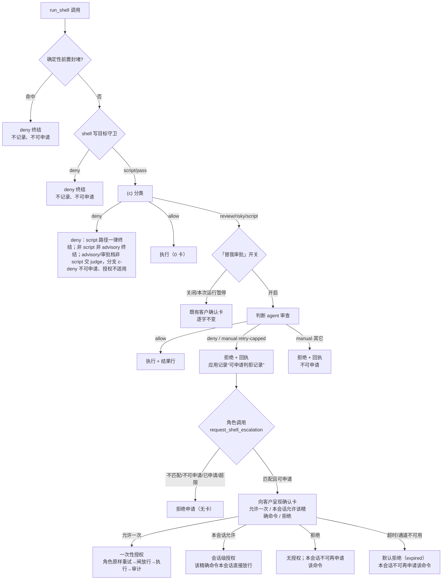
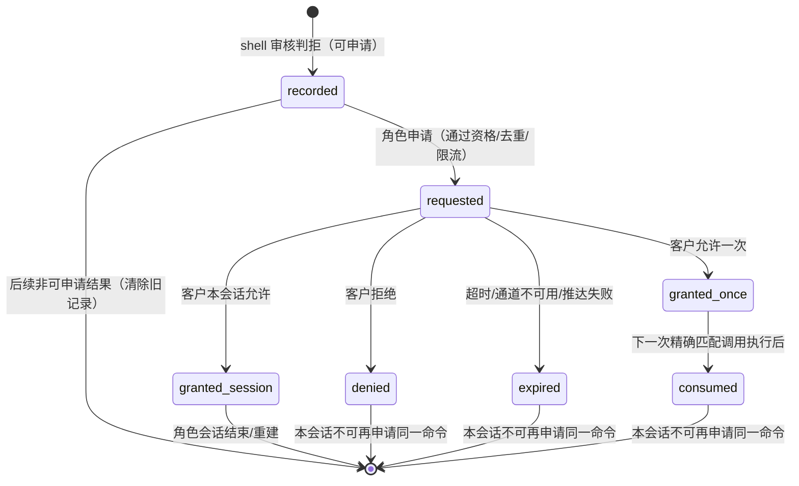
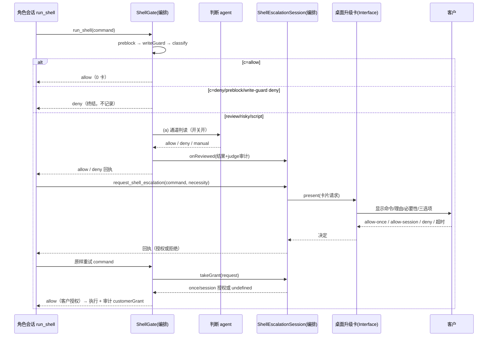

# 策划方案 v1.3：shell 判拒后的客户确认通道 + 例行命令白名单扩容 + 回执/开关粒度（闸门 1 方案）

- 日期：2026-10-31（v1.0 初稿；v1.1 处置完整复核 F1–F14；v1.2 处置窄复核 N1–N7；v1.3 处置第二轮窄复核 N8–N9，见 §14）
- 角色：ANS 策划（Planning），独立上下文
- 状态：**草案 v1.3（已处置完整复核 F1–F14、窄复核 N1–N7 与第二轮窄复核 N8–N9；待确认性窄复核与闸门 1 客户确认；未实施、未测试、未验收）**；本文件是设计候选，客户在闸门 1 确认的版本才是验收基线；实施需闸门 1 确认 + 闸门 2 角色指派确认 + 客户实施授权。
- 风险档位：**T3（治理/权限/审批语义变更）**。本方案改变 shell 审批链在被判拒后的客户升级口径、改判拒回执与「替我审批」的开关粒度，并扩大确定性放行的执行面（例行命令不再经判断 agent）；即使大多为文案与判定补充，也属于审批/权限语义变更，不能压成 T0–T2（与 2026-10-29 shell 审批链方案同为 T3 的先例一致）。
- 闸门 0 依据：`docs/communication/2026-10-31_intent_shell-deny-customer-escalation.md`（49 行，SHA-256 `74e0596cc757dd773b197e6acf4f572988f4b0a87c31c4b2a60f480bfff06b1d`；客户已确认「把这个方案立为下一轮改进（走闸门 0/1）」）。
- 代码基线：worktree `flow-improvements-wave1` HEAD `9f670fb`（已合并 main `32d8f0d` / v1.8.3）。本文行号均为该快照的只读核对结果；实施以符号名与文本锚点为准。
- 独立复核：`docs/planning/2026-10-31_review_shell-deny-customer-escalation.md`（**完整复核** v1.0 / 754 行 / SHA-256 `620a41a5…`，结论「建议修订后提交」；**窄复核** v1.1 / 818 行 / SHA-256 `74d49c78…`，结论「建议修订后提交」，N1–N7；**第二轮窄复核** v1.2 / 840 行 / SHA-256 `f3fe95f5…`，结论「建议提交客户确认」，N8–N9；N1–N9 已在 v1.3 处置；**确认性窄复核**结论见复核记录的「确认性窄复核 v1.3」小节）。
- 标记约定：**[现状]** 已核实代码行为；**[设计候选]** 本方案提议、未实施；**[待客户决定]** 见 §8.3/§15，闸门 1 需客户拍板。

---

## 1. 摘要

**客户的问题（闸门 0 记录）**：有些命令是推进任务所必需，但「替我审批」的判断 agent 一直判拒；客户当前唯一的出路是**关闭全局「替我审批」**，之后每条命令都弹手动确认卡。同时，部分项目内例行命令（尤其内置治理角色下的测试/类型检查，以及 `npm ci`/`tsc` 等不在既有委托清单的形态）仍会惊动判断 agent，造成误伤和等待。

**本方案（设计候选）提出三层改动：**

1. **判拒后的客户确认通道（核心）**：判断 agent 判拒（或同一命令重试超限）后，**角色可对这一条精确命令申请客户确认**；应用向客户呈现一张确认卡（命令原文、cwd、判拒理由、角色必要性说明、judge 的替代方案），选项为 **「允许一次 / 本会话允许该精确命令 / 拒绝」**；无答复默认拒绝。客户批准记为**客户手批**，与 judge 放行在审计上可区分。**硬拒档（c=deny）与确定性封堵档（长内联/无界搜索）不可申请**；**同一命令每会话最多申请一次**；**判断 agent 不得自翻判拒**，该确认的决策者只能是客户。
2. **确定性白名单扩容（减少误伤）**：把静态可证明为项目内例行操作的确切命令形态（`npm test`、固定脚本名的 `npm run test|typecheck|lint|check`、`node --test`（受限路径）、`tsc --noEmit`、`npm ci`）加入确定性放行——**0 卡、不调判断 agent**；`npm install <新包>` 保留判断 + 判拒后可申请确认；其余命令行为不变，fail-closed 不变。
3. **回执措辞与开关粒度**：判拒回执的出路从「关闭『替我审批』后重试」升级为「可对这条精确命令申请客户确认」（保留关闭开关作为兜底）；并提供**「本次运行暂停自动审批」**的细粒度控制（仅作用于 shell 判断、应用运行期内有效、不写偏好、重启后清零并回到持久化开关值），不再要求客户动全局开关。

**客户可见的结果（设计候选）**：

- 必要命令被判拒后，角色可发起一次客户确认；客户可只放行这一条命令一次，或在本角色会话内放行这一条精确命令，或拒绝；不操作即拒绝。
- 测试/类型检查一类例行命令不再出现卡片、也不再调用判断 agent；非白名单命令仍由判断 agent 审查（开关开启时）。
- 判拒回执明确告诉角色下一步；客户在判拒结果行可一键「本次运行暂停自动审批」。
- 安全边界不放宽：硬拒/封堵不可申请；judge 不能推翻自己；每命令每会话一次；全部决定可审计。

---

## 2. 基线与范围

### 2.1 需求基线与确认状态

| 项 | 状态 | 记录 |
| --- | --- | --- |
| 闸门 0：意图确认 | **已确认（2026-10-31）** | `docs/communication/2026-10-31_intent_shell-deny-customer-escalation.md`（49 行 / `74e0596c…`） |
| 三层意图（判拒后客户确认 / 白名单扩容 / 回执与开关粒度） | **已确认**，本方案按此展开 | 同上「意图理解（客户确认的方案，三层）」 |
| 非目标（不得自翻判拒、不接「替我决策」、不放宽硬拒/封堵、无答复不放行、不改治理卡「替我决策」语义） | **已确认** | 同上「非目标」 |
| 独立复核 | **见复核记录**（完整模式） | `docs/planning/2026-10-31_review_shell-deny-customer-escalation.md` |
| 闸门 1：方案确认 | **待客户确认** | 本文件 v1.3 |
| 闸门 2：角色指派/写集 | 未开始（闸门 1 通过后由统筹判断团队） | — |
| 实施授权 | **未给**；本方案不授权任何代码/测试改动 | 同上「已授权边界」 |

### 2.2 验收基线

客户在闸门 1 确认的本方案版本（含 §10 可核对验收标准）是后续独立验收的基线。§10 的 P/G 是方案自带的可核对标准，不是正式验收结论；独立验收在实施前基于确认版本写正式完成标准。

### 2.3 范围边界

**本轮必须覆盖（对应闸门 0 三层意图）：**

- 判拒后的窄口径客户升级通道：申请资格、三选项、超时默认拒绝、每命令每会话一次、申请上限与去重、授权作用域与消费、审计区分、回执措辞。
- 确定性白名单扩容：类别清单、精确形态、静态可证明口径、`npm ci` 与 `npm install <新包>` 分档、与 shell 写目标守卫的协同。
- 「本次运行暂停自动审批」的开关粒度与回执措辞。
- 可核对验收标准、失败分支、安全分析、不变量、写集候选、风险档位与 overlay 影响。

**本轮明确不做：**

- 不让判断 agent 推翻自己刚做出的判拒；不把 shell 判拒接入「替我决策」代批；不做「一键允许所有」。
- 不放宽硬拒档（c=deny）与确定性封堵档（长内联、无界递归搜索）；不在无答复时默认放行。
- 不改变治理卡（提案/任命/验收）的「替我决策」语义；不改角色 id/显示名/写区；不改两开关的存在与分组。
- 不做 OS 级沙箱；不自动回滚越界写入；不改被治理目标项目。
- 不在闸门 1/2 确认前改任何应用代码或测试；不 git commit/push；不启动应用。

---

## 3. 现状与问题（代码事实）

### 3.1 [现状] 审批链与「替我审批」

| # | 事实 | 证据 |
| --- | --- | --- |
| 3-1 | 三层审核链为 (c) 确定性 → (b) pm 审读 → (a) 操作者确认；risky 即使 b 放行也必过 a。**c 硬拒的终结位置按路径区分**：`script` 分支在**所有装配模式**下 c=deny 一律终结（`shell-gate.ts:582-587`）；非 script 路径下，非 advisory 装配终结，默认项目角色 advisory 与内置审批档则交 (a)（分支 `c-deny→a-*`）。 | `src/common/编排/shell-gate.ts:11-62`、`:572-636`、`:648-659`、`:660-677`、`:678-685`、`:718-763`；`src/common/门禁引擎/shell-write-guard.ts:509-513`；`src/pipeline/orchestration/shell-arming.ts:183-185` |
| 3-2 | 项目角色默认 advisory 规则集：(c) 只快速放行，`risky/review/deny` 一律跳过 (b) 直接交 (a)（判断 agent / 客户）。 | `src/common/编排/shell-gate.ts:645-659`；`src/pipeline/orchestration/shell-arming.ts:183-185` |
| 3-3 | 内置治理角色走审批档（operatorOnly + approveDeny）：c=allow 直放（0 卡），其余（含 deny 档）逐条交 (a)。 | `src/common/编排/shell-gate.ts:660-677`；`src/pipeline/orchestration/shell-arming.ts:324-369`；`src/pipeline/orchestration/run-role.ts:1270-1285` |
| 3-4 | 「替我审批」开启时，桌面 (a) 通道在 present **之前**调用判断 agent；判断 agent 是**唯一审查者**（2026-10-19 客户裁定）。`allow` → 结果行 + 放行；`deny` → 结果行 + 拒绝（不弹卡）；`manual`（超时/预算/解析失败/重试超限等）与 `row-failed` → **一律按拒绝处理、不弹卡**。 | `app/desktop/operator-channel.ts:33-40`、`:462-486`、`:540-566`、`:626-665` |
| 3-5 | 判拒回执给角色的文本以「关闭『替我审批』后重试」为唯一出路。 | `src/common/编排/shell-judge-verdict.ts:36-37`；`app/desktop/operator-channel.ts:741-752`；i18n `main.operator.judgeWayOut` / `ui.judge.closeAndRetry` |
| 3-6 | 同一命令连续判拒上限默认 2；第三次转 `manual/retry-capped`，但桌面把 manual 也按拒绝处理 ⇒ **「转手动确认」在桌面不可达**；命令稍有改写即视为新命令，计数不累计。 | `src/common/编排/shell-judge.ts:150-151`、`:755-761`、`:248-250`；`app/desktop/operator-channel.ts:540-566` |
| 3-7 | shell 写目标守卫对 `node --test`、`npm test/install/ci/run` 等返回 `script`（进入脚本内容审查）；且该分支先于 (c) 白名单判断。 | `src/common/门禁引擎/shell-write-guard.ts:536-551`；`src/common/编排/shell-gate.ts:571-636`、`:637-644` |
| 3-8 | (c) 分类把 `npm run/install/ci/test` 等包命令判 `risky`；`node --test`、`tsc` 等未命中白名单 ⇒ `review`。 | `src/common/门禁引擎/classify-shell.ts:583-646`、`:452-461` |
| 3-9 | 客户委托的「常规检查」在 **script 分支**（judge 之前）直接放行，不需要 (b)；桌面在项目已接受时为**项目角色**注入该策略，因此 `npm test`、`npm run typecheck`、`node --test`（受限测试路径）在默认项目角色路径**已经是 0 卡、0 judge**。该机制不覆盖内置治理角色（审批档构造期禁止 routineShellPolicy），且清单很窄（`cwd` 必须等于项目根；无 `npm ci`/`tsc`/`npm run test|lint|check`）。 | `src/common/编排/routine-shell-policy.ts:12-34`；`src/common/编排/shell-gate.ts:590-597`；`app/desktop/session.ts:2446-2449`、`:2740`；`src/pipeline/orchestration/shell-arming.ts:324-369`；`test/编排/shell-authorized-routine.test.ts:29-75` |
| 3-10 | 桌面 shell 确认卡是**应用内确认卡**（`shell:confirm-request`/`shell:confirm-response`），只支持放行/拒绝二元决定；确认卡的 pending/replay/expire 抽在共享核心 `confirm-card.ts`，`respond` 只认 `allow === true`。 | `app/main.ts:557-568`；`app/desktop/operator-channel.ts:916-982`；`app/desktop/confirm-card.ts:85-195`、`:159-168`；`app/renderer/src/shell/ConfirmCard.tsx:65-239` |
| 3-11 | 客户交互卡（`request_confirmation`/`request_choice`）走另一套聊天内卡通道，带 `cardKind`/判断组/排队/过期；与 shell 确认卡不是同一通道。 | `app/main.ts:510-553`；`app/desktop/customer-input.ts`；`src/provider/runtime/tools.ts:3036-3042` |
| 3-12 | shell 闸审计落 `docs/audit/shell-gate.jsonl`（append-only，声明 `shell-gate` 条件）；已能区分 judge 自做的 allow/deny（`judge` 字段）与客户手批（无 `judge` 字段）。 | `src/common/编排/shell-audit.ts:24-92`；`src/common/编排/shell-gate.ts:926-960` |
| 3-13 | 判断 agent 的 rubric 只审五类系统风险（破坏/装包/提权、卡死、越界、并发、端口）；业务必要性明确不归判断 agent；装包/长驻服务等会判拒。 | `src/common/编排/shell-judge-prompt.ts:38-107` |
| 3-14 | 2026-10-29 客户 §五/Q2 口径：不强制客户本人；开关开启时由 judge 审查命令 + 脚本内容（`npm run`/`node --test`/`npm install` 等都在脚本审查范围内），开关关闭才走客户卡；judge 不可用 fail-closed。 | `src/common/编排/shell-gate.ts:571-636`；`src/common/编排/shell-approval-context.ts`；`src/model/runtime.ts:161-198` |

### 3.2 [现状] 判拒后的死路（用户可见痛点）

1. 判断 agent 判拒后，角色只拿到「未执行 + 理由 + 关闭开关」的回执；**没有对这条命令本身申请客户确认的通道**。
2. `manual`（含 `retry-capped`）在桌面按拒绝处理，客户没有任何机会看到「这条命令重试超限、是否要处理」。
3. 客户若关闭全局开关，之后**每条**非白名单命令都要手动确认；开关还会持久化，容易忘记恢复。
4. 判拒是终局，角色只能改写命令或换方案；而「这条命令是否真的必要」恰恰只有客户/业务侧能判断——rubric 明确不审业务必要性，形成系统性错位。

### 3.3 [现状] 例行命令：已有一部分放行，缺口在内置角色与少数形态

- **已经是 0 卡的部分**：项目角色（`role.builtIn !== true`）在项目已接受（`config.accepted`）时，桌面会注入 `routineShellPolicy`；写目标守卫把 `npm test`、`npm run typecheck`、`node --test`（受限测试路径）判为 `script` 后，script 分支命中委托即直接 allow——**不经 judge、不弹卡**（`app/desktop/session.ts:2446-2449`、`:2740`；`src/common/编排/shell-gate.ts:590-597`；`src/common/编排/routine-shell-policy.ts:12-34`）。闸门 0 中列举的这些例子，部分已是现状。
- **真正的缺口**：
  1. **内置治理角色**走审批档，构造期禁止 `routineShellPolicy`（`shell-arming.ts:324-369`），同类命令仍逐条交 judge/客户。
  2. **不在委托清单的形态**：`npm ci`、`tsc --noEmit`、`npm run test|lint|check`（`typecheck` 已在委托内）；`cwd` 必须等于项目根。
  3. 委托是**宿主授权**机制（配置接受后生效），不是 (c) 级确定性白名单；它只在 script 分支生效，遇到 c=deny/preblock 不生效，且其清单一旦扩展会影响**所有**项目角色的审批面。
- `git status/diff/log`、`cat/ls/grep`（有界）等只读命令已经在 (c) 白名单内，本来就 0 卡；闸门 0 中把它们列为目标，属于「确认现状」而非新增。
- **结论**：本轮不是「从零扩容」，而是把已生效的少数委托形态**提升为所有角色（含内置）的 (c) 级确定性白名单**，并补 `npm ci`/`tsc --noEmit`/`npm run test|lint|check`；同时必须显式处理「这会把原本只在项目角色、只在 script 分支的放行面扩大」这一行为变化（见 §3.5、§8.3）。

### 3.4 根因

1. **判拒没有窄口径的客户升级通道**：2026-10-19 裁定「judge 是唯一审查者、deny 终结不打扰」把客户完全排除在判拒之后；本方案只增补一条**角色发起、客户决策、仅限该精确命令**的例外，不恢复「自动打扰」。
2. **自动化审查与业务必要性的边界错位**：judge 按设计不审业务必要性，但判拒后没有业务侧（客户）的复核通道。
3. **确定性白名单只覆盖「只读」与少数委托形态**：项目内例行的安装/类型检查等，部分靠宿主委托、部分完全没覆盖；内置角色没有委托。
4. **写目标守卫与分类器各自为政**：写守卫先把例行命令判成 `script`，分类器的白名单再想放行也到不了——扩容必须两处共用同一个判定函数。
5. **委托机制与确定性白名单的语义不同**：委托是「配置接受后的宿主授权」（只在 script 分支、只对项目角色），确定性白名单是 (c) 级分类；把前者升级为后者会扩大放行面，必须显式确认。

### 3.5 [现状] 与 2026-10-29 §五/Q2 口径的冲突点（必须如实披露）

- 2026-10-29 客户确认「开关开启时 judge 审查命令 + **脚本内容**」：`node --test <file>`、`npm test`、`npm run <script>`、`npm install` 都是**执行任意脚本**的形态，judge 必须看到内容。
- 本轮闸门 0 要求「例行命令走确定性放行、不惊动 judge」。两者在以下点直接冲突：
  0. **冲突已部分存在**：项目角色在项目已接受时，`npm test`/`npm run typecheck`/`node --test`（受限路径）已由宿主委托在 script 分支直接放行、不经 judge（§3.3）。本方案不是首次引入冲突，而是把这一放行面**扩大到内置角色并增加形态**；扩大部分必须重新确认。
  1. 若允许**任意** `npm run <script>` 确定性放行，等于对包脚本全面撤销脚本内容审查——这是实质安全回退，**本方案不推荐**。
  2. 即使只放行**固定脚本名**（`test`/`typecheck`/`lint`/`check`）与 `npm ci`，其脚本体/生命周期脚本仍可执行任意代码；客户在闸门 0 已明确把 `npm ci` 列为可确定性命中，属于客户接受的风险，但须在闸门 1 再次明示。
  3. `node --test <file>` 运行测试文件同样是任意代码；本方案以「路径形状受限 + 执行后写审计」作为补偿，而不是内容审查。
- **本方案的处理**：只对**精确命令形态**放宽（§5.1），并在 §8/§10 明示「这些形态不再经脚本内容审查」的后果与补偿；任意 `npm run <script>` 不纳入，留作 §11 O7 / §15 待客户决定。复用委托清单时保留其原有授权语义（不把新形态自动继承给委托），见 §5.3。

---

## 4. 目标行为 A：判拒后的客户确认通道

### 4.1 [设计候选] 完整流程与分支



**分支说明：**

- **开关关闭 / 本次运行暂停**：走既有 `presentConfirmed` 路径，行为逐字不变（客户卡放行/拒绝/超时）；此时不产生「可申请判拒记录」（没有 judge 判拒），申请工具会如实回「没有可申请的判拒记录」。
- **判断 agent allow**：结果行 + 执行，行为不变。
- **判断 agent deny**：结果行 + 拒绝；应用把该次判拒记录为「可申请判拒记录」（仅当符合 §4.2 资格）。
- **manual/retry-capped**：按拒绝处理（2026-10-19 裁定不变），但同样记录为可申请；**其他 manual** 不记录（不可申请，见 §4.2）。
- **角色申请**：只有角色显式调用工具才会打扰客户；判拒本身仍然**不自动弹卡**（不违反「拒绝不打扰」原则）。
- **客户决定**：三选项 + 无答复默认拒绝；决定只对**这一条精确命令**生效。
- **授权消费的闸内顺序（精确，见 §6.3）**：preblock → write-guard deny → classify 计算 → **仅当 `detail.decision` 为 `review`/`risky` 时才检查授权**（非 script 类在此直接放行）→ script 分支内：c=deny 检查 → 授权检查（重载脚本上下文并与判拒记录比对 sha256）→ 既有委托/审批链。**任何 c=deny 分类都不消费授权、不放行**：script 路径在所有模式下终结；非 script 的默认 advisory 下 c=deny 仍按现状交 judge/客户（分支 `c-deny`，不可申请），本方案不新增 c=deny 终结；c=allow 也不消费授权。

### 4.2 [设计候选] 申请资格：可申请 / 不可申请

| 判据 | 可申请 | 说明 |
| --- | --- | --- |
| 本次 shell 审核最终为 **judge 主动 `deny`**（`judge.verdict === "deny"`，非 `manualAsDeny`） | ✅ | 主路径；含 `review`/`risky`/`script` 档被判拒 |
| 本次为 **`manual` + `reasonCode === "retry-capped"`**（`manualAsDeny === true`） | ✅ | 闸门 0 明确要求「retry-capped 桌面可达路径（客户确认）」 |
| `manual` 的其它 reasonCode（`timeout`/`unavailable`/`parse-failed`/`budget`/`read-denied`/`read-truncated`/`context-too-large`/`context-missing`/`model-manual`/`aborted`/`queue-*`/`row-failed`） | ❌（v1） | 不是「判拒」，是审查未完成；扩展见 O2 |
| `c=deny` 硬拒档（含内置治理角色审批档的 `tier === "deny"`；分支以 `c-deny` 开头） | ❌ | 硬地板不翻案；即使 judge 在审批档下判拒也不可申请 |
| 确定性前置封堵：`preblock:inline-too-large` / `preblock:unbounded-search` | ❌ | 不进入 (a)，不产生记录 |
| 写目标守卫 deny（`write-guard:deny`，含版本化文档只读、写区外目标） | ❌ | 结构性拒绝，不进入 (a) |
| 脚本审查上下文不可用（`script:context-unavailable` / `approvalContext.failClosed`） | ❌ | fail-closed 拒绝，不是判拒 |
| 客户在开关关闭时手拒、pm 在旧路径判拒（(b) `b-deny`） | ❌ | 不是判断 agent 判拒 |
| **入口不是 `run_shell`**：`start_background_task`（后台启动） | ❌（v1） | 同一 `shellGate` 被后台启动复用；客户批准的是「前台执行这一条命令」，不应自动成为「后台长驻启动」。`ShellReviewRequest` 新增 `entry` 字段并纳入记录键；v1 只允许 `run_shell` 申请。后台启动的判拒记录不写入可申请台账（O11 可扩展） |
| 只读档（`readonlyOnly`）下的任何命令（`readonly-deny` / `script:readonly-deny`） | ❌ | 只读档不产生 judge 判拒记录；**不得注入/调用 `takeGrant`**（构造期守卫或调用点跳过），避免陈旧授权越过只读拒绝 |
| 同一命令在本会话已申请过（无论结果） | ❌ | 每命令每会话一次（§4.3） |
| 会话申请总数达上限 / 已有待答复申请 | ❌ | 限流（§4.3） |

> **实现口径**：资格判断只读**已记录的审核结果**（branch、`judge` 审计、`reasonCode`、`tier`），不重新做风险判断（不变量，见 §9）。「可申请判拒记录」由应用侧在 shell 审核结束回调时写入（§6.1/§6.3），键为 `(roleId, projectRoot, cwd, entry, 规范化 argv)`；**非 `run_shell` 的 review 只忽略，不得写入或清除 `run_shell` 记录**。

### 4.3 [设计候选] 申请与决定

| 项 | 设计 |
| --- | --- |
| 申请工具 | `request_shell_escalation`，参数 `{ command: string, necessity?: string }`；工具处理器用自身 `splitCommand` 拆分命令并把 `argv` 交给编排 registry（模型不提供 argv），与记录做**精确匹配**；cwd 固定为本会话项目根；v1 只允许 `run_shell` 入口 |
| 申请上限 | **同一命令每会话最多申请一次**（无论允许/拒绝/超时，均消耗该命令的申请权） |
| 会话总上限 | 默认 **5 次/角色会话**（防轰炸；超限直接拒绝，不弹卡）；数值待客户决定（§15 Q4） |
| 并发/待答 | 同一角色会话同时最多 **1 张**待答申请；**同一窗口同时最多 1 张**升级卡（跨角色）；已有待答时新申请直接拒绝并提示稍后（不排队，v1） |
| 无答复 | 卡超时/通道不可用/推达失败 → **默认拒绝**（`expired`/`unavailable`），消耗该命令申请权；不重试、不自动弹第二张 |
| 客户选项 | `allow-once` / `allow-session` / `deny`；**没有**「允许所有」「按前缀允许」「允许该程序的所有参数」 |
| 判断 agent | **不参与升级卡**：升级卡不调用 judge、不读「替我决策」开关、不产生 judge 结果行；决策者只能是客户 |
| 角色必要性说明 | 可选，UTF-8 ≤ 1KB / 500 字符；卡上单独标注「由角色提供，未经验证」，不得作为标题/选项来源 |
| 卡内容 | 命令原文（逐字、取自记录的判拒，不取模型本次输入）、cwd、judge 判拒理由/给客户的话/替代方案、角色必要性说明、脚本上下文摘要（路径 + sha256 + 有界内容，如有）、「客户手批 ≠ judge 放行」声明 |
| 申请结果回执 | `allow-once`：明确「仅此一次，请原样重试该命令」；`allow-session`：「本会话该精确命令可直接执行」；`deny`/`expired`：「未获客户允许；本会话不再受理同一命令的申请」 |

### 4.4 [设计候选] 授权作用域与精确命令键

- **键 = (roleId, 项目根, cwd, entry, 规范化 argv 数组)**；`entry` 为 `run_shell`（v1 唯一可申请入口）。
  - 归一化只做 `splitCommand` + 现有 `normalizeArgv`（与工具/审计同源），不改变 token 内容；raw 空格差异不改变键（执行语义相同），但**卡上展示与审计记录**用判拒时的原始命令文本。
  - 「精确命令」指 argv 逐元素完全相等；不做前缀、通配、程序名级或「同类命令」放宽。
- **允许一次（`allow-once`）**：只在**同一角色会话**内有效；由**下一次**完全匹配的 `run_shell` 消费（原子 check-and-consume）；消费后即失效；若匹配调用在闸的**前置封堵/写守卫/c=deny**处被拒，则不消费（授权保留）。
- **本会话允许（`allow-session`）**：只在**同一角色会话**内有效；该精确命令（同 cwd、同 argv）可反复执行；**会话结束/重建（含边界刷新重建、dispose、应用重启）即失效**；不跨角色、不跨项目、不跨 cwd。
- **不继承**：派生命令（加参数、改路径、改大小写）一律视为新命令，回到正常审批链；新命令若被判拒，可另行申请（受会话总上限约束）。
- **脚本上下文的时效（关键）**：判拒记录保存 judge 当时看到的 `approvalContext`（脚本路径 + sha256 + 有界内容）。消费 script 类授权时，闸必须**重新加载同一份上下文并比对 sha256**；任一脚本变化/不可读 ⇒ 拒绝（`customer-escalation:stale-context`），授权作废且该命令本会话不可再申请（客户批准的是旧内容，不是新内容）。
- **开关关闭后的既有授权**：客户在开关开启期间给出的授权不因随后关闭开关而失效（客户已明确批准）；但不会扩展到任何其它命令。

### 4.5 [设计候选] 申请单状态机



- 任务要求的五个状态 `requested / granted-once / granted-session / denied / expired` 全部覆盖；`recorded` 是申请前的判拒记录，`consumed` 是一次性授权的终态。
- 所有终态（`denied`/`expired`/`consumed`）都**不可再次申请**同一命令；`granted-session` 持续到会话结束。
- **旧记录清理**：`onReviewed` 对同一 key 的后续审核，若结果不再是可申请判拒（judge allow、客户手拒、其他 manual），**删除该 key 的 `recorded` 记录**；申请前记录已被清除即不可申请。记录带 `at`/顺序号，资格判断只认该 key 最近一次审核；避免「先判拒、后被放行，仍能申请一张无必要的卡」。

### 4.6 [设计候选] 回执措辞与「本次运行暂停自动审批」

**判拒回执（角色可见）**建议改为（中英文同步）：

- judge deny：`出路：如确属推进必需，可调用 request_shell_escalation 对这条精确命令申请客户确认（每会话一次）；或关闭「替我审批」后重试。`
- retry-capped：在 `manualDenyAdvice.retryCapped` 中给同样出路（不再只写「请重试」）。
- 判拒结果行（客户可见）的 `retryHint` 改为：`可让角色申请客户确认（允许一次 / 本会话允许该命令 / 拒绝），或关闭「替我审批」后重试（改为手动确认）。`
- 保留「关闭『替我审批』后重试」子串作为兜底（现有 `containsExitLine` 判据与 judge 自拟文本兼容，见 `shell-judge-verdict.ts:121-132`）。

**「本次运行暂停自动审批」**：

- **独立状态，不复用全局开关**：新增应用运行期的 `shellSessionPaused` 标记（主进程模块级，跨窗口重开保留、应用重启清零），只被 **shell 操作者通道**的 `judge.isEnabled()` 读取（`isEnabled = 持久化开关 && !shellSessionPaused`）；**不改变持久化开关值**，也**不影响治理 approval 组**（`customer-input` 的判断组仍只看全局开关）。
- **入口**：① judge 判拒结果行上的「本次运行暂停自动审批」按钮；② 升级卡页脚的次要动作「暂停本次运行自动审批」（覆盖 retry-capped 没有结果行的场景，不改变三选项决定）。
- 状态经既有 `shell:judge-state` 推送（新增可选 `paused` 字段）；渲染侧显示「本次运行已暂停自动审批（重启后清零、回到持久化开关值）」并提供恢复按钮。
- 与全局开关的关系：全局开关仍可在设置里开关；暂停是叠加的临时覆盖，恢复即回到持久化值。**暂停后新的 shell 请求逐条走客户确认卡（与关闭开关一致），这是客户主动选择的降级。**
- 备选：按角色/项目暂停（O3）或把暂停做成升级卡第四选项（不推荐，混淆两个决定）；作用域需客户在闸门 1 确认（§8.3 第 5 点、§15 Q5）。

---

## 5. 目标行为 B：确定性白名单扩容

### 5.1 [设计候选] 类别清单与精确形态

> 只放宽**精确 argv 形态**；任何多余参数、flag、`--`、通配、相对/绝对越界路径都不命中，落回既有链（review/risky → judge 或客户卡）。
>
> **现状说明**：`npm test`、`npm run typecheck`、`node --test`（受限路径）在**项目角色**路径已由宿主委托放行（§3.3）；本表把它们提升为 (c) 级确定性白名单，使其对**所有角色（含内置治理角色）**生效，并新增 `npm ci`/`tsc --noEmit`/`npm run test|lint|check`。委托清单不自动继承本表新增形态（§5.3）。

| 类别 | 精确形态（argv 全等） | 静态可证明性 | 备注 |
| --- | --- | --- | --- |
| 测试 | `["npm","test"]` | 精确 2 元素；无附加参数 | 已是项目角色委托形态；本方案提升为 (c) 级（内置角色也生效）。会运行 package.json 的 `test` 脚本（任意代码）——客户在闸门 0 接受「例行测试不惊动 judge」 |
| 脚本 | `["npm","run","test"]`、`["npm","run","typecheck"]`、`["npm","run","lint"]`、`["npm","run","check"]` | 精确 3 元素 + **固定脚本名** | `typecheck` 已是委托形态；其余为新增。任意其它脚本名不放行（`npm run build`/`start`/自定义 → 仍走 judge） |
| 测试 | `["node","--test"]`；或 `["node","--test", <paths>...]`，每个 path 必须是 `test/…` 下、匹配 `*.test.{js,ts,mjs,cjs,mts,cts}`、无 flag、无 `..`、无空白/元字符 | argv 形状 + 路径形状 | 已是项目角色委托形态（路径规则相同）；本方案提升为 (c) 级。裸 `node --test` 在 cwd（项目根）发现测试；不允许 `--import`/`--loader` 等 flag |
| 类型检查 | `["tsc","--noEmit"]` | 精确 2 元素 | **新增**。裸 `tsc`（会写产物、读 tsconfig 的 outDir）**不放行**；`npx tsc` 不放行 |
| 安装 | `["npm","ci"]` | 精确 2 元素 | **新增**。按锁文件安装；**会运行生命周期脚本**（客户已知悉并接受，闸门 1 再次明示） |
| 只读 | `git status/log/diff/...`、`cat/ls/grep`（有界）等 | 既有 (c) 白名单 | **现状已 0 卡**；本方案只确认，不改 |
| 不纳入 | `npm install`（裸/带包）、`npm ci <flags>`、`npm run <其它脚本>`、`tsc`（裸）、`node --test <越界/带 flag>`、`npx *` | — | `npm install <新包>` 保留 judge 判拒 + 申请确认（闸门 0 明确） |

**为什么 `npm run <script>` 只收固定脚本名**：任意脚本名等于绕过 2026-10-29 的脚本内容审查，属于安全回退；固定名至少把「例行」限定为可枚举的约定，剩余风险由「精确 argv + 执行后写审计 + 无参数」兜。若客户坚持任意脚本名，须在闸门 1 明确这是安全回退（§15 Q1）。

### 5.2 [设计候选] `npm ci` 与 `npm install <新包>` 分档

- `npm ci`：精确命中 → (c) allow（0 卡、不调 judge）。
- `npm install` / `npm install <pkg>` / `npm i ...` / `npm ci --xxx`：不命中 → 现状 `risky:pkg-run` → judge；judge 按 rubric「装包」判拒后，角色可对**这一条精确命令**申请客户确认（§4）。这正是闸门 0 要求的「后者保留判拒 + 申请确认」。
- 安全注记：`npm ci` 的 `preinstall/install/postinstall` 可执行任意代码，且安装会写 `node_modules/`（执行后审计的排除项）；这是客户在闸门 0 明确接受的取舍，须在闸门 1 复述。

### 5.3 [设计候选] 单一判定与写目标守卫的协同（关键实现陷阱）

[现状] 写目标守卫在 (c) 分类**之前**运行，并对 `node --test`、`npm test/install/ci/run` 直接返回 `script`（`shell-write-guard.ts:536-551`）；而 `script` 分支又先于 (c)=allow 判断（`shell-gate.ts:571-644`）。**只改 `classify-shell` 白名单不会产生 0 卡**。

**设计**：

- 在门禁引擎 `classify-shell.ts` 新增**唯一**纯函数 `matchRoutineShellCommand(argv): { id: string } | undefined`（无 IO、无规则集依赖；上表全部形态在此实现）。
- **合法消费路径**：`src/service/gate/shell-rules.ts`（Service 公开出口）**再导出**该谓词（同一函数引用）；`common/编排` 只能经此公开出口导入（先例：`shell-audit.ts` 经 `src/service/gate/` 导入 `resolveWrite`）。该文件必须列入写集；不得让编排直接导入门禁引擎私有 `common/`（违反 §6 边界）。
- `classifyShellDetailed` 在**硬拒/记号检查之后、risky 判断之前**调用它：命中 → `allow`（`ruleId: "allow:routine:<id>"`）。
- `evaluateShellWriteTargets`（`src/common/门禁引擎/shell-write-guard.ts`）在程序名解析后、`node --test`/`npm` script 分支之前调用**同一函数**：命中 → `{ kind: "pass" }`（不进入脚本审查）。
- `routine-shell-policy.matchesDelegatedRoutineCheck` 的形态判断改为调用同一谓词，但**只接受原委托清单的三个 id**（`npm test`、`npm run typecheck`、`node --test` 受限路径），保留项目根/cwd/realpath 校验——**不把本表新增形态自动继承给委托**，避免扩大既生效的宿主授权面。
- **自定义规则集披露**：该谓词在 classify 的 risky 之前生效，因此对注入自定义规则集的宿主也会把上表形态判 allow（硬拒仍优先）。这是有意的「全局确定性安全形态」；若需按规则集关闭，见 O8。此项列入 §8.3 客户确认点（F13）。
- **不变量**：这是同一个确定性白名单函数在两条路径的使用，不是第二份风险判定；任何未命中形态继续走既有链，fail-closed 不变。

### 5.4 [设计候选] 规则集版本、误伤面与测试

- 该白名单是**代码内确定性判定**，不加入 `ShellRules` 数据（写守卫拿不到规则集；避免为传规则集新增装配面）。自定义规则集的宿主同样获得该白名单——这是有意的「全局确定性安全形态」；若未来需要按规则集开关，另开设计（O8）。
- 误伤面：脚本名不同（`npm run test:unit`）、`npm test -- --ci`、`node --test --experimental-*`、`tsc -p tsconfig.json`、`npm ci --ignore-scripts` 都**不**命中 → 仍走既有链（judge/客户卡），不会误放行；对应测试必须断言它们**不**是 c-allow。
- **现有测试需同步（逐条）**：`test/门禁引擎/classify-shell.test.ts` 中 `npm run/install/ci/test` 的 risky 断言（`npm test`/`npm ci` 改为 allow；`npm run build`/`npm install` 仍 risky）；`test/编排/shell-authorized-routine.test.ts:63` 的 `npm ci` 负例（变为 c-allow，需改断言/移除）；`:29-39` 的委托分支断言（若 c-allow 先命中，分支从 `b-allow`/`b-delegated-routine` 变为 `c-allow`——注意脚本分支的顺序）；新增 `test/门禁引擎/shell-routine.test.ts`；`test/门禁引擎/shell-write-guard.test.ts`（实际路径，不是 `test/编排/`）增加例行命令返回 `pass` 的用例。

---

## 6. 架构设计

### 6.1 分层与模块

| 层 | 模块/文件 | 职责（单一） | 改动性质 |
| --- | --- | --- | --- |
| 门禁引擎 | `src/common/门禁引擎/classify-shell.ts` | 新增 `matchRoutineShellCommand`（唯一白名单谓词）；分类器在 risky 前调用 | 改 |
| Service 公开出口 | `src/service/gate/shell-rules.ts` | 再导出 `matchRoutineShellCommand`（同一函数引用）——编排/委托策略的合法导入源 | 改 |
| 门禁引擎 | `src/common/门禁引擎/shell-write-guard.ts` | 同谓词前置：命中 → `pass`，避免 `script` 抢先 | 改 |
| 门禁引擎 | `src/common/门禁引擎/governance-roles.ts` | `SHELL_APPROVAL_CARD_LINE` 补一句「判拒后可申请客户确认（每会话一次）」 | 改（文案） |
| 编排 | **新增** `src/common/编排/shell-escalation.ts` | 判拒记录台账（含旧记录清理、入口限制 `run_shell`）+ 资格判定 + 状态机 + 精确键 + 一次性/会话授权存储 + 脚本上下文 sha256 时效校验 + 申请接口 + 升级决定审计事件；纯逻辑 + 注入时钟/呈现函数/审计 sink；roleId 由每会话闭包绑定 | 新增 |
| 编排 | `src/common/编排/shell-gate.ts` | 注入 `onReviewed`（审核结束回调）与 `takeGrant`（授权检查）；**授权检查位置：classify 后且 `detail.decision` 为 `review`/`risky`（非 deny、非 allow）时（非 script）或 script 分支内 c=deny 检查与上下文重载之后**；任何 c=deny 分类不消费授权，c=allow 也不消费；新增分支常量；审计写 `customerGrant`；`onAuditSinkCreated` 供 registry 共享 sink | 改 |
| 编排 | `src/common/编排/shell-audit.ts` | 审计记录加可选 `event` / `customerGrant` / `escalation` 字段（向后兼容 append-only） | 改 |
| 编排 | `src/common/编排/shell-judge-verdict.ts` | 判拒标准出路句改为「可申请客户确认 + 关闭开关兜底」 | 改（文案/判据） |
| 编排 | `src/common/编排/routine-shell-policy.ts` | 形态判断复用 `matchRoutineShellCommand` | 改 |
| Pipeline | `src/pipeline/orchestration/shell-arming.ts` | 透传 `onReviewed`/`takeGrant`/`onAuditSinkCreated` 到 `buildShellGate`（共享 sink） | 改 |
| Pipeline | `src/pipeline/orchestration/run-role.ts` | 每会话构造 `shellEscalation`（注入 presenter），把 `recordReview`/`takeGrant` 交给闸、把 `request` 作为能力交给工具；`AdapterCapabilities` 增字段 | 改 |
| Pipeline | `src/pipeline/orchestration/govern-session.ts` | 公共再导出（供桌面按既有模式消费） | 改（薄） |
| 运行时核心 | `src/model/runtime.ts` | 新增升级通道契约：动作/决定/卡片请求/呈现函数/工具能力/授权形状；`ShellReviewRequest.entry?: "run_shell"\|"start_background_task"`；`ShellJudgeAudit.manualAsDeny?: true`（加法）；`ShellReviewResult.grant?`；`GovernedToolsOptions.shellEscalation` | 改 |
| 运行时核心 | `src/provider/runtime/tools.ts` | 注册 `request_shell_escalation`（注入才注册，入参含 `argv`）；`run_shell`/`start_background_task` 在 `ShellReviewRequest` 填 `entry`；授权放行结果附说明 | 改 |
| 运行时核心 | `src/provider/runtime/schema.ts` | 新工具 JSON-Schema 与说明 | 改 |
| 桌面窗口 | **新增** `app/desktop/shell-escalation.ts` | 升级卡的 pending/replay/expire 呈现端（复用扩展后的 `confirm-card.ts`）；IPC 数据面 | 新增 |
| 桌面窗口 | `app/desktop/confirm-card.ts` | 核心扩展：保留既有布尔 `mount/respond` 不变，新增「动作投影」挂载（升级卡）；与审批卡/恢复卡共享的 pending/replay/expire 语义不回归 | 改 |
| 桌面窗口 | `app/desktop/recovery-channel.ts` | 适配共享核心的扩展（如签名不变则不改，需在实施时确认） | 可能改 |
| 桌面窗口 | `app/desktop/session.ts` | 把桌面的 presenter 交给 `openRoleSession`；会话终止时中止挂起卡 | 改 |
| 桌面窗口 | `app/main.ts` | 升级卡 IPC（复用 `shell:confirm-*`）、暂停 IPC（模块级 `shellSessionPaused`，只作用于 shell 操作者通道，不影响治理 approval 组）、`shell:judge-state` 推送 `paused` | 改 |
| 桌面窗口 | `app/desktop/interface.ts` | `ShellJudgeStateReply` 增可选 `paused`；暂停开关的读取/恢复接口（状态本体在 main.ts 模块级，跨窗口重开保留、重启清零） | 改 |
| 桌面窗口 | `app/desktop/operator-channel.ts` | `retry-capped` 的拒绝建议改用新出路文案 | 改 |
| 桌面窗口 | `app/preload.cjs` | 新增升级卡/暂停的受限桥方法 | 改 |
| 桌面UI | `app/renderer/src/shell/ConfirmCard.tsx`、`stores/confirm-store.ts`、`chat/ipc.ts`、`lib/platform.ts`、`chat/judge.ts`、`chat/judge-row-view.ts`、`shell/shell.css` | 升级卡三按钮/字段；判拒行「本次运行暂停」按钮与状态 | 改 |
| 共享 i18n | `src/common/shared/i18n/messages/zh-CN.ts`、`en-US.ts` | 新 key + 措辞更新；`test/项目管理/shared/i18n.test.ts` 计数同步 | 改 |

### 6.2 调用与数据流



### 6.3 [设计候选] 必要接口与数据模型（形状，不是最终代码）

**运行时核心契约（`src/model/runtime.ts`）：**

```ts
export type ShellEscalationAction = "allow-once" | "allow-session" | "deny";
export type ShellEscalationDecision =
  | { action: ShellEscalationAction; operatorId?: string }
  | { action: "expired" | "unavailable"; reason?: string };

export interface ShellEscalationCardRequest {
  version: 1;
  requestId: string;                 // 应用生成，卡与回包绑定
  roleId: string;
  projectRoot: string;
  runtime: RuntimeKind;
  command: string;                   // 判拒时的逐字原文（不是模型本次输入）
  argv: string[];
  cwd: string;
  judgeReason?: string;
  judgeCustomerMessage?: string;
  judgeAlternative?: ShellJudgeAlternative;
  necessity?: string;                // 角色提供，≤1KB，不可信数据
  approvalContext?: ShellApprovalContext; // 判拒时同一份有界脚本上下文（如有）
  expiresAt?: string;
}

export type ShellEscalationPresentFn = (
  request: ShellEscalationCardRequest,
  signal?: AbortSignal,
) => Promise<ShellEscalationDecision>;

/** 工具能力（注入才注册；argv 由 tools.ts 的 splitCommand 生成，避免第二份拆分实现） */
export type ShellEscalationFn = (
  input: { command: string; argv: string[]; necessity?: string },
  signal?: AbortSignal,
) => Promise<{ ok: boolean; message: string; state?: string }>;

export interface ShellGrant {
  scope: "once" | "session";
  requestId: string;
  operatorId?: string;
}
```

**编排内部（`shell-escalation.ts`）：**

```ts
interface EscalationRecord {
  key: string;                        // roleId + "\0" + projectRoot + "\0" + cwd + "\0" + entry + "\0" + JSON(argv)
  roleId: string;
  projectRoot: string;
  entry: "run_shell";                 // v1 只记录前台入口；start_background_task 不写入/不清除本台账
  command: string;                    // 逐字原文
  argv: string[];
  cwd: string;
  outcome: "judge-deny" | "retry-capped";
  branch: string;
  judge: ShellJudgeAudit;             // 原样保存（tier/reasonCode/modelVerdict/manualAsDeny；manualAsDeny 见 §7.1 契约加法）
  approvalContext?: ShellApprovalContext;
  at: string;
  seq: number;                        // 同一 key 的最近一次审核顺序
  state: "recorded" | "requested" | "granted-once" | "granted-session" | "denied" | "expired" | "consumed";
  requestId?: string;
  operatorId?: string;
}

interface ShellEscalationSession {
  bindAudit(sink: ShellAuditSink): void;
  recordReview(req: ShellReviewRequest, outcome: ReviewedOutcome): void; // 可申请则 upsert；否则清除同 key 旧记录
  takeGrant(req: ShellReviewRequest, context?: ShellApprovalContext): ShellGrant | "stale" | undefined;
  request(input: { command: string; argv: string[]; necessity?: string }, signal?: AbortSignal): Promise<{ ok: boolean; message: string; state?: string }>;
}
```

**闸的新注入（`CreateShellGateOptions`）：**

- `onReviewed?: (req: ShellReviewRequest, outcome: { result: ShellReviewResult; conclusion; branch; judge?: ShellJudgeAudit }) => void` —— 最终判定后调用（与审计同址）；只做记录/清理，不改变判定。**script 分支必须以带 `approvalContext` 的有效请求调用**（供判拒卡片展示与 sha256 时效校验）；非 script 用原请求。
- `takeGrant?: (req: ShellReviewRequest, context?: ShellApprovalContext) => ShellGrant | "stale" | undefined` —— **精确位置**：非 script 类在 classify 计算后、`detail.decision` 为 `review`/`risky`（非 deny、非 allow）时调用；script 类在 script 分支内 c=deny 检查与 `approvalContextLoader` 重载成功之后调用（与判拒记录的 sha256 比对；`"stale"` ⇒ 拒绝且授权作废）。**任何 c=deny 分类都不调用/不放行；c=allow 也不消费授权。**
- `onAuditSinkCreated?: (sink: ShellAuditSink) => void` —— 闸创建审计 sink 后回调；run-role 用它把同一 sink 绑定给 registry（升级决定记录写同一文件、同一 `shell-gate` 条件）。
- **readonly 档守卫**：`assembleReadonlyShellGate` 不注入 `takeGrant`；`CreateShellGateOptions` 在 `readonlyOnly === true` 且给出 `takeGrant` 时构造期抛错（或调用点跳过），防止陈旧授权越过 `readonly-deny`。
- `ShellReviewResult` 允许分支增加可选 `grant?: ShellGrant`（工具结果可显示「客户已允许一次/本会话」；不改变 allow 语义）。

**授权消费顺序（必须）：** preblock → write-guard deny → classify 计算 → **仅当 `detail.decision` 为 `review`/`risky`（非 `deny`、非 `allow`）**：非 script 直接查授权；script 先经 c=deny 检查 + 上下文重载 + sha256 比对，再查授权 → 既有委托/审批链。这样既覆盖默认 advisory、operatorOnly 与三层链，又保证任何 c=deny 分类都不会被授权越过（script 路径在所有模式终结；非 script 的 advisory 下 c=deny 仍按现状交 judge/客户，本方案不新增终结），也不会在 c=allow 命令上误消费授权。

### 6.4 [设计候选] 复用而非重建

| 复用 | 说明 |
| --- | --- |
| 既有 shell 确认卡通道 | 复用 `shell:confirm-request`/`shell:confirm-response` 与 `confirm-card.ts` 的 pending/replay/expire；升级卡是同一通道上的**新卡片类型**（多动作）。核心扩展保持既有布尔 `mount/respond` 不变（恢复卡与既有审批卡零回归），新增动作投影挂载；**同窗口 shell 卡族（审批 + 升级）互斥呈现**：升级卡为排他卡（有升级卡待答时新审批卡等待），升级申请在有审批卡待答时直接拒绝（§7.2） |
| 既有判断结果/原因 | 升级卡展示判拒时已生成的 `reason`/`customerMessage`/`alternative`；不重新调用 judge、不重新判风险 |
| 既有 argv 规范化 | `splitCommand` + `normalizeArgv`（单一来源） |
| 既有审计 sink | `docs/audit/shell-gate.jsonl` + `shell-gate` 条件；`onAuditSinkCreated` 把同一 sink 绑定给升级 registry，升级决定追加同文件 `event:"escalation-decision"` 记录（append-only） |
| 既有客户卡超时链 | 升级卡超时沿用操作者确认超时链（`ANS_DESKTOP_OPERATOR_CONFIRM_TIMEOUT_MS` → `ANS_PI_SHELL_REVIEW_TIMEOUT_MS` → 120s），超时 = 拒绝 |
| 既有「注入才注册」 | 升级工具只在注入 `shellEscalation` 且 shell 已 arm 时注册（能力缺席 = 不注册） |
| 既有委托常规检查 | `routine-shell-policy` 复用新的白名单谓词，但**只接受原三个委托 id**（`npm test`/`npm run typecheck`/`node --test` 受限路径），不继承本表新增形态；保留项目根/cwd/realpath 校验 |

### 6.5 [设计候选] 关键设计选项与推荐

#### (a) 升级面的呈现：既有 operator 确认卡 vs 聊天内客户卡

| 选项 | 内容 | 代价/风险 | 结论 |
| --- | --- | --- | --- |
| **A（推荐）** 扩展既有 shell 确认卡 | 同一 IPC/呈现端，增加 `kind:"escalation"` 与三动作；命令原文块、argv、cwd、脚本上下文全部复用 | 需扩展共享核心 `confirm-card.ts`（保留布尔 API、新增动作投影；恢复卡需回归）；渲染侧单实例视图一次只显示一张卡 ⇒ 需**跨卡片类型仲裁**：升级卡排他（待答时新审批卡等待）、有审批卡待答时升级申请直接拒绝（不排队） | **推荐**：命令核对是核心，shell 决策只应有一种视觉语言；不引入治理卡语义；仲裁面小且可测 |
| B 聊天内客户卡（`request_choice` 风格） | 复用 customer-input 的 pending/queue/过期与按角色路由 | 需为应用自有卡绕过/扩展 `cardKind` 白名单与判断组映射，易被误接「替我决策」；请求生命周期会写治理记录；命令块不突出 | 不推荐（成本/耦合更高） |
| C 原生对话框 | 简单 | 客户已裁定「太丑」；无 pending/replay | 不采用 |

#### (b) 触发方式：角色显式工具 vs 回执按钮

| 选项 | 内容 | 代价/风险 | 结论 |
| --- | --- | --- | --- |
| **A（推荐）** 角色显式工具 `request_shell_escalation` | 与闸门 0「角色可申请」一致；工具回执可审计；模型按回执提示自然调用；**v1 仅 `run_shell` 入口**（后台启动不纳入，见 §4.2） | 模型可能不调用；靠工具说明 + 回执提示 | **推荐** |
| B 判拒结果行「转人工确认」按钮 | 客户点按钮 | 应用无法代角色发起工具调用；要么新开一轮指令给角色（额外模型调用、可能被提示注入），要么由应用直接重放命令（绕开角色会话、语义混乱） | 不采用；可作 O6 的后续交互糖 |
| C 自动弹卡（判拒即问客户） | 无需角色行动 | 直接违反 2026-10-19「拒绝不打扰」 | 不采用 |

#### (c) 「允许一次/本会话」的作用域与命令键

- **推荐**：作用域 = 同一角色会话；键 = `(roleId, projectRoot, cwd, entry, 规范化 argv)`；一次授权由下一次精确匹配消费；会话授权持续到会话结束/重建；raw 空格差异不改变键（执行语义相同），展示用判拒原文。**后台入口（`start_background_task`）不写入/不清除台账，也不消费 `run_shell` 授权**（负例测试）。
- 备选：按「程序名 + 所有参数」的 hash（等价但更脆，不推荐）；按前缀/通配（不安全，不采用）；跨会话（不推荐，无法界定「本会话」）。
- 待确认：一次性授权是否加 TTL（O1）。

#### (d) 白名单扩容的类别清单与静态可证明口径

- **推荐**：§5.1 表；固定脚本名、精确 argv、路径形状约束；`npm ci` 放行、`npm install` 分档；`tsc --noEmit` 放行、裸 `tsc` 不放行；`node --test` 路径受限。
- 备选：任意 `npm run <script>`（安全回退，不推荐）；只加 `npm test`/`node --test`（更保守，可作 O4）；通过读取 `package.json` 脚本体做静态检查（成本高、易漏，O7）。
- 静态可证明口径：**命令形态可枚举 + 路径可枚举**；不声称能证明脚本体无副作用（脚本体是任意代码），风险由「精确形态 + 执行后写审计 + 客户已接受」承担，须在闸门 1 明示。

#### (e) 开关粒度与回执措辞

- **推荐**：「本次运行暂停自动审批」= 应用运行期临时覆盖（模块级标记，跨窗口重开保留、**重启清零**、不持久化），**只作用于 shell 操作者通道**（不关闭治理 approval 组），入口在判拒结果行 + 升级卡页脚次要动作；`isEnabled()` 有效值 = 持久化开关 && !paused；状态推送含 `paused`；恢复按钮回到持久化值。回执保留「关闭开关」兜底。
- 备选：按项目/角色暂停（更细，但需新状态维度，O3）；持久化暂停（容易忘记恢复，不推荐）；把暂停做成升级卡第四决定项（混淆两个决定，不推荐）。作用域与是否波及治理 approval 组需客户在闸门 1 确认（§8.3 第 5 点）。

---

## 7. 共享业务契约

### 7.1 卡片/事件/审计字段

| 载体 | 字段 | 业务含义 | 必填/规则 |
| --- | --- | --- | --- |
| 升级卡请求（主→渲染） | `version`/`requestId`/`kind:"escalation"` | 卡标识与类型 | 必填；id 由应用生成，回包必须对 id |
| | `roleId`/`projectRoot`/`runtime` | 申请归属（卡落到该角色窗口） | 必填；来自会话闭包，不信任渲染侧 |
| | `command`/`argv`/`cwd` | 判拒时的精确命令事实 | 必填；`command` 逐字；`argv` 规范化 |
| | `judgeReason`/`judgeCustomerMessage`/`judgeAlternative` | judge 判拒说明与替代方案 | 可选（取自判拒审计） |
| | `necessity` | 角色一句话必要性 | 可选；≤1KB；标注「角色提供、未经验证」 |
| | `approvalContext` | 判拒时的有界脚本上下文（路径/sha256/内容） | 可选；与 judge 所见同一份 |
| 客户回包（渲染→主） | `{id, action}` | `allow-once`/`allow-session`/`deny` | 必须对 id；未知/过期 id → `{ok:false,expired:true}`，不放行 |
| 授权（应用内部） | `scope`/`requestId`/`operatorId` | 一次性或会话授权 | 只由应用创建；角色不可自报 |
| shell 闸审计（`docs/audit/shell-gate.jsonl`） | `event?: "review" \| "escalation-decision"` | review = 既有审核记录；escalation-decision = 申请决定记录 | 缺省 `review`（向后兼容） |
| | `entry?: "run_shell" \| "start_background_task"` | 审核入口（授权键/审计可辨） | 可选加法；缺省按 `run_shell`（兼容旧调用） |
| | `customerGrant?: {requestId, scope, operatorId?}` | 本次放行来自客户升级授权 | 仅授权放行的 review 记录；**不得**与 `judge` 同时出现 |
| | `judge?: ShellJudgeAudit` | judge 自做的 allow/deny（既有）；契约加法 `manualAsDeny?: true`（manual 转拒绝时置位，供资格判断） | 客户授权/客户手批不写 |
| | `escalation?: {requestId, action, roleId}` | 申请决定（允许/拒绝/超时都记录） | 仅 `escalation-decision` 记录；该记录同时必须填既有必填字段：`timestamp`、`toolCallId`（可为空串）、`command`/`argv`/`cwd`（判拒原文）、`conclusion`（allow/deny/timeout）、`execution:"未执行"`、`conditions:["shell-gate"]`；`event:"escalation-decision"` |
| | `branch` | 授权放行：`customer-escalation:allow-once` / `customer-escalation:allow-session`（独立分支，不与 `a-*` 串链）；申请决定：`escalation:granted-once` / `escalation:granted-session` / `escalation:denied` / `escalation:expired`；**客户手批的 review 仍是升级链**（如 `c-review→a-allow`、`b-unsure→a-allow`） | 稳定可辨识 |
| | `by` | 授权放行：`customer:<operatorId>（grant:<requestId>）`；申请决定：`operator:<operatorId>`（不可用/超时可用 `operator:unavailable`）；**客户手批的 review 仍是链条**（如 `ruleset:… → operator:<id>`） | 与 judge 的 `judge:<engine>` 可区分 |

**区分口径（验收必查）：**

- judge 放行：`judge.verdict === "allow"`，`by` 含 `judge:<engine>`。
- 客户在开关关闭时手批：**无** `judge`、**无** `customerGrant`；`branch` 以 `→a-allow` 结尾（如 `c-review→a-allow`），`by` 以 `operator:<id>` 结尾（前面可能带 `<bAttr> → `）。
- 客户升级授权放行：`customerGrant` 存在，无 `judge`，`branch` 以 `customer-escalation:` 开头，`by` 以 `customer:` 开头。

### 7.2 IPC 形状

| 通道 | 方向 | 形状 | 失败语义 |
| --- | --- | --- | --- |
| `shell:confirm-request`（复用） | 主→渲染 | 既有 `ShellConfirmRequest` + `kind?"approval"\|"escalation"`；升级卡另带 §7.1 字段 | 推达失败（窗口关）→ 通道 unavailable → 默认拒绝 |
| `shell:confirm-response`（复用） | 渲染→主 | 批准卡：`{id, allow}`；升级卡：`{id, action}` | 未知/过期 id → `{ok:false,expired:true}`，不放行 |
| `shell:judge-pause`（新增） | 渲染→主 | `{paused: boolean}` → `{version:1, ok, paused}`；只影响 shell 操作者通道的 `isEnabled()`，不改持久化开关、不影响治理 approval 组 | 非法输入不改状态；sender 校验同 `shell:judge-*` |
| `shell:judge-state`（扩展） | 主→渲染 | 既有字段 + `paused?: boolean` | 可选加法，旧渲染忽略 |

> **卡片仲裁（与既有 shell 审批卡共用呈现槽）**：升级卡为排他卡——升级卡待答时，新到的 shell 审批卡在**主进程呈现端等待**（不推达渲染），直到升级卡决出/过期；有 shell 审批卡待答时，升级申请**直接拒绝**（不排队，回执「当前有 pending shell 确认卡，请稍后再申请」）。这样渲染侧单槽不会被跨类型覆盖；恢复卡是否纳入同一仲裁由实现对共享核心的扩展方式决定（不得破坏恢复卡的既有「等待客户不设限」语义）。
>
> **仲裁 API 与等待超时（实现契约）**：共享呈现端提供 `pendingCount()`/`canPresent()` 与 `waitForSlot(signal)`；审批卡在**真正推达前**等待槽位，等待期间**不启动**操作者确认超时（超时从实际推达开始计时）；等待本身有上限（建议复用确认超时），超限/中止 ⇒ `unavailable`（fail-closed），不得静默放行。回包按 `{id}` 路由到对应 core；`allow` 与 `action` 两种响应由 payload 的 `kind` 区分。补「升级卡先到/审批卡先到/等待超时/轮次中止」四组测试。

> 升级卡也可以使用独立的 `shell:escalation-*` 通道；推荐复用 `shell:confirm-*` 以减少 preload/IPC 面，但需在实现时把回包类型区分清楚（见 §6.5(a)）。

### 7.3 i18n 键（中英成对）

新增/修改（名称供实现参考，最终以共享 i18n 目录为准）：

- `main.operator.escalation.appliedOnce` / `.appliedSession` / `.denied` / `.expired` / `.ineligible` / `.pending` / `.capped` / `.invalid`
- `main.operator.manualDenyAdvice.retryCapped`
- `main.operator.judgeWayOut`（改写，保留「关闭」「替我审批」「重试」三词）
- `ui.judge.closeAndRetry`（改写，保留同上子串）
- `ui.confirm.escalation.title` / `.intro` / `.judgeHeader` / `.necessityHeader` / `.necessityNote` / `.allowOnce` / `.allowSession` / `.reject` / `.note` / `.expired` / `.customerNotJudge`
- `ui.judge.pauseSession` / `.pauseSessionDone` / `.pausedBadge` / `.resume` / `ui.confirm.escalation.pauseSession`
- `ui.chatRow.escalation…`（仅当实现 O9 的聊天行）

规则：`test/项目管理/shared/i18n.test.ts:62` 的 key 分区计数是**钉死的**（当前 ui 886 / main 550 / shared 62 / preferences 3 = 1501）；新增 key 必须显式更新计数断言；中英 parity 与英文零中文泄漏必须过。

### 7.4 状态语义与权限边界

- **提供方/消费方**：判断 agent（提供判拒事实，不参与决定）→ 应用（记录、呈现、发放/消费授权、审计）→ 角色（申请、原样重试）→ 客户（唯一决定者）。
- **权限边界**：
  - 角色**不能**代客户批准（工具只发起申请；授权只由应用在客户卡回包后创建）。
  - 判断 agent **不能**自翻判拒（升级卡不调用 judge；`onReviewed` 只读）。
  - 「替我决策」开关**不接入**（升级卡不属于任何判断组）。
  - 角色不能选择/伪造卡片内容：标题、选项、命令原文、judge 理由全部由应用从判拒记录生成；角色只能提供 ≤1KB 必要性说明。
  - 授权不能越过硬地板：闸在 preblock/writeGuard/c=deny 之后才检查授权。
- **交接条件**：只有「同角色会话 + 同 cwd + argv 全等」才交接授权；不满足即回到正常审批链。
- **版本与变更**：本契约 v1；若后续扩大可申请 reasonCode、授权粒度或加入「替我决策」，属于实质变更，需重开闸门 1（§13）。

---

## 8. 安全分析

### 8.1 威胁与缓解

| 威胁 | 场景 | 缓解 |
| --- | --- | --- |
| 提示注入（角色把危险命令推给客户） | 角色被项目文件/上下文操纵，调用申请工具并把危险命令说成「必要」 | 只有**已被 judge 判拒**的精确命令可申请；硬拒/封堵不可申请；卡上命令原文、judge 理由/替代方案由应用生成并置顶；必要性说明 ≤1KB、单独标注不可信；每命令每会话一次 + 会话上限；不自动弹卡（只有角色显式申请才打扰客户） |
| 伪造客户同意 | 角色在工具入参/文本里声称「客户已同意」 | 授权只由应用在**卡回包**后创建（id 绑定、单次消费、未知/过期 id 不放行）；工具入参不含任何授权字段；审计 `customerGrant` 只由闸写入 |
| 审计完整性 | 授权放行与 judge 放行混淆；申请被拒无记录 | review 记录用 `customerGrant` 与 `judge` 区分；申请决定（含拒绝/超时）写 `escalation-decision` 记录；append-only；审计失败不翻转判定但如实 stderr（既有） |
| 限流/防轰炸 | 角色反复申请不同命令骚扰客户 | 同命令每会话一次；角色会话总上限（默认 5）；同窗口 1 张待答卡；已申请命令拒绝后不可再申请；不排队 |
| 授权范围滥用 | 「允许一次」被重复使用；「本会话」被用于派生命令 | once 原子消费；session 仅 argv 全等；不跨角色/cwd/项目；会话重建即失效；授权不能越过 c=deny/preblock |
| 卡片内容欺骗 | 角色提供的 necessity 含伪造的「系统提示」或伪造 judge 结论 | 必要性显示在独立区块并标注「角色提供、未经验证」；judge 结论只取自审计记录；渲染转义（React） |
| 并发/竞态 | 两个角色同时申请；并发 run_shell 竞争同一授权；升级卡与审批卡同时到达 | 同窗口 shell 卡族（审批 + 升级）1 张待答（升级排他、审批等待）；once 消费原子化；同一 registry 闭包内串行（JS 单线程） |
| 审计盲区 | 授权放行后脚本写项目外 | 既有 post-audit 仍是纵深（项目树 + extraRoots）；不把它当项目外兜底（既有口径） |
| 关闭开关后授权仍有效 | 客户批准后关闭开关，授权被再次使用 | 授权是客户明确批准，允许使用；只限该精确命令/会话；审计可追溯 |
| 授权对象已变化（脚本内容被改） | 判拒时客户看到脚本 A，消费授权时脚本已变成 B | script 类授权消费时重载上下文并比对 sha256；不一致 ⇒ 拒绝（`stale-context`）且授权作废、本会话不可再申请该命令 |
| 入口混淆（前台 vs 后台） | 客户批准「前台执行」后被 `start_background_task` 消费，变成后台长驻 | `ShellReviewRequest.entry` 纳入记录键；v1 只允许 `run_shell` 申请，后台启动判拒不入可申请台账 |
| 跨卡片覆盖 | 升级卡与既有审批卡共用渲染单槽，互相覆盖导致丢结果 | 升级卡排他、审批卡等待；有审批卡待答时升级申请直接拒绝；补双向时序测试 |
| 暂停波及治理 approval 组 | 暂停复用 `shellJudgeSwitch` 会连治理卡代批一起关 | 暂停独立标记，只被 shell 操作者通道读取；治理 approval 组仍只看全局开关；闸门 1 明示 |
| 自定义规则集被覆盖 | 宿主注入更严格的 risky 规则，但代码级白名单先命中 | 列入闸门 1 确认点；如需按规则集关闭见 O8；测试断言该行为 |

### 8.2 对 2026-10-19 客户裁定的修订范围（显式）

**保留（不变）：**

- 开关开启时，**新命令**的唯一自动审查者是判断 agent；`manual`/`row-failed` 默认拒绝、不自动弹卡；judge 判拒不自动打扰客户；「替我决策」与 shell 审批仍为两条通道。

**修订（本方案唯一新增的窄口径）：**

- judge **主动判拒**（且不属于 c=deny 硬拒档）或 `manual/retry-capped` 后，**角色可对该精确命令发起一次**客户确认申请；客户可「允许一次 / 本会话允许该精确命令 / 拒绝」，无答复默认拒绝。
- 授权只影响该精确命令，不改变 judge 对其它命令的审查地位；judge 不能自翻判拒。

**不修订：** 硬拒档（c=deny）与确定性封堵档的终结性（`script` 路径在所有装配模式下终结；非 `script` 的 advisory/审批档交 judge/客户的现状不变）；`manual`（除 retry-capped）仍按拒绝处理；`row-failed` 仍拒绝；无「一键允许所有」；不改治理卡「替我决策」。

### 8.3 闸门 1 需客户确认的点

1. **核心升级口径**：judge deny + retry-capped 可申请；三选项、无答复拒绝、每命令每会话一次。
2. **可申请范围**：仅这两类；其它 `manual` 暂不开放（O2）。
3. **白名单类别**：固定脚本名（`test|typecheck|lint|check`）而非任意 `npm run <script>`；`npm ci` 确定性放行（含生命周期脚本风险）；`tsc --noEmit` 而非裸 `tsc`；`node --test` 路径受限。
4. **限额**：会话总上限默认 5；同窗口 1 张待答卡。
5. **暂停粒度**：「本次运行暂停自动审批」= **shell-only**、应用运行期（跨窗口重开保留）、重启后清零并回到持久化开关值、不持久；入口在判拒结果行 + 升级卡页脚。
6. **回执措辞**：保留「关闭开关」兜底。
7. **呈现面**：复用既有 shell 确认卡（推荐）还是聊天内客户卡；若复用，接受「升级卡排他、审批卡等待」的仲裁。
8. **审计与权限**：客户手批标注、judge 不自翻、「替我决策」不接入。
9. **入口范围**：升级仅限 `run_shell`（v1）；`start_background_task` 判拒不开放申请（O11）。
10. **暂停影响面**：暂停只关 shell 判断、不关治理 approval 组；是否需要「一并暂停治理 approval」由客户决定。
11. **自定义规则集**：代码级白名单会在 risky 之前命中，即使宿主注入更严格的规则；是否接受（或改用 O8 可配置）由客户决定。
12. **脚本上下文时效**：客户批准的是判拒时看到的脚本内容；脚本变化后授权作废、不可再用，需客户知悉。

---

## 9. 不变量

1. **fail-closed 默认**：升级卡超时/通道不可用/推达失败 → 拒绝；工具不注入 → 不注册；registry 不可用 → 无授权（挂起卡不放行）。
2. **硬地板不可翻案**：preblock（长内联/无界搜索）、写目标越界、c=deny 硬拒在授权检查**之前**终结；任何授权都无法越过。**c=deny 分类一律不消费/不放行；终结位置按路径区分**：`script` 路径在所有装配模式终结；非 script 的非 advisory 终结，advisory/operatorOnly 非 script 交 (a)（现状，本方案不新增终结）。readonly 档不得注入/调用 `takeGrant`（构造期守卫或调用点跳过），`readonly-deny`/`script:readonly-deny` 不可申请。
3. **单一判定实现**：例行白名单只有 `matchRoutineShellCommand` 一份（经 `src/service/gate/shell-rules.ts` 公开出口消费；分类器与写守卫共用）；升级资格只读已记录的审核结果，不出现第二份风险判定；不重新调用 judge 决定授权。
4. **拒绝不打扰原则的例外范围**：判拒本身仍不自动打扰；唯一例外是**角色显式发起**、同命令每会话一次、且已通过资格/限流的客户确认申请。
5. **judge 唯一审查者**：新命令仍由 judge 唯一自动审查；升级卡不调用 judge、不读「替我决策」。
6. **客户是唯一决定者**：应用/角色/judge 都不能代客户批准升级申请；授权只由客户卡回包创建。
7. **授权最小化**：仅精确 argv + 同角色会话 + 同 cwd + `entry=run_shell`；不允许前缀/通配/跨会话/跨角色；script 类授权还要求脚本上下文 sha256 与判拒时一致。
8. **审计可区分**：judge 放行、客户手批、客户升级授权三类记录字段不同、可机读（见 §7.1 的准确形状）。
9. **开关语义不变**：两开关存在与分组不变；关闭开关的 shell 确认路径逐字不变；暂停是临时覆盖、不持久化、只作用于 shell 判断。
10. **旧判拒记录不过期使用**：同一命令后续被 allow/其它结果时旧记录立即清除，资格只认最近一次审核。

---

## 10. 可核对验收标准（P/G）

> 证据规则（2026-10-27 客户规则）：**最多截图**；不得要求/提供录屏。截图须来自真实运行、关闭 DEBUG 覆盖层，并记录 sha256、候选版本、拍摄命令/窗口尺寸；日志、校验输出与哈希可作辅助证据。

| ID | 标准 | 证据 | 失败示例 |
| --- | --- | --- | --- |
| P1 | **判拒后申请通道（核心）**：`run_shell` 的 judge deny（非 c=deny 档）或 `manual/retry-capped` 后，同角色会话可对**该精确命令**（同 cwd、argv 全等、`entry=run_shell`）发起申请；应用呈现三选项卡（命令原文、cwd、judge 理由/替代方案、角色必要性、客户手批声明）；客户选择后回执如实。**无答复/通道不可用默认拒绝**。 | `shell-escalation` 单测；桌面/渲染测试；真实应用截图（卡面、三选项、回执） | 申请任意命令；卡上命令与判拒原文不一致；无答复后放行；回执说成「已批准」而非「未获允许」；`start_background_task` 判拒可申请 |
| P2 | **不可申请档**：`c=deny` 硬拒（含内置角色 `tier=deny` judge 判拒；advisory 非 script 下即使交 judge 也按 `c-deny` 分支排除；**script 路径 c=deny 在所有模式终结**）、`preblock:inline-too-large`/`unbounded-search`、`write-guard:deny`、`script:context-unavailable`、`readonly-deny`/`script:readonly-deny`（若误注入授权）、非 judge 的拒绝（客户手拒、pm b-deny、`manual` 其它 reasonCode）、`row-failed`、`start_background_task` 判拒全部**不可申请**：工具拒绝、不弹卡、不调用 judge/客户。即使存在伪造/陈旧授权：`c=deny`/封堵仍拒绝；**advisory 非 script 下 `detail.decision === "deny"` 时授权一律不消费、不放行**（注入匹配 grant 的单测）。 | `shell-escalation` 资格矩阵单测；`shell-gate` 授权顺序单测（script/advisory/operatorOnly/三层链/readonly 五路径）；桌面通道测试 | 任一档出现升级卡；硬拒被授权放行；`manual/timeout` 被当作可申请；后台启动判拒可申请；readonly 档被授权放行 |
| P3 | **作用域与消费**：`allow-once` 只放行下一次精确匹配调用，第二次同命令回到正常链（再次被判拒则不可再申请）；`allow-session` 在本角色会话内对该精确命令可反复放行；不同命令/参数/cwd/角色/项目、会话重建均不继承；**c=allow 命令不消费一次性授权**。 | 单测 + 真实应用（两次调用、重建会话、c=allow 不消费） | 一次授权被重复使用；会话授权覆盖派生命令；跨角色生效；c=allow 吃掉一次性授权 |
| P4 | **每命令每会话一次 + 限流 + 卡片仲裁**：同一命令无论允许/拒绝/超时，均不可再次申请；角色会话申请总数达上限（默认 5）后拒绝且不弹卡；同窗口同时最多 1 张 shell 卡族（审批+升级）待答：有审批卡待答时升级申请被拒，升级卡待答时新审批卡在主进程等待；两张卡不会在渲染单槽互相覆盖。 | 单测 + 桌面测试（双向时序：审批卡先到/升级卡先到） | 同命令反复弹卡；超限后仍弹卡；升级卡覆盖审批卡导致丢结果；审批卡覆盖升级卡导致挂起至超时 |
| P5 | **审计可区分**：`docs/audit/shell-gate.jsonl` 中——judge 放行含 `judge`（`by` 含 `judge:<engine>`）；客户升级授权放行含 `customerGrant`（`requestId/scope/operatorId`）且无 `judge`，`branch` 为 `customer-escalation:allow-once|allow-session`，`by` 以 `customer:` 开头；客户手批无 `judge`/`customerGrant`，`branch` 以 `→a-allow` 结尾、`by` 以 `operator:<id>` 结尾；申请决定（允许/拒绝/超时）有完整 `event:"escalation-decision"` 记录（含 `conclusion`/`execution`/`conditions`）与稳定 `branch`。**新增字段（necessity/卡片载荷）不得含凭据；既有 `command`/`argv` 逐字审计行为不变。** | 审计 JSONL 样例 + 单测；真实运行后 grep/哈希 | 客户授权被写成 judge 放行；拒绝/超时无审计；新增字段含凭据；按错误的 `branch=a-allow` 口径验收 |
| P6 | **开关关闭路径逐字不变**：开关关闭时，非白名单命令仍走既有客户确认卡（present/allow/deny/超时）——命令显示、超时、拒绝、可用性文案与行为不变；不产生判拒记录、不弹升级卡；开关开启时 `manual`/`row-failed` 仍按拒绝处理、不弹卡（**retry-capped 仍按拒绝处理，只是其判拒记录可申请**）。 | 既有 `operator-channel` 测试全过 + 新增开关关闭回归；真实截图 | 开关关闭出现升级卡；manual 在开关开启时弹卡；既有确认路径行为变化 |
| P7 | **白名单扩容（含现状与增量）**：§5.1 精确形态在**所有角色（含内置治理角色）**→ `c-allow`（0 卡、0 judge 调用、audit `c-allow`）；项目角色原本已由宿主委托放行的 `npm test`/`npm run typecheck`/`node --test` 改为 c-allow（分支从委托/b-allow 变为 `c-allow`，仍 0 卡）；`npm install`/`npm install <pkg>`/其它 `npm run` 脚本/`npm test -- args`/`tsc` 裸/`node --test` 越界或带 flag → 仍走既有链（judge 开关开 / 客户卡开关关）；硬拒/封堵不变；**注入自定义规则集的测试断言：上表形态仍 c-allow（risky 被覆盖），硬拒仍优先**。 | `classify-shell`/`shell-routine`/`shell-write-guard` 单测；真实运行（judge 调用计数=0）；截图 | `npm test` 仍调 judge；`npm install` 被确定性放行；`node --test ../x` 被放行；写守卫仍把例行命令判 script；自定义规则集行为未被断言 |
| P8 | **回执与开关粒度**：judge deny 回执含「申请客户确认」出路并保留「关闭『替我审批』后重试」兜底；retry-capped 回执同样；判拒结果行有「本次运行暂停自动审批」按钮；升级卡页脚有同一暂停的次要动作（覆盖无结果行的 retry-capped）；暂停后新的 **shell** 请求走客户确认卡、**不影响治理 approval 组**、持久化开关值不变、同一次应用运行内跨窗口重开保留、重启后暂停清零并回到持久化开关值；状态推送含 `paused`。 | 中英文案断言；桌面/渲染测试；真实应用截图 + 重启/窗口重开前后状态 | 回执仍只有关闭开关；暂停写入了偏好；重启后仍暂停；窗口重开后暂停丢失（本方案要求保留）；治理 approval 组被一并暂停 |
| P9 | **i18n 完整**：新增/修改 key 中英成对；`i18n.test.ts` 计数/parity/英文零泄漏全过。 | i18n 测试输出 | 缺英文；计数未更新；中文泄漏到 en-US |
| P10 | **不变量与安全**：无答复拒绝；硬地板不可翻案；单一判定实现（无第二份白名单/风险判定）；升级卡不调用 judge、不接「替我决策」；必要性说明有界且标注不可信；伪造卡 id/回包不放行。 | 单测 + 代码 diff + 注入对抗样例 | 任何一条被破坏 |
| P11 | **测试与证据**：受影响既有测试不弱化断言；新增测试齐全；全量回归；真实应用 E2E（含开关开/关、暂停、升级三选项、超时）；截图证据按 §10 证据规则。 | 命令/输出/哈希/截图 | 只跑单测；改断言保绿；截图含 DEBUG 覆盖层 |
| P12 | **无越权改动**：不改角色写区/角色 id/显示名；不改治理卡「替我决策」；不新增 OS 沙箱；不改被治理目标项目（除测试新建）；发布 overlay 逐文件列名。 | diff/枚举/overlay 检查 | 出现未列出的权限变化；写区扩张；未列 overlay 文件 |
| G1 | **申请不丢/不重放**：升级卡 pending/replay/expire 与既有确认卡同口径；未知/过期 id 回包不放行；窗口关闭/轮次中止 → 默认拒绝；重复回包不产生第二次授权。 | 单测 + 桌面测试 | 过期卡仍放行；重复回包二次授权；窗口关闭后挂起卡永久等待 |
| G2 | **judge 行为不回归**：既有 judge 测试（allow/deny/manual/retry-capped/并发/读取预算/提示注入）全过；判拒结果行仍产生；deny 档放行仍标 `hardDenyOverride`。 | 既有测试输出 | judge 判定变化；结果行缺失；deny 档标记丢失 |
| G3 | **权限不扩张**：升级工具只读/只申请（不写盘、不执行命令）；授权只影响精确命令；无跨角色/跨项目；post-audit/写守卫/审计边界不变。 | 代码 diff + 单测 | 工具可执行命令；授权成为通用白名单 |
| G4 | **开关持久化不回归**：全局开关的持久化/重载保持行为不变；暂停不写偏好；`shell:judge-set` 的字段校验不变。 | 既有 interface/preferences 测试 + 新增暂停测试 | 暂停改动偏好文件；开关字段校验被放宽 |
| G5 | **文档与基线**：本方案版本、复核记录、闸门 1 记录可追溯；实施时不超出确认版本与写集；实质变更重开闸门。 | 文档链接/哈希 | 无复核记录；实施超出写集不回报 |

---

## 11. 可选事项（O1–O12；默认勾选仅推荐，未经客户确认不实施）

| ID | 事项 | 原因/收益 | 代价 | 默认 |
| --- | --- | --- | --- | --- |
| O1 | 「允许一次」加 TTL（如 10 分钟） | 避免长期悬挂的一次性授权被意外使用 | 状态/时钟/测试 | 推荐否（先不做） |
| O2 | 升级通道覆盖其它 `manual` reasonCode（timeout/budget/parse-failed/model-manual 等） | 这些情况角色同样卡死 | 与「judge 判拒」边界模糊；可能鼓励反复申请 | 待客户决定 |
| O3 | 暂停粒度改为按项目/角色会话（而非本次运行全局） | 更细、不波及其它角色 | 新状态维度、UI/持久化更复杂 | 推荐否 |
| O4 | 更保守的白名单（只 `npm test` + `node --test`） | 减少安全回退面 | 例行命令覆盖不足 | 备选 |
| O5 | 聊天内升级卡（备选呈现面） | 与治理卡统一的聊天体验 | 见 §6.5(a) 的耦合成本 | 不推荐 |
| O6 | 判拒结果行「转人工确认」按钮（向角色发一条指引，由角色调用工具） | 客户一键引导，降低发现成本 | 需新的一轮指令注入、可能被提示注入 | 推荐后续 |
| O7 | 任意 `npm run <script>` 的静态脚本体检查 | 更接近客户原话 | 解析成本高、易漏/误判；仍非真正沙箱 | 待客户决定 |
| O8 | 白名单按规则集数据开关（`ShellRules.routineAllow`） | 严格自定义规则集可关闭 | 写守卫需拿到规则集，装配面变大 | 推荐否 |
| O9 | 升级决定在角色聊天流产生系统行（客户可见结果） | 可追溯性更好 | 新 UI/事件通道 | 推荐后续 |
| O10 | 客户可撤销「本会话允许」 | 误批后可收回 | 新 UI/状态接口 | 推荐后续 |
| O11 | 升级覆盖 `start_background_task`（独立范围 + 卡上明示后台执行） | 覆盖后台长驻场景 | 入口/风险披露/审计扩展 | 推荐后续（v1 不做） |
| O12 | 脚本上下文变化（sha256 不一致）后允许重新申请 | 避免脚本改动导致该命令本会话永久卡死 | 削弱「每命令一次」限流 | 推荐后续 |

---

## 12. 写集候选与发布 overlay 影响

> 设计级写集，不是团队计划；最终写集由统筹/闸门 2 确定。新增桌面测试文件需由人事按闸门 2 在 `角色卡/桌面窗口/boundary.yaml` 增加**精确文件条目**（`test/桌面应用/` 是逐文件授权）；`src/common/编排/`、`test/编排/`、`src/common/门禁引擎/`、`test/门禁引擎/`、`app/renderer/`、`test/桌面UI/` 是目录授权。

| 文件/目录 | 所属角色 | 改动性质 |
| --- | --- | --- |
| `src/common/门禁引擎/classify-shell.ts` | 门禁引擎 | `matchRoutineShellCommand` + 分类器前置调用 |
| `src/service/gate/shell-rules.ts` | 门禁引擎（Service 公开出口） | 再导出 `matchRoutineShellCommand`（同一函数引用） |
| `src/common/门禁引擎/shell-write-guard.ts` | 门禁引擎 | 同一谓词前置 → `pass` |
| `src/common/门禁引擎/governance-roles.ts` | 门禁引擎 | 审批档卡文案补一句升级出路 |
| `src/common/编排/shell-escalation.ts`（新增） | 编排 | 判拒台账/资格/状态机/授权/脚本上下文时效/申请/审计事件 |
| `src/common/编排/shell-gate.ts` | 编排 | `onReviewed`/`takeGrant`/`onAuditSinkCreated` 注入、授权顺序、分支常量、审计字段 |
| `src/common/编排/shell-audit.ts` | 编排 | 审计记录可选字段（event/customerGrant/escalation/entry） |
| `src/common/编排/shell-judge-verdict.ts` | 编排 | 出路句改写与匹配 |
| `src/common/编排/routine-shell-policy.ts` | 编排 | 经 Service 出口复用白名单谓词（保留原委托子集） |
| `src/pipeline/orchestration/shell-arming.ts` | 编排 | 透传新注入（含共享 sink 回调） |
| `src/pipeline/orchestration/run-role.ts` | 编排 | 每会话构造升级 registry、能力注入、`AdapterCapabilities` 字段 |
| `src/pipeline/orchestration/govern-session.ts` | 编排 | 公共再导出 |
| `src/model/runtime.ts` | 运行时核心 | 升级通道契约 + `entry`/`manualAsDeny` + `GovernedToolsOptions.shellEscalation` + `ShellReviewResult.grant?` |
| `src/provider/runtime/tools.ts` | 运行时核心 | 新工具注册/处理器（入参含 argv）；两个入口填 `entry`；授权说明 |
| `src/provider/runtime/schema.ts` | 运行时核心 | 新工具 schema/说明 |
| `app/desktop/shell-escalation.ts`（新增） | 桌面窗口 | 升级卡呈现端与 IPC 数据面 |
| `app/desktop/confirm-card.ts` | 桌面窗口 | 共享核心的兼容扩展（布尔 API + 动作投影） |
| `app/desktop/recovery-channel.ts` | 桌面窗口 | 适配共享核心扩展（如签名不变则不改，实施确认） |
| `app/desktop/session.ts` | 桌面窗口 | presenter 传递、会话中止清理 |
| `app/desktop/interface.ts` | 桌面窗口 | `ShellJudgeStateReply.paused` 与暂停读取/恢复接口 |
| `app/desktop/operator-channel.ts` | 桌面窗口 | retry-capped 建议文案 |
| `app/main.ts` | 桌面窗口 | 升级卡 IPC、暂停状态（模块级）、状态推送 |
| `app/preload.cjs` | 桌面窗口 | 受限桥新增方法 |
| `app/renderer/src/shell/ConfirmCard.tsx`、`stores/confirm-store.ts`、`chat/ipc.ts`、`lib/platform.ts`、`chat/judge.ts`、`chat/judge-row-view.ts`、`shell/shell.css` | 桌面UI | 多动作卡 + 暂停按钮/状态 |
| `src/common/shared/i18n/messages/zh-CN.ts`、`en-US.ts` | 项目管理（shared） | 新 key/措辞；计数测试同步 |
| `test/门禁引擎/classify-shell.test.ts`、新增 `test/门禁引擎/shell-routine.test.ts`、`test/门禁引擎/shell-write-guard.test.ts` | 门禁引擎 | 白名单正/负例、写守卫协同 |
| `test/编排/shell-escalation.test.ts`（新增）、`shell-gate.test.ts`、`shell-operator-only.test.ts`、`shell-authorized-routine.test.ts`、`shell-judge*.test.ts` | 编排 | 状态机/资格/授权顺序/回执/回归 |
| `test/桌面应用/operator-channel.test.ts`（既有，改写/扩展） | 桌面窗口 | 开关路径回归；**已存在，不需新边界条目** |
| `test/桌面应用/shell-escalation.test.ts`（新增） | 桌面窗口 | 升卡 presenter/暂停 IPC；**需闸门 2 精确边界条目** |
| `test/桌面UI/judge-row-view.test.ts`、`test/桌面UI/confirm-logic.test.ts`（/新增升级卡视图测试） | 桌面UI | 暂停按钮/升级卡视图 |
| `test/项目管理/shared/i18n.test.ts` | 项目管理 | 计数更新 |
| `test/测试/**`（E2E） | 测试 | 真实应用回归（按统筹计划） |
| `docs/planning/`、`docs/communication/` | 策划/沟通 | 本方案、复核记录、闸门记录 |

**发布 overlay 影响（release-policy 白名单 fail-closed）：**

- `src/common/装配/release-policy.mjs:55-87`：`files` 为逐文件白名单，`directories` 仅 `src/common/装配/`、`test/装配/`；**未列名的 `app/`/`src/` 变更会使 prepare 直接失败**（fail-closed）；未列名的 `test/` 文件会被静默排除、不随构建树。
- 若本方案随补丁发布到冻结 tag（当前 `SOURCE_REF = v1.8.3` / `SOURCE_SHA = c3957d0…`），必须把本写集中**全部 `app/`/`src/` 文件逐条加入 `files`**（包括 `src/common/装配/release-policy.mjs` 自身——该目录已在白名单）；新增/修改的 `test/` 文件如要随版，也须逐条加入。若作为新版本发布（新 tag），则按发布流程整体构建，不需要 overlay 列名，但仍受 release-policy 的 fail-closed 约束（未列名的生产文件必须来自冻结源）。
- 建议：优先作为**新小版本**发布；若必须 overlay，按精确路径逐文件评审，不开目录。

**风险档位：T3。** 理由：改变审批/权限语义（判拒后的客户升级）、改 shell 开关粒度、扩大确定性执行面（例行命令不经 judge）、新增审计契约与 IPC/卡片面；跨门禁引擎/编排/Pipeline/运行时核心/桌面窗口/桌面UI/共享 i18n。**不压成 T2** 的原因：即使白名单只是「测试命令」，它实质撤销了这些形态的 judge 脚本内容审查，属于安全语义变化；升级通道改变「judge 唯一审查者」的边界。

---

## 13. 风险、回滚与升档/重开

### 13.1 风险

1. **客户被说服放行危险命令**：角色必要性说明是提示注入面；缓解见 §8.1（卡内容应用生成、判拒理由置顶、必要性有界标注、硬拒不可申请）。
2. **白名单安全回退**：`npm test`/`npm ci`/`node --test` 的脚本体不再经 judge 内容审查；缓解：精确形态、固定脚本名、路径约束、执行后写审计；风险接受需闸门 1 明示。
3. **`npm ci` 生命周期脚本**：可执行任意代码；客户已在闸门 0 选定该分档，闸门 1 复述。
4. **授权越界**：一次/会话授权被误解为通用白名单；缓解：精确键、状态机、审计、测试负例。
5. **并发卡片**：多角色同时申请导致渲染侧单卡覆盖；缓解：升级卡排他、审批卡在主进程等待；有审批卡待答时升级申请直接拒绝（§7.2）。
6. **审计 sink 共享**：升级决定记录与 review 记录共用 sink；若 sink 构造/刷新失败，记录缺失但判定不翻转（既有语义）；验收要求审计可区分，不以缺失为通过。
7. **i18n/文案回归**：出路句被 judge 自拟文本或旧渲染缓存引用；保留「关闭」「替我审批」「重试」子串，更新 `containsExitLine` 与既有断言。
8. **发布 overlay 漏列**：`app/`/`src/` 未列名即 prepare 失败（fail-closed），不会静默发布；测试文件未列名会不进构建树。
9. **会话重建**：授权/台账随会话销毁；重建后角色需重新申请（可能已无判拒记录）——这是 fail-closed 的预期行为，需在文案中说明。
10. **暂停状态混淆**：暂停不持久化；UI 必须显式标注「本次运行」；重启后暂停清零并回到持久化开关值。暂停只作用于 shell 判断，不影响治理 approval 组；若客户期望「一并暂停治理代批」，需在闸门 1 明确（§8.3 第 10 点）。
11. **旧判拒记录过期使用**：同一命令后续被 allow/其它结果时，记录必须清除；否则客户可能被问一张已无必要的卡。单测覆盖「先判拒、后 allow、再申请」。
12. **脚本上下文被改**：客户批准的是判拒时的脚本内容；消费时 sha256 不一致必须拒绝并作废授权。测试覆盖脚本变化负例。
13. **跨卡片类型覆盖**：升级卡与审批卡共用渲染单槽；按 §7.2 的排他/等待仲裁实现，并补双向时序测试。
14. **自定义规则集被代码级白名单覆盖**：见 §5.3/§8.3 第 11 点；若宿主需要更严格，走 O8。

### 13.2 回滚

- **可快速回滚的开关**：升级通道建议提供构建期/环境开关（如 `ANS_SHELL_ESCALATION_DISABLED=1`）——关闭时：不注册申请工具、不创建 registry、`takeGrant` 不注入（既有授权全部失效，fail-closed）；白名单扩容可单独回滚代码（恢复旧 `matchRoutineShellCommand` 调用点）。
- **数据兼容**：审计新增字段为可选加法；旧读者忽略；已写 JSONL 不删除、不改写。
- **文案/UI 回滚**：回执句、暂停按钮可单独回滚（不改判定）。
- **不声称**：回滚后旧会话的授权/台账不保留；不自动迁移。

### 13.3 升档/重开闸门条件

- 需要放宽硬拒档/确定性封堵、允许 judge 自翻判拒、接入「替我决策」、允许「一键允许所有」或跨角色/跨会话授权 ⇒ **重开闸门 0/1**。
- 需要任意 `npm run <script>` 确定性放行（安全回退）或改变 `npm ci` 分档 ⇒ 重开闸门 1。
- 需要 OS 级沙箱/自动回滚越界写入 ⇒ 另开设计。
- 升级卡无法在既有确认卡机制上安全实现（多动作/并发/过期不可控）⇒ 回到策划修订呈现面（可能选聊天卡）。
- 白名单谓词无法在分类器与写守卫间保持单一实现 ⇒ 停止实施、回到策划（不得接受两份判定）。
- 审计无法区分客户授权与 judge 放行 ⇒ 停止实施并修订审计契约。

---

## 14. 复核处置（2026-10-31，完整复核）

> 复核记录：`docs/planning/2026-10-31_review_shell-deny-customer-escalation.md`（**完整复核** v1.0 / 754 行 / SHA-256 `620a41a5…`，结论「建议修订后提交」；**窄复核** v1.1 / 818 行 / SHA-256 `74d49c78…`，结论「建议修订后提交」，新发现 N1–N7）。复核由**独立只读子代理上下文**执行（不继承作者对话），作者只读记录发现并逐项处置；复核记录的原发现不被作者改写。F1–F14 与 N1–N7 的处置如下。

| 发现编号 | 处置 | 理由与落点 |
| --- | --- | --- |
| F1（重要）advisory 下 c=deny 非终结、takeGrant 插入点不可落地 | **采纳** | 修正 §3.1/§3.4：明确 c=deny 的终结位置**按路径区分**——script 路径在所有装配模式终结；非 script 的非 advisory 终结，advisory/operatorOnly 非 script 交 (a)（分支 `c-deny→a-*`；N1 进一步补全 script 路径）。§4.1 增加**精确授权消费顺序**；§6.3 明确：非 script 在 classify 后且 `detail.decision` 为 review/risky 时才检查授权；script 在 c=deny 检查 + 上下文重载后检查；**任何 c=deny 分类不消费/不放行**。§9 不变量 2、P2（五路径单测）同步。 |
| F2（重要）routineShellPolicy 现状断言错误 | **采纳** | 修正 §3.3/§3.9/§3.5：项目角色在项目已接受时委托**已生效**（`npm test`/`npm run typecheck`/`node --test` 受限路径已 0 卡）；真正缺口是内置角色 + `npm ci`/`tsc --noEmit`/`npm run test|lint|check`。§5.1 增现状列、P7 改写；委托策略只认原三个 id，不继承新增形态。 |
| F3（重要）跨角色导入不合法、写集缺 Service 出口 | **采纳** | §5.3 明确经 `src/service/gate/shell-rules.ts` 再导出（先例：`shell-audit.ts` 经 service 导入 `resolveWrite`）；§6.1/§12 写集加入该文件；`routine-shell-policy` 经公开出口消费。 |
| F4（重要）confirm-card 布尔核心/恢复卡/渲染单槽 | **采纳** | §6.1/§12 写集加入 `app/desktop/confirm-card.ts`、`app/desktop/recovery-channel.ts`；§6.4/§6.5(a) 改为「保留布尔 API + 新增动作投影」，并定义**跨卡片类型仲裁**（升级卡排他、审批卡等待；有审批卡待答时升级申请拒绝）；§7.2/P4 补双向时序验收。 |
| F5（一般）start_background_task 共享 gate、授权键缺入口 | **采纳** | `ShellReviewRequest` 增 `entry` 并纳入键；v1 只允许 `run_shell` 申请，后台启动判拒不入可申请台账；§4.2/P1/P2/§9/O11/Q12 同步。 |
| F6（一般）暂停作用域自相矛盾、波及治理 approval 组 | **采纳（部分）** | 统一为「应用运行期、shell-only、模块级标记、跨窗口重开保留、重启清零、不写偏好、不影响治理 approval 组」；§1/§4.6/§6.1/§6.5(e)/§8.1/§8.3/P8/Q5/Q13 同步。未采纳「按闸门 0 收敛为本角色会话」的理由：闸门 0 原文为「本会话暂停自动审批」，在单窗口应用中「本次运行」是同一语义的可用实现；作用域仍作为闸门 1 确认点（Q5）。 |
| F7（一般）retry-capped 无客户可见结果行 | **采纳（部分）** | 不新增 manual 结果行（保持 2026-10-19 裁定）；在升级卡页脚增加暂停次要动作覆盖 retry-capped，并在 P8 明示该入口。 |
| F8（一般）审计 branch/by 形状与凭据口径 | **采纳** | §7.1 区分口径改为可机读条件（客户手批：无 judge/customerGrant、`branch` 以 `→a-allow` 结尾、`by` 以 `operator:` 结尾；授权放行：`customerGrant` + `customer-escalation:*` + `customer:`）；P5 的凭据要求限定为新增字段，既有 `command`/`argv` 逐字审计行为不变。 |
| F9（一般）manualAsDeny 不在共享契约 | **采纳** | 在 `ShellJudgeAudit` 增加可选 `manualAsDeny?: true`（加法兼容）；§6.3/§7.1 同步；资格判断仍以 `verdict`/`manualAsDeny`/`reasonCode` 为准。 |
| F10（一般）ShellEscalationFn 缺 argv、splitCommand 私有、roleId 不在请求 | **采纳** | 工具能力入参改为 `{command, argv, necessity?}`，argv 由 tools.ts 的 `splitCommand` 生成（单一实现）；roleId 由 run-role 的每会话 registry 闭包绑定，不要求出现在 `ShellReviewRequest`；§6.3 同步。 |
| F11（一般）escalation-decision 必填字段与 sink 共享未定义 | **采纳** | §6.3/§7.1 补全记录必填字段（timestamp/toolCallId/conclusion/execution/conditions/command/argv/cwd）与 `onAuditSinkCreated` 共享 sink 设计。 |
| F12（一般）旧判拒记录不清除 | **采纳** | §4.5 增加 `recorded → cleared`（同一 key 后续非可申请结果即删除）；资格只认最近一次审核（`seq`）；§9 不变量 10、§13 风险 11。 |
| F13（一般）代码级白名单覆盖自定义规则集 risky | **采纳（部分）** | 披露并列入闸门 1 确认点（§8.3 第 11 点、Q11）；v1 不改为规则集数据开关（O8 保留），因为写守卫拿不到规则集且会扩大装配面；P7 增加显式断言。 |
| F14（建议）版本自相矛盾、测试路径/断言漏列 | **采纳** | 统一 v1.0（复核对象）/v1.1（处置后）/v1.2（窄复核处置后）；§2.1 现为 v1.2；§5.4 修正 `test/门禁引擎/shell-write-guard.test.ts` 路径并列出现有断言变更（`shell-authorized-routine.test.ts:63` 的 `npm ci` 负例等）。 |

**未采纳项：** 无完全拒绝项；F6/F7/F13 为部分采纳（保留推荐口径但列为客户确认点/后续项）。**未解决意见：** 复核者提出的「暂停作用域/治理 approval 组影响」「自定义规则集覆盖」仍作为闸门 1 披露项由客户决定（§8.3 第 10/11 点、§15 Q11/Q13）。

### 14.1 窄复核（v1.1）与 N1–N7 处置

> 窄复核对象：v1.1（818 行，SHA-256 `74d49c78c143698d19aa4faca0e1b31091d70de949913806f70faf0f88c3ba7c`）；范围：F1–F4、F6–F8 处置闭合性 + 修订引入的新矛盾。结论：**建议修订后提交**（F2/F3/F7–F14 已闭合；F1/F4/F6 主要问题已解决或已披露；N1/N2/N3 需在闸门 1 前修正）。

| 发现编号 | 处置 | 理由与落点 |
| --- | --- | --- |
| N1（一般）script 类 c=deny 在所有模式终结，原表述不完整 | **采纳** | §3.1/§4.1/§6.3/§8.2/§9 不变量 2/P2 改为按路径区分：script 路径在所有装配模式终结；非 script 的非 advisory 终结，advisory/operatorOnly 非 script 交 (a)；任何 c=deny 分类不消费/不放行。 |
| N2（一般）卡片仲裁等待机制与超时语义未定义 | **采纳** | §7.2 增加仲裁 API（`pendingCount/canPresent/waitForSlot`）、等待期间不启动操作者确认超时、等待上限/中止 fail-closed、按 id/kind 路由；P4 补四组时序测试。 |
| N3（一般）键定义各处不一致，可能重新引入 F5 | **采纳** | §4.2/§4.4/§6.3/§6.5(c) 统一键为 `(roleId, projectRoot, cwd, entry, 规范化 argv)`；`EscalationRecord` 补 `projectRoot`/`entry`；非 `run_shell` review 只忽略、不清除/写入台账；补「后台启动不消费前台授权」负例。 |
| N4（建议）状态图缺 `recorded → [*]` | **采纳** | §4.5 状态图补「后续非可申请结果（清除旧记录）」转移。 |
| N5（建议）暂停口径未完全统一 | **采纳** | 统一为「shell-only、应用运行期、跨窗口重开保留、重启后暂停清零并回到持久化开关值」；§1/§4.6/§8.3 第 5 点/P8/Q5/§13 风险 10 同步，删除条件化失败示例。 |
| N6（建议）风险 5 与新版仲裁不一致 | **采纳** | §13.1 风险 5 改为「升级申请拒绝并提示；审批卡在主进程等待（§7.2）」。 |
| N7（建议）readonly 档授权边界 | **采纳** | §4.2 增加 readonly 不可申请行；§6.3 增加 readonly 档不得注入/调用 `takeGrant`（构造期守卫或调用点跳过）；§9 不变量 2、P2 负例同步。 |

### 14.2 第二轮窄复核（v1.2）与 N8–N9 处置

> 复核对象：v1.2（840 行，SHA-256 `f3fe95f5…`；复核上下文在文件多次变化后读取的快照）。范围：F1–F14、N1–N7 的闭合性与 v1.2 是否引入新矛盾。结论：**建议提交客户确认**（F1–F14、N1–N7 实质问题已闭合；N8/N9 为文字条件与版本/哈希可追溯性问题）。

| 项目 | 复核结果 |
| --- | --- |
| F1–F14 | 全部闭合（F1 按路径区分、F2 现状纠正、F3 公开出口、F4 仲裁 API、F5 键含 entry、F6 暂停 shell-only、F7 retry-capped 页脚、F8 审计口径、F9 manualAsDeny、F10 argv/roleId、F11 审计字段/共享 sink、F12 记录清理、F13 自定义规则集披露、F14 版本/测试路径） |
| N1–N7 | 全部闭合（script c=deny 路径表述、仲裁等待/超时、键/记录形状、状态图转移、暂停口径、风险 5、readonly 授权边界） |
| N8（建议） | §6.1/§6.3 两处仍写 `detail.decision !== "deny"`，与权威顺序段「仅 review/risky（非 deny、非 allow）」不一致；实现者若按前者，c=allow 命令可能消费一次性授权 |
| N9（建议） | 复核期间文件多次变化，v1.1/v1.2 版本与哈希记录不一致；§14.2 曾写「未再复核 v1.2」，与本次复核事实不符 |

| 发现编号 | 处置 | 理由与落点 |
| --- | --- | --- |
| N8（建议） | **采纳** | §6.1 shell-gate 行、§6.3 `takeGrant` 精确位置均改为「`detail.decision` 为 `review`/`risky`（非 deny、非 allow）」；§6.3 授权顺序与 §4.1 同步「c=allow 也不消费」；P3 增加「c=allow 不消费一次性授权」验收与负例。 |
| N9（建议） | **采纳** | 冻结版本：v1.2 复核快照 `f3fe95f5…`、v1.3 处置后版本（哈希见复核记录）；复核记录与 §14 记录实际版本/哈希；§14.2/§14.3 更新「已复核 v1.2」；闸门 1 材料以最终哈希为准。 |

### 14.3 复核状态、限制与版本

- **复核已完成**：完整复核（v1.0，754 行 / `620a41a5…`）+ 窄复核（v1.1，818 行 / `74d49c78…`）+ 第二轮窄复核（v1.2，840 行 / `f3fe95f5…`）。结论依次为「建议修订后提交」「建议修订后提交」「建议提交客户确认」；作者处置见 §14/§14.1/§14.2。
- **v1.3 的性质**：只包含对 N8/N9 的修订（两处文字条件统一 + 版本/哈希记录更正），不改变方案方向、范围、契约主体或验收基线。沟通要求的**确认性窄复核（v1.3）**范围：N1–N3 处置闭合、F6/F7/F13 披露如实、与 2026-10-29 §五/Q2 冲突披露一致；**复核结论：可提交闸门 1**（N1–N3/N8 闭合；F6/F7/F13 与冲突披露一致、无阻断性新发现；两项非阻断提示由闸门 1 材料引用 §14.3 与 §3.5/§5.1：①§8.3 第 5 点应明示「暂停范围宽于闸门 0 的『本会话』」；②§8.3 第 3 点摘要应引用 §3.5 的「委托已部分生效、本轮扩大放行面」）。详见复核记录「确认性窄复核 v1.3」小节。
- **限制**：复核上下文未运行测试/应用，未验证真实 IPC/等待槽位/超时/窗口重开/并发卡片；第二轮窄复核未逐行核对 v1.2 全部 840 行的未受影响部分。确认性窄复核若发现阻断项，按其结论处置并递增版本。
- **未解决意见**：暂停作用域仍宽于闸门 0 的「本会话」（以 Q5 披露，客户决定）；自定义规则集被代码级白名单覆盖（§8.3 第 11 点、Q11）；后台升级入口（O11/Q12）与脚本上下文变化后的重新申请（O12/Q14）为后续项。

---

## 15. 未决项（待客户决定）

| ID | 问题 | 推荐 | 影响 |
| --- | --- | --- | --- |
| Q1 | 白名单脚本名：固定 `test/typecheck/lint/check` 还是任意 `npm run <script>`？ | 固定名（安全） | 任意脚本名=撤销脚本内容审查，需客户明示 |
| Q2 | `npm ci` 确定性放行（含生命周期脚本）是否确认？ | 按闸门 0 执行（放行） | 安全回退，需客户明示 |
| Q3 | 裸 `tsc` 是否也放行？ | 否（只 `--noEmit`） | 裸 `tsc` 会写产物/读 tsconfig |
| Q4 | 角色会话升级申请总上限（默认 5）与同窗口 1 张待答卡 | 5 / 1 | 防轰炸；可能影响高频任务 |
| Q5 | 「本次运行暂停自动审批」的范围与位置 | shell-only、应用运行期（跨窗口重开保留、重启清零回到持久化开关值）、判拒结果行 + 升级卡页脚 | 影响开关粒度/UI |
| Q6 | 升级通道是否覆盖其它 `manual`（O2） | 暂不 | 影响卡死场景覆盖 |
| Q7 | 呈现面：既有 shell 确认卡 vs 聊天卡 | 既有确认卡 | 影响实现与体验 |
| Q8 | 「允许一次」是否加 TTL（O1） | 暂不 | 影响悬挂授权 |
| Q9 | 是否在聊天流产生升级决定系统行（O9） | 后续 | 影响可追溯性 |
| Q10 | 是否提供客户撤销「本会话允许」（O10） | 后续 | 影响误批恢复 |
| Q11 | 自定义规则集被代码级白名单覆盖是否接受（或启用 O8 可配置） | 接受并披露 | 影响宿主严格规则 |
| Q12 | 是否将升级通道扩展到 `start_background_task`（O11） | v1 不扩展 | 影响后台长驻场景 |
| Q13 | 暂停是否应同时暂停治理 approval 组 | 否（只关 shell） | 影响治理卡代批体验 |
| Q14 | 脚本上下文变化后是否允许重新申请（O12） | 暂不（fail-closed） | 影响脚本改动后的卡死 |

---

## 16. 交付状态

- **已完成（本策划上下文）**：本方案 v1.3 的现状核对、产品流程、架构设计、共享契约、安全分析、不变量、验收标准、可选事项、写集候选、风险档位与 overlay 影响；完整复核 F1–F14、窄复核 N1–N7、第二轮窄复核 N8–N9 的逐项处置见 §14（v1.0 `620a41a5…`；v1.1 `74d49c78…`；v1.2 `f3fe95f5…`）。确认性窄复核（v1.3）结果见复核记录。
- **未做**：任何应用代码/测试/角色卡/边界/团队计划改动；未实施、未测试、未验收；未 commit/push；未启动应用。
- **下一步**：交沟通 → 确认性窄复核闭环（§14.3）→ 提交闸门 1 → 客户确认后由统筹判断团队、闸门 2、实施授权 → 独立验收按确认版本写标准并判断。
- **版本**：`2026-10-31 v1.3`（v1.0 完整复核对象；v1.1 处置 F1–F14；v1.2 处置 N1–N7 并接受第二轮窄复核；v1.3 处置 N8–N9；实质变更递增版本并重开闸门 1）。
