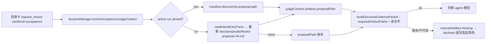

# 策划方案 P1.2：验收判断的提案物证路径修复（acceptance evidence proposal path）

- 日期：2026-11-01
- 角色：ANS 策划（Planning），独立上下文
- 状态：**草案 P1.2**（已处置完整复核 F1–F11 与 P1.1 窄复核 N1；待闸门 1 客户确认；未实施、未测试、未验收）。客户在闸门 1 确认的版本才是验收基线；实施需闸门 1 确认 + 闸门 2 角色指派确认 + 客户实施授权。
- 风险档位：**T2（建议）**；理由与升档触发条件见 §8。
- 闸门 0 依据：`docs/communication/2026-11-01_intent_acceptance-evidence-path.md`（53 行，SHA-256 `e97b978b7be485679d94568e96058f3f03096600fa63384b8683c313b21fe53e`；客户原话「记录这个验收物证路径 bug 并修复」）。
- 代码基线：worktree `flow-improvements-wave1` HEAD `eb77fadafc4df40594938798645da111665027c3`（已含 shell-escalation 合并）；本文行号均为该快照的只读核对结果，实施以符号名与文本锚点为准。
- 独立复核：`docs/planning/2026-11-01_review_acceptance-evidence-path.md`（完整复核 P1 + P1.1 受影响部分窄复核，结论「建议提交客户确认」，F1–F11 已闭合，N1 建议已在 P1.2 采纳；发现与作者处置见 §11）。复核不是批准，不是客户确认，也不是实施授权。
- 标记约定：**[现状]** 已核实代码/试跑行为；**[设计候选]** 本方案提议、未实施；**[待客户决定]** 见 §10。

---

## 1. 问题、根因与影响

### 1.1 [现状] 客户可见问题（闸门 0 + 试跑证据）

试跑项目 `C:\Users\51054\Desktop\work\trial-shell-escalation`（textkit CLI，六角色全流程，「替我审批」「替我决策」均开启）：

| 证据 | 事实 |
| --- | --- |
| `docs/quality/textkit-cli-report-v1.md` | 质检独立核对 AC-1..AC-5 全部通过（5/5）；如实报告验收卡被自动决策挡下、未送达客户。 |
| `.ans/state/tasks.jsonl` `req-ede39454bd1a30e5` | 2026-11-01T01:15:10.970Z `request.resolved`，`operatorId=judge:pi`，`choice=declined`，reason「自动决策未通过：规范物证缺失（物证不可读：docs/proposals/textkit-cli-v1.md；请按上述原因修正后重新提交）。」 |
| 同上 `req-ef57716bc74bf1d4` | 2026-11-01T01:15:29.883Z 重提，reason 与上一条逐字相同。 |
| `docs/proposals/` | 真实提案为 `docs/proposals/textkit-cli-proposal-v1.md`（存在、可读）；被指向的 `docs/proposals/textkit-cli-v1.md` 在两次失败时不存在。 |
| `.ans/runs/run-20261101-textkit-cli-87325f96/manifest.json` | run **pinned**；`documents.proposal.path = docs/proposals/textkit-cli-proposal-v1.md`，sha256 `a2bdbee2882d788947808743d7d2a6d1e053ed97035df907012b34d60d4ce185`。 |

后果：开着「替我决策」时，验收的正常成功路径是判断 agent 代批 `accept`，客户本来就不需要看到卡；本次缺陷让自动判断**无法完成并被退回发起角色**，验收流程无法完成，客户也无法作出验收决定。若关闭「替我决策」，判断 agent 不介入，验收卡直接呈现客户，缺陷不触发。闸门 0 记录中的「永远到不了客户」应按上述语义理解，不是要求客户必须看到卡。

### 1.2 [现状] 根因链（已核实到符号）

| # | 位置 | 行为 |
| --- | --- | --- |
| 1 | `app/desktop/session.ts` `enrichAcceptanceJudgeContext`（约 3733-3888 行；错误行约 3883） | 对验收卡固定写入 `artifacts.proposalPath = docs/proposals/${flowId}-v1.md`：既不查 pinned run 的 `documents.proposal.path`，也不扫提案版本；漏掉 `-proposal`。 |
| 2 | `app/desktop/customer-input.ts` `planJudge`（约 1049-1106 行） | 把 `judgeContext.artifacts` 原样放进 `GovernanceJudgeRequest.artifacts`。 |
| 3 | `src/common/编排/governance-judge-evidence.ts`（约 1072-1154 行） | `requiredArtifactPaths` 判定物证存在后，按 `artifacts.proposalPath` 读取（`:1101`）；读不到即 `artifact-missing`「物证不可读：<path>」（`:1143`）。 |
| 4 | `src/common/编排/governance-judge.ts`（约 324-339 行） | 证据包失败时不调用模型，直接 `manual`；判断链 fail-closed。 |
| 5 | `app/desktop/customer-input.ts` `settleJudgeOutcome`（约 1165 行起） | `manual` 结算为 `declined` 退回发起角色，reason 带「自动决策未通过」外包装；客户未见到卡，也不是客户拒绝。 |

第二处同错约定：`src/common/编排/governance-judge-facts.ts` `requiredArtifactPaths`（约 181 行）`expectedProposal = docs/proposals/${flowId}-v1.md`。它只在 app **未提供** `proposalPath` 时作为 `missingPaths` 文案使用（验收/提案卡缺失分支），不是本次试跑两次拒绝的直接触发点；但它是同一错误约定，会让缺证文案继续指向错误路径，必须同步对齐。

全仓既有约定均带 `-proposal`：`mechanical-rejection.ts:37/179`（文案示例为 `-proposal-v1.md`）、`run-manifest.ts:367/843`（`-proposal-vN.md` 正则）、`workflow-preconditions.ts:259/1006/1222`（正则/文案）、`governance-judge-prompt.ts:143`（`-proposal-v1.md` 示例）。因此「漏掉 `-proposal`」是本缺陷的独立错误，与 v1/vN 的文案示例差异是两回事。

### 1.3 [现状] 为什么现有测试没发现

- `test/编排/acceptance-judge-minimal.test.ts` 直接构造 `artifacts.proposalPath = docs/proposals/focus-proposal-v1.md`（正确路径），没有经过 session 的 `enrichAcceptanceJudgeContext`。
- `test/桌面应用/acceptance-evidence.test.ts` 覆盖 `evidence_check`（criteria/sidecar），不覆盖验收 judgeContext 的 proposal 物证。
- `test/桌面应用/run-pin.test.ts` 只断言 legacy 场景的 `judgeContext.facts.runState`，未断言 `artifacts.proposalPath`。
- 因此「app 派生路径」这一层完全没有测试；错误路径在真实试跑中才暴露。

### 1.4 [现状] 试跑项目后续变化：别名已掩盖缺陷

在两次失败之后，试跑项目新增了 `docs/proposals/textkit-cli-v1.md`（本地 mtime 2026-11-01 09:17:38 +0800；frontmatter `schema: project-proposal-entry/v1`、`entryOf: docs/proposals/textkit-cli-proposal-v1.md`，是方案入口/别名，不是方案正文）。试跑账本显示它由 chief 以 `task.created` 派发 rapporteur 创建（任务 `t-mvx540yf-22773fa3`，`stepId=proposal-entry`），属于治理侧绕过产品约定的变通；其授权状态由试跑治理方确认，本方案不判定为「未授权」。

随后第三次验收卡 `req-6dc353d878405acc` 于 2026-11-01T01:19:00.208Z 被 `judge:pi` 接受，`judge.evidence` 明确引用 `docs/proposals/textkit-cli-v1.md`。

**这直接削弱回归证明力**：在当前试跑项目上重发验收卡，**即使不修 bug 也会通过**（别名文件让旧硬编码路径可读）。因此本方案要求真实回归必须让别名在判断时不可用（§5.4 方法 A），不得仅凭一次 `accept` 判定修复有效；详见 AC-8。

### 1.5 影响

- **命中面**：开启「替我决策」的验收卡；提案文件不是 `<flowId>-v1.md` 命名的所有 flow（现状约定本应是 `-proposal-vN`，即几乎所有真实 flow）。
- **未命中面**：「替我决策」关闭时判断 agent 不介入，验收卡直接交客户，缺陷潜伏；交付质量与客户决定不受影响。
- **安全语义**：本次失败是 fail-closed 的正确表现，只是输入路径错误；修复不得放宽任何 fail-closed 条件。

---

## 2. 修复设计

### 2.1 选项比较

| 选项 | 做法 | 优点 | 缺陷 | 结论 |
| --- | --- | --- | --- | --- |
| (a) 静态修正 | 只把路径改成 `docs/proposals/${flowId}-proposal-v1.md` | 一行改完，能解试跑 v1 | 提案有 v2/v3 时读旧版或读不到；与闸门 0「最新版本 + run/manifest 优先」不符；同类缺陷会在 v2 复发 | 否决 |
| **(b) 推荐：pin 优先 + 最新版本解析** | pinned run 用 manifest 记录路径；否则解析最新 `-proposal-vN.md`；都没有则按缺失处理 | 与全仓约定一致；尊重 run 冻结；无提案时 fail-closed 且文案正确；复用既有解析能力 | 需一处 app 侧改动 + 一处文案对齐；需新增测试 | **推荐** |
| (c) 永远取最新 | 忽略 pinned manifest，总扫最新版 | 实现简单 | 会让验收 judge 使用 pin 之后的新提案，违反冻结语义；pin 的 sha 不再有意义 | 否决 |
| (d) 让发起角色在卡里传路径 | 卡片/工具参数携带 proposalPath | 不改 app | 依赖模型/角色自报，可伪造/可漏，无法机械保证；不能修复自动决策链路 | 否决 |

### 2.2 推荐规则（b）

在 `enrichAcceptanceJudgeContext` 内按以下优先级计算 `proposalRel`：

1. **run 已 pin**：`pinnedRun.documents.proposal.path`（trim 后非空）为唯一路径；即使磁盘上出现更新的 `-proposal-vN.md`，也不替换（验收判断对应冻结契约）。pinned 但 `documents.proposal` 为 null/缺失/空串 ⇒ 视为缺失，**不回退**到最新扫描。
2. **无 pinned run（draft 或无 run）**：复用既有共享解析能力 `readIntentEntryFacts`（`src/common/shared/intent-entry-contract.ts` 的 `latestVersioned`，约 183-206 行）取 `docs/proposals/<flowId>-proposal-vN.md` 中**数字版本最大**的一个；`<flowId>-v1.md` 或其它别名不匹配、不会被选中。
3. **解析不到提案**：`proposalPath` 置为 `undefined`（覆盖任何继承的旧值），不编造路径；由机械门槛报告缺失。
4. **pinned 路径不可读**：保留 pinned 路径交给证据包读取，得到精确的「物证不可读：<pinned path>」并 fail-closed；不回退到最新/别名。
5. **active run 查询失败（多 pin/读失败）**：保持既有 intent/report 事实的处理口径，按无 pin 处理并走最新解析；这是既有行为，本修复不改变（风险见 R6）。

### 2.3 分支行为表

| 场景 | 选择的 proposalPath | 判断结果 |
| --- | --- | --- |
| run pinned；提案 v1、磁盘另有 v2/v3 | manifest 的 v1（pinned） | 证据包读 v1；批准/拒绝按冻结契约判断 |
| run pinned；manifest 无 proposal（null/缺失/空串） | 缺失（不扫描） | `manual/artifact-missing`，文案指向约定路径；不猜 |
| 无 pinned；提案 v1、v2、v3 | v3（数字最大） | 证据包读 v3 |
| 无 pinned；只有 `<flowId>-v1.md` 别名，无 `-proposal-vN` | 缺失 | `manual/artifact-missing`；不使用别名 |
| 无 pinned；无任何提案 | 缺失 | `manual/artifact-missing`；客户卡不呈现 |
| pinned 路径文件被删除/不可读 | pinned 路径 | `manual/artifact-missing`「物证不可读：<pinned path>」；不回退 |

### 2.4 fail-closed 缺证文案

- 无提案（`proposalPath` 缺失）时，`requiredArtifactPaths` 的 `missingPaths` 为 `docs/proposals/<flowId>-proposal-v1.md`（flowId 缺失时退化为「提案」）。证据包问题文案：
  `规范物证缺失：docs/proposals/<flowId>-proposal-v1.md（判断无法核对）`；
  经 `chooseReason` 追加「请按上述原因修正后重新提交」，再由桌面加「自动决策未通过：…本次自动判断未通过/未完成，已拒绝」外包装。
- pinned 路径不可读时：`物证不可读：<pinned path>`。
- 两种都保持 `manual/artifact-missing`，**不得**转为 approve 或交客户手选（除非客户关闭「替我决策」）。

### 2.5 单一来源与复用

- **本次不新增第二份版本解析实现**：`src/common/shared/intent-entry-contract.ts` 的 `latestVersioned(...)` 是共享层既有的版本解析实现，公开出口 `readIntentEntryFacts` 已由 `session.ts` 导入（约 129 行）并用于 §5A `contract_check`（约 7153 行）。本次直接调用 `readIntentEntryFacts({ projectRoot, flowId }).proposalPath`，不新增 readdir/regex/版本比较代码。
- 必须如实说明：该实现**不是全仓唯一**——`run-manifest.ts:360-368`、`workflow-preconditions.ts:1004-1008`、`session.ts chainDispatchFacts`（约 5941-5959 行）各有既有私有扫描。本次不统一这些既有实现（非目标），但也不新增第二份；「单一来源」是本次的设计原则与任务约束，不是闸门 0 原文要求。
- 不选 `run-manifest.ts` 的私有 `latestVersioned`：它是 pin 内部同步实现，导出会形成第二套公开 API；`readIntentEntryFacts` 已暴露同一能力。
- 若实施发现 `readIntentEntryFacts` 不适用，唯一可接受的替代是从同一 `intent-entry-contract.ts` 导出既有 `latestVersioned`（同一实现、单一来源）并在写集中列明；不得在 `session.ts` 新写扫描。

### 2.6 兼容性、假设与披露

- **intentId 假设（复核 F5）**：本修复只冻结验收判断的 **proposal 物证路径**。`judgeContext.intentId` 仍由 `run-role.ts`（约 1146-1156 行）在不带 pinned 路径的情况下用 `readIntentEntryFacts` 从最新提案/产品意图解析。假设同一 flow 的提案修订保持 intentId 稳定（既有意图变更规则要求意图变化走需求变更/重开流程）；若最新提案改变 intentId，证据包会因意图冲突 fail-closed，**不会误 approve**。该解析不在本修复范围，§10 要求客户知悉；若要冻结 pinned intentId，属于新的需求（需改 `run-role.ts`、更新写集/风险档位）。
- **仅 `<flowId>-v1.md` 的历史项目（复核 F10）**：修复后，无 pin 且只有 `<flowId>-v1.md`、没有 `-proposal-vN.md` 的项目将从「旧代码可能读到该文件」变为「缺失 fail-closed」。这符合闸门 0「不回退到错误约定」；若存在受影响项目，需要另行迁移/别名需求，不在本方案承诺。
- **report/intent 的静态 v1 回落（R5）**：`reportRel = docs/quality/<flowId>-report-v1.md`、未 pin 时 `intentRel = docs/product/<flowId>-intent-v1.md` 仍为静态约定；同类但不同物证，不在本修复范围。

---

## 3. 精确改法

### 3.1 `app/desktop/session.ts`（根因）

`enrichAcceptanceJudgeContext` 内，`pinnedRun` 已在该函数约 3740-3741 行计算。增加：

```ts
const pinnedProposalPath = pinnedRun?.documents.proposal?.path?.trim();
const proposalRel =
  pinnedRun !== undefined
    ? (pinnedProposalPath !== undefined && pinnedProposalPath !== "" ? pinnedProposalPath : undefined)
    : (await readIntentEntryFacts({ projectRoot, flowId })).proposalPath;
```

把现有 artifacts 构造（约 3881-3885 行）：

```ts
artifacts: {
  ...(baseContext?.artifacts ?? {}),
  proposalPath: `docs/proposals/${flowId}-v1.md`,
  acceptanceReportPath: reportRel,
},
```

改为：

```ts
artifacts: {
  ...(baseContext?.artifacts ?? {}),
  proposalPath: proposalRel,
  acceptanceReportPath: reportRel,
},
```

- `proposalPath: proposalRel` 必须**显式覆盖** `baseContext?.artifacts` 里可能继承的旧值；`proposalRel === undefined` 时 `requiredArtifactPaths` 的 `pick` 视为缺失，不得保留旧值。
- `readIntentEntryFacts` 已在 `session.ts` 导入，无需新增 import；不新增 IO 模块、不加缓存、不改报表路径。
- 不改变 `intentRel`/`reportRel` 的现有逻辑（见 §9 非目标与 R5）。

### 3.2 `src/common/编排/governance-judge-facts.ts`（文案对齐）

`requiredArtifactPaths` 约 181 行：

```ts
const expectedProposal = flowId !== undefined ? `docs/proposals/${flowId}-proposal-v1.md` : "提案";
```

同步更新该函数上方注释（约 156-167 行）说明：本函数不扫盘；实际版本路径由 app 传入，`expectedProposal` 只是 flowId 存在时的约定缺失文案，与 `mechanical-rejection`/`workflow-preconditions`/`governance-judge-prompt` 同一命名（这些位置有的用 v1 示例、有的用 vN 正则）。`expectedQualityReport` 不变。

### 3.3 两处的关系与不变量

- **根因是 session.ts**：它把错误路径作为实际物证交给证据包读取，直接导致试跑拒绝。facts.ts 只影响「app 没给路径」时的缺失文案，是**文案对齐**，不是根因。
- 两处都不负责版本扫描的「第二实现」：版本选择只在共享 `latestVersioned`/`readIntentEntryFacts` 中。
- 契约形状不变：`GovernanceJudgeContext.artifacts` / `GovernanceJudgeRequest.artifacts` 不新增字段、不改类型；不改变判断规则、fail-closed、代批口径、卡片选项。
- 不写目标项目：只读 `docs/proposals` 与 `.ans/runs`，不创建/修改任何目标文件（别名文件也不由本产品代码创建或删除）。

---

## 4. 架构设计与共有契约

### 4.1 调用与数据流



### 4.2 模块职责与共有契约

| 模块 | 唯一职责 | 边界 |
| --- | --- | --- |
| 桌面窗口 `app/desktop/session.ts` | 从 pinned run/目录事实派生验收 judgeContext 的物证路径 | 不判断、不读全文、不写目标项目 |
| 编排共享 `src/common/编排/governance-judge-facts.ts` | 纯函数：给出缺失物证约定文案与必读集合 | 不扫盘、不做版本选择 |
| 编排 `governance-judge-evidence.ts` / `governance-judge.ts` | 读取物证、建证据包、fail-closed 判断 | 不猜路径、不因缺失而 approve |
| 共享 `src/common/shared/intent-entry-contract.ts` | 版本化文档最新版本解析的既有实现之一（本次复用的公开入口） | 只读，不写 |

**共有契约（不新增字段，只明确取值语义）**：

- 提供方：桌面窗口（app）在验收 judgeContext 中提供 `artifacts.proposalPath`。
- 消费方：编排证据包/判断链按该路径读取提案；`requiredArtifactPaths` 在缺失时给出约定文案。
- 行为保证：pinned run 的 `documents.proposal.path` 优先；无 pin 时取 `<flowId>-proposal-vN.md` 数字最大版本；无提案或路径不可读 => `manual/artifact-missing`，绝不 approve。
- 版本与变更：本次不改变字段形状与判断规则，只修正已存在字段的取值来源；属缺陷修复，不是新契约。

### 4.3 复用与权衡

- 复用 `readIntentEntryFacts` 避免第二份版本解析；代价是一次额外只读（产品意图/提案/意图入口），对一次验收卡可忽略。
- 不在 `session.ts` 直接 `readdir`：虽然代码量小，但会形成又一份版本解析实现，违反本任务的「禁止第二份实现」约束。
- 不用 roster 的 `proposal` 引用代替最新扫描：闸门 0 明确要求「真实存在的最新提案」；roster 引用可能落后于最新提案（且 pin 场景已由 manifest 覆盖）。

### 4.4 验证要点

- pinned 优先且不被更新版本覆盖；pinned 缺失不回退。
- 无 pin 时数字最大版本；别名 `<flowId>-v1.md` 不参与。
- 无提案 => 缺失文案正确、绝不 approve。
- 既有正确路径断言不变、不被弱化。

---

## 5. 测试计划

### 5.1 新增/更新测试文件与断言

| 文件 | 类型 | 断言 |
| --- | --- | --- |
| `test/桌面应用/acceptance-proposal-path.test.ts` | 新增（session 集成，自包含最小夹具） | T1 pinned：manifest 钉 v2、磁盘另有 v3 => 捕获的 `judgeContext.artifacts.proposalPath === docs/proposals/<flowId>-proposal-v2.md`；**T1b** pinned 但 manifest 无 proposal（null/缺失/空串三种变体）=> `proposalPath === undefined`，且不调用最新扫描（fixture 同时放 v2/v3 与别名）；T2 无 pin：v1/v2/v3 存在 => 取 v3，且不等于 `<flowId>-v1.md`；**T2b** 无 pin 且只有 `<flowId>-v1.md` => `proposalPath === undefined`；T3 无提案 => `proposalPath === undefined`，继承的旧路径被覆盖（metadata 预置旧 proposalPath），并把捕获结果拼成 `GovernanceJudgeRequest` 调 `buildDecisionEvidencePacket`，断言 `ok=false`、`reasonCode=artifact-missing`、reason 含 `docs/proposals/<flowId>-proposal-v1.md` 且不含 `docs/proposals/<flowId>-v1.md`；T4 试跑形状：pinned 真实 proposal + `<flowId>-v1.md` 别名 => 取真实 proposal，证据包 `evidence` 含真实路径且不含别名；T5 pinned 路径不可读（pin 后删除文件）=> 证据包 `artifact-missing` 且 detail 为「物证不可读：<pinned path>」，不回退 v2/别名。 |
| `test/编排/governance-judge-facts.test.ts` | 新增（纯函数） | `requiredArtifactPaths` 对 acceptance/proposal 卡缺 proposal 时 `missingPaths` 恰为 `docs/proposals/focus-proposal-v1.md`；flowId 缺失时为「提案」；任何结果都不含 `docs/proposals/focus-v1.md`。 |
| `test/编排/acceptance-judge-minimal.test.ts` | 更新 | 在既有「物证缺失/未读 => manual」用例上增加：缺 proposal 时 `reason` 含 `docs/proposals/focus-proposal-v1.md`，不含 `focus-v1.md`；既有断言保持原样。 |

测试夹具策略（复核 F9）：

- 新 session 测试**自包含最小夹具**：只写 `docs/product/focus-intent-v1.md`、`docs/intents/<intentId>.md`（证据包意图基准）、`docs/proposals/*`、`docs/quality/focus-report-v1.md` 和最简项目 listing；pinned manifest 用 `writeRunManifest` 直接写一个合法的最小 pinned manifest（`schema: ans-run/v1`、`state: pinned`、`documents.proposal.path`），不复制 `run-pin.test.ts` 的大段 roster/modules 夹具。
- 不抽取新的共享测试 helper（避免扩大写集）；`run-pin.test.ts`、`acceptance-evidence.test.ts` 保持不动。若实施阶段确需共享 helper，必须先更新 §7 写集与归属并重新评估风险档位。
- T1/T2 的 fixture 同时放入 `docs/proposals/<flowId>-v1.md`（别名）和 `-proposal-vN.md`，确保测试能区分旧约定与正确约定。
- T5 在 pin 后删除 proposal 文件，确保错误不是被最新扫描掩盖。
- T5 的「不调用模型」由既有 `governance-judge.ts:324-339` 控制流保证（证据包失败先于 adapter/模型创建），本修复不改变该路径；T5 断言证据包失败，AC-6 的证据来源据此限定，不新增模型 spy。

### 5.2 现有测试不改弱

- `test/桌面应用/acceptance-evidence.test.ts`、`test/桌面应用/run-pin.test.ts`、`test/编排/decision-evidence-packet.test.ts`、`test/编排/workflow-preconditions.test.ts` 的既有路径/字段断言保持原样；只新增断言，不删除、不放宽。
- `test/编排/decision-evidence-packet.test.ts` 的 fixture 是**显式传入** `artifacts.proposalPath` 的历史路径（`docs/proposals/flow-a-v1.md`），不经过本次派生逻辑，保持不动；不在本修复中批量改 fixture 命名（避免扩大写集）。
- 若任何既有测试因路径文案变化失败，逐条核对是否属于「旧错误约定断言」；只有确认错误约定本身时才允许更新，并在实现记录中列出。

### 5.3 命令与证据

- 类型检查：`npm run typecheck`（退出码 0）。
- 受影响测试：

```bash
node --test --test-concurrency=1 \
  "test/桌面应用/acceptance-proposal-path.test.ts" \
  "test/桌面应用/acceptance-evidence.test.ts" \
  "test/桌面应用/run-pin.test.ts" \
  "test/编排/acceptance-judge-minimal.test.ts" \
  "test/编排/governance-judge-facts.test.ts" \
  "test/编排/decision-evidence-packet.test.ts" \
  "test/编排/workflow-preconditions.test.ts"
```

- 因改动触及 `app/desktop/session.ts` 与 `src/common/编排`，建议追加 `test/桌面应用/**`、`test/编排/**` 或 CI 同款全量命令作为补充证据；不把 T2 受影响证据虚报为全量回归。
- 证据记录：命令、候选提交/工作树、退出码、测试总数/pass/fail、关键用例名、改动文件 sha256；不得只写「测试通过」。

### 5.4 试跑项目真实回归（必须，且要有区分力）

前置：修复后的候选版本；试跑项目 run 仍为 `run-20261101-textkit-cli-87325f96`（pinned）；「替我审批/替我决策」开启；与试跑相同的 runtime。

- **方法 A（推荐；AC-8 判 pass 的唯一充分方法，需试跑项目所有者/客户授权）**：把变通别名 `docs/proposals/textkit-cli-v1.md` 临时移出 `docs/proposals`（移到不参与扫描的目录），记录移出前 sha256；重新发起验收卡；预期 `request.resolved` 为 `by=judge`、`choice=accept`、`judge.reasonCode=sufficient`，`judge.evidence` 含 `docs/proposals/textkit-cli-proposal-v1.md` 且不含别名；无「物证不可读」。验证后按原字节还原别名并复核 sha256。**若不做这一步，别名存在时旧代码也会通过，不能证明修复。**
- **方法 B（仅补充，不能单独判 AC-8 pass）**：在真实试跑项目上重发验收卡并保留只读证据：从同一 pinned manifest 生成 `GovernanceJudgeRequest`，调用修复后的 `buildDecisionEvidencePacket`，记录 `evidence` 中 proposal 的 `path` 与 sha256 必须为 `docs/proposals/textkit-cli-proposal-v1.md`/`a2bdbee2…`；并记录真实 `request.resolved` 的 `judge.evidence`。方法 B 只证明证据包能读 pinned 路径，**不经过 `enrichAcceptanceJudgeContext`**；真实 `judge.evidence` 是模型自述，可能被别名误导，故不能单独证明 app 派生逻辑已修复。
- **未获方法 A 授权时**：AC-8 记 `insufficient evidence`，不得判 pass；沟通在闸门 1 材料中披露该缺口，由客户决定是否授权方法 A 或接受该风险。
- **禁止**：关闭「替我决策」后由客户手批、或把 `accept` 结果单独当作修复证据；这两种都不能证明判断链读到了正确提案。不定义/不使用未说明的「受控副本」作为替代证据；若未来需要副本对照，必须另行定义位置、授权、证据保留与写集，且仍不能替代方法 A。

---

## 6. 可核对验收标准（AC）

| 编号 | 标准（可核对） | 证据 |
| --- | --- | --- |
| AC-1 | pinned run：`judgeContext.artifacts.proposalPath` 恰为 manifest `documents.proposal.path`；磁盘更新版本不覆盖；pinned 无 proposal（null/缺失/空串）时不回退最新扫描 | T1/T1b 测试断言 + 输出 |
| AC-2 | 无 pin：取 `docs/proposals/<flowId>-proposal-vN.md` 的数字最大版本；不取 `<flowId>-v1.md` 别名或其他命名；无 pin 仅别名时缺失 | T2/T2b 测试断言 + 输出 |
| AC-3 | 无提案：`proposalPath` 为 `undefined`（继承旧值被覆盖）；证据包 `ok=false`、`reasonCode=artifact-missing`，reason 含 `docs/proposals/<flowId>-proposal-v1.md`，不含 `docs/proposals/<flowId>-v1.md` | T3 测试（含 `buildDecisionEvidencePacket` 断言）+ facts 测试断言 + reason 原文 |
| AC-4 | `requiredArtifactPaths` 对 acceptance/proposal 卡缺 proposal 时 `missingPaths` 使用 `docs/proposals/<flowId>-proposal-v1.md`；flowId 缺失时为「提案」 | facts 测试断言 |
| AC-5 | 试跑形状（pinned 真实 proposal + `<flowId>-v1.md` 别名）：证据包提交 proposal 的真实路径与 sha256；别名不进入 `evidence` | T4 测试断言 + 证据包输出 |
| AC-6 | pinned 路径不可读：`manual/artifact-missing`，detail 为「物证不可读：<pinned path>」；不回退最新/别名。证据包失败即进入既有 model-call gate（`governance-judge.ts:324-339`，本修复未改该控制流；T5 断言证据包失败） | T5 测试断言 + 既有控制流代码基线 |
| AC-7 | 无回归：`npm run typecheck` 退出码 0；§5.3 受影响测试全部 pass；既有路径断言未删除/未放宽；改动仅限写集 | 命令输出、diff、候选 sha256 |
| AC-8 | 真实试跑回归：按 §5.4 **方法 A** 重发验收卡，判断 agent 接受且证据指向 `docs/proposals/textkit-cli-proposal-v1.md`，无「物证不可读」；验收流程未被错误的自动决策拦截（judge 代批 accept 或按客户选择完成；客户本来不需要看到卡）。方法 B 只能作为补充，不能单独判 pass；未获方法 A 授权时 AC-8 为 insufficient evidence | `tasks.jsonl` 新 `request.resolved` 摘录、请求 id/时间、judge.evidence、别名移出/还原 sha256、试跑项目与候选版本信息 |

判断规则：AC-1..AC-7 全 pass 且 AC-8 按方法 A pass，才算修复完成；任何一项 insufficient evidence 不得判 pass。

---

## 7. 写集与角色（预计）

| 文件 | 归属角色 | 改动 |
| --- | --- | --- |
| `app/desktop/session.ts` | 桌面窗口（app/desktop） | 根因修复：pinned/manifest 优先 + 共享最新版本解析 + 缺失不编造 |
| `src/common/编排/governance-judge-facts.ts` | 编排（orchestration） | `expectedProposal` 约定文案对齐 |
| `test/桌面应用/acceptance-proposal-path.test.ts` | 测试 | 新增 session 集成测试（自包含最小夹具） |
| `test/编排/governance-judge-facts.test.ts` | 测试 | 新增 facts 单测 |
| `test/编排/acceptance-judge-minimal.test.ts` | 测试 | 更新缺失文案断言 |

- **不需要修改**共享助手：直接复用 `readIntentEntryFacts`。若实施确需导出 `latestVersioned`，唯一允许的文件是 `src/common/shared/intent-entry-contract.ts`（共享层，归属运行时核心/编排共享），并必须把该文件加入团队计划与写集；不得在 `session.ts` 另写版本扫描。
- 测试夹具自包含在 `test/桌面应用/acceptance-proposal-path.test.ts` 内，不抽共享 helper；如实施阶段确需抽取，先更新本写集与风险档位。
- 不在写集：`docs/planning/`（策划只写自己的方案）、`docs/communication/`、角色卡、试跑项目文件（§5.4 方法 A 的别名临时移出/还原是经客户授权的**验证步骤**，不属于产品写集）、任何发布/版本文件。
- 本方案不授权实施；实施需闸门 1/2 与客户实施授权。

---

## 8. 风险档位与回滚

### 8.1 风险档位建议：T2

依据 `references/testing.md`：本变更跨 `app/desktop` 与 `src/common/编排`、修改判断链的事实/契约取值并需跨模块集成验证，属 **T2（跨角色/接口/契约/集成或共享代码）**。不升 T3 的理由：不改变判断规则、approve/deny/manual 条件、代批或权限语义；不新增/改变共有契约字段；不新增共享抽象或发布面；fail-closed 保持不变。若实施中出现以下情况，立即停止并重开闸门/升 T3：改变判断条件或代批权限、引入可在缺失物证时 approve 的兜底、修改 `runtime.ts` 的契约形状、或需要新增公共导出。

### 8.2 风险与未决事项

| 编号 | 风险/未决 | 处置 |
| --- | --- | --- |
| R1 | 试跑项目已有别名 `textkit-cli-v1.md`，会让未修复代码也通过 | §5.4 方法 A 区分；AC-8 不接受仅 accept 或仅方法 B |
| R2 | pinned 路径不可读/文件被删 | fail-closed「物证不可读」；不回退 |
| R3 | 判定与读取之间提案被改写 | 证据包记录 sha256/bytes，判断按包内快照；既有机制，不在本次扩大 |
| R4 | `readIntentEntryFacts` 额外只读与 intent 解析失败 | 只取 `proposalPath`，不把 intentResolutionError 带入 judgeContext；只读无副作用 |
| R5 | 同类静态约定仍在：`intentRel` 的 v1 回落、`reportRel` 的 `-report-v1`、report/intent 版本化 | 本次非目标；不影响本修复；如需处理另开需求（见 §9） |
| R6 | `findActiveRun` 多 pin/读失败时仍按无 pin 走最新 | 既有行为，本修复不改变；该状态本身属 run 完整性问题，另行处理 |
| R7 | 既有 `chainDispatchFacts`/workflow 的版本扫描未统一 | 先前存在；本次不新增；未来统一另开重构需求 |
| R8 | 试跑别名是治理侧绕过产品约定的变通产物（chief 派 rapporteur 创建），长期保留可能掩盖回归 | 授权状态由试跑治理方确认；修复验证后建议归档/移除；由试跑治理方决定，不在本产品写集 |
| R9 | 无 pin 且只有 `<flowId>-v1.md` 的历史项目在修复后转为 fail-closed | 符合闸门 0「不回退到错误约定」；§10 披露；如需兼容另开迁移/别名需求 |
| R10 | pinned 分支只冻结 proposal 物证路径；`judgeContext.intentId` 仍由 `run-role.ts` 从最新提案/产品意图解析 | 假设提案修订保持 intentId 稳定（既有意图变更流程）；若最新提案改变 intentId，意图证据链 fail-closed，不误 approve；若需冻结 pinned intentId，另开需求并更新写集/风险档位 |

### 8.3 回滚

- 回滚 = 还原上述源码与测试改动；无数据迁移、无持久化格式变化、无 schema/API 变更。
- 回滚后验收卡会回到旧的错误路径行为（缺陷复现），但不会产生错误批准或数据损坏；客户仍可用「替我决策」关闭作为临时兜底。
- 不涉及试跑项目既有文件（除 §5.4 方法 A 经授权的别名临时移出/还原，验证记录中保留还原哈希）。

---

## 9. 非目标

**沿用闸门 0 记录：**

- 不改变验收卡的判断规则、fail-closed 语义、代批口径（「替我决策/替我审批」语义不变）。
- 不改动产品意图/方案/名单/架构的命名与版本化规则；不做与提案路径无关的重构。
- 不处理试跑报告中的 O1（双 BOM）/O2（`wc <file> -h`）。

**本方案补充边界：**

- 不修 `intentRel`/`reportRel` 的静态 v1 回落，也不冻结 pinned `judgeContext.intentId`（同类但不同物证/事实；如需处理另开需求，见 R5/R10）。
- 不修 proposal 卡自身的 artifacts 接线（本次只修验收判断的 proposal 物证路径；proposal 卡是独立链路）。
- **产品代码不创建/修改/删除试跑项目的别名文件**；§5.4 方法 A 的临时移出/还原是经客户/试跑所有者授权的**验证步骤**，不属于产品写集，也不改变产品对别名的处理规则。
- 不新增 judgeContext 字段、不改 `GovernanceJudgeRequest`/`GovernanceJudgeContext` 类型、不改判断提示词。
- 不 commit/push/发布；不启动应用（真实回归属于实施后验证，需另行授权）。

---

## 10. 闸门 1 需客户确认的点

1. **设计选择**：确认 §2.2 的优先级（pinned manifest 路径 > 最新 `<flowId>-proposal-vN.md` > 缺失），以及 §2.4 的 fail-closed 文案；确认否决静态 `-proposal-v1`、永远最新、角色自报三种备选。
2. **风险档位**：确认按 **T2** 实施与验收（跨模块 bug 修复，不改判断规则/权限）；如客户认为判断链属治理变更要求 T3，按 T3 重定验收范围。
3. **真实回归方法**：试跑项目现在存在别名 `docs/proposals/textkit-cli-v1.md`，不移动它无法区分「修复生效」与「别名兜底」。请确认是否授权 §5.4 方法 A 的临时移出/还原（并记录 sha256）；未授权时 AC-8 记 insufficient evidence，不得以方法 B 或单独一次 accept 判 pass。
4. **写集**：确认 §7 的五个文件（两处源码 + 三个测试）与「不新增共享助手」；若实施确需导出 `latestVersioned`，需另行批准 `src/common/shared/intent-entry-contract.ts` 并更新团队计划。
5. **非目标**：确认 §9 不包含 intent/report 路径的同类修复、pinned intentId 冻结、proposal 卡 artifacts 接线、O1/O2 与别名清理；这些不阻塞本次修复，但不被本方案承诺。
6. **兼容性披露**：确认 R9——无 pin 且只有 `<flowId>-v1.md` 的历史项目在修复后会 fail-closed；如存在此类项目并需要兼容，另行安排迁移/别名需求。
7. **intentId 假设披露**：确认 R10——本修复只冻结 proposal 物证路径；`judgeContext.intentId` 仍按既有 `run-role.ts` 从最新提案/产品意图解析，假设 intentId 跨提案修订稳定；若最新提案改变 intentId，会 fail-closed 而非误 approve。是否要求一并冻结 pinned intentId，请客户决定（属新需求）。
8. **别名处置**：试跑项目中的 `docs/proposals/textkit-cli-v1.md` 是治理侧变通产物；修复验证后是否由试跑项目治理方归档/移除，请客户知悉并决定（本产品不改试跑文件）。

---

## 11. 复核处置

- 独立复核记录：`docs/planning/2026-11-01_review_acceptance-evidence-path.md`（完整复核 P1 + P1.1 受影响部分窄复核 + P1.2 确认；由同一策划角色的独立只读上下文产出，作者不改复核记录；最终行数与 SHA-256 以复核记录及交付报告为准）。
- 窄复核结论：**建议提交客户确认**；F1–F4 已闭合，F5–F11 处置/披露可接受，N1（AC-8 措辞统一）为建议级、已在 P1.2 采纳。结论与未解决意见以复核记录为准，并在闸门 1 材料中如实披露。
- 复核不是客户确认，也不是实施授权。

| 发现编号 | 处置 | 理由 | 改动位置或版本 |
| --- | --- | --- | --- |
| F1（重要） | 采纳 | AC-8 只以方法 A 为充分证据；方法 B 降为补充且明确不经过 `enrichAcceptanceJudgeContext`，不再允许单独判 pass | §5.4、AC-8 |
| F2 | 采纳 | T3 增加 `buildDecisionEvidencePacket` 直接断言（ok/reasonCode/reason 原文），AC-3 证据来源明确 | §5.1 T3、AC-3 |
| F3 | 采纳 | 增加 T1b（pinned 无 proposal 三种变体）与 T2b（无 pin 仅别名）负例，均断言 `proposalPath === undefined` 且不调用最新扫描/别名 | §5.1、AC-1/AC-2 |
| F4 | 采纳 | §9 与 §5.4/§7 对齐：产品代码不碰别名；方法 A 的临时移出/还原是经授权的验证步骤，不属于产品写集 | §9、§7 |
| F5 | 部分采纳 | 不扩大写集改 `run-role.ts`；在 §2.6/R10/§10 明确 intentId 稳定假设与 fail-closed 行为；冻结 pinned intentId 作为新需求由客户决定 | §2.6、R10、§10 第 7 项 |
| F6 | 采纳 | 校正「全仓唯一」与 `-proposal-vN` 表述：既有约定均带 `-proposal`，部分文案用 v1 示例；共享实现不是全仓唯一，本次只是不新增第二份；删除对闸门 0 的「单一来源」过度归因 | §1.2、§2.5、§4.2/§4.3 |
| F7 | 采纳 | 成功语义改为「judge 代批 accept / 验收流程完成」，不再把「客户看到卡」当成功标准；R8 改为治理侧变通产物，授权状态由试跑治理方确认 | §1.1、§1.4、R8 |
| F8 | 采纳 | 删除未定义的「受控副本」；方法 B 仅补充，未获方法 A 授权时 AC-8 记 insufficient evidence | §5.4、AC-8 |
| F9 | 采纳 | 明确新测试文件使用自包含最小夹具（`writeRunManifest` 写最小 pinned manifest），不抽共享 helper、不改 `run-pin.test.ts`；如需抽取先更新写集 | §5.1、§7 |
| F10 | 采纳 | 增加 R9 与 §10 第 6 项：无 pin 且仅 `<flowId>-v1.md` 的历史项目修复后 fail-closed；如需兼容另开迁移/别名需求 | R9、§10 第 6 项 |
| F11 | 采纳 | AC-6 证据限定为 T5 证据包失败 + 既有 `governance-judge.ts:324-339` 控制流（本修复未改），不新增模型 spy | AC-6、§5.1 T5 |
| N1（窄复核建议） | 采纳 | AC-8 改为「验收流程未被错误的自动决策拦截（judge 代批 accept 或按客户选择完成；客户本来不需要看到卡）」，与 §1.1 成功语义一致 | AC-8、P1.2 |
