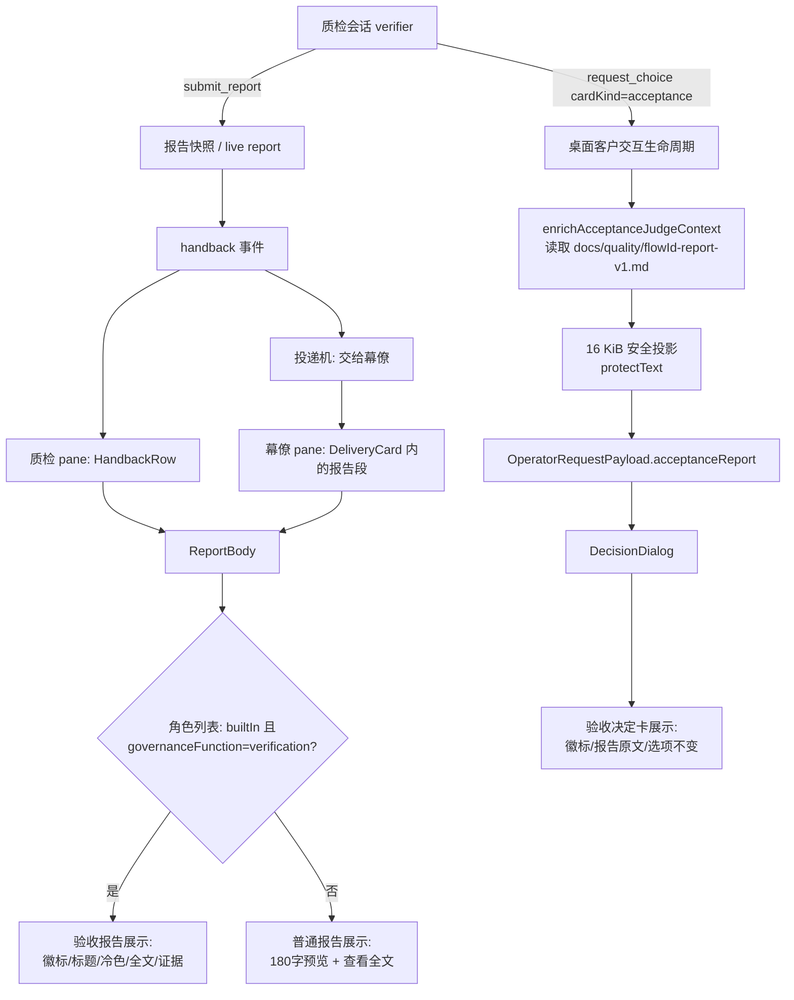

# 策划方案 P1.2：验收结果返回幕僚的卡片特殊显示 + 原文直出

- 日期：2026-11-02
- 角色：ANS 策划（Planning），独立上下文
- 状态：**草案 P1.2**（P1.1 窄复核结论「建议提交客户确认」、F1–F12 关闭；P1.2 仅按窄复核 N1–N4 做**文档/口径更正**，不改已确认语义；待闸门 1；未实施、未测试、未 commit/push）。闸门 1 未确认；实施授权未给。客户在闸门 1 确认的版本才是实施方案与验收基线；实施还需闸门 2 角色指派确认与客户实施授权。
- 风险档位：**T2（建议，不变）**。理由：跨渲染层、桌面 Interface 与共享 i18n 的展示/载荷变更；不改变验收判定、验收卡选项/路由、报告持久化与声明语义、写权/边界。若实施改为修改共享 Model、报告快照/声明契约、新增公共导出或验收路由，升为 T3（见 §8.1）。
- 闸门 0 依据：`docs/communication/2026-11-02_intent_acceptance-return-card.md`（68 行；SHA-256 `54f44bbbc66926a106140460413130360334385d51882d3101384b7d9b668aa4`）。客户已确认：**Q1 两者都要**（verifier 验收报告返回幕僚的报告卡 + 客户侧验收决定卡）；**Q2 徽标 + 全文 + 证据**（加「独立验收」徽标/标题与不同配色/边框，`report.summary.text` 原文直接渲染，全部 `evidence` 一并展示，验收卡不再使用 180 字/4 行预览 + 折叠）。
- 复核记录（同一文件，当前 **143 行 / SHA-256 `6f8f8121ba73f95b2f816e4d7a462912b1d7e6698249ecd958e10a79fc54772f`**；`docs/planning/2026-11-02_review_acceptance-return-card.md`）：
  - **P1.0 复核快照：103 行 / SHA-256 `5e423152f16202cf43e414d4e84ad71be66c98aa4f07f6ca0a77c78e67bcf03e`**（复核对象 P1.0 778 行 / `fd9571b4…`；结论「建议修订后提交」；F1–F12）。
  - **P1.1 再复核记录：当前 143 行 / `6f8f8121…` 的 §101–§143**（复核对象 P1.1 855 行 / `59cd7ea0…`；结论「建议提交客户确认」；F1–F12 关闭；N1–N4）。
  - 本 P1.2 仅文档/口径更正；复核记录由复核上下文维护，本文不修改它。复核不是批准、不是客户确认、不是实施授权。
- 代码基线：worktree `flow-improvements-wave1`，分支 `feat/flow-improvements-wave1`，HEAD `5a35908ce70a0f007e22808bbc3b6f9378f0c7c9`（PR #31 merge 后）。相对本文行号的读取快照 `93a8b93`，`93a8b93..5a35908` 只改了 `docs/communication/**` 四个文件，产品代码一致；因此 §13 的行号在 HEAD 上仍成立（实施仍以符号名与文本锚点为准）。任务起始点 `019e05d` 之后，其他会话的沟通记录提交与 PR #31 merge 已前进，但未改动本方案引用的展示/验收代码。
- 标记约定：**[现状]** 已只读核实的代码/测试行为；**[设计候选]** 本方案提议、未实施；**[待客户确认]** 见 §11。

**版本记录**

| 版本 | 日期 | 变更摘要 | 状态 |
| --- | --- | --- | --- |
| P1.0 | 2026-11-02 | 初稿：产品方案、数据来源与识别、架构/实现、共享契约、兼容迁移、选装、AC、测试计划与 Q1–Q5 | 已复核（F1–F12，结论「建议修订后提交」） |
| P1.1 | 2026-11-02 | 处置 F1–F12：内置质检识别并入必做并重排选装；披露与已取消 full-report-display P1.3 的重叠；显式写明「所有内置质检报告按验收展示」的已接受限制；补 SessionManager 级测试映射、交付批/决定卡危险色优先、Q4 确认状态、preview 默认可见、引用/字段/非目标/路径安全/报告文件未认证/契约优先级 | 已窄复核（当前记录 143 行 / `6f8f8121…`；结论「建议提交客户确认」；F1–F12 关闭；N1–N4） |
| P1.2 | 2026-11-02 | 仅文档/口径更正：更新复核引用为 143 行 / `6f8f8121…` 并区分 P1.0 快照 103 行 / `5e4231…`；N1 改为本地 `new RegExp(GOVERNANCE_SLUG_PATTERN).test(flowId)`（不新增共享导出）；N4 限定合法 slug 卡语义并披露非法/缺失 flowId 的 fail-closed 缺失处理；N2 memo 引用改用小节文本；N3 免责声明条件化。不改 Q1–Q5、AC、写集、范围、风险档位或产品语义。 | 草案；待闸门 1；未确认、未实施 |

---

## 0. 摘要（先读这段）

客户在幕僚（chief）视图里看到质检（verifier）交回的验收报告时，它和普通角色报告长得一样：正文只有 180 字/4 行的预览，全文和证据藏在「查看全文」折叠里。客户要求：**验收报告卡要一眼看出是「独立验收」，并且把报告原文和全部证据直接摆出来**；同时，客户侧的**验收决定卡**也要能看到验收报告原文。

本方案做两件事，都只改「怎么显示」，不改「怎么判定」：

1. **verifier 报告卡（两个出现位置）**：幕僚流里的交付卡、以及质检自己流里的回交卡。只要报告来源是内置治理角色「质检」（`governanceFunction = "verification"`），卡片就使用「独立验收报告」标题、独立验收徽标和冷色边框/头部；正文直接渲染完整 `report.summary.text`，卡片内列出全部 `evidence`，不再显示 180 字预览和「查看全文」折叠。普通报告卡保持原样。
2. **客户验收决定卡**：`cardKind = "acceptance"` 的对话框卡加「独立验收决定」徽标与冷色边框；把应用**已经为验收判断读取过**的验收报告文件（`docs/quality/<flowId>-report-v1.md`）做成有界安全投影，作为「验收报告原文」直接显示在卡上；`request.preview` 作为「验收卡说明」始终可见（报告缺失时也保留）；选项、推荐、可作答性、判断代批与后端路由全部不变。

**一句话：** 验收报告卡从「摘要预览 + 折叠」变成「独立验收身份 + 原文 + 证据」；客户验收卡从「只有标题/选项」变成「能看到这份验收报告原文」；两者都不改变验收结论由谁作出、怎么作出。

**P1.1 复核处置摘要（详见 §12）：** F1–F12 已逐项处置。三项重要发现：F1「只对内置质检生效」已并入必做识别，不再是选装；F2 本方案是 2026-11-02 闸门 0 的**新授权**，不恢复已取消 `full-report-display` P1.3 的「全部交付卡默认展开」，也不复用其旧闸门确认；F3 v1 把**内置质检提交的所有报告**按验收身份显示——这是**显式已接受限制**（内置质检也可能提交非验收的质量核对报告），不是「职责本身就是验收」的事实断言；客户需在闸门 1 知悉该限制，或要求增加任务级判别（会升档/扩大契约）。

**P1.2 说明：** P1.1 窄复核结论为「建议提交客户确认」，F1–F12 关闭；P1.2 仅按窄复核 N1–N4 做文档/口径更正（复核引用、正则构造、非法 flowId 语义限定、memo 引用、免责声明条件化），**不改变 Q1–Q5、AC、写集、范围、风险档位或产品语义**。

---

## 1. 产品方案

### 1.1 问题与目标

**场景（[现状]）。** 一个 trio 项目里，质检完成核对后经 `submit_report` 交报告。报告在聊天流里由 `ReportBody` 统一渲染：正文取 `reportPreview(full)`（最多 180 字/4 行，`app/renderer/src/chat/report-view.ts:130-138`），全文与证据放在 `查看全文` 的 `<details>` 里（`app/renderer/src/shell/ReportCard.tsx:160-166`、`:205-234`）。报告交回幕僚时，幕僚流里的交付卡也用同一个 `ReportBody` 渲染报告（`app/renderer/src/shell/ReportCard.tsx:369-380`）。客户在聊天流里只能看到一小段，必须点开折叠才能读全文与证据；卡片也没有任何「这是验收报告」的身份提示。客户侧的验收决定卡（`DecisionDialog`，`cardKind = "acceptance"`）目前只显示标题、来源、风险、`request.preview` 与选项（`app/renderer/src/chat/DecisionDialog.tsx:190-194`、`:227-229`、`:233-265`）；验收报告原文不在卡上，`cardKind` 徽标还直接显示机器值 `acceptance`。

**目标。** 让客户和幕僚在两类卡上直接看到：

- 这张报告是「独立验收」报告，和普通角色报告不同；
- 验收报告的完整原文（在既有安全投影上限内）；
- 报告携带的全部证据（在既有快照上限内）；
- 验收决定卡上也能读到同一份验收报告原文，并明确「通过与否仍由客户/判断 agent 在验收决定卡上决定」。

**成功后的用户可见结果。** 幕僚流里的验收交付卡、质检流里的回交卡出现「独立验收报告」标题/徽标和冷色边框，正文直接展开，证据在卡内列出，不需要再点「查看全文」；客户打开验收决定卡时，先在卡上看到「独立验收决定」徽标和验收报告原文，再作答。普通报告卡仍是一眼可辨的普通报告。

### 1.2 用户可感知行为

#### 1.2.1 verifier 报告卡（幕僚交付卡 + 质检回交卡）

| 情形 | 用户看到什么 | 系统做什么 |
| --- | --- | --- |
| 成功（报告来源是内置质检） | 标题「独立验收报告」；徽标「独立验收」；冷色（`--info`）边框/头部（回交行与交付批两处一致）；正文直接显示完整 `summary.text`；「证据（N 条）」列出全部可用证据；没有「查看全文」折叠 | 读取报告快照的完整 `summary`/`evidence`；按既有投影 flags 显示「已净化 / 已截断 / 另有 N 条证据因预算省略」 |
| 报告状态为 blocked/failed/aborted | 仍有独立验收身份；状态与危险色边框如实保留（危险状态优先于验收冷色） | 不把失败报告说成通过；声明行、状态行、免责声明照旧 |
| 普通报告 | 与现状逐字一致：180 字/4 行预览 + 「查看全文」折叠 | 不进入验收分支 |
| 报告来源无法解析为内置质检 | 按普通报告卡显示（不猜） | 角色列表缺失或 `builtIn !== true` 时不加验收样式 |
| 内置质检提交**非验收**的质量核对报告（v1 已接受限制） | 也会显示「独立验收报告」身份；但文案明确「报告本身不构成通过」，不显示「验收通过/已通过」等通过结论字样（免责声明写「如本次为验收任务，是否验收通过以验收决定卡为准」） | 这是 v1 的显式限制：任务记录不持久化 `taskKind`，低成本判别不可靠；任务级判别列为 O10，默认不实施 |
| 旧报告/回放 | 只要角色列表能解析出内置质检，就按验收卡显示；否则普通卡 | 不迁移数据、不改报告快照 |
| 报告不支持的版本 | 维持现有「不支持此报告版本，未生成成果摘要。」 | 既有分支不变 |

#### 1.2.2 客户验收决定卡（`DecisionDialog`）

| 情形 | 用户看到什么 | 系统做什么 |
| --- | --- | --- |
| 成功（验收卡 + 报告可读） | 「独立验收决定」徽标；冷色边框；「验收报告原文」区域直接显示报告文件全文（Markdown、16 KiB 投影内）；可选的报告路径；`request.preview` 作为「验收卡说明」**始终可见**（在报告原文上方；与报告文本规范化后完全重复时可去重）；问题与选项照旧 | 复用验收判断已读取的报告文件；经安全投影后随既有 `session:operator-request` 载荷送达渲染层；不改变选项、推荐、可作答性、判断代批、`request.resolved` 或下一步路由 |
| 报告缺失/不可读/无 flowId/旧卡 | 显示「未能读取验收报告原文」说明；`request.preview` 仍按现状完整显示（`<pre>`）；问题与选项照旧，卡仍可作答 | 不报错、不阻断、不自动通过、不改变判断上下文 |
| 报告过大/被截断 | 显示 16 KiB 投影后的文本与「报告原文超出显示预算，已截断」；如发生净化显示既有「已净化」 | 不读第二条路径、不改变验收判定 |
| 判断代批开启且可直接代批 | 与现状一致：不向客户呈现卡 | 本方案只改呈现面，不改代批条件/结果 |

### 1.3 两种卡片的区分

| 维度 | 普通报告卡 | 独立验收报告卡 | 客户验收决定卡 |
| --- | --- | --- | --- |
| 识别依据 | 默认 | 报告来源角色是内置治理角色且 `governanceFunction = "verification"` | `request.cardKind = "acceptance"`（显式字段） |
| 标题 | 「任务报告」 | 「独立验收报告」 | 沿用 `request.title` |
| 徽标 | 无 | 「独立验收」 | 「独立验收决定」 |
| 配色/边框 | 既有绿色头部、普通边框 | 冷色 `--info` 头部/左边框；blocked/failed 时危险色优先 | 冷色 `--info` 边框/徽标 |
| 正文 | 180 字/4 行预览 + 「查看全文」 | 完整 `summary.text`，无折叠 | 验收报告文件原文（16 KiB 投影）+ 问题/选项 |
| 证据 | 折叠内 | 卡片正文内全部列出 | 报告文件自身包含的证据章节；无独立 `evidence[]` 数组 |
| 结论语义 | 报告不等于验收 | 报告不等于验收通过；以验收决定卡为准 | 由客户/判断 agent 决定；卡本身不因展示报告而改变选项/路由 |

### 1.4 范围与非目标

**In scope（本方案要解决）**

- 渲染层报告卡：`app/renderer/src/shell/ReportCard.tsx` 的 `ReportBody`/`ReportCard`/`DeliveryCard` 展示分支。
- 渲染层验收决定卡：`app/renderer/src/chat/DecisionDialog.tsx` 与 `app/renderer/src/chat/decision-dialog.ts` 的展示分支。
- 桌面 Interface 的展示载荷：复用 `app/desktop/session.ts::enrichAcceptanceJudgeContext` 已有的报告文件读取，把有界安全投影随 `OperatorRequestPayload` 送到渲染层；`app/desktop/customer-input.ts` 增加一个**应用私有、仅展示**的可选字段。
- 共享 i18n：`src/common/shared/i18n/messages/zh-CN.ts`、`en-US.ts` 新增文案 key。
- CSS/主题：`app/renderer/src/shell/shell.css`、`phase4a.css`、`phase4b.css` 增加验收样式；只使用 `index.css` 已有令牌。
- 测试与验收证据：受影响纯逻辑测试、桌面通道测试、i18n parity/计数、Electron 冒烟/定向 e2e。

**Out of scope（明确不改）**

- 验收判定、验收结论、验收卡选项 id/推荐项/可作答性/优先级/路由、判断代批条件、`request.resolved`/`customer.decision` 写入语义。
- 报告持久化、报告快照/声明契约（`RuntimeReportSnapshotV1`/`RuntimeLiveReportViewV1`/`DisplayTextV1` 形状）、`reportId`/`reportPreview` 语义、报告存储与回放格式。
- `submit_report`/`request_choice` 工具 schema 与角色卡文本；不新增 `cardKind`、不新增报告类型、不新增工具/能力位。
- 写权/边界（Section 1、`resolveWrite`、`TaskScope`）、验收返工路由、客户闸门、任务状态、派发受理。
- 幕僚模型收到的 `[工作结果]` 输入文本（`renderWorkReportPrompt` 的 200 字摘要/前 5 条证据）不变；那是模型输入，不是聊天流里的报告卡。
- 工作概览（`WorkOverview`）的「最近交付」120 字摘要列表不是本次的验收报告卡，保持现状；若客户希望该列表也标验收，属于独立选装。
- 任务面板 `TaskCenterPanel.tsx:248-250` 的 `task.lastReport` 短摘要行（`task-state.ts:569-599`）是任务回执摘要，不是 `ReportBody` 报告卡，保持现状；若客户希望该列表也标验收，属于独立选装。
- 不读取 `docs/quality/` 以外的报告路径；不根据摘要/证据文本猜测「这是验收」；不把项目角色 id 恰好叫 `verifier` 的报告自动标成验收。
- 不恢复 2026-11-01 已取消的 `full-report-display` P1.3 的全部交付卡默认展开、64 KiB 预算示例或 run-change 等范围；不复用其旧闸门确认。详见 §1.6。
- 不要求或提供录屏；验收证据最多截图（客户 2026-10-27 规则）。

### 1.5 术语

| 术语 | 含义 |
| --- | --- |
| **验收报告卡** | verifier 经 `submit_report` 交回的报告在聊天流中的卡片（渲染 `ReportBody`）。它在两个位置出现：质检自己的回交行、幕僚收到的交付批。**v1 已接受限制：** 内置质检提交的非验收质量核对报告也会按此身份显示；卡片文案不声称「通过」，是否验收以验收决定卡为准。 |
| **验收决定卡** | verifier 发起的 `request_choice(cardKind="acceptance")` 客户/判断 agent 决定卡，在 `DecisionDialog` 呈现。 |
| **内置质检** | trio 内置治理角色 `verifier`，`governanceFunction = "verification"`（`src/common/门禁引擎/governance-roles.ts:418-448`）。 |
| **验收报告原文** | 报告卡中指报告快照的 `summary.text`；决定卡中指应用从 `docs/quality/<flowId>-report-v1.md` 读到的报告文件文本（经 16 KiB 安全投影）。 |
| **有界安全投影** | 经 `protectText` 净化/截断后的 `DisplayTextV1`；报告快照既有上限：摘要 16 KiB、单条证据 2 KiB、最多 32 条、快照 96 KiB（`src/common/runtime-core/report-provenance.ts:6`）。 |

### 1.6 与已取消 `full-report-display` P1.3 的关系（F2）

**已核实事实。** 2026-11-01 存在一份 `full-report-display` 方案 P1.3（`docs/planning/2026-11-01_design_full-report-display.md`，485 行，SHA-256 `258efa208a4d7d15d506673a2262a7fc5955e735f32775c2828647a3820c2cb5`；**当前工作树不可见，按本地快照引用，仅作边界说明**），位于本地快照 `e9e53a84…` 的未跟踪文件树 `93c3329d…` 中。其 §2.2 主张「交付卡默认展开报告全文与全部证据」，§4.2 的 Q-A 正是「验收卡呈现前把 `docs/quality/<flowId>-report-v1.md` 全文放进卡片展示数据」，其选装 O1（P1.3 的验收卡全文）在 2026-11-01 闸门 1 **未被明示纳入**；客户随后于 2026-11-02 取消两轮未提交修复并要求恢复 `HEAD c80f494`（`docs/communication/memo.md` 的「同日早前」条，2026-11-02 取消两轮未提交修复；`docs/scheduling/memo.md` 的「与已取消的 run-change-auto-approve / full-report-display 无关」条）。

**本方案的边界（不重叠、不复用旧确认）：**

1. **新授权**：本方案依据 2026-11-02 闸门 0（Q1 两者都要、Q2 徽标 + 全文 + 证据）；不复用 P1.3 的闸门 1/2 确认、不声称 P1.3 的旧选装已被批准。
2. **范围更窄**：只做验收报告卡（内置质检来源）与客户验收决定卡；**不恢复 P1.3 的「全部交付卡默认展开」**；普通报告卡保持 180 字预览 + 折叠。
3. **预算不同**：报告卡沿用既有快照 16 KiB 上限，决定卡用 16 KiB 投影；**不使用 P1.3 的 64 KiB 示例**。
4. **不恢复 P1.3 的其他部分**：run-change 等未提交改动不在本方案；未使用快照中的代码，仅只读核对文档。
5. 若客户希望「所有交付卡默认展开全文」，那是独立变更：需要重新评估 P1.3 的范围并重开闸门 0/1，不能以本方案代替。

---

## 2. 数据来源与识别

### 2.1 验收报告卡（verifier 报告）如何识别

**主判据（[设计候选·必做]）：角色声明，不猜文本。**

报告卡渲染时可以拿到主进程枚举的角色列表（`RoleView`，`app/renderer/src/chat/types.ts:24-38`）；`interface.ts:2104-2112` 把内置治理角色的 `builtIn` 与 `governanceFunction` 原样透传。判定：

```text
isAcceptanceReport =
  role(report.source.roleId).builtIn === true
  且 role(report.source.roleId).governanceFunction === "verification"
```

这是「应用声明的内置角色身份」，不是对角色 id 字符串的猜测：即使某个项目角色恰好叫 `verifier`，只要 `builtIn !== true` 或没有 `governanceFunction`，就按普通报告卡显示。trio 的 `verifier` 由注册表固定为 `function: "verification"`，且 `TRIO_CARD_KINDS.verifier = ["acceptance"]`（`src/pipeline/orchestration/run-role.ts:2053`）。**该判据是必做条款，不是选装**：本项目要显示验收报告卡，就必须用它；若客户不想要内置质检的特殊显示，则整个验收报告卡需求不成立，应重开闸门 0。

**已接受限制（F3，客户需在闸门 1 知悉）：** `VERIFIER_CARD_TEXT` 的职能是「可选质量核对与验收执行者」（`src/common/门禁引擎/governance-roles.ts:237`），同一内置质检也可能提交**非验收的质量核对报告**。v1 没有任务级判别，会把这类报告也显示成「独立验收报告」。这是显式简化，不是「职责本身就是验收」的事实；卡片文案必须保持「报告本身不构成通过；如本次为验收任务，是否验收以验收决定卡为准」，不得显示「验收通过/已通过」等通过结论字样（免责声明写「如本次为验收任务，是否验收通过以验收决定卡为准」）。若客户不愿接受该限制，可选 O10（任务级判别）但会扩大契约/升档，需另行确认。

**辅助事实（不作为判定门槛）**

- 典型验收报告带 `taskId`（任务回交，`TaskHandback.taskId`，`src/common/编排/handback.ts:15-34`）；无任务的聊天报告仍可能是质检报告，因此 `taskId` 只作为测试/诊断中的佐证，不要求存在。
- 报告来源角色可能出现在幕僚流的交付批中（`inputProvenance.reports`，`src/model/runtime.ts:2517-2521`；`app/desktop/session.ts:7675-7688`），也可能在质检自己的回交行中（`events.ts:611-628`）。两处都用同一 `ReportBody`，用同一判据。

**为什么本版不加显式 marker。** 任务/步骤可以进一步区分「这次任务是不是验收」，但当前 `task.created` 不持久化 `taskKind`，渲染层也拿不到任务账本；要在 `HandbackEvent`/`RuntimeInputProvenanceV1` 上加 `reportKind` 会改共享交接/报告契约（升 T3）。trio 的内置质检身份是权威的**角色**身份，但不等同于**任务**身份（见上方 F3 限制）。若未来需要非 trio 的验收角色或区分「验收任务/普通核对任务」，建议由桌面在可信任务事实上生成**应用私有**的 `reportKind` 展示 marker，作为新版本契约（见 C1 变更条款），不在本版静默扩展；列为 O10。

**明确不采用**

- 不按 `summary`/`evidence` 是否含「验收」「通过」等文字猜测。
- 不按报告状态（`completed` 等）判断是否验收。
- 不按项目角色 id 字符串 `"verifier"` 判断（必须经角色列表/内置注册表）。
- 不要求 `taskId` 或某个 `stepId` 才显示；缺少时仍按内置质检身份显示。

### 2.2 客户验收决定卡如何识别

**显式字段：`request.cardKind === "acceptance"`。** 这个字段由 verifier 的 `request_choice` 工具显式携带，应用在 `run-role.ts` 按角色白名单校验（`verifier: ["acceptance"]`，`run-role.ts:2053`），并在 `request.created` 中落账（`app/desktop/session.ts:3876`）。渲染层 `decisionCardKind` 已读取该字段（`app/renderer/src/chat/decision-dialog.ts:64-67`）。不需要新识别 marker。

### 2.3 决定卡上的验收报告原文从哪来

**结论：复用应用已有的报告文件读取，不新增读取路径、不读报告存储、不信任模型自报。**

- `app/desktop/session.ts::enrichAcceptanceJudgeContext` 在**每张 `request.cardKind === "acceptance"` 的验收卡呈现/判断之前**运行（调用点 `:3835-3837`），已经为验收判断读取：
  - `docs/quality/<flowId>-report-v1.md`（路径常量 `:3673`）；
  - `readText`（`:3674-3680`），`reportOk = 非空可读`（`:3698-3699`）；
  - 结果进入 `facts.qualityReportPath` 与 `judgeContext.artifacts.acceptanceReportPath`（`:3786`、`:3811-3816`）。
- 这个路径与 verifier 卡文本一致：质检报告写 `docs/quality/<flowId>-report-v1.md`（`src/common/门禁引擎/governance-roles.ts:238`）。
- **为什么不从报告存储取**：verifier 的报告在轮次 settle 时才由 `recordFinalHandback` 持久化（`src/pipeline/orchestration/run-role.ts:1448-1507`）；验收卡在 verifier 同一轮内呈现，此时报告往往尚未落盘。报告存储不是可靠的卡时来源。
- **为什么不只用 `request.preview`**：`preview` 是 verifier 自己写的卡面说明（工具 schema：`src/provider/runtime/schema.ts:346`），不保证是验收报告原文，也可能为空（演示夹具 `test/测试/phase-e-governance-demo.mjs:325-334` 的验收卡就没有 preview）。它作为**可见的卡面说明**与降级来源，不作为原文的替代。
- **为什么不再读别的路径**：不根据模型给出的任意路径读盘；只用应用已经为验收判断使用的固定约定路径。旧项目若把报告写在别的目录（如 `docs/acceptance/…`），本版不扫描、不回退（见 §7 O4）。
- **路径安全（F9/N1）：** `flowId` 来自 `request.flowId ?? metadata?.flowId`（`app/desktop/session.ts:3660`）。上游 `run-role.ts:977-1018` 对 **confirm** 卡做严格 slug 校验（另有 `:1916`/`:1971` 的 slug 判据），但 `request_choice` 的 choice 卡路径不应被假定一定经过同一检查。因此本方案在 `enrichAcceptanceJudgeContext` 构造 `reportRel` **之前**用**本地** `new RegExp(GOVERNANCE_SLUG_PATTERN).test(flowId)` 校验（`src/model/runtime.ts:364` 只导出 `GOVERNANCE_SLUG_PATTERN`；`run-role.ts:1916-1918` 的 `isGovernanceFlowId` 是私有函数，不能从 model 导入；`app/desktop/requirement-change.ts:21`/`:99-100` 有同口径先例；**不新增共享导出**）；非法/缺失 → 不构造 `docs/quality/` 路径、不读取、display/facts 按缺失处理，渲染层走 `request.preview`。这是 fail-closed 的路径保护，不依赖上游；对合法 slug 卡零行为变化，非法/缺失卡本来就是异常输入（若 judge 开关开启，既有 `unavailableReason` 路径可能自动退回，这是既有 fail-closed 语义，不是新判定）。测试需覆盖非法 flowId/异常路径负例，确保不读项目外文件。

**顺序假设。** verifier 卡文本要求先写报告（`docs/quality/<flowId>-report-v1.md`）再发验收卡（`src/common/门禁引擎/governance-roles.ts:238-239`）；本方案依赖该顺序。若真机出现「卡先到、报告后写」，决定卡会降级为 `request.preview`；把顺序写得更硬（角色卡文本）属于独立事项，角色卡不在本方案写权内。

**展示投影（[设计候选]）**

- 文本：`protectText(reportText, 16384)`，得到 `DisplayTextV1`（`text/truncated/redacted`）。
- 保护：复用 `createToolDisplayContext`（`src/common/runtime-core/tool-display.ts:69-84`）的同一份净化规则；凭据名沿用 `session.ts:7408` 已有的 `extraCredentialEnvVars + apiKeyEnvVar` 组合。
- 载体：应用私有 `OperatorRequestPayload` 新增可选字段（见 §5 C2），只随既有主进程→渲染层 IPC 走，不写盘、不进 `task.created`、不进报告快照。
- 读取失败/无 flowId/旧卡：字段缺席；渲染层走 `request.preview` 降级。

### 2.4 识别与来源的边界结论

| 对象 | 判据 | 来源 | 缺省/降级 |
| --- | --- | --- | --- |
| 验收报告卡 | 角色列表 `builtIn === true` 且 `governanceFunction === "verification"` | 报告快照（`summary`/`evidence`） | 角色不可解析 → 普通报告卡 |
| 验收决定卡 | `request.cardKind === "acceptance"` | 请求快照 + 应用读取的 `docs/quality/<flowId>-report-v1.md` | 文件缺失/不可读/旧卡/**仅 metadata 携带 cardKind** → `request.preview` + 明确说明 |
| 决定卡报告原文 | 应用读取的固定约定路径 | 主进程已有的 `enrichAcceptanceJudgeContext` 读取 | 16 KiB 投影；超限/净化显示 flags |

---

## 3. 架构设计

### 3.1 分层与职责

| 层/模块 | 职责 | 本方案变化 |
| --- | --- | --- |
| 渲染层 `app/renderer/src/shell/ReportCard.tsx` | 报告卡/交付批展示 | `ReportBody` 增加验收展示分支；普通分支不变 |
| 渲染层 `app/renderer/src/chat/DecisionDialog.tsx` | 客户决定对话框 | 验收卡增加徽标/报告原文区域；选项/动作不变 |
| 渲染层纯映射 `report-view.ts` / `decision-dialog.ts` / `role-view.ts` | 展示判定与视图 | 新增验收判定/报告显示视图的纯函数 |
| 桌面 Interface `app/desktop/session.ts` | 验收卡生命周期、报告文件读取、投递 | 复用已有读取；把安全投影传给客户卡通道；不改判定/路由 |
| 桌面 Interface `app/desktop/customer-input.ts` | 客户交互通道、渲染载荷 | 新增应用私有可选展示字段 |
| 现有安全投影能力（`src/common/runtime-core/tool-display.ts`） | 文本净化/截断 | 桌面 `enrichAcceptanceJudgeContext` 复用现有 `createToolDisplayContext().protectText`；不新增公共导出、不新增 IO |
| 共享 i18n | zh/en 文案 | 新增验收相关 key；key 计数测试更新 |
| CSS/主题 | 视觉 | 新增验收样式，只引用既有令牌 |

**分层说明。** 渲染层不读文件、不碰主进程能力；桌面层只做展示载荷，不改变验收判定。报告原文的安全投影**复用 Service 已经在用的同一个 `createToolDisplayContext` 实现**（`src/common/runtime-core/tool-display.ts:69-84`），在桌面 `enrichAcceptanceJudgeContext` 内调用；项目现有桌面层已有若干 `src/common/编排/*` 与 `src/common/runtime-core/*` 只读导入先例（`app/desktop/session.ts:2-3`、`:77-101`），本方案沿用该先例，**不新增公共导出/不新增 Service/Pipeline 入口**，以保持 T2。若项目架构复核要求严格 Interface→Pipeline，可把同一投影包成 Pipeline 公共出口；这会新增公共导出，按 §8.1 升为 T3，需另行确认。

### 3.2 数据流



### 3.3 组件拆分

**报告卡（渲染层）**

- `ReportCard`：外层 `.msg-handback`；计算一次验收身份，给外层加 `is-acceptance`（仅在验收时）。
- `ReportBody`：报告主体；计算或接收 `acceptance`：
  - 验收：标题 `acceptanceTitle`；徽标；`report-top`/`report-body` 加 `is-acceptance`；正文用 `full`；证据列表在正文；不渲染 `report-complete` 折叠。
  - 普通：现状逐字不变。
- `DeliveryCard`：每个报告段的 `ReportBody` 自行判定；不改变交付批事实/安全副本/持久化区。
- 纯函数：`role-view.ts::isVerificationRole(role)`（`builtIn === true && governanceFunction === "verification"`）；`report-view.ts` 可保留报告预览/证据纯函数不变。

**验收决定卡（渲染层）**

- `decision-dialog.ts::decisionView`：新增 `acceptance: boolean` 与 `acceptanceReport: AcceptanceReportView | null`；从 `payload.acceptanceReport` 做类型/版本防御读取；无效 → `null`。
- `DecisionDialog.tsx`：验收时显示本地化徽标；渲染「验收报告原文」区域（Markdown 安全渲染，最多 16 KiB）；报告缺失时显示说明；`request.preview` 作为「验收卡说明」**始终显示在报告原文上方**（`<pre class="dd-preview">`，保留现状纯文本），仅当规范化后与报告文本完全相同时去重；报告缺失时 preview 按现状完整显示。
- 选项、推荐、`answerable`、优先级、提交/拒绝/稍后处理、焦点陷阱、二次确认全部不变。

### 3.4 数据模型与接口（应用私有展示契约）

**`OperatorRequestPayload`（`app/desktop/customer-input.ts:96-122`）新增可选字段**

```ts
export interface AcceptanceReportDisplayV1 {
  version: 1;
  /** 固定约定路径：docs/quality/<flowId>-report-v1.md（仅展示/追溯）。 */
  path: string;
  /** 主进程已做 16 KiB 净化/截断投影；渲染层不再二次改写。 */
  text: DisplayTextV1;
}

export interface OperatorRequestPayload {
  // ...既有字段不变
  /** 仅 acceptance 卡；应用私有、仅展示、不持久化。 */
  acceptanceReport?: AcceptanceReportDisplayV1;
}
```

**渲染层防御读取结果（`decision-dialog.ts` 本地类型；不新增共享类型）**

```ts
export interface AcceptanceReportView {
  version: 1;
  path: string;
  text: string;
  redacted: boolean;
  truncated: boolean;
}
```

`AcceptanceReportView` 只是 `payload.acceptanceReport` 经 §4.2 防御校验后的视图；不是共享 Model，不进入报告快照/账本。

**桌面上下文（`DesktopCustomerInputFn` 的 `ctx`，`app/desktop/customer-input.ts:539-568`）新增可选 `acceptanceReport`**，由 `buildCustomerInputContext` 从 `withRequestLifecycle` 传入；`customerInput` 在构造 payload 时复制该字段（`app/desktop/customer-input.ts:1768-1775`）。

**不修改的共享类型**

- `CustomerInputRequest`/`CustomerInputMetadata`（`src/model/runtime.ts:477-622`）。
- `RuntimeReportSnapshotV1`/`RuntimeLiveReportViewV1`/`DisplayTextV1`（`src/model/runtime.ts:2513-2516`、`:2566-2571`、`:2334-2338`）。
- `GovernanceJudgeRequest`/`GovernanceJudgeContext`（判定上下文不加展示文本）。

**安全投影复用（不新增公共导出）**

```ts
// 在 app/desktop/session.ts::enrichAcceptanceJudgeContext 内，复用现有净化实现：
const protector = createToolDisplayContext({
  credentialEnvNames: [...(this.deps.runtimeOptions?.extraCredentialEnvVars ?? []),
    ...(this.deps.runtimeOptions?.apiKeyEnvVar ? [this.deps.runtimeOptions.apiKeyEnvVar] : [])],
});
const text = protector.protectText(reportText, 16384); // DisplayTextV1
```

- `createToolDisplayContext` 已是 Service `projectRuntimeLiveHandback` 使用的同一净化实现（`src/service/runtime/session.ts:127`），不复制第二份净化逻辑。
- 不新增 Service/Pipeline 公共导出、不新增文件、不新增 IO；桌面已有 `src/common/runtime-core/*` 只读导入先例（`app/desktop/session.ts:2-3`）。
- 若架构复核要求严格分层，替代方案是新增 Pipeline 公共出口包装同一调用；该替代会新增公共导出，按 §8.1 升 T3。

### 3.5 技术选型与权衡

| 选择 | 方案 | 理由 | 代价 |
| --- | --- | --- | --- |
| 报告卡识别 | 角色列表的 `builtIn + governanceFunction` | 数据驱动、无文本猜测；普通报告零影响 | 依赖角色列表已加载；加载前短暂显示普通卡（可接受） |
| 决定卡原文来源 | 复用 `enrichAcceptanceJudgeContext` 已有文件读取 | 无新增 IO/路径；与验收判断看同一份报告 | 报告必须在验收卡呈现前写好；否则降级 preview |
| 展示文本载体 | 应用私有 `OperatorRequestPayload` 可选字段 | 不污染共享 Model/报告快照/任务账本；旧渲染层可忽略 | 旧卡/重启后无该字段，需降级 |
| 安全投影 | 复用 `protectText` + 16 KiB | 与报告/交付历史同一净化规则 | 超长报告只显示前 16 KiB（有明确 flag） |
| 视觉 | `--info` 冷色 + 既有令牌 | 与成功绿、危险红区分；主题审计无新令牌 | 深色主题下需核对对比度 |
| 折叠 | 验收卡无「查看全文」 | 客户明确要求原文直出 | 长报告依赖卡内滚动（不是折叠） |

---

## 4. 实施方案

### 4.1 渲染层：报告卡（`ReportCard.tsx`）

**[现状]** `ReportBody` 对所有报告使用 `preview = reportPreview(full)`（`:94`）、正文 `hb-summary`（`:160-166`）、`folded` flag（`:106`、`:163-165`）、`report-complete` 折叠（`:205-234`）；`ReportCard` 外层固定 `msg-handback`（`:258-261`）；`DeliveryCard` 对每个报告渲染 `ReportBody`（`:369-380`）。

**[设计候选]**

1. 新增纯函数 `isVerificationRole(role: RoleView | null | undefined): boolean`（`app/renderer/src/chat/role-view.ts`），判据 `role?.builtIn === true && role.governanceFunction === "verification"`。**这是必做识别（原 O1 已并入必做），不是选装**；项目角色不自动标记。
2. `ReportCard` 通过 `useChatStore(s => s.roles)` + `findRole(roles, sourceRoleId)` 计算 `acceptance`，外层加 `is-acceptance`；`ReportBody` 也计算/接收同一结果（避免两处判据分叉，建议由 `ReportCard`/`DeliveryCard` 计算后作为可选 prop 传入）。
3. `ReportBody` 验收分支：
   - `report-top`/`report-body` 加 `is-acceptance`；标题用 `ui.reportCard.acceptanceTitle`；标题旁渲染 `report-acceptance-badge`（`ui.reportCard.acceptanceBadge`）。
   - 正文：`full`（不是 `preview`）；`excerpt-label` 用 `ui.reportCard.acceptanceReportLabel`。
   - flags：`flags` 照旧；**不加** `folded` 文案。
   - 证据：正文内新增 `acceptance-evidence` 区块，标题 `ui.reportCard.evidenceCount`（`{count}`），`<ul className="hb-evidence">` 列出 `evidence` 全部条目及逐条 `textFlags`；空列表用 `ui.reportCard.noEvidence`。
   - 不再渲染 `report-complete` `<details>`；`report-actions` 只保留来源角色文档按钮。
   - `report-facts`：验收时把「独立验收 / 尚未确认」行改为「验收决定（如适用） / 若本次为验收任务，由客户在验收决定卡作出；报告本身不构成通过。」（`ui.reportCard.acceptanceDecision` / `ui.reportCard.acceptanceDecisionPending`）；普通报告保留原行。该条件措辞用于避免把非验收质量核对报告说成一定存在验收决定卡（F3）。
   - 免责声明：验收时用 `ui.reportCard.acceptanceDisclaimer`；普通报告保留原 `disclaimer`。
4. 普通分支：保持现有 DOM、文案、折叠、`detailsOpen` 行为逐字不变。
5. `DeliveryCard`：不改变交付批标题/事实/安全副本；对每个验收报告段加 `delivery-report is-acceptance`，并按 `asReportRecord(report).status !== "completed"` 加 `is-blocked`（`DeliveryCard` 当前不添加状态类）；`ReportBody` 的 `report-top`/`report-body` 也带 `is-acceptance`。CSS 必须同时覆盖 `.msg-handback`（回交行）与 `.delivery-report`（交付批）两处，保证冷色边框/危险色优先一致。

**边界情形**

- `report.status !== "completed"`：外层仍加 `is-blocked`；CSS 规定危险边框优先于验收冷色；标题/徽标保留。
- 报告版本不支持：走既有 `unsupportedVersion` 分支，不进入验收展示（保持现状）。
- 证据被投影省略：`reportFlags` 的「另有 N 条证据因预算省略」照旧显示；不伪造未收到的证据。
- 证据为空：显示 `（未提供证据）`，不隐藏区块。

### 4.2 渲染层：验收决定卡（`DecisionDialog.tsx`）

**[现状]** `view.cardKind` 原样作为 Badge（`:190-194`，验收卡会显示英文机器值 `acceptance`）；`view.preview` 用 `<pre class="dd-preview">`（`:227-229`，`phase4a.css:1605` 限制 260px 高、可滚动）；选项/动作在 `:233-319`。

**[设计候选]**

1. `decision-dialog.ts`：
   - `DecisionView` 增加 `acceptance: boolean`、`acceptanceReport: AcceptanceReportView | null`。
   - `decisionView` 设 `acceptance = cardKind === "acceptance"`；从 `payload.acceptanceReport` 防御读取：
     - 必须 `version === 1`、`text.text` 为字符串、`text.redacted/truncated` 为布尔、`path` 为字符串（可空）；
     - 防御上限：`text.text` 的 UTF-8 字节数 > 16384 视为无效（`null`）；渲染层用浏览器全局 `TextEncoder`（不 import `node:buffer`），避免异常载荷绕过主进程投影；渲染层不做二次截断语义；
     - 任何不合法 → `null`（不抛、不猜）。
   - 保持 `kind/options/multiple/recommendedId/priority/highRisk/destructive/answerable` 的计算逐字不变。
2. `DecisionDialog.tsx`：
   - 对话框加 `is-acceptance`；验收时徽标用 `ui.decisionDialog.acceptanceKind`（本地化），其他卡种保持现状（O1 可选统一本地化）。
   - 新增 `<section className="dd-acceptance-report" aria-label="...">`：
     - 标题 `ui.decisionDialog.acceptanceReportTitle`；有路径时显示 `ui.decisionDialog.reportPath`（`<code>`）。
     - 有 `acceptanceReport`：`card-md` 内用安全 Markdown 渲染 `text`（`markdown.ts` 只导出 `renderMarkdown`；可像 `ReportCard.tsx:41-43` 一样定义局部 `markdownHtml` helper，或直接 `dangerouslySetInnerHTML={{ __html: renderMarkdown(text) }}`，两者都满足 source-guard 的注入行检查）；`truncated`/`redacted` 时显示 flags（`shared.common.truncated`/`shared.common.redacted` 或专用 key）。
     - 无 `acceptanceReport`：显示 `ui.decisionDialog.acceptanceReportMissing` 或 `acceptanceReportFallback`（有 preview 时用 fallback，无 preview 时用 missing）。
   - `request.preview`：
     - **始终显示**为「验收卡说明」（标签 `ui.decisionDialog.acceptancePreviewLabel`；`<pre class="dd-preview">`，纯文本）在报告原文上方；报告缺失时也按现状完整显示；
     - 仅当 `normalize(preview) === normalize(reportText)`（如去首尾空白/统一换行后完全相等）时才去重，避免同一内容出现两次；
     - 不要把 preview 默认收进折叠——它可能包含报告文件没有的卡面结论/建议（F12）。
   - `question`、`detail`、选项、按钮、焦点/键盘/ARIA 全部不变。
3. 安全：Markdown 只经 `app/renderer/src/chat/markdown.ts` 的 `renderMarkdown`（`html:false`、无图片、链接受控）；`markdownHtml` 是局部 helper（`ReportCard.tsx:41-43`），不是 `markdown.ts` 导出。DecisionDialog 可定义同形局部 helper 或直接使用 `renderMarkdown`；满足 `test/桌面UI/source-guard.test.ts:64-101` 的唯一管线守卫；不新增 `innerHTML`。

### 4.3 桌面层：报告原文投影与载荷

**[现状]** `enrichAcceptanceJudgeContext` 读报告文件（`session.ts:3655-3819`），但只把路径/可读事实放进 judge facts/artifacts；`OperatorRequestPayload` 当前带 `id/roleId/projectRoot/runtime/turnId/toolCallId/request/anchorKey`（必填）与可选 `mirrorRoleId/judgeNotice`（`customer-input.ts:96-122`），渲染层拿不到报告文本。

**[设计候选]**

1. `enrichAcceptanceJudgeContext` 在已读取的 `reportText` 上增加：
   - **保持现有调用条件 `request.cardKind === "acceptance"` 不变**（`session.ts:3835`）；不扩大 `judgeContext` 的生成条件，避免改变判断代批行为。只在同一次调用内计算 display；若卡种只出现在 metadata（旧/非典型路径），不新增读取、不显示原文，走 `request.preview` 降级。
   - **构造 `reportRel` 前先校验 flowId slug**（本地 `new RegExp(GOVERNANCE_SLUG_PATTERN).test(flowId)`；`src/model/runtime.ts:364` 只导出 pattern，`run-role.ts:1916-1918` 的 `isGovernanceFlowId` 是私有函数，不新增共享导出）；非法/缺失 → 不构造路径、不读取、按缺失处理（fail-closed），不依赖上游 confirm 卡是否已校验。
   - `display = reportOk ? { version: 1, path: reportRel, text: createToolDisplayContext({ credentialEnvNames }).protectText(reportText, 16384) } : undefined`；
   - 返回值改为 `{ metadata, display? }`（或等价结构），调用点 `session.ts:3835-3837` 接收。
   - **对合法 slug 卡不得改变** `facts.qualityReportPath`/`unavailableReason`/`artifacts` 的现有语义；对**非法/缺失 flowId**，新守卫按缺失处理：不设置 `qualityReportPath`/`acceptanceReportPath`（`acceptanceReportPath` 是可选字段，`src/model/runtime.ts:1640`，可省略）、可能改变 `unavailableReason`——这是新增的 fail-closed 保护，不是合法卡行为变化（N4）。投影失败只记诊断并省略 display，不影响卡片呈现/判断。
2. `withRequestLifecycle` 的验收分支条件**保持不变**；把 `display` 通过 `buildContext(request, { onPresented, acceptanceReport: display })` 传入；`buildCustomerInputContext`（`session.ts:2641-2663`）把它放进返回的 `ctx`。
3. `customer-input.ts`：
   - `DesktopCustomerInputFn` 的 `ctx` 类型增加 `acceptanceReport?: AcceptanceReportDisplayV1`；
   - `customerInput` 构造 `payload` 时，若 `ctx.acceptanceReport` 存在则复制到 `payload.acceptanceReport`（`:1768-1775`）；
   - 队列/镜像/过期路径原样保留该字段（payload 整体保存，`chat-store.ts:1885-1955`）。
4. 投影：在 `enrichAcceptanceJudgeContext` 内复用 `createToolDisplayContext(...).protectText(reportText, 16384)`；不读盘、不写盘、不新增公共导出。若投影抛错，调用方省略 display 并记诊断，不影响卡片呈现/判断。
5. 诊断：记录 `acceptance.card.report.display`（`flowId`、`path`、`bytes`、`truncated`、`redacted`、`ok`），**不记录报告正文**、凭据或命令原文。
6. 兼容：无 flowId/无文件/读取失败/旧卡 → 不设置字段；渲染层降级。

**为什么复用已有读取：** `enrichAcceptanceJudgeContext` 在验收卡呈现前已经读取同一文件（`:3698`）；新增展示不增加第二次磁盘 IO，也不引入新的路径来源。报告在 settle 才持久化（`run-role.ts:1448-1507`），因此报告存储不能作为卡时来源。

### 4.4 i18n（zh-CN / en-US）

新增 key（两语言同 key、同占位符；`test/项目管理/shared/i18n.test.ts` 的精确 key 计数需由测试所有者同步更新：当前 `ui: 907 / main: 559 / shared: 62 / preferences: 3，总计 1531`，本表 14 个 key 全为 `ui.*`，若最终 key 集合与本表一致则应为 `ui: 921 / 总计 1545`）：

| Key | zh-CN | en-US |
| --- | --- | --- |
| `ui.reportCard.acceptanceTitle` | 独立验收报告 | Independent acceptance report |
| `ui.reportCard.acceptanceBadge` | 独立验收 | Independent acceptance |
| `ui.reportCard.acceptanceReportLabel` | 验收报告原文 | Acceptance report text |
| `ui.reportCard.evidenceCount` | 证据（{count} 条） | Evidence ({count}) |
| `ui.reportCard.acceptanceDecision` | 验收决定（如适用） | Acceptance decision (if applicable) |
| `ui.reportCard.acceptanceDecisionPending` | 若本次为验收任务，由客户在验收决定卡作出；报告本身不构成通过。 | If this is an acceptance task, the customer decides on the acceptance card; this report alone is not an approval. |
| `ui.reportCard.acceptanceDisclaimer` | 以上为质检提交的报告原文；如本次为验收任务，是否验收通过以验收决定卡为准。 | This is the verifier's report; if this is an acceptance task, approval is decided on the acceptance card. |
| `ui.decisionDialog.acceptanceKind` | 独立验收决定 | Independent acceptance decision |
| `ui.decisionDialog.acceptanceReportTitle` | 验收报告原文 | Acceptance report |
| `ui.decisionDialog.acceptanceReportFallback` | 未能读取验收报告原文；验收卡说明仍可见。 | The acceptance report text could not be read; the card preview remains visible. |
| `ui.decisionDialog.acceptanceReportMissing` | 未提供验收报告原文。 | No acceptance report text is available. |
| `ui.decisionDialog.acceptanceReportTruncated` | 报告原文超出显示预算，已截断。 | The report text exceeds the display budget and is truncated. |
| `ui.decisionDialog.acceptancePreviewLabel` | 验收卡说明 | Card preview |
| `ui.decisionDialog.reportPath` | 报告路径：{path} | Report path: {path} |

约束：

- 不在 `ReportCard.tsx`/`DecisionDialog.tsx` 写任何硬编码中文；两文件不在 `i18n-guard-allowlist.ts` 中，守卫会拦截（`test/项目管理/shared/i18n-guard.test.ts`）。
- 机器值（`roleId`、`path`、`cardKind`）不翻译；验收卡的 `cardKind` 徽标改用本地化 `acceptanceKind`，其他卡种保持现状（O1 可选）。
- `shared.common.redacted`/`truncated` 可复用，避免重复 key。

### 4.5 CSS / 主题

**[现状]** 报告卡样式在 `shell.css:2257-2365`；交付批覆盖在 `phase4b.css:499-529`、`:639-645`；窄屏/200% 在 `phase4b.css:869-910`；对话框在 `phase4a.css:1569-1622`；令牌在 `index.css:14-80`；主题审计 `test/桌面UI/theme-tokens.test.ts`。

**[设计候选] 新增类（只引用既有令牌）**

```css
/* shell.css / phase4b.css —— 回交行 */
.msg-handback.is-acceptance { border-color: var(--info-border); border-left: 3px solid var(--info); }
.msg-handback.is-acceptance.is-blocked { border-color: var(--danger-border); border-left: 3px solid var(--danger); }
.msg-handback.is-acceptance.is-blocked .report-top { background: var(--danger-bg); }
.report-top.is-acceptance { background: var(--info-bg); }
.report-acceptance-badge { /* inline-flex; border 1px solid var(--info-border); color: var(--info); background: var(--info-bg); 10px */ }
.report-body.is-acceptance .hb-summary { max-height: 60vh; overflow: auto; }
.report-body.is-acceptance .hb-evidence { max-height: 40vh; overflow: auto; }
.acceptance-evidence { /* 与 report-body 同列；证据标题用 excerpt-label 风格 */ }

/* phase4b.css —— 交付批报告段（没有 .msg-handback 外层） */
.delivery-report.is-acceptance { border-left: 3px solid var(--info); border-radius: var(--radius-control); }
.delivery-report.is-acceptance.is-blocked { border-left-color: var(--danger); }
.delivery-report.is-acceptance.is-blocked .report-top { background: var(--danger-bg); }

/* phase4a.css —— 决定卡 */
.decision-dialog.is-acceptance { border-color: var(--info-border); }
/* 高风险/破坏性优先于验收冷色；必须写在 .is-acceptance 之后。 */
.decision-dialog.is-acceptance.is-high-risk { border-color: var(--danger-border); }
.decision-dialog.is-acceptance.is-destructive { border-color: var(--warning-border); }
.dd-kind.is-acceptance { border-color: var(--info-border); color: var(--info); background: var(--info-bg); }
.dd-acceptance-report { border: 1px solid var(--info-border); border-left: 3px solid var(--info); border-radius: var(--radius-micro); background: var(--selected); padding: 10px; display: flex; flex-direction: column; gap: 6px; }
.dd-acceptance-body { max-height: 46vh; overflow: auto; color: var(--text-2); font-size: 12px; line-height: 1.8; overflow-wrap: anywhere; }
.dd-report-path { font-family: var(--font-mono); font-size: 10.5px; color: var(--text-3); overflow-wrap: anywhere; }
```

要求：

- 不写裸色值；新样式只用 `--info*`、`--danger*`、`--selected`、`--text-*` 等已定义令牌（`theme-tokens.test.ts` 会扫描）。
- 危险状态（blocked/failed）优先于验收冷色；验收徽标/标题仍保留。
- 200%/窄屏：验收正文与决定卡报告区用 `overflow-wrap:anywhere`、卡内滚动；在 `phase4b.css` 的窄屏媒体查询与 `phase4a.css` 的 480px 查询中补相应规则，避免横向溢出。
- 颜色不是唯一信息：徽标有文字「独立验收/独立验收决定」。

### 4.6 安全边界

| 关注点 | 方案 |
| --- | --- |
| 正文上限 | 报告卡：既有快照投影（摘要 16 KiB、单证据 2 KiB、最多 32 条、快照 96 KiB）；决定卡：`protectText(text, 16384)`。不在渲染层二次截断或放宽。 |
| 净化 | 决定卡复用 `createToolDisplayContext` 的凭据/模式净化；`redacted`/`truncated` 如实显示。报告快照的 `DisplayTextV1` 已带净化/截断事实。 |
| Markdown/XSS | 只经 `markdown.ts::renderMarkdown`（`html:false`、图片转义、链接白名单），满足 source-guard；`request.preview` 降级仍用 `<pre>` 纯文本。 |
| 路径 | 决定卡只读应用已使用的固定路径 `docs/quality/<flowId>-report-v1.md`；不接受模型/渲染层提供的任意路径。构造路径前在 `enrichAcceptanceJudgeContext` 内用本地 `new RegExp(GOVERNANCE_SLUG_PATTERN).test(flowId)` 校验（`src/model/runtime.ts:364` 只导出 pattern；不新增共享导出）；非法/缺失 → 不构造、不读取，走 preview 降级。choice 卡路径不假定已经过 confirm 卡的 `run-role.ts:977-1018` 严格校验。 |
| 内容认证 | 报告文件由质检模型写入，应用只做安全投影/净化，**不认证其内容**；文案标为「报告」而非「通过」，是否验收由客户/判断 agent 在决定卡决定；O5（SHA-256）可选审计缓释。 |
| 持久化 | 展示文本只走内存 IPC；不写 `tasks.jsonl`、报告快照、localStorage/indexedDB；诊断只记路径/字节/flags，不记正文。 |
| 排序/去重 | 不改报告身份/去重/回放；不因展示增加新的报告记录。 |
| 权限 | 不新增工具/能力位/IPC 方法；不改变写权/边界/验收路由。 |

---

## 5. 共有业务契约

本方案的契约是**展示层契约**，不是治理/账本/权限契约；不改变任何角色的写权或验收判定权。

### C1 验收报告身份（展示契约 v1）

| 项 | 内容 |
| --- | --- |
| 提供方 | 主进程角色枚举（`RoleView.builtIn`/`RoleView.governanceFunction`）与报告快照 |
| 消费方 | 渲染层 `ReportBody` |
| 保证 | `builtIn === true && governanceFunction === "verification"` ⇒ 验收展示；否则普通展示；不以文本/状态/角色 id 字符串猜测。**该判据是必做条款（原 O1 已并入必做），不是选装**；若客户不想要内置质检特殊显示，则整个验收报告卡需求不成立，应重开闸门 0。 |
| 失败/缺省 | 角色不可解析或字段缺失 ⇒ 普通展示，不阻塞渲染 |
| 变更 | 判据变更需新版本；新增角色身份（如未来非 trio 的验收角色）需另行确认 |

### C2 客户验收卡报告显示载荷（应用私有展示契约 v1）

| 项 | 内容 |
| --- | --- |
| 提供方 | 桌面 `withRequestLifecycle`（复用 `enrichAcceptanceJudgeContext` 的读取） |
| 消费方 | 渲染层 `decisionView`/`DecisionDialog` |
| 形状 | `OperatorRequestPayload.acceptanceReport?: { version: 1; path: string; text: DisplayTextV1 }` |
| 展示优先级 | 有合法 `acceptanceReport` ⇒ 报告原文为主，`request.preview` **始终可见**（作为「验收卡说明」；规范化后与报告文本完全相同时可去重）；无 ⇒ `request.preview` 按现状完整显示；报告缺失说明与 preview 同时可见 |
| 保证 | 仅 `request.cardKind === "acceptance"`；`text.text` ≤16 KiB 投影；缺失/非法 ⇒ 字段缺席，渲染层降级 |
| 非保证 | 不保证文件在卡呈现时已存在/最新；不保证 `preview` 与报告一致；不改变选项/路由/判定 |
| 持久化 | 不持久化；重启/旧卡无此字段 |
| 变更 | 形状变更需同步渲染层防御读取与测试；不进入共享 Model |

### C3 验收报告文件来源（数据契约 v1）

| 项 | 内容 |
| --- | --- |
| 路径 | `docs/quality/<flowId>-report-v1.md`（与验收判断/verifier 卡一致） |
| 读取 | 仅主进程；复用验收卡生命周期已有读取；不新增扫描/不读任意路径 |
| 投影 | `protectText(text, 16384)`；`redacted/truncated` 如实 |
| 失败 | 无/非法 flowId、缺失、不可读、空 ⇒ 无显示字段（不构造/不读取路径）；facts/artifacts 按缺失处理，`unavailableReason` 可能变化（新增 fail-closed 保护，见 §4.3）；卡仍呈现，走 `request.preview` 降级 |

### C4 普通报告卡不回归（展示契约 v1）

| 项 | 内容 |
| --- | --- |
| 保证 | 非验收报告继续使用 180 字/4 行预览 + 「查看全文」折叠；既有 DOM 类名/文案/持久化/证据折叠不变 |
| 验证 | 既有 `uiux-v2.mjs` / `phase4b-electron-smoke.mjs` 的报告卡断言保持通过；纯函数测试 `reportPreview` 不变 |

### C5 验收语义不变（治理契约）

| 项 | 内容 |
| --- | --- |
| 保证 | 验收判定、验收卡选项/推荐/可作答性/优先级、判断代批、`request.resolved`/`customer.decision`、返工路由、报告持久化/声明语义均不变 |
| 验证 | 相关桌面/编排测试通过；源码 diff 不触及 `governance-judge-*`、`decisionPriority`、`isDestructiveDecision`、`recordFinalReport` 等 |

---

## 6. 兼容与迁移

### 6.1 普通报告卡

- `ReportBody` 的普通分支保持现有 DOM 顺序、类名、文案与折叠行为；验收分支只在判定为验收时插入。
- 既有 e2e `test/桌面应用/e2e/uiux-v2.mjs:413-428` 与 `test/桌面UI/phase4b-electron-smoke.mjs:916-930` 使用普通角色 `A` 的报告，不触发验收分支；应原样通过。
- `reportPreview` 纯函数不改；`test/桌面UI/report-view.test.ts:62-80` 不变。

### 6.2 旧 acceptance card / 旧 report 记录

- **旧报告快照**：报告卡从快照渲染；角色列表能解析内置质检就显示验收样式，不能则普通显示；不迁移快照、不补写字段。
- **旧 acceptance 卡 payload**：没有 `acceptanceReport` 字段 → 决定卡显示 `request.preview`（现状）并加说明；选项/路由不变。
- **旧决定中心历史**：只存派生条目（标题/来源/结果），不显示报告原文；本方案不改其结构。
- **旧 `cardKind` 徽标**：验收卡从机器值 `acceptance` 改为本地化「独立验收决定」；其他卡种保持现状。

### 6.3 播放/回放

- 报告回放：`RuntimeInputProvenanceV1`/`RuntimeLiveHandbackPresentationV1` 中的报告快照不变；渲染时按角色列表判定，回放同样生效。
- 客户卡回放：验收卡不跨重启回放（既有通道语义）；旧的排队/历史卡没有 display 字段，走 preview 降级。
- 不改 `chat-store` 去重/历史合并/折叠状态；`detailsOpen` 对验收卡不适用，但旧状态不会被误用（验收分支不渲染 folding）。

### 6.4 测试快照

- 本仓库使用显式断言/源码守卫，不依赖图片或文本快照文件；无需更新快照。
- i18n 精确 key 计数（`test/项目管理/shared/i18n.test.ts:110`）和新增 key 由测试所有者同步；这是预期测试变更，不是产品行为变更。
- `dialog-a11y.test.ts` 的 ARIA/焦点断言继续适用；新增报告区不改 `aria-labelledby`/`aria-describedby`。

### 6.5 部署/版本

- 桌面应用与渲染层同包发布；`acceptanceReport` 字段是向后兼容的可选字段。
- 无数据迁移、无数据库/文件格式变更、无版本 lockstep 要求。
- 若未来要把显示文本持久化到历史/报告存储，属于独立变更（重开闸门 1），不在本方案。

---

## 7. 选装项

> 规则：以下为 AI 建议的选装；默认勾选仅为推荐，**待客户确认**。只有客户在闸门 1/实施授权中明确包含的编号才实施；未选择的选装不写代码/测试。**勾选是推荐，不是批准；本方案默认不实施任何选装。**

**已并入必做识别（原 P1.0 的 O1，不再是选装）：** 验收报告身份只对内置质检 `builtIn === true && governanceFunction === "verification"` 生效，项目角色不自动标记；见 §2.1/§5 C1。若客户不想要内置质检的特殊显示，则整个验收报告卡需求不成立，应重开闸门 0，而不是取消该判据。

- [ ] **O1：把所有治理卡种的 `cardKind` 徽标本地化（proposal/appointment/decision 等），不只验收。**
  - 好处：统一去掉英文机器值。
  - 代价：扩大范围，需为每个卡种定中文名并改测试；客户本次只要求验收。
  - 默认不实施；验收卡单独本地化。

- [x] **O2：在验收决定卡上显示报告文件路径（`docs/quality/<flowId>-report-v1.md`）。**
  - 好处：客户/幕僚可追溯原文位置。
  - 代价：多一行文案与一个 key；路径可能较长，需要换行样式。
  - 默认推荐（低成本、可追溯），待客户确认；若客户不想看路径可去掉。

- [ ] **O3：验收报告证据超过 20 条时，在卡内加「展开更多证据」。**
  - 好处：极端长列表不撑高卡片。
  - 代价：与「全部 evidence 一并展示」的客户要求有冲突；需要额外的展开交互。
  - 默认不实施；保持全部列出 + 卡内滚动。

- [ ] **O4：兼容旧项目把验收报告写在 `docs/acceptance/<flowId>-report-v1.md` 的路径。**
  - 好处：旧演示/旧项目也能显示原文。
  - 代价：新增第二条读取路径/扫描与测试；当前验收判断只认 `docs/quality/`，两条路径可能不一致。
  - 默认不实施；本版只读 `docs/quality/`。

- [ ] **O5：在验收决定卡上显示报告文件 SHA-256。**
  - 好处：审计可核对原文版本，也可作为报告文件未认证风险的缓释（见 F11）。
  - 代价：需要计算/传输哈希；客户本次未要求；哈希对普通用户可读性低。
  - 默认不实施。

- [ ] **O6：验收特殊显示只用于幕僚视图（交付卡），质检自己的回交卡保持普通报告卡。**
  - 好处：只改客户/幕僚最常看的视图，视觉变化更小。
  - 代价：同一份报告在两个视图显示不一致；Q4 推荐的所有报告出现位置未满足。
  - 默认不实施；本方案推荐两处一致显示。

- [ ] **O7：把验收报告正文/决定卡原文的字号调大（例如 13.5px，普通报告保持 12px）。**
  - 好处：长文阅读更舒适。
  - 代价：与普通报告卡视觉不一致；需要额外的窄屏/200% 核对。
  - 默认不实施；保持既有 12px 正文规格。

- [ ] **O8：验收样式改用主色绿（`--primary`）而不是冷色蓝（`--info`）。**
  - 好处：与现有报告头部绿色更接近。
  - 代价：与普通报告/成功状态的区分度降低；客户要求「不同配色」。
  - 默认不实施；推荐冷色蓝以区分验收身份。

- [ ] **O9：当交付批里含验收报告时，把外层交付卡头部也标成验收样式。**
  - 好处：在幕僚流里更醒目。
  - 代价：混合批次（验收 + 普通报告）可能让客户误以为整批都是验收；需要额外的批次级文案。
  - 默认不实施；只对报告段做验收样式，外层交付批保持中性。

- [ ] **O10：任务级验收判别（区分内置质检的验收任务与普通质量核对任务）。**
  - 好处：消除 F3 的「非验收质量核对报告被标成独立验收报告」限制。
  - 代价：需要在可信任务事实上生成应用私有 `reportKind` 展示 marker（可能改 `HandbackEvent`/交付 presentation 或新增 app 私有字段），涉及跨模块契约，按 §8.1 升 T3；需要新测试覆盖任务→报告关联；本版不实施。
  - 默认不实施；本版按 F3 的已接受限制处理，并由客户在闸门 1 知悉。

---

## 8. 风险与实施阶段

### 8.1 风险档位

**建议 T2。** 依据 `references/testing.md` 的档位定义：

- 跨角色：渲染层（桌面 UI 展示）+ 桌面 Interface（展示载荷）+ 共享 i18n；属于跨角色/共享代码变更。
- 不改变验收判定、路由、报告持久化/声明、写权/边界；不是治理/权限变更，不是发布/shared-abstraction 变更。本方案**不新增公共导出、不修改共享 Model/报告契约**（`createToolDisplayContext` 是既有实现，桌面按现有只读导入先例复用；flowId 校验用本地 `new RegExp(GOVERNANCE_SLUG_PATTERN)`）。合法 slug 卡零行为变化；非法/缺失 flowId 的 facts/artifacts 省略、`unavailableReason` 可能变化，是新增 fail-closed 保护（见 §4.3/§11.3），不算验收判定变更。
- **升档条件（任一出现即 T3）**：修改 `src/model/runtime.ts` 的共享报告/客户输入契约；新增 Service/Pipeline 公共导出；修改 `request.resolved`/`customer.decision`/验收判定；新增 `cardKind`/工具/能力位；把展示文本持久化进报告/任务存储；实现中需要重新定义验收路由。
- **复核状态**：P1.0 复核快照 103 行 / `5e423152…`；P1.1 窄复核当前记录 143 行 / `6f8f8121…`（结论「建议提交客户确认」；F1–F12 关闭；N1–N4）；P1.2 仅文档/口径更正，不改变 T2 档位。

### 8.2 风险与回退

| 风险 | 影响 | 缓解 | 回退 |
| --- | --- | --- | --- |
| 误把普通报告标成验收 | 客户误解 | 只认 `builtIn + governanceFunction`；项目角色/缺字段走普通；测试覆盖 | 关闭验收分支（渲染层条件） |
| 内置质检的非验收质量核对报告被标成独立验收报告（F3 已接受限制） | 语义误导 | 文案明确「报告本身不构成通过」、不声称已通过；客户在闸门 1 知悉；O10（任务级判别）为未来选项 | 增加任务级判别（O10，升 T3）或关闭验收分支 |
| 非法/缺失 flowId 的验收卡 | 新守卫使 facts/artifacts 省略、`unavailableReason` 可能变化，judge 开关开启时可能按既有 unavailable 路径自动退回 | 合法 slug 卡零行为变化；异常输入 fail-closed；SessionManager 测试断言 judgeContext；客户在 §11.3 知悉 | 移除守卫（不推荐，恢复路径风险） |
| 被误认为恢复已取消的 `full-report-display` P1.3 | 客户/团队误以为复用旧确认或恢复「全部交付卡默认展开」 | §1.6 明确本方案是新授权、只限验收、16 KiB vs 64 KiB、不恢复旧范围；不复用旧闸门确认 | 若客户要全部交付卡展开，另开变更并重走闸门 0/1 |
| 验收卡报告文件缺失/滞后 | 决定卡看不到原文 | 明确降级说明；保留 `request.preview`；不阻断作答；记录诊断 | 只显示 preview（现状） |
| 报告文本泄露敏感信息 | 安全 | `protectText` 净化 + flags；不写诊断正文；Markdown 安全渲染 | 省略 display 字段 |
| 报告文件内容未经认证/可伪造（F11） | 决定卡可能显示与 `submit_report` 摘要不一致的结论或误导性文字 | 文案明确「这是质检提交的报告，不是通过」；决定权仍在客户/判断 agent；O5（SHA-256）作为可选审计缓释；如客户担心，另做与 `submit_report` 摘要的差异提示（独立变更） | 只显示 preview 或不显示报告原文 |
| 超长报告撑高/卡顿 | 体验 | 16 KiB 投影、卡内滚动、无折叠；证据最多 32 条 | 调整滚动高度/预算（O 项） |
| 危险状态与验收冷色冲突 | 误读状态 | `is-blocked` 危险色优先；徽标/标题仍表示报告身份 | CSS 调整顺序 |
| i18n key 计数/守卫失败 | 构建红 | 同步更新计数测试；只走 i18n key | 修正 key/测试 |
| 角色列表未加载时闪烁 | 视觉 | 加载后重渲染；可接受；不阻塞 | 无数据迁移 |
| 验收语义被误读为「已通过」 | 治理误解 | 标题「报告」而非「通过」；明确「报告本身不构成通过」；免责声明；不声称已通过 | 文案调整 |

### 8.3 实施阶段建议（仅方案，不派发）

| 阶段 | 内容 | 依赖 | 主要产出 |
| --- | --- | --- | --- |
| S1 | 共享 i18n key + 渲染纯函数（`isVerificationRole`、`DecisionView.acceptance/acceptanceReport` 解析）+ 纯测试 | 无 | i18n parity/计数、纯逻辑测试 |
| S2 | 报告卡验收分支 + CSS + 渲染测试/源码守卫 | S1 | 报告卡 DOM/样式、普通卡不回归 |
| S3 | 验收决定卡分支 + CSS + 渲染测试 | S1 | 决定卡报告区/降级、选项不变 |
| S4 | 桌面 `enrichAcceptanceJudgeContext` 复用现有安全投影 + payload 线程 + 桌面测试 | S1 | `acceptanceReport` 载荷、缺失降级、诊断 |
| S5 | Electron 冒烟/定向 e2e、typecheck/build、变更包与证据 | S2/S3/S4 | T2 证据包、独立验收输入 |

跨角色影响面（供统筹判断，不是派发）：渲染层（报告卡/对话框/CSS）、桌面 Interface（session/customer-input）、共享 i18n、测试（纯逻辑/桌面/Electron）。具体角色、写集、顺序由统筹按闸门 2 决定。

---

## 9. 验收标准（AC）

> 判定证据必须来自当前候选的实际执行输出/文件原文；代码阅读只作补充。截图至多，不要求录屏。

| ID | 标准 | 需要的证据 | 通过判据 |
| --- | --- | --- | --- |
| **AC-1 验收报告身份** | 内置质检报告在**两个位置**（质检回交行 + 幕僚交付批）都显示「独立验收报告」标题/「独立验收」徽标/`is-acceptance` 冷色样式；普通报告不显示；内置质检的**非验收质量核对报告**按 F3 已接受限制也显示验收身份，但文案不声称通过 | 渲染纯函数测试；Electron 冒烟 DOM 断言（两处位置）；普通报告对照；verifier 非验收报告边界用例 | 验收卡三个特征在两处位置齐全；普通卡无 `is-acceptance`/徽标；项目角色 `verifier`（`builtIn=false`）不触发；F3 边界文案不声称已通过（免责声明可含「是否验收通过以验收决定卡为准」） |
| **AC-2 原文直出** | 验收报告卡正文渲染完整 `summary.text`，不再使用 180 字预览，不再有「查看全文」折叠 | 构造 >180 字且末尾有唯一 marker 的报告；DOM 断言 marker 可见、无 `.report-complete`；普通报告仍有 `.report-complete` | 验收卡正文含 marker；无折叠；普通卡行为不变 |
| **AC-3 全部证据** | 验收报告卡在正文列出报告快照的全部 `evidence`，逐条文本/flags；空列表显示「未提供证据」；`evidenceOmitted>0` 显示既有省略提示 | 3 条证据（含 redacted/truncated）+ `evidenceOmitted=2` 的夹具；DOM 计数/文本/ flags | 证据条数与快照一致；flags/省略提示可见；不伪造未收到证据 |
| **AC-4 普通报告不回归** | 普通报告卡继续 180 字/4 行预览 + 「查看全文」；既有 e2e/冒烟断言通过 | `report-view.test.ts`；`uiux-v2.mjs` 报告卡检查；`phase4b-electron-smoke.mjs` | 既有断言全部通过；无文案/类名变化 |
| **AC-5 验收决定卡身份与原文** | `cardKind="acceptance"` 的对话框显示本地化徽标/冷色样式；显示 `docs/quality/<flowId>-report-v1.md` 的 16 KiB 安全投影原文；问题/选项不变；`request.preview` 作为「验收卡说明」始终可见 | **SessionManager 级测试**（`acceptance-evidence.test.ts` 或新文件）的 `ctx.acceptanceReport`/presenter payload；Electron 对话框 DOM；选项作答回归；preview 含唯一 marker 的用例 | 徽标/报告文本/路径（如 O2 选）可见；preview marker 在默认视图可见；选项 id/推荐/可作答性与基线一致 |
| **AC-6 决定卡降级** | 报告缺失/不可读/无 flowId/非法 flowId/旧 payload：显示明确说明，`request.preview` 完整可见，卡可作答；不抛错、不自动通过、不读项目外文件 | **SessionManager 级测试**的缺失/不可读/无 flowId/非法 flowId/旧字段五组夹具；桌面测试；对话框 DOM | 五组均显示说明与 preview；`answerable`/选项/路由不变；无异常；无越界读取 |
| **AC-7 有界投影** | 决定卡报告文本 ≤16 KiB（UTF-8 前缀），超限显示「已截断」；报告卡沿用既有快照上限；无无限增长 DOM | **SessionManager 级测试**的 >16 KiB 报告文件；DOM 文本长度/flag；报告快照边界测试 | 投影 flag 为 true；无崩溃；报告卡证据上限/省略提示正确；原始文件未被改写 |
| **AC-8 i18n** | 新增 zh/en key 齐全、占位符一致；无硬编码中文；精确 key 计数测试更新 | `i18n.test.ts`、`i18n-guard.test.ts` 原始输出；key 清单 | parity/guard 通过；计数与新增 key 一致；两文件零硬编码中文 |
| **AC-9 安全渲染** | 报告原文只经 `markdown.ts` 安全渲染；`request.preview` 降级仍为纯文本；无新 `innerHTML`/网络/文件访问；净化 flags 如实；非法 flowId/异常路径不读项目外文件 | source-guard 测试；构造含 HTML/链接/伪装 secret 的夹具；非法 flowId/路径穿越负例；渲染输出检查 | HTML 被转义/不执行；链接受控；secret 被替换且 `redacted=true`；source-guard 通过；无越界读取 |
| **AC-10 可访问性/窄屏** | 徽标有文字（非仅颜色）；对话框 ARIA/焦点/二次确认不变；回交行与交付批两处冷色/危险色一致；决定卡高风险/破坏性危险色优先；200%/窄屏无横向溢出 | `dialog-a11y.test.ts`；Electron 窄屏断言/截图（可选）；theme-tokens 审计；两处位置与危险态 DOM 断言 | 既有 a11y 断言通过；两处位置样式一致；危险色优先；无溢出；令牌全部有定义 |
| **AC-11 回放/旧记录** | 已持久化的 verifier 报告回放仍显示验收样式（角色列表可解析时）；无法解析时普通显示；旧 acceptance payload 降级 preview | 历史回放夹具；旧 payload 夹具；DOM 断言 | 回放分类正确；旧卡无报错、可作答（如仍 pending） |
| **AC-12 语义零变化** | 验收判定、选项/推荐/可作答性/优先级、判断代批、`request.resolved`、报告持久化/声明、写权/边界均无 diff | `git diff`/grep；相关桌面/编排测试；`test/桌面应用/optional-acceptance.test.ts` | 上述路径零改动或仅测试/文案允许项；测试通过 |
| **AC-13 权限/契约** | 无新增工具/能力位/IPC 方法/cardKind/公共导出；无新增共享报告/客户输入字段；`acceptanceReport` 为应用私有可选字段；不进入共享 Model/账本 | diff/grep；payload 形状测试；`src/model/runtime.ts` 与 public 入口 diff | 零新增共享契约/公共导出；应用私有字段仅在 `app/desktop`/renderer 消费 |
| **AC-14 证据包** | T2 变更包含候选哈希、改动路径、任务节点、证据链接、风险档位与未 commit/push 声明 | 变更包原文；复算哈希；测试/Electron 输出 | 内容齐全可复算；档位与改动相符 |

---

## 10. 测试计划

### 10.1 测试面

| 测试面 | 文件（候选） | 覆盖 |
| --- | --- | --- |
| 渲染纯逻辑 | `test/桌面UI/report-view.test.ts`、`role-view.test.ts` | `isVerificationRole`：内置质检/项目 verifier/缺字段；`reportPreview` 不变 |
| 决定卡纯逻辑 | `test/桌面UI/decision-dialog.test.ts` | `acceptance` 标志；`acceptanceReport` 合法/非法/缺失；选项/推荐/可作答性不变 |
| 源码/A11y/主题 | `test/桌面UI/dialog-a11y.test.ts`、`source-guard.test.ts`、`theme-tokens.test.ts` | 对话框 ARIA/焦点不变；Markdown 单一管线；令牌全部定义；新增类存在 |
| i18n | `test/项目管理/shared/i18n.test.ts`、`i18n-guard.test.ts` | zh/en parity、占位符、精确计数、无硬编码中文 |
| 桌面通道/载荷（channel 级） | `test/桌面应用/optional-acceptance.test.ts`（扩展） | 验收卡 presenter payload 含 `acceptanceReport`；缺失时不含；选项/路由不变；无异常。**注意：该测试直接测 `createCustomerInputChannel`（`:200-237`），不执行 `withRequestLifecycle`/`enrichAcceptanceJudgeContext`，不能单独作为 AC-5–AC-7 的证据。** |
| 桌面 SessionManager 级（必做） | 扩展 `test/桌面应用/acceptance-evidence.test.ts` 或新增 `test/桌面应用/acceptance-return-card.test.ts`（新文件需闸门 2 写集确认） | 走 `withRequestLifecycle`/`enrichAcceptanceJudgeContext`，捕获 `ctx.acceptanceReport`/presenter payload；覆盖正常文件、>16 KiB 截断、空/缺失、不可读、无 flowId、非法 flowId、旧 payload 无字段；**非法 flowId 额外断言 judgeContext/facts/artifacts 缺失、`unavailableReason` 的 fail-closed 结果**（N4） |
| 桌面投影 | 现有 `test/runtime-core/tool-display.test.ts`/`report-provenance.test.ts`（投影行为）+ 桌面 payload 测试 | `protectText` 16 KiB/净化/flags 的既有行为；桌面 payload 的 `acceptanceReport` 形状/降级 |
| Electron 冒烟/e2e | `test/桌面应用/e2e/uiux-v2.mjs` 或 `test/桌面UI/phase4b-electron-smoke.mjs`（按现有 harness 最小追加） | 验收报告卡 DOM（标题/徽标/全文 marker/证据/无折叠）；验收决定卡 DOM（徽标/报告文本/选项可答）；普通报告对照 |

### 10.2 夹具

- **角色列表**：`{ roleId: "verifier", builtIn: true, governanceFunction: "verification" }`；对照项目角色 `{ roleId: "verifier", builtIn: false }`。
- **报告快照**：`summary.text` >180 字且末尾 marker；3 条 evidence（1 条 `redacted:true`、1 条 `truncated:true`）；`evidenceOmitted: 2`；另有一份普通报告（roleId `A`）。
- **验收决定 payload**：`request.cardKind="acceptance"`，`acceptanceReport = { version:1, path:"docs/quality/flow-a-report-v1.md", text:{ text:">180字…marker", redacted:false, truncated:false } }`；缺失/非法/超长变体。
- **临时项目**：在系统临时目录创建 `docs/quality/flow-a-report-v1.md`；不写目标项目/演示；测试结束清理。
- **SessionManager 级夹具**：临时项目 + 真实 `SessionManager.open`/customerInput 通道（参考 `test/桌面应用/acceptance-evidence.test.ts:215-240` 的现有夹具）；覆盖正常文件、>16 KiB、空/缺失、不可读（路径为目录/权限/注入读失败）、无 flowId、非法 flowId（enrich 不构造/不读取 `docs/quality/` 之外路径）、旧 payload 无 `acceptanceReport`；**非法 flowId 断言 judgeContext/facts/artifacts 缺失与 `unavailableReason` 的 fail-closed 结果**。断言不实际读取项目外文件。
- **安全夹具**：报告文本包含 `<script>`/HTML 链接/伪 secret（用测试注入的 env 值验证净化），断言不执行、不泄漏。

### 10.3 命令（按仓库实际脚本；记录环境）

```bash
npm run typecheck
npm run typecheck:renderer
npm run build:renderer
node --test --test-concurrency=1 test/桌面UI/report-view.test.ts
node --test --test-concurrency=1 test/桌面UI/role-view.test.ts
node --test --test-concurrency=1 test/桌面UI/decision-dialog.test.ts
node --test --test-concurrency=1 test/桌面UI/dialog-a11y.test.ts
node --test --test-concurrency=1 test/桌面UI/source-guard.test.ts
node --test --test-concurrency=1 test/桌面UI/theme-tokens.test.ts
node --test --test-concurrency=1 test/项目管理/shared/i18n.test.ts
node --test --test-concurrency=1 test/项目管理/shared/i18n-guard.test.ts
node --test --test-concurrency=1 test/桌面应用/optional-acceptance.test.ts
# SessionManager 级（必做；新增文件名按闸门 2 写集定稿）
node --test --test-concurrency=1 test/桌面应用/acceptance-evidence.test.ts
# 投影与桌面前提（按实际文件名）
node --test --test-concurrency=1 test/runtime-core/tool-display.test.ts
node --test --test-concurrency=1 test/runtime-core/report-provenance.test.ts
# 定向 Electron（按实际 harness；fresh userData）
node_modules/.bin/electron test/桌面应用/e2e/main.mjs
```

> 实际文件名/命令以实施时的仓库脚本为准；若新增测试文件，需先在闸门 2 写集/角色边界中确认，实施者不得自行扩权。

### 10.4 T2 证据口径

- 候选：worktree/分支、基线提交、`git status --short`、每个产品改动文件的 `git hash-object` + `sha256sum`。
- 行为证据：定向套件与 Electron 原始输出（命令、cwd、时间、Node/npm/OS、退出码、pass/fail/skip、失败原文）；普通报告对照结果。
- 复用：仅复用同候选、同输入/依赖、同命令、同夹具/环境的证据；本次展示/载荷变更会失效相关 UI/桌面证据，需重跑受影响套件。
- 全量回归：T2 默认不做 T3 全量；若证据不足或实施触发升档条件，按 T3 执行 `node --test --test-concurrency=1 "test/**/*.test.ts"`（排除已知挂起测试并记录方式）与发布/共享抽象检查。
- 证据媒体：截图至多；必须来自当前候选真实运行、关闭 DEBUG 覆盖层，记录 SHA-256/候选/命令/窗口尺寸；不要求录屏，缺录屏不构成失败。

---

## 11. Q1–Q5 推荐与待确认

### 11.1 Q1–Q5 结论

| 问题 | 闸门 0 状态 | 本方案实现/推荐 |
| --- | --- | --- |
| Q1 目标卡片 | **已确认：两者都要**（verifier 验收报告返回幕僚的报告卡 + 客户侧验收决定卡） | 报告卡与客户验收决定卡都做；**质检自己的回交视图是否同做见 Q4**（未逐字确认） |
| Q2 特殊显示 | **已确认：徽标 + 全文 + 证据** | 「独立验收」徽标/标题 + `--info` 冷色边框/头部；`summary.text` 全文；全部可用 `evidence` |
| Q3 原文范围 | 由 Q2 回答 | 报告卡：完整 `summary.text` + 全部 `evidence`；不再使用 180 字预览/折叠。决定卡：验收报告文件 16 KiB 投影原文；`request.preview` 作为可见的「验收卡说明」/降级来源，不作为原文的替代 |
| Q4 适用视图 | **闸门 0 未逐字确认**（Q1 只写「返回幕僚的报告卡 + 客户侧验收决定卡」） | 本方案**推荐**所有报告出现位置：质检自己的回交行、幕僚收到的交付批；决定卡在 `DecisionDialog`。作为 §11.3 第 7 项请客户确认；O6 是「只幕僚视图」的替代。不扩展到与报告无关的界面 |
| Q5 超长/旧记录 | 留给方案 | 推荐 Q5-A（见 §11.2）：沿用既有报告上限；决定卡 16 KiB 安全投影；旧卡/缺失走 preview 降级 |

### 11.2 Q5 选项与推荐

- **Q5-A（推荐）：** 报告卡沿用既有快照投影上限（摘要 16 KiB、单证据 2 KiB、最多 32 条、快照 96 KiB）；决定卡对报告文件做 16 KiB 安全投影；超限显示「已截断」，净化显示「已净化」；旧卡/缺失/不可读显示 preview + 明确说明。**原因：** 与现有报告/交付历史的安全口径一致，不引入新的无界文本；客户仍能直接读到绝大部分报告原文。
- **Q5-B：** 把验收展示预算提高到 64 KiB/更大。**好处：** 极长报告更完整；**代价：** 更大的 IPC/渲染负担、与既有报告投影不一致、需要新的边界测试；不推荐默认。
- **Q5-C：** 不设上限，直接读/显示文件全文。**好处：** 绝对原文；**代价：** 大文件/敏感内容/渲染卡顿风险，违反既有安全投影纪律；不推荐。
- **Q5-D（可选叠加）：** 对报告文件读取增加 1 MiB 上限（超限只读前缀并标记），避免极端文件内存占用。**好处：** 更稳；**代价：** 需改既有读取路径并验证 `reportOk` 不变；列为独立可选后续项（默认不做，不计入 O1–O10）。

### 11.3 待客户确认

1. 标题/徽标文案：报告卡用「独立验收报告」/「独立验收」，决定卡用「独立验收决定」；是否接受？
2. 冷色主题：验收用 `--info`（蓝）而非绿色/主色；是否接受？
3. 决定卡上报告原文与 `request.preview` 同时存在时，preview 作为「验收卡说明」始终显示在报告原文上方（完全重复时去重）；是否接受？
4. 是否显示报告路径（O2）？
5. 是否同意 Q5-A 的 16 KiB 投影与降级行为？
6. 内置质检识别已并入必做（不再是选装）；请客户知悉并确认「项目角色不自动标记、内置质检的非验收质量核对报告也会按验收身份显示」这一范围与 F3 限制。
7. 报告卡特殊样式是否应用于所有出现位置（幕僚交付卡 + 质检自己的回交卡），还是只幕僚视图（O6 为替代）？
8. 选装 O1–O10 的选择（默认勾选不等于批准；未选择的选装不实施）。
9. 非法/缺失 flowId 的验收卡会按缺失报告 fail-closed（不构造/不读取路径，可能触发既有自动退回）；这是新增路径保护，合法 slug 卡不变。请客户知悉（N4）。

### 11.4 复核状态与再复核

复核记录：`docs/planning/2026-11-02_review_acceptance-return-card.md`，当前 **143 行 / SHA-256 `6f8f8121ba73f95b2f816e4d7a462912b1d7e6698249ecd958e10a79fc54772f`**。其中 **P1.0 复核快照 103 行 / `5e423152…`**（结论「建议修订后提交」，F1–F12），**P1.1 再复核位于当前记录 §101–§143**（结论「建议提交客户确认」，F1–F12 关闭，N1–N4）。P1.2 仅按 N1–N4 做文档/口径更正，不改已确认语义；是否再做核对由沟通按 `references/planning-proposal-review.md` 判断。复核不是批准、不是客户确认、不是实施授权。

---

## 12. 复核处置

复核记录：`docs/planning/2026-11-02_review_acceptance-return-card.md`，当前 **143 行 / SHA-256 `6f8f8121ba73f95b2f816e4d7a462912b1d7e6698249ecd958e10a79fc54772f`**；其中 **P1.0 复核快照 103 行 / `5e423152…`**（复核对象 P1.0；结论「建议修订后提交」；F1–F12），**P1.1 再复核位于当前记录 §101–§143**（结论「建议提交客户确认」；F1–F12 关闭；N1–N4）。以下为 P1.1 的 F1–F12 逐项处置与 P1.2 对 N1–N4 的文档/口径更正；复核记录由复核上下文维护，本文未修改它。

| 发现编号 | 处置 | 理由 | 改动位置或版本 |
| --- | --- | --- | --- |
| **F1**（重要） | **采纳** | 识别判据是验收报告卡唯一可执行判据，不能作为「不选就不实施」的选装；否则必做行为无定义。已把「只对内置质检生效」移入必做，删除原 O1，重排其余选装，并把客户问项改为知悉/确认。 | §2.1（必做条款 + F3 限制）、§4.1 第 1 条、§5 C1、§7（原 O1 删除，O1–O10 重排）、§11.3 第 6/8 项；P1.1 |
| **F2**（重要） | **采纳** | 必须披露与 2026-11-01 已取消 `full-report-display` P1.3 的重叠，说明本方案是新授权、只限验收、16 KiB vs 64 KiB、不恢复全部交付卡默认展开、不复用旧闸门确认。 | 新增 §1.6；§8.2 风险表；§14 参考；P1.1 |
| **F3**（重要） | **采纳（选择复核建议 a + 未来 O10）** | `VERIFIER_CARD_TEXT` 是「可选质量核对与验收执行者」，不能写成「职责本身就是验收」。v1 采用显式已接受限制：内置质检的所有报告按验收身份显示；文案不声称通过；增加边界用例；任务级判别列为 O10（默认不实施，若做会升 T3）。 | §2.1（限制段 + marker 段修正）、§1.2.1 边界行、§1.5 定义、§8.2 风险表、AC-1、§7 O10；P1.1 |
| **F4**（一般） | **采纳** | `optional-acceptance.test.ts` 是 channel 级、绕过 `withRequestLifecycle`/`enrichAcceptanceJudgeContext`，不能单独证明「文件内容 → 16 KiB 投影 → payload」。补 SessionManager 级测试映射与夹具。 | §10.1（桌面 SessionManager 级必做行 + channel 级警示）、§10.2、§10.3、AC-5/6/7；P1.1 |
| **F5**（一般） | **采纳** | 交付批没有 `.msg-handback` 外层，原选择器不覆盖；决定卡高风险/破坏性边框可能被验收冷色覆盖。补 `delivery-report` 类与危险色优先规则，并在两处位置/危险态加 AC。 | §4.1 第 5 条、§4.5 CSS、AC-1、AC-10；P1.1 |
| **F6**（一般） | **采纳** | Q4 未被闸门 0 逐字确认，不能写成「由 Q2 回答」；改为「推荐所有出现位置、请客户确认、O6 为替代」。 | §11.1 Q4 行、§11.3 第 7 项；P1.1 |
| **F7**（建议） | **采纳** | 更正三处引用/字段清单：phase-e 夹具位置、`OperatorRequestPayload` 的 `anchorKey`/`mirrorRoleId`、`markdownHtml` 是 `ReportCard.tsx` 局部 helper。 | §2.3、§4.2 第 2/3 条、§4.3 现状段、§13；P1.1 |
| **F8**（建议） | **采纳** | 任务面板 `task.lastReport` 短摘要不是 `ReportBody` 报告卡，应在非目标中明确。 | §1.4 Out of scope、§13 行；P1.1 |
| **F9**（建议） | **采纳** | 不能假定 `request_choice` 的 choice 卡一定经过 confirm 卡的 flowId 严格校验；在 `enrichAcceptanceJudgeContext` 构造路径前增加 flowId slug 校验（非法/缺失 → 不构造、不读取、fail-closed），并补非法 flowId/异常路径负例与越界读取断言。 | §2.3、§4.3 第 1 条、§4.6 路径行、§10.2、AC-6/AC-9、§13；P1.1 |
| **F10**（建议） | **采纳** | C2 需写明展示优先级；渲染侧 `AcceptanceReportView` 需定义（本地类型，不新增共享类型）。 | §3.4、§5 C2、§4.2；P1.1 |
| **F11**（建议） | **采纳** | 报告文件由质检模型写入、应用不认证内容；风险表单列，O5（SHA-256）为可选审计缓释。 | §4.6 内容认证行、§8.2 风险表、§7 O5；P1.1 |
| **F12**（一般） | **采纳** | `request.preview` 可能包含报告文件没有的卡面结论，默认折叠会隐藏关键信息；改为「验收卡说明」始终可见在报告原文上方，仅完全重复时去重，并加 preview marker 用例。 | §1.2.2、§4.2 第 2 条、§5 C2、AC-5、§11.3 第 3 项；P1.1 |

**P1.2 对 P1.1 窄复核 N1–N4 的处置**

| 编号 | 处置 | 理由 | 改动位置或版本 |
| --- | --- | --- | --- |
| **N1** | **采纳** | `isGovernanceFlowId` 是 `run-role.ts:1916-1918` 的私有函数，`src/model/runtime.ts:364` 只导出 `GOVERNANCE_SLUG_PATTERN`；改为本地 `new RegExp(GOVERNANCE_SLUG_PATTERN).test(flowId)`，不新增共享导出（避免升 T3）。 | §2.3 路径安全段、§4.3 第 1 条、§4.6 路径行、§8.1、§13；P1.2 |
| **N2** | **采纳** | 沟通记录会继续增行，memo 行号不可靠；改用小节名/条目标题引用。 | §1.6、§14；P1.2 |
| **N3** | **采纳** | 非验收质量核对报告可能没有验收决定卡；免责声明加「如本次为验收任务」，与报告事实行的条件措辞一致。 | §4.4 `acceptanceDisclaimer`、§2.1 限制段、§1.2.1 边界行；P1.2 |
| **N4** | **采纳** | 把「不得改变 facts/artifacts 语义」限定为**合法 slug 卡**；明确非法/缺失 flowId 的 facts/artifacts 省略、`unavailableReason` 可能变化是新增 fail-closed 保护；`acceptanceReportPath` 为可选字段；补 SessionManager 级 judgeContext 断言与 §11.3 客户知悉项。 | §4.3 第 1 条、§5 C3 失败行、§8.1、§8.2、§10.1、§10.2、§11.3 第 9 项；P1.2 |

**处置结论：** F1–F12 全部采纳（F3 采用「显式已接受限制 + 未来 O10」的复核建议 a，而非本版增加任务级判别）；P1.1 窄复核的 N1–N4 已在 P1.2 全部采纳并按文档/口径更正处理，不改 Q1–Q5、AC、写集、范围、风险档位或产品语义。没有不采纳的发现。仍为**客户决策/待确认**的事项：报告路径（O2）、16 KiB 预算（Q5-A）、冷色蓝、preview 始终可见的排版、Q4 视图范围、F3 限制的接受或要求 O10、O1–O10 的选装选择，以及 §11.3 第 9 项的非法/缺失 flowId fail-closed 知悉。复核记录中的未检查事项/限制（未跑测试/未真实渲染等）仍成立；P1.2 是草案，未实施、未测试。P1.2 仅为文档/口径更正，不改已确认语义；是否再做核对由沟通按复核规则判断，本文不声称已再次复核。

---

## 13. 只读核实记录（2026-11-02；行号读于 `93a8b93`，`93a8b93..5a35908` 仅沟通文档变化，产品代码一致）

| 事实 | 位置 | 说明 |
| --- | --- | --- |
| 报告卡统一 180 字/4 行预览 + 折叠 | `app/renderer/src/shell/ReportCard.tsx:93-106`、`:160-166`、`:205-234`；`app/renderer/src/chat/report-view.ts:130-138` | 所有报告共用；验收无专用分支 |
| 回交行/交付批两处渲染 | `app/renderer/src/chat/ChatRow.tsx:637-656`；`app/renderer/src/shell/ReportCard.tsx:369-380` | `HandbackRow` 与 `DeliveryCard` 都走 `ReportBody` |
| 报告交回/投递幕僚 | `app/desktop/session.ts:5445-5448`、`:5541-5665`、`:7675-7688`；`src/common/编排/handback.ts:48-62` | 星形任务按创建者路由；交付批携带报告快照 |
| 角色列表暴露 `builtIn/governanceFunction` | `app/desktop/interface.ts:2104-2112`；`app/renderer/src/chat/types.ts:24-38` | 渲染层可数据驱动识别内置质检 |
| 内置质检身份 | `src/common/门禁引擎/governance-roles.ts:234-246`、`:418-448`；`src/pipeline/orchestration/run-role.ts:2053` | `function: "verification"`；验收卡白名单 |
| 验收决定卡现状 | `app/renderer/src/chat/DecisionDialog.tsx:190-194`、`:227-229`、`:233-319`；`app/renderer/src/chat/decision-dialog.ts:64-67`、`:89-130` | 原始 `cardKind` 徽标；preview 为 `<pre>`；选项/动作 |
| 验收卡报告文件读取 | `app/desktop/session.ts:3655-3819`（路径 `:3673`、读取 `:3698-3699`、artifacts `:3811-3816`） | 已在呈现/判断前读取；本方案复用 |
| 路径安全校验 | `app/desktop/session.ts:3660`；`src/model/runtime.ts:364`；`src/pipeline/orchestration/run-role.ts:1916-1918`（私有 `isGovernanceFlowId`）、`:977-1018`；`app/desktop/requirement-change.ts:21`/`:99-100`（本地 RegExp 先例） | confirm 卡上游严格校验；本方案在 enrich 构造路径前用本地 `new RegExp(GOVERNANCE_SLUG_PATTERN).test(flowId)`（不新增共享导出） |
| 任务面板摘要（非报告卡） | `app/renderer/src/chat/TaskCenterPanel.tsx:248-250`；`src/common/编排/task-state.ts:569-599` | `task.lastReport` 短摘要保持现状，不在本方案样式范围 |
| 验收卡生命周期/呈现 | `app/desktop/session.ts:3835-3837`、`:3872-3910`；`app/desktop/customer-input.ts:1526-1540`、`:830-848` | enrich 在呈现前；presenter 推 payload |
| 渲染载荷形状 | `app/desktop/customer-input.ts:96-122`、`:539-568`、`:1768-1775` | 应用私有；可加可选展示字段 |
| 报告在 settle 才持久化 | `src/pipeline/orchestration/run-role.ts:1448-1507` | 卡时不能用报告存储 |
| 报告投影上限 | `src/common/runtime-core/report-provenance.ts:6-27` | 摘要 16 KiB、证据 2 KiB×32、快照 96 KiB |
| 安全投影能力 | `src/common/runtime-core/tool-display.ts:69-84`；`app/desktop/session.ts:7408` | `protectText` 净化/截断；凭据名组合 |
| i18n 位置 | `src/common/shared/i18n/messages/zh-CN.ts:602-621`、`:1846-1883`；`en-US.ts:639-660`、`:2112-2149` | 报告卡/对话框 key |
| i18n 精确计数 | `test/项目管理/shared/i18n.test.ts:110` | 当前 1531；新增 key 需同步 |
| CSS 位置 | `app/renderer/src/shell/shell.css:2257-2365`；`phase4b.css:499-529`、`:639-645`、`:869-910`；`phase4a.css:1569-1622`；`index.css:14-80` | 报告/对话框/令牌 |
| 普通报告 e2e 断言 | `test/桌面应用/e2e/uiux-v2.mjs:413-428`；`test/桌面UI/phase4b-electron-smoke.mjs:916-930` | 必须保持通过 |
| 验收卡桌面测试 | `test/桌面应用/optional-acceptance.test.ts:111-161`、`:186-237`；SessionManager 级夹具 `test/桌面应用/acceptance-evidence.test.ts:215-240` | channel 级测试绕过 enrich；SessionManager 级测试用于 AC-5–AC-7 证据 |
| Markdown 单一管线 | `app/renderer/src/chat/markdown.ts:1-100`；`test/桌面UI/source-guard.test.ts:64-101` | HTML 关闭、无图片、链接受控 |
| 主题令牌审计 | `test/桌面UI/theme-tokens.test.ts:33-43` | 所有 `var(--x)` 必须定义 |

---

## 14. 参考

- 闸门 0：`docs/communication/2026-11-02_intent_acceptance-return-card.md`
- 方案复核记录（同一文件 `docs/planning/2026-11-02_review_acceptance-return-card.md`）：当前 **143 行 / SHA-256 `6f8f8121ba73f95b2f816e4d7a462912b1d7e6698249ecd958e10a79fc54772f`**；其中 **P1.0 复核快照 103 行 / `5e4231…`**（F1–F12），**P1.1 再复核 §101–§143**（F1–F12 关闭；N1–N4；结论「建议提交客户确认」）。
- 角色与写作规则：`C:\Users\51054\.claude\skills\ans-governed-construction\references\planning-role.md`、`documentation.md`、`documentation-design.md`
- 风险档位：`C:\Users\51054\.claude\skills\ans-governed-construction\references\testing.md`
- 验收证据边界（截图至多、不要求录屏）：同上，及 `planning-role.md`
- 报告/交付/验收相关既有设计：`docs/planning/2026-10-23_design_acceptance-rework-routing.md`、`docs/planning/2026-11-01_design_acceptance-evidence-path.md`、`docs/planning/2026-10-28_entry-role-minimal-three-plans-disposition.md`
- 已取消的同类方案（仅说明边界，不复用其确认/代码）：本地快照 `e9e53a84…` 的未跟踪文件树 `93c3329d…` 中的 `docs/planning/2026-11-01_design_full-report-display.md`（485 行 / SHA-256 `258efa208a4d7d15d506673a2262a7fc5955e735f32775c2828647a3820c2cb5`）；客户 2026-11-02 取消并恢复 `HEAD c80f494`（`docs/communication/memo.md` 的「同日早前」条；`docs/scheduling/memo.md` 的「与已取消的 run-change-auto-approve / full-report-display 无关」条）。本方案不恢复其「全部交付卡默认展开」，也不复用其旧闸门确认。
- verifier 卡文本：`src/common/门禁引擎/governance-roles.ts`（`VERIFIER_CARD_TEXT`）
- 报告投影：`src/common/runtime-core/report-provenance.ts`
- 客户交互通道：`app/desktop/customer-input.ts`
