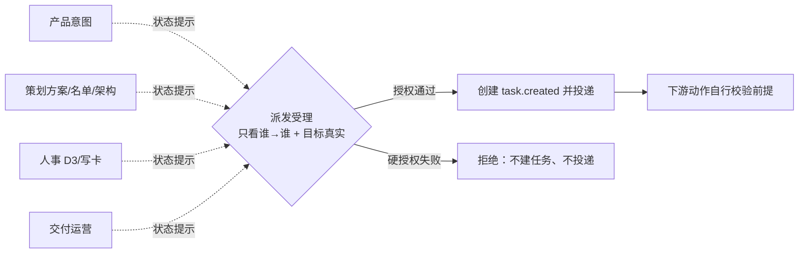
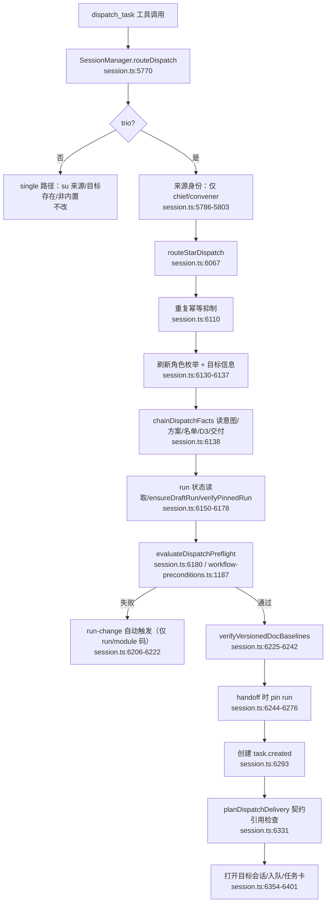
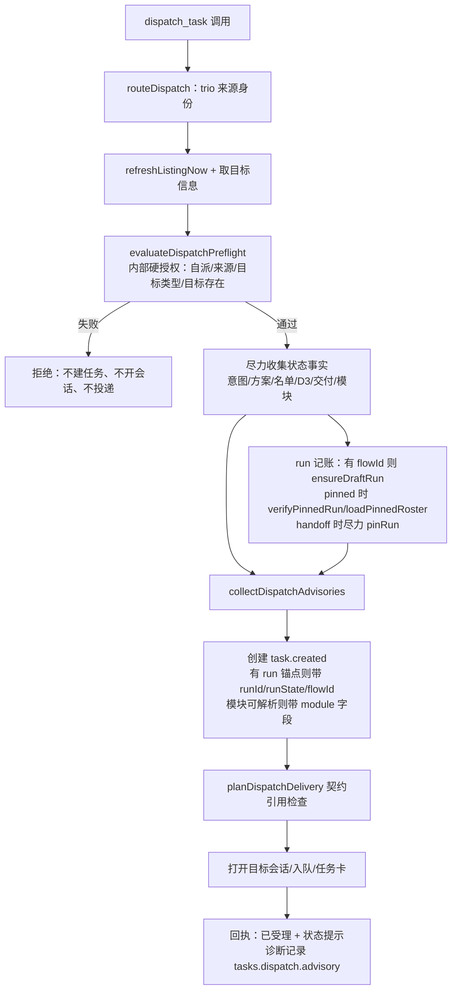

# 策划方案 P1.1：派发护栏只保留「谁能给谁派发」（dispatch authorization only）

- 日期：2026-11-02
- 角色：ANS 策划（Planning），独立上下文
- 状态：**草案 P1.1**（已处置独立只读复核 F1–F12；待沟通安排受影响部分窄复核；待闸门 1 客户确认；**未实施、未测试、未验收、未 commit/push**）。客户在闸门 1 确认的版本才是实施与验收基线；实施还需闸门 2 角色指派确认与客户实施授权。
- 风险档位：**T3（建议）**。理由：改动产品派发受理语义，属于治理/权限边界变更；即使方向是放宽，也不是纯文档或局部实现。升档条件与回滚见 §9。
- 闸门 0 依据：`docs/communication/2026-11-02_intent_dispatch-guardrail-relax.md`（67 行，SHA-256 `212e987fa183e739e8bcd813e14f40d376fbc86702e792e82a7735901775bb54`；客户原话「规矩护栏，应该只管控谁能给谁派发任务，而不能管任务状态是否满足」；客户已确认意图、Q1–Q5 与非目标）。
- 独立复核：`docs/planning/2026-11-02_review_dispatch-guardrail-relax.md`（101 行，SHA-256 `232c4b1c23dbec5284a2faec812fda33bd0fdd2da520e0b9f1d8ec286d9f93a4`；对 P1.0 的完整复核，结论「建议修订后提交」，F1–F12；本 P1.1 逐项处置见 §13）。复核不是批准、不是客户确认、不是实施授权。
- 代码基线：worktree `flow-improvements-wave1`，HEAD `c80f4944c3421554fcbd35f8570cedd3e2119a0a`。本文所有行号均为该快照的只读核对结果；实施以符号名与文本锚点为准。
- 被修订的既有基线：`docs/planning/2026-10-29_design-workflow-maintainers-hiring.md`（1330 行，SHA-256 `4a13e99b0b0dbb4aeb9141ed4a15fdddd4ec5021b88146589bdf1f4f8030e6b6`）中的 M1–M8、M13 派发阻断条款与 P1「五步链不可跳」。本方案是**对该确认版本派发受理部分的重新定义**，不是对其历史记录的回写；实质变更须重开闸门 1。
- 标记约定：**[现状]** 已只读核实的代码/测试行为；**[设计候选]** 本方案提议、未实施；**[待客户决定]** 见 §11。

**版本记录**

| 版本 | 日期 | 变更摘要 | 状态 |
| --- | --- | --- | --- |
| P1.0 | 2026-11-02 | 初稿：产品方案、逐项检查清单、架构/实现、共享契约、兼容迁移、AC、选装与 Q1–Q5 | 草案；已复核（F1–F12，复核结论「建议修订后提交」） |
| P1.1 | 2026-11-02 | 处置复核 F1–F12：handoff 早退改为 advisory；verifier 模块元数据保留；旧 P3/P5/P8 处置；redispatch 与 flow 锚点下游消费者披露（含 O7）；契约幂等/输出修正；G-1 文案与全量回归说明；复用 `evaluateDispatchPreflight` 入口、取消不必要改名；契约 v1 出处；AC/测试补充 | 草案；待受影响部分窄复核；未确认、未实施 |

---

## 0. 摘要（先读这段）

客户觉得当前的派发护栏「有点重」：幕僚想派策划/人事/运营时，应用会因为意图文档、方案、名单、D3、模块绑定、run 是否 pin、版本基线等**任务状态**不满足而直接拒发。客户要求：**派发只问「谁能给谁派发」**，任务状态不满足不应阻断派发。

本方案把派发受理拆成两层：

1. **硬授权（保留，拒绝仍发生）**：只有幕僚/运营能派发；不能派给自己；幕僚不给项目 worker 派任务；运营只给真实存在的项目 worker 或质检派发；目标必须是真实存在的内置/项目角色。这一层在 `task.created` 之前判定，拒绝不产生任务行、不打开目标会话。
2. **状态提示（不阻断）**：意图/方案/名单/模块/D3/交付任务/run/pin/文档哈希/版本基线等全部降级为**可核对的提示与诊断记录**，不再返回 `ok:false`。任务照常创建与投递；回执和派发者聊天流显示「状态提示（未阻断）」。

这样做的直接结果：幕僚在缺产品意图时派策划、在缺名单时派人事、在缺 D3 时交付运营，都会**受理**；运营在没有交付任务、没有模块、目标不在 D3 选中集合时派实现，也会**受理**。但目标角色不存在、幕僚直接派项目 worker、运营派产品/策划/人事、自派、非幕僚/运营来源，仍会被拒绝。写权/边界、D3 写卡、验收判定、客户闸门、shell/写守卫全部不变。

**一句话：**以后派发只看「你是谁、要派给谁、这个人是否真实存在」；缺文档/名单/D3/run 只提示，不拦。

---

## 1. 产品方案

### 1.1 问题与目标

**场景（[现状]）。** 一个按五步链配置的 trio 项目（幕僚/产品/策划/人事/运营/质检）里，幕僚派策划前必须先有 `docs/product/<flowId>-intent-vN.md`；派人事前必须有方案、名单、模块清单、env-bootstrap；交付运营前必须有 D3 选中角色的角色卡；运营派实现前必须已接交付、带 `moduleId`、目标在 D3 选中集合且拥有该模块、run 必须 pinned 且目标在 manifest.roles 内；每次派发前还要全量校验版本化文档基线。任何一项不满足，`evaluateDispatchPreflight`（`src/common/编排/workflow-preconditions.ts:1187`）都会在 `app/desktop/session.ts:6180` 返回 `ok:false`，任务不会创建。

**客户判断（闸门 0 已确认）。** 这些是任务状态，不是「谁能给谁派发」。护栏应只管角色授权关系，不应替角色判断任务是否该做、材料是否齐备。

**目标。** 派发受理只依赖角色授权与目标真实性；任务状态不满足时，派发仍成功，并以可见提示/诊断记录让派发者知道缺什么。任务创建后继续按现有流程流转；下游动作自己仍会拒绝真正缺失的前提（如无名单时人事发不了 D3、无边界时写入被拒）。

**成功后的用户可见结果。** 幕僚/运营不再被「缺意图」「缺名单」「缺 D3」「run 未 pin」「模块不归目标」等状态拦住；收到「已受理 + 状态提示」而不是「派发未受理」。非法的「谁给谁」仍会被立即拒绝，并说明下一步。

### 1.2 角色授权矩阵（硬规则，[设计候选]）

| 来源 | 允许的目标 | 不允许的目标 |
| --- | --- | --- |
| 幕僚（chief） | 内置角色：产品、策划、人事、运营、质检 | 自己；项目 worker；`su`/未知内置 id；不存在的目标 |
| 运营（convener） | 真实存在的项目 worker（角色卡+边界可枚举）；内置质检（verifier） | 自己；产品/策划/人事/幕僚等其它内置角色；不存在的目标 |
| 其他任何角色 | 无 | 一律拒绝（`unknown-source`） |

补充说明：

- 「项目 worker 真实存在」以项目角色枚举为准：`src/service/role/resolve-role.ts` 只在 `角色卡/<id>/role-card.md` 与 `boundary.yaml`/`boundary.yml`/`boundary.md` 都存在且可解析时才枚举该角色（`resolve-role.ts:215-216`、`:345-370`）。因此这等价于「目标角色卡已写、边界可用」，但**不要求 D3 选中集合里的其它角色也都写好卡**。
- **目标 id 不存在 vs 目标类型不允许的优先顺序**：幕僚对任何非内置目标一律按类型禁止（`chief-to-project-forbidden`），即使该 id 也不存在；运营对不存在的项目角色返回 `target-card-missing`（目标不存在/未枚举）；幕僚对 `su`/未知内置 id 返回 `target-card-missing`（该 id 不是可派发内置角色）。`target-card-missing` 的 action 文案需同时覆盖「拼写/角色 id 错误」与「角色卡/边界未就绪」，不能只说「请人事写卡」。
- **redispatch 是独立恢复通道**：`redispatch_task` 只注入幕僚（`run-role.ts:1280`）；`redispatchTask` 在重试≥1 时由 `chooseRedispatchTarget`（`session.ts:4324-4330`）选择「首个非内置、非当前、非幕僚」的项目角色，并以原 `created.from` 新建 `task.created` 后投递（`:4476-4599`）。它不受本方案 `routeStarDispatch` 授权矩阵直接约束，但可能把任务送到项目 worker；本方案**不改变**该恢复通道，只把它作为范围外缺口披露（§2.2、§9.1），并建议实施阶段做只读核对；若客户要求把重派也纳入「谁能给谁」硬矩阵，属独立变更、重开闸门 0/1。
- 幕僚对项目 worker 的禁止是**目标类型级**，不是按 `sideEffect` 判断。`sideEffect` 是模型声明、应用只升不降（`DispatchTaskPayload.sideEffect` 注释），不能用它当授权依据。
- 内置目标名单显式限定为产品/策划/人事/运营/质检；`su` 是 single 模型的主入口，不是 trio 的可派发角色。当前 `isBuiltInGovernanceRoleId` 把 `su` 也算内置（`src/common/门禁引擎/governance-roles.ts:494-496`），建议在新硬校验中用显式 allowlist 收紧（这是收紧而非放宽，见 §3 第 4 行）。

### 1.3 用户可感知行为

| 情形 | 用户看到什么 | 系统做什么 |
| --- | --- | --- |
| 成功且状态齐备 | 「已受理：任务将投递给角色 X……（受理≠已完成）」 | 创建 `task.created`、投递、记录任务卡；与现状一致。 |
| 成功但状态不齐 | 「已受理……状态提示（未阻断）：① 尚无产品意图文档；② run 仍为 draft……」 | 照常创建任务与投递；诊断记录 `tasks.dispatch.advisory`；派发者聊天流出现一行提示。 |
| 失败（硬授权） | 「派发未受理：不能派发给自己 / 幕僚不直接给项目 worker 派任务 / 运营只能给项目 worker 或质检 / 目标角色不存在……」 | 在 `task.created` 之前拒绝；不写任务行、不打开目标会话、不投递。 |
| 投递失败 | 「派发未投递：目标会话无法打开……」或「引用的契约 X 不存在……」 | 任务已创建但以 `task.closed(rejected)` 收口；不冒充送达。 |
| 下游真正缺前提 | 例如人事「无名单，不能发 D3」、worker 写入被边界拒绝、验收缺证据 | 由对应动作返回自己的错误；派发本身不替它兜底，也不把任务标成完成。 |

**输入与输出（产品视角）：** 输入仍是现有的 `dispatch_task` 载荷（目标角色、任务文本、可选 flowId/模块/期望产出/证据提示等），不新增用户必填字段；输出是受理/拒绝回执、任务卡/派发者系统行、派发者聊天流中的状态提示，以及诊断记录。产品不新增 API、Model 或事件字段。

### 1.4 与「五步链」的关系

五步链（产品意图 → 策划方案/名单/架构 → 人事 D3/写卡 → 交付运营 → 运营派实现/验收）**仍然是推荐的工作流程和角色卡指导**，其产物仍然会被下游动作使用和校验；改变的是：**应用不再把「链上的材料是否齐备」当作派发受理条件**。



因此：

- 「五步链不可跳」作为**派发机械门**的 P1 标准被本方案取代（见 §7.4）；链的产物与顺序仍是角色卡与验收判断的依据。
- 下游动作的机械门不受影响：人事没有名单仍然发不了 D3；`appointment-write` 仍然要求 D3/名单一致；写入仍然受 Section 1/写守卫；验收仍然按已确认标准判定。
- 角色卡文本目前写着「应用会机械拒绝」（如 `governance-roles.ts:144` 幕僚卡、`:223` 运营卡）；`src/provider/runtime/schema.ts:515-519` 的 `dispatch_task.moduleId` 工具描述仍写「MUST carry / target must own」。角色卡不在本任务写权内；本方案把「文案与新行为对齐」列为后续独立事项（O5），不把旧文案当成新行为承诺。

### 1.5 范围与非目标

**In scope（本方案要解决）：**

- `src/common/编排/workflow-preconditions.ts` 的派发前置拆分：硬授权 + 状态提示。
- `app/desktop/session.ts` 中阻断派发的状态校验：run 状态读取/草案创建/pin/哈希校验、版本化文档基线校验；以及派发触发的 run-change 分支。
- 相应测试迁移、验收标准与迁移说明。

**Out of scope（明确不改）：**

- 写权/边界（Section 1、`resolveWrite`、`TaskScope`）、shell 命令/脚本守卫、执行后审计。
- 验收判定、验收卡、客户/判断 agent 的验收决定权。
- 三道客户闸门、角色卡/边界文本、人事 D3 与 `appointment-write` 通道。
- 报告路由（`reportTargetForTaskCreator`）、任务卡片格式、任务重派/看护。**尤其 `redispatch_task` 是幕僚专用恢复通道**（`run-role.ts:1280`、`session.ts:4476-4599`），本方案不改其目标选择与授权语义；它可能绕过「幕僚不直接给项目 worker 派任务」的形式约束，已作为范围外缺口在 §2.2/§9.1 披露，建议实施阶段只读核对。
- single 模型的派发路径（`routeDispatch` 的 su→项目角色路径）；本方案只改 trio 的 `routeStarDispatch` 前置。
- run-change 卡的三模式语义与显式入口；只移除「派发被冻结事实拒绝时自动弹卡」这一条触发路径（见 §5.6）。

### 1.6 术语

| 术语 | 含义 |
| --- | --- |
| **硬授权** | 「谁可以给谁派发、目标是否真实存在」的判定；失败即拒发，`ok:false`，不创建任务。 |
| **状态提示（advisory）** | 旧的任务状态检查结果；只记录/展示，不阻断派发。不是拒绝，不是验收结论，也不是客户确认。 |
| **派发受理** | 应用接受一次 `dispatch_task` 并创建任务行；受理 ≠ 已投递、受理 ≠ 完成、受理 ≠ 下游前提已满足。 |
| **任务状态** | 意图/方案/名单/模块/D3/交付任务/run/pin/文档哈希/版本基线/幂等等与「任务做到哪一步」有关的事实；本方案不再用它拒绝派发。 |

---

## 2. [现状] 调用链与阻断点

### 2.1 调用链



### 2.2 被本方案触及的现状事实

| # | 位置 | [现状] 行为 |
| --- | --- | --- |
| 2-1 | `src/common/编排/workflow-preconditions.ts:1187-1372` | `evaluateDispatchPreflight` 把角色授权与任务状态混在一个函数里；状态不满足返回 `ok:false` 与 `MechanicalRejection`。 |
| 2-2 | 同上 `:1189-1197` | 自派拒绝；幕僚对任意项目 worker 拒绝（`chief-to-project-forbidden`）。 |
| 2-3 | 同上 `:1200-1249` | 幕僚→策划要求 flowId + 意图；幕僚→人事要求 flowId + 方案/架构 + 名单 + 模块 + env-bootstrap。 |
| 2-4 | 同上 `:1251-1277` | 幕僚→运营要求 flowId + runId + D3 选中 + D3 选中角色卡齐备。 |
| 2-5 | 同上 `:1283-1313` | 运营只能给项目 worker 或 verifier；要求非 legacy、已接交付、runId、pinned、目标在 run.roles、flowId。 |
| 2-6 | 同上 `:1314-1368` | 实现任务必须有 `moduleId`，模块必须在最新名单、目标必须是属主、`modulePaths` 必须落在模块路径内、目标必须在 D3 选中集合、目标角色卡存在。 |
| 2-7 | `app/desktop/session.ts:6150-6178` | run 状态读取失败、pin 前草案创建失败、pinned run 文档 hash 不匹配、pinned roster 读取失败，全部在 `task.created` 之前拒发。 |
| 2-8 | `app/desktop/session.ts:6225-6242` | 版本化文档基线与 `.ans/state/versions.jsonl` 不一致时拒发（`versioned-doc-baseline-violation`）。 |
| 2-9 | `app/desktop/session.ts:6244-6276` | 交付运营时若 run 为 draft，先 `pinRun`；pin 失败、pin 后校验失败都拒发。 |
| 2-10 | `app/desktop/session.ts:2050-2130` | 派发被 `run-role-missing`/`module-missing`/`module-not-owned` 拒绝且识别到更新版本契约时，自动弹 run-change 三模式卡。 |
| 2-11 | `app/desktop/session.ts:6110-6125` | 同幂等键的重复派发被抑制，返回 `ok:true`（不是拒绝）。 |
| 2-12 | `app/desktop/session.ts:6331-6348` | `planDispatchDelivery` 对任务文本引用的 `docs/contracts/…md` 不存在时拒投，并把已创建任务以 `rejected` 收口。这是**消息引用完整性**检查，不是任务状态。 |
| 2-13 | `src/common/编排/task-state.ts:234-237` | `task.created` 带 `flowId` 时必须带 `runId`/`runState`（`run-required`）；无 `flowId` 时不要求。 |
| 2-14 | `src/pipeline/orchestration/run-role.ts:1280`；`app/desktop/session.ts:4324-4330`、`:4476-4599` | `redispatch_task` 只注入幕僚；重试≥1 时由应用选择「首个非内置、非当前、非幕僚」的项目角色，以原 `created.from` 新建 `task.created` 后投递——这是独立于 `routeStarDispatch` 的恢复通道，可把任务送到项目 worker。本方案不改该路径，仅披露（§1.2/§9.1）。 |

### 2.3 既有设计与测试为什么把状态当必须

`docs/planning/2026-10-29_design-workflow-maintainers-hiring.md` 的 M1–M8 把「产品意图存在」「名单/模块完整」「D3 选中角色卡齐备」「已接交付」「目标拥有模块」「run pinned」定义为机械前置，P1 进一步把它们写成「五步链不可跳」的验收标准。测试 `test/编排/workflow-preconditions.test.ts`、`test/桌面应用/chain-enforcement.test.ts`、`test/桌面应用/star-routing.test.ts`、`test/桌面应用/run-pin.test.ts`、`test/桌面应用/run-change-trigger.test.ts` 逐条断言这些拒绝与「`tasks.jsonl` 行数不变」。本方案不是让这些测试「失效」，而是把每条断言迁移成「硬授权仍拒绝」或「状态降级后受理 + 提示」的可核对断言（见 §7.3）。

**不需要单独的调研方案**：现状已只读核实到符号与行号；剩余未决点是产品选择（§11）与实施细节（§5），不是需要先查清的事实。

---

## 3. 逐项检查清单（分类与推荐）

**分类口径：**「角色授权保留」= 继续作为硬拒绝；「降级为提示/记录」= 不再阻断，返回 `ok:true` 并记录；「删除」= 不再有该检查/代码路径；「保留但调整」= 语义基本保留，但归位、拆分、文案或落点调整。

### 3.1 派发前置检查（`evaluateDispatchPreflight` 及 session 前置）

| # | 检查点 / 拒绝码 | 位置 | [现状] | 分类 | 推荐处置与理由 |
| --- | --- | --- | --- | --- | --- |
| 1 | `self-dispatch` | `workflow-preconditions.ts:1189` | 来源=目标即拒 | **角色授权保留** | 保留。这是「谁能给谁」的最小规则；会话层 `routeStarDispatch:6086` 还有一道「不能派给幕僚自己」。 |
| 2 | `unknown-source` | `:1371` | 来源不是幕僚/运营即拒 | **角色授权保留** | 保留；同时保留 `routeDispatch:5786-5803` 的来源身份校验与 `dispatchTask` 能力位注入。 |
| 3 | `chief-to-project-forbidden` | `:1191-1197` | 幕僚对任意项目 worker 拒 | **角色授权保留** | 保留目标类型级规则；不按 `sideEffect` 放行（模型可自报，不能当授权依据）。 |
| 4 | 内置目标 allowlist（`su`/未知内置） | 现状无显式 allowlist；`isBuiltInGovernanceRoleId` 含 `su`（`governance-roles.ts:494-496`） | 幕僚可派任意 `builtIn`，包括 `su` | **保留但调整** | 显式限定幕僚可派产品/策划/人事/运营/质检，运营只可派质检；`su`/未知内置按 `target-card-missing` 拒绝并说明「该 id 不是可派发内置角色」。这是收紧一个现有缺口，符合「目标必须真实」。 |
| 5 | `convener-target-forbidden` | `:1283-1289` | 运营对非 verifier 内置目标拒 | **角色授权保留** | 保留。运营只给项目 worker/质检。 |
| 6 | `target-card-missing`（运营→项目 worker 的目标存在性） | `:1365-1367`（`targetCardFound` 来自 `session.ts:6201-6204` 的 `targetRole !== undefined`） | 目标不在角色枚举即拒 | **保留但调整** | 保留为**硬目标存在性**，但提前到授权矩阵阶段；文案改为「目标角色不存在/未枚举到（角色卡或边界未就绪，或 id 拼写错误）」；owner 仍为 nominator，但 action 要先确认 id。**幕僚→未知非内置 id 不走本码**，按 §1.2 的类型规则返回 `chief-to-project-forbidden`。 |
| 7 | `target-card-missing`（幕僚→运营的 D3 选中角色卡齐备） | `:1264-1276` | D3 选中的每个角色都有卡才放行 | **降级为提示/记录** | 不再阻断；改发 advisory `d3-selected-cards-incomplete`（列出缺卡 id）。D3 选中集合是任务状态，且只影响运营后续能否找到目标；目标真实存在性仍在运营派发时校验。 |
| 8 | `flow-required` | `:1200-1205`、`:1216-1218`、`:1252-1254`、`:1311-1313` | 链式派发缺 flowId 即拒 | **降级为提示/记录** | 不阻断；能唯一推断时使用推断值，否则 advisory `flow-required`。flowId 只用于 run/记录/去重，不是角色授权。 |
| 9 | `intent-missing` | `:1206-1212` | 幕僚→策划缺意图即拒 | **降级为提示/记录** | advisory `intent-missing`。策划仍可先被派发，产品意图由产品角色按角色卡补齐；下游验收仍以实际文档为准。 |
| 10 | `proposal-missing` | `:1219-1225` | 幕僚→人事缺方案/架构即拒 | **降级为提示/记录** | advisory `proposal-missing`。 |
| 11 | `roster-missing` | `:1226-1232` | 幕僚→人事缺/非法名单即拒 | **降级为提示/记录** | advisory `roster-missing`。人事发 D3/写卡时仍会因缺名单被自己的校验拒绝。 |
| 12 | `roster-modules-missing` | `:1234-1240` | 名单无模块即拒 | **降级为提示/记录** | advisory `roster-modules-missing`；与 `roster-missing` 同链时只报首个未满足项，避免刷屏。 |
| 13 | `env-bootstrap-missing` | `:1241-1248` | 名单缺 env-bootstrap 且未省略即拒 | **降级为提示/记录** | advisory `env-bootstrap-missing`。 |
| 14 | `d3-missing` | `:1258-1263` | 幕僚→运营无 D3 选中即拒 | **降级为提示/记录** | advisory `d3-missing`。运营仍可先接交付，但在角色卡未写、目标不存在时派实现会被硬目标存在性拒绝。 |
| 15 | `run-missing` | `:1255-1257`、`:1302-1304` | 缺 runId 即拒 | **删除** | 不再产生：带 flowId 的派发由应用尽力创建/复用 draft run；创建失败也不以该码拒绝，改为 advisory `run-ledger-unavailable` 并允许任务不带 run 锚点（`task.created` 的 flowId 也相应省略；见 §5.5）。 |
| 16 | `run-pin-required` | `:1305-1307` | 实现/验收必须 pinned | **降级为提示/记录** | advisory `run-pin-required`：run 仍为 draft；不阻断。 |
| 17 | `run-role-missing` | `:1308-1310` | 目标不在 run.roles 即拒 | **降级为提示/记录** | advisory `run-role-missing`：目标不在冻结 run 的角色集；不阻断。该 pinned run 不覆盖本任务，因此**不把它作为任务锚点**（任务不带 run/flow 锚点），避免下游误用不覆盖目标的冻结契约。 |
| 18 | `run-legacy-readonly` | `:1290-1295` | legacy flow 的实现/验收拒 | **降级为提示/记录** | advisory `run-legacy-readonly`：该 flow 有历史 legacy 任务；新任务可用新 draft run 记账，不阻断。 |
| 19 | `handoff-missing` | `:1296-1301` | 运营未接交付即拒 | **降级为提示/记录** | advisory `handoff-missing`。 |
| 20 | `module-required` | `:1326-1328` | 实现任务必须带 moduleId | **降级为提示/记录** | advisory `module-required`；任务可创建，只是不落模块元数据。 |
| 21 | `module-missing` | `:1322`、`:1332-1335` | 模块不在名单即拒 | **降级为提示/记录** | advisory `module-missing`。 |
| 22 | `module-not-owned` | `:1336-1342` | 目标不是模块属主即拒 | **降级为提示/记录** | advisory `module-not-owned`。模块归属是任务分派建议，不是派发授权；实际写入仍由 Section 1/写守卫拦截。**verifier 例外**：模块存在即保留 `moduleId`/`modulePaths` 元数据，不要求属主（验收逐模块证据依赖）。 |
| 23 | `module-path-invalid` | `:1348` | modulePaths 非法即拒 | **降级为提示/记录** | advisory `module-path-invalid`；模型自报路径本来就不落盘（`session.ts:6282-6285` 只用名单模块），不影响安全。 |
| 24 | `module-path-outside` | `:1354-1356` | modulePaths 越模块即拒 | **降级为提示/记录** | advisory `module-path-outside`；同上。 |
| 25 | `target-not-nominated` | `:1359-1364` | 目标不在 D3 选中集合即拒 | **降级为提示/记录** | advisory `target-not-nominated`；D3 是任务状态，目标存在性已硬校验。 |
| 26 | 派发触发的 run-change（`runChangeRejectionForDispatch` / `dispatchFrozenConflictDetail`） | `session.ts:2050-2130`、调用点 `:6206-6222` | preflight 失败且识别为冻结冲突时弹三模式卡并回 `run-change-required` | **删除（代码路径）** | 硬授权失败不再与冻结契约相关；状态不再拒绝，原先的触发条件不存在。保留 run-change 卡本身、显式入口与提案卡冻结路径（§5.6）；`run-change-required` 码表条目保留给提案卡路径，不恢复已取消的 run-change-auto-approve。 |
| 27 | run 状态读取失败 / draft 创建失败 / pinned 哈希失败 / pinned roster 读取失败 | `session.ts:6150-6178` | 全部拒发 | **降级为提示/记录** | 读取/创建失败 → advisory `run-ledger-unavailable`，任务仍创建（不带 run 锚点）；哈希/ roster 失败 → advisory `run-document-hash-mismatch`/`run-pinned-roster-invalid`，任务仍创建，但**不锚定无效的 pinned run**（不带 run/flow 锚点）；不重写 manifest/文档。 |
| 28 | `versioned-doc-baseline-violation` | `session.ts:6225-6242` | 基线不一致即拒发 | **降级为提示/记录** | advisory `versioned-doc-baseline-violation`。版本化文档的**写入**只读保护、基线记录与 shell 守卫不变；派发不再因全局基线状态被拦。 |
| 29 | handoff 时 `pinRun` 失败 / pin 后校验失败 / handoff 早退（无 runManifest 或无 flowId） | `session.ts:6244-6276`（早退 `:6245-6247`） | 拒发、不建交接任务 | **降级为提示/记录** | `:6245-6247` 的「交付运营缺少 runId」早退改为 advisory `run-ledger-unavailable`（无 runManifest）或 `run-pin-required`（有 draft 但未 pin）；跳过 pin，交接任务照常创建并省略 run/flow 锚点。pinned 校验失败/pin 失败同样 advisory；run 保持 draft/缺失，不伪造 pinned。 |
| 30 | `planDispatchDelivery` 契约引用缺失 | `session.ts:5857-5861`、`:6331-6349`；`handback.ts:353-378` | 引用的 `docs/contracts/…md` 不存在即拒投，并把任务收口 rejected | **保留但调整** | 保留现有**运行文案逐字不变**（G-1 测试对 `handback.ts:370-375` 文案有逐字断言）；只在方案文档说明它是**消息引用完整性**，不是任务状态，也不在闸门 0 列举的放宽对象内。若客户要求「连引用缺失也不拒」，属独立变更。 |
| 31 | 目标会话无法打开 | `session.ts:6354-6369` | 任务收口 rejected、不投递 | **保留但调整** | 保留真实投递失败语义；这是运行/环境失败，不是授权拒绝，也不回退为 `ok:true`。 |
| 32 | 任务状态写入失败 | `session.ts:6313-6318` | 拒发、不投递 | **保留但调整** | 保留。没有任务行就不能声称受理；这是账本写入前提，不是任务状态判定。 |
| 33 | 重复幂等抑制 | `session.ts:6110-6125` | 同键重复返回 `ok:true`，不新建/不投递 | **保留但调整** | 保留为业务幂等保证；不计入受理前置，也不产生 advisory。补充说明：终态重复会提示用新任务文本/新幂等键。 |
| 34 | `chiefRoleId === null` | `session.ts:6135-6137` | 未枚举到幕僚即拒（连运营来源也被拒） | **保留但调整** | 仅当来源/任务 creator 无法确定时才拒；`chiefRoleId` 允许为 null，运营来源且 `convenerRoleId` 可用的派发不因幕僚缺失被误伤。这不是任务状态，是运行环境/身份前提。 |
| 35 | 空 `roleId`/`task` | `session.ts:5777-5779` | 拒 | **保留但调整** | 输入校验，保留。 |

> **名单解析内部码说明**：`workflow-preconditions.ts` 的 roster/modules 解析器还会返回 `roster-reference-missing`、`roster-reference-stale`、`roster-modules-drift`、`roster-module-owner-invalid` 等内部码。它们不是独立派发拒绝码；现状由 `roster-missing`（名单读取失败的原因）或 `run-pinned-roster-invalid`（pinned roster 读取失败）携带。新方案仍保留这些解析器校验（D3/写卡/run pin 使用），只在派发链把它们降级为 advisory 的原因文本，不新增派发拒绝。

### 3.2 范围外不变（不在本表分类，但必须明确）

- 写权/边界：`resolveWrite`、`TaskScope`、Section 1、`boundary.yaml`、shell 写目标守卫、执行后审计、版本化文档只读保护。
- 验收：`acceptance` 卡、criteria/evidence 校验、验收判断、客户/判断 agent 决定权。
- 人事通道：`cardKind=appointment` 发卡、D3 版本/hash 校验、`appointment-write` 逐路径写卡。
- 客户闸门、角色卡/边界文本、报告路由、任务重派/看护、single 模型派发路径。
- `task-state.ts` 的事件 schema 与 `task.created` 的 `run-required` 校验（本方案通过「尽力记账 + 允许省略锚点」避免改 schema；见 §5.5）。

### 3.3 Q1–Q5 回答摘要

| 问题 | 推荐 | 理由摘要 |
| --- | --- | --- |
| Q1 目标存在性/角色卡 | **A：保留目标存在性，取消 D3 选中集合完整性** | 「目标真实存在」是「谁能给谁」的一部分；D3 集合是任务状态。 |
| Q2 模块归属 | **A：降级为提示，不再硬拒** | 模块是任务分派建议；真实写入由边界守卫负责。 |
| Q3 删除 vs 降级 | **A：全部降级为提示/记录** | 保留可核对信息，避免「一刀切删除」导致排查困难；符合闸门 0「默认倾向不阻断、保留记录」。 |
| Q4 run 哈希/版本基线/幂等 | **A：幂等保留；run/哈希/版本基线全部非阻断；run 记账尽力而为** | 幂等不是状态前置；run/基线是记录与溯源，不应拦住派发；不引入迁移开关。 |
| Q5 失败落点 | **A：落在真正需要该前提的下游动作** | 派发只对「谁给谁/目标真实」负责；下游 D3/写卡/写守卫/验收各自拒绝，不伪造成功。 |

详细选项与推荐项见 §11。

---

## 4. 产品行为细节（[设计候选]）

### 4.1 成功回执

状态齐备时保持现有回执（`main.session.acceptedTask`）不变。

状态不齐时，在现有回执后追加一行，示例：

> 已受理：任务将投递给角色「策划」的会话……（受理≠已完成）。状态提示（未阻断）：尚无产品意图文档（`docs/product/focus-intent-v1.md`）；如需按五步链推进，可先派产品补齐。

要求：

- 首词必须是「已受理」，不能出现「拒绝」「失败」「未受理」等误导词。
- 明确写「未阻断」「受理≠已完成」。
- 提示项最多展示 3 条，其余以「另有 N 项，见诊断记录」收口；技术 code 只给模型/诊断，不塞进客户卡。
- 不把提示写成「已满足」或「已确认」；不把提示写成客户决定。

### 4.2 提示（advisory）内容建议

| advisory code | 触发链 | 建议人话 |
| --- | --- | --- |
| `flow-required` | 链式目标且无法解析 flowId | 未携带/无法推断 flowId；本次不关联 run 记录。 |
| `intent-missing` | 幕僚→策划 | 尚无产品意图文档；策划可先接任务，但产出依据可能不足。 |
| `proposal-missing` | 幕僚→人事 | 尚无方案/架构；人事发 D3/写卡前仍需这些材料。 |
| `roster-missing` | 幕僚→人事 | 尚无合法名单；人事暂时无法发 D3/写卡。 |
| `roster-modules-missing` | 幕僚→人事 | 名单缺模块清单；模块归属信息不可用。 |
| `env-bootstrap-missing` | 幕僚→人事 | 名单缺 env-bootstrap 且未声明省略理由。 |
| `d3-missing` | 幕僚→运营 | 尚无 D3 选中角色；运营派实现时目标可能不存在。 |
| `d3-selected-cards-incomplete` | 幕僚→运营 | D3 选中角色卡未齐备（缺：…）；不阻断交付。 |
| `handoff-missing` | 运营→worker/质检 | 尚未收到幕僚的交付任务；不阻断本次派发。 |
| `run-legacy-readonly` | 运营→worker/质检 | 该 flow 有 legacy 历史任务；本次按新 run 记账，不阻断。 |
| `run-pin-required` | 运营→worker/质检 | run 仍为 draft/未 pin；实现与验收的冻结契约不可用，不阻断派发。 |
| `run-pin-failed` | 交付运营时 | run 的 pin 尝试失败；run 保持 draft/缺失，不伪造 pinned。 |
| `run-role-missing` | 运营→worker | 目标不在 pinned run 的角色集；不阻断。 |
| `module-required` / `module-missing` / `module-not-owned` / `module-path-*` | 运营→worker/质检 | 模块信息缺失或不匹配；任务照常受理，写入仍受角色边界约束。 |
| `target-not-nominated` | 运营→worker | 目标不在 D3 选中集合；不阻断。 |
| `versioned-doc-baseline-violation` | 任意派发 | 版本化文档基线有漂移；派发不阻断，旧版本写入仍受只读保护。 |
| `run-document-hash-mismatch` | 任意带 pinned run 的派发 | pinned run 文档哈希与 manifest 不一致；不重写、不阻断。 |
| `run-pinned-roster-invalid` | 任意带 pinned run 的派发 | pinned run 的 roster 读取/校验失败；不重写、不阻断。 |
| `run-ledger-unavailable` | 任意带 flowId 的派发 | run 记录不可用；任务不带 run 锚点，不阻断。 |

### 4.3 失败文案

硬授权失败继续使用 `MechanicalRejection` 三段式（`mechanical-rejection.ts`），文案保持或微调：

- `self-dispatch`：不能派发给自己。
- `unknown-source`：只有幕僚或运营可以派发任务。
- `chief-to-project-forbidden`：幕僚不直接给项目 worker 派任务；实现任务请交运营。
- `convener-target-forbidden`：运营只能给项目 worker 或质检派发；不得派产品/策划/人事/幕僚。
- `target-card-missing`：目标角色不存在/未枚举到（角色卡或边界未就绪，或 id 拼写错误）；请先确认目标 id 是否正确、是否是可派发内置角色；若目标是项目 worker 且尚未写卡，请人事按 D3 完成写卡后重试。

`target-card-missing` 的 owner 仍为 `nominator`（`mechanical-rejection.ts:57`），但 action 文案从「按 D3 选中集合逐角色写卡」改为「确认目标 id；若目标尚未写卡，请人事按 D3 写卡」。旧日志里的 `M5_TARGET_CARD_MISSING` 别名保留。幕僚→未知非内置 id 仍按类型返回 `chief-to-project-forbidden`，不落到本码。

### 4.4 失败落点（Q5 推荐 A）

| 失败类型 | 落点 | 用户看到 |
| --- | --- | --- |
| 自派/来源非法/幕僚→项目 worker/运营→非质检内置/目标不存在 | 派发前置（`task.created` 之前） | `ok:false`，无任务行、无目标会话。 |
| run 记账失败/哈希不一致/版本基线漂移 | 派发会话（advisory） | `ok:true`，任务照常创建；提示与诊断。 |
| 目标会话无法打开 | 投递阶段 | 任务已创建但 `task.closed(rejected)`；回执 `ok:false`，不冒充送达。 |
| 任务账本写入失败 | 投递前 | `ok:false`，不投递；不自称受理。 |
| 缺 D3/名单/写卡/边界/验收证据 | 下游动作 | 人事/写守卫/验收自己的错误；派发不替它兜底，也不把任务标成完成。 |

---

## 5. 架构设计与实现方案（[设计候选]，不写代码）

### 5.1 分层与模块

| 位置 | 层/职责 | 本方案改动 |
| --- | --- | --- |
| `src/common/编排/workflow-preconditions.ts` | 共享编排纯逻辑（无 I/O）：名单解析 + 派发授权 | **保留 `evaluateDispatchPreflight` 作为单一公开入口**；内部拆出硬授权步骤，返回值 `ok:true` 增加 `advisories`；保留 `DispatchPreflightInput`，仅新增 `targetExists`；删除状态分支。保留 roster/modules 解析函数不动（D3/写卡/run pin 仍用）。 |
| `src/common/编排/dispatch-advisories.ts`（新增） | 共享编排纯逻辑：状态提示 | 新增 `DispatchAdvisory` 类型与 `collectDispatchAdvisories(input: DispatchPreflightInput)`；按来源→目标链计算旧状态检查，返回数组，永不 `ok:false`。只做 `import type`，不反向依赖会话；与 `workflow-preconditions` 无运行期循环。 |
| `app/desktop/session.ts` | Interface/SessionManager：I/O、任务账本、投递 | `routeStarDispatch` 只调用硬授权；状态事实尽力收集；run 记账尽力而为；advisory 写入回执/系统行/诊断；移除派发触发的 run-change 分支。 |
| `src/common/编排/mechanical-rejection.ts` | 机械拒绝码表 | 保留旧码映射（历史回执可读）；更新 `target-card-missing` 的 action 文案。不新增拒绝码。 |
| `src/common/编排/task-state.ts` | 任务账本 | **不改**：保留 `task.created` 的 `run-required`；带 flowId 时应用尽力提供 run 锚点，无法提供时省略 flowId/run 字段而不是改 schema（见 5.5）。 |
| `src/common/编排/run-manifest.ts` | run manifest/冻结 | **不改**：pin/verify 语义保持；调用方把失败降级为 advisory。 |
| `src/common/门禁引擎/versioned-doc-guard.ts` | 版本化文档基线/只读 | **不改**：函数与写入守卫保持；派发调用方把违规降级为 advisory。 |
| `src/common/门禁引擎/governance-roles.ts` | 角色注册表/能力位 | **无改动**（保留 `evaluateDispatchPreflight` 函数名，`:407` 注释无需同步）；能力位不变。 |
| `src/common/shared/i18n/messages/{zh-CN,en-US}.ts` | 文案 | 如回执/系统行需要新 key，两种语言同步；否则复用现有文案 + 中文 advisory 文本。 |
| `app/renderer/**` | 渲染层 | 默认不改；状态提示 UI 是选装 O2。 |

调用方向保持现状：`app/desktop`（Interface/SessionManager）→ `src/common/编排`（共享编排纯逻辑）；不新增反向依赖，不让 common 调 app，不引入第二套日志框架。

### 5.2 数据流



顺序要求：

1. 硬授权必须在 `newTaskId`/`task.created` 之前；拒绝不产生任务行、不打开目标会话（沿用 F10 口径）。
2. 重复幂等抑制保持在硬授权之前或之后均可；它不创建任务、不投递。建议保持现状位置（在刷新枚举之前），减少不必要 I/O。
3. 状态事实读取失败不得抛到调用方；按「缺事实」处理并记 advisory/诊断，继续。
4. advisory 计算在任务创建前完成，便于随回执返回；诊断写入可异步/非阻塞（沿用 `createDiagnosticLogger`）。

### 5.3 精确改动点

#### 5.3.1 `evaluateDispatchPreflight`（`workflow-preconditions.ts`，内部硬授权步骤）

输入类型保留现有 `DispatchPreflightInput`，只新增 `targetExists: boolean`。内部硬授权可用 `Pick` 收窄（不新增对外重复类型）：

```ts
type DispatchAuthorizationInput = Pick<
  DispatchPreflightInput,
  "fromRoleId" | "targetRoleId" | "targetBuiltIn" | "targetExists" | "chiefRoleId" | "convenerRoleId"
>;
```

`evaluateDispatchPreflight` 返回 `ok:true` 时带 `advisories: DispatchAdvisory[]`；硬授权失败时仍返回 `ok:false` + `MechanicalRejection`。这样单一入口、调用点和测试导入名不变，减少迁移面（F11）。`DispatchPreflightInput.chiefRoleId` 从 `string` 调整为 `string | null`（未枚举到幕僚时），只影响来源/creator 判定，不误伤运营来源。

判定顺序（建议）：

1. `fromRoleId === targetRoleId` → `self-dispatch`。
2. 来源不是 `chiefRoleId` 且不是 `convenerRoleId` → `unknown-source`。
3. 来源是幕僚：
   - `!targetBuiltIn` → `chief-to-project-forbidden`；
   - `targetRoleId` 不在 `{product, rapporteur, nominator, convener, verifier}` → `target-card-missing`（目标不是可派发内置角色）；
   - 否则通过。
4. 来源是运营：
   - `targetBuiltIn && targetRoleId !== "verifier"` → `convener-target-forbidden`；
   - `targetBuiltIn`（verifier）→ 通过；
   - `!targetExists` → `target-card-missing`（目标角色不存在/未枚举到）；
   - 否则通过。

因此：幕僚→未知**非内置** id 返回 `chief-to-project-forbidden`（类型禁止优先，即使 id 不存在）；幕僚→`su`/未知**内置** id 返回 `target-card-missing`（不是可派发内置角色）；运营→不存在的项目角色返回 `target-card-missing`。

说明：`targetBuiltIn` 由 `session.ts:6132-6133` 现有逻辑计算（listing 的 `builtIn` 或 `isBuiltInGovernanceRoleId`）；`targetExists` 建议用 `targetRole !== undefined || isBuiltInGovernanceRoleId(targetRoleId)`，但内置目标是否可派由 allowlist 决定。allowlist 建议在 `workflow-preconditions.ts` 内用显式常量（与现有 role id 字面量一致），避免新增 `src/common/编排` → `src/common/门禁引擎` 的依赖；若后续有已接受的共享角色集合公开入口，再复用它。

#### 5.3.2 `collectDispatchAdvisories`（新增 `dispatch-advisories.ts`）

输入沿用现有 `DispatchPreflightInput` 的事实字段（`fromRoleId`、`targetRoleId`、`flowId`、`intent`、`proposalFound`、`architectureFound`、`roster`、`d3Selected`、`moduleId`、`modulePaths`、`handoffFound`、`targetCardFound`、`missingSelectedCardIds`、`run`）。输出：

```ts
type DispatchAdvisory = {
  code: string;
  /** 一句人话；不含技术 code（技术 code 放 diagnostics）。 */
  message: string;
};
```

规则：

- 按来源→目标链，沿用旧检查顺序；**每条链只报第一个未满足项**（避免一次列出 5 条同源提示）。独立的 run/版本/会话级 advisory 可追加。
- 状态事实优先使用**最新**名单/D3；pinned run 的 roster/D3 只用于 run 专属 advisory（如 `run-role-missing`）与任务模块元数据，不覆盖 latest 状态判定（否则会把「pin 旧但最新已补齐」误报成缺口）。
- `run-legacy-readonly` 建议由会话层的 `hasLegacyFlowTask` 事实（该 flow 有历史无 manifest 的任务）判断，不因本次创建 draft run 而丢失该提示。
- 从不返回 `ok:false`；没有任何事实时返回 `[]`。
- 不读盘、不写盘；所有事实由会话层传入。
- 纯函数可单测，覆盖每个旧 code 的降级映射。

#### 5.3.3 `app/desktop/session.ts`

| 位置 | 改动 |
| --- | --- |
| `routeStarDispatch:6127-6137` | 取 `targetRole`、`targetBuiltIn`、`targetExists`；`chiefRoleId` 允许为 null（仅影响幕僚来源/creator 判定，不误伤运营来源）。若 `refreshListingNow`/listing 不可用，项目 worker 目标的存在性无法确认：按 hard `target-card-missing` 拒绝并说明枚举失败（不猜）；内置目标仍由注册表判定。 |
| `:6138-6149` | 保留 `chainDispatchFacts` 作为 advisor 事实源；读失败按缺事实处理。 |
| `:6150-6178` | run 状态读取/ensureDraftRun/verifyPinnedRun/loadPinnedRoster 改为尽力而为：失败 → advisory，不 `return fail`。带 `flowId` 时（`runFlowId !== undefined`）对所有来源/目标都 `ensureDraftRun`（当前只对 handoff/product/rapporteur/nominator；现状运营缺交付会在 preflight 先以 `run-missing` 拒绝，新方案移除该状态拒绝后，若不 ensureDraftRun 会撞 `task.created` 的 `run-required`，因此必须扩到所有带 flowId 的派发）。 |
| `:6180-6222` | 调用 `evaluateDispatchPreflight`（单一入口；内部先硬授权、再 `collectDispatchAdvisories`）；失败时 `return fail`，不再调用 `runChangeRejectionForDispatch`。成功时把 `advisories` 暂存。 |
| `:6225-6242` | 版本基线违规改为 advisory；不再 `return fail`。 |
| `:6244-6276` | handoff 的 `runManifest` 缺失或 `dispatchFlowId` 缺失时早退（`:6245-6247`）改为 advisory `run-ledger-unavailable`（无 runManifest）或 `run-pin-required`（有 draft 但未 pin）：跳过 pin，任务照常创建并省略 run/flow 锚点；pinned 校验失败与 pin 失败同样改为 advisory，run 保持 draft/缺失，不伪造 pinned。 |
| `:6293-6312` | 构造 `task.created`：draft run 直接锚定（`runId`/`runState: "draft"`/`flowId`）；pinned run 仅在 `verifyPinnedRun` 通过且（目标为内置角色，或目标项目 worker 在 `run.roles` 内；如带 `moduleId` 则模块也在 pin 名单内）时锚定；其余情况省略三者（`task-state.ts` 只在 flowId 存在时要求 run）。**模块字段写入规则按目标区分**（适用名单 = 锚定的 pinned roster，否则最新 roster，与现有 `runRoster` 口径一致）：实现目标（项目 worker）只有目标确实是该模块属主时才写 `moduleId`/`modulePaths`；verifier（及其它合法验收/治理目标）只要模块存在于适用名单就写 `moduleId`/`modulePaths`，**不要求属主**（verifier 通常不在 roster `roles[]` 中，其 `modulePaths` 是 `evidenceScopeRoots` 的重要证据根）；不匹配时省略并记 advisory。`moduleDirectory` 只在目录型模块（路径以 `/` 结尾）写入，文件型模块不写该字段，避免 `task-state.ts:383-394` 的目录校验把任务行判坏。 |
| `:6313-6318` | 任务账本写入失败仍 `fail`（不投递）。 |
| `:6327-6349` | `planDispatchDelivery` 保留；引用缺失时按现有方式收口 rejected。 |
| `:6354-6401` | 投递成功后，在回执后追加 advisory 摘要；同时 `emitDeliveryNote` 一行「状态提示（未阻断）」；诊断记录每个 code。 |
| `evidenceScopeRoots`（`:7062-7093`） | 为保持 AC-5.3，verifier 任务即使没有 flow 锚点，也应把该任务自身的 `modulePaths`（按 taskId/creator 兼容匹配）或 roster/角色边界根系纳入证据范围；不能因锚点省略而静默变成空 roots 导致所有物证被拒。补「无 flow 锚点的 verifier 任务」用例。 |
| `:2050-2130` | 删除 `runChangeRejectionForDispatch` 与 `dispatchFrozenConflictDetail`；保留 `proposalCardFrozenRejection`/`offerRunChangeOnFrozenContract`（提案卡路径）与显式入口。 |

#### 5.3.4 诊断记录

使用现有 `createDiagnosticLogger`（`src/common/shared/diagnostics.ts`），不要新增日志框架：

- 事件：`tasks.dispatch.advisory`，每个 advisory 一条；字段 `sourceRoleId`、`targetRoleId`、`reasonCode`、`phase: "dispatch"`、`mode: "authorization-only"`、`count`（可选）。这些字段都在现有白名单/通用规则内（`diagnostics.ts:11-20`）。
- 只在有 advisory 时记录，避免正常派发热循环噪声。
- 可选一条汇总 `tasks.dispatch.accepted`（`count` = advisory 数）；不记录任务正文/命令/密钥。
- 派发者聊天流的系统行只写人话；技术 code 留给诊断/模型回执。

### 5.4 失败语义

| 失败 | 是否阻断 | 结果 |
| --- | --- | --- |
| 硬授权（自派/来源/目标类型/目标不存在） | 是 | `ok:false`；`task.created` 不写；目标会话不打开；不投递。 |
| 状态事实读取失败 | 否 | `ok:true`；按缺事实生成 advisory；任务照常。 |
| run 读取/ensureDraftRun 失败 | 否 | `ok:true`；advisory `run-ledger-unavailable`；任务不带 run/flow 锚点。 |
| pinned 哈希/roster 校验失败 | 否 | `ok:true`；advisory；不重写 manifest/文档；不把无效 pinned run 作为任务锚点。 |
| 版本基线违规 | 否 | `ok:true`；advisory；版本化文档写入仍受只读保护。 |
| handoff pin 失败 / handoff 无 flowId 或 run 账本不可用 | 否 | `ok:true`；advisory；交接任务照常创建；run 保持 draft/缺失；任务省略 run/flow 锚点；不伪造 pinned。 |
| 任务账本写入失败 | 是 | `ok:false`；不投递；不自称受理。 |
| `planDispatchDelivery` 引用缺失 | 是 | 任务已创建但 `task.closed(rejected)`；`ok:false`；不投递。 |
| 目标会话无法打开 | 是 | 任务 `task.closed(rejected)`；`ok:false`；不投递。 |

### 5.5 run 记账的兼容设计（重要）

`task-state.ts:234-237` 规定：`task.created` 带 `flowId` 时必须带 `runId`/`runState`。为了不改这个账本契约：

- 有 `flowId` 时，应用对所有派发目标都 `ensureDraftRun`（复用/领养 `pending` draft），把 draft 作为任务账本锚点；这是应用记账，不是「run 状态前置」。draft run 直接作为锚点（`runState: "draft"`）；pinned run 只有在 `verifyPinnedRun` 通过、`loadPinnedRoster` 成功**且**（目标为内置角色，或目标项目 worker 在 `run.roles` 内；如带 `moduleId`，该模块也在 pin 名单内）时才作为锚点。
- 若 run 不可用（读取失败、多 pinned 冲突、draft 创建失败），**不拒发**：创建 `task.created` 时省略 `flowId`/`runId`/`runState`，记 advisory `run-ledger-unavailable`。派发载荷/回执中的 flowId 仍可用于流程提示；只是任务账本不锚定 run（`task-state.ts` 只在 `task.created.flowId` 存在时要求 run）。这样既满足「run 不阻断」，也不改 `task-state.ts` schema。**handoff 任务即使无 flow/run 锚点，仍写 `stepId=project-handoff`**，后续 `handoffFound` 仍可按 stepId 识别。
- pinned run 校验失败或不覆盖目标/模块时，任务不带 run/flow 锚点并记对应 advisory（`run-document-hash-mismatch`/`run-pinned-roster-invalid`/`run-role-missing`/`module-missing`），避免下游把失效或不覆盖目标的冻结契约当成任务依据。
- 下游若需要 run（例如 `contract_check`、验收 judge 的 `runState`），按实际记录读取；没有 run 时如实显示「无 run 记录」，不伪造。
- 若客户更希望「run 完全可选、连 draft 都不创建」，那是更大的账本契约变更（Q4 选项 B），本方案不默认采用。

**flow/run 锚点省略时的下游消费者（必须披露）**

| 消费者 | 位置 | 影响与处置 |
| --- | --- | --- |
| `evidenceScopeRoots` | `session.ts:7062-7093`（尤其 `:7086`） | 按 `created.flowId === flowId` 过滤任务，并把 `created.modulePaths` 纳入验收证据范围；无 flow 锚点的任务不贡献范围。处置：verifier 任务按 F2 保留 `moduleId`/`modulePaths`；`evidenceScopeRoots` 增加 taskId/creator 兼容匹配或 roster/角色边界回退，不得因锚点省略静默变成空 roots 而拒绝所有物证；补「无 flow 锚点的 verifier 任务」用例。 |
| `escalateStuckTask` | `session.ts:4497`、`:4707` | 读取 `created.flowId`；无 flow 锚点时按既有 `task-escalation` 兜底/文本匹配，不伪造 flow。 |
| 任务卡/旧记录合成 | `task-state.ts:589-592` | 无 run/flow 字段时任务卡如实显示「无 run 记录」/旧记录形态；不合成假的 runId。 |
| `contract_check` | `session.ts:529-530`、`run-manifest` 读取 | 无 run 时如实返回「无 run 记录」，不猜 pinned。 |
| `redispatchTask` | `session.ts:4476-4599` | 以原 `created.from` 复制来源并新建任务；无 flow 锚点时不参与 flow 过滤，但 `stepId`/文本仍保留；重派路径见 §9.1 风险披露。 |

这些影响不改变「派发不受 run 阻断」的结论；它们说明省略锚点会让部分下游按「无 run/flow」处理，属于如实降级，不是伪造成功。

### 5.6 与 run-change 卡的关系

- **不恢复已取消的 run-change-auto-approve**；本方案不新增任何自动批准逻辑。run-change 卡若由判断 agent 代答，沿用现有「替我决策」开关语义，本方案不修改该语义，也不扩大代批范围。
- run-change 卡本身、三模式语义、显式入口（会话头「契约变更 · 重开 run」）和提案卡冻结路径**保留**；它们不是派发状态门。
- 删除「派发被冻结事实拒绝时自动弹卡」的触发：`runChangeRejectionForDispatch`/`dispatchFrozenConflictDetail` 及其调用点。硬授权失败与冻结契约无关；状态不再拒绝，所以没有可触发的场景。
- 如果磁盘上 pinned run 已过期而用户仍派发：只记 advisory `run-role-missing`/`run-document-hash-mismatch` 等；用户需要重开契约时走显式入口。可选 O1 提供一行提示指向该入口。

### 5.7 新字段与不新增

- 新增（纯逻辑）：`DispatchAdvisory` 类型；`DispatchPreflightInput.targetExists`；`DispatchPreflightResult.ok:true` 的 `advisories` 数组；内部 `DispatchAuthorizationInput`（`Pick<DispatchPreflightInput, …>`，不新增对外重复输入类型）。
- 不新增：`DispatchAdvisoryInput`（直接复用 `DispatchPreflightInput`）；`TaskCreatedEvent`/`DispatchTaskPayload`/`RunManifest` 的任何必填字段；不新增 `cardKind`；不改 `tasks.jsonl` schema；不改 `.ans/state/versions.jsonl` schema。
- 可选新增：`task.created` 的 advisory 持久化（O3）不在默认方案。

---

## 6. 共享业务契约（dispatch-acceptance/v2）

| 项 | 内容 |
| --- | --- |
| 契约名称/版本 | 派发受理契约 `dispatch-acceptance/v2`。**v1 的准确出处**：`docs/planning/2026-10-29_design-workflow-maintainers-hiring.md` §5.1（M1–M8，约 476–494 行）与 §7.2（P1/P4/P11，约 944–954 行）所定义的派发阻断口径；仓库中**没有**名为 `dispatch-acceptance/v1` 的独立契约文件，v1 仅指该已确认设计中的派发前置。v2 是本方案首次以独立契约形式写出的版本。 |
| 涉及角色 | 提供方：幕僚、运营（派发者）；消费方：所有被派发角色；应用（SessionManager）执行判定与投递。 |
| 输入 | `dispatch_task` 载荷：`roleId`、`task`、可选 `reason`/`sideEffect`/`flowId`/`stepId`/`moduleId`/`modulePaths`/`expectedOutput`/`requestedEvidence`/`idempotencyKey`。字段形状不变。 |
| 输出 | `DispatchReceipt { ok: boolean; message?: string }`（`src/model/runtime.ts:1001-1004`，`message` 可选）。`ok:true` 表示已受理/已被幂等抑制（不等于已投递/完成）；`ok:false` 表示硬授权失败、账本失败或投递失败。 |
| 受理保证 | 只要来源/目标满足 §1.2 硬矩阵且目标真实存在，派发授权必定通过（不因任务状态拒绝）；任务账本/投递失败仍按 §5.4 如实返回 `ok:false`。 |
| 拒绝保证 | 硬授权失败时，`task.created` 不产生、目标会话不打开、不投递；文案说明下一步。 |
| 提示保证 | 状态不满足时，回执包含「状态提示（未阻断）」；诊断以 `reasonCode` 记录；提示不是拒绝、不是验收、不是客户决定。 |
| 下游保证 | 派发受理不改变写权/边界、D3/写卡、验收判定、客户闸门、shell 守卫；下游动作仍可拒绝或阻塞，并须如实报告。 |
| 幂等 | 派发路径（`session.ts:6099-6105`）的默认键实际为 `from/to/text/moduleId`（`taskIdempotencyKey` 支持 `moduleDirectory`，但派发调用不传）；显式 `idempotencyKey` 优先。未收口/已报告/已收口均抑制重复创建与投递；任务正文或键变化才视为新任务。 |
| run 记账 | 有 flowId 时尽力创建/复用 draft run 作为账本锚点；pinned/legacy/roles/hash/版本基线不阻断；run 不可用时任务可不带 run/flow 锚点并记 advisory。 |
| 版本与变更 | v2 取代 v1 的派发阻断部分；v1 的历史任务/记录不改写。契约实质变更（例如重新引入状态硬门）须重开闸门 1。 |
| 失效影响 | 本契约变更不影响写权/验收契约；引用 v1「链式前置」措辞的验收标准/测试须按 §7.4 迁移。 |

---

## 7. 兼容与迁移

### 7.1 旧 run / legacy / pinned run

- 旧 `tasks.jsonl` 记录（含/不含 `runId`/`runState`/`moduleId`）继续按 `task-state.ts` 兼容读取；本方案不改 schema、不迁移历史行。
- legacy flow（无 manifest）不再阻止新派发；新任务会尽力创建 draft run。若创建失败，任务不带 run 锚点 + advisory。
- 已 pinned run 继续可读、可 `verifyPinnedRun`、可走 run-change 显式入口；不再因为「目标不在 manifest.roles」「模块不在 pin 名单」「文档哈希漂移」拒绝派发。`verifyPinnedRun`/`loadPinnedRoster` 仍供 `contract_check`/run-change 使用。draft run 直接作为任务锚点；pinned run 只有在校验通过、`loadPinnedRoster` 成功**且**（目标为内置角色，或目标项目 worker 在 `run.roles` 内；如带 `moduleId`，该模块也在 pin 名单内）时才锚定；否则任务不带 run/flow 锚点并记 advisory，避免把不覆盖/已失效的冻结契约当成任务依据。
- 不自动重写 pinned manifest/文档；不自动 pin 新版本；不自动关闭旧 run。

### 7.2 版本化文档

- `.ans/state/versions.jsonl` 基线、`.initialized` marker、写入只读保护、shell/post-audit 全部不变。
- 派发不再因基线违规拒绝；违规只进 advisory 与诊断。旧版本被外部修改时，写入通道仍会拒绝覆盖；派发不受影响。
- 不新增迁移开关；版本化语义不变。
- 任务不带 flow/run 锚点时的下游消费者（`evidenceScopeRoots`/stuck 升级/任务卡/contract_check/redispatch）及处置见 §5.5；它们按「无 run/flow」如实降级，不伪造。

### 7.3 旧测试迁移（不删测试、不弱化断言）

| 测试文件/位置 | [现状] 断言 | [设计候选] 迁移后断言 |
| --- | --- | --- |
| `test/编排/workflow-preconditions.test.ts:495-560`（M1–M8） | 缺意图/方案/名单/模块/D3/卡 → `ok:false` 指定 code | 这些缺失 → `ok:true` + advisory code；硬负例（自派/幕僚→worker/运营→非质检内置/目标不存在）仍 `ok:false`。 |
| 同上 `:562-571` | 幕僚→产品/质检 ok；自派/未知来源拒 | 保持不变（硬授权正/负例）。 |
| 同上 `:580-598`（flowId） | 缺 flowId → `flow-required` 拒 | `ok:true` + advisory `flow-required`。 |
| 同上 `:836-854`（run） | 缺 run/pin/roles → 拒 | `ok:true` + `run-pin-required`/`run-role-missing` advisory；draft handoff 仍 `ok:true`。 |
| 同上 `:856-866`（legacy） | `run-legacy-readonly` 拒 | `ok:true` + advisory `run-legacy-readonly`。 |
| `test/桌面应用/chain-enforcement.test.ts:305-353` | 缺意图/名单拒、`tasks.jsonl` 行数不变；基线篡改拒 | 缺意图/名单**受理**、任务行 +1、advisory；基线篡改**受理** + advisory；任务行仍只 +1；硬负例仍不建行。 |
| 同上 `:355-429` | 交付需 D3 卡；运营派实现需 handoff/module/属主/D3 选中；错模块拒；运营→产品拒 | 缺 D3/卡/handoff/module/选中 → 受理 + advisory；错模块 → 受理 + advisory；运营→产品仍拒；目标不存在仍拒；可解析模块：实现目标按属主写模块字段，**verifier 目标不要求属主、模块存在即写 `moduleId`/`modulePaths`**（文件型模块不写 `moduleDirectory`）。 |
| 同上 `:561-619`（M9 报告路由）、`:621-699`（M11 D3 版本）、`:700-757`（F4） | 现状 | 保持不变（不在派发放宽范围）。 |
| `test/桌面应用/rejection-copy.test.ts:42-79`（BUG-4） | `target-card-missing` 的 D3 缺卡文案 | 改为**硬目标不存在**文案；D3 缺卡移入 advisory 测试（`d3-selected-cards-incomplete`，无 `MechanicalRejection`）。 |
| 同上 `:111-128`（code→owner） | 高频 code 都在 map | 保留旧码映射；`target-card-missing` owner/action 更新；advisory code 不进拒绝 map（或仅作为历史映射保留）。 |
| `test/桌面应用/run-change-trigger.test.ts:242-326` | pinned + 新版本 → 派发拒绝 + 自动弹卡；第二次仍拒 | 派发**受理** + advisory；不再自动弹卡；客户卡请求数为 0；显式入口/提案卡路径测试保留。 |
| 同上 `:328-379` | stop-and-restart 后重新 pin 并恢复派发新角色 | 派发本就受理；重新 pin 与显式入口行为不变。 |
| 同上 `:380-416`（无会话兜底） | dispatch 冻结冲突回 `run-change-required` | 该触发随派发自动触发删除而消失；测试改为覆盖**提案卡冻结路径**或显式入口的无会话失败（保留测试覆盖，不静默删除）。 |
| 同上 `:417-443`（宁可不弹） | 目标不在最新名单 → `run-role-missing` 拒、不弹卡 | 派发受理 + advisory `run-role-missing`；不弹卡。 |
| 同上 `:444-479`（提案卡） | 冻结 run 上更高版本 proposal → run-change 卡 | 保持不变（提案卡不是派发）。 |
| `test/桌面应用/run-pin.test.ts:308-328` | 缺 D3 → pin 失败 → handoff 不建任务 | handoff **受理**、任务创建、不伪造 pinned、advisory `run-pin-failed`/`run-pin-required`；补「handoff 无 flowId / runManifest 缺失」用例：受理、任务无 run/flow 锚点、`run-ledger-unavailable` advisory。 |
| 同上 `:531-550`（F2 基线） | 基线违规 → 拒发 | 受理 + advisory `versioned-doc-baseline-violation`；任务行 +1；基线/文档不被改写。 |
| 「verifier 模块元数据」新增/扩展现有用例 | 现状无 verifier 非属主模块的派发断言 | 运营→verifier 带 `moduleId`（模块在名单、verifier 非属主）→ 受理且任务写 `moduleId`/`modulePaths`；文件型模块不写 `moduleDirectory`；补无 flow 锚点的 verifier 任务证据范围 fail-closed 用例。 |
| 同上 `:176-307`、`:330-530`、`:552-641` | pin/legacy/contract_check 现状 | 直接 `pinRun`/manifest/contract_check 用例保持不变；只有依赖派发前置的夹具按 advisory 调整。 |
| `test/桌面应用/star-routing.test.ts:110-130` | 幕僚→项目 worker 拒、不建任务 | 保持不变（硬授权）。 |
| 同上 `:132-153` | 幕僚→运营缺 D3 拒 | 受理 + advisory `d3-missing`；自派仍拒。 |
| 同上 `:155-171` | 运营→worker 未接交付拒、不建任务 | 受理 + advisory `handoff-missing`；任务行 +1（若目标存在）。 |
| 同上 `:173-...` | 幂等抑制 | 保持不变。 |
| `test/桌面应用/run-change-entry.test.ts:195-218` | 源码钉要求 `session.ts` 含 `runChangeRejectionForDispatch` | 移除该钉；保留 `proposalCardFrozenRejection`、`requestRunChangeDecision`、显式入口与 `run-change-required` 码表钉。 |
| `test/桌面应用/dispatch-fresh-enum.test.ts:86-170` | 首轮寻址缓存 miss 重枚举 | 保持不变；补「目标不存在 → 硬拒绝」用例（如未覆盖）。 |
| `test/桌面应用/optional-acceptance.test.ts:111-152` | 幕僚→质检可选验收 | 保持不变。 |
| `test/编排/dispatch-reads.test.ts`、`test/测试/g1-verify/g1-dispatch-wiring.test.ts`、`g1-extraction-render.test.ts` | G-1 拒投/渲染文案逐字断言 | **保持不变**：本方案不改 `handback.ts:370-375` 的运行文案；只在文档中把它说明为「消息引用完整性」。 |
| `test/门禁引擎/versioned-doc-guard*.test.ts` | 基线/只读保护 | 保持不变（函数级测试，不依赖派发）。 |
| `test/编排/appointment-roster.test.ts`、`test/编排/task-state.test.ts` | D3/写卡/账本 | 保持不变；`task-state` 的 `run-required` 继续有效。 |

新增测试建议：`test/编排/dispatch-advisories.test.ts`（每个 advisory code 的正/负例、链顺序、无 advisory 场景）；`test/桌面应用/chain-enforcement.test.ts` 增硬授权负例与 advisory 回执正例。

### 7.4 旧设计/旧验收标准处置

| 旧条目 | 处置 |
| --- | --- |
| `2026-10-29_design-workflow-maintainers-hiring.md` P1「五步链不可跳」 | **被取代**：由本方案 AC-1/AC-2 取代；链仍是推荐流程，但不再是派发机械门。旧验收记录保留历史，不改写。 |
| P2（名单 v3/模块/拓扑） | **部分保留**：名单/模块解析、D3/写卡/run pin 仍使用；「名单缺失/非法 ⇒ 不派人事」的派发阻断部分被取代。 |
| P3（D3/招人） | **不变**：D3 卡形状、推荐集、`appointment-write` 目标/名单校验、env-bootstrap 规则均不改；本方案只放宽派发受理。 |
| P4（交付/实现/报告路由） | **部分取代**：「未接交付/缺 moduleId/目标不在 D3/非属主 ⇒ 不派」被取代；「报告按创建者路由」保留；「目标真实存在」保留。 |
| P5（验收逐模块证据） | **不变**：验收卡、逐模块 `moduleId`/`modulePaths`、属主与证据要求保留；但任务元数据写入需按 F2 保留 verifier 的模块字段（见 §5.3.3/§8.2 AC-5.3）。 |
| P11（版本链/M13） | **部分取代**：M13 的派发阻断被取代；版本化文档只读、基线记录、D3 rosterVersion 校验、写守卫保留。 |
| P6/P7/P9/P10 | **不变**（shell 守卫/开关、证据、不追溯）。 |
| P8（权限 delta） | **部分取代**：旧 P8「convener dispatchTask 目标限 D3 选中 worker + verifier」被本方案改为「任意真实存在的项目 worker + verifier」；其余已批准 delta（nominator appointment、convener 不发 appointment、task from/closed 放宽等）不变。 |
| G1–G6 | **不变**（报告不丢、D3 不伪造、shell 硬拒、边界口径、验收语义、版本链不漂移中非派发部分）。 |
| 旧验收报告/标准（`docs/acceptance/`、`docs/scheduling/` 历史记录） | **不改写、不追溯**；新变更的独立验收必须从本方案确认版本重新写标准，不引用旧 P1 作为通过依据。 |

#### 7.4.1 M1–M13 逐项处置（旧设计 → 新方案）

| 旧条目 | [现状] 作用 | 本方案处置 |
| --- | --- | --- |
| M1 幕僚→策划：意图/flowId | 派发硬拒 | 意图/flowId → advisory；硬授权（幕僚→内置策划）不变。 |
| M2 幕僚→人事：方案/架构/名单/模块/env | 派发硬拒 | 全部 advisory；人事发 D3/写卡时仍按自己的校验拒绝缺名单/缺模块。 |
| M3 人事 D3 卡形状/推荐集 | 发卡通道 | **不变**（不是派发前置）。 |
| M4 appointment-write 目标/路径 | 写卡通道 | **不变**（不是派发前置）。 |
| M5 幕僚→运营：D3 选中角色卡齐备 | 派发硬拒 | D3 缺失 → `d3-missing` advisory；卡不齐 → `d3-selected-cards-incomplete` advisory；运营是内置真实角色，硬授权通过。 |
| M6 运营→worker：已接交付/moduleId/属主/D3 选中/角色卡 | 派发硬拒 | handoff/module/属主/D3 选中 → advisory；**目标真实存在**仍硬校验；模块不再阻断。 |
| M7 运营→质检：已接交付/模块 | 派发硬拒 | handoff/module → advisory；**运营→非质检内置**仍硬拒。verifier 的模块元数据按 F2 保留：模块存在即写 `moduleId`/`modulePaths`，不要求属主（验收逐模块证据依赖它）。 |
| M8 幕僚→项目 worker | 派发硬拒 | **不变**（角色授权保留）。 |
| M9 报告路由 | 报告路由 | **不变**。 |
| M10 验收卡/逐模块证据 | 验收通道 | **不变**。 |
| M11 名单版本与 D3 一致性 | appointment-write 校验 | **不变**（不是派发前置）。 |
| M12 shell 写区 | 写守卫 | **不变**。 |
| M13 文档版本链 | 派发硬拒（当 roster/引用不满足时） | 派发链 → advisory；版本化文档写入只读、基线记录、引用链写入校验**不变**；任务 pin 只在有效 run 且覆盖目标/模块时使用。 |

### 7.5 是否需要迁移开关

**推荐：不需要。** 理由：

- 行为变化是客户在闸门 0 明确要求的治理决定；开关会让旧硬门与新增 advisory 双路径并存，测试与维护成本翻倍，且容易出现「配置不同、行为不同」的证据争议。
- 回滚用发布回退/代码回退即可；任务账本与 run/版本基线没有 schema 变化，旧数据可继续读。
- 若客户坚持要一个过渡开关，建议做成独立的选装 O4，并在方案中明确默认关闭、只保留一个版本；本方案不默认实施。

---

## 8. 测试与验收

### 8.1 测试计划

| 层 | 文件 | 内容 |
| --- | --- | --- |
| 编排纯逻辑 | `test/编排/workflow-preconditions.test.ts`（改造） | 硬授权矩阵正/负例；`targetExists`；不再因状态返回 `ok:false`。 |
| 编排纯逻辑 | `test/编排/dispatch-advisories.test.ts`（新增） | 每个 advisory code 的触发/不触发；链顺序；空 advisory；run/版本基线 advisory；不返回拒绝。 |
| 桌面集成 | `test/桌面应用/chain-enforcement.test.ts`（改造） | `task.created` 前后行数；硬拒绝不建任务；状态缺失受理 + advisory；handoff 无 flowId/run 账本不可用受理 + 无锚点；verifier 模块元数据（非属主仍写）；文件型模块不写 `moduleDirectory`；报告路由/D3 版本用例保留。 |
| 桌面集成 | `test/桌面应用/star-routing.test.ts`（改造） | 幕僚→worker 硬拒；幕僚→运营缺 D3 受理；运营→worker 无 handoff 受理；幂等不变。 |
| 桌面集成 | `test/桌面应用/rejection-copy.test.ts`（改造） | 硬 `target-card-missing` 文案；advisory 不走机械拒绝三段式。 |
| 桌面集成 | `test/桌面应用/run-pin.test.ts`（改造） | 缺 D3 pin 失败但 handoff 受理；基线违规受理 + advisory；直接 pin/manifest 用例不变。 |
| 桌面集成 | `test/桌面应用/run-change-trigger.test.ts` / `run-change-entry.test.ts`（改造） | 派发不再自动弹 run-change；显式入口/提案卡路径保留；源码钉更新。 |
| 桌面集成 | `test/桌面应用/dispatch-fresh-enum.test.ts`（补充） | 目标不存在硬拒绝；缓存刷新后受理。 |
| 门禁/账本回归 | `test/门禁引擎/versioned-doc-guard*.test.ts`、`test/编排/task-state.test.ts`、`test/编排/appointment-roster.test.ts` | 保持不变，作为「范围外护栏不变」的回归证据。 |
| 类型/构建 | `npm run typecheck`；如改渲染层再跑 `npm run typecheck:renderer`/`npm run build:renderer` | 当前候选全量类型检查。 |

命令（在 worktree 根执行）：

```bash
node --test test/编排/workflow-preconditions.test.ts test/编排/dispatch-advisories.test.ts
node --test test/桌面应用/chain-enforcement.test.ts test/桌面应用/star-routing.test.ts \
  test/桌面应用/rejection-copy.test.ts test/桌面应用/run-pin.test.ts \
  test/桌面应用/run-change-trigger.test.ts test/桌面应用/run-change-entry.test.ts \
  test/桌面应用/dispatch-fresh-enum.test.ts
npm run typecheck
```

T3 全量回归（建议，理由是治理/权限变更）：

```bash
node --test --test-concurrency=1 $(find test -name '*.test.ts' ! -name 'write-sequencing.test.ts')
```

`test/pi-adapter/write-sequencing.test.ts` 是仓库既有已知挂起测试：`docs/acceptance/acceptance-rework-routing-criteria-v1.md:98/162/604` 已记录允许在 T3 全量回归中排除但必须记录可复现方式；本方案沿用该口径，排除不是静默跳过，报告中必须写明排除命令与原因。

记录基线：仓库既有 Windows symlink EPERM 失败与本变更无关；报告中必须区分「既有失败」与「本次新增失败」，不得把既有失败算作通过。若环境可跑 Electron E2E，建议加跑 `node_modules/.bin/electron test/桌面应用/e2e/main.mjs` 并在报告中记录 `E2E_PASS`/截图/哈希；不要求录屏。

### 8.2 可核对验收标准（AC）

> 这些是方案自带的可核对标准，不是独立验收结论。独立验收在实施前基于客户确认的同一版本写正式标准；不得弱于本节。

**AC-1（硬授权仍拒绝，负例）**

- AC-1.1 自派：`from == target` → `self-dispatch`，`ok:false`，`tasks.jsonl` 行数不变，目标会话未打开。
- AC-1.2 非幕僚/运营来源：纯函数 `unknown-source`；桌面来源校验拒绝；无任务行。
- AC-1.3 幕僚→项目 worker：`chief-to-project-forbidden`；无任务行。
- AC-1.4 运营→产品/策划/人事/幕僚等非质检内置：`convener-target-forbidden`；无任务行。
- AC-1.5 运营→不存在项目角色：`target-card-missing`（目标不存在/未枚举）；无任务行；文案说明角色卡/边界或 id 拼写问题。
- AC-1.6 幕僚→`su`/未知内置 id：`target-card-missing`（该 id 不是可派发内置角色）；幕僚→未知**非内置** id：`chief-to-project-forbidden`（类型禁止优先）；均无任务行。
- AC-1.7 硬拒绝不触发 run-change 自动卡；客户卡请求数为 0。

**AC-2（任务状态不再阻断，正例）**

- AC-2.1 幕僚→策划，缺意图/缺 flowId：受理；任务行 +1；advisory `intent-missing`/`flow-required`；投递发生。
- AC-2.2 幕僚→人事，缺方案/架构/名单/模块/env-bootstrap：受理；advisory 按链首个未满足项记录。
- AC-2.3 幕僚→运营，缺 D3/缺 D3 角色卡/run 为 draft：受理；advisory `d3-missing`/`d3-selected-cards-incomplete`/`run-pin-required`（按实际）。
- AC-2.4 运营→worker，缺 handoff/run/module/D3 选中：受理；advisory 对应；任务行 +1；目标存在时投递；带模块时仅当目标为属主才写模块字段（非属主省略并 advisory）。
- AC-2.5 运营→质检，缺 handoff/module：受理；advisory；投递；若带模块且模块存在于名单，任务仍写 `moduleId`/`modulePaths`（不要求属主），以保留验收证据范围。
- AC-2.6 legacy flow：受理；advisory `run-legacy-readonly`；旧 legacy 任务记录仍可读。
- AC-2.7 版本化文档基线违规：受理；advisory `versioned-doc-baseline-violation`；基线/文档未被改写；旧版本写入仍被只读守卫拒绝（用既有 versioned-doc-guard 测试证明）。
- AC-2.8 pinned run 文档哈希漂移/roster 读取失败：受理；advisory；manifest 未被改写；任务不锚定该无效 pinned run。
- AC-2.9 无 flowId 且无法唯一推断：受理；任务创建且不带 flow/run 锚点；advisory `flow-required`。

**AC-3（run 记账非阻断）**

- AC-3.1 pinned run 不含目标角色：受理；advisory `run-role-missing`；任务不锚定该 run。
- AC-3.2 handoff pin 失败（缺 D3/缺文档）：受理；任务创建；run 仍 draft/缺失；不伪造 pinned；advisory。
- AC-3.3 run 读取/草案创建失败，或 handoff 时无 runManifest/无 flowId（`session.ts:6245-6247` 早退）：受理；任务创建且不带 run/flow 锚点；advisory `run-ledger-unavailable`（无 runManifest）或 `run-pin-required`（有 draft 未 pin）；诊断有记录；不触发 run-change 卡。
- AC-3.4 前提齐备时：draft→pin 行为与任务锚定 `runId`/`runState` 不回归（既有 run-pin 正例仍通过）。
- AC-3.5 幂等：同键重复不新建/不投递，`ok:true`；终态重复提示新文本/新键（既有测试不变）。

**AC-4（提示与记录）**

- AC-4.1 受理回执含「状态提示（未阻断）」与「受理≠已完成」；不出现拒绝词。
- AC-4.2 每个 advisory 在诊断中有一条 `reasonCode` 记录；不写任务正文/密钥；不虚构成功。
- AC-4.3 状态齐备时无 advisory，回执与现状一致；不产生额外诊断噪声。

**AC-5（范围外护栏不变）**

- AC-5.1 无名单/D3 时人事发 D3 与 `appointment-write` 仍被拒（既有 M3/M4 测试通过）。
- AC-5.2 写守卫/shell 守卫/版本化文档只读行为不变（既有测试通过）。
- AC-5.3 验收 criteria/evidence/客户决定权不变（既有测试通过）；verifier 任务带 `moduleId` 时仍写 `moduleId`/`modulePaths`（不要求属主），文件型模块不写 `moduleDirectory`，验收证据范围不因放宽而缩小。
- AC-5.4 `planDispatchDelivery` 引用缺失仍拒投并收口任务（既有 G-1 测试通过），运行文案逐字不变，且回执不冒充送达。
- AC-5.5 目标会话无法打开时任务仍 `closed(rejected)`，不投递。
- AC-5.6 flow/run 锚点省略时，`evidenceScopeRoots` 等下游按「无 run/flow」如实处理：verifier 任务保留 `moduleId`/`modulePaths`；证据范围可回退 roster/角色边界；都无时 fail-closed，不误放行、不伪造通过。

**AC-6（测试与迁移质量）**

- AC-6.1 不删除测试文件、不新增 skip/todo、不通过放松断言保绿；旧负例逐条转为「硬负例」或「受理 + advisory」正例。
- AC-6.2 `run-change-entry.test.ts` 源码钉更新后仍覆盖显式入口/提案卡路径；不再要求 `runChangeRejectionForDispatch`。
- AC-6.3 `npm run typecheck` 通过；T3 全量回归对当前候选执行，新增确定性失败为 0；既有失败按基线列出。
- AC-6.4 若跑 E2E：`E2E_PASS=true` 或如实记录不可用原因；不以录屏作证据。

**AC-7（run-change 边界）**

- AC-7.1 派发不再自动呈现 run-change 卡；同一 pinned run 的 advisory 只记录，不弹卡。
- AC-7.2 显式入口「契约变更 · 重开 run」与三模式行为不变（`run-change-entry.test.ts` 既有用例）。
- AC-7.3 不新增 run-change 自动批准/代批逻辑；已取消的 run-change-auto-approve 不复活。

**AC-8（文档与状态如实）**

- AC-8.1 方案明确标注草案 P1.1、未实施/未测试；不声称闸门 1 或实施授权。
- AC-8.2 角色卡文本与新行为的差异记录为后续事项（O5），本任务不改角色卡/边界。
- AC-8.3 旧设计/旧验收记录的取代关系按 §7.4 披露，不改写历史文件。

### 8.3 T3 证据口径与全量回归建议

- **受影响层**：`src/common/编排`（纯逻辑）、`app/desktop`（会话/投递集成）、`src/common/编排/mechanical-rejection.ts`（文案/码表）、必要时 i18n。
- **跨模块**：桌面会话 ↔ 任务账本/run manifest/版本基线读取；`task.created` 形状与报告路由回归。
- **typecheck**：`npm run typecheck` 必须通过；改渲染层才加 `typecheck:renderer`。
- **全量回归**：**建议做**。T3 定义包含治理/权限变更；本变更虽然放宽，但改变了派发受理语义与失败路径，必须对当前候选做适用全量回归，并区分既有失败。
- **E2E**：建议真实 Electron E2E；至少要有 `SessionManager` 真实集成测试（本方案的桌面集成套件）。验收证据最多要求截图、不得要求录屏（2026-10-27 客户规则）。

---

## 9. 风险、回滚与升档

### 9.1 风险

| 风险 | 影响 | 缓解 |
| --- | --- | --- |
| 状态不再阻断后，角色被派去做缺材料的工作，浪费时间/产生阻塞报告 | 中 | advisory 明示缺什么；角色卡仍指导五步链；下游动作如实拒绝；验收仍按标准判断。 |
| 目标存在性依赖角色枚举（卡+边界），运营可能因目标未上线被硬拒 | 低 | 这是「目标必须真实」的必要检查；文案说明缺卡/边界与下一步。 |
| 幕僚仍可派任何内置角色（除自身），可能把验收/质检当实现用 | 低 | 角色卡指导 + 验收卡/报告路由 + 客户/验收判断；不扩大到项目 worker 即可。 |
| `planDispatchDelivery` 仍会拒投缺失契约，客户以为「全放宽」 | 低 | §2/§3 明确披露；这是消息引用完整性，不在闸门 0 的放宽列表；如客户要求可另行变更。 |
| run 记账失败导致任务不带 flow/run 锚点，后续 contract_check/run-change 信息不足 | 低 | advisory 明确「无 run 记录」；不伪造 pinned；下游按实际状态报告。 |
| flow 锚点省略后 `evidenceScopeRoots` 不把该任务纳入证据范围，verifier 可能缺少证据根 | 中 | verifier 任务保留 `moduleId`/`modulePaths`（F2），evidence scope 回退 roster/角色边界；都无时 fail-closed（不误放行），并补无 flow 锚点 verifier 用例。 |
| `redispatch_task` 是幕僚专用恢复通道，可能把任务改派给项目 worker，形式上绕开「幕僚不直接给项目 worker 派任务」 | 中 | 本方案不改该路径；在 §1.2/§2.2/§9.1 披露；实施阶段做只读核对；若要纳入硬矩阵，属独立变更、重开闸门 0/1。 |
| 文件型模块写入 `moduleDirectory` 会被 `task-state.ts` 的目录校验判坏（现状隐患） | 低 | 只在目录型模块（路径以 `/` 结尾）写 `moduleDirectory`；文件型只写 `moduleId`/`modulePaths`。 |
| 角色卡文本仍写「应用会机械拒绝」，与新行为不符 | 中 | O5 后续由人事按团队计划更新；本任务不改角色卡，方案中如实披露。 |
| 测试迁移量大，可能出现「删测试/放宽断言」 | 中 | §7.3 逐条映射；AC-6.1 明确禁止；独立验收核对 diff 与测试数量。 |
| 既有 Windows symlink 失败被误算成本次失败 | 低 | 记录基线、区分既有/新增失败。 |

### 9.2 回滚

- 无 schema 变化、无数据迁移；回滚到上一发布版本/上一层代码即可恢复「状态前置阻断」。
- 已产生的 advisory 只是诊断记录，不影响任务读取；已创建的任务/run/版本基线记录保持可读。
- 若实施中选择 O4 迁移开关，回滚可先切回旧模式；但本方案默认不引入开关。

### 9.3 升档/重开闸门

- 若实施中发现需要改 `task-state.ts` 的 `run-required` schema、改 D3/写卡/验收/写守卫/角色卡，属范围扩大，先停下回报，必要时重开闸门 1/2。
- 若客户要求「连 `planDispatchDelivery` 引用缺失也不拒」或「完全移除 run 记账」，属实质变更，重开闸门 1。
- 安全边界（写权/shell/验收）不变；若实现中触碰，按 T3 升档并重新评估。

---

## 10. 选装项（默认不实施，待客户确认）

> 选装不是必需改动；未获客户明确选择前不写代码、不写测试。推荐项也只是建议，不是已批准。

- [ ] **O1：pinned run 过期时给一行「可走显式入口」提示**（不弹卡）。
  理由：派发不再自动弹 run-change 后，用户可能不知道显式入口；一行提示可发现。
  收益：减少「run 过期但不知道怎么办」的困惑。
  代价：会话层多一处文案/判断；测试增加；不选也不影响派发。
- [ ] **O2：状态提示 UI（会话头徽标/面板）**。
  理由：回执和系统行是文本，长任务中容易被刷走。
  收益：可视化未满足项列表。
  代价：renderer/preload/i18n/测试，跨层改动，明显大于本次核心。
- [ ] **O3：把 advisory codes 持久化到 `task.created`/任务卡**。
  理由：任务卡可回看当时有哪些状态提示。
  收益：审计更完整。
  代价：`TaskCreatedEvent`/`task-state.ts` schema 变更与旧记录兼容测试；与「不改 schema」的默认方案冲突。
- [ ] **O4：迁移开关（旧阻断 / 新仅授权）**。
  理由：担心行为变化过大时，可先灰度。
  收益：可快速切回旧行为。
  代价：双路径、双测试、配置与证据口径复杂；与「不做迁移开关」的推荐相反。
- [ ] **O5：更新内置角色卡文本（幕僚/运营/产品/策划/人事/质检）与 `dispatch_task.moduleId` 工具描述，以匹配新行为**。
  理由：现有卡文本写「应用会机械拒绝」「前置不满足不派」；`src/provider/runtime/schema.ts:515-519` 的工具描述仍写「MUST carry」「target must own the module」，与放宽后的产品行为不一致。
  收益：角色行为指导与新行为一致，减少模型误判。
  代价：角色卡/边界是人事治理资产，需闸门 2 与独立变更；工具描述属代码，需团队计划与写集；本任务不改。
- [ ] **O6：扩展 `contract_check`，在派发前显示 advisory 事实**。
  理由：派发者可在派发前自查，而不是事后看提示。
  收益：减少无效派发。
  代价：工具输出/文案/测试；需要新的只读数据源字段。
- [ ] **O7：把 `redispatch_task` 的目标选择纳入派发授权矩阵**（独立变更）。
  理由：重派是幕僚专用恢复通道，当前可把任务改派给项目 worker，形式上绕开「幕僚不直接给项目 worker 派任务」；本方案只披露、未改。
  收益：统一「谁能给谁」口径，消除形式缺口。
  代价：改变恢复/安全路径与已有测试，可能影响卡死恢复；需重开闸门 0/1 与独立验收。

---

## 11. 待客户确认的选项（Q1–Q5 + 选装）

> 推荐项均为 **A**。客户确认的版本才是实施基线；默认勾选/沉默/团队共识不构成确认。

### Q1：目标存在性/角色卡保留到什么程度？

- **A（推荐）**：保留「目标必须是真实存在的内置/项目角色」；项目 worker 以角色枚举（`role-card.md` + `boundary.yaml` 可解析）为准。取消「D3 选中集合里每个角色都必须有卡」。
- B：保留当前 M5 口径——交付运营前 D3 选中角色卡必须齐备；这会继续用任务状态阻断交付，与闸门 0 冲突。
- C：完全不检查目标存在性，交给投递阶段报错；会产生「任务已创建但目标不存在」的垃圾任务，不推荐。

**推荐理由**：A 把「目标真实」留在硬授权，把「D3 集合完整」留给提示，正好落在「谁能给谁」与「任务状态」的分界上。

### Q2：模块归属（`module-not-owned` 等）算角色授权还是任务状态？

- **A（推荐）**：任务状态；降级为 advisory，不阻断。写权仍由 Section 1/写守卫保证。
- B：算角色授权，保留硬拒（`moduleId` 必须存在、目标必须是属主、`modulePaths` 必须在内）；这会保留一大类客户明确点名的状态拒绝。
- C：删除模块检查与任务模块字段，完全不管模块；会丢失任务溯源信息，不推荐。

**推荐理由**：模块是名单派生的工作分派建议，不是「谁能给谁」；真实写入权限不依赖它。

### Q3：状态检查全部删除，还是降级为提示/记录？

- **A（推荐）**：全部降级为**提示 + 诊断记录**（不阻断）；保留可核对信息，便于排查和后续补齐。
- B：全部删除，不记录、不提示；派发者不知道缺什么，下游阻塞时更难排查。
- C：部分保留硬门（例如 run pin、模块归属），其余降级；会保留客户明确反对的状态拒绝，口径也不一致。

**推荐理由**：闸门 0 的默认倾向是「不阻断、保留记录」；A 最符合，也便于独立验收逐条核对。

### Q4：run pin/文档哈希/版本化基线/重复幂等是否也在放宽范围？

- **A（推荐）**：**幂等保留**（业务去重，不是状态门）；run 读取/草案/pin/哈希、版本化基线全部**降级为 advisory**；有 flowId 时尽力创建/复用 draft run 作为账本锚点，失败则任务不带 run/flow 锚点并记录；不改 `task-state.ts` schema。
- B：让 run 完全可选（连 draft 都不创建，修改 `task.created` 的 `run-required` 校验）；范围更大，需任务账本契约变更与迁移测试。
- C：只放宽文档/名单/D3，保留 run pin/哈希为硬门；与闸门 0「run 不满足不拒绝」冲突。

**推荐理由**：A 实现「run 不阻断」且保持任务账本可读/可追溯；不引入 schema 变更，风险最小。

### Q5：派发后任务指向不存在的角色/模块时，失败落在哪一层？

- **A（推荐）**：目标角色不存在 → **派发硬拒**（目标必须真实）；模块不存在/不归属 → **advisory**，写入由写守卫拒绝，任务可由角色自己报告 blocked。
- B：全部落到任务收口（先建任务再关闭）；会产生垃圾任务，且「受理」语义混乱。
- C：只记录，不向任何层报错；会掩盖真实问题，不推荐。

**推荐理由**：把「目标不存在」留在派发（这是受理对象是否真实），把「模块/材料」留给下游（这是任务执行前提），符合 Q5 的「失败落在真正需要该前提的动作」。

### 选装项确认

| 编号 | 默认 | 推荐 | 说明 |
| --- | --- | --- | --- |
| O1 | 不实施 | 推荐（可选） | pinned run 过期时一行显式入口提示。 |
| O2 | 不实施 | 不推荐（首版） | UI 面板成本高，文本提示已够。 |
| O3 | 不实施 | 不推荐（首版） | 持久化 advisory 需 schema 变更；先看诊断是否够用。 |
| O4 | 不实施 | 不推荐 | 迁移开关双路径成本高；回退用发布回退。 |
| O5 | 不实施 | 推荐为后续独立事项 | 角色卡文本与新行为对齐，需人事/闸门 2。 |
| O6 | 不实施 | 可选 | `contract_check` 预检 advisory 事实。 |
| O7 | 不实施 | 推荐为后续独立事项 | 把 `redispatch_task` 目标选择纳入授权矩阵；需重开闸门 0/1。 |

**闸门 1 需确认的最小范围**：Q1–Q5 的选择（建议全 A）、O1–O7 的选择（建议 O1/O5/O7 作为后续独立事项，O2–O4/O6 暂不做）、以及「`planDispatchDelivery` 契约引用缺失继续保留为拒投」这一范围说明。确认后由统筹判断团队并按闸门 2 指派；本方案不派发。

---

## 12. 实施阶段建议（仅方案，不派发）

1. **阶段 A：纯逻辑与单测**——保留 `evaluateDispatchPreflight` 单一入口，在 `workflow-preconditions.ts` 内拆出硬授权；新增 `dispatch-advisories.ts`；改造 `workflow-preconditions.test.ts`，新增 `dispatch-advisories.test.ts`。此阶段不接会话，先用测试钉住硬/软分界。
2. **阶段 B：会话接线**——`routeStarDispatch` 接硬授权 + advisory；run 记账改为尽力而为；移除派发触发的 run-change；改造桌面集成测试（chain-enforcement/star-routing/run-pin/run-change-trigger/run-change-entry/rejection-copy/dispatch-fresh-enum）。
3. **阶段 C：回归与证据**——`npm run typecheck`、T3 全量回归、可跑的 Electron E2E；记录基线失败与新增失败；交独立验收。
4. **阶段 D（后续独立事项）**——O5 角色卡/工具描述对齐（人事/闸门 2，不属于本任务）；若客户选择 O1/O6/O7，再单独安排。

不建议把阶段 A/B 拆成两个发布；派发语义必须一次切换，避免半套逻辑造成「有时阻断、有时不阻断」的证据争议。

---

## 13. 复核处置（P1.1，对应 2026-11-02 完整复核 F1–F12）

- 复核记录：`docs/planning/2026-11-02_review_dispatch-guardrail-relax.md`（150 行，SHA-256 `aa702f6b…`；含 P1.0 完整复核 F1–F12 与 P1.1 再复核 R1–R4。P1.0 复核时为 101 行 / `232c4b1c…`，是历史快照；复核对象 P1.0，823 行，`d2f90b25749717a0061611417e27608124d87c85258a19ad79d8d914ef2afefb`）。
- 复核结论：「建议修订后提交」。本版本为 P1.1；复核记录由复核上下文维护，作者未修改。复核不是批准、不是客户确认、不是实施授权。

| 编号 | 处置 | 理由 | 改动位置或版本 |
| --- | --- | --- | --- |
| F1 | **采纳** | handoff 早退 `session.ts:6245-6247` 确实会在「无 flowId/runManifest 缺失」时硬拒，违反闸门 0 与 AC-3.3。改为 advisory，任务照常创建并省略锚点；补 AC 与测试。 | §3 第 29 行、§5.3.3 `:6244-6276`、§5.4 失败表、§7.3 run-pin 行、§8.2 AC-3.3、§8.1 测试计划；P1.1 |
| F2 | **采纳** | verifier 的模块元数据是验收证据范围来源；「仅属主写模块字段」会缩小验收购证。改为：实现目标按属主，verifier/验收目标模块存在即写 `moduleId`/`modulePaths`；文件型模块不写 `moduleDirectory`；补用例。 | §5.3.3 `:6293-6312`、§7.4.1 M7、§7.3 chain-enforcement 行、§8.2 AC-2.5/AC-5.3、§8.1；P1.1 |
| F3 | **采纳** | 旧 P8 的「convener 目标限 D3 选中 worker + verifier」已被新矩阵部分取代；P3/P5 需显式列出，P5 的逐模块证据依赖需保留。 | §7.4 旧验收标准表新增 P3/P5、P8 改「部分取代」；P1.1 |
| F4 | **部分采纳（披露 + 选装 O7，不改行为）** | `redispatch_task` 是幕僚专用恢复通道，确实可能把任务改派给项目 worker；但它不属于本次闸门 0 的 `routeStarDispatch` 派发前置范围，改它会扩大授权/恢复语义。本版完整披露其目标选择、来源复制与风险，新增 O7 作为后续独立事项，建议实施阶段只读核对；若要纳入硬矩阵，须重开闸门 0/1。 | §1.2、§1.5、§2.2 第 2-14 行、§9.1、§10 O7；P1.1 |
| F5 | **采纳（披露 + 处置）** | flow/run 锚点省略会影响 `evidenceScopeRoots`（按 flowId 过滤、纳入 modulePaths）、`escalateStuckTask`、任务卡、contract_check、redispatch。新增下游消费者表与处置：verifier 保留模块元数据、证据范围回退/ fail-closed、不伪造；风险表更新。 | §5.5 下游消费者表、§9.1、§8.2 AC-5.6；P1.1 |
| F6 | **采纳** | 派发路径幂等键实际只传 `from/to/text/moduleId`；`DispatchReceipt.message` 可选。契约按真实形状修正。 | §6「输出」「幂等」行；P1.1 |
| F7 | **采纳** | G-1 测试对拒投文案逐字断言；本方案不改运行文案，只改文档说明。 | §3 第 30 行、§7.3 新增 G-1 测试行、§8.2 AC-5.4；P1.1 |
| F8 | **采纳** | 全量回归排除 `write-sequencing.test.ts` 需引用既有验收结论并记录，不得静默跳过。 | §8.1 命令后说明；P1.1 |
| F9 | **采纳** | `schema.ts:515-519` 的 `moduleId` 工具描述与新行为不一致，应纳入 O5 文案对齐范围；改代码需团队计划/写集。 | §1.4、§10 O5；P1.1 |
| F10 | **采纳** | 明确「目标类型不允许」优先于「目标不存在」：幕僚→非内置（含未知 id）→`chief-to-project-forbidden`；幕僚→`su`/未知内置→`target-card-missing`；`target-card-missing` 文案同时覆盖拼写/id 与写卡未就绪。补 AC。 | §1.2、§3 第 4/6 行、§4.3、§5.3.1、§8.2 AC-1.5/1.6；P1.1 |
| F11 | **采纳（简化）** | 保留 `evaluateDispatchPreflight` 单一公开入口与 `DispatchPreflightInput`，内部用 `Pick` 收窄硬授权输入；不新增 `DispatchAdvisoryInput`、不做函数改名，减少 import/注释/测试迁移面。 | §5.1、§5.3.1、§5.3.2、§5.7、§12；P1.1 |
| F12 | **采纳** | `dispatch-acceptance/v2` 的 v1 需写明准确出处；仓库没有独立 v1 文件，v1 指旧设计 §5.1 M1–M8 与 §7.2 P1/P4/P11。 | §6 契约名称/版本行；P1.1 |

**顺手校正（复核记录「未检查事项」中的轻微偏差）**：`resolve-role.ts` 行号改为 `:345-370`，并补 `boundary.yml`；§5.3.3 对 convener 缺交付的解释改为「现状先在 preflight 以 `run-missing` 拒绝；新方案移除该状态拒绝后，若不 ensureDraftRun 会撞 `task.created` 的 `run-required`」；均已在本版本落文。

**仍未解决的意见（如实列出）**：

- **F4（部分采纳）**：`redispatch_task` 的改派风险已在 §1.2/§1.5/§2.2/§9.1 披露，行为未改，留 O7 作为后续独立事项。
- **R1（调用协议不一致）**：已由团队计划 §6.1 固定，并在 P1 审核确认。
- **R2/R3**：已由团队计划 §6.2/§6.3 固定。
- **R4**：本编辑性更正本身（仅更新 §13 的复核记录引用与未解决意见表述，不改变 Q1–Q5、AC、写集、范围、风险档位或任何已确认语义）。

复核记录中的「未检查/未执行」事项（未运行测试、未跑 E2E、未逐行读完全部消费者等）仍成立，由后续实施证据覆盖；本方案不声称它们已被验证。

**再复核**：复核上下文已对 P1.1 做受影响部分再复核（R1–R4），复核记录更新为 150 行；R4 即本次编辑性更正。本更正不改变 Q1–Q5、AC、写集、范围、风险档位或任何已确认语义；作者不声称闸门 1。
