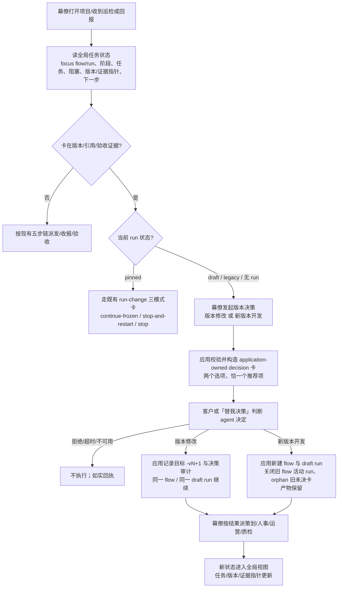
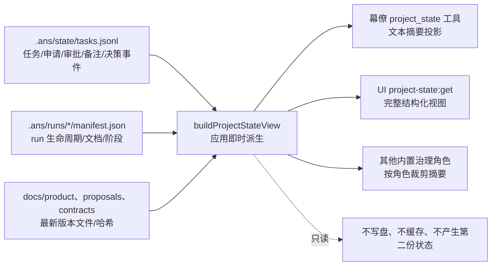
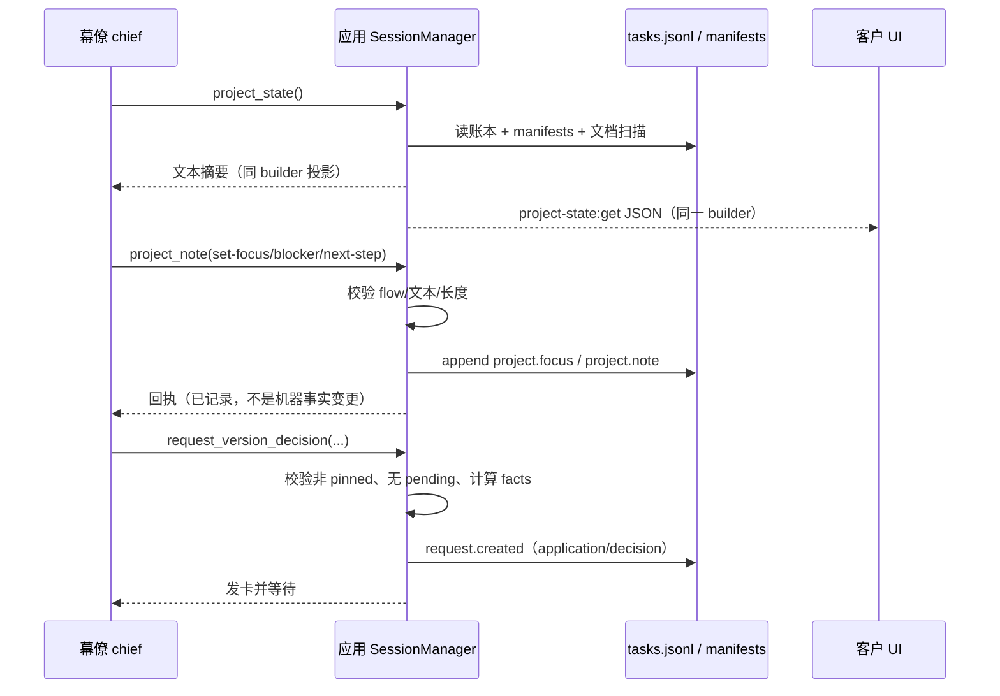
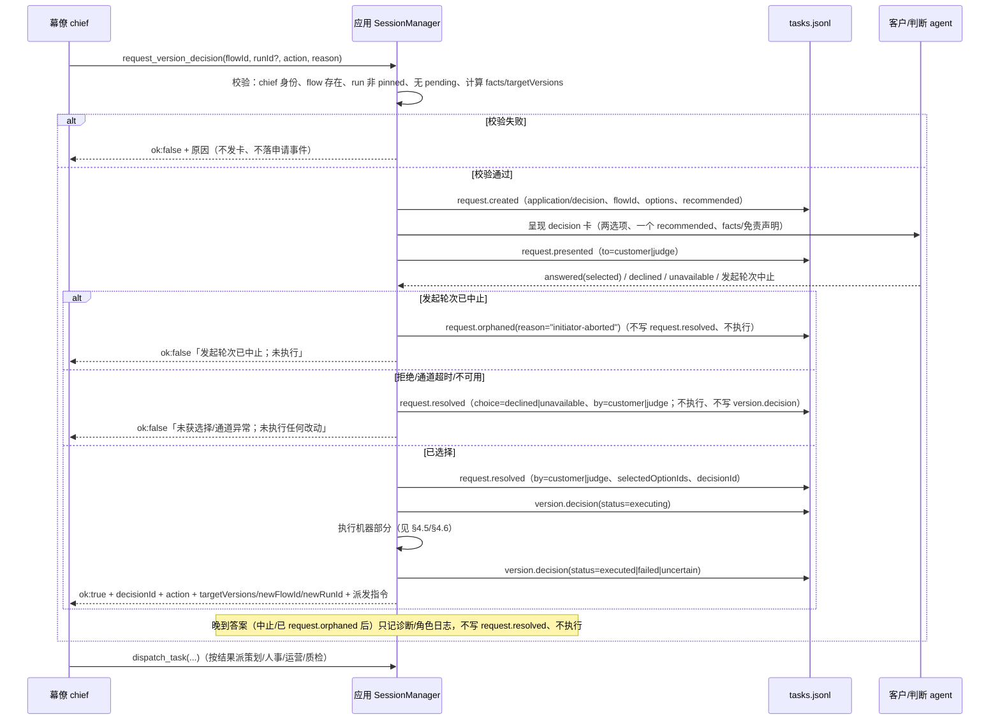
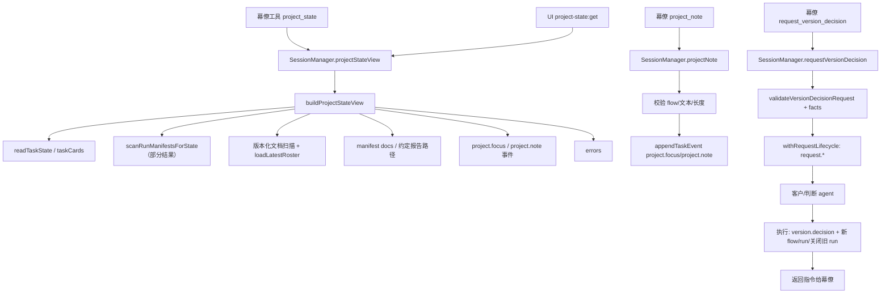

# 策划方案 P1.3：幕僚的全局任务状态与版本决策权

- 日期：2026-11-02
- 角色：ANS 策划（Planning），独立上下文
- 状态：**草案 P1.3**（P1.1 已按独立完整复核 F1–F13 逐项处置并经再复核；P1.2 为 R1–R5 窄修订；P1.3 为 D-04 兼容的 blocker kind 窄更正（内部 id 改为 `rework-pending`），语义/范围/T3/写权/验收边界不变；待沟通核对 P1.3；待闸门 1 客户确认；**未实施、未测试、未验收、未 commit/push**）。客户在闸门 1 确认的版本才是实施与验收基线；实施还需闸门 2 角色指派确认与客户实施授权。
- 风险档位：**T3（建议）**。理由见 §10.3；如果客户把范围收窄成「只读全局视图 + 幕僚备注」而不含版本决策执行，可降为 T2。
- 闸门 0 依据：`docs/communication/2026-11-02_intent_global-task-state.md`（83 行，SHA-256 `baf327b9299c0fa2d2c5482f296044cf3c750a3f8b63d35ef9b765a257afebc6`；客户确认「全局任务状态 + 幕僚版本决策权，按发卡确认方式行使」）。
- 独立复核：`docs/planning/2026-11-02_review_global-task-state-version-authority.md`。**P1.0 复核快照：103 行 / SHA-256 `3b8d3a3ad407a1da71940d9d26b8aaa98665f50fc2759daafc27c57a8ae3fc07`**（对 P1.0 1252 行 / `0173fe50…` 的完整复核，结论「建议修订后提交」，F1–F13；P1.1 已逐项处置，见 §13）。**当前复核记录（P1.1 再复核，2026-11-02）：148 行 / SHA-256 `22128e59904ab8de10ede64f7acc478069c752198fc3b87c043f5dab4434c5a8`**，结论「建议提交客户确认」，新发现 R1–R5（P1.2 处置见 §13）。两者不是同一快照，不混用；复核记录由复核上下文维护，本方案不改写。复核不是批准、不是客户确认、不是实施授权。
- 代码基线：worktree `flow-improvements-wave1`，HEAD `0a123109a6b10e9b60fd1aee5f08f861455c48de`。本文所有行号均为该快照的只读核对结果；实施以符号名与文本锚点为准。
- 标记约定：**[现状]** 已只读核实的代码/测试行为；**[设计候选]** 本方案提议、未实施；**[待客户决定]** 见 §12。

**版本记录**

| 版本 | 日期 | 变更摘要 | 状态 |
| --- | --- | --- | --- |
| P1.0 | 2026-11-02 | 初稿：产品方案、现状核实、全局状态设计、版本决策权、UI/角色卡、架构、共享契约、兼容/恢复、测试与 AC、风险与阶段、选装、Q1–Q6 | 草案；已完整复核（F1–F13，结论「建议修订后提交」） |
| P1.1 | 2026-11-02 | 处置复核 F1–F13：唯一 requestId/attempt 计数与拒绝/中止重试测试；run manifest 部分结果扫描；`tasks[]` 与 `TaskCardView` 投影对齐；unclosed/superseded 计数统一；resolved→executing 崩溃窗口对账；晚到答案单一语义；账本轮转保留披露；多 draft 的 runId 作用域；blocked/failed 分离；移除 `scopeOrArchitectureWrong`/`appSuggestedAction` 启发式；AC-7.1 拒绝口径；README 事件清单同步；补既有 application-owned 决定卡先例 | 草案；已再复核（148 行 / `22128e59…`，建议提交客户确认，R1–R5）；未确认、未实施 |
| P1.2 | 2026-11-02 | R1–R5 窄修订：**R2** 统一「通道超时/不可用 → `request.resolved`（`declined`/`unavailable`），不执行、不写 `version.decision`」与「发起轮次中止 → `request.orphaned(reason:"initiator-aborted")`，不写 `request.resolved`、不执行」；晚到答案只记诊断/角色日志（§4.4 时序图/表、§4.7、§7.2、AC-7.1、AC-8.5）；**R4** `new-version-development` 关闭旧 flow 的**全部**活动 run（含多个 draft；`closeReason` 含 `superseded-by:<newFlowId>/<newRunId>`；请求 `runId` 只作决策上下文；执行前发现 pinned 异常先 fail-closed，不关闭任何 run）（§4.3/§4.6/§7.2/AC-5.2）；**R5** 复核引用区分 P1.0 快照（103 行 / `3b8d3a3a…`）与再复核记录（148 行 / `22128e59…`）（方案头/§13）；R1/R3 必要披露（active run 从部分扫描派生；执行期 pinned 写 `version.decision(status:"failed", message:"run-change-required")`，F5 扫描排除已 orphaned）（§3.2/§6.1/§6.4/AC-1.4/§4.6/§8.4/AC-5.6/AC-8.3） | 草案；待沟通核对 P1.2；未确认、未实施 |
| P1.3 | 2026-11-02 | D-04 兼容窄更正：为兼容 2026-10-28 D-04 撤除残留守卫，blocker kind 内部 id 由 `acceptance-rework` 改为 `rework-pending`（仅 §3.4 字面量；`blockers[].kind` 的语义、匹配规则与 AC 不变）；不改 Q1–Q6/C1–C7/O1–O11、范围、T3、写权/验收边界与其它契约 | 草案；待沟通核对 P1.3；未确认、未实施 |

---

## 0. 摘要（先读这段）

**场景。** 幕僚（chief）打开一个正在推进的项目：磁盘上有三个 draft flow（`xianxia-brotato`、`xianxia-brotato-b`、`xianxia-brotato-c`），提案已经到 v7、名单到 v14，最近的验收卡又被判断 agent 以「规范物证缺失」退回，两个任务卡在 blocked。幕僚不知道「现在到底哪个 flow 生效、卡在哪个阶段、该修哪份文档」，于是再次新建一个 flow，循环继续。

**本方案给幕僚两件东西：**

1. **一个项目级、跨 flow 的全局任务状态视图**：当前生效的 flow/run、阶段、所有未收口任务及状态、阻塞与卡点、版本/证据指针、下一步。它由应用从现有机器事实（`.ans/state/tasks.jsonl` 与 `.ans/runs/*/manifest.json`）**即时派生**，不落第二份状态；幕僚通过只读工具和 UI 查看，并通过受控工具写「当前 flow / 阻塞备注 / 下一步」这类**具名备注**。机器事实仍由应用独占写入。
2. **一个受控的版本决策权**：当版本/引用/验收证据卡住时，幕僚可以提出「**版本修改**」（同一 flow 出 `-vN+1`，修引用/名单/架构，继续当前 run）或「**新版本开发**」（应用新建 flow/run，关闭旧 flow 的活动 run，重新走流程）。应用发一张 **decision 卡**（复用现有卡种，不新增 cardKind），由客户或「替我决策」判断 agent 决定；应用只执行机器部分（新 flow/run、关闭旧 run、审计），**不写文档、不派角色、不创建任务**。幕僚只提议，不代选。

**一句话：** 幕僚先看一张「项目现在在哪、卡在哪、下一步是什么」的全局状态；卡住时它可以在「修当前版本」和「干净重开」之间发起一张客户/判断 agent 决定的路线卡，而不是自己新建 `-b/-c` flow。

**边界：** 不改验收判定、证据规则、写权/边界、客户闸门、run-change 三模式、人事 D3/写卡；不自动修复当前修仙 run；不把「新版本开发」变成绕过客户确认或规避验收的通道。

---

## 1. 产品方案

### 1.1 问题与场景

**问题一：缺少项目级、跨 flow 的「现在在哪」。**

- `tasks.jsonl` 只有**逐任务**事件（`task.created`/`delivered`/`reported`/`closed`/`redispatch`）和申请/审批事件；每个任务可带 `flowId`/`runId`/`runState`/`runStage`（`src/model/runtime.ts:685-715`；`app/desktop/session.ts:6299-6324`），但没有一个项目级汇总告诉你「哪个 flow 是当前、run 是什么状态、哪些任务还开着、卡在什么阶段」。
- `run manifest` 按 flow/run 分开存放在 `.ans/runs/<runId>/manifest.json`（`src/common/编排/run-manifest.ts:58-80`、`:119-125`），只描述单个 run 的文档、角色、阶段和冻结状态；没有跨 flow 的「当前生效」概念。
- 幕僚现有工具只有 `dispatch_task`/`redispatch_task`/`terminate_role_run`/`role_status`/`session_tail`/`role_activity_log`/`contract_check`（`src/provider/runtime/tools.ts:2112-2204`、`:2385-2474`、`:2485-2570`、`:2576-2644`；注入见 `app/desktop/session.ts:2440-2504`）。`role_status` 缺省能给项目内各角色的运行态概览（忙闲/会话/队列/最近日志，`app/desktop/session.ts:7299-7390`），但没有一个入口能读全项目任务账本、当前 flow/run、版本指针和阻塞。
- 结果：在 2026-10-31/11-02 的修仙游戏 dogfooding 中，幕僚在方案卡被判断 agent 以「规范物证缺失」退回后，连续新建 `xianxia-brotato`、`xianxia-brotato-b`、`xianxia-brotato-c` 三个 flow；提案 v1–v7、名单 v1–v14，但没有任何全局状态告诉它「当前哪个 flow 生效、卡在哪个阶段、应该修什么」。三个 manifest 都是 `draft`（不是 `pinned`），所以 run-change 三模式卡（只对 pinned run 发起，`app/desktop/session.ts:1912-1931`）也不适用。

**问题二：幕僚在版本/引用/验收证据卡住时没有受控的路线选择权。**

- 幕僚没有 `run-change` 工具；run-change 三模式卡由应用构造（`src/common/编排/run-manifest.ts:696-730`），决定者是客户或「替我决策」，且只对 pinned run 发起（`app/desktop/session.ts:1927-1931`）。
- `request_requirement_change` 只注入策划/运营（`app/desktop/session.ts:2453-2467`），幕僚不能用它来表达「当前流程怎么继续」。
- 幕僚能做的只有：`dispatch_task` 重新派发、`redispatch_task` 有限重派、`terminate_role_run` 终止卡死轮次；它不能选择「修当前版本继续」还是「干净重开」。于是 ad hoc 新建 flowId 成了事实上的逃生口。

**问题证据（不作为本方案范围）。** 同一次 dogfooding 还暴露：UI 加载触发 demo 重复投递，写 `src/evil.ts` 被边界拒绝；roster/module/引用校验形成循环。这些说明全局状态和版本决策的必要性，但**不在本方案的必做范围**；是否顺带修 roster/demo，见 §11.2 独立事项。

### 1.2 目标与成功

**目标。**

1. 幕僚（以及按需读取的其他角色/客户）能看到**一个**项目级视图：当前 focus flow/run、阶段、任务及状态、阻塞与卡点、版本/证据指针、下一步。
2. 幕僚能对「当前 flow 卡在版本/引用/验收证据」发起一次受控的**版本决策**：版本修改或新版本开发；应用发 decision 卡，客户/「替我决策」决定；应用执行机器部分并审计。
3. 不再需要靠 ad hoc 新建 `-b/-c` flow 来逃生；新 flow 由应用按确定性命名创建，旧 flow 的活动 run 被关闭并留下 supersede 记录，产物保留。
4. 机器事实仍由应用独占写入；幕僚的备注和路线选择都有归属、可回看、可审计；申请≠批准、路线≠内容批准、验收/证据/写权边界不变。

**成功后的用户可见结果。**

- 幕僚在聊天里请求全局状态，得到一段可核对的摘要：`focus: xianxia-brotato / run-… / draft / 未定义阶段；未收口任务 4（blocked 2）；阻塞：验收卡被退回 2 次、proposal 最新 v7 但 run 未 pin；下一步：先决定版本路线`。
- 客户在 UI 的「项目状态」区看到同样的数字和阻塞列表；点开能看到每个 flow 的 run、任务、最新/钉住版本和证据指针。
- 卡住时，幕僚发「版本决策」卡：两个选项，一个「幕僚建议」标记；客户或判断 agent 选择后，应用创建新 flow/run 或记录版本修改目标；幕僚按结果派策划/人事/运营，流程继续。
- 如果判断 agent 代选，系统行明确写「判断 agent 代批，不是客户本人点击」；如果客户拒绝或超时，什么都不改。

**失败/降级时的用户可见结果。**

| 情形 | 用户看到 | 系统做什么 |
| --- | --- | --- |
| 没有 focus、且有多个活动 flow | 「当前 flow 未指定；活动 flow：A、B、C。请幕僚设置当前 flow。」 | 不猜最新 flow；不发起版本决策；列出候选。 |
| 当前 flow 有多个 draft run | 「当前 flow 有多个 draft run（…）；请指定 runId。」 | 版本决策请求 fail-closed；全局视图列出全部。 |
| 当前 run 是 pinned | 「当前 run 已冻结；版本决策不适用，请走『契约变更 · 重开 run』。」 | 不发版本决策卡；不改 run；指向既有 run-change 入口。 |
| 应用读任务账本/ manifest 失败 | 「状态读取部分失败：N 条坏行、M 个 manifest 不可读；以下为可读部分。」 | 返回可读部分 + `errors[]`；不伪造完整。 |
| 客户/判断 agent 拒绝或超时 | 「版本决策未获选择；未执行任何改动。」 | 不创建 flow/run、不关 run、不写文档、不派角色。 |
| 执行到一半失败 | 「新 flow 已创建，但旧 run 关闭失败：…；请核对后再继续。」 | 记录 `version.decision` 失败/待核对状态；不声称成功；可重试/人工处理。 |
| 其他角色读取 | 只看到与自己相关的任务摘要和 focus flow 聚合，不看别的角色任务正文。 | 按角色裁剪的只读视图；写意图工具不注入。 |

### 1.3 完整产品流程



### 1.4 范围与非目标

**In scope（本方案要解决）。**

- 全局任务状态：派生视图、字段、只读工具、UI 呈现、幕僚的 focus/阻塞/下一步备注（受控事件）。
- 版本决策：触发信号、卡型/选项/推荐规则、应用发卡与决定、执行语义（版本修改/新版本开发）、审计、与 run-change/需求变更的边界。
- 任务账本的**加法式**扩展：新事件 kind（`project.focus`/`project.note`/`version.decision`）与 `request.orphaned.reason` 的可选值扩展；旧记录读取不变。
- 共享契约、兼容/恢复、测试、AC、选装、风险与阶段。

**Out of scope（明确不改）。**

- 验收判定、验收卡语义、证据路径/规范物证规则、`evidence_check` 的判定逻辑。
- 写权/边界（Section 1、`resolveWrite`、`TaskScope`、forbiddenWritePaths）、shell 守卫、版本化文档只读保护。
- 客户三道闸门（意图/方案/角色指派）、人事 D3/`appointment-write`、角色卡/边界文本（本方案不改，只提出后续对齐项）。
- run-change 三模式卡的语义与显式入口；本方案不新增 run-change 自动批准，也不复活 `run-change-auto-approve`。
- `request_requirement_change` 的通道与语义；需求变更仍只由策划/运营发起。
- 自动修复当前修仙 run；自动派发角色；应用代替幕僚写任务；应用自动写文档/创建角色/写角色卡。
- 派发护栏放宽（P1.1）的既有范围；本方案不修改派发受理矩阵。
- demo 重复投递、roster/引用校验循环的根因修复（列为独立事项，见 §11.2）。

### 1.5 术语

| 术语 | 含义 |
| --- | --- |
| **全局任务状态** | 项目级、跨 flow 的只读派生视图：focus flow/run、阶段、任务状态、阻塞、版本/证据指针、下一步。它不是第二份持久化状态。 |
| **焦点（focus）** | 幕僚通过受控备注指定的「当前推进的 flow/run」；应用校验其存在性，视图把它与机器事实分开展示。 |
| **活动 run** | `state` 为 `draft` 或 `pinned` 的 run manifest（`run-manifest.ts:40`、`:240-251`）；`closed`/`cancelled` 是历史。 |
| **阻塞/卡点** | 应用从账本/manifest 派生的信号（blocked/failed 任务、未决申请、验收退回、版本漂移、重派耗尽）或幕僚的具名备注；不是验收结论。 |
| **版本修改** | 同一 flow 内出新版本（`-vN+1`），修引用/名单/架构，继续当前 draft run。应用不写文档。 |
| **新版本开发** | 应用新建 flow 与 draft run，关闭旧 flow 的活动 run，保留旧产物；重新走产品意图→方案→招人→实现→验收。 |
| **路线决策** | 版本决策卡的选择：版本修改 vs 新版本开发。它是流程路线，不是对新版本内容、验收或客户闸门的批准。 |
| **机器事实** | 由应用独占写入的 `.ans/state/tasks.jsonl` 事件与 `.ans/runs/*/manifest.json`；幕僚和角色不可直接写。 |
| **具名备注** | 幕僚通过受控工具提交、应用校验后追加到同一账本的归属事件（focus/blocker/next-step）；它不是机器事实。 |

---

## 2. [现状] 只读核实

### 2.1 任务账本与任务状态

| # | 位置 | [现状] |
| --- | --- | --- |
| 2-1 | `src/common/编排/task-state.ts:31` | 账本路径 `.ans/state/tasks.jsonl`；模块注释明确 **app-only、append-only、角色不可写**。 |
| 2-2 | `src/common/编排/task-state.ts:39-47` | 事件 kind 白名单：`task.created/delivered/reported/closed/redispatch`、`delegation.changed`、`request.created/presented/resolved/notified/orphaned`、`approval.created/resolved/expired`。 |
| 2-3 | `src/common/编排/task-state.ts:274-422` | 逐 kind 形状校验：`task.created.from` 只能是 chief/convener；`task.created.flowId` 存在时必须有 `runId`+`runState`（除非 `allowLegacyRun`）；`request.created` 可带 `cardKind`，`request.resolved` 可带 `selectedOptionIds`/`decisionId`/`by`。 |
| 2-4 | `src/common/编排/task-state.ts:425-480` | 重放：创建记录、归并 delivered/reports/closed/redispatch；坏行跳过并记录；未收口任务按创建时间排序。 |
| 2-5 | `src/common/编排/task-state.ts:542-549` | 任务派生状态：`created`/`delivered`/`reported`/`closed`/`failed`；最后一条报告 `failed` 即 `failed`。 |
| 2-6 | `src/common/编排/task-state.ts:574-603` | `TaskCardView` 已带 `flowId`/`runId`/`runState`/`runStage`/`moduleId`/`modulePaths`/`status`/`lastReport`/`closed`/`reports`。 |
| 2-7 | `app/desktop/session.ts:4049-4062`；`app/desktop/interface.ts:727`、`:2412-2415` | `listTasks` 只读重放任务账本，返回 `TaskListView {projectRoot, tasks, errors, unclosed}`；UI `TaskCenterPanel.tsx:63-315` 逐任务展示，无跨 flow 聚合、无版本/证据指针。 |
| 2-8 | `app/desktop/session.ts:6141-6324` | 派发时应用尽力确定 run 锚点：`findActiveRun`/`ensureDraftRun`；draft 直接锚定；pinned 只有 `verifyPinnedRun` 通过且目标/模块覆盖时才锚定；任务事件带 `flowId`/`runId`/`runState`/`runStage`。 |
| 2-9 | `app/desktop/session.ts:3882-4041` | 申请生命周期：`request.created → presented(customer/judge) → resolved → notified(chief)`；`request.resolved` 记录 `cardKind`、`selectedOptionIds`（非 appointment）、`by`、`operatorId`、`judge`。 |
| 2-10 | `app/desktop/session.ts:4073-4107` | 重启恢复：未决 `request.created` 标 `request.orphaned`（reason `restart`），不自动执行原动作，并通知幕僚。 |

### 2.2 幕僚能力与注入

| # | 位置 | [现状] |
| --- | --- | --- |
| 2-11 | `src/common/门禁引擎/governance-roles.ts:140-163` | 幕僚卡文本：工作流管理、按序派发、短报汇总、运行日志巡检；不批准、不写账本/flow/gate、不代标 delivered。 |
| 2-12 | `src/common/门禁引擎/governance-roles.ts:258-294` | 幕僚 Section 1 只有 `docs/intents/`；能力位 `customerInput:true`、`dispatchTask:true`、`roleStatus:true`、`sessionTail:true`；禁写 `.ans/**`、`角色卡/**`、`docs/product、proposals、contracts、scheduling、quality、verification、skills、mcp`。 |
| 2-13 | `app/desktop/session.ts:2440-2504` | 派发/只读/终止/重派能力注入：`dispatchTask` 给 chief/schedule；`roleStatus`/`sessionTail` 给 chief/legacy su；`roleActivityLog`/`terminateRoleRun`/`redispatchTask` 只给 chief；`requestRequirementChange` 只给 proposal/schedule。 |
| 2-14 | `src/provider/runtime/tools.ts:3070-3259` | 工具「注入才注册」：未注入能力时工具不存在（结构性 fail-closed）；`buildGovernedTools` 统一构造。 |
| 2-15 | `app/desktop/session.ts:2459-2462`、`:2788-2803` | `application:true` 的 run-change 卡可经统筹/提案/幕僚任一有客户卡通道的会话呈现；`requirementChangeCard` 通道只在这些治理会话构造。 |
| 2-16 | `src/common/编排/decision-card.ts:36`、`:86-145` | `cardKind=decision` 的角色发行上限是 `convener`/`rapporteur`；`application:true` 的应用自有卡**不借用角色发行槽位**，绕过角色 allowlist，但仍校验 `kind=choice`、`flowId`、≥2 选项、选项 id 不重复、恰一个 `recommended:true`。 |
| 2-17 | `src/model/runtime.ts:388`、`:420-427`、`:440-450` | 卡种枚举仍为 `proposal/appointment/acceptance/intent-confirm/decision` + `appointment-write`；`decision` 属于「替我决策」组；`GovernanceCardMetadata.application/sourceRoleId` 只由应用侧设置。 |

### 2.3 run 状态与 run-change

| # | 位置 | [现状] |
| --- | --- | --- |
| 2-18 | `src/common/编排/run-manifest.ts:40`、`:58-80` | `RunState = draft/pinned/closed/cancelled`；manifest 记录 `flowId`、`state`、`documents`、`execution`、`rosterVersion`、`d3`、`stage`、`roles`、`runChange`。 |
| 2-19 | `src/common/编排/run-manifest.ts:240-251` | `findActiveRun`：同 flow 的活跃 run 为 draft/pinned；多个 pinned 视为冲突；否则优先 pinned，其次最新 draft。 |
| 2-20 | `src/common/编排/run-manifest.ts:254-285` | `ensureDraftRun`：已有活跃 run 复用；无则创建 draft；可领养 `pending` draft。 |
| 2-21 | `src/common/编排/run-manifest.ts:546-565` | `closeRun`：把 draft/pinned 置为 `closed`/`cancelled`，写 `closedAt`/`closeReason`；已关闭幂等返回。 |
| 2-22 | `src/common/编排/run-manifest.ts:616-667` | `applyRunChange`：`continue-frozen` 不改 run；`stop-and-restart` 关闭旧 run 并在**同一 flow** 创建新 draft；`stop` 取消。记录 `runChange`（decisionId、mode、decidedBy、old/new run、oldHashes/newHashes）。 |
| 2-23 | `src/common/编排/run-manifest.ts:696-730` | `buildRunChangeCard`：复用 `decision` 卡，`application:true`、`sourceRoleId:"application"`、三选项 `continue-frozen`（推荐）/`stop-and-restart`/`stop`。 |
| 2-24 | `app/desktop/session.ts:1912-2022` | `requestRunChangeDecision`：只对 **pinned run** 发起；会话选择顺序 `convener → rapporteur → chief`；无 pinned/无可呈现会话/无通道 ⇒ fail-closed。 |
| 2-25 | `app/desktop/session.ts:2082-2130` | 冻结 run 上出现更新版本提案卡时，应用自动呈现 run-change 卡一次；提案卡以 `run-change-required` 拒发（未呈现，不冒充客户拒绝）。 |
| 2-26 | `src/common/编排/run-manifest.ts:832-863` | `findNewerContractDocs`：pinned run 的同类契约文档中，磁盘版本号严格大于 pin 的项；只提供事实，不激活新版本。 |

### 2.4 版本化文档与本次循环

| # | 位置 | [现状] |
| --- | --- | --- |
| 2-27 | `src/common/门禁引擎/versioned-doc-guard.ts:16-24` | 版本化文档路径：`docs/product/<flow>-intent-vN.md`、`docs/proposals/<flow>-{proposal,roster,modules,topology}-vN.md`、`docs/contracts/<flow>-{architecture,assets}-vN.md`。 |
| 2-28 | `src/common/门禁引擎/versioned-doc-guard.ts:55-70` | 覆盖既有版本化文档 ⇒ `versioned-doc-overwrite` 拒绝（不进入审批）；新建 vN+1 不受影响。 |
| 2-29 | `src/common/编排/run-manifest.ts:354-499` | pin 前要求 intent/proposal/modules/roster/architecture 五类最新版本文档 + schema + roster 一致性；任一缺失/漂移 fail-closed。 |
| 2-30 | `docs/communication/2026-11-02_intent_global-task-state.md` | 修仙 run 的提案 v1–v7、名单 v1–v14、模块/引用校验循环、判断 agent 以「规范物证缺失」退回、幕僚 ad hoc 新建 `-b`/`-c` flow；三个 manifest 都是 draft。这是本次问题的现场证据。 |

### 2.5 为什么不能直接给幕僚读 `tasks.jsonl`

- 账本按任务逐行；要得到「当前 flow/run、阶段、阻塞、版本/证据指针、下一步」，模型必须自己扫描、聚合、解释文本，结果不确定，还会看到不需要的其他角色任务正文。
- `tasks.jsonl` 是应用独占运行数据，不是给人读的文档；直接暴露原始账本会鼓励模型把「读到的某行」当成当前状态。
- 现有 `role_status` 缺省给角色运行态概览（忙闲/会话/队列/最近日志），`contract_check` 只给契约摘要，`session_tail` 只给会话尾部；它们都不是任务/flow/run/版本/证据的项目级聚合。

### 2.6 不需要单独调研方案

现状已只读核实到符号与行号；剩余未决点是**产品选择**（§12）与**实施细节**（§6/§8），不是需要先查清根因的事实。因此本方案不另写调研方案。

---

## 3. 全局任务状态设计

### 3.1 形态选择与理由

闸门 0 给出 Q1 四个形态：

| 选项 | 做法 | 优点 | 代价/风险 |
| --- | --- | --- | --- |
| A | 扩展现有 `tasks.jsonl`：应用代理的只读全局视图 + 受控备注事件 | 单一事实源；审计同账本；无第二份状态；旧记录可读 | 需要新增事件 kind 和受控工具；账本 schema 加法扩展 |
| B | 新增幕僚-owned 项目状态文档（Markdown/JSON） | 幕僚可直接写、可读 | 第二套状态；易漂移；无审计；应用要解析文档；幕僚写权需扩大 |
| C | 只给幕僚只读全局视图 | 最小 | 幕僚不能设 focus/标记阻塞/写下一步；遇到多 flow 仍无法表达「当前」 |
| D | A+B 结合 | 兼顾 | B 的第二状态问题仍在；维护两套 |

**推荐：A（必要时加一个受控备注通道），不选 B/D。** 具体是：

- **机器事实**继续只来自 `.ans/state/tasks.jsonl` 与 `.ans/runs/*/manifest.json`；
- **幕僚的 focus/阻塞/下一步**作为**归属给幕僚的 append-only 事件**写进**同一个** `tasks.jsonl`（`project.focus`/`project.note`），由应用校验后写入；
- **全局视图**是应用每次读取时**即时派生**的只读结果，不落盘、不缓存为第二份状态；
- 可选 O2 才考虑「生成一份只读快照文档」，默认不做。

**为什么不选 B。** 幕僚写状态文档会造出第二套事实：文档说 flow A 是当前，manifest 说 flow B 刚 pin；谁对？没有仲裁。而且幕僚的默认写区只有 `docs/intents/`（`governance-roles.ts:264-283`），要写项目状态文档就得扩写权，属于治理变更，收益不抵成本。把备注写进账本，天然带时间、归属和审计。

### 3.2 单一事实源与派生视图



**派生规则（全部由应用实现，UI/角色不重算）：**

1. **任务**：重放 `tasks.jsonl`（复用 `readTaskState`/`taskCards`）；每条任务带自己的 `flowId/runId/runState/runStage`（可能为空，按 legacy/未归属处理）。
2. **flow 枚举**：合并三类来源——run manifest 的 `flowId`、任务 `created.flowId`、`docs/product|proposals|contracts` 中版本化文件名解析出的 flowId；同一 flowId 合并。
3. **run 枚举**：每个 flow 列出所有 manifest（draft/pinned/closed/cancelled），并从**部分扫描结果**（`scanRunManifestsForState`）经 `deriveActiveRunFromManifests` 派生当前活跃 run（复用冲突/优先级规则；不调用 all-or-nothing 的 `findActiveRun`，R1）；多个 draft 时全部列出，不擅自选。
4. **focus**：取最新 `project.focus` 事件；若该事件 `cleared:true` → `focus:none`（尊重幕僚清除，不再自动派生）；若没有事件，且**恰好一个**有活跃 run/未收口任务的 flow，则派生该 flow（`selectedBy:"derived"`）；否则 `focus:none`，列出候选，**不猜最新创建的 `-c`**。
5. **阶段**：来自 focus run 的 `manifest.stage.current`；draft 无 stage 时如实显示「未定义阶段」，不从任务文本猜。
6. **阻塞**：按 §3.4 的派生规则从账本/manifest 计算；再加幕僚备注。
7. **版本指针**：对 focus flow（以及其他 flow 的最新版本，可选）扫描版本化文档，取每个 kind 的最新版本；若 focus run 是 pinned，取 manifest 钉住的版本并比较是否 `newerThanPinned`。
8. **证据指针**：从任务的结构化字段（`requestedEvidence`、`modulePaths`）、验收申请（`request.created.cardKind="acceptance"`）、按约定路径存在性（如 `docs/quality/<flowId>-report-v1.md`）生成**指针**；不读任务正文、不读报告正文、不判断证据是否合格。
9. **下一步**：取最新 `project.note(kind="next-step")`；没有则由应用派生一句建议（例如「先设置 focus flow」「当前 run 未 pin，实现/验收前需 pin」），并标明 `source:"derived"`。
10. **错误**：坏行、manifest 不可读、文档扫描失败放入 `errors[]`；部分结果照常返回。manifest 使用**部分结果扫描**（见 §6.1/§6.4），单个非法 manifest 不丢弃其他 flow；`listRunManifestsResult` 的 all-or-nothing 语义不在本视图复用。

### 3.3 字段（`ProjectStateView`，schema `project-state/v1`）

> 字段是给 UI/工具/契约用的稳定形状；本文不写 TypeScript 代码。实现时可放 `src/model/project-state.ts`（共享 Model）与 `src/common/编排/project-state.ts`（派生逻辑）。

| 组 | 字段 | 来源 | 说明 |
| --- | --- | --- | --- |
| 元信息 | `schema`、`generatedAt`、`projectRoot` | 应用 | 只读快照时间；不做持久化版本。 |
| 焦点 | `focus.flowId`、`focus.runId?`、`focus.runState`、`focus.stage?`、`focus.selectedBy`（`chief`/`application`/`derived`/`none`）、`focus.updatedAt`、`focus.stale` | `project.focus` + manifest | `selectedBy:"application"` 表示新版本开发执行后的自动切换；`stale=true` 表示指针指向已关闭 flow/run；视图会提示并列出候选。 |
| flow 列表 | `flows[].flowId`、`flows[].sources`（run/task/docs）、`flows[].runs[]`、`flows[].taskCounts`、`flows[].lastActivityAt`、`flows[].supersededBy?` | manifest + 账本 + 文档扫描 | `runs[]` 含 `runId/state/stage/createdAt/updatedAt/pinnedAt/closedAt/closeReason/rosterVersion/documentKinds`；`supersededBy` 来自 `version.decision`。 |
| 任务 | **`TaskCardView` + 派生字段**：`taskId`、`retryOf?`、`targetRoleId`、`text`、`expectedOutput?`、`requestedEvidence?`、`moduleId?`、`moduleDirectory?`、`modulePaths?`、`flowId?`、`runId?`、`runState?`、`runStage?`、`sideEffect`、`status`、`createdAt`、`deliveredAt?`、`lastReport?`、`closed?`、`reports`，再加 `from`、`blocked`（仅最后报告 `blocked`）、`failed`（最后报告 `failed`）、`redispatchCount` | `taskCards` + `record.created.from` + 重派链 | 完整视图（UI/chief）含 `text`/`reports`；工具文本摘要用有界 `summary`（`shortenSummary(text)`）而不是全量正文；其他角色裁剪后只含自己的任务。默认返回全部未收口任务 + 每个 flow 最近 N 条已收口（N 默认 50），超出 `truncated`。`blocked`/`failed` 分开，不合并。 |
| 阻塞 | `blockers[].id`、`kind`、`flowId?`、`runId?`、`taskId?`、`requestId?`、`summary`、`since?`、`source`（`app`/`chief`） | 派生 + `project.note` | `kind` 见 §3.4；`source:"chief"` 的项来自备注，不改机器事实。 |
| 版本 | `versions[].flowId`、`docKind`、`latest{path,version,sha256?}`、`pinned{path,version?,sha256?}`、`newerThanPinned`、`referenceIssue?` | 文档扫描 + manifest | 只做「最新/pin/版本号」比较；`referenceIssue` 只在对应文档存在但解析/引用失败时给出；缺失文档按 `latest:undefined` 表示，不误报 `reference-invalid`。 |
| 证据 | `evidence[].flowId`、`kind`（`acceptance-card`/`verifier-report`/`task-evidence`）、`ref`、`summary`、`status`、`at?` | 账本 + 约定路径 | 指针，不是证据有效性结论。 |
| 备注 | `notes[]`（`kind`、`text`、`refs?`、`at`、`roleId:"chief"`） | `project.note` | 按 `noteKey` 取最新 active 状态；`nextStep` 是其中一类。 |
| 下一步 | `nextStep{text, source:"chief"或"derived", at}` | 备注或派生 | 幕僚备注优先；没有则派生建议。 |
| 错误 | `errors[]`（`source`、`message`） | 应用 | 坏行/manifest/扫描错误；不影响可读部分。 |
| 截断 | `truncated`、`counts` | 应用 | 有界输出，避免大项目把工具结果撑爆。 |

**计数口径（F4 统一）：** 顶层 `counts.unclosed = state.unclosed.length`（账本**全部**未收口，含 superseded），与任务中心 `unclosed` 严格一致；`counts.supersededUnclosed` = 其中所属 flow 已 superseded 的子集；`counts.activeUnclosed = unclosed - supersededUnclosed`；`counts.blocked`/`counts.failed` 只统计**活动 flow**（不含 superseded），UI 文案标明「活动」。`counts.pendingRequests` 统计未决申请。`flows[].taskCounts` 是每个 flow 的明细。这样既与任务中心一致，也不会把旧 flow 的 blocked/failed 当成当前卡点。

**投影方式：** UI 经 `project-state:get` 拿完整结构化视图；幕僚/其他角色的工具拿同一 builder 的**文本摘要投影**（focus、计数、**全部未收口任务（有界）**、前 N 个阻塞/版本、下一步；可选 `flowId` 过滤），建议 ≤8 KiB，超出截断标注。摘要与完整视图同源，不另写派生逻辑。

**有界性：** 默认最多 50 个 flow、500 条任务、每 flow 20 条版本指针、50 条证据指针；超出置 `truncated=true` 并保留计数。工具文本输出建议 ≤8 KiB（沿 `role_status` 的 8 KiB 上限，`src/provider/runtime/tools.ts:2274-2296`）。

### 3.4 阻塞/卡点的派生规则

| kind | 触发（应用只读派生） | 含义 |
| --- | --- | --- |
| `task-blocked` | 未收口任务的最后报告 `status:"blocked"` | 角色明确报告阻塞。 |
| `task-failed` | 最后报告 `status:"failed"` | 角色报告失败；不等于验收失败。 |
| `request-pending` | `request.created` 无对应 `request.resolved`/`request.orphaned` | 有客户卡/审批卡未决；列出 requestId、来源角色、标题。 |
| `rework-pending` | 按 `requestId` 关联 `request.created`（`cardKind:"acceptance"`，取 `flowId`）与 `request.resolved`，选择 `reject`（或 `selectedOptionIds` 含 `reject`）≥1；或验收返工任务未收口 | 验收证据/返工循环信号；不是验收结论。 |
| `redispatch-exhausted` | 同任务链 `redispatchCountOf >= 2` 且未收口/最后报告 blocked/failed | 自动重派耗尽（`task-state.ts:630-642`）。 |
| `version-drift` | focus run 为 pinned 且 `findNewerContractDocs` 非空 | 磁盘有比 pin 新的契约文档；按现有 run-change 处理。 |
| `reference-invalid` | `loadLatestRoster`/`parseProjectRoster`/模块解析失败（`roster-reference-*` 等） | 版本/引用链不合法；只显示原因，不自动修。 |
| `run-ambiguous` | focus flow 有多个活跃 run 且未指定 runId | 需要幕僚/视图指定 run，版本决策 fail-closed。 |
| `focus-stale` | `project.focus` 指向已关闭/不存在的 flow/run | 指针过期；视图列候选，不自动改。 |
| `chief-note` | 最新 active 的 `project.note(noteKind="blocker")` | 幕僚具名阻塞理由；`source:"chief"`。 |

**原则：** 阻塞是**信号**，不是失败判决，也不是验收结论；应用只报事实，幕僚/客户决定下一步。派生规则不读任务正文关键词，不猜意图。已 superseded 的旧 flow 的任务只在旧 flow 明细显示，不进入活动 blockers（避免旧 flow 的 blocked/failed 干扰当前决策）。

### 3.5 写入权威与受控动作

**机器事实（应用独占）。**

- `.ans/state/tasks.jsonl` 只能由应用写（`task-state.ts:1-12` 的纪律；`appendTaskState` 在 `app/desktop/session.ts:3386-3393`）。
- `.ans/runs/*/manifest.json` 只能由应用写（`run-manifest.ts:1-8`）。
- 角色（含幕僚）不能直接写 `.ans/**`；幕僚禁写清单见 `governance-roles.ts:271-283`。

**幕僚受控动作（通过应用工具提交，应用校验后落账）。**

| 动作 | 工具（建议名） | 应用行为 | 不做什么 |
| --- | --- | --- | --- |
| 设置/清除当前 flow/run | `project_note`（`op:"set-focus"`） | 校验 flow 存在（有 run/任务/文档任一）；写 `project.focus` 事件；`cleared:true` 清除 | 不改 run 状态、不改 manifest、不关闭任何东西 |
| 添加/解除阻塞备注 | `project_note`（`op:"blocker"`） | 校验 `noteKey`/文本长度；写 `project.note`（`active:true/false`） | 不把任务标成 blocked、不改任务状态 |
| 设置下一步 | `project_note`（`op:"next-step"`） | 同上；最新 active 覆盖 | 不派发任务、不承诺完成 |
| 发起版本决策 | `request_version_decision` | 校验后发 decision 卡并执行选定路线（§4） | 不写文档、不派发角色、不创建任务 |

**应用执行产生的 focus：** 新版本开发执行成功后，应用追加一条 `project.focus` 指向新 flow/run（`roleId:"application"`、`sourceDecisionId:decisionId`）。它不是幕僚备注，而是路线决定的执行后果；视图照常显示归属，幕僚可再用 `project_note(set-focus)` 调整。

**为什么备注不需要客户卡。** 备注不是批准、不是机器事实，只记录幕僚对「当前 focus/阻塞/下一步」的判断；它不改变任务/run/文档，写入受 flow 存在性、文本长度和审计约束。客户和其他角色能看到它的归属与时间；如果备注内容需要客户决定（例如改变范围/验收），仍走对应闸门/卡，不由备注代替。

**为什么不让幕僚直接写状态文档。** 见 §3.1；另外，幕僚的默认写区只有 `docs/intents/`，扩写权需要治理变更；用受控事件可以在不扩写权的前提下实现「管理」。

**为什么不让幕僚直接改 run manifest / 关 run。** run 冻结/关闭是应用拥有的生命周期（`run-manifest.ts:1-8`）；幕僚的终止/重派只作用于**角色轮次/任务**，不是 run。版本决策的新版本开发由应用执行关闭，且有客户/判断 agent 的决定作依据。

### 3.6 读取者与作用域

| 读取者 | 入口 | 看到什么 | 看不到什么 |
| --- | --- | --- | --- |
| 幕僚 | `project_state` 工具 + UI 全局面板 | 完整视图：所有 flow、未收口任务、阻塞、版本/证据指针、备注、下一步 | 角色会话原文、运行日志原文（仍走 `session_tail`/`role_activity_log`） |
| 其他内置治理角色（产品/策划/人事/运营/质检/旧 su） | `project_state` 只读工具（按角色裁剪） | focus flow/run/阶段、自己的任务、相关 flow 的未收口任务计数与阻塞摘要、focus 版本指针、公开下一步 | 其他角色任务正文、全部 flow 的明细、幕僚私有备注的原文（如需，只给摘要） |
| 项目 worker | 现有任务卡（`renderTaskCardLines` 已带 run/runState/runStage，`task-state.ts:654-671`） | 自己的任务、run/阶段、期望产出、证据提示 | 全局视图工具（默认不注入；O3 可选） |
| 客户/UI | `project-state:get` IPC → 全局面板 | 完整只读视图（与幕僚工具同一 builder） | 不能通过面板直接改账本；面板操作是只读 + 刷新 |

**裁剪规则（其他内置角色）：**

- `flows`：focus flow + 该角色有任务的 flow；其他 flow 只给 `flowId` + 未收口计数。
- `tasks`：`targetRoleId === roleId` 或 `from === roleId` 的任务；其他任务只给计数。
- `blockers`：与上述任务/flow 相关的项；`chief-note` 只给 `kind`+摘要，不给全文（除非 `refs` 指向该角色）。
- `versions`/`evidence`：focus flow 的指针；不展开其他 flow。
- `nextStep`：公开下一步（chief 备注或派生）。

**不新增第二套展示事实。** UI 和工具调用同一个 `buildProjectStateView`；任务中心仍展示逐任务卡（`TaskCenterPanel.tsx`），全局面板展示聚合（focus/run/阶段/计数/阻塞/版本/证据/下一步），两者不各自实现状态判定。`tasks[]` 是 `TaskCardView` + 派生字段（`from`/`blocked`/`failed`/`redispatchCount`）的投影；全局面板的「任务数」同源计数，不另写 `taskStatusOf` 的副本。

### 3.7 与 run manifest / flow / tasks 的关系

| 对象 | 关系 | 本方案 |
| --- | --- | --- |
| `tasks.jsonl` | 逐任务机器事实；可带 flow/run 锚点 | 原样读取；新增幕僚备注与版本决策事件（同一文件、append-only）；不改既有事件形状 |
| `run manifest` | 单 run 生命周期/冻结/文档/阶段 | 原样读取；新版本开发通过 `closeRun` 关闭旧 run、`ensureDraftRun` 新建 run；不改 manifest schema（`closeReason` 记录 supersede） |
| flow | 不是独立实体，是 flowId 字符串；由 docs/run/tasks 派生 | 不新建 flow 文件/表；新 flow 由应用命名并写进 run manifest + 后续文档/任务；`version.decision` 记录 old/new flow 映射 |
| `project.focus` | 幕僚的当前指针 | 新事件，追加到 tasks.jsonl；不是机器事实 |
| `project.note` | 幕僚的阻塞/下一步备注 | 新事件；不是机器事实 |
| `version.decision` | 版本决策的路由与执行审计 | 新事件；记录决策人、推荐人、动作、目标版本、old/new flow/run、状态 |

### 3.8 数据流与不变量



**不变量：**

1. 读全局状态**不写任何文件**；视图不落盘、不缓存为第二份状态。
2. 幕僚不能通过备注改机器事实：备注不能把任务标 closed、不能把 run 标 pinned、不能改文档哈希。
3. 任一视图数字都能追溯到账本事件或 manifest 字段；`errors[]` 如实列出读不到的部分。
4. 全局视图与任务中心不各自派生状态；共享 `taskStatusOf`/`taskCardOf`。
5. 没有 focus 时不猜；多个候选时让幕僚/客户指定。

---

## 4. 幕僚版本决策权

### 4.1 触发条件

**产品触发（客户/幕僚看到的信号）：**

1. **版本/引用卡住**：最新版本文档的引用链不合法（`loadLatestRoster` 返回 `roster-reference-*`/`roster-modules-*` 等），或版本化文档覆盖被 `versioned-doc-overwrite` 拒绝后没有 vN+1 可用。
2. **验收证据卡住**：同一 flow/run 的 acceptance 卡被拒绝/退回（`request.resolved` 选择 `reject`，或判断 agent 以「规范物证缺失」退回）≥1 次，或验收返工任务 blocked/failed。
3. **重派耗尽**：同一任务链自动重派 ≥2 次仍 blocked/failed（`redispatchCountOf`，`task-state.ts:630-642`）。
4. **幕僚判断**：幕僚在全局状态里看到上述信号，或自己在 `project.note` 里标了阻塞；它可以主动发起路线决策。
5. **没有自动信号但幕僚认为需要**：允许发起，但卡面必须写「无自动信号，基于幕僚判断」，并记录理由；客户/判断 agent 可以拒绝。**不设硬阈值**：修仙案例只有一次「规范物证缺失」退回，硬阈值会让幕僚无法行动，违背闸门 0「给幕僚一定权力」的意图。

**不触发（明确交给别的机制）：**

- **pinned run 的冻结基线冲突**：不发起版本决策；走既有 run-change 三模式（`requestRunChangeDecision`，`app/desktop/session.ts:1912-2022`）。
- **需求/范围/授权变化**：走 `request_requirement_change`（只注入策划/运营，`app/desktop/session.ts:2453-2467`）和客户闸门；版本决策不能替代。
- **单个任务卡死**：先走 `terminate_role_run`/`redispatch_task`（幕僚现有工具）；版本决策是流程级，不是任务级恢复。
- **验收结论/证据判定**：验收角色/客户决定；版本决策不判验收、不改证据规则。

### 4.2 权限层级与卡型

**闸门 0 已确认：发卡确认。** 幕僚提出、应用发卡、客户或「替我决策」判断 agent 决定；不是幕僚直接决定。

**卡型：复用 `cardKind:"decision"`，应用自有卡（`application:true`），不新增 cardKind。**

- 沿用 `run-change` 的模式：应用构造 `VersionDecisionCard`，`request.kind="choice"`、`cardKind="decision"`、`application:true`、`sourceRoleId:"application"`、`flowId`（`run-manifest.ts:696-730` 是同一先例）。
- 另一个现有先例是 `app/desktop/session.ts:4692-4723` 的 `escalateStuckTask`：`application:true`、`sourceRoleId:"application"`、`cardKind:"decision"`、`withRequestLifecycle` 与 requestId 覆盖；说明「app-owned decision 卡 + request.* 审计」在现有代码里可行，本方案沿用同一接线。
- `validateDecisionCardRequest` 的 `application` 分支已允许应用自有卡绕过 `DECISION_CARD_ALLOWED_ROLES`（`decision-card.ts:98-107`）；本方案**不扩大**角色发行上限，幕僚仍不能用 `request_choice` 直接发 decision 卡。
- 卡内**恰一个** `recommended:true`（`decision-card.ts:124-144`）。推荐项 = 幕僚提议的路线；卡面同时列**事实清单**（未收口/blocked/failed、未决卡、验收退回次数、最新 vs pin、历史路线决策次数），不生成应用第二建议。
- 决定者是客户或判断 agent（`GOVERNANCE_CARD_GROUP.decision`，`src/model/runtime.ts:420-427`）；判断 agent 开启时按推荐项代选，回执必须标注「判断 agent 代批，不是客户本人点击」（沿 `judgeReceipt` 文案，`src/provider/runtime/tools.ts:1668-1679`）。

**为什么不是新 cardKind。** 新增卡种要改 `GovernanceCardKind`/`GOVERNANCE_CARD_GROUP`/UI/judge 白名单，收益只是命名更精确；decision 的语义（材料性选择、恰一个推荐、独立于提案/验收）已经匹配。复用还让 UI/账本/判断链路零改动。

**为什么不是 `request_requirement_change`。** 它表达的是需求/范围/授权变化，审批卡由策划/运营发起；版本决策表达的是**当前流程怎么继续**，不改意图。两者混用会让「版本修改」被误当成需求变更批准。

### 4.3 选项与推荐规则

**固定两个选项（id 稳定）：**

| 选项 id | 标签（zh-CN） | 语义 |
| --- | --- | --- |
| `version-modify` | 版本修改：同一 flow 出新版本（`-vN+1`），修引用/名单/架构，继续当前 run | 同一 flow、同一 draft run（legacy 可新建 draft 锚点）；应用只记录目标版本，不写文档；幕僚派策划/人事修复 |
| `new-version-development` | 新版本开发：应用新建 flow 与 draft run，**取代整个旧 flow**（关闭其**全部**活动 run，含多个 draft；`closeReason` 含 `superseded-by:<newFlowId>/<newRunId>`；请求 `runId` 只作决策上下文），重新走流程 | 新 flow、新 draft run；旧产物保留；幕僚从产品意图开始重新走五步链；客户闸门/验收照旧；执行前发现 pinned 异常 → fail-closed，不创建新 flow/run、不关闭任何 run |

**推荐规则（[设计候选]，可调）：**

- 幕僚在 `request_version_decision` 中必须给出 `action`（它提议的路线）和 `reason`（必填，≤1000 字）。
- 卡内 `recommended:true` = 幕僚提议的 `action`。这是闸门 0「幕僚提出」的体现，不是客户批准。
- 卡面同时列**事实清单**（应用只读派生，不作第二建议）：同一 run 的历史路线决策次数、blocked/failed 任务数、验收退回次数、最新版本文档 vs pin、未决卡数。事实用于帮助客户/判断 agent 理解现状，不替代幕僚选择，也不生成 `appSuggestedAction`。
- 应用不因事实与幕僚提议不同而拒发卡；路线是否合理由客户/判断 agent 决定，不由应用替幕僚否决。
- **事实清单不是需求变更批准。** 如果卡点的事实是范围/授权/成本变化，先走 `request_requirement_change`/客户闸门 0/1；版本决策只能选择「在现有意图下修版本」或「重开流程」，不能替客户批准新的范围。
- **判断 agent 的现有语义**是选卡内唯一 `recommended:true`（幕僚建议）；事实清单不改变 judge 的推荐项选择规则。如果客户要求 judge 在事实与幕僚建议冲突时必须按事实否决，属于 judge 语义变更（独立闸门 1），本方案不做。

**为什么推荐标记给幕僚而不是应用。** 闸门 0 明确「给幕僚一定的权力，选择是版本修改，还是新版本开发」；如果应用把推荐项抢过来，幕僚只剩「申请」，不符合意图。风险（判断 agent 盲选推荐项）见 §10.1，用事实清单、审计和可选二次确认缓解。

### 4.4 发卡、决定与执行流程



**工具与注入（[设计候选]）：**

- `request_version_decision` 只注入幕僚会话（`governanceFunction === "chief"`），沿 `roleActivityLog`/`terminateRoleRun` 的注入先例（`app/desktop/session.ts:2480-2504`）；其他角色和项目 worker 拿不到（能力缺席 = 工具不注册，`tools.ts:3070-3259`）。
- 应用侧能力 `RequestVersionDecisionFn` 放进 `GovernedToolsOptions`（`src/model/runtime.ts:2054+`），由 `run-role.ts` 透传（沿 `dispatchTask`/`roleStatus` 的接缝，`run-role.ts:2332-2347`）。
- 工具的 handler 只做形状校验（flowId slug、action 枚举、reason 长度）并调用注入能力；治理判定/发卡/执行全在应用层——与 `dispatch_task`/`request_requirement_change` 的「工具层不判定」纪律一致。

**卡片内容（[设计候选]）：**

- 标题：`版本决策：<flowId>`。
- 问题（`question`）：一段可核对事实 + 免责声明：
  > 当前 flow `<flowId>`（run `<runId>`，draft/legacy）卡在版本/引用/验收证据循环。已知事实：<未收口/blocked/failed、未决卡、验收退回次数、最新 vs pin、历史路线决策次数>。幕僚建议：<版本修改/新版本开发>。**若选择新版本开发，应用将新建 flow 并关闭旧 flow 的全部活动 run（不只当前 run）**。这是**路线选择**，不是对新版本内容、验收或客户闸门的批准；新版本仍需按既有客户闸门与验收规则推进。
- 选项标签见 §4.3；`recommended:true` 在幕僚提议的选项上。
- `preview` 可放更细的版本表（最新 vs pin、目标 vN+1、最近决策次数、未收口任务数）；不放大段任务正文。
- 卡内不写「客户已同意」「已批准」；决定前不执行。

**拒绝/降级语义：**

| 结果 | 回执 | 副作用 |
| --- | --- | --- |
| 客户/判断 agent 选了一个选项 | `ok:true`，附 decisionId/action/执行结果 | 按 §4.5/§4.6 执行 |
| 客户拒绝/关闭卡 | `ok:false`「未获选择」 | 零执行；写 `request.resolved`（`declined`），不写 `version.decision`；可重新发起（新 requestId，`attempt` 递增） |
| 通道超时/通道不可用 | `ok:false`「通道异常」 | 已发卡 → 零执行，写 `request.resolved`（`unavailable`），不写 `version.decision`；发卡前失败 → 不发卡、无 `request.created` |
| 无客户通道（发卡前） | `ok:false`「通道不可用」 | 不发卡、不落申请/执行事件 |
| 判断 agent 不可用/失败 | 回落客户（现有开关语义） | 客户作答后才执行 |
| 发起轮次中止（含中止后才收到答案） | `ok:false`「发起轮次已中止；未执行」 | 不执行；未决申请标 `request.orphaned(reason:"initiator-aborted")`，**不写 `request.resolved`、不写 `version.decision`**；晚到答案只记诊断/角色日志；幕僚可重新发起（新 requestId） |

**为什么应用不自动派角色。** 版本决策的「执行」分两层：应用执行**机器部分**（记录路线/目标版本；新版本开发时新建 flow/run、关闭旧 run、orphan 旧申请、审计），角色工作仍由幕僚用 `dispatch_task` 派发。原因：① `task.created.from` 只接受 chief/convener（`task-state.ts:334-338`），应用代派要么改账本 schema，要么冒充幕僚；② 派发文本/期望产出/证据提示是幕僚的管理职责，应用模板化会降低任务质量；③ 幕僚是工作流管理者，路线决定后由它派下一步，符合现有五步链与「派发≠授权」。如果客户希望应用自动派第一步，属独立变更（选装 O11，本方案不做）。

### 4.5 版本修改（`version-modify`）执行语义

**前置：** focus flow 存在；当前 run 不是 pinned（pinned 在 §4.1/§4.9 交给 run-change）；若同 flow 有多个活跃 draft（active run 由 `deriveActiveRunFromManifests` 从部分扫描结果判定，R1），请求必须带 `runId`，否则 fail-closed `run-ambiguous`。`runId` 是**决策上下文**（识别当前 run、计算 targetVersions/oldRunId），不是 new-version-development 的关闭范围；后者总是取代整个旧 flow（F8）。

**应用执行：**

1. 扫描 focus flow 的最新版本文档，计算 `targetVersions`：每个 kind（intent/proposal/modules/roster/architecture/assets；topology 随 roster）的最新版本 + 1（无该文档时目标 v1，但只作为建议，不创建文件）。
2. 记录 `version.decision`（`status:"executing"`）→ 立即 `status:"executed"`（版本修改没有文件/flow 变更，执行只是记录路线与目标）。
3. 返回派发指令：`{action:"version-modify", decisionId, flowId, runId?, targetVersions, reason}`。
4. **不写任何文档、不改 manifest、不 pin、不创建任务、不派角色。**
5. 若当前是 legacy/无 run：应用可尽力 `ensureDraftRun(flowId)`，把返回的 draft run 写进 `version.decision` 的 `runId`，作为后续任务的锚点；旧 legacy 任务不变。若 `ensureDraftRun` 失败，如实返回 `runAnchor:"unavailable"`，不伪造。
6. 如果卡点只是验收证据/实现返工、不需要改版本化文档，`targetVersions` 可为空；应用仍记录路线，幕僚派运营/质检修复（仍走既有验收/证据规则）。「版本修改」不等于「必须出新版本」。

**幕僚随后做什么（由幕僚决定，不是应用自动）：**

- 派策划：产出 `docs/proposals/<flowId>-proposal-vN+1.md`、`modules`/`roster`/`architecture` 的新版本（引用最新 intent/proposal/modules/architecture；具体由策划按角色卡判断）。
- 若名单/模块变化：派人事按新名单重新走 D3 + `appointment-write`（既有通道，不变）。
- 派运营继续实现/验收；验收标准按新提案版本重新写（独立验收流程，不变）。
- 旧版本保留；写入仍受 `versioned-doc-guard`（覆盖既有 vN 被拒，只能新建 vN+1）。

| 修复内容 | 必派角色 | 后续 |
| --- | --- | --- |
| 方案/模块/引用/架构文本 | 策划（rapporteur） | 新版本通过后，运营/质检按新版本继续 |
| 名单/模块归属/角色集合 | 策划出 `roster -vN+1` → 人事（nominator）按新名单重新 D3/写卡 | 新角色上线后运营再派实现 |
| 实现/验收证据缺口（非版本语义） | 运营（convener）组织返工/补证；必要时质检（verifier） | 验收按既有规则重新判断 |
| 只是意图/范围本身变化 | **不走版本修改**：先走需求变更/客户闸门 0/1 | 版本修改只修「同一意图下的版本/引用/名单/架构」 |

**成功标准（产品视角）：** 同一 flow 出现新的 `-vN+1` 文档；当前 draft run 仍是同一个；全局状态显示新的最新版本、目标版本、决策记录；旧版本未被覆盖。

**失败/降级：** 策划/人事/运营不接、写入被边界拒绝、文档引用仍不合法——都是下游各自的失败；版本决策不会替它们成功，也不会自动重试循环。全局状态把 blocked/failed 任务继续列为阻塞。

### 4.6 新版本开发（`new-version-development`）执行语义

**前置：** 同 §4.5；pinned run fail-closed。**执行前复核（fail-closed，R3/R4）**：开始执行时先重读旧 flow 的全部活动 run；若发现任一 `pinned`（异常前置，或与复核并发的新 pin），立即返回 `run-change-required`，写 `version.decision(status:"failed", message:"run-change-required")` 作为可审计终态，**不创建新 flow/run、不关闭任何 run、不 orphan 任何申请**；F5 对账不得把这次 fail-closed 误判为 `uncertain`。

**应用执行（按顺序，尽量幂等）：**

1. **命名新 flow**：应用生成 `<oldFlowId>-next`；若已存在（manifest/任务/文档任一），依次 `<oldFlowId>-next2`、`-next3`…；校验 slug 合法且 ≤64 字符。若超长，尝试更短后缀 `-n2`/`-n3`；仍不合法则 fail-closed 返回错误（不截断 flowId）。**幕僚不能自带任意 newFlowId**，从根上替代 ad hoc `-b/-c`。
2. **创建新 draft run**：`ensureDraftRun(newFlowId)`；得到 `newRunId`。若创建失败，记录 `version.decision(status:"failed")`，返回错误；旧 flow 不动。
3. **关闭旧 flow 活动 run**：对旧 flow 的**全部**活动 run（正常路径为多个 `draft`；`pinned` 属异常，已由前置执行前复核 fail-closed，不进入本步骤）调用 `closeRun(..., "closed", "superseded-by:<newFlowId>/<newRunId>")`——不只请求带的 `runId`；`runId` 只用于决策上下文/targetVersions/oldRunId（F8/R4）。若关闭阶段并发出现 pinned 或关闭失败，停止关闭其余 run，按 §8.4 记 `failed`/`uncertain` 并如实回报已关闭/未关闭项，不谎称旧 flow 已关闭。
4. **处理旧未决申请**：扫描旧 flow 的 `request.created`，对无 `request.resolved`/`request.orphaned` 的，追加 `request.orphaned`（`reason:"superseded"`，见 §8.1）。防止旧卡在后续被误答；orphaned 后晚到的答案只记录、不执行，UI 应关闭/标记该卡失效。
5. **旧任务处置**：**不自动关闭**旧 flow 的未收口任务；它们在账本里保留，视图按 `supersededBy` 标为「已随旧 flow 废弃（未收口）」。原因：自动写 `task.closed` 需要把 `by` 归给谁的问题（chief/convener/application），而应用替角色收口会造成虚假完成。幕僚可在任务中心逐条收口，或用 `terminate_role_run` 处理仍在跑的角色；是否自动关闭列为选装 O7。
6. **切换 focus**：追加 `project.focus` 指向 `newFlowId`/`newRunId`，`roleId:"application"`、`sourceDecisionId:decisionId`，备注「superseded-by…」。这样全局状态不会停在已关闭的旧 flow；幕僚后续可用 `project_note(set-focus)` 再调整。
7. **记录审计**：`version.decision(status:"executed")`，带 `oldFlowId`、`oldRunId`、`newFlowId`、`newRunId`、`closedRunIds`、`orphanedRequestIds`、`supersededTaskIds`（信息性）、`decidedBy`、`operatorId`、`reason`。
8. **返回派发指令**：`{action:"new-version-development", decisionId, oldFlowId, newFlowId, newRunId, message:"请从产品意图开始重新走五步链"}`。
9. **不创建文档、不招募角色、不创建任务、不自动派发。**

**旧产物保留：**

- 旧 flow 的 `docs/product|proposals|contracts` 文件不删、不改；旧 run manifest 保留 `closed` + `closeReason`；旧任务事件保留；旧未决申请标记 orphaned 但原 `request.created` 保留。
- 新 flow 的文档从 v1 开始；不复用旧 flow 的版本号，不跨 flow 引用旧文档（除非新文档正文明确引用；引用链由策划/验收判断）。

**幕僚随后做什么：** 派产品写 `docs/product/<newFlowId>-intent-v1.md`；然后按五步链派策划/人事/运营/质检。客户闸门照旧：意图变化重开闸门 0，方案实质变化重开闸门 1，角色指派变化重开闸门 2；同对象/同版本/同范围的有效确认可复用，但**路线卡本身不是这些确认**。

**成功标准：** 新 flow 有 draft run；旧 flow 的活动 run 全部 closed 且 `closeReason` 含 `superseded-by`；旧产物仍在；全局状态显示新旧映射；新 flow 的任务/文档/验收从零开始。

**失败/降级：** 见 §8.4（部分执行/恢复）；任何一步失败都如实记录，不声称全部完成。

### 4.7 审计记录

**卡生命周期（复用现有事件）：**

- `request.created`：`requestId`、`flowId`、`cardKind:"decision"`、`sourceRoleId:"application"`、`title`、`context`（问题/事实摘要）、`options`（两个 id/label/recommended）、`recommended:[action]`。
- `request.presented`：`to:"customer"|"judge"`。
- `request.resolved`：`decisionId`、`cardKind:"decision"`、`selectedOptionIds:[action]`、`by:"customer"|"judge"`、`operatorId`、`choice`、`reason?`、`judge?`（判断 agent 审计）。
- `request.notified`：按现有制度通知幕僚；本方案建议只对 resolved 发一条 `[系统·版本决策]`，避免 created/presented 刷屏（实现细节见 §6）。
- **拒绝/中止的审计（F6 单一语义）**：客户拒绝/通道超时/通道不可用写 `request.resolved`（`choice:"declined"/"unavailable"`，不执行、不写 `version.decision`）；发起轮次中止写 `request.orphaned(reason:"initiator-aborted")`（不写 `request.resolved`、不写 `version.decision`）；**晚到答案不写 `request.resolved`**，只记诊断/角色日志。这样不会出现「已 resolved 但未执行」的第二种合法状态。

**执行审计（新事件）：**

- `version.decision`：见 §3.7/§8.1；至少记录 `schema:"version-decision/v1"`、`decisionId`、`requestId`、`attempt`（同一 run 的请求序号，仅展示/审计）、`flowId`、`runId?`、`action`、`recommendedBy:"chief"`、`recommendedAction`、`decidedBy`、`operatorId?`、`reason`、`status`、`oldFlowId`、`oldRunId?`、`newFlowId?`、`newRunId?`、`targetVersions?`、`closedRunIds?`、`orphanedRequestIds?`、`supersededTaskIds?`、`message?`。
- `status` 状态机：`executing → executed | failed | uncertain`；同一 `decisionId` 可有多条事件，视图取最新；append-only，不覆盖。
- 审计不含密钥、完整 prompt、客户隐私；任务正文只以摘要出现（沿 `shortenSummary`）。

**审计边界：**

- 版本决策卡是**路线**审计，不是内容批准；新版本文档/验收仍按各自流程留证。
- 现有 run-change 卡不经 `request.*` 入账（`requestRunChangeDecision` 直接调 `requirementChangeCard`，`app/desktop/session.ts:1964-1977`，没有 `withRequestLifecycle`）；这是既有审计缺口，本方案不改变 run-change，只把它列为独立事项（§11.2）。
- 判断 agent 的审计字段（`judge`/`operatorId`）随 `request.resolved` 落账；回执文案必须写「判断 agent 代批，不是客户本人」。
- **账本保留边界（F7）**：`tasks.jsonl` 按 5 MB × 3 份轮转（`task-state.ts:31-36`、`:190-218`），最旧文件会被删除；`version.decision`/`project.focus`/`project.note` 的审计与操作状态只在保留窗口内可回看。视图保证从当前账本重建 focus/notes/决策的**可读部分**；被轮转掉的旧决策不会恢复，focus 可能回退到 derived/none。若客户需要永久审计，应另立不轮转的审计落点（额外范围，未包含在本方案）；补轮转后的视图行为测试。

### 4.8 与 run-change 三模式的边界

| 维度 | run-change（现有） | 版本决策（本方案） |
| --- | --- | --- |
| 作用对象 | **pinned run** 的冻结契约基线 | **非 pinned**（draft/legacy/无 run）的 focus flow/run |
| 选项 | `continue-frozen`（推荐）/`stop-and-restart`/`stop` | `version-modify`/`new-version-development` |
| 发起者 | 应用（显式入口/提案卡冻结路径）；幕僚无工具 | 幕僚 `request_version_decision` 工具；应用发卡 |
| 决定者 | 客户/判断 agent | 客户/判断 agent |
| 执行 | `continue-frozen` 不改 run；`stop-and-restart` 同 flow 新 draft；`stop` 取消 | 版本修改：同 flow/run 记录目标版本；新版本开发：新 flow/run + 关旧 run |
| 产物 | 保留旧 run manifest/hashes；新 run 同 flow | 旧 flow 产物保留；新 flow 从 v1 开始 |
| 边界 | 冻结语义不变；不新增自动批准 | 不碰 pinned；不替代 run-change；不改冻结语义 |

**判定顺序：**

1. 如果 focus flow 有 pinned 活跃 run → 不发版本决策卡，回 `run-change-required` 风格的 `ok:false`，提示走「契约变更 · 重开 run」（现有 UI 入口，`app/desktop/interface.ts:2141-2195`）。
2. 如果 focus flow 只有 draft/legacy/无 run → 版本决策可用。
3. 如果 focus flow 既有 pinned 又有 draft → active run 判定优先 pinned（`deriveActiveRunFromManifests` 复用 `findActiveRun` 的冲突/优先级规则，R1），按 pinned 处理；幕僚需先用 run-change 关闭/继续 pinned，才能用版本决策。

**为什么不把新版本开发并入 run-change。** run-change 的 `stop-and-restart` 只在**同一 flow** 创建新 run，不产生新 flow、不重置文档版本；修仙案例需要的是「干净的新 flow」，且旧 flow 的活动 run 要关闭。两者语义不同，强行合并会让 run-change 变复杂，也会让冻结基线的决定混入非冻结场景。

**为什么不让幕僚直接调 run-change。** 现状 chief 没有 run-change 工具（`app/desktop/session.ts:2459-2462` 只给应用发卡呈现面）；保持「run-change 由应用构造、决定者是客户/judge」的既有边界。版本决策不是绕过它。

### 4.9 不能绕过验收、证据、写权与客户闸门

- **验收**：版本决策卡不是验收卡，不产生验收结论；新版本仍需独立验收按确认版本写标准并判断。卡面明确写「不是验收/内容批准」。
- **证据**：不改 `evidence_check`、证据路径规则、规范物证要求；新版本开发不因「新 flow」而放宽证据。
- **写权/边界**：幕僚仍不能写 `docs/proposals|contracts`、`.ans/**`、角色卡；应用只写账本/run manifest；角色写文档仍走各自 Section 1 与版本化守卫。
- **客户闸门**：路线卡只决定流程路线；意图/方案/角色指派的实质变化仍重开闸门 0/1/2；同对象/同版本/同范围的有效确认可复用，但路线卡不替代。
- **需求变更**：`request_requirement_change` 通道不变；版本决策不能批准范围/授权/成本变化。
- **不自动修复当前修仙 run**：本方案只提供能力；是否用、怎么用由客户/幕僚决定；不自动改现有 `-b/-c` flow、不自动 pin/关闭。
- **不 ad hoc 新建 flow**：新版本开发的新 flowId 由应用生成；幕僚不能自带任意 flowId。现有 `-b/-c` 保留为历史，不追溯改名。

---

## 5. UI、角色卡与交互

### 5.1 全局状态面板（[设计候选]）

**最小基础版（建议纳入本方案）：** 在现有任务中心（`app/renderer/src/chat/TaskCenterPanel.tsx`）顶部加一个「项目状态」区：

- 一行：`当前：<flowId> / <runId> / draft|pinned|legacy · 阶段 <stage|未定义> · 更新于 <generatedAt>`。
- 徽标：未收口任务数、blocked/failed 数、未决卡数、版本漂移（`newer-than-pinned`/`reference-invalid`）。
- 可展开：flow 列表（active/closed）、未收口任务摘要（来自同一 `TaskCardView` 投影；完整正文在任务中心/详情）、阻塞列表、版本表（最新 vs pin）、证据指针、下一步。
- 按钮：刷新；当前为 pinned 时显示「契约变更 · 重开 run」（复用既有入口）；默认不在面板直接改状态（写操作走幕僚工具/聊天）。
- 数据只经 `project-state:get` IPC；不在渲染层重新扫描文件或重新判定状态。

**完整版（选装 O1）：** 全页面/筛选/历史时间线/按 flow drilldown/导出。

### 5.2 聊天与系统行（[设计候选]）

| 时点 | 位置 | 文案要点 |
| --- | --- | --- |
| 幕僚读状态 | 幕僚聊天（工具结果） | 可核对摘要（focus/run/阶段、计数、全部未收口任务（有界）、前 N 个阻塞/版本、下一步）；完整明细在 UI 面板；技术 code 不塞给客户 |
| 发出版本决策卡 | 幕僚聊天（客户卡） | 卡面见 §4.4；不写「已批准」 |
| 客户/判断 agent 决定 | 幕僚聊天（系统行） | `[系统·版本决策] <客户/判断 agent 代批> 选择「版本修改/新版本开发」；<执行结果>。` |
| 判断代批 | 同上 | 必须写「判断 agent 代批，不是客户本人点击」 |
| 拒绝/超时 | 同上 | `未获选择；未执行任何改动。` |
| 新版本开发完成 | 幕僚聊天 + 全局面板 | `已新建 flow <newFlowId> / run <newRunId>；旧 flow <oldFlowId> 的活动 run 已关闭（superseded）；请从产品意图开始。` |
| 部分失败 | 同上 | 如实写哪一步成功、哪一步失败；不写「已完成」 |

**噪声控制：** 不为 created/presented 各发一条 `[系统·申请]`；只发一条 resolved 结果行（实现上用带 `notify:"resolved-only"` 的请求生命周期变体，或直接写 `request.*` 事件不发通用通知）。任务中心的 `paneVersions` 刷新触发全局面板刷新，不额外轮询。

### 5.3 决策卡呈现

- 复用现有 decision 卡 UI；`application:true` 的卡已经是 run-change 的既有形态（`run-manifest.ts:696-730`），无需新组件。
- 卡内展示：标题、问题/事实、两个选项、推荐标记、`preview`（可选版本表）。
- 不新增 `cardKind`；不改变「替我决策」开关语义；不改变 judge 分组。
- 卡面不写验收结论、不写客户已确认。

### 5.4 其他角色如何读取

- **内置治理角色**：新增只读工具 `project_state`，按 §3.6 裁剪；能力由 `buildGovernedTools` 在注入 `projectState` 时注册（`tools.ts:3162-3180` 附近同款「注入才注册」）。角色卡加一句「可读取项目当前 state（只读）」——角色卡由人事按闸门 2 后的团队计划更新，本方案不写。
- **项目 worker**：默认不加工具；任务卡已带 `run/runState/runStage`（`task-state.ts:654-671`），足够它知道自己在哪个 run/阶段。若客户希望 worker 也能读全局状态，选装 O3。
- **旧 su/single**：若注入只读工具，按同一裁剪规则处理；不新增写意图工具。

### 5.5 角色卡建议（供人事后续按闸门 2 更新，本方案不写角色卡）

**幕僚卡（`governance-roles.ts:140-163`）建议增加：**

- 「全局任务状态：派发前先读 `project_state`；它给出当前 focus flow/run、阶段、未收口任务、阻塞、版本/证据指针、下一步。机器事实以应用为准，你的备注只是备注。」
- 「用 `project_note` 设置当前 flow、标记/解除阻塞、写下一步；不要用新建 flowId 绕过卡点。」
- 「卡在版本/引用/验收证据循环时，用 `request_version_decision` 提出「版本修改」或「新版本开发」；应用发 decision 卡，客户/「替我决策」决定；你只提议，不代选。」
- 「pinned run 不走版本决策，走既有 run-change（契约变更 · 重开 run）。」
- 「版本决策只是路线选择，不是方案/验收批准；新版本仍走客户闸门与验收。」

**其他内置角色卡建议增加：**

- 「需要了解项目当前 flow/run/阻塞时，可读 `project_state`（只读、按角色裁剪）；不要据此修改状态或把它当验收证据。」

**工具描述：** `src/provider/runtime/schema.ts` 需要新增三个工具的描述；描述必须写「只读」「申请≠批准」「路线≠内容批准」「不写文档/不派发」。这是代码变更的一部分，由实施角色在团队计划写集内完成。

### 5.6 不新增第二套展示事实

- UI 面板/工具/角色工具共用 `buildProjectStateView` 与 `taskCards`；不各自实现 flow 归并、状态映射、版本比较。
- 任务中心继续负责逐任务动作（收口/终止/重派）；全局面板负责聚合与 focus；两者是同一账本的两个投影，不是两套状态。
- 全局面板的**顶层**「未收口数」与任务中心 `unclosed` 必须一致（同一 `state.unclosed.length`，含 superseded）；`supersededUnclosed` 为其子集、`activeUnclosed` 单列；测试断言。

---

## 6. 架构设计

### 6.1 分层与模块

| 位置 | 层/职责 | 本方案改动 |
| --- | --- | --- |
| `src/model/project-state.ts`（新增，建议） | Model：共享类型 | `ProjectStateView`、`VersionDecisionCard`、`VersionDecisionRequest/Result` 等纯类型；无 I/O；不反向依赖 `runtime.ts` |
| `src/model/runtime.ts` | Model：运行时/账本契约 | 账本事件类型 `ProjectFocusEvent`/`ProjectNoteEvent`/`VersionDecisionEvent` 与 `TaskStateEvent` 联合扩展（与现有 `TaskCreatedEvent` 等同处，避免循环依赖）；`GovernedToolsOptions` 增加 `projectState`/`projectNote`/`requestVersionDecision` 能力字段（沿 `dispatchTask`/`roleStatus` 先例） |
| `src/common/编排/task-state.ts` | 共享编排：账本 | 事件 kind 白名单 + `validateEvent` 加法扩展；`appendTaskEvent`/重放/任务卡不变；新增事件不参与 `TaskRecord` 状态派生（只由全局视图读取） |
| `src/common/编排/project-state.ts`（新增） | 共享编排：派生视图 | `buildProjectStateView(projectRoot, scope)`：读账本/manifests/文档扫描，合并 flow/run/tasks/blockers/versions/evidence/notes；纯读、无写；坏行/读失败进 `errors[]`。新增只读 `scanRunManifestsForState`（逐 manifest 读，返回可读 manifests + errors）与纯函数 `deriveActiveRunFromManifests`（从部分结果派生 active run，复用冲突/优先级规则；不调用 all-or-nothing 的 `findActiveRun`），避免 `listRunManifestsResult` 的 all-or-nothing 丢部分结果（F2/R1）。 |
| `src/common/编排/version-decision.ts`（新增） | 共享编排：版本决策纯逻辑 | `buildVersionDecisionCard`、`validateVersionDecisionRequest`、`mapVersionDecisionAnswer`、`planVersionDecisionExecution`、`computeTargetVersions`；不读盘/不写盘（I/O 由会话层注入事实） |
| `app/desktop/session.ts` | Interface/SessionManager：I/O、发卡、执行 | `projectStateView`、`projectNote`、`requestVersionDecision`；调用 `withRequestLifecycle`（或变体）落 request 事件；执行 new-flow/close-run/orphan-request；写 `version.decision`；注入能力 |
| `app/desktop/interface.ts`、`app/main.ts`、`preload.cjs` | Interface：IPC | `project-state:get`、`project:note`（可选）、`version-decision:request`（若 UI 入口需要）；`listTasks`/`requestRunChange` 保持不变 |
| `src/provider/runtime/tools.ts`、`schema.ts`、`run-role.ts` | Provider/Pipeline：工具与注入 | `project_state`（只读，注入才注册）、`project_note`/`request_version_decision`（仅幕僚）；`buildGovernedTools` + `RuntimeSessionOptions` 透传 |
| `app/renderer/src/chat/TaskCenterPanel.tsx`（或新增面板组件） | 渲染层 | 项目状态区/面板；只调用 IPC，不重算 |
| `src/common/shared/i18n/messages/{zh-CN,en-US}.ts` | 共享 i18n | 新卡标题/问题/选项/系统行/面板标签；两种语言同步 |
| 测试 | test | 见 §9.1 |

**调用方向：** `app/desktop`（Interface/Session）→ `src/common/编排`（共享编排）→ `task-state`/`run-manifest`/`versioned-doc-guard`（只读/账本）；Provider 工具 → 注入的 app 能力；不新增 `common` → `app` 的反向依赖。

### 6.2 调用与数据流



**顺序要求：**

1. 发卡校验（pinned/多 run/pending）必须在写 `request.created` 之前；失败不发卡、不落申请事件。
2. 执行必须在 `request.resolved` 之后；执行前写 `version.decision(executing)`；执行后写终态。若 `request.resolved` 已写、`executing` 未写时崩溃，重启按 §8.4 的「resolved 无执行记录」规则补 `uncertain` 并通知幕僚；**不自动执行**。
3. 新版本开发先创建新 flow/run，再关闭旧 run（创建失败时旧 flow 不动）；关闭旧 run 是幂等的（`closeRun` 已关闭返回原 manifest）。
4. 任何 I/O 失败不得抛到工具层；如实返回 `ok:false`/`status:"failed"`，不伪造。
5. 读视图不写盘；不调用 `appendTaskEvent`。

### 6.3 接口/数据模型/错误语义（[设计候选]）

**工具输入（严格参数面，沿 `dispatch_task` 的形状校验 + 拒绝未知参数）：**

- `project_state`：无可选参数，或 `{flowId?, roleId?}`（roleId 仅限本人；实际裁剪按会话角色）。返回**文本摘要投影**（focus、计数、全部未收口任务（有界）、前 N 个阻塞/版本、下一步；≤8 KiB；超出截断标注）；完整结构化视图只经 UI `project-state:get`。
- `project_note`：
  - `op:"set-focus"`：`flowId`（slug）、`runId?`（run id）、`note?`（≤500 字）、`cleared?`（true 清除）。
  - `op:"blocker"`：`noteKey`（slug，≤64）、`text`（≤500）、`active`（bool）、`refs?`（≤5 个项目相对路径/任务 id）。
  - `op:"next-step"`：`noteKey`（固定 `"next-step"` 或自定义）、`text`（≤1000）、`active`。
  - 返回 `{ok, message, noteEventId?}`；不返回第二份状态。
- `request_version_decision`：`flowId`（slug）、`runId?`、`action:"version-modify"|"new-version-development"`、`reason`（≤1000）、`refs?`（≤5）。返回 `{ok, decisionId?, action?, targetVersions?, newFlowId?, newRunId?, message}`。

**错误码（稳定，供工具/诊断/UI）：**

| code | 触发 | 用户可见 |
| --- | --- | --- |
| `version-decision-invalid` | 参数非法/缺 reason/action 非法 | 未发卡；请更正参数 |
| `flow-not-found` | flowId 无 run/任务/文档 | 未发卡；请先设置/确认 focus |
| `run-ambiguous` | focus flow 多个活跃 run 且未给 runId | 未发卡；请指定 runId |
| `run-change-required` | 当前 run 为 pinned | 未发卡；请走 run-change |
| `decision-pending` | 同一 run 已有未决版本决策 | 未发卡；已有待决卡 |
| `channel-unavailable` | 幕僚无客户卡通道/会话不可用 | 未发卡 |
| `decision-declined` | 客户/判断 agent 拒绝/关闭 | 未执行 |
| `decision-unavailable` | 通道异常/超时 | 未执行 |
| `initiator-aborted` | 发起轮次已中止 | 未执行 |
| `execution-failed` | 应用执行失败（创建/关闭/写审计） | 如实说明哪一步失败 |
| `execution-uncertain` | 执行状态无法确认（重启/部分失败） | 需要核对；不称成功 |

**结果形状：**

```
VersionDecisionResult {
  ok: boolean;
  code?: <上述>;
  message: string;
  decisionId?: string;
  action?: "version-modify" | "new-version-development";
  flowId?: string;
  runId?: string;
  targetVersions?: Record<string, number>;
  newFlowId?: string;
  newRunId?: string;
  closedRunIds?: string[];
  orphanedRequestIds?: string[];
}
```

**实现注意（审计接线）：** 现有 `requirementChangeCard` 直接调用 `customerInput`，不走 `withRequestLifecycle`（run-change 因此不落 `request.*`，见 §11.2）。版本决策要在 `requestVersionDecision` 内用同一个 `customerInput` 经 `withRequestLifecycle`（或一个 `notify:"resolved-only"` 变体）落账；**不要为了补审计改 run-change 的现有路径**（O9 独立）。会话条目需要保留一个可包装的客户通道引用（例如新增 `governedCardChannel` 或让 `requirementChangeCard` 接受 lifecycle 包装）；不改 run-change 的呈现顺序/信号语义。
**实现注意（中止/晚到答案）：** `requestVersionDecision` 在发起 signal 上设中止标记；中止后**不进入** `withRequestLifecycle` 的 resolved 写（或使用其可抑制分支），而是写 `request.orphaned(reason:"initiator-aborted")`；晚到 outcome 只进诊断/角色日志。若底层通道强制写 resolved，则以 `request.orphaned` 为唯一决策状态并在诊断记录晚到，**不执行、不两者并写**。

**错误语义：** `ok:true` 只表示「卡已决定且应用的机器部分已完成/已记录」，不表示文档已出、角色已派、验收已过。`ok:false` 不产生任何执行副作用（或在 `execution-*` 时如实说明已发生的部分）。

### 6.4 共享与复用

- 复用 `readTaskState`/`taskCards`/`taskStatusOf`/`redispatchCountOf`（`task-state.ts`）——不复制状态机。
- 复用 `readRunManifest`/`closeRun`/`ensureDraftRun`/`findNewerContractDocs`（`run-manifest.ts`）——不复制 run 生命周期；`findActiveRun` 的既有语义与调用方保持不变，但本视图不用它派生 active 标记：**新增**只读 `scanRunManifestsForState` 做部分结果扫描，并由 `deriveActiveRunFromManifests` 从部分结果派生 active run（R1）；**不改** `listRunManifestsResult` 的 all-or-nothing 语义（`activeRunViews`/run-change 等既有调用方保持现状）。
- 复用 `loadLatestRoster`/`parseProjectModules`（`workflow-preconditions.ts`）——不复制名单/模块解析。
- 复用 `versionedDocVersionOf`/`isVersionedDocPath`（`versioned-doc-guard.ts`）——不复制版本路径规则。
- 复用 `validateDecisionCardRequest`（`decision-card.ts`）与 `buildRunChangeCard` 的卡构造先例——不新增卡种/校验副本。
- 复用 `withRequestLifecycle`（`session.ts:3882-4041`）的请求事件/裁决/通知链——不新增第二套审计。
- 复用 `judgeReceipt` 文案（`tools.ts:1668-1679`）——判断代批措辞一致。
- 复用 `i18n` 目录与 `createDiagnosticLogger`——不新增日志框架。

### 6.5 技术选型与权衡

| 选择 | 采用 | 理由 | 替代/代价 |
| --- | --- | --- | --- |
| 状态载体 | 账本事件 + 即时派生视图 | 单一事实源、可审计、无漂移 | 读时扫描成本；用有界视图/可选缓存缓解 |
| 幕僚备注 | 同账本 append-only 事件 | 不扩写权、天然审计 | 事件 kind 增加；旧读者降级时见错误计数 |
| 版本决策卡 | 复用 decision + application-owned | 零新卡种/零 UI 大改 | 语义靠标题/问题文本区分；测试要钉住 |
| 新 flow 命名 | 应用确定性命名 `<base>-next` | 消除 ad hoc `-b/-c` | 名字不随客户偏好；客户可后续改名（独立需求） |
| 旧 flow 处置 | 关 run + orphan 未决申请 + 视图标 supersede；不自动关任务 | 不伪造完成、不扩 `task.closed.by` | 旧任务仍留在账本；幕僚需手动收口（可选 O7） |
| pinned 边界 | 版本决策只做非 pinned；pinned 走 run-change | 不重叠、不改冻结语义 | 幕僚不能直接处理 pinned；需客户点现有入口 |
| 执行者 | 应用执行机器部分；幕僚派角色 | 不绕过派发权/角色边界 | 版本修改的「继续」依赖幕僚后续派发；若幕僚停住，视图仍显示目标版本 |

### 6.6 验证要点

- 派生正确性：flow 枚举合并、focus 规则、多 run 歧义、版本最新/pin 比较、证据指针存在性、坏行/读失败。
- 单一事实源：读视图零写入；备注事件不改变任务/run 状态；UI/工具同 builder。
- 卡与决策：application-owned decision 校验、两选项/一推荐、pinned fail-closed、多 run fail-closed、pending 去重、judge 代批措辞。
- 执行：版本修改不写文档/不改 run；新版本开发创建新 flow/run、关旧 run、orphan 旧申请、保留旧产物、不自动关任务。
- 恢复：重启 orphan、executing 对账、并发/中止、部分失败。
- 边界：验收/证据/写权/闸门/run-change/需求变更不变。

---

## 7. 共享业务契约

### 7.1 `project-state/v1`（全局任务状态只读契约）

| 项 | 内容 |
| --- | --- |
| 契约名称/版本 | `project-state/v1` |
| 提供方 | 应用（SessionManager / `buildProjectStateView`） |
| 消费方 | 幕僚（工具摘要 + UI 完整）、其他内置治理角色（裁剪摘要）、UI（完整只读）、诊断/测试 |
| 输入 | 项目根、读取者角色 id（用于裁剪）；可选 `flowId` 过滤（只读） |
| 输出 | `ProjectStateView`（§3.3）：focus、flows、tasks、blockers、versions、evidence、notes、nextStep、errors、generatedAt。UI 拿完整结构化视图；工具拿同一 builder 的文本摘要投影（≤8 KiB，截断标注） |
| 事实来源 | `.ans/state/tasks.jsonl`（任务/申请/审批/备注/决策） + `.ans/runs/*/manifest.json` + `docs/product、proposals、contracts` 版本化文档 + 约定报告路径存在性 |
| 行为保证 | 读操作零写入；派生确定性（同输入同结果）；坏行/不可读 manifest 不阻塞，进 `errors[]`；有界输出 + `truncated`；不猜 focus；不把备注当机器事实 |
| 裁剪保证 | 幕僚可用完整视图（UI）与摘要（工具）；其他内置角色只看到自己的任务与 focus 聚合；项目 worker 默认不注入工具 |
| 错误语义 | 读失败返回可读部分 + 错误项；不抛到工具层；不伪造完整。manifest 部分可读由 `scanRunManifestsForState` + `deriveActiveRunFromManifests` 保证（active 标记不依赖 all-or-nothing 的 `findActiveRun`）；`listRunManifestsResult` 的 all-or-nothing 语义保持给既有调用方 |
| 版本与变更 | v1；字段加法兼容；删除/改义须重开闸门 1；视图 schema 变更同步 UI/工具/测试 |
| 失效影响 | 不影响任务账本/run manifest/验收证据；只是展示层 |

### 7.2 `version-decision/v1`（版本决策契约）

| 项 | 内容 |
| --- | --- |
| 契约名称/版本 | `version-decision/v1` |
| 涉及角色 | 发起：幕僚（唯一工具注入）；发行/执行：应用；决定：客户或「替我决策」判断 agent；消费：策划/人事/运营/质检（后续派发） |
| 输入 | `flowId`、可选 `runId`、`action`（`version-modify`/`new-version-development`）、必填 `reason`、可选 `refs` |
| 卡 | `cardKind:"decision"`、`application:true`、`sourceRoleId:"application"`、`flowId`、两个固定选项、恰一个 `recommended:true`（幕僚提议）；问题文本含事实与免责声明 |
| 决定 | 客户或 judge；judge 代批按现有「替我决策」语义选推荐项；回执标注 judge，不说成客户本人 |
| 执行保证 | 版本修改：同一 flow/draft run，记录目标 `-vN+1`，不写文档/不改 run；新版本开发：应用命名新 flow、创建 draft run、关闭旧 flow 的**全部**活动 run（含多个 draft；`closeReason` 含 `superseded-by:<newFlowId>/<newRunId>`；请求 `runId` 只作决策上下文）、orphan 旧未决申请、保留旧产物；执行前发现 pinned 异常 → fail-closed `run-change-required`，写 `version.decision(status:"failed", message:"run-change-required")`，不创建新 flow/run、不关闭任何 run；不创建文档/角色/任务，不自动派发 |
| 拒绝保证 | 客户拒绝/通道超时/通道不可用 ⇒ 零执行，写 `request.resolved`（`declined`/`unavailable`），不写 `version.decision`；发起轮次中止 ⇒ 零执行，写 `request.orphaned(reason:"initiator-aborted")`，不写 `request.resolved`/`version.decision`；晚到答案（中止/已 orphaned 后）只记诊断/角色日志，不写 `request.resolved`、不执行；发卡前失败无 `request.created` |
| 审计保证 | **进入执行**的版本决策：`request.created/presented/resolved` + `version.decision`（status 状态机）；拒绝/通道超时/不可用只有 `request.created` + `request.resolved`（无 `version.decision`）；发起中止只有 `request.created` + `request.orphaned`；记录 decisionId、action、recommendedBy、decidedBy、operatorId、reason、old/new ids、targetVersions、closedRunIds、orphanedRequestIds；append-only |
| 边界保证 | pinned → `run-change-required`；不改验收/证据/写权/闸门；路线≠内容批准；不替代 run-change/需求变更 |
| 幂等/去重 | 同一 flow/run 同时只允许一个未决版本决策；requestId 由应用生成且永不复用（时间+随机后缀）；`attempt` 按该 run 的 `request.created` 数（含拒绝/中止）+1 仅作展示/审计；执行重试幂等（新 flow 命名+ensureDraftRun+closeRun 可重入） |
| 版本与变更 | v1；选项 id/语义变更须重开闸门 1；与 run-change 的边界变更同上 |

### 7.3 `task-state` 加法式扩展

| 项 | 内容 |
| --- | --- |
| 扩展方式 | 只加事件 kind/可选字段，不改既有事件形状；旧行照常读 |
| 新事件 | `project.focus`（flowId?（`cleared:true` 时可省略）/runId?/note?/roleId:"chief"或"application"/sourceDecisionId?/cleared?）、`project.note`（noteKey/noteKind/text/refs?/active/roleId:"chief"）、`version.decision`（§4.7） |
| 枚举扩展 | `request.orphaned.reason` 从 `"restart"` 扩为 `"restart"/"superseded"/"initiator-aborted"`（旧读侧未校验 reason，运行时兼容；TS 类型同步） |
| 既有字段 | `task.created` 的 `flowId/runId/runState/runStage`、`request.created.cardKind`、`request.resolved.selectedOptionIds/decisionId/by/operatorId/judge` 全部不变 |
| 读侧 | 新视图读取新事件；`TaskRecord`/`taskStatusOf` 不消费新事件（任务状态不变）；重放时新 kind 与 `delegation.changed`/`request.*`/`approval.*` 一样跳过，不产生「未知任务事件」错误；旧 app 读新账本会把新 kind 当坏行计数，但不丢数据、不阻塞 |
| 写侧 | 仅应用写；`appendTaskEvent` 的串行链/轮转/坏行语义不变；新事件写入失败如实回执；新事件与原事件共享 5 MB × 3 轮转保留窗口（F7，见 §4.7） |
| 兼容 | 无迁移、无 schema 版本升级、无文件搬迁；旧 flow/旧 run/legacy 任务照常读 |

### 7.4 契约变更与重新确认

- 本契约首次以独立文档形式写出 v1；没有独立的历史 `project-state/v1`/`version-decision/v1` 文件。
- 与派发契约 `dispatch-acceptance/v2`（P1.1）的关系：本方案不改派发受理；版本决策的后续派发仍按 P1.1 的硬授权 + advisory 执行。
- 与 run-change 契约的关系：本方案不改 `run-change/v1`（`run-manifest.ts:34`、`:616-667`）；只定义「非 pinned 的版本路由」。
- 与需求变更契约的关系：本方案不改 `request_requirement_change`；只定义「流程路线」。
- 实质变更（例如给幕僚直接决定权、改成新 cardKind、把新版本开发变成自动执行/自动派发）须重开闸门 1。

---

## 8. 兼容、并发与恢复

### 8.1 旧账本、旧 flow、旧 run、draft/pinned/legacy

| 对象 | 读法 | 本方案行为 |
| --- | --- | --- |
| 旧 `tasks.jsonl`（无新事件） | 现有重放 | 正常；无 focus 时按「唯一活动 flow」派生，否则显示未指定；旧任务无 flow/run 锚点归「未归属/legacy」 |
| 旧任务（无 `flowId`） | `task-card` 不带 flow/run | 视图归「未归属」，不猜 flow；不参与版本决策的 flow 计数（除非幕僚手动关联，不在本方案） |
| legacy flow（有 `flowId` 无 run） | `task.created` 重放标 `legacy`（`task-state.ts:443-445`） | 可作 focus；版本修改可尽力建 draft 锚点；新版本开发可关闭（无 run 则只标 supersede） |
| draft run | manifest state=draft | 版本决策可用；版本修改继续同一 run；新版本开发关闭旧 draft |
| pinned run | manifest state=pinned | 版本决策不可用，走 run-change；视图显示 pin 文档/哈希/`newerThanPinned` |
| closed/cancelled run | manifest 历史 | 视图显示历史；不是活动 run；不参与冲突 |
| 多个 draft | `findActiveRun` 取最新；视图用 `deriveActiveRunFromManifests` 同规则（R1） | 视图列出全部；版本决策要求 `runId`，否则 `run-ambiguous`；`runId` 只是决策上下文，new-version-development 仍关闭旧 flow 全部活动 run（F8），不擅自只关一个 |
| 多个 pinned | `findActiveRun` 冲突（`run-manifest.ts:247-248`） | 视图进 `errors[]`/`run-ambiguous`；版本决策 fail-closed；不猜 |

**`request.orphaned.reason` 扩展：**

- `"restart"`：既有重启恢复（`session.ts:4092`）。
- `"superseded"`：新版本开发关闭旧 flow 时，旧未决申请作废。
- `"initiator-aborted"`：发起轮次中止，未执行；防止后续误答。
- 旧读侧 `validateEvent` 对 `request.orphaned` 只校验 `requestId`（`task-state.ts:285-324`），不校验 reason；运行时兼容。TS 类型同步扩展。

### 8.2 新事件对旧读者的影响

- 旧 app 的 `TASK_EVENT_KINDS` 不含新 kind ⇒ 读新账本时把新行记为「未知 kind」坏行；`readTaskState` 跳过坏行、不阻塞、`errors` 计数。**数据不丢**（原行仍在），但旧版的视图/任务卡看不到新事件。
- 这是「降级可见失败」：不静默、不损坏；升级回来即可读。发布说明/回滚说明要写明。
- 不新增 `.ans/state` 之外的持久文件；不迁移旧账本。

### 8.3 并发

- **同一 flow/run 的版本决策**：应用用 per-project 串行链（沿 `pinChains`/`runWriteChains` 先例，`run-manifest.ts:182-219`、`:502-517`）保护「检查 pending → 写 request.created → 发卡」；并发的第二个请求看到 pending，返回 `decision-pending`，不再发第二张卡。
- **requestId 唯一（F1 修正）**：`requestId = version-decision-<runId>-<base36 时间戳>-<8 hex>`，由应用生成、**永不复用**；`attempt` = 该 run 的 `request.created`（`requestId` 前缀 `version-decision-<runId>-`）数量 + 1（**含拒绝/中止的请求**），仅用于展示/审计，**不参与 requestId 唯一性**。pending 检测按前缀扫描 `request.created` 且无对应 `request.resolved`/`request.orphaned`；发现 pending 即 `decision-pending`，不复用其 requestId。
- **为什么不用 `version.decision` 条数**：拒绝/中止零执行、不写 `version.decision`，按它的条数会复用 requestId，导致 `requestNotifiedKeys`（requestId+event）吞通知、`restoreRequestState` 把新未决请求当已结算、账本审计混并（复核 F1）。唯一 requestId 让每次 attempt 在通知去重、重启恢复、审计上都独立。
- **重试测试（F1）**：拒绝→重试、中止→重试、第二次未决时重启、通知不被吞，均须有新 requestId 且审计独立（见 §9.1）。
- **两个幕僚会话/两个窗口**：同一 projectRoot 串行；不同 projectRoot 互不影响。
- **备注并发**：`appendTaskEvent` 已有同文件串行链（`task-state.ts:220-259`）；`project.note` 以 `noteKey` 最新事件为准，幂等重复不产生多条 active 语义。
- **执行并发**：新版本开发的「创建新 flow/run + 关闭旧 run」在串行链内执行；`ensureDraftRun`/`closeRun` 本身可重入；第二个执行请求看到已执行状态，返回幂等结果。
- **UI 读并发**：只读派生，不锁；读到的是某一时刻快照；`generatedAt` 标明。

### 8.4 重启恢复、中止与部分失败

| 情形 | 行为 |
| --- | --- |
| 重启时有未决 `request.created` | 既有 `restoreRequestState` 标 `request.orphaned(reason:"restart")` 并通知幕僚（`session.ts:4073-4107`）；不自动执行；版本决策可重新发起（新 requestId，`attempt` 递增） |
| 重启时有 `version.decision(status:"executing")` | 对账：按 `newFlowId`/`newRunId` 检查 run 是否存在；存在则继续关闭旧 run/orphan；全部确认后写 `executed`；无法确认写 `uncertain` 并列出已完成/未完成项；不重复创建第二个 flow（命名确定性 + ensureDraftRun） |
| 重启时「`request.resolved` 已写、无 `version.decision`」（F5 崩溃窗口） | 扫描 `requestId` 前缀 `version-decision-`、**answered**（有 `decisionId`、`selectedOptionIds` 为 `version-modify`/`new-version-development`）、且**无对应 `request.orphaned`** 的 `request.resolved`（已 orphaned 的请求不进入本推断，R3），若无同 `decisionId` 的 `version.decision`：用 `request.created/resolved` 的事实填充 `action/decidedBy/oldFlowId`，写 `version.decision(status:"uncertain", message:"resolved-without-execution-record")` 并通知幕僚；**不自动执行**、不创建 flow/run；幕僚可重新发起（新 requestId）。执行期 pinned 的 fail-closed 已写 `failed/run-change-required`（§4.6 前置），不会被本规则误判为 `uncertain` |
| 创建新 flow/run 成功、关闭旧 run 失败 | 写 `failed`/`uncertain`，返回 `ok:false` + 已创建的新 id + 未关闭的旧 run；视图显示两个活动 run + `run-ambiguous`；幕僚可重试/人工处理；不谎称旧 flow 已关闭 |
| 执行成功、写 `version.decision` 失败 | 返回 `ok:false`/`execution-uncertain`，说明机器效果可能已发生；下一次视图/请求可按确定性命名对账；不谎称审计完整 |
| 发起轮次中止 | 工具返回 `initiator-aborted`；应用不执行；未决申请标 `request.orphaned(reason:"initiator-aborted")`（若已呈现且未裁决）；晚到答案不写 `request.resolved`、只记诊断/角色日志 |
| 客户/判断 agent 拒绝/通道超时/通道异常 | 零执行；写 `request.resolved`（`choice:"declined"/"unavailable"`），不写 `version.decision` |
| 已 `request.orphaned` 的旧卡晚到答案 | 只记诊断/角色日志，不写 `request.resolved`、不执行原动作；UI 关闭/标记失效；不改变新 flow 的决策 |
| 重复请求 | 未决 → `decision-pending`；已执行且状态未变 → 仍允许新 attempt（卡面显示上次决策/次数），或按 §12 的可选 O6 二次确认；不静默重复执行 |

### 8.5 降级/回滚

- **无 schema 迁移**：回滚到上一版本 app 即可；旧账本/旧 run 仍可读；新事件在旧版显示为坏行（可见、不损坏）。
- **新 flow 已创建后回滚**：新 flow 的 draft run 与旧 flow 的 closed run 都是应用记录；回滚不自动删除/重开；需要人工处置（不在本方案自动化）。
- **不自动修复**：任何回滚都不自动改文档/角色/验收；只恢复代码行为。
- **审计保留（F7）**：轮转后旧 `version.decision`/`project.*` 事件可能丢失；视图按当前账本重建，focus 可能回退；这不是数据损坏，是账本保留窗口限制。需要永久审计时另行确认不轮转落点。

---

## 9. 测试与验收标准

### 9.1 测试计划

| 层 | 文件（建议） | 内容 |
| --- | --- | --- |
| 编排纯逻辑 | `test/编排/project-state.test.ts`（新增） | flow 合并、focus 规则、多 run 歧义、任务/阻塞/版本/证据/备注、坏行/非法 manifest + 合法 manifest 部分结果（合法 flow 的 active 标记仍正确，R1）、有界/裁剪、零写入（前后哈希）、轮转后的视图行为、blocked/failed 分离、unclosed/superseded 计数 |
| 编排纯逻辑 | `test/编排/version-decision.test.ts`（新增） | 参数校验、卡形状（application/两个选项/一推荐/flowId）、答案映射、targetVersions、执行计划（版本修改/新版本）、pinned/多 run/pending 拒绝、执行期 pinned 写 `version.decision(status:"failed", message:"run-change-required")`、F5 排除已 orphaned（R3） |
| 编排纯逻辑 | `test/编排/task-state.test.ts`（扩展） | 新事件 kind 校验/重放/坏行；`request.orphaned.reason` 扩展；旧行不受影响；`TaskRecord` 状态不变 |
| 编排纯逻辑 | `test/编排/run-manifest.test.ts`（扩展） | `closeRun` 的 supersede reason、多 draft/活动 run、`findActiveRun` 边界 |
| 编排纯逻辑 | `test/编排/decision-card.test.ts`（扩展） | `application:true` 绕过角色 allowlist；两选项/一推荐/flowId；角色上限不变 |
| 桌面集成 | `test/桌面应用/project-state.test.ts`（新增） | `project-state:get`、chief 工具注入、其他角色裁剪、备注事件、零写入、UI IPC 形状 |
| 桌面集成 | `test/桌面应用/version-decision.test.ts`（新增） | 发卡/客户选择/judge 代批/拒绝/通道超时/通道不可用/发起中止（超时、不可用写 `request.resolved`；中止写 `request.orphaned(initiator-aborted)`、晚到答案只记诊断）；拒绝→重试、中止→重试、第二次未决时重启、通知不被吞（新 requestId/`attempt`）；版本修改不改文档/run；新版本开发创建新 flow/run、关闭旧 flow 全部活动 run（含多 draft）、orphan 旧申请、保留产物；执行期 pinned fail-closed 写 `version.decision(status:"failed", message:"run-change-required")`（不误判 uncertain）、不创建新 flow/不关闭任何 run；pending 去重；重启恢复/部分失败；resolved→executing 崩溃窗口写 uncertain；F5 扫描排除已 orphaned（R3） |
| 桌面集成 | `test/桌面应用/chief-workflow.test.ts`（扩展） | 新工具只给 chief；其他角色不注册写意图工具；只读工具按角色注入 |
| 桌面集成 | `test/桌面应用/run-change.test.ts`、`run-change-entry.test.ts`（保持） | run-change 三模式/显式入口/提案卡冻结路径不变；版本决策不触发/不替代 run-change |
| 渲染层 | `test/桌面UI/**`（扩展/新增） | 项目状态区渲染、focus/徽标/阻塞/版本表、只读、无本地派生；i18n 两语言 |
| 类型/构建 | `npm run typecheck`（改渲染层再加 `typecheck:renderer`/`build:renderer`） | 当前候选 |

**命令（在 worktree 根执行，实施后）：**

```bash
node --test test/编排/project-state.test.ts test/编排/version-decision.test.ts \
  test/编排/task-state.test.ts test/编排/run-manifest.test.ts test/编排/decision-card.test.ts
node --test test/桌面应用/project-state.test.ts test/桌面应用/version-decision.test.ts \
  test/桌面应用/chief-workflow.test.ts test/桌面应用/run-change.test.ts \
  test/桌面应用/run-change-entry.test.ts
npm run typecheck
```

**T3 全量回归（建议）：**

```bash
node --test --test-concurrency=1 $(find test -name '*.test.ts' ! -name 'write-sequencing.test.ts')
```

- `test/pi-adapter/write-sequencing.test.ts` 是仓库既有已知挂起测试；排除时必须记录命令与原因（沿 `docs/acceptance/acceptance-rework-routing-criteria-v1.md:98/162/604` 与 P1.1 的口径）。
- 仓库既有 Windows symlink EPERM 失败与本次无关；报告中必须区分「既有失败」与「本次新增确定性失败」。
- 证据最多要求真实运行截图（关闭 DEBUG 覆盖层；记录 sha256、候选版本、拍摄命令/窗口尺寸）；**不得要求或提供录屏**；日志/校验输出/哈希可作辅助证据。

### 9.2 可核对验收标准（AC）

> 这些是方案自带的可核对标准，不是独立验收结论。独立验收在实施前基于客户确认的同一版本写正式标准，不得弱于本节。

**AC-1（全局状态视图正确且只读）**

- AC-1.1 `project-state:get`/`project_state` 返回 focus、flows、tasks、blockers、versions、evidence、notes、nextStep、generatedAt；字段与 §3.3 一致。
- AC-1.2 focus：有最新 `project.focus` 且有效 → 使用（`selectedBy:"chief"` 或 `"application"`）；无 focus 且恰好一个活动 flow → `selectedBy:"derived"`；多个且无 focus → `selectedBy:"none"` 并列出候选；**不得**自动选最新创建的 `-c`。
- AC-1.3 同一 flow 多个活跃 run：全部列出；版本决策未带 `runId` → `run-ambiguous`，不发卡。
- AC-1.4 坏账本行/manifest 不可读/文档扫描失败：返回可读部分 + `errors[]`；一个非法 manifest + 一个合法 manifest 时，合法 flow 仍返回、其 active run 标记仍正确（由 `scanRunManifestsForState` 部分结果经 `deriveActiveRunFromManifests` 派生，不调用 all-or-nothing 的 `findActiveRun`）、非法项进 `errors[]`；不抛、不阻塞；错误计数准确；既有 `listRunManifestsResult` 的 all-or-nothing 行为不被本视图改变。
- AC-1.5 读操作零写入：调用前后 `tasks.jsonl`/manifest/文档哈希不变；不产生 `.ans/state/project*.json` 等第二状态文件。
- AC-1.6 裁剪：chief 完整；其他内置角色只看到自己的任务 + focus 聚合；项目 worker 默认无 `project_state` 工具（若 O3 未选）。
- AC-1.7 有界：超过上限时 `truncated=true`，计数保留；工具文本 ≤8 KiB（截断标注）。
- AC-1.8 `tasks[].blocked` 只在最后报告 `status==="blocked"` 时为 true；`tasks[].failed` 只在 `failed` 时为 true；`blockers` 的 `task-blocked`/`task-failed` 分开；计数不合并。

**AC-2（幕僚备注受控、可审计、不改机器事实）**

- AC-2.1 `set-focus` 指向存在的 flow → 追加 `project.focus`；视图 focus 更新；指向不存在的 flow → `ok:false`、无事件。
- AC-2.2 blocker/next-step：`noteKey` 最新 active 为准；`active:false` 解除；同 key/同文本幂等不产生语义重复；文本超长拒绝不截断。
- AC-2.3 备注不能改变任务 status/closed、不能改变 run state/pin、不能写文档；视图把备注与机器事实分列。
- AC-2.4 事件 `roleId:"chief"`、时间、文本、refs 可核对；重启后视图重建备注。

**AC-3（版本决策卡与决定层级）**

- AC-3.1 `request_version_decision` 只注入幕僚；其他角色/项目 worker 无该工具；不新增 `cardKind`；`DECISION_CARD_ALLOWED_ROLES` 不变。
- AC-3.2 参数：flowId slug、action 两值、reason 必填/≤1000；非法 → `version-decision-invalid`，不发卡、不落 `request.created`。
- AC-3.3 pinned run → `run-change-required`；不发卡、不改 run/manifest/文档；run-change 既有行为不变。
- AC-3.4 多活跃 run 未带 runId → `run-ambiguous`；带有效 runId → 正常发卡。
- AC-3.5 同一 flow/run 未决版本决策 → `decision-pending`；只呈现一张卡；拒绝/中止后重试生成**新** requestId（不复用），`attempt` 递增且仅作展示/审计。
- AC-3.6 卡为 `application:true`/`sourceRoleId:"application"`/`cardKind:"decision"`/flowId/两个选项/恰一个 recommended；`validateDecisionCardRequest` 通过；客户/判断 agent 决定；`request.created/presented/resolved` 审计完整。
- AC-3.7 判断 agent 代选：`request.resolved.by="judge"`、`operatorId` 以 `judge:` 开头、`judge` 审计随行；回执/系统行写「判断 agent 代批，不是客户本人」。
- AC-3.8 拒绝/关闭/通道不可用/发起中止 → `ok:false`，零执行；无 `version.decision(executed)`；必要时 `request.orphaned` 如实记录原因。

**AC-4（版本修改执行）**

- AC-4.1 同一 flow、同一 draft run；不创建新 flow/run；不改变 manifest state/文档/hashes。
- AC-4.2 `targetVersions` = 已存在文档的最新版本 + 1；不存在的 kind 按 v1 建议；写入 `version.decision`；不写任何文档。
- AC-4.3 返回派发指令（action/decisionId/flowId/runId/targetVersions/reason）；应用不派发、不创建任务、不写文档。
- AC-4.4 角色随后新建 `-vN+1` 仍受 `versioned-doc-guard`：覆盖旧版被拒，新增 vN+1 允许；旧版保留。
- AC-4.5 legacy/无 run：应用尽力 `ensureDraftRun` 作为锚点并记录；失败如实返回 `runAnchor:"unavailable"`；旧 legacy 任务不变。
- AC-4.6 不自动 pin/不自动激活新版本；draft run 后续 pin 时仍按 `prepareRunPin` 取最新文档（既有行为）。

**AC-5（新版本开发执行）**

- AC-5.1 应用生成 `<old>-next`/`-next2`…，校验唯一与 slug 长度；幕僚不能自带任意 newFlowId；不产生 `-b/-c` 式 ad hoc 名称。
- AC-5.2 `ensureDraftRun(newFlowId)` 创建新 draft；正常路径下旧 flow 的**全部**活动 run（含多个 draft）都 `closed`，`closeReason` 含 `superseded-by:<newFlowId>/<newRunId>`；请求的 `runId` 只作决策上下文，不限制关闭范围；若旧 flow 有 pinned（异常，见 AC-5.6），执行前 fail-closed，不创建新 flow/run、不关闭任何 run。
- AC-5.3 旧 flow 文档/任务/manifest 保留；未收口旧任务不被自动关闭（视图按 supersede 标记，仍可核对）；旧未决申请标 `request.orphaned(reason:"superseded")`。
- AC-5.4 `version.decision(status:"executed")` 记录 old/new flow/run、closedRunIds、orphanedRequestIds、targetVersions（如适用）、decidedBy/operatorId/reason；`project.focus` 自动指向新 flow/run（`roleId:"application"`+`sourceDecisionId`）；视图显示新旧映射。
- AC-5.5 应用不创建新 flow 的文档/角色/任务，不自动派发；幕僚从产品意图开始走五步链；客户闸门照旧。
- AC-5.6 旧 flow 有 pinned（异常前置）→ 执行前 fail-closed `run-change-required`，写 `version.decision(status:"failed", message:"run-change-required")`（可审计终态，R3）；不创建新 flow/run、不关闭任何 run、不 orphan 任何申请；重启对账不把它误判为 `uncertain`。

**AC-6（边界：不绕过验收/证据/写权/闸门/其他机制）**

- AC-6.1 版本决策卡不是验收卡；不产生验收结论/客户批准；新版本仍需独立验收按确认版本写标准并判断。
- AC-6.2 `evidence_check`、证据路径/规范物证规则、验收卡/返工路由不变（既有测试通过）。
- AC-6.3 写权/边界不变：幕僚仍不能写 `.ans/**`、`docs/proposals|contracts`、角色卡；应用只写账本/manifest；角色写文档仍受 Section 1/版本化守卫。
- AC-6.4 客户闸门不变：意图/方案/角色指派实质变化仍重开 0/1/2；路线卡不替代；同对象/同版本/同范围确认可复用，但路线卡不是确认。
- AC-6.5 `request_requirement_change` 通道/语义不变；版本决策不能批准范围/授权/成本变化。
- AC-6.6 run-change 三模式/显式入口/提案卡冻结路径不变；不新增 run-change 自动批准；不复活 `run-change-auto-approve`。
- AC-6.7 不自动修复当前修仙 run；不追溯改 `-b/-c` flow；不自动删除/覆盖旧产物。

**AC-7（审计与 UI 一致性）**

- AC-7.1 **每次进入执行**的版本决策有 `request.created/presented/resolved` + `version.decision`（executing→终态）；客户拒绝/通道超时/通道不可用只要求 `request.created` + `request.resolved`（`declined`/`unavailable`，不执行、无 `version.decision`）；发起轮次中止要求 `request.created` + `request.orphaned(initiator-aborted)`（不写 `request.resolved`、无 `version.decision`、不执行）；晚到答案只记诊断/角色日志，不写 `request.resolved`；append-only；不含密钥/完整 prompt/隐私。
- AC-7.2 判断代批与客户决定在账本/系统行可区分；不把 judge 写成客户。
- AC-7.3 UI 项目状态区数据只来自 `project-state:get`；不重新扫描/派生；`counts.unclosed === state.unclosed.length`（含 superseded，与任务中心一致）；`supersededUnclosed` 是子集、`activeUnclosed = unclosed - supersededUnclosed`；`blocked/failed` 只算活动 flow 并在 UI 标「活动」。
- AC-7.4 聊天系统行覆盖请求/决定/拒绝/执行结果/部分失败；不写「已完成」除非机器部分确认完成。
- AC-7.5 任务中心仍是逐任务动作面；全局面板只做聚合/导航；动作不通过面板直接改账本（O4 未选时）。

**AC-8（兼容、并发、恢复）**

- AC-8.1 旧 `tasks.jsonl`（无新事件）可读；旧任务无 flow/run 归未归属；legacy/draft/pinned 显示正确；不迁移、不改旧文件。
- AC-8.2 旧 app 读新账本：新 kind 记为坏行/错误计数，不阻塞、不丢数据；升级回来可读（用测试模拟旧白名单）。
- AC-8.3 重启：视图重建；未决申请 orphaned(restart)；`version.decision(executing)` 对账为 executed/uncertain；「resolved 已写、无 version.decision」的崩溃窗口写 `uncertain`（message `resolved-without-execution-record`）并通知幕僚、不自动执行；扫描排除已 `request.orphaned` 的请求；执行期 pinned 的 `version.decision(failed/run-change-required)` 不被误判为 uncertain；不重复创建新 flow/run。
- AC-8.4 并发/重试：同一 flow/run 只一张未决卡；并发第二个 `decision-pending`；拒绝/中止后重试使用新 requestId，`requestNotifiedKeys` 不吞通知；第二个未决时重启按 requestId 独立 orphan/resolve；执行串行；新 flow 命名唯一。
- AC-8.5 超时/中止：通道超时/通道不可用 → 零执行，写 `request.resolved`（`declined`/`unavailable`），不写 `version.decision`；发起轮次中止 → 零执行，未决申请 `request.orphaned(reason:"initiator-aborted")`，不写 `request.resolved`、不写 `version.decision`；晚到答案不写 `request.resolved`、只记诊断/角色日志；无部分机器效果。
- AC-8.6 部分失败：`failed`/`uncertain` 如实记录已完成/未完成；视图显示；不声称成功。

**AC-9（测试、构建、证据）**

- AC-9.1 新增/扩展测试覆盖 §9.1；不删除测试文件、不新增 skip/todo、不放宽断言保绿。
- AC-9.2 `npm run typecheck` 通过；改渲染层时双端 typecheck/build 通过。
- AC-9.3 T3 全量回归对当前候选执行；新增确定性失败为 0；既有失败（Windows symlink EPERM、write-sequencing 挂起）按基线单独列出。
- AC-9.4 证据记录候选版本/路径/哈希/命令；截图最多、不得要求录屏；缺录屏不判失败。
- AC-9.5 独立验收按客户确认的同一版本写标准并判断；本方案不声称通过。

**AC-10（文档与状态如实）**

- AC-10.1 方案标注草案 P1.3、已按完整复核 F1–F13 处置并经 P1.1 再复核（148 行 / `22128e59…`），P1.2 为 R1–R5 窄修订（P1.0 复核快照 103 行 / `3b8d3a3a…` 与再复核记录分开标注）、P1.3 为 blocker kind 窄更正（旧 id 改为 `rework-pending`，见版本记录 P1.3 行），待沟通核对 P1.3；未确认/未实施/未测试；不声称复核结论、闸门 1 或实施授权。
- AC-10.2 角色卡/工具描述与新行为的对齐列为后续独立事项（§11.2）；README 中英事件清单同步列入实施阶段文档更新；本方案不改角色卡/README。
- AC-10.3 旧设计/旧验收记录不改写；与 run-change/需求变更/验收返工的关系按 §4.8/§4.9 披露。

### 9.3 T3 证据口径与全量回归建议

- **受影响层**：`src/model`（类型）、`src/common/编排`（账本/派生/纯逻辑）、`app/desktop`（发卡/执行/注入）、`src/provider/runtime`（工具）、`src/pipeline/orchestration`（能力透传）、`app/renderer`（面板）、i18n。
- **跨模块**：账本 ↔ run manifest ↔ 版本化文档 ↔ 客户卡通道 ↔ UI；任务状态/报告路由/run-change 回归。
- **typecheck**：`npm run typecheck` 必须通过；改渲染层加 `typecheck:renderer`/`build:renderer`。
- **全量回归**：**建议做**。T3 定义包含治理/权限/共享抽象变更；本方案新增决策权与账本事件，必须对当前候选做适用全量回归，并区分既有失败。
- **E2E**：建议真实 Electron 验证项目状态区与 decision 卡呈现；至少要有 SessionManager 真实集成测试（§9.1 桌面套件）。证据最多截图。

---

## 10. 风险与阶段

### 10.1 风险

| 风险 | 影响 | 缓解 |
| --- | --- | --- |
| **幕僚推荐 + 判断 agent 盲选** = 幕僚事实上决定「新版本开发」 | 中高：可能频繁重开、浪费工作 | 卡面列事实清单（不生成第二建议）；记录 recommendedBy=chief；审计可回看；O6 可选「new-version-development 二次确认」；客户可关「替我决策」 |
| **新版本开发被用来逃避验收** | 高：绕过验收/证据会破坏信任 | 路线卡不是验收批准；新 flow 仍按确认版本写标准并独立验收；不改证据规则；旧产物保留可核对；审计记录理由/决定人 |
| **旧版本引用链断裂** | 中：新 flow 引用旧文档/旧版本号，pin 失败 | 新 flow 从 v1 开始；版本化守卫禁止覆盖；策划/验收按新 flow 引用链；不自动跨 flow 引用 |
| **状态漂移/多源** | 中：视图说 A、任务中心说 B | 单一 builder + 共享 `taskCards`；UI/工具同源；测试断言未收口数一致；不缓存第二状态 |
| **focus 指针过期/歧义** | 中：版本决策作用在错 flow/run | `focus-stale`/`run-ambiguous` 阻塞；不猜；要求 runId；视图列候选 |
| **审计缺口** | 中：判断代批/路线理由无法回看 | `request.*` + `version.decision` 双记录；judge 字段随行；run-change 既有缺口单独披露（§11.2） |
| **审计保留/轮转** | 中：5 MB×3 轮转可能丢掉旧决策/备注；focus 回退 | 契约与风险明确「保留窗口内可回看」；补轮转测试；永久审计需另立不轮转落点（独立范围） |
| **与 run-change 重叠** | 中：两套卡/两套语义 | 状态边界（pinned vs 非 pinned）；判定顺序；测试钉住；版本决策不触发 run-change |
| **旧 flow 仍在跑的 worker 继续写/报告** | 中：浪费资源、旧任务误报 | 视图标 supersede；旧申请 orphaned；幕僚可 `terminate_role_run`/逐条收口；O7 可选自动终止/关闭（默认不做） |
| **new-flow 命名/长度冲突** | 低：`-next` 过长/已存在 | 确定性递增后缀 + slug 校验；失败如实返回；不截断/不覆盖 |
| **账本加法扩展的降级兼容** | 低中：旧版读到新 kind 报坏行 | 旧版跳过坏行不阻塞；发布说明写明；数据不丢；升级恢复 |
| **并发/重复执行** | 中：两个窗口发两张卡/建两个 flow | per-project 串行 + pending 去重 + 确定性命名 + 幂等 close/ensure |
| **发起中止后晚到答案** | 中：客户点了但幕僚已不在，机器效果发生 | 规定不执行；orphaned；客户可重新发起；测试覆盖 |
| **UI 重复/性能** | 低：面板与任务中心不一致/扫描慢 | 同 builder；有界；可选缓存（O1）；渲染层不重算 |
| **角色卡/工具描述漂移** | 中：模型仍按旧卡「新建 flow」 | §11.2 独立事项：闸门 2 后由人事更新卡文本；工具描述同步 |
| **证据指针被误读为证据有效** | 中：用户以为有指针就合格 | 视图字段/文案明确「指针≠有效」；证据判定仍归验收/`evidence_check` |
| **T3 范围大** | 中：实施/验收成本 | 阶段拆分（§10.2）；先纯逻辑后接线；O1/O3 等可后置 |

### 10.2 实施阶段（仅方案，不派发）

1. **阶段 A：契约与纯逻辑**——`src/model/project-state.ts`、`src/model/runtime.ts`（事件联合/能力字段）、`src/common/编排/project-state.ts`、`version-decision.ts`、`task-state.ts` 事件校验；单测（`test/编排/project-state.test.ts`、`version-decision.test.ts`、扩展 `task-state.test.ts`/`decision-card.test.ts`）。此阶段不接会话。
2. **阶段 B：会话/工具/发卡/执行**——`app/desktop/session.ts` 的 `projectStateView`/`projectNote`/`requestVersionDecision`；工具注入（`tools.ts`/`schema.ts`/`run-role.ts`）；`request.*` + `version.decision` 落账；桌面集成测试。
3. **阶段 C：UI/项目状态区**——IPC/preload/`TaskCenterPanel`/i18n；渲染层测试；只读、同 builder。
4. **阶段 D：T3 回归与证据**——typecheck/全量回归/E2E；变更包；独立验收。
5. **阶段 E（后续独立事项）**——角色卡/工具描述对齐（人事/闸门 2）；run-change 审计缺口；worker 只读视图；自动终止/关闭旧任务（若客户选 O7）；roster/demo 修复（独立）；README 中英事件清单同步（F13）。

**不建议**把 A/B 拆成两个发布：版本决策的「校验/发卡/执行/审计」必须一次切换，避免半套状态。

### 10.3 风险档位与升档/重开闸门

- **建议 T3**：新增治理决策权（幕僚提议、客户/judge 决定、应用执行 flow/run 生命周期）、账本共享契约加法扩展、跨角色工具/UI、任务/run/证据指针聚合。即使不改验收/写权，影响面已超过局部实现。
- **可降 T2 的条件**：客户把本方案收窄为「只读全局视图 + 幕僚备注」，**不含**版本决策执行（新 flow/关 run），且不改账本事件（或只加备注事件）。当前范围含执行，按 T3。
- **升档/重开闸门**：若实施中需要给幕僚直接决定权、改验收/证据/写权边界、改 run-change 三模式、让应用自动派发/自动写文档、或让新版本开发绕过客户闸门 → 停止，回报，重开闸门 0/1/2。
- **安全边界不变**：写权/shell/验收不变；若触碰，按 T3 重新评估。

---

## 11. 选装项（默认不实施，待客户确认）

> 选装不是必需改动；未获客户明确选择前不写代码、不写测试。推荐项也只是建议，不是已批准。

### 11.1 选装项清单

- [ ] **O1：完整项目状态页**（筛选/按 flow drilldown/历史时间线/导出）。
  理由：基础版只有任务中心顶部的聚合区；大项目可能需要独立页。
  收益：更好浏览多 flow/历史。
  代价：renderer/路由/测试/i18n 成本；不选不影响核心。
- [ ] **O2：生成只读状态快照文档**（如 `docs/intents/project-state.md`，由应用生成，不手写）。
  理由：给人离线阅读/归档。
  收益：可 diff/可分享。
  代价：第二份展示载体，可能被误当事实源；默认不做。
- [ ] **O3：给项目 worker 只读 `project_state`**（按任务/flow 裁剪）。
  理由：worker 可能想知道当前 flow/阶段。
  收益：减少重复询问。
  代价：扩工具面/角色卡/测试；默认任务卡已够。
- [ ] **O4：全局面板上的幕僚操作入口**（设 focus/加阻塞/发起版本决策）。
  理由：不打开幕僚聊天也能操作。
  收益：快捷。
  代价：面板写操作/权限归属/测试；默认走幕僚工具/聊天。
- [ ] **O5：pinned run 时由幕僚工具转呈 run-change 卡**。
  理由：幕僚没有 run-change 工具，客户可能找不到显式入口。
  收益：一个入口。
  代价：复用/映射三模式与审计；默认 fail-closed 指向既有入口。
- [ ] **O6：`new-version-development` 在无自动信号时要求二次确认**。
  理由：降低「幕僚推荐 + judge 盲选」风险。
  收益：多一道客户确认。
  代价：多一张卡/流程；默认不做。
- [ ] **O7：新版本开发时自动终止旧 flow 角色/自动关闭旧任务**。
  理由：避免旧 worker 继续跑/旧任务悬空。
  收益：干净收口。
  代价：需要 `task.closed.by` 扩展或应用代收口，可能造成虚假完成；默认不做，由幕僚手动处理。
- [ ] **O8：把版本决策/阻塞持久化到任务卡/变更包**。
  理由：任务卡回看决策。
  收益：审计更直观。
  代价：任务卡 schema/展示变更；默认 `version.decision` 已够。
- [ ] **O9：补 run-change 卡的账本审计**（独立缺口）。
  理由：当前 run-change 卡不经 `request.*`（`session.ts:1964-1977`）。
  收益：所有应用卡统一审计。
  代价：改 run-change 路径/测试，独立变更；本方案不做。
- [ ] **O10：single/su 治理模型的版本决策**。
  理由：旧模型也有版本卡点。
  收益：覆盖旧项目。
  代价：single 没有 trio 的 D3/flow 链，语义不同；默认只读视图可用，执行不开放。
- [ ] **O11：路线决定后由应用自动派第一步**（版本修改派策划；新版本开发派产品）。
  理由：减少幕僚一轮操作。
  收益：路线决定后立即推进。
  代价：应用代派需要新的 task 来源/账本 schema 或冒充幕僚，改变派发权/任务质量；默认不做，由幕僚 `dispatch_task` 派。

### 11.2 独立事项（不在本方案范围，不得混入实施）

以下问题在本次 dogfooding 中出现，但本方案**不修复**；需要各自独立的闸门 0/1/2 或缺陷修复：

1. **roster/module/引用校验循环**：名单 v1–v14、模块/引用校验反复失败。本方案只提供「版本修改」出口，不改善校验错误文案/交互/根因。
2. **UI 加载触发 demo 重复投递并写 `src/evil.ts`**：本方案不碰 demo/UI 加载/投递去重；全局状态可能显示重复任务，但不修根因。
3. **run-change 卡审计缺口**：run-change 卡不经 `request.*`（`session.ts:1964-1977`）；本方案只审计版本决策，O9 列为独立事项。
4. **角色卡/工具描述对齐**：幕僚卡仍写「前置不满足不派/应用会机械拒绝」，版本决策/全局状态工具描述需在闸门 2 后由人事与实施角色更新；本方案不改角色卡。
5. **自动终止/关闭旧 flow 的 worker/任务**：O7，默认不做；避免虚假完成/误杀。
6. **single/su 的版本决策执行**：O10，默认不做；只读视图可用。
7. **README 中英事件清单同步**：`README.md:133`、`README.en.md:133` 列了 `TaskStateEvent` 现有事件种类；新增 `project.focus`/`project.note`/`version.decision` 后需同步（中英双语），避免把「唯一机器状态」的文件说明写成旧形状。属实施阶段文档更新（F13）。

---

## 12. 待客户确认的选项（Q1–Q6 + 选装）

> 推荐项均为 **A**。客户确认的版本才是实施基线；默认勾选/沉默/团队共识不构成确认。

### Q1：全局任务状态的形态？

- **A（推荐）**：扩展现有 `tasks.jsonl` + 应用即时派生只读视图 + 幕僚受控备注事件；不新增幕僚-owned 状态文档；单一事实源。
- B：新增幕僚-owned 项目状态文档（机器账本仍由应用写）。
- C：只给幕僚只读全局视图（不能设 focus/备注）。
- D：A+B 结合。

**推荐理由：** A 满足「可管理」且不造第二套状态；B/D 会漂移且需要扩写权；C 无法解决多 flow 的「当前」表达。

### Q2：幕僚的管理动作允许到哪一步？

- **A（推荐）**：允许设/清 focus、加/解阻塞备注、写下一步、发起版本决策；不允许直接关 run/改 manifest/改任务状态/写文档/批准验收。任务级收口/终止/重派仍走现有任务中心/工具。
- B：允许幕僚直接关闭/推进 flow/run（更多权力）。
- C：只读，不允许任何备注/决策。

**推荐理由：** A 给幕僚「管理」但不越过应用/客户/验收的权限；B 会制造第二套流程权力；C 回到当前痛点。

### Q3：写入权威？

- **A（推荐）**：账本继续 app-only；幕僚通过工具提交意图，应用校验后写 append-only 事件；不直接写 `.ans/**` 或状态文档。
- B：允许幕僚直接写状态文档（机器账本仍 app-only）。
- C：允许幕僚直接写 `.ans/**`（不推荐）。

**推荐理由：** A 保留单一事实源和审计；B 是第二状态；C 破坏应用独占。

### Q4：作用域与 run 关系？

- **A（推荐）**：视图项目级跨 flow；focus 是项目级指针；版本决策按 focus flow/run；只对非 pinned（draft/legacy/无 run）；pinned 走 run-change。
- B：视图/决策都按单 flow，不跨 flow。
- C：版本决策也覆盖 pinned（与 run-change 重叠）。

**推荐理由：** A 对应客户「跨 flow 全局状态」的意图，且与 run-change 边界清晰；B 解决不了多 flow；C 会重叠。

### Q5：展示与读取？

- **A（推荐）**：任务中心顶部最小项目状态区 + 聊天系统行 + 现有 decision 卡；幕僚工具摘要 + UI 完整视图；其他内置治理角色只读裁剪工具；项目 worker 读任务卡。
- B：只做幕僚工具文本，不做 UI。
- C：所有角色都注入完整 `project_state`（含项目 worker）。

**推荐理由：** A 让客户/幕僚都看得到，又不扩大 worker 工具面/信息暴露；B 客户看不见；C 暴露过多。

### Q6：兼容与迁移？

- **A（推荐）**：无迁移；账本加法扩展；旧记录/旧 flow/旧 run/legacy 照读；新事件对旧版是可见坏行；重启重建；不改验收/证据/写权/闸门。
- B：做一次账本迁移/重写。
- C：新老双账本并存。

**推荐理由：** A 风险最小、可回滚；B/C 增加迁移/双源风险。

### 追加待确认项（不属于 Q1–Q6，但影响实施）

| 编号 | 问题 | 推荐 |
| --- | --- | --- |
| C1 | 版本决策卡的推荐项是否用幕僚提议（而非应用建议）？ | 用幕僚提议；卡面列事实清单（不生成应用第二建议）；O6 可选二次确认 |
| C2 | 新版本开发时旧未收口任务如何处理？ | 不自动关闭；视图标 superseded；幕僚手动收口；O7 可选自动 |
| C3 | 项目状态区是最小基础版还是完整页？ | 最小基础版；O1 完整页可选 |
| C4 | 是否给项目 worker 只读 `project_state`？ | 默认不给；O3 可选 |
| C5 | `new-version-development` 无自动信号时是否二次确认？ | 默认不；O6 可选 |
| C6 | 是否本方案内补 run-change 审计缺口？ | 不；O9 独立事项 |
| C7 | T3 还是收窄为 T2（只读视图+备注）？ | 当前范围 T3；若收窄则 T2 |

**闸门 1 需确认的最小范围：** Q1–Q6 的选择（建议全 A）+ C1–C7（建议按推荐）+ 选装 O1–O11 的选择（建议 O1/O3/O4/O5/O6/O7/O9/O10/O11 暂不做；O2/O8 不做）。确认后由统筹判断团队并按闸门 2 指派；本方案不派发。

---

## 13. 复核处置（P1.1 处置 F1–F13；P1.2 处置 R1–R5）

- 复核记录：`docs/planning/2026-11-02_review_global-task-state-version-authority.md`。**P1.0 复核快照：103 行 / SHA-256 `3b8d3a3ad407a1da71940d9d26b8aaa98665f50fc2759daafc27c57a8ae3fc07`**，复核对象 P1.0（1252 行，SHA-256 `0173fe50bbd545d61b3d6f8abd1671b02cafec3b068315bc412f81163e6e7991`），结论「建议修订后提交」（F1–F13），P1.1 已逐项处置。**当前复核记录（P1.1 再复核，2026-11-02）：148 行 / SHA-256 `22128e59904ab8de10ede64f7acc478069c752198fc3b87c043f5dab4434c5a8`**，结论「建议提交客户确认」，新发现 R1–R5；P1.2 处置见下。两个快照不混用；复核记录未由作者改写。
- P1.1 为首次处置版本；P1.2 仅做 R1–R5 窄修订（见下）。复核记录由复核上下文维护，作者**未修改**复核记录。复核不是批准、不是客户确认、不是实施授权。
- 处置汇总：F1–F13 全部**采纳**（F7 为披露+测试，F8 为语义明确，F10/F12 为简化/移除）；无未解决发现。F12 的简化不改变 Q1–Q6 的推荐、C1 的核心答案（推荐项=幕僚提议）或 T3 风险档位；只删去「应用第二建议」的卡面/契约字段与启发式。

| 发现编号 | 处置 | 理由 | 改动位置或版本 |
| --- | --- | --- | --- |
| F1 | **采纳** | 原公式按 `version.decision` 条数计 attempt，拒绝/中止零执行不写该事件，重试会复用 requestId，破坏通知去重、重启恢复与审计区分。改为应用生成**唯一 requestId**（`version-decision-<runId>-<base36 时间>-<8 hex>`，永不复用）；`attempt` 改为该 run 的 `request.created` 数（含拒绝/中止）+1，仅作展示/审计；pending 按 requestId 前缀扫描。补拒绝→重试、中止→重试、第二次未决时重启、通知不被吞测试。 | §7.2「幂等/去重」、§8.3、§4.4 拒绝/重试行、§8.4、AC-3.5、AC-8.4、§9.1；P1.1 |
| F2 | **采纳** | `listRunManifestsResult` 是全有或全无（任一非法 manifest 即 `ok:false`），不能实现「部分可读 + errors」。改为新增只读 `scanRunManifestsForState`（逐 manifest 读，返回可读 manifests + errors）；`listRunManifestsResult` 的 all-or-nothing 语义保留给 `activeRunViews`/run-change 等既有调用方。AC-1.4 与测试按该口径。 | §3.2 规则 10、§6.1、§6.4、§7.1 错误语义、AC-1.4、§9.1；P1.1 |
| F3 | **采纳** | `tasks[]` 改为 **`TaskCardView` + 派生字段**（`from`/`blocked`/`failed`/`redispatchCount`）；完整视图含 `text`/`reports`，工具文本摘要用有界 `summary`（`shortenSummary`）；其他角色裁剪后只含自己的任务。删去模糊的「复用任务卡」表述。 | §3.3 `tasks[]` 行、§5.1、§5.6；P1.1 |
| F4 | **采纳** | 统一计数：`counts.unclosed = state.unclosed.length`（账本全部未收口，含 superseded，与任务中心严格一致）；`supersededUnclosed` 为其子集；`activeUnclosed = unclosed - supersededUnclosed`；`blocked`/`failed` 只统计活动 flow 并在 UI 标「活动」。 | §3.3「计数口径」、§5.6、AC-7.3；P1.1 |
| F5 | **采纳** | 补「`request.resolved` 已写、`version.decision(executing)` 未写」的崩溃窗口：重启扫描版本决策 resolved 且无同 decisionId 的 `version.decision` → 写 `uncertain`（`resolved-without-execution-record`）并通知幕僚，不自动执行；补 AC/测试。 | §6.2 顺序要求 2、§8.4、AC-8.3、§9.1；P1.1 |
| F6 | **采纳（固定单一语义）** | 发起轮次中止：未决申请标 `request.orphaned(reason:"initiator-aborted")`；晚到答案**不写 `request.resolved`**，只记诊断/角色日志；客户拒绝/通道异常仍写 `request.resolved`（`declined`/`unavailable`）且不执行。消除「resolved 但不执行」的第二种合法状态。 | §4.4 拒绝/中止表、§4.7、§8.4、AC-8.5；P1.1 |
| F7 | **采纳（披露 + 测试）** | 账本 5 MB × 3 轮转会删除最旧文件，`version.decision`/`project.*` 审计只保证保留窗口内可回看；视图从当前账本重建，focus 可能回退；永久审计需另立不轮转落点（额外范围，未包含）。补轮转后的视图测试。 | §4.7 审计边界、§7.3 写侧、§8.5、§10.1 风险、§9.1；P1.1 |
| F8 | **采纳（语义明确）** | `new-version-development` 的语义是**取代整个旧 flow**：关闭旧 flow 的**全部**活动 run（含多个 draft），不只请求带的 runId；`runId` 只作决策上下文/targetVersions/oldRunId。卡面明确写「关闭旧 flow 的全部活动 run」。 | §4.3 选项表、§4.5 前置、§4.6 第 3 步、§8.1「多个 draft」、AC-5.2、§9.1；P1.1 |
| F9 | **采纳** | `tasks[].blocked` 只在最后报告 `status==="blocked"` 时为 true；新增 `tasks[].failed`（最后报告 `failed`）；`blockers` 的 `task-blocked`/`task-failed` 分开，计数不合并。 | §3.3 `tasks[]` 行、§3.4、AC-1.8；P1.1 |
| F10 | **采纳（移除字段）** | 与 F12 一起简化：删除 `scopeOrArchitectureWrong` 与 `appSuggestedAction`；工具输入/契约不再保留该字段，避免契约不完整与启发式无依据。 | §4.3、§4.7、§6.3、§7.2；P1.1 |
| F11 | **采纳** | AC-7.1 改为「每次**进入执行**的版本决策」要求 `request.created/presented/resolved` + `version.decision`；拒绝/超时/不可用只要求 `request.created` + `request.resolved`；发起中止只要求 `request.created` + `request.orphaned`。 | AC-7.1、§7.2 拒绝保证；P1.1 |
| F12 | **采纳（简化）** | 删除四条启发式 `appSuggestedAction`；卡面只列**事实清单**（历史路线决策次数、blocked/failed 数、验收退回次数、最新 vs pin、未决卡数），不生成应用第二建议。judge 仍按唯一 `recommended`（幕僚建议）代选；不改变 Q1–Q6/C1 核心答案与 T3。 | §4.3 推荐规则、§4.7、§6.3、§7.2、§10.1 风险、C1；P1.1 |
| F13 | **采纳** | README 中英事件清单（`README.md:133`/`README.en.md:133`）需随新增 `project.*`/`version.decision` 同步；列入实施阶段文档更新与独立事项，避免「唯一机器状态」说明过期。 | §11.2 第 7 项、§10.2 阶段 E、AC-10.2；P1.1 |

**仍未解决的发现：** 无。F7 的「永久审计」是明确的范围外事项（已在 §4.7/§8.5 披露）；F12 的简化只减少卡面/契约字段，不改变闸门 0 意图、Q1–Q6/C 核心答案、写权/验收边界或 T3 风险档位。

### P1.2 窄修订（2026-11-02，R1–R5）

> 范围：只收口 R1–R5 的时序图/契约/AC/引用与必要披露；不改 Q1–Q6/C1–C7/O1–O11、范围、T3、写权/验收/证据边界。

| 编号 | 处置 | 改动位置 |
| --- | --- | --- |
| R1 | 披露：active run 由 `scanRunManifestsForState` 的部分扫描结果经 `deriveActiveRunFromManifests` 派生（复用冲突/优先级规则），不调用 all-or-nothing 的 `findActiveRun`；`listRunManifestsResult` 语义不变；补「1 个坏 manifest + 1 个好 manifest 时合法 flow 的 active 标记仍正确」测试。 | §3.2 规则 3、§6.1、§6.4、§7.1 错误语义、AC-1.4、§9.1 |
| R2 | 统一术语与审计：**通道超时/不可用** → `request.resolved`（`declined`/`unavailable`），不执行、不写 `version.decision`；**发起轮次中止** → `request.orphaned(reason:"initiator-aborted")`，不写 `request.resolved`、不执行；晚到答案只记诊断/角色日志。§4.4 时序图 alt 拆为「发起中止 / 拒绝/通道异常 / 已选择」三分支，resolved 只在拒绝/通道异常与已选择分支写入。 | §4.4 时序图/拒绝降级表、§4.7、§7.2 拒绝保证/审计保证、AC-7.1、AC-8.5、§13 F6 口径 |
| R3 | 必要披露：执行期发现 pinned 先 fail-closed（不创建新 flow/run、不关闭任何 run），写 `version.decision(status:"failed", message:"run-change-required")` 作为可审计终态；F5「resolved 未执行」扫描排除已 `request.orphaned` 的请求；补测试。 | §4.6 前置/第 3 步、§7.2 执行保证、§8.4 F5 行、AC-5.6、AC-8.3、§9.1 |
| R4 | `new-version-development` 关闭旧 flow 的**全部**活动 run（含多个 draft；`closeReason` 含 `superseded-by:<newFlowId>/<newRunId>`）；请求 `runId` 只作决策上下文；执行前发现 pinned 异常先 fail-closed，不关闭任何 run。 | §4.3 选项表、§4.6 前置/第 3 步、§7.2 执行保证、AC-5.2、§9.1 |
| R5 | 引用标注：方案头/§13 将 103 行 / `3b8d3a3a…` 标为 **P1.0 复核快照**；当前 148 行 / `22128e59…` 标为 **P1.1 再复核记录**；二者不混用；不改写复核记录。 | 方案头「独立复核」行、§13 首条 |

**再复核：** P1.1 再复核已完成（148 行 / `22128e59…`，结论「建议提交客户确认」，R1/R2 一般、R3–R5 建议）；P1.2 仅窄修订上述条目，待沟通核对 P1.2（如认为需要，可另起独立只读窄复核）；本版本不声称复核结论、闸门 1 或实施授权。

---

## 14. 交付说明（给沟通/客户的白话摘要）

**要解决什么。** 幕僚现在看不到项目全局：有几个 flow、哪个是当前、哪些任务卡住、版本/证据到哪一步；卡住时只能再建一个 `-b/-c` flow。结果是版本越堆越多，问题没解决。

**准备怎么改。** 应用从现有任务账本和 run manifest 里**即时算出一张全局状态**给幕僚和客户看（不另存一份状态）。幕僚可以标记「当前 flow / 阻塞 / 下一步」，但不能改机器事实。卡住时，幕僚可以发一张「版本决策」卡：选「版本修改」（同一 flow 出 vN+1、修引用/名单）或「新版本开发」（应用新建 flow/run、取代整个旧 flow 并关闭其全部活动 run、保留旧产物）。应用发卡，客户或「替我决策」判断 agent 选择；应用只做机器部分（新 flow/run、关旧 run、审计），不写文档、不派角色、不创建任务。幕僚按结果继续派策划/人事/运营。

**现在做没做、测没测。** 只写了方案，**没实施、没测试、没提交**。需要客户在闸门 1 确认方案，再走闸门 2 角色指派和实施授权。

**主要取舍。** 版本决策卡复用现有 decision 卡（不新增卡种）；只对非 pinned run 开放（pinned 走现有 run-change）；新 flow 名字由应用生成（不再手写 `-b/-c`）；旧未收口任务不自动关闭（避免虚假完成），由幕僚手动处理。

**想请客户决定。** Q1–Q6（建议全 A）、C1–C7、以及选装 O1–O11 是否要做。这个方案有什么地方想进一步了解吗？
