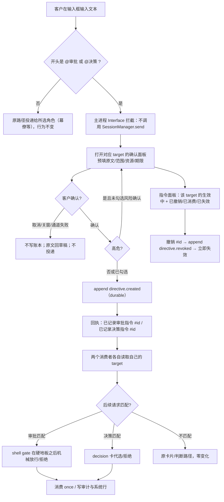
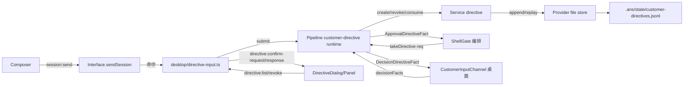

# 策划方案 P1.2：客户授权平面——两个标记 `@审批` / `@决策`

- 日期：2026-11-03
- 角色：ANS 策划（Planning），独立固定上下文
- 状态：**草案 P1.2**（P1.0 已完成独立完整复核 F1–F9；P1.1 已逐项处置，再复核给出「建议提交客户确认」（余 R1/R2 建议级）；P1.2 仅做窄复核 R1/R2 的**编辑性收口**，不改语义；待沟通核对 P1.2；未闸门 1 客户确认、未实施、未测试、未验收、未 commit/push）。客户在闸门 1 确认的版本才是实施与验收基线；实施还需闸门 2 角色指派确认与客户实施授权。
- 风险档位：**T3（建议）**。依据见 §11.3；客户在闸门 0 已声明 T3。
- 闸门 0 依据：`docs/communication/2026-11-03_intent_customer-authorization-plane.md`（69 行，SHA-256 `91d77bb868c78dcee4d32adf94db96645843ce8f3672b7a2e4017326c128400a`；客户确认原话「确认闸门 0，现在就在新 worktree 立项开发两个标记。」）。本方案不重开该记录已确认的口径。
- 独立复核：`docs/planning/2026-11-03_review_customer-authorization-plane.md`（**132 行，SHA-256 `d258844527c382aeb1b575f9f0401a87422d557acc94fe2ea181924c6b5aa1b3`**；含 P1.0 复核 F1–F9「建议修订后提交」与 P1.1 再复核「建议提交客户确认，余 R1/R2 建议级」）。快照：P1.0 1147 行 / `6260008c840ba03c0933801638b00a00c97f06529dd1398918ff6aa7fc4766a5`；P1.1 1199 行 / `7875ad6afd0331b658b99028bb3674096feede674165d56a6f3ac2fd1b74c229`。本 P1.2 的处置见 §14。**复核不是批准、不是客户确认、不是实施授权、不是验收基线。**
- 代码基线：worktree `customer-authorization-plane`，分支 `feat/customer-authorization-plane`，HEAD `243d8f6a6db663a383b516aad6320c5110c7f583`。本文所有行号均为该快照的只读核对结果；实施以符号名与文本锚点为准。
- 标记约定：**[现状]** 已只读核实的代码/文档行为；**[设计候选]** 本方案提议、未实施；**[待客户决定]** 见 §13；**[未核实]** 现有代码无法确认的事实。

**版本记录**

| 版本 | 日期 | 变更摘要 | 状态 |
| --- | --- | --- | --- |
| P1.0 | 2026-11-03 | 初稿：现状只读核实、识别与路由、确认面板与回执、`customer.directive` 共享契约、两个消费者与隔离、期限/撤销、高危二次确认、架构、兼容/风险、AC、Q1–Q10、选装 O1–O8 | 草案；已完整复核（F1–F9，结论「建议修订后提交」）；未确认、未实施 |
| P1.1 | 2026-11-03 | 处置复核 F1–F9：**F1** Q5 升为闸门 1 显式 yes/no（缩减范围不得被“确认方案”隐含通过），同步 §0/§1.4/§2.8/§12/§13/§15/AC；**F2** 统一 Q9 字母与推荐（推荐 A＝扩展 `"directive"` + `directiveId`），修正 §6.2/§9.2/AC-10；**F3** 补全更新点 `session.ts:4165-4197`/`:4469-4470`/`:4657-4690` 与旧读者 `requirement-change.ts:316-318`，改“旧读者安全方向”为逐点核对，AC-10/AC-15 增加四处置信断言；**F4** 限定 `.ans` 读取承诺（shell 读取同 tasks.jsonl 受既有审批/审计），新增 O10；**F5** 统一“deny 指令先于 c=allow；允许列表只在 allow 侧先行”的措辞；**F6** 冲突与不匹配两条路径都绕过默认推荐，补 AC-10；**F7** 回滚开关列 O9 并写清禁用态回显；**F8** 补指令面板与 shell 卡槽/一项目一卡的共存规则；**F9** 校正“命令为空”不可达谓词、`Q/O6`→O6、`judgedContext`→`judgeContext`；另处置复核未解决意见 ①项目切换/②账本重置 ID/③开关关闭时项目级选推荐（§4.3/§7.1/§9.5/AC-13/AC-21–AC-24） | 草案；已再复核（「建议提交客户确认」，余 R1/R2 建议级）；未确认、未实施 |
| P1.2 | 2026-11-03 | 窄复核 R1/R2 **编辑性收口（不改语义）**：**R1** 明确 `directivesEnabled` 属**基础实现**能力位——指令平面启用时主进程推送 `true`、项目切换/重载重推；O9 只增加由 env 控制 `false` 的分支；O9 未选时该位恒为 `true`，§3.3 第 7 步的条件来源即此（§3.3/§9.5/O9）；**R2** AC-13 的高危子句注明「（Q7 A 时）」并与 Q7 选择联动（Q7 B 时该组合不适用）（AC-13）；同步复核记录引用为 132 行 / `d2588445…`（含 P1.1 再复核节），§14 增补 R1/R2 处置行 | 草案；待沟通核对 P1.2；未确认、未实施 |

---

## 0. 摘要（先读这段）

**场景。** 客户想在输入框里“打字即授权”：`@审批 允许 shell "npm install" once`、`@审批 撤销 #d-123`、`@决策 选推荐项 until=session`、`@决策 只接受方案 A`。今天 ANS 的输入框只有一个去向：把文本投递给当前选中的角色（三权下主入口是幕僚 `chief`）。**没有任何前缀解析、没有应用级旁路、没有 `customer.directive` 账本、没有可撤销的客户指令**；「替我审批」和「替我决策」两个判断器各有自己的事实来源，但都不读客户指令。因此客户如果直接输入这些文本，它们会被当作普通聊天发给幕僚，既不会真的放行 shell，也不会真的代选 decision 卡。

**本方案给客户一条清晰、可审计的“打字即授权”路径：**

1. **两个标记只在输入框开头识别**：`@审批`、`@决策`。命中后**不投递幕僚**，由主进程走应用级 IPC 打开对应确认面板；未命中（包括 `@审批员`、正文中出现的标记、`@边界`、全角 `＠`）一律按原路径投递，行为不变。
2. **同一本指令账本、两个互不串线的消费者**：确认后写入项目私有的 `.ans/state/customer-directives.jsonl`，以 `target: "approval" | "decision"` 区分；审批消费者只读 `approval`，决策消费者只读 `decision`；跨 target 的记录在读取、撤销、提示词三个层面都被结构性隔离。
3. **确认面板与回执**：两个标记各走各的面板（预填原文、范围、资源、期限），回执分别显示「已记录审批指令 #d-123」「已记录决策指令 #d-124」；两个面板分开列出生效中与已撤销/已失效。
4. **高危二次确认**：应用级（项目级）、长期（forever）、宽范围（通配域名/路径、含 shell 元字符的命令、项目级拒绝等）在落账前必须额外勾选风险确认；定义可判定、主进程复核，渲染侧不能绕过。
5. **期限与撤销**：`once`/`session`/`forever`；`session` 定义为**本次应用运行**（重启失效）；`@审批 撤销 #d-123` / `@决策 撤销 #d-123` 只允许撤销同 target 的生效指令，撤销立即生效。
6. **不越权**：两个标记都不能授权代码、角色卡、边界变更；审批指令不越过 `c=deny`/preblock/write-guard 等确定性硬地板，不改变写门禁、验收、证据或客户闸门；决策指令只作用于 `cardKind="decision"` 的 decision 卡。

**一句话：** 客户在输入框打两个标记，应用弹面板确认、落一本项目私有账本、发一条如实回执；之后 `@审批` 只喂审批前置、`@决策` 只喂决策消费者，能自动放行/拒绝/代选；不能越过的硬边界照旧。

**如实披露的两个现状缺口（不藏在设计里）：**

- **联网/外部目录没有独立审批消费者**：当前只有 shell 命令审批（含联网命令本身）与 shell 写目标守卫；`web_search`/`web_fetch` 是运行时能力位（默认关，`src/common/pi-adapter/real-adapter.ts:653`），没有按域名审批的入口；也没有“外部目录审批”机制。方案默认把 `domain`/`path` 资源**如实记录为“待接线”**（不影响执行）。**这是对闸门 0「`@审批` 覆盖 shell/联网/外部目录」的实质缩减，Q5 必须在闸门 1 作为单独的 yes/no 决定；确认整份方案不等于确认 Q5 A。** 见 Q5/O1/O2。
- **`request.resolved.by` / `version.decision.decidedBy` / run manifest `decidedBy` 目前只允许 `customer|judge`**（`src/common/编排/task-state.ts:342-344`、`:462-464`、`src/model/project-state.ts:91`、`src/common/编排/run-manifest.ts:87`）：指令代选若照实归属为“客户指令”，需要加法式扩展枚举；否则只能误记成“客户本人点击”。**Q9 推荐 A（扩展枚举 + `directiveId`），也必须在闸门 1 单独确认；推荐 A 不是客户已确认。** 见 Q9/§9.2。

**闸门 1 的单独决定项（不得被“确认方案”隐含通过）：** Q5（是否接受“本轮 `@审批` 只覆盖 shell、联网/外部目录仅记录”）与 Q9（指令归属是否扩展为 `"directive"`）。沟通在闸门 1 材料中必须逐项列出客户的选择；未单独选择时，实施不得按 A 缩减或以 A 归属推进。其余 Q1–Q4、Q6–Q8、Q10 同样逐项列示，但 F1/F2 指出的这两项是**范围/契约级**决定，不能打包默认。

---

## 1. 产品方案

### 1.1 问题与场景

**问题一：客户授权没有“入口”。** 客户要放行一条 shell、拒绝一类命令、指定 decision 卡选哪个，今天只能等卡片弹出来再点；没有“先打字、后生效”的路径。客户原话要的是「打字即授权」，且两个判断器不能互相污染。

**问题二：没有客户指令账本。** 应用里没有 `customer.directive`（代码中仅意图记录出现该词；详见 §2.3）。既有 `customer.decision` 只是 D 批撤除前的历史词汇，不是现存的账本。客户无法回看“我说过什么、还在不在生效、怎么撤销”。

**问题三：撤销只有“关开关/等会话结束”。** 现有 shell 升级授权（`allow-once`/`allow-session`）只活在角色会话内存里，会话结束/重建即清空（`src/common/编排/shell-escalation.ts:590-596`）；两个判断开关只管之后新到的卡（`app/desktop/customer-input.ts:1189-1225`）；没有“撤销某一条已生效客户授权”的入口。

**问题四：两个判断器的隔离只是“各自的事实源不同”，没有共同的客户指令事实。** 审批判断器（shell judge）的事实来自命令原文/argv/cwd/角色/项目/档位/当轮文本/脚本上下文（`app/desktop/operator-channel.ts:527-540`）；决策判断器的事实来自 `GovernanceJudgeFacts`（`src/model/runtime.ts:1868-1935`）。两者都没有客户指令字段，也没有“只读自己 target”的强制点。

**具体例子（本方案目标行为）：**

- 客户输入 `@审批 允许 shell "npm install" once` → 面板确认 → 回执「已记录审批指令 #d-1」→ 之后某角色在项目根执行完全相同的 `npm install`，shell 闸在硬地板之后按客户指令放行一次；一次性指令标记为已消费；若该命令命中 `c=deny`/preblock/write-guard，指令不生效，命令仍被拒绝。
- 客户输入 `@决策 选推荐项 until=session` → 回执「已记录决策指令 #d-2」→ 之后到达的 decision 卡（材料性选择、run-change、需求变更审批等 `cardKind="decision"`）按推荐项代选；结果行如实写“客户指令 #d-2 代选（不是客户本人点击）”；会话结束/应用重启后失效。
- 客户输入 `@审批 撤销 #d-1` → 面板显示 #d-1 摘要 → 若已消费/已撤销/已失效则拒绝撤销并说明原因；若生效中则回执「已撤销审批指令 #d-1」，之后同一命令不再按该指令放行。
- 客户输入 `@边界 ...` → 不做隐藏解析：按普通聊天投递，并附一次性提示“请用 `@审批` / `@决策`”（Q4 可改为静默普通聊天）。

### 1.2 目标与成功

**目标。**

1. 客户在输入框开头打 `@审批` 或 `@决策`，应用能确定地识别、**不投递幕僚**、打开对应确认面板。
2. 确认后落一本项目私有、append-only、可回放、可撤销的客户指令账本；回执如实、可分 target 查看。
3. 两个消费者只读自己的 target：审批前置读 `approval`，决策消费者读 `decision`；任何跨 target 使用在读取、撤销与提示词层面都不可能。
4. 高危指令在落账前有可判定的二次确认；期限（`once`/`session`/`forever`）与撤销语义明确、可核对。
5. 客户指令**不扩大**任何现有权限：不越过确定性硬地板、写门禁、边界、验收、证据规则和客户闸门；不能授权代码/角色卡/边界变更。
6. 旧输入、旧卡片、旧账本、旧判断器行为零回归；账本不可用时只让“客户指令”失效，不阻断产品主路径。

**成功后的用户可见结果。**

- 命中标记时：输入框不出现“发给幕僚”的用户气泡；出现确认面板；确认后聊天流出现系统行「已记录审批指令 #d-1」/「已记录决策指令 #d-2」，不是模型消息。
- 指令生效时：shell 命令直接放行/拒绝的结果行或工具回执里写明来源（`directive:d-1`）；decision 卡不呈现给客户，而是按指令代选/拒绝，结果行明确“客户指令，不是判断 agent、不是客户本人点击”。
- 打开“指令面板”：审批/决策两个逻辑面板分别列出“生效中”和“已撤销/已消费/已失效”；每项显示 id、原文、结构化范围/资源/期限、创建时间、状态；生效项可撤销。
- 撤销后：同一命令/同一范围的后续请求不再按该指令处理；面板把它移入“已撤销”。

**失败/降级时的用户可见结果。**

| 情形 | 用户看到 | 系统做什么 |
| --- | --- | --- |
| 面板不可用/窗口已关 | 「指令未记录：确认面板不可用；原文已放回输入框，未发送给任何角色。」 | 不写账本、不投递；fail-closed |
| 客户取消/关闭面板 | 「未记录指令。」（可选系统行） | 不写账本、不投递；原文回到草稿（Q 可决定是否提示） |
| 账本写盘失败 | 「未记录指令：写入失败（原因）；可重试。」 | 不返回成功回执；面板保持，原文不丢 |
| 指令原文无法解析 | 面板字段留空并显示“未能自动解析的片段：…”；确认按钮禁用，直到客户手动填齐 | 不猜资源/范围/期限；不落账 |
| 撤销目标不存在/非生效/跨 target | 「#d-123 是决策指令，不能在审批面板撤销」/「#d-123 已消费，不能撤销」 | 不写撤销事件；面板显示具体原因 |
| 账本不可读/坏行 | 指令面板与系统行如实显示“指令账本不可用（N 条坏行）；客户指令未生效”；普通 shell/卡片路径照常 | 消费者按“无指令”处理；不阻断产品主路径 |
| 高危指令未二次确认 | 确认按钮禁用，风险横幅列出原因 | 主进程复核；未确认的落账请求被拒绝 |
| 指令匹配但被硬地板拒绝 | shell 工具回执写明“命中 c=deny/preblock/write-guard，客户指令不越过硬边界” | 指令不消费；命令不执行 |
| 决策指令与卡片不匹配/冲突 | decision 卡照常呈现给客户，并显示“决策指令 #d-x 未匹配/冲突，未代选” | 不消费指令；不静默改选 |

### 1.3 完整产品流程



### 1.4 范围与非目标

**In scope（本方案要解决）。**

- 输入框开头的两个标记识别规则（前导空白、边界、多行、近失配、全角/大小写）与主进程权威拦截。
- 命中后的应用级 IPC、确认面板、回执、指令面板（两个 target 分开）与高风险二次确认。
- `customer.directive` 账本：存储、事件 schema、状态机、ID、期限、撤销、兼容、轮转、并发。
- 两个消费者：审批前置（shell gate 的精确命令机械放行/拒绝）与决策消费者（decision 卡的确定性代选/拒绝）；目标隔离与审计。
- 与既有「替我审批」「替我决策」开关、shell 允许列表、shell 升级授权、decision 卡自动推荐的关系与优先级。
- 共享业务契约、架构、兼容/风险、可核对完成标准、选装与 Q1–Q10。

**Out of scope（明确不改）。**

- `@边界` 或任何旧标记的隐藏解析；`@审批`/`@决策` 的英文别名、全角 `＠`（O5 选装，默认不做）。
- 联网域名/外部目录的**新审批闸**（当前没有消费者；O1/O2 是补齐闸门 0 该部分意图的选装，默认本轮不做）。**这会使 `domain`/`path` 只记录不生效；属于对闸门 0 覆盖面的缩减（Q5 A），必须在闸门 1 单独 yes/no 确认，不得随“确认方案”隐含通过。** 面板/回执必须如实标注“暂无消费者”。
- 用模型解释非精确决策指令（O3 选装，默认不做；本方案只做确定性精确匹配）。
- 修改 shell 允许列表规则集、`c=deny` 硬地板、preblock、write-guard、`resolveWrite` 写门禁、边界文档、角色卡、验收判定、证据规则、客户三道闸门。
- 让客户指令授权代码/角色卡/边界变更；让审批指令参与决策判断；让决策指令参与 shell 审批。
- 把指令注入模型上下文、让模型读取 `.ans` 账本、或让角色工具写账本。
- CLI 入口的指令识别（指令平面是桌面输入框功能；CLI 不注入消费者，行为逐字不变）。
- 提交/推送/合并/发布；以及 `contract-schema-query` 未提交改动的复用。

### 1.5 术语

| 术语 | 含义 |
| --- | --- |
| **客户指令（customer directive）** | 客户通过输入框开头标记提交、确认面板确认、写入项目私有账本的一条结构化授权/拒绝/撤销记录；不是角色工具调用、不是模型消息、不是客户本人点击卡片。 |
| **target** | 指令归属的消费者：`approval`（审批前置）或 `decision`（决策消费者）。同一本账、两个消费者，各自只读自己的 target。 |
| **审批前置（approval pre-gate）** | shell 闸在确定性分类/写目标守卫之后、向客户或判断 agent 要确认之前的应用级步骤；只读 `approval` 指令。 |
| **决策消费者（decision consumer）** | decision 卡呈现之前的应用级确定性步骤；只读 `decision` 指令，按规则代选/拒绝或回落到客户卡。 |
| **期限** | `once`（最多一次）、`session`（本次应用运行）、`forever`（长期，高危需二次确认）。指令面板文案会写清每种期限的失效时机。 |
| **生效中** | 账本视图状态 `active`：未被消费、未撤销、未失效。 |
| **消费** | 指令真正导致一次放行/拒绝/代选时写入 `directive.consumed`；`once` 消费后终态，`session`/`forever` 可重复应用并逐次记录应用审计（不改变状态）。 |
| **高危** | 由应用按结构化字段可判定为应用级/长期/宽范围的指令；落账前必须额外勾选风险确认。定义见 §4.3。 |
| **回执** | 落账成功后显示在提交 pane 聊天流的应用系统行：「已记录审批指令 #id」「已记录决策指令 #id」；不是模型消息。 |
| **面板** | 两个逻辑面板：审批指令面板、决策指令面板；各自列出生效中与已撤销/已消费/已失效。 |
| **指令账本** | `.ans/state/customer-directives.jsonl`：app-only、append-only、每行一个事件、按事件回放得到当前视图；无直接 API/工具读写路径（判断 agent 读取工具排除 `.ans`；角色写路径被边界拒绝），但 shell 读取与其他 `.ans` 运行数据同受既有审批/审计（非结构性禁止，见 O10）。 |

---

## 2. [现状] 只读核实

### 2.1 客户输入从输入框到幕僚的投递路径

| # | 位置 | [现状] |
| --- | --- | --- |
| 2-1 | `app/renderer/src/shell/Composer.tsx:232-234` | 输入框发送入口 `send()`：读取 textarea 原文后 `trim()`；空文本直接拒绝（提示“空消息”）。 |
| 2-2 | `app/renderer/src/shell/Composer.tsx:268` | `target = { projectRoot, roleId, runtime }`：`roleId` 是当前选中角色；三权下主入口 `primaryRoleId="chief"`（`src/service/role/resolve-role.ts:433`）。 |
| 2-3 | `app/renderer/src/shell/Composer.tsx:282-286` | 发送前先 `appendLocalUser(roleId, displayText, clientMessageId)` 本地回显，再 `bridge.sendSession(text, images, target, {clientMessageId})`。 |
| 2-4 | `app/preload.cjs:66` | `sendSession` 经 `ipcRenderer.invoke("session:send", { text, images, target, metadata })` 进主进程。 |
| 2-5 | `app/main.ts:894` | `registerHandler("session:send", ... => desktop.sendSession(input))`：窗口作用域的唯一聊天发送入口。 |
| 2-6 | `app/desktop/interface.ts:2339-2371` | `sendSession()`：主进程重校验图片（真实字节/魔数/≤5MB），无图直接 `manager.send(text, undefined, target, metadata)`；有图组 `PromptOptions` 后同样 `manager.send`。 |
| 2-7 | `app/desktop/session.ts:3167-3291` | `SessionManager.send()`：按 target 定格角色；角色忙则入同一投递队列；空闲则 `beginDeliveryOrigin` → `sendDelivery`。 |
| 2-8 | `app/desktop/session.ts:1497-1528` | `sendDelivery()`：`entry.lastUserText = boundTurnText(text)`（判断器当轮文本来源），最后 `await entry.handle.send(text, promptOptions)` 交给适配器/模型。 |

**结论：** 现状只有一条路——`Composer → session:send → Interface.sendSession → SessionManager.send → handle.send`。**没有应用级旁路**；任何输入（包括以 `@审批` 开头的文本）都会作为普通聊天投递给所选角色。三权下就是幕僚 `chief`。

### 2.2 现有前缀/命令式输入处理

| # | 位置 | [现状] |
| --- | --- | --- |
| 2-9 | `app/desktop/interface.ts:2339-2371`、`app/desktop/session.ts:3167-3291` | 发送路径没有 `startsWith("@")`、`startsWith("/")`、斜杠命令、前缀标记或命令式输入解析；唯一处理是 `trim()`、空文本拒绝、图片校验、target 解析。 |
| 2-10 | 全仓只读检索（本方案写盘前） | `@审批`/`@决策`/`@边界` 在源码与测试中**零命中**；除本方案自身外，只出现在 `docs/communication/2026-11-03_intent_customer-authorization-plane.md`。 |

### 2.3 `customer.directive` 账本现状

| # | 位置 | [现状] |
| --- | --- | --- |
| 2-11 | 全仓只读检索 `customer.directive`（本方案写盘前） | **不存在**：源码、测试、角色卡、既有账本中零命中；除本方案自身外，只出现在本次意图记录。`customer.decision` 仅出现在少量注释/文案（如 `src/pipeline/orchestration/run-role.ts:848`、`:978`），D 批已撤除旧 gate/flow/ledger（`src/common/门禁引擎/governance-roles.ts:6`、`src/common/编排/task-state.ts:12`、`src/pipeline/orchestration/run-role.ts:823`），不是现存账本。 |
| 2-12 | `src/common/编排/task-state.ts:4-12`、`:41` | 现有最接近的账本是 `.ans/state/tasks.jsonl`：**app-only、append-only、每行一个事件、角色不可写**；`.ans/state/**` 是应用独占运行数据（非仓库候选）。 |
| 2-13 | `src/common/编排/task-state.ts:49-56` | 事件 kind 白名单：任务/申请/审批/`project.focus`/`project.note`/`version.decision`；新增 kind 需要显式白名单与逐 kind 校验。 |
| 2-14 | `src/common/编排/task-state.ts:233-260`、`:267-...` | 追加串行链 + 单文件上限（5MiB）+ 轮转（3 份，env 可调）；读取按旧→新读轮转文件，坏行跳过并记录。 |
| 2-15 | `app/desktop/session.ts:3983-4197` | 申请生命周期写入：`request.created`（4035）→ `request.presented`（3624）→ `request.resolved`（4185）；`request.resolved` 记录 `cardKind`、`decisionId`、`selectedOptionIds`、`by` 等。 |
| 2-16 | `src/common/编排/task-state.ts:342-344` | `request.resolved.by` 只允许 `"judge" | "customer"`；`version.decision.decidedBy` 只允许 `"customer" | "judge"`（`:462-464`）。指令代选若要如实归属为第三方来源，需要加法式扩展枚举（Q9）。 |
| 2-17 | `src/common/runtime-core/shell-judge/policy.ts:234-253`、`src/common/编排/governance-judge-prompt.ts:102` | 判断 agent 的读取策略**整棵 `.ans/**` 硬排除**（app-private；账本/会话/应用文件不可读）。**注意：** 这只约束判断 agent 的只读工具；普通角色经 `run_shell` 执行 `cat .ans/...` 仍走既有 shell 审批链（与 `tasks.jsonl` 同），不是结构性禁止读取（见 F4/O10）。 |
| 2-18 | `app/desktop/preferences.ts:50-52`、`:29-36` | 应用级偏好只写 `<userData>/ans/preferences.json`（locale + `judgeSwitches`）；不写项目 `.ans`/治理账本。指令账本不应塞进偏好文件。 |

### 2.4 两个判断器与事实源

**「替我审批」= approval 组（shell / appointment-write 写卡族）**

| # | 位置 | [现状] |
| --- | --- | --- |
| 2-19 | `app/main.ts:338-344`、`:559-561` | 两个独立开关实例：`shellJudgeSwitch`（approval）、`decisionJudgeSwitch`（decision）；`isGroupEnabled(group)` = approval 读前者、decision 读后者。 |
| 2-20 | `app/main.ts:711-724`、`app/desktop/session.ts:2619-2638` | 每会话操作者通道：`metadata` 带 `roleId/projectRoot/runtime/signal/turnText/judge`；开关在调用当刻由通道读取。 |
| 2-21 | `app/desktop/operator-channel.ts:498-522`、`:527-540` | 开关开且有 judge 时，在 `present` 之前构造 `ShellJudgeRequest`：命令原文、规范化 argv、cwd、toolCallId、roleId、projectRoot、runtime、policy、tier、reason、turnText、approvalContext。**没有客户指令字段。** |
| 2-22 | `src/common/编排/shell-gate.ts:13-31`、`:465-1073` | shell 闸三层链：c 确定性规则 →（可能）pm 审读 →（a）客户/判断 agent；硬地板（c=deny/preblock/write-guard/readonly/script 上下文失败）不可被翻案。 |
| 2-23 | `src/common/编排/shell-escalation.ts:255-381`、`:590-596` | 已有“客户升级授权”：`allow-once`/`allow-session`，精确匹配 `(roleId, projectRoot, cwd, entry, 规范化 argv)`；`once` 原子消费，`session` 在角色会话内反复放行；会话结束/重建 `dispose()` 清空。**没有客户指令、没有项目级、没有撤销。** |
| 2-24 | `src/common/编排/shell-gate.ts:664-703`、`:769-781` | 升级授权消费点：script 分支在 c=deny 检查与上下文重载之后；非 script 在 `review`/`risky` 时。`readonlyOnly` 构造期禁止注入 `takeGrant`（`:492-494`）。 |

**「替我决策」= decision 组（提案/任命/验收/需求确认/材料性选择）**

| # | 位置 | [现状] |
| --- | --- | --- |
| 2-25 | `src/model/runtime.ts:419`、`:432-439` | `GovernanceJudgeGroup = "approval" | "decision"`；`GOVERNANCE_CARD_GROUP` 把 `appointment-write` 归 approval，`proposal/appointment/acceptance/intent-confirm/decision` 归 decision。 |
| 2-26 | `src/model/runtime.ts:1868-1935` | `GovernanceJudgeFacts`：`governanceModel/flowId/ledgerErrors/proposalDecision/appointmentTargetRoleIds/dispatchedStepIds/unresolvedClarificationCount/latestDecisionKinds` 等；**没有客户指令字段**。 |
| 2-27 | `src/pipeline/orchestration/run-role.ts:1117-1199` | `judgeContext` 的唯一计算点：`buildGovernanceJudgeFacts({ flowId, facts? })` → `GovernanceJudgeContext`；desktop 只拼 `GovernanceJudgeRequest`，不读账本。 |
| 2-28 | `app/desktop/customer-input.ts:1066-1123` | `planJudge`：decision 卡**明确不进入模型判断**（`if (cardKind === DECISION_CARD_KIND) return undefined;`，`:1075`）；只有 switch 开 + trio + flowId 合法等才判断。 |
| 2-29 | `app/desktop/customer-input.ts:1426-1486` | decision 卡「替我决策」**确定性默认推荐**：开关开、trio、推荐项仍在卡内、结果行投达成功 → `answered{selected:[推荐项]}` + `judge` 审计；**不调用模型**。 |
| 2-30 | `src/common/编排/decision-card.ts:86-145` | decision 卡结构校验：仅 convener/rapporteur（或应用自有 `application:true`）可发；choice、合法 flowId、≥2 选项、id 非空不重复、恰一个 `recommended:true`。 |
| 2-31 | `app/desktop/session.ts:1977-2092`、`:4165-4197`、`:4469-4470`、`:4657-4690`；`app/desktop/requirement-change.ts:316-318` | 应用自有 run-change 卡复用 decision 卡；决定者映射 `operatorId.startsWith("judge:") ? "judge" : "customer"`（`:2077`）——第三方来源（客户指令）会被误记成 customer（Q9）。同一文件的 `request.resolved.by`（`:4165-4197`）、`decidedByText`（`:4469-4470`）、`version.decision.decidedBy`（`:4657-4690`）都有同类窄联合；`requirement-change.ts:316-318` 用 `=== "judge"` 决定展示，会把 directive 误显示为“客户选择”。 |

### 2.5 确认面板与 IPC 通道现状

| # | 位置 | [现状] |
| --- | --- | --- |
| 2-32 | `app/main.ts:525-575` | 客户交互通道：`session:operator-request`（主→渲）/`session:operator-response`（渲→主）/`session:operator-expired`/`session:operator-queued`/`session:operator-judge`；窗口作用域，关窗 `rejectAllPending`。 |
| 2-33 | `app/desktop/customer-input.ts:627-2014` | 通道实现：一项目一卡、排队、判断、fail-closed 三态、渲染回包按请求快照校验（`respondUnsafe`，`:1874-1928`）。 |
| 2-34 | `app/main.ts:577-626` | shell 确认卡：`shell:confirm-request`/`shell:confirm-response`；审批卡与升级卡共用通道，按 `kind/action` 路由；每窗口一个呈现槽。 |
| 2-35 | `app/main.ts:627-693` | 开关 IPC：`shell:judge-get/set/pause`、`decision:judge-get/set`；handler 内校验 sender；状态推送 `shell:judge-state`/`decision:judge-state`。 |
| 2-36 | `app/preload.cjs:198-217`、`:230-311` | 渲染侧桥：operator request/respond/queued/expired/judge；shell/decision judge get/set；`shell:judge-result`、`session:operator-judge`。 |
| 2-37 | `app/renderer/src/chat/ipc.ts:5` | 渲染侧 IPC 消费清单（注释）：`project:changed`、`operator-request/expired/queued/judge`、`shell:confirm-request` 等；新通道应沿用 `<domain>:<verb>` 命名。 |

### 2.6 现有撤销/失效机制

| # | 位置 | [现状] |
| --- | --- | --- |
| 2-38 | `src/common/编排/shell-escalation.ts:590-596` | 升级授权只在角色会话内存；`dispose()` 清空 records/grants/requestedKeys/pending；没有单条撤销入口。 |
| 2-39 | `app/desktop/customer-input.ts:1189-1225`、`:1322-1332` | 判断开关关闭/重载复位时，`approve`/`deny` 结算前再查一次开关；`switch-off` 回落客户卡；只影响之后/在途的卡，不撤销历史决定。 |
| 2-40 | `app/main.ts:638-656` | `shell:judge-pause`：本次运行临时暂停 shell 自动审批（不写偏好、不影响决策组），不是撤销已生效授权。 |
| 2-41 | `app/desktop/customer-input.ts:1930-1955` | 关窗 `rejectAllPending`：所有挂起请求归 declined/unavailable，不写客户决定；这是“未决卡失效”，不是“已生效授权撤销”。 |

### 2.7 账本与存储兼容约束

| # | 位置 | [现状] |
| --- | --- | --- |
| 2-42 | `src/common/编排/task-state.ts:4-12`、`:41` | `.ans/state/**` 是应用独占运行数据；既有账本按项目分文件、append-only、可轮转、坏行容错。新账本应遵循同一纪律，但**不应**把客户指令混进 `tasks.jsonl`（见 §3.2 对比）。 |
| 2-43 | `app/desktop/preferences.ts:116-128`、`:251-256` | `judgeSwitches` 的偏好 schema 严格：未知键/非布尔值 ⇒ 全关 + 诊断；写盘失败如实报错。指令账本不改变该文件。 |
| 2-44 | `src/common/shared/config-loader.ts:37-39` | `.ans/` 目录名与项目配置文件名的单一来源；新账本路径应通过常量集中定义，不在多处拼串。 |
| 2-45 | `src/common/编排/task-state.ts:342-344`、`:462-464` | `request.resolved.by`、`version.decision.decidedBy` 的枚举约束是本次**最大的旧记录/旧读者兼容点**；新增 `"directive"` 是加法式扩展，但会让旧验证器拒收（见 Q9 与 §9.2）。 |

### 2.8 现状中不存在的“联网/外部目录审批消费者”

| # | 位置 | [现状] |
| --- | --- | --- |
| 2-46 | `src/common/runtime-core/network-gate.ts:1-13` | 网络状态门只做**在线/离线**状态与离线等待窗口；没有按域名/按请求的网络审批。 |
| 2-47 | `src/common/pi-adapter/real-adapter.ts:653`、`src/common/codex-adapter/config.ts:15-25`、`src/provider/claude/session.ts:556-565` | `web_search`/`web_fetch` 是运行时能力位（默认关，env/选项开启）；没有“对某个域名允许/拒绝”的审批入口或事实源。 |
| 2-48 | `src/common/门禁引擎/shell-write-guard.ts`、`src/common/编排/shell-gate.ts:596-617` | “外部目录”只在 shell 写目标守卫/角色边界里体现；没有独立的“外部目录审批”对象。客户要放行某个外部目录，今天只能逐条 shell 审批或改边界。 |

**结论：** 客户原话里的“联网/外部目录”在当前产品中没有独立消费者。本方案**不把不存在的能力写成已存在**：默认把 `domain`/`path` 记录为“已记录、待接线、不影响执行”，并在面板/回执如实标注。**是否接受这个缩减（Q5 A）必须由客户在闸门 1 单独回答 yes/no；选 B 则实施 O1/O2 补齐；未单独选择时按未决处理，不得按 A 实施。**

### 2.9 不需要单独调研方案

现状已只读核实到符号与行号；剩余未决点是**产品选择**（§13 Q1–Q10）、**共享契约取舍**（§5/Q9）与**实施细节**（§8），不是需要先查清根因的事实。因此本方案不另写调研方案。

---

## 3. 识别与路由设计

### 3.1 标记识别规则（唯一纯函数）

**单一来源：** `src/model/directive-marker.ts` 的纯函数 `parseDirectiveMarker(text)`（**零 import**，不读盘、不依赖 Node，可被主进程与渲染侧共同导入；渲染侧仅用于回显抑制，主进程才是权威）。类型/事件/schema 放在同目录的 `src/model/directive.ts`（可依赖 `runtime.ts` 的类型），**渲染侧只导入 marker 文件**，避免把整个 `runtime.ts` 打进渲染包。规则：

1. **只认开头**：先跳过文本开头的 Unicode 空白（JS `\s`，含空格、制表符、换行、全角空格 `　`）；第一个非空白位置必须是 `@审批` 或 `@决策`。
2. **标记后边界**：标记 token 之后必须是空白（同 `\s`）或文本结束。`@审批员`、`@审批-允许`、`@审批，允许`（中文逗号紧贴）都**不命中**；按普通聊天处理（可附一次提示，见 Q4）。
3. **多行**：只检查开头；首个非空白 token 命中后，其余全部是指令正文（可跨行）。正文中出现 `@审批`/`@决策` 不触发第二次识别。
4. **大小写/全角**：两个标记都是中文 token，无大小写；ASCII `@` 必须半角。全角 `＠`、英文 `@approval`/`@decision` 不命中（O5 选装，默认不做）。
5. **`@边界`**：不命中任何指令；按 Q4 处理（默认普通聊天 + 一次性提示）。
6. **空正文**：命中但正文为空/仅空白 ⇒ 仍打开对应面板，字段留空、确认禁用；不静默忽略（客户看得见发生了什么）。
7. **图片附件**：命中且带图片 ⇒ 不打开面板，返回明确错误“指令输入不支持图片附件；请移除图片后重试”；**不投递、不落账**（fail-closed，避免图片被静默丢弃或发给幕僚）。

**示例表：**

| 输入（去除行首空白后） | 结果 |
| --- | --- |
| `@审批 允许 shell "npm install" once` | 命中 approval；正文=`允许 shell "npm install" once` |
| `  \n\t@决策 选推荐项 until=session` | 命中 decision（前导空白/空行被跳过） |
| `@审批\n允许 shell "npm install"` | 命中 approval（多行正文） |
| `@审批员 你好` | 不命中（边界不是空白） |
| `你好 @审批` | 不命中（不在开头） |
| `@边界 只改 docs` | 不命中；按 Q4 处理 |
| `＠审批 允许 …`（全角 @） | 不命中 |
| `@审批`（无正文） | 命中；面板空字段、确认禁用 |
| `@审批 允许 shell "x"` + 图片 | 命中但拒绝：不支持图片附件；不投递、不落账 |

**为什么规则这么严：** 客户把“打字即授权”当作一条有后果的路径。宽松匹配（正文任意位置、标点紧贴、全角字符）会把普通聊天误判成授权，风险远大于多打一个空格。严格规则可单测、可向客户解释。

### 3.2 识别所在层（Q1）

**推荐 A：主进程 `Interface.sendSession` 权威识别 + 共享纯解析器；渲染侧只用同一函数做回显抑制。**

| 选项 | 做法 | 优点 | 代价/风险 |
| --- | --- | --- | --- |
| **A（推荐）** | `app/desktop/interface.ts::sendSession` 在图片校验/`manager.send` 之前调用 `parseDirectiveMarker`；命中则走指令通道，绝不调用 `manager.send`。渲染侧在 `Composer.send()` 里用同一纯函数决定是否 `appendLocalUser`（仅显示）。 | 权威在可信主进程；渲染侧被绕过（自动化/旧渲染）仍不会投递幕僚；单一解析实现；旧输入零变化。 | 渲染侧需要导入同一 Model 纯函数（已有 i18n 相对导入先例，`app/renderer/src/i18n/index.ts:14-29`）；`interface.ts` 增加一个可选依赖。 |
| B | 仅渲染侧识别，命中后调用新的 `directive:submit` IPC；`session:send` 不识别。 | 改动少。 | 渲染侧不可信；任何绕过/旧渲染都会把指令发给幕僚；不能作为安全保证。 |
| C | 双端各自解析。 | 各自独立。 | 两份实现会漂移；违反单一来源；测试要维护两套。 |

**结论：** A。渲染侧的判断只影响“是否先画用户气泡”，不影响路由；若渲染侧判断与主进程不一致（例如 `@审批员`），以主进程返回为准，界面按返回结果校正回显。

### 3.3 命中后的应用级 IPC 流程

1. `Composer.send()` 调 `bridge.sendSession(text, images, target, {clientMessageId})`（**不改现有 IPC 名称**）。
2. 主进程 `Interface.sendSession`：
   - 先解析标记；**未命中 ⇒ 现状图片校验与 `manager.send` 原路径逐字不变**；
   - 命中且带图片 ⇒ `{ok:false, error:"指令输入不支持图片附件…"}`；
   - 命中且无图片 ⇒ **不调用 `manager.send`**，调用注入的 `directiveRuntime.submitFromInput({ rawText, target, projectRoot, roleId, runtime, clientMessageId })`。
3. `directiveRuntime`（Pipeline 公共句柄）把面板请求交给注入的 presenter（Interface 窗口通道）；presenter 经 **`directive:confirm-request`**（主→渲）推给渲染侧。
4. 渲染侧打开对应面板；客户确认/取消经 **`directive:confirm-response`**（渲→主）回传。
5. 主进程按请求快照校验回包（渲染侧不可信）：target 必须与标记一致、原文必须与提交时一致、字段在界内、高危已二次确认。
6. 确认 ⇒ `directiveRuntime` 追加 `directive.created` 并等待 durable 结果；成功返回 `{ok:true, directive:{id, target}}`；失败返回 `{ok:false, error}`（面板保持，可重试）。
7. `Interface.sendSession` 把结果转成 `SendResult`（加法字段 `directive?: {id, target}`），不产生角色轮次；`Composer` 发送前用同一纯函数决定**不先画**普通用户气泡，但**仅当主进程能力位 `directivesEnabled === true` 时**（**基础实现**：指令平面启用时主进程在启动/项目切换/重载时推送 `true`；O9 被选时，env 禁用会在此基础上额外推送 `false` 分支；O9 未选时该位恒为 `true`，不存在 `false` 分支——第 7 步的条件来源就是这个基础能力位，不是 O9）；若主进程判定为近失配（未命中）或该位为 `false`，按返回结果走普通发送并补画气泡；回执由指令通道写系统行。
8. 取消/关窗/通道失败 ⇒ `{ok:false, error, directiveCancelled?:true}` 的明确结果（见 §8.3），**不落账、不投递**；渲染侧复用现有“未接受 ⇒ 恢复草稿”路径把原文放回输入框。

**IPC 命名（新增，沿用 `<domain>:<verb>`）：**

| 通道 | 方向 | 用途 |
| --- | --- | --- |
| `directive:confirm-request` | 主→渲 | 打开确认面板（id、target、rawText、预填字段、高危原因、是否可确认） |
| `directive:confirm-response` | 渲→主（invoke） | 客户确认/取消 + 结构化字段 + 高危勾选 |
| `directive:list` | 渲→主（invoke） | 按项目返回两个 target 的生效/已消费/已撤销/已失效摘要 |
| `directive:revoke` | 渲→主（invoke） | 面板“撤销”按钮（与 `@审批 撤销 #id` 同一服务路径；仍校验 target/状态） |
| `directive:state` | 主→渲 | 账本变化后刷新面板（可选；面板打开时也可重新 `list`） |

**窗口与生命周期：** 与既有 `session:operator-request` 一样**挂在窗口作用域**（`app/main.ts:525-575` 的先例）；每个新 handler（`directive:confirm-response`/`directive:list`/`directive:revoke`）在内部校验 `event.sender === win.webContents`（沿用 `isShellJudgeIpcSender` 模式，`app/main.ts:630-693`）；关窗时所有待确认面板取消（不落账）；渲染重载/窗口重新聚焦时 `replayPending()` 重推未决面板（沿用 `app:recovery-ready` 的重推模式，`app/main.ts:613-619`）。指令面板不设时间超时（客户可一直不答；应用关闭即失效，不产生任何记录）。

### 3.4 未命中与 `@边界`

- 未命中任何标记：`session:send` 原路径逐字不变（文本、图片、metadata、队列、ACK 全不变）。
- `@边界`：按 Q4（默认 A：普通聊天 + 一次性提示“`@边界` 不再解析；请用 `@审批` / `@决策`”）。**不做隐藏解析**，不把 `@边界` 的内容翻译成指令。
- 其他 `@...`：按普通聊天；不产生提示（避免对正常聊天刷屏）。

### 3.5 失败分支与并发

| 情形 | 处理 |
| --- | --- |
| 同一窗口已有待确认指令面板 | 第二次提交返回 `{ok:false, error:"已有待确认的指令面板"}`；不覆盖、不排队、不落账；原文回草稿。 |
| 面板呈现失败（窗口关闭/推达异常） | `submit` 返回 `{ok:false, error}`；不落账；**绝不回退为发给幕僚**。 |
| 渲染重载 | `directive:confirm-request` 重推未决面板（同一 requestId 幂等）；已确认但回包丢失的，主进程以账本事件为准，不重复创建。 |
| 客户确认时账本写盘失败 | 返回 `{ok:false,error}`；不生成回执；面板保持；不消费、不应用。 |
| 同一 `clientMessageId` 重复提交 | 主进程按 `(projectRoot, target, rawText, clientMessageId)` 幂等：已有同 id 的未决面板 ⇒ 复用；已落账 ⇒ 返回同一 id，不重复写。 |
| 应用重启时未决面板 | 未决面板随窗口清空；不落账、不投递；不生成“已记录”假回执。 |
| **项目切换（复核未解决意见 ①）** | 待确认的指令面板**取消**（不落账、不投递）；指令面板/列表切换到新项目的账本；`session` 指令按项目账本分开（切回同一应用运行内仍有效），**不跨项目匹配**；旧项目的未决面板不会带到新项目。 |

**与既有卡槽/队列的共存（F8）：** 指令面板是应用自有模态，**不占** shell 确认卡的每窗口 `shellCardSlot`（`app/main.ts:584-606`），**不进入** `customer-input` 的一项目一卡队列（`customer-input.ts:634-652`），也不计入 `pendingCount`/`pendingRoles`/`judgingCount`。规则：

- 指令面板打开时，角色触发的 shell 卡/治理卡仍按各自通道推达（位于模态之后）；客户关闭/取消指令面板后可继续处理；
- shell 卡待答时，客户输入 `@审批` 仍会打开指令面板（不排队）；关掉面板后 shell 卡仍在；
- 指令面板与 shell 卡**不互相阻塞、不合并、不自动关闭**；UI 在指令面板上显示待答 shell 卡数量徽标（防止客户看不见）；
- 关窗时两类通道各自 cancel：指令不落账，shell 卡按既有 fail-closed 语义处理。

---

## 4. 确认面板与回执

### 4.1 两个逻辑面板与字段

每个标记只打开自己的 target 面板；面板字段由**原文 + 结构化字段**组成：

| 字段 | `@审批` 面板 | `@决策` 面板 | 说明 |
| --- | --- | --- | --- |
| **原文** | 逐字显示提交文本（含标记与正文，≤4KB） | 同左 | 只读；作为审计原文；不执行、不送模型 |
| **动作** | `允许` / `拒绝` / `撤销` | `选推荐项` / `只接受 <选择器>` / `拒绝` | 由解析预填；客户可改；未知则必须手选 |
| **范围** | 本项目（所有角色；本方案不可改） | `所有 flow（本项目）` 或 `flow=<flowId>` | 决策范围可收窄到单个 flow；审批范围固定项目级（O6 可加角色级） |
| **资源** | `shell <命令>` / `domain=<主机>` / `path=<目录>` | 选择器（`select-option` 时；如“方案 A”）/ 无（推荐项或拒绝） | shell 命令按原文精确匹配；domain/path 默认仅记录（Q5） |
| **期限** | `once` / `session` / `forever` | 同左 | 默认 `session`（面板可改；`forever` 高危） |
| **撤销目标** | 仅 `撤销` 时：`#<id>` + 目标摘要 | 同左 | 必须是同 target 的生效指令 |
| **高危原因** | 自动计算并显示（§4.3） | 同左 | 高危时必须额外勾选 |
| **风险确认** | 复选框“我已理解上述风险，仍要记录” | 同左 | 未勾选 ⇒ 确认禁用；主进程复核 |

**两个面板分开列出生效/撤销（Q10）：** 一个“指令面板”窗口内两个逻辑面板（审批指令 / 决策指令），每个面板分“生效中”与“已撤销/已消费/已失效”两组。生效中显示：id、动作、范围、资源、期限、创建时间、消费者状态（`shell-gate` / `decision-card` / `暂无消费者`）；历史组显示终态与时间。面板只读账本视图，不直接写文件。

### 4.2 解析与预填（保守建议，不是记录来源）

**原则：解析只生成“预填建议”；落账以面板确认后的结构化字段为准；解析不确定时留空，绝不猜。**

| 输入片段 | 预填 |
| --- | --- |
| `允许 shell "<命令>" once` / `允许 shell <命令> session` | 动作=允许；资源=`shell`，命令=引号内原文（或 `shell` 后全部文本）；期限=尾部的 `once/session/forever` |
| `允许联网 domain=<主机> until=session` | 动作=允许；资源=`domain`，主机=值；期限=session |
| `允许外部目录 path=<目录>` / `允许目录 <目录>` | 动作=允许；资源=`path`，目录=值；期限=默认 session |
| `撤销 #d-123` | 动作=撤销；目标=`#d-123`；其余字段不适用 |
| `选推荐项 until=session` | 动作=选推荐项；期限=session；范围默认所有 flow |
| `只接受 <文本>` | 动作=只接受；选择器=`<文本>`（去尾部期限 token） |
| `拒绝` / `拒绝所有新范围` | 动作=拒绝；范围默认所有 flow；面板显示“将拒绝本项目所有 decision 卡”的语义（不假装理解“新范围”以外的含义） |
| 含未识别 token | 保留已识别字段，面板列出“未能识别的片段：…”；确认前客户必须确认或改齐 |

**解析器实现：** 标记识别（唯一来源）是 `src/model/directive-marker.ts`；**正文预填**是 `src/pipeline/orchestration/customer-directive.ts` 的纯函数（不读盘、可单测），只生成建议、不决定 target/高危、不写账本。不要另写第二份标记解析。

### 4.3 高危二次确认（可判定定义）

**高危判定只看落账时的结构化字段**，由主进程计算；渲染侧显示同一结果，但主进程复核。

| 高危原因 | 判定谓词（可判定） | 例子 |
| --- | --- | --- |
| **长期** | `until === "forever"` | 任何 forever 指令 |
| **项目级拒绝** | `target==="decision"` 且 `action==="reject"` 且 `scope.flowId` 为空 | `@决策 拒绝所有新范围`（项目级） |
| **项目级选择偏好** | `target==="decision"` 且 `action==="select-option"` 且 `scope.flowId` 为空 | `@决策 只接受方案 A`（所有 flow） |
| **通配域名** | `target==="approval"` 且 `resource.type==="domain"` 且（host 为空、`*`、或以 `*.` 开头） | `允许联网 domain=*.example.com` |
| **宽路径** | `target==="approval"` 且 `resource.type==="path"` 且（路径为盘符根/`/`/项目根祖先、含 `**`、或规范化后等于项目根） | `允许外部目录 path=/` |
| **宽命令** | `target==="approval"` 且 `resource.type==="shell"` 且命令含 shell 元字符（`;`、`&&`、`\|\|`、`\|`、`>`、`<`、`` ` ``、`$(`、`*`、换行） | `允许 shell "npm *"` |
| **开关关闭时的项目级自动代选（复核未解决意见 ③）** | `target==="decision"` 且 `action==="select-recommended"` 且 `scope.flowId` 为空 且 `isGroupEnabled("decision") !== true` | `@决策 选推荐项`（「替我决策」开关关） |

**空命令不是高危，而是被拒：** §5.2 要求 `shell.command` 非空；空命令在面板/Provider 校验阶段被拒绝，不会走到高危判定（F9 修正不可达谓词）。

**不属于高危的常见指令（示例）：** 精确 shell 命令 + `once`/`session`；具体域名（无通配）+ `session`；具体外部目录（无通配、非根）+ `session`；`@决策 选推荐项 until=session` 且「替我决策」开关**开**（等同于现有推荐默认）；`@决策 只接受方案 A flow=<flowId>`（收窄到单 flow）。**开关关闭时的项目级 `select-recommended` 属于高危**（见上表；此时客户本应看到卡，指令会代选，Q7 A 下必须二次确认）。

**二次确认交互：** 面板显示红色风险横幅（逐条列出命中的原因）+ 未勾选的复选框“我已理解上述风险，仍要记录”。确认按钮在未勾选时禁用。主进程在落账前**重新计算**高危原因；若存在高危且回包未带 `acknowledged:true` ⇒ 拒绝落账（`{ok:false, error}`），渲染侧无法绕过。落账记录保存 `highRisk:{reasons, acknowledged:true, acknowledgedAt}`。

**“应用级”的落地口径：** 本方案的账本是**项目级**（每个项目一本），因此客户口径中的“应用级”在本方案落地为“本项目所有 flow/角色”；跨项目指令不在范围（Q2 C 被拒绝）。面板文案写“本项目”而不是“整个应用”，避免夸大。

### 4.4 回执文案与可见性

**落账成功回执（聊天流系统行；不是模型消息，不进模型上下文）：**

| target | 文案（精确模板） |
| --- | --- |
| approval | `已记录审批指令 #{id}`（渲染为「已记录审批指令 #d-123」） |
| decision | `已记录决策指令 #{id}`（渲染为「已记录决策指令 #d-124」） |
| 撤销 approval | `已撤销审批指令 #{id}` |
| 撤销 decision | `已撤销决策指令 #{id}` |

- 回执只在 `directive.created`/`directive.revoked` **durable 追加成功后**生成；写盘失败不生成回执，改为错误系统行/面板错误。
- 回执不包含原文全文（避免把长文本/敏感内容灌进聊天/历史）；面板可查看原文。回执可附一句范围/期限摘要（有界、转义）。
- 若资源类型当前没有消费者（domain/path），回执追加：`（已记录；当前版本暂无对应审批消费点，不影响执行）`。这是如实状态，不是“已生效”。
- 应用指令时的系统行：`客户指令 #{id} 已放行此命令（一次性）`、`客户指令 #{id} 已代选推荐项 X（不是客户本人点击）`、`客户指令 #{id} 拒绝：<范围>`；归属 `operatorId:"directive:<id>"`，不是 `judge:`、也不是客户本人。
- 所有回执/系统行走既有 `emitEvent`/`appendSystemRow` 路径（`app/main.ts:547-556`、`app/renderer/src/chat/chat-store.ts` 的 system row 先例），不新增模型消息。

### 4.5 生效/撤销分列面板

- 面板数据来源：`directive:list` → 主进程读账本视图 → 返回两个 target 的 `{active, consumed, revoked, expired, ledgerErrors}`；渲染侧只分组展示。
- 生效中项可点“撤销” → `directive:revoke({id, target})`；主进程校验：必须是该 target、必须 `active`；否则返回明确错误。撤销成功后追加 `directive.revoked`，面板刷新，回执「已撤销…」。
- 历史组显示终态与时间；`session` 失效项显示“应用重启后失效”；`once` 未使用失效项显示“未使用，已失效”（按 Q3 的口径）；`forever` 显示“长期有效（可撤销）”。
- 面板不提供“编辑已生效指令”；要改就撤销后重新输入（避免静默改写历史）。

---

## 5. 指令账本与共享业务契约（`customer-directive/v1`）

### 5.1 存储位置与格式

**推荐 A（Q2）：** `.ans/state/customer-directives.jsonl`，append-only、每行一个事件、按项目分文件、应用独占、可轮转、坏行容错。

| 选项 | 做法 | 优点 | 代价/风险 |
| --- | --- | --- | --- |
| **A（推荐）** | 独立 `.ans/state/customer-directives.jsonl` + 独立轮转；新 Provider/Service/Pipeline 读账本。 | 与任务账本隔离：坏行/损坏不会让任务/派发状态降级；target 过滤自然；轮转独立；面板与消费者只读本账本。 | 多一个存储模块；需要复用/抽取 JSONL 追加重放辅助（见 §8.4）。 |
| B | 扩展 `.ans/state/tasks.jsonl` 增加 `directive.*` 事件。 | 复用现有追加/轮转/回放；文件少。 | 客户指令与任务/申请/审批混账；坏行会增加 `TaskReplay.errors`，可能让派发/项目状态降级；目标隔离要在一张混合账本上做；任务工具/项目状态会看到无关事件。 |
| C | `<userData>/ans/customer-directives.jsonl`（应用级）。 | 跨项目共享。 | 指令是项目级授权（shell 命令、flow/decision 卡），跨项目会误伤；应用级文件更难按项目隔离/清理；与 `.ans` 的“项目运行数据”惯例不一致。 |

**拒绝 B 的关键理由：失败隔离。** 一条坏的客户指令行不应让任务账本进入 `errors>0` 状态、进而影响派发 advisory/项目状态；客户指令是“额外的授权层”，必须与主状态机解耦。

**路径单一来源：** 在 Provider/Model 常量中定义 `CUSTOMER_DIRECTIVES_REL = ".ans/state/customer-directives.jsonl"`；轮转后缀与任务账本同款（`.1..N`，旧→新读取）。

### 5.2 事件 schema（`customer-directive/v1`）

**事件（存储层；每行一个 JSON 对象）：**

```ts
type CustomerDirectiveTarget = "approval" | "decision";
type CustomerDirectiveUntil = "once" | "session" | "forever";

type ApprovalResource =
  | { type: "shell"; command: string; cwd: string }        // 命令原文，按规范化文本精确匹配
  | { type: "domain"; host: string; wildcard: boolean }    // 主机名；wildcard=以 *. 开头或 *
  | { type: "path"; path: string };                        // 外部目录（规范化后的输入）

type ApprovalAction =
  | { kind: "allow"; resource: ApprovalResource }
  | { kind: "deny"; resource: ApprovalResource };

type DecisionAction =
  | { kind: "select-recommended" }
  | { kind: "select-option"; selector: string }            // 选项 id 或标签前缀匹配
  | { kind: "reject" };

type DirectiveAction =
  | { target: "approval"; action: ApprovalAction }
  | { target: "decision"; action: DecisionAction };

interface DirectiveCreatedEventV1 {
  version: 1;
  kind: "directive.created";
  id: string;                 // "d-<seq>"；同一项目单调递增；target 不编码在 id 内
  seq: number;                // 正整数；回放取 max+1
  target: CustomerDirectiveTarget;
  action: ApprovalAction | DecisionAction; // 与 target 匹配的联合
  scope: { flowId?: string }; // decision 可选；approval 恒为 {}
  until: CustomerDirectiveUntil;
  rawText: string;            // 提交原文（含标记），≤4KB；只存账本/面板，不进日志/模型
  highRisk?: { reasons: string[]; acknowledged: true; acknowledgedAt: string };
  sessionId: string;          // 本次应用运行 id（主进程启动生成；用于 session/once 失效判定）
  createdAt: string;          // ISO
  createdBy: "customer";      // 固定；不是角色/模型
  source: "desktop-input";    // 固定；来源可审计（CLI/模型无入口）
}

type DirectiveEventV1 =
  | DirectiveCreatedEventV1
  | { version: 1; kind: "directive.consumed"; id: string; seq: number; at: string;
      via: { requestId?: string; toolCallId?: string; flowId?: string } }
  | { version: 1; kind: "directive.revoked"; id: string; seq: number; at: string; by: "customer" }
  | { version: 1; kind: "directive.expired"; id: string; seq: number; at: string;
      reason: "app-restart" | "unused-once" | "ttl" };
```

**字段约束（主进程/Provider 校验，fail-closed）：**

| 字段 | 约束 |
| --- | --- |
| `id` | `^d-[1-9][0-9]*$`；同一项目唯一；由回放 max seq+1 分配 |
| `seq` | 正整数；事件按 seq 单调；重复/倒退 ⇒ 坏行/错误 |
| `target` | 只允许 `approval`/`decision`；未知 target ⇒ 记录但永不消费 |
| `action` | 必须与 target 匹配（approval 不允许 `select-*`；decision 不允许 shell/domain/path） |
| `until` | 只允许 `once`/`session`/`forever`；未知 ⇒ 坏行 |
| `rawText` | ≤4096 字节；超长拒绝（面板提示缩短）；不打印到诊断 |
| `scope.flowId` | 可选；存在时必须是合法 slug（`GOVERNANCE_SLUG_PATTERN`，单一来源在 `src/model/runtime.ts`）；decision only |
| `command` | ≤1024 字节；非空；不含 NUL；按规范化文本（trim + 折叠空白）匹配 |
| `host` | 小写主机名（`[a-z0-9.-]+`，可带 `*.` 前缀）；长度 ≤253；不允许 scheme/路径/端口 |
| `path` | 绝对路径（Windows 盘符或 POSIX `/`）；规范化后不允许 `..` 逃逸（规范化后仍是输入本身）；≤512 字节 |
| `selector` | ≤256 字节；非空；不包含换行/NUL |
| `highRisk` | 若主进程计算为高危则必填 `acknowledged:true`；否则必须缺省 |
| `sessionId` | 非空字符串；只在本次运行有效 |

**视图（消费者/面板读取；回放派生）：**

```ts
interface CustomerDirectiveView {
  id: string; seq: number; target: CustomerDirectiveTarget;
  action: ApprovalAction | DecisionAction;
  scope: { flowId?: string };
  until: CustomerDirectiveUntil;
  status: "active" | "consumed" | "revoked" | "expired";
  rawText: string; createdAt: string;
  consumedAt?: string; revokedAt?: string; expiredAt?: string; expiredReason?: string;
  highRisk?: { reasons: string[]; acknowledged: true };
  consumer: "shell-gate" | "decision-card" | "none"; // none = domain/path 等暂未接线
}
```

### 5.3 状态机与期限

```
created → active
active --(once 被一次应用)--> consumed
active --(客户撤销)---------> revoked
active --(app 重启/session)--> expired(app-restart)
active --(unused-once 策略)-> expired(unused-once)
```

| 期限 | 含义（面板文案必须一致） | 失效/消费时机 |
| --- | --- | --- |
| `once` | 最多一次 | 首次真正导致放行/拒绝/代选时消费；未使用时按 Q3 策略（默认随本次应用运行结束失效） |
| `session` | 本次应用运行期间 | 应用重启时，`sessionId` 不一致的 active 记录转 `expired(app-restart)`；运行中可反复应用 |
| `forever` | 长期，直到撤销 | 仅客户撤销/失效；高危必须二次确认；面板显示长期有效 |

**`sessionId`：** 主进程启动时生成一个随机 id（不落盘到账本以外的位置；只写进每条 created 事件）。应用重启后，读取账本时把所有 `until==="session"`（按 Q3 默认还包括未使用的 `once`）且 `sessionId !== currentSessionId` 的 active 记录标记 `expired`（追加 `directive.expired`，best-effort；即使追加失败，读取视图也按 expired 处理）。**不依赖时间戳**，避免时钟漂移。

**与既有“角色会话”术语的区分：** shell 升级授权的 `allow-session` 是**角色会话**生命周期（会话结束/重建清空，`src/common/编排/shell-escalation.ts:590-596`）；客户指令的 `session` 是**本次应用运行**。两者不是同一个“session”。面板/收据必须写清“本次应用运行期间有效（重启失效）”，避免客户误以为和角色会话一样。

### 5.4 写入方、读取方与 target 隔离

| 角色 | 能做什么 | 不能做什么 |
| --- | --- | --- |
| 客户（通过输入框 + 面板） | 创建/撤销自己的指令 | 不能改 target、不能编辑已生效指令、不能绕过高危确认 |
| 主进程 Interface 指令通道 | 校验回包、调用 Pipeline 句柄、发回执/面板 | 不直接写文件（经 Service/Provider） |
| 审批消费者（shell gate） | 只读 `approval` 的 active 快照；消费 `once`；写应用审计 | 不能读 `decision`；不能创建/撤销指令 |
| 决策消费者（decision 卡路径） | 只读 `decision` 的 active 快照；消费 `once`；写应用审计 | 不能读 `approval`；不能创建/撤销指令 |
| 角色/模型 | 无**直接 API/工具**读取路径；写路径被边界/write-guard 拒绝；判断 agent 的读取工具对 `.ans/**` 硬排除 | 不能调用指令服务、不能写账本；**不等于结构性禁止 shell 读取**——角色经 `run_shell` 执行 `cat .ans/state/customer-directives.jsonl` 会走既有 shell 审批链，与 `tasks.jsonl` 的既有暴露相同；若要求结构性禁止读取，见 O10 |
| 面板/审计（Interface） | 读两个 target 的视图（这是唯一的“跨 target”读点） | 不能把跨 target 视图交给任何消费者；不能改账本 |

**强制点清单（详见 §6.4）：** 类型分离、读取 API 按 target、消费者运行时再过滤、提示词字段分离、撤销 target 校验、测试证明。

### 5.5 版本演进与旧记录兼容

- 每条事件带 `version: 1`；读取器接受 `version===1`。`version>1` ⇒ 该行记为错误（不猜测未来字段），消费者按“账本不可用”处理（指令不生效，产品主路径继续）。
- 未知事件 `kind` ⇒ 忽略并计数 `unknownEvents`（不阻塞、不当作错误）；这允许未来加法式事件在旧版本上被安全跳过。
- 未知字段 ⇒ 忽略；缺失必填字段/类型不符 ⇒ 该行 `errors++`，跳过该行。
- `errors > 0` ⇒ 消费者返回空快照 + `ledgerErrors`，**不应用任何指令**；面板显示错误数。与既有判断器 `ledgerErrors > 0 ⇒ 禁止 approve` 的纪律同向（`src/common/编排/governance-judge-facts.ts:8-11`）。
- 轮转：`.1` 最旧 … 无后缀最新；读取旧→新；`seq` 取全局 max；新事件追加到当前文件。
- 并发：同一项目同一时刻只允许一个 append 队列（进程内串行链，沿用 `task-state.ts:267` 先例）；多应用实例同时写同一项目属于既有 `.ans/state` 限制，不在本方案扩大（同一应用只有一个窗口/项目实例）。
- **账本重置/ID 重号（复核未解决意见 ②）：** `seq` 取当前可见账本（含轮转）的 max；若人工把坏账本改名/删除后重新创建，seq 可能从 1 重新开始，`#d-N` 与历史回执可能重号。默认 `d-<seq>` 采用这个行为，并在方案/面板/审计如实披露：面板显示 `(id, createdAt)`，审计以两者关联；如需跨重置不重号，选 O11（随机后缀）。不自动复活旧 id、不扫描被改名文件（避免把人工恢复动作变成隐式状态）。
- **迁移：** 本方案是新账本，无旧记录；不迁移 `tasks.jsonl`，不复活 `customer.decision`。旧记录只可能是未来版本降级写出的未知事件，按上面的“忽略/错误”规则处理。

### 5.6 共享业务契约（角色/消费者之间）

| 契约项 | 内容 |
| --- | --- |
| 涉及角色 | 客户（输入/确认/撤销）；主进程 Interface（面板/IPC/回执）；Pipeline 指令运行时（解析/校验/分发）；Service（状态机/隔离/快照）；Provider（持久化）；审批消费者（shell gate）；决策消费者（decision 卡路径）；审计/面板（只读视图） |
| 输入 | 客户的原文 + 确认后的结构化字段（动作/范围/资源/期限/高危确认）；撤销的 `#id`；主进程的 `sessionId`/`projectRoot`/`roleId`/`clientMessageId` |
| 输出 | `directive.created/consumed/revoked/expired` 事件；`CustomerDirectiveView` 视图；回执文案；消费者结果（allow/deny/select/reject + `directive:<id>` 审计） |
| 共享术语 | §1.5 的术语；`target`、`once/session/forever`、`active/consumed/revoked/expired`、`directive:<id>` |
| 交接条件 | 创建：面板确认 + 高危二次确认 + durable 追加成功；消费：消费者真正导致结果 + 审计/可见行投达成功（fail-closed）；撤销：目标存在、同 target、active；失效：sessionId 不一致或策略触发 |
| 行为保证 | 目标隔离；不越硬地板；不授权代码/角色卡/边界；坏账本不影响主路径；回执不造假；渲染侧回包不可信、主进程复核；同一指令幂等（`once` 不重复消费） |
| 版本与变更 | `customer-directive/v1`；新增字段/事件为加法；改变 target 语义、期限语义、消费者优先级、账本位置属于实质变更，需重开闸门 1；旧读者按未知字段忽略/未知事件跳过保持兼容 |

---

## 6. 两个消费者与隔离

### 6.1 审批消费者（审批前置；shell gate）

**位置：** `src/common/编排/shell-gate.ts` 的 `decide()` 内，注入一个新的 `takeDirective(req)`（由 Pipeline 在 `openRoleSession` 时注入；CLI 不注入 ⇒ 行为逐字不变）。**不是**在桌面 `operator-channel.ts` 里做机械放行——硬地板与 gate 同址，必须由 gate 自己执行。

**判定顺序（在既有顺序上插入，其余逐字不变）：**

1. `guardShellCommand` preblock（长内联/无界搜索）→ deny（**指令不参与**）。
2. `writeGuard` deny → deny（**指令不参与**）。
3. `classifyShell` → `allow`/`deny`/`review`/`risky`。
4. **审批指令 deny 检查**（`await takeDirective(req)`；只读 `approval`）：命中 deny ⇒ 直接 deny（`by:"directive:<id>"`），写审计；`once` deny 消费一次后转 `consumed`，`session`/`forever` deny 不改变状态（standing rule，见 §5.3）。
5. `c=deny`：**指令 allow 不适用**；后续按既有模式处理（默认三层链的硬拒、审批档/advisory 的 `c-deny→a-*` 逐字不变；在审批档/advisory 下客户仍可按既有卡片逐条批准）。
6. `c=allow` → 直接放行（**不消费 allow 指令**；指令只在本来需要审批的区间起作用）。
7. **script 分支**（`writeGuardDecision.kind==="script"`）：**allow 指令不适用**（客户只看到命令名，没看到脚本内容；仍走既有脚本审查/客户卡）；deny 指令已在上方生效。`readonlyOnly` 照旧拒绝。
8. 非 script `review`/`risky`：**既有客户升级授权 `takeGrant` 先** → 既有行为（`once`/`session` 角色会话级）；未命中 ⇒ **审批指令 allow 检查**（`await takeDirective(req)`）：精确匹配 + active + `once` 消费 durable 成功 ⇒ allow（`by:"directive:<id>"`；`ShellReviewResult` 增加可选 `directive:{id,scope}` 供审计/系统行）；失败/无匹配 ⇒ 继续。
9. 既有 advisory/operatorOnly/三层链 → 逐字不变。

**优先级（固定，写死在 gate 顺序里）：** **deny 指令最先**（安全方向，减少授权，且可拒绝 `c=allow`）；allow 侧**既有 `takeGrant` 先、指令补足**（既有行为优先，指令只覆盖“本来要审批”的区间）；审计记录实际命中的来源。若客户想用新指令覆盖既有 grant，先撤销/等角色会话结束（既有 grant 是角色会话级，不是项目级）。

**构造期守卫：** `readonlyOnly === true` 时**不得注入 `takeDirective`**（与既有 `takeGrant` 守卫同向，`src/common/编排/shell-gate.ts:492-494`）：只读档不得被客户指令越过 `readonly-deny`；构造期抛错，调用方不 arm。

**精确匹配规则：**

- `resource.type==="shell"`：`normalizeCommandText(req.command) === normalizeCommandText(record.command)`，其中 `normalizeCommandText = trim + 折叠连续空白`；`cwd` 必须等于记录时的项目根（`record.cwd`）。不做通配、不做 argv 等价推断（避免把“差不多”的命令当成同一授权）。
- `resource.type==="domain"`/`"path"`：本方案**没有消费者**；记录为 `consumer:"none"`；gate 不读。O1/O2 若启用，再定义匹配。
- 脚本/不透明执行：命令文本匹配也不放行（见顺序 7）。

**消费与审计：**

- `once`：在返回 allow 之前 `await consume(id, {requestId/toolCallId})`；durable 成功后更新内存视图；失败 ⇒ 不按指令放行（回落既有路径），绝不让一次性指令可重复使用。
- `session`/`forever`：每次应用把结果写入**消费者自己的既有审计**（shell audit 的 `directive` 字段 / `request.resolved` 的 `directiveId`），**不往指令账本写非状态事件**；账本只记状态变化（created/consumed/revoked/expired）。可见系统行投达失败 ⇒ 不应用（回落既有路径），见 §8.3 的“可见性条件”。
- gate 的 `ShellAuditRecord` 增加可选 `directive:{id,scope}`（与 `judge`、`customerGrant` 并列，三者互斥）；`by:"directive:<id>"`。
- 桌面/CLI 的结果行：`directive:<id>` 不是 `judge:`；不会被误记为判断 agent 代批。

**与既有 shell 允许列表的关系：** `c=allow` 在 **allow 侧**先行：命中即放行；allow 指令不扩大、不消费。但 **deny 指令先于 `c=allow`**（顺序第 4 步在 `c=allow` 之前）：客户可以拒绝一条白名单命令（减少授权，安全）。“允许列表先行”只指 allow 侧，不指 deny 侧；本节与 §6.3 统一这个口径。

**与「替我审批」开关的关系：** 见 Q7。推荐：指令是客户明确指示，独立于常驻开关生效；开关只决定判断 agent 是否参与，不决定客户指令是否生效。若客户选择 B（必须开关开），面板在创建时显示“当前开关关闭，指令记录但不会生效”，并在指令面板标“未生效（开关关）”。

**与 2026-10-19「判断 agent 是唯一审查者」的关系：** 该裁定的语境是“客户开启「替我审批」后，由 judge 代替客户逐条审查、客户不再被弹卡”；客户指令是**客户本人事先给出的明确授权**，不是 judge 代批，也不改变 judge 对**非指令**命令的审查。若客户希望 judge 对每条命令始终参与，选 Q5 C（只做事实、不机械放行）或 Q7 B（指令必须开关开且仍走 judge）。本方案推荐 A 的理由是“打字即授权”本来就是客户要的短路路径，且高危指令有二次确认；这一点会在闸门 1 明确请客户确认。

### 6.2 决策消费者（decision 卡路径）

**位置：** `app/desktop/customer-input.ts` 的 `presentEntryNow()`（`:1489`）之前，新增一个应用级步骤（只对 `cardKind==="decision"` 且 `application` 不限制——run-change/需求变更也是 decision 卡）。它读取注入的 `decisionFacts()`（只读 `decision` 指令），按确定性规则应用：

1. **选推荐项**：卡内恰有一个 `recommended:true`（decision 卡校验保证）⇒ 代选该 id。
2. **只接受 <选择器>**：在卡选项里找**唯一**匹配：`option.id === selector`，或 `option.label` 规范化后等于 selector，或以 `<selector>` + 分隔符（`：`/`:`/`（`/`(`/空白/`-`）开头；匹配 0 个或多个 ⇒ **不应用**（回落客户卡），不猜。
3. **拒绝**：`scope.flowId` 存在时必须等于卡的 flowId；不存在则匹配本项目所有 decision 卡。命中 ⇒ 以 `declined` 结算，理由“客户决策指令 #id 拒绝（范围）”。
4. **范围**：`scope.flowId` 存在时只匹配同 flow；不存在时匹配所有 flow。
5. **冲突处理**：同一卡有多条适用指令且动作/选区不一致 ⇒ **不代选**，**绕过 `tryAutoSelectDecision`**（不得让默认推荐先行），直接呈现客户卡并显示“决策指令冲突：#d-1 vs #d-2”；不消费任何一条。
6. **不匹配但存在同 scope 的 `select-option`**：**阻止** `tryAutoSelectDecision` 的默认推荐代选（否则“只接受方案 A”会被推荐项静默覆盖）；把卡呈现给客户，并显示“决策指令 #d-x 未匹配到唯一选项，未代选”。客户可手动选择或拒绝。
7. **默认推荐只在“无适用指令”时运行**：冲突（第 5 条）与不匹配（第 6 条）两条路径都必须绕过 `tryAutoSelectDecision`；只有完全没有 `decision` 指令匹配时，才走既有“开关开 + 推荐项”默认路径。否则“不代选”会被默认推荐静默落空。
8. **应用结果**：`answered{selected:[id]}` 或 `declined`，`operatorId:"directive:<id>"`，新增可选 `directive:{id, action, scope}` 审计；`request.resolved` 记录 `by:"directive"`（Q9 A）与 `directiveId`；`selectedOptionIds` 照旧只记非 appointment 卡。
9. **一次性消费**：`once` 在代选/拒绝前 `await consume`；durable 失败 ⇒ 不应用（回落客户卡）；`session`/`forever` 逐次写消费者既有审计（`request.resolved.directiveId` / 系统行），不改变账本状态。
10. **可见行是条件**：代选/拒绝的系统行（`session:operator-judge` 同类通道或新的 directive 结果行）投达失败 ⇒ 不应用，回落客户卡；绝不静默代选。

**异步求值与槽位：** decision 指令的匹配/`once` 消费/审计是异步的；请求在求值期间占用“一项目一卡”槽位（新增内部状态 `directing`，语义与既有 `judging`/`triaging` 同：不呈现、不计入 `pending`，但阻止下一张卡插队）。成功 ⇒ 结算；失败/无匹配/冲突 ⇒ 回到既有呈现路径（必要时阻止默认推荐，见上）。其他卡片的状态机不受影响。

**“决策 judge facts”的口径：** 本节把任务/意图口径中的“决策 judge facts”落地为**决策消费者的 target-scoped facts**（只含 `decision`）。本方案不调用模型，因此**不新增** `GovernanceJudgeFacts.customerDecisionDirectives` 字段（避免未使用字段）；若客户选 O3，才按 §6.4 的隔离规则加法新增，且只在 `cardKind==="decision"` 时填充。无论哪条路径，审批指令都不会进入决策 facts。

**与「替我决策」开关的关系（Q7）：** 推荐 A：指令是客户明确指示，独立于开关；开关只决定“没有指令时的默认推荐/判断 agent”行为。若客户选 B，则 `isGroupEnabled("decision") !== true` 时指令不应用（但记录、面板标“未生效（开关关）”）。**不能**在写指令时自动打开开关（C，不推荐）。

**与现有推荐默认的关系：** 无指令 + 开关开 + decision 卡 ⇒ 既有 `tryAutoSelectDecision` 逐字不变；有指令 ⇒ 指令优先；指令冲突/不匹配 ⇒ 阻止默认推荐（见上）。

**decision judge facts 的隔离：** 如果未来启用 O3（模型解释非精确指令），`GovernanceJudgeFacts` 只新增 `customerDecisionDirectives?: DecisionDirectiveFact[]`，且只在 `cardKind==="decision"` 时由 Pipeline 填充；非 decision 卡不带该字段；shell judge 永远不带。本方案默认不启用模型路径，因此**不新增这个未使用字段**（避免过度设计）；隔离由决策消费者的 target 过滤和类型保证。

### 6.3 与两个开关、允许列表、升级授权的关系

| 既有机制 | 关系（推荐口径） |
| --- | --- |
| 「替我审批」开关（`shellJudgeSwitch`） | 只决定 shell judge 是否参与；客户审批指令独立生效（Q7 A）；开关关闭时面板显示“指令仍按客户指示生效”，但不会调用 judge。 |
| 「替我决策」开关（`decisionJudgeSwitch`） | 只决定无指令时的默认推荐/判断；客户决策指令独立生效（Q7 A）；开关关闭时指令仍可代选，但审计明确“客户指令，不是判断 agent”。 |
| shell 允许列表（c=allow） | **allow 侧**先行（命中即放行）；allow 指令不扩大、不消费；**deny 指令先于 c=allow**，可拒绝白名单命令；“先行”不含 deny 侧。 |
| shell 升级授权（`takeGrant`） | 既有角色会话级授权；deny 指令最高；allow 侧既有 grant 先、指令补足；互不替代。 |
| decision 卡默认推荐（`tryAutoSelectDecision`） | 无指令时逐字不变；有指令时指令优先；冲突/不匹配时阻止默认推荐，交客户。 |
| 写盘确认/`writePreauthorization` | 完全独立；指令不参与写盘预授权、不发行 writeSet、不改变写门禁。 |

### 6.4 跨判断器隔离的强制点

| # | 强制点 | 位置（设计候选） | 证明 |
| --- | --- | --- | --- |
| I-1 | **类型分离**：`ApprovalDirectiveFact` 与 `DecisionDirectiveFact` 是两个不同类型；消费者 API 不返回联合类型 | `src/model/directive.ts` | 编译期：把 decision fact 传给 approval 消费者无法通过类型检查 |
| I-2 | **读取 API 按 target**：`runtime.approvalFacts()` / `runtime.decisionFacts()` 各自返回本 target；没有“all facts”消费者 API | Pipeline 句柄 | 单元测试：approval 快照不包含任何 decision 记录（反之亦然） |
| I-3 | **运行时再过滤**：消费者拿到数组后再按 `target` 过滤一次（防御性） | shell gate / decision consumer | 注入一条伪造的跨 target 记录 ⇒ 被丢弃并记诊断 |
| I-4 | **提示词字段分离**：shell judge 的 `ShellJudgeRequest` 没有 decision 字段；decision 相关字段（若 O3 启用）只在 decision 卡 facts | `src/model/runtime.ts`、`src/common/编排/shell-judge-prompt.ts`、`governance-judge-prompt.ts` | 提示词快照测试：不含另一 target 的 id/原文 |
| I-5 | **撤销 target 校验**：`@审批 撤销 #d-x` 只能撤销 approval；`@决策 撤销 #d-x` 只能撤销 decision | Interface 指令通道 | 跨 target 撤销返回明确错误，账本无事件 |
| I-6 | **标记→target 固定**：`@审批` 只能创建 approval；`@决策` 只能创建 decision；面板不能改 target | 解析器 + 主进程复核 | 回包 target 与标记不一致 ⇒ 拒绝 |
| I-7 | **测试**：跨 target 使用、撤销、提示词、快照四类测试 | 各层测试 | 见 AC-7/AC-17 |

### 6.5 “不得授权代码/角色卡/边界变更”的强制点

| # | 强制点 | 说明 |
| --- | --- | --- |
| B-1 | **指令类型无写权目标** | `ApprovalResource` 只有 `shell/domain/path`；`DecisionAction` 只有选择/拒绝；没有 `write`/`code`/`role-card`/`boundary` 目标。 |
| B-2 | **shell 硬地板先行** | preblock、write-guard、c=deny、readonly、script 上下文失败都在指令之前/之上；指令不能翻案（`src/common/编排/shell-gate.ts:536-845`）。 |
| B-3 | **写门禁独立** | `resolveWrite`/`forbiddenWritePaths`/`versioned-doc-guard` 不受指令影响；指令不发行 writeSet、不改边界。 |
| B-4 | **决策消费者只处理 decision 卡** | proposal/appointment/acceptance/intent-confirm 卡不进入决策消费者（`GOVERNANCE_CARD_GROUP` 与 `cardKind` 双重限定）；不能借 decision 指令批准提案/任命/验收。 |
| B-5 | **无写卡/边界工具** | 指令平面不新增模型工具；角色不能发指令；`.ans` 不可写；面板只能写账本。 |
| B-6 | **测试** | 指令放行一个越界写命令仍被 write-guard 拒绝；指令不能使 `appointment-write`/提案卡自动通过；`@审批 允许 shell "rm -rf 角色卡"` 仍被硬边界拒绝。 |

---

## 7. 期限与撤销语义

### 7.1 期限定义

| 期限 | 生效期 | 失效/消费 | 面板文案 |
| --- | --- | --- | --- |
| `once` | 创建后到首次真正应用 | 首次应用消费后终态；未使用时按 Q3（默认：本次应用运行结束失效，`expired(unused-once)`） | “仅一次；本次应用运行内未使用则失效”（按 Q3 默认） |
| `session` | 本次应用运行 | 应用重启时 `sessionId` 不一致 ⇒ `expired(app-restart)`；运行中可反复应用 | “本次应用运行期间有效；重启失效” |
| `forever` | 直到撤销 | 仅撤销/失效；高危必须二次确认 | “长期有效，直到撤销” |

**为什么 `session` 不用时间戳：** 应用可能休眠/系统时钟变化；`sessionId` 是确定性的“进程运行”标识，重启即失效，不依赖时钟。`once` 的默认随运行结束失效也是同一理由：避免一条一次性授权在磁盘上无限期等待一个未来可能不同的命令。**项目切换：** 账本按项目分开；`session` 指令只在所属项目的账本内有效，切换项目不把指令带到新项目；切回同一应用运行内的原项目仍有效（同一 `sessionId`）。待确认面板在切换时取消（§3.5）。

### 7.2 过期与失效时机

1. **应用启动/创建运行时**：读取账本，回放视图；对 `until==="session"`（及 Q3 默认的未使用 `once`）且 `sessionId !== currentSessionId` 的 active 记录，追加 `directive.expired`（best-effort）并在视图中标记 expired。追加失败不影响读取视图的 expired 判定（fail-safe）。
2. **消费时**：`once` 在消费者应用前 durable 追加 `directive.consumed`；失败 ⇒ 不应用。
3. **撤销时**：立即追加 `directive.revoked`；之后消费者快照不再包含它；已挂起但未应用的卡/命令不再按它处理。
4. **账本不可用**：消费者按“无指令”处理；不把“读不到”当成“指令已失效并删除”，也不当成“仍然有效”。
5. **不自动清理历史**：撤销/消费/失效记录保留在账本中（append-only）；面板按状态分组；轮转只按大小，不按状态删除。

### 7.3 撤销交互与账本状态

**入口：**

- 输入框：`@审批 撤销 #d-123` / `@决策 撤销 #d-123` → 对应面板显示目标摘要（id、动作、范围、资源、期限、状态）→ 确认 → 追加 `directive.revoked` → 回执「已撤销审批指令 #d-123」/「已撤销决策指令 #d-123」。
- 指令面板：生效中项点“撤销” → `directive:revoke({id, target})` → 同一服务校验/追加/回执（不再弹二次确认面板；按钮点击就是明确动作；高危撤销不需要二次确认——撤销只减少授权）。

**规则：**

- 目标必须存在且 `active`；已 `consumed`/`revoked`/`expired` 的指令不能撤销，返回明确原因（“已消费，不能撤销”/“已撤销”/“已失效”）。
- **target 必须匹配**：`@审批 撤销 #d-x` 若 `#d-x` 是 decision ⇒ 拒绝并提示改用 `@决策 撤销 #d-x`；反之亦然。这是隔离的硬点。
- 撤销没有“撤销撤销”：撤销后要重新授权就重新输入一条新指令（新 id）。
- 撤销事件不删除 created 事件；历史可审计。

### 7.4 “打字即授权”的生效链路

```
输入 -> 主进程识别 -> 面板确认 -> durable append directive.created -> 内存视图更新 -> 回执
     -> 下一次消费者读取（审批 gate / decision 卡）-> 匹配 -> 应用（durable consume/审计）-> 结果行
```

- **写穿（write-through）**：确认返回成功前，账本事件必须已 durable 追加；内存视图更新后才返回回执。这样“已记录”不是缓存假象。
- **立即生效**：消费者每次请求读取的是当前内存视图（由同一个 Provider/Service 实例维护，追加成功后更新）；不需要重启会话、不需要通知角色。
- **无模型参与**：指令不进入任何模型提示；消费者是确定性代码；只有 O3（默认不做）才可能调用模型解释非精确选择。
- **失败回退**：任何一步失败（面板、账本、消费、可见行）都回退到既有卡/判断路径；绝不静默放行或静默代选。

---

## 8. 架构设计

### 8.1 分层与模块

| 层 | 模块（设计候选） | 唯一职责 | 依赖方向 |
| --- | --- | --- | --- |
| **Model** | `src/model/directive-marker.ts`（新，**零 import** 的标记解析）；`src/model/directive.ts`（新，类型/事件/视图/高危谓词）；`src/model/runtime.ts`（加法扩展） | 指令类型/事件/视图、标记解析、高危谓词、target 类型；`ShellReviewResult`/`SendResult`/`CustomerInputOutcome` 的加法字段 | 不依赖任何运行层；`directive-marker.ts` 可被渲染侧安全导入 |
| **Provider** | `src/provider/directive/abstract/`、`impl/file-store.ts`、`public/`（新） | `.ans/state/customer-directives.jsonl` 的追加/回放/轮转/坏行；纯存储，不做业务判定 | Model + Node fs |
| **Service** | `src/service/directive/abstract/`、`impl/`、`public/`（新） | 状态机、ID 分配、target 过滤、快照、创建/撤销/消费/失效、高危计算、错误语义 | Model + Provider 公共入口 |
| **Pipeline** | `src/pipeline/orchestration/customer-directive.ts`（新） | 每项目运行时句柄：解析→确认请求→落账；`approvalFacts()`/`decisionFacts()`；消费/撤销；把 `takeDirective` 注入 shell gate；把 decision facts 注入 customer-input channel | Model + Service 公共入口 |
| **Interface** | `app/desktop/directive-input.ts`（新，纯逻辑）；`app/desktop/interface.ts`（sendSession 拦截 + 依赖注入）；`app/main.ts`（窗口 IPC/呈现端/生命周期）；`app/preload.cjs`（桥）；`app/renderer/src/chat/directive-*.tsx`、`app/renderer/src/stores/directive-store.ts`（面板/回执） | 识别入口、IPC、面板呈现、回执、面板列表；**不做判定**；渲染侧回包不可信 | Model + Pipeline 公共入口；不直接 import Service/Provider |
| **编排（既有）** | `src/common/编排/shell-gate.ts`（加法注入 `takeDirective`）；`src/common/编排/shell-audit.ts`（加法审计字段） | 审批前置在硬地板之后消费/拒绝；审计 | Model；`takeDirective` 由 Pipeline 注入（回调） |
| **桌面通道（既有）** | `app/desktop/customer-input.ts`（加法：decision 消费者） | decision 卡前的确定性代选/拒绝；冲突/不匹配回落 | Model；facts 由注入的 Pipeline 回调提供 |
| **共享辅助** | `src/common/shared/jsonl-ledger.ts`（新，若团队计划采用） | 通用 JSONL 追加/轮转/回放；`task-state.ts` 与 directive Provider 共用 | 纯 Node；不依赖运行层 |

**依赖合法性：** `Interface → Pipeline → Service → Provider`；Model 全局共享；Interface 不直接 import Service/Provider（现有 `customer-input.ts` 对 `src/service/boundary/resolve-boundary.ts` 的导入是历史先例，不复制、不扩大）；编排的 `shell-gate.ts` 只通过注入的 `takeDirective` 回调与 Pipeline 交互，不 import Service/Provider。

### 8.2 调用与数据流



### 8.3 接口/数据模型/错误语义（设计候选）

| 接口 | 形状（要点） | 错误语义 |
| --- | --- | --- |
| `parseDirectiveMarker(text): {target, body} \| undefined` | 纯函数；§3.1 规则 | 不抛错；未知/空 ⇒ undefined |
| `runtime.submitFromInput(input): Promise<{ok:true; id; target} \| {ok:false; error}>` | input: rawText/target/projectRoot/roleId/runtime/clientMessageId；内部经 presenter 取客户确认 | 面板不可用/取消/写盘失败 ⇒ `ok:false`，不落账、不投递 |
| `runtime.approvalFacts(): ApprovalDirectiveSnapshot` | `{ledgerErrors, active: ApprovalDirectiveFact[]}`；只含 approval | ledgerErrors>0 ⇒ active=[]；消费者按无指令处理 |
| `runtime.decisionFacts(): DecisionDirectiveSnapshot` | `{ledgerErrors, active: DecisionDirectiveFact[]}`；只含 decision | 同上 |
| `runtime.takeDirective(req): Promise<ApprovalDirectiveDecision \| undefined>` | 内部匹配/消费；返回 `{action:"allow"\|"deny", id, scope}` | 未匹配/消费失败 ⇒ undefined（回落既有路径） |
| `runtime.applyDecisionDirective(card): Promise<{kind:"selected", id, optionId} \| {kind:"rejected", id} \| {kind:"conflict"\|"no-match", ids} \| undefined>` | 确定性规则 §6.2 | 消费失败 ⇒ undefined（回落客户卡）；冲突 ⇒ 调用方呈现卡 |
| `runtime.revoke(id, target): Promise<{ok} \| {ok:false, error}>` | 同 target、active 才能撤销 | 明确错误码/原因 |
| `GET directive:list` | `{approval:{active,consumed,revoked,expired}, decision:{...}, ledgerErrors}` | 读失败 ⇒ `{ok:false, error}`；面板显示错误，不伪造空 |
| `POST directive:revoke` | `{id, target}` | target/状态不符 ⇒ `{ok:false, error}` |
| `POST directive:confirm-response` | `{id, decision:"confirm"\|"cancel", values?, acknowledged?}` | 非法回包 ⇒ `{ok:false, error}`，面板保持可重试；未知/过期 id ⇒ `expired:true` |

**`SendResult` 加法字段：** `directive?: { id: string; target: "approval"|"decision" }`（成功落账后）。**取消/未记录**走既有“未接受”语义：`{ok:false, error:"已取消；未记录", directiveCancelled:true}`（`ok:false` 让 Composer 复用现有“恢复草稿”路径；`directiveCancelled` 只用于文案区分）。旧渲染忽略未知字段；旧调用方行为不变。

**`ShellReviewResult` 加法字段：** `directive?: { id: string; scope: "once"|"session"|"forever" }`（仅指令导致的 allow/deny）；与 `grant` 并列；审计写 `directive` 不写 `judge`/`customerGrant`。

**`CustomerInputOutcome` 加法字段：** `directive?: { id: string; action: "select-recommended"|"select-option"|"reject" }`（仅决策指令导致的结果）；`operatorId:"directive:<id>"`。

### 8.4 共享与复用

- **复用现有 JSONL 机制**：`task-state.ts` 的追加串行链/轮转/坏行回放是成熟先例（`:233-260`、`:267+`）。推荐抽出 `src/common/shared/jsonl-ledger.ts`（追加一行、按大小轮转、按旧→新读取、坏行计数），由 `task-state.ts` 与 directive Provider 共用；这样不产生第二份轮转/原子追加实现。**代价：** 改 `task-state.ts` 的调用点（行为逐字不变，需回归）；共享文件属主是项目管理（`src/common/shared/` 的既有唯一写者，`src/common/shared/argv-primitives.ts:1-8`），团队计划必须包含该角色或由编排在已确认架构下细化。若团队计划不包含该角色，**退路 B**：directive Provider 自带等价实现（约 100 行）+ 独立测试，作为记录在案的重复；不碰 `task-state.ts`。
- **复用确认卡模式**：`customer-input.ts` 的“请求快照校验/失败 fail-closed/关窗 rejectAll/排队”模式；directive 面板是应用自有确认通道，不新增 cardKind、不走 `request_*` 工具、不写 tasks.jsonl。**为什么不直接复用 `createCustomerInputChannel`：** 该通道绑定 `CustomerInputRequest`/角色工具/治理卡分组/一项目一卡的治理卡队列；把指令确认塞进去要么新增一个 cardKind（客户明确不要新卡种语义），要么让客户指令与治理卡共用队列（`@审批` 面板会被角色卡排队/判断逻辑影响）；独立的应用自有通道更符合“指令不是角色请求”的边界。两者共享的是**模式**（快照校验、fail-closed、重推），不是同一队列。
- **复用回执/系统行模式**：`app/main.ts:547-556` 的 `emitEvent` delivery-note；渲染侧 system row。
- **复用开关读取**：`isGroupEnabled` 仍是主进程权威（`app/main.ts:559-561`）；指令面板显示开关状态，但不依赖它（Q7 A）。
- **不新增**：第二个标记解析器、第二本任务账本、第二个 decision 卡校验、第二个写门禁。

### 8.5 技术选型与权衡

| 选择 | 采用 | 理由 | 代价/替代 |
| --- | --- | --- | --- |
| 账本格式 | append-only JSONL | 与 `.ans/state` 惯例一致；崩溃安全；可回放；易测试 | 需要轮转/坏行处理；替代 SQLite 超出本项目现状 |
| 账本位置 | 项目 `.ans/state` | 项目级授权；与任务/会话同域；角色不可读 | 跨项目共享指令需另立需求（非目标） |
| 指令状态 | 事件 + 回放视图 | 审计完整；撤销/消费不覆盖历史 | 读取需回放；小账本可接受 |
| 识别层 | 主进程权威 + 共享纯解析 | 安全；单一实现；旧输入零变化 | 渲染侧需要共享导入（已有 i18n 先例） |
| 审批消费 | gate 内机械精确匹配 | 与硬地板/写守卫同址；可审计；不绕过 judge 的风险判断（judge 只在无指令时参与） | 只支持精确命令；domain/path 暂不生效 |
| 决策消费 | 确定性精确匹配 | 遵守 2026-10-26 “不调用模型做选择题”的既有裁定；可测试 | 非精确/语义指令需回落客户或 O3 |
| 面板 | 独立指令面板 + 模态确认 | 两个 target 分开；不污染既有决策中心 | 新 UI 组件与 IPC |

### 8.6 验证要点

- 解析器：全部 §3.1 示例 + 边界/近失配/多行/全角/空正文。
- 账本：追加/回放/轮转/坏行/未知事件/未知字段/并发/ID 单调/幂等。
- 隔离：四个强制点（I-1..I-4）+ 跨 target 撤销/提示词/快照。
- 审批：硬地板不可翻案、c=allow 不消费、script 不放行、once 原子消费、session/forever、deny 优先、既有 grant 不回归。
- 决策：推荐/选项/拒绝、冲突、不匹配阻止默认推荐、开关独立性、run-change 归属。
- 面板/回执：字段、取消、写盘失败、高危未勾选、重载重推、关窗。
- 回归：无指令时既有 shell/decision/写盘/验收路径逐字不变；T3 全量回归。

---

## 9. 兼容、风险与迁移

### 9.1 旧输入零影响

| 输入 | 行为 |
| --- | --- |
| 普通聊天（不含开头标记） | 与现状逐字相同：同一 `session:send` → `manager.send` → `handle.send`；文本/图片/metadata/队列/ACK 不变 |
| 正文中包含 `@审批`/`@决策` | 不命中；普通聊天 |
| `@审批员`/`@决策X`/`@边界`/全角 `＠` | 不命中；普通聊天（`@边界` 可附一次提示，Q4） |
| 空文本/仅空白 | 现状拒绝（Composer 提示），不打开面板 |
| 带图片的普通消息 | 现状路径不变 |
| 带图片的标记输入 | 明确拒绝；不投递、不落账（新分支，仅标记命中时） |

**证明点：** `session:send` 在未命中分支的调用参数/顺序与现状一致；`Interface.sendSession` 的图片校验先于标记检查（或标记检查在图片校验之后，保证带图普通消息不受影响）；AC-1/AC-2/AC-15。

### 9.2 账本迁移与旧记录兼容

- **无旧 `customer.directive` 记录**；新账本是首次创建。不迁移 `tasks.jsonl`、不复活 `customer.decision`。
- 旧记录兼容规则见 §5.5：未知事件忽略、未知字段忽略、坏行计数 + 消费者禁用、`version>1` 视为不可用。
- **`request.resolved.by`/`version.decision.decidedBy`/run manifest `decidedBy` 的扩展（Q9 A，推荐）：** 这是旧验证器会拒收的唯一一类“新值”。落地时必须同一变更内更新：
  - `src/common/编排/task-state.ts:342-344`（`request.resolved.by` 加 `"directive"`；可加可选 `directiveId`）；
  - `src/common/编排/task-state.ts:462-464`（`version.decision.decidedBy` 加 `"directive"`）；
  - `src/common/编排/version-decision.ts:256`、`:289`、`:401`、`:435`（`decidedBy` 联合与 `event.by` 映射加 `"directive"`）；
  - `src/model/project-state.ts:91`（`VersionDecisionDecidedBy` 加 `"directive"`）；
  - `src/common/编排/run-manifest.ts:87`、`:619`（`decidedBy` 加 `"directive"`）；
  - `app/desktop/session.ts:2077`（run-change 的 `decidedBy` 映射：`operatorId` 以 `directive:` 开头 ⇒ `"directive"`）；
  - `app/desktop/session.ts:4165-4197`（`request.resolved` 的 `judged` 计算与 `by` 写入：目前只识别 `judge:` 前缀，`directive:<id>` 会落 `"customer"`；需加 `directive:` 分支并写 `directiveId`）；
  - `app/desktop/session.ts:4657-4690`（`version.decision.decidedBy` 的计算与写入：同一映射要加 `"directive"`）；
  - `app/desktop/session.ts:4469-4470`（`decidedByText` 的窄联合/展示分支：加 `"directive"` 文案）；
  - `app/desktop/requirement-change.ts:316-318`（旧读者 `source === "judge" ? judge : customer`：`"directive"` 会被误显示为“客户在 decision 卡上选择”；需加第三支或改为显式三值映射）；
  - 所有读 `by/decidedBy` 的展示/文档/i18n（`ui.versionDecision.decidedBy.*` 增加 `directive` 文案，`src/common/shared/i18n/messages/{zh-CN,en-US}.ts`）。
  - **逐点核对而非“安全方向”一句话：** 旧读者中做 `=== "customer"` 判断的（若存在）会把 directive 当作非 customer，方向安全但不完整；做 `=== "judge"` 判断的（`requirement-change.ts:316-318`）会把 directive **误显示为 customer**——这是必须修的读者，不能靠“安全方向”带过。`session.ts:4141-4147` 的通道异常分支只写 `"customer"`，不受本次扩展影响（复核已确认）；新增读者一律按 `customer|judge|directive` 三值处理。**不带 `directiveId` 的旧记录仍可读。**
- **Q9 B（不改 schema，不推荐）：** 指令代选记 `by:"customer"` + `operatorId:"directive:<id>"` + 可选 `directiveId` 字段；代价是审计文案可能误读为“客户本人点击”，与本次“打字即授权要清晰”的目标相悖。**Q9 A（扩展枚举）是本方案推荐；B 只在客户明确不愿动旧验证器时选用，并在回执/UI 明确“客户指令不是客户点击”。**

### 9.3 判断器隔离的证明点

见 §6.4 I-1..I-7。补充：
- **账本读取隔离：** Provider/Service 的消费者 API 只接受 target；面板的跨 target 列表只走 Interface，不注入消费者。
- **提示词隔离：** shell judge 的 `ShellJudgeRequest` 无 decision 字段；decision 卡 facts（若 O3）无 approval 字段；提示词快照测试断言不出现另一 target 的 id/原文。
- **撤销隔离：** 跨 target 撤销在落账前被拒；测试断言账本无事件。
- **归属隔离：** `operatorId:"directive:<id>"` 既不等于 `judge:` 前缀，也不是客户 OS 用户名；结果行/审计/`request.resolved` 明确区分。

### 9.4 与 `contract-schema-query`（另一 worktree，在途未提交）的重叠面

| 重叠面 | 说明 | 处理建议 |
| --- | --- | --- |
| `src/model/runtime.ts` | 对方在途改动也在 Model（schema 查询相关类型/工具契约）；本方案也要加法扩展 `ShellJudgeRequest`/`GovernanceJudgeFacts`/`CustomerInputOutcome`（以及桌面 `SendResult`，在 `app/desktop/session.ts:370-390`） | **不复用对方未提交改动**；本方案从当前 HEAD `243d8f6` 立项；实施时若对方已合入 main，先 rebase/合并再改；Model 属共享抽象，任一方改动会使另一方的引用证据失效（Governing Invariant #6），T3 验收须重跑受影响面 |
| `src/provider/runtime/tools.ts`、`schema.ts`、`governance-roles.ts` | 对方的 `contract_check`/schema 查询改动 | 本方案**不触碰**这些文件（除非 O3 需要 judge 工具，但 O3 默认不做）；无直接重叠 |
| `src/pipeline/orchestration/run-role.ts` | 对方可能改 `contract_check` 相关路径；本方案改 `judgeContext`/gate 注入 | 同一文件不同区域；实施时由统筹排序/合并，避免同一阶段并行编辑 |
| `app/desktop/session.ts`、`app/desktop/customer-input.ts`、`app/main.ts`、preload、renderer | 对方是模型/工具/门禁层为主，预计不碰桌面 UI；但 `session.ts` 可能因 Model 类型变化被动改 | 以实际 diff 为准；实施前由统筹核对 |
| i18n `src/common/shared/i18n/messages/{zh-CN,en-US}.ts` | 双方都可能加 key | 加法合并；key 命名不冲突（`ui.directive.*` vs 对方 `ui.*`） |
| 证据/验收 | 两个 T3 共享 Model | 独立验收按各自候选/版本判断；不能复用对方 Model 改动后的旧证据 |

**结论：** 如实列出；本方案不假设对方改动可用，不把对方的类型/工具当依赖；实施排在对方收尾后或 rebase 后，具体顺序由统筹在团队计划中决定。

### 9.5 降级/回滚

- **回滚开关（O9，待客户确认，不是必做）：** `ANS_CUSTOMER_DIRECTIVES_DISABLED=1` ⇒ 主进程不创建指令运行时、不拦截标记（标记文本回到普通聊天）、消费者不注入。这是“功能整体关闭”的 fail-safe，不删除账本、不改历史。**能力位属基础实现（R1）：** 指令平面启用时主进程在启动/项目切换/重载时推送 `directivesEnabled:true`；这是 §3.3 第 7 步的条件来源，**O9 未选也成立**。**O9 只增加由 env 控制 `false` 的分支：** 禁用态主进程推送 `directivesEnabled:false`，渲染侧**不得仅凭本地标记解析抑制气泡**，必须按普通 `session:send` 发送并正常回显（§3.3 第 7 步）。若客户不选 O9，则没有整体开关，能力位恒 `true`，只能逐条撤销或撤销功能；方案默认按 O9 未选记录，不写 `false` 分支。
- **单条降级：** 撤销单条指令即可；不需要重启。
- **账本损坏：** 消费者按无指令处理；面板显示错误；不影响 shell/decision 主路径。可人工把坏文件改名保留，应用下次创建新账本（不在本方案自动删除）；改名/重建后 seq 可能重置、`#d-N` 可能与历史回执重号（§5.5/AC-24 披露；O11 可选）。
- **不改变既有回滚：** `ANS_SHELL_ESCALATION_DISABLED`、两个判断开关、`shell:judge-pause` 语义不变。

---

## 10. 测试与可核对完成标准

### 10.1 测试计划

| 层 | 测试 | 重点 |
| --- | --- | --- |
| Model | `parseDirectiveMarker`、高危谓词、schema 校验、类型隔离 | 全部 §3.1 示例；边界/近失配/多行/全角；高危谓词真值表 |
| Provider | 追加/回放/轮转/坏行/未知事件/未知字段/幂等/ID | 与 `task-state` 行为对齐；崩溃/部分写；读取旧→新 |
| Service | 状态机、target 过滤、快照、消费/撤销/失效、冲突 | 跨 target 不可见；once 原子；sessionId 失效；ledgerErrors |
| Pipeline | 运行时句柄、submit/confirm/revoke、approvalFacts/decisionFacts、takeDirective | 面板回包校验、渲染侧不可信、消费失败回落 |
| 编排 | shell gate 指令顺序、硬地板、script、c=allow、既有 grant | 指令不翻案；deny 优先；once 消费；审计 `by` |
| 桌面应用 | sendSession 拦截、IPC、面板通道、rejectAll、重载重推、回执 | 命中不投递；未命中零变化；带图拒绝；幂等 |
| 桌面 UI | 面板字段/预填/高危勾选/回执/两个面板/撤销 | 文案精确；不可绕过；无硬编码 |
| 集成 | 真实输入→面板→账本→消费者→结果行；重启；撤销 | 端到端；截图证据（不要求录屏） |
| 回归 | 既有 shell/decision/写盘/验收/派发路径 | 无指令时逐字不变；T3 全量 |

### 10.2 可核对验收标准（AC，供 V1 细化，不是验收结论）

| ID | 完成标准（可核对） | 所需证据 |
| --- | --- | --- |
| AC-1 | §3.1 识别规则全部通过：前导空白/空行、标记后空白边界、多行、`@审批员`/`@决策X`/正文中标记/全角 `＠`/`@边界` 不命中；空正文打开面板且确认禁用；带图标记输入明确拒绝 | 单元测试 + 输入夹具 + 截图 |
| AC-2 | 命中标记时**不调用** `SessionManager.send`/`handle.send`：无角色轮次、无 `lastUserText` 变化、无 `session:events` 用户消息；未命中输入与现状逐字一致 | 集成测试 + 诊断/调用计数 + diff |
| AC-3 | 面板显示原文、动作、范围、资源、期限；解析不确定时字段留空并列出未识别片段；确认禁用直到字段有效 | UI 测试 + 截图 |
| AC-4 | 取消/关窗/面板不可用/账本写失败：不落账、不投递、无“已记录”回执；原文回草稿；窗口关闭时未决面板全部取消 | 集成测试 + 证据 |
| AC-5 | 回执精确为「已记录审批指令 #d-N」「已记录决策指令 #d-N」/「已撤销审批指令 #d-N」「已撤销决策指令 #d-N」；只在 durable 追加成功后出现；不含原文全文；不进模型上下文 | i18n 快照 + 集成测试 + 截图 |
| AC-6 | 账本路径/事件 schema/ID `d-<seq>`/target/until/seq 单调/版本/轮转/未知事件忽略/坏行计数/ID 幂等全部符合 §5 | Provider/Service 单元测试 + 账本样例 |
| AC-7 | 目标隔离：approval 快照不含 decision；decision 快照不含 approval；跨 target 撤销被拒；shell judge/decision facts 提示词不含另一 target；伪造跨 target 记录被丢弃 | 隔离测试 + 提示词快照 |
| AC-8 | 审批 allow：精确命令在硬地板之后放行；`once` 消费一次后不再生效；`session` 在本次运行内反复生效；`forever` 持续；`c=allow` 不消费；script 不适用 allow；消费 durable 失败 ⇒ 不放行 | gate 单元/集成测试 + 审计 |
| AC-9 | 审批 deny：匹配命令被拒绝；**deny 指令先于 `c=allow`**（可拒绝白名单命令）；`c=allow` 只在 **allow 侧**先行（allow 指令不扩大、不消费）；不能翻案 c=deny/preblock/write-guard/readonly/script 上下文失败；deny 指令不误伤其他命令 | gate 配置矩阵测试 |
| AC-10 | 决策：推荐项/选项 id/标签前缀/拒绝（flow/项目）按 §6.2 应用；0/多匹配回落客户卡；冲突与不匹配两条路径都绕过默认推荐（不得让 `tryAutoSelectDecision` 先行）；开关独立性按 Q7；**归属按 Q9 A**：`request.resolved.by`、`version.decision.decidedBy`、run manifest `decidedBy`、UI 文案四处均如实显示 `"directive"`（不是“客户本人点击”、不是 judge） | decision 消费者单元/集成测试 + 四处审计/文案断言 |
| AC-11 | 期限：`session` 在应用重启后失效；`once` 按 Q3 策略；`forever` 持续；面板状态分组正确；不依赖时钟 | 重启/回放测试 + 面板截图 |
| AC-12 | 撤销：仅同 target 的 active 指令可撤销；已消费/已撤销/已失效拒绝；撤销立即影响后续请求；回执正确；账本保留历史 | 集成测试 + 账本审计 |
| AC-13 | 高危：§4.3 谓词真值表通过；未勾选风险确认的落账被主进程拒绝；渲染侧无法绕过；记录保存 reasons/acknowledged；**（Q7 A 时）开关关闭时的项目级 `select-recommended` 触发高危二次确认（复核未解决意见 ③）；Q7 选 B 时该组合不适用，本条不要求** | 单元/集成测试 + 面板截图 |
| AC-14 | 不授权代码/角色卡/边界：指令类型无写权目标；越界写命令仍被 write-guard/边界拒绝；指令不能使 proposal/appointment/acceptance 卡自动通过；不能使 `appointment-write` 自动确认 | gate/decision 测试 + 结构检查 |
| AC-15 | 回归：无指令时既有 shell 闸/判断器/decision 卡/写盘确认/验收分诊/派发行为不变；旧输入、旧账本、旧记录可读；**Q9 A 归属扩展的旧读者逐点核对**（`session.ts:4165-4197`/`:4469-4470`/`:4657-4690`、`requirement-change.ts:316-318` 等）均不把 directive 误显示为 customer/judge | 受影响测试 + T3 全量回归报告 + 四处审计/文案断言 |
| AC-16 | 账本不可读/坏行：消费者按无指令处理；普通 shell/卡片路径不受阻；面板如实显示错误；不伪造回执 | 故障注入测试 |
| AC-17 | i18n：新增文案在 zh-CN/en-US 都存在；无硬编码用户可见字符串；回执/面板/高危/错误文案可切换 | i18n 键检查 + 截图 |
| AC-18 | T3 证据：候选哈希/版本、改动路径、测试命令/结果、截图（关闭 DEBUG；记录 sha256/窗口尺寸；**不要求录屏**）、全量回归按技能参考 `ans-governed-construction/references/testing.md`；未实施/未测试状态如实 | 变更包 + 验收表 |
| AC-19 | 与 `contract-schema-query` 的重叠处理：实施基线不含对方未提交改动；若对方先合入，完成 rebase/受影响 Model 证据重跑；如实披露 | 分支/合并记录 + 证据 |
| AC-20 | 非目标核对：无 `@边界` 解析、无英文别名/全角 `＠`（除非 O5 被选）、**无联网/目录新闸（除非 Q5 被单独确认为 B 且 O1/O2 被选）**、无模型解释（除非 O3 被选）、无 CLI 入口、无指令进模型上下文 | 结构/文本检查 + 范围清单 |
| AC-21 | **闸门 1 单独决定（F1/F2）**：闸门 1 记录中 Q5 与 Q9 各自有客户明确选择（Q5 A/B、Q9 A/B）；没有“确认方案”即默认 A 的推断；若 Q5 未单独确认，实施不得按 A 缩减；若 Q9 未单独确认，实施不得按 A 扩展枚举 | 闸门 1 材料 + 客户原话记录 |
| AC-22 | **面板共存与项目切换（F8/复核未解决意见 ①）**：指令面板不占 `shellCardSlot`、不进 `customer-input` 一项目一卡队列；shell 卡待答时仍可输入指令；指令面板打开时角色卡仍按各自通道推达；项目切换会取消未决面板且不带到新项目；`session` 指令按项目分开 | 集成/UI 测试 + 截图 |
| AC-23 | **回滚开关（F7，若 O9 被选）**：`ANS_CUSTOMER_DIRECTIVES_DISABLED=1` 时主进程不拦截标记、消费者不注入；标记文本按普通聊天投递并正常回显（渲染侧按 `directivesEnabled:false` 不抑制气泡）；不写账本、不伪造回执 | 集成测试 + 诊断 + 截图 |
| AC-24 | **账本重置/ID 重号披露（复核未解决意见 ②）**：若 O11 未选，手动改名/丢失账本后 seq 重置的风险在方案/面板/审计中如实披露；面板以 `(id, createdAt)` 展示；若 O11 被选，`d-<seq>-<4hex>` 跨重置不重号 | 单元测试 + 面板/审计快照 |

### 10.3 T3 证据口径与全量回归建议

- 按技能参考 `ans-governed-construction/references/testing.md` 的 T3 定义：本次涉及共享抽象（Model/公共入口/跨模块契约）与权限/治理语义，**默认全量适用回归**。
- 证据：候选哈希、改动路径、任务节点、各层测试命令与结果、受影响集成/回归、截图（真实运行、关闭 DEBUG、记录 sha256/窗口尺寸/拍摄命令）。**不要求录屏**（策划验收证据边界规则）。
- 复用证据仅限未受影响路径且同候选/版本；Model/接口变更会使受影响证据失效，必须重跑。
- 独立验收按客户确认的 P1.x 版本写 V1 标准；本表只是基线素材，不是验收结论。

---

## 11. 风险档位与实施阶段

### 11.1 风险

| 风险 | 说明 | 缓解 |
| --- | --- | --- |
| 授权被误用 | 客户以为“已记录”=“已生效/已执行” | 回执写“已记录”；面板显示 consumer 状态；domain/path 明确“暂无消费者”；指令应用时另有系统行 |
| 高危指令绕过 | 宽范围/长期指令无限期放权 | §4.3 可判定高危 + 强制二次确认 + 主进程复核 + 撤销 |
| 判断器串线 | 审批指令被决策消费者用，或反向 | §6.4 七个强制点 + 类型/API/提示词/撤销/测试 |
| 越过硬地板 | 指令放行危险命令 | gate 顺序：preblock/write-guard/c=deny/script 在指令前/上；AC-9/AC-14 |
| 账本损坏影响主路径 | 坏行/写失败 | 独立账本、消费者按无指令、主路径不受阻、面板如实报错 |
| 渲染侧伪造 | 伪造 target/字段/高危确认 | 主进程按提交快照复核；原文由主进程持有；target 由标记决定；高危重算 |
| 语义模糊 | “只接受方案 A”“拒绝所有新范围”被过度解释 | 确定性匹配/明确语义；不匹配交客户；面板显示解释；O3 才引入模型 |
| 与在途变更冲突 | Model/桌面文件重叠 | §9.4 排序/ rebase；证据重跑 |
| 术语混淆 | 指令 `session` vs 角色会话 `allow-session` | 面板/回执明确“本次应用运行”；文档/测试钉住 |

### 11.2 实施阶段（仅方案，不派发）

1. **Model 冻结**：`src/model/directive.ts`、`runtime.ts` 加法字段；解析器/高危谓词/类型隔离测试。
2. **Provider/Service**：账本追加/回放/轮转/坏行；Service 状态机/target 过滤/快照/撤销/失效；若采用共享 JSONL 辅助，先完成 `src/common/shared/jsonl-ledger.ts` 与 `task-state.ts` 的等价回归。
3. **Pipeline 运行时**：`customer-directive.ts`；submit/confirm/revoke；approvalFacts/decisionFacts；takeDirective/applyDecisionDirective。
4. **编排接线**：shell gate 顺序/审计/硬地板测试；run-role 注入；customer-input channel decision 消费者。
5. **桌面 Interface**：sendSession 拦截、指令通道/IPC/面板 presenter、回执/系统行、重载重推、关窗取消。
6. **渲染 UI**：确认面板/指令面板/回执/高危勾选/i18n/两个面板分组。
7. **集成与回归**：真实输入→面板→账本→两个消费者→结果行；重启/撤销/坏账本；T3 全量。
8. **独立验收**：按客户确认版本写 V1；E2 判定当前候选。

阶段划分只是建议；实际角色、写集与顺序由统筹在团队计划中决定（闸门 2）。

### 11.3 风险档位建议

**建议 T3。依据：**

- 修改共享 Model（`ShellJudgeRequest`/`GovernanceJudgeFacts`/`CustomerInputOutcome`/`SendResult` 等）与公共入口，属于技能参考 `ans-governed-construction/references/testing.md` 的“shared-abstraction change”。
- 新增客户授权/撤销/高危语义，属于“governance or permission change”。
- 跨 Interface/Pipeline/Service/Provider 四层与 shell gate/decision 卡两个消费者，属于跨模块契约变更。
- 需要全量回归与共享抽象检查；证据不可只做窄回归。

**降档条件（供客户参考，不推荐）：** 若客户把范围收窄为“只记录、不接线任何消费者、不改 Model 公共契约、只做桌面面板与账本”，可能降到 T2；但一旦启用任一消费者或扩展公共类型，仍是 T3。客户已声明 T3，本方案按 T3 设计。

---

## 12. 选装项（默认不实施，待客户确认）

> 选装默认勾选为“推荐了解”，但**未获客户确认前不实施**；勾选不是批准。每项给出好处、代价、不加会怎样。

- [ ] **O1：联网域名审批消费者（新 network gate）。** 为 `web_search`/`web_fetch` 或 shell 联网命令增加按域名允许/拒绝的执行闸。**本项与 O2 是补齐闸门 0「`@审批` 覆盖联网/外部目录」的选装，不是一般健壮性选项；只有 Q5 选 B 才实施。**
  好处：`@审批 允许联网 domain=...` 真正生效。代价：新 Provider/Service 接入、provider 能力位改造、域名解析/端口/重定向/子域匹配的安全评审；工作量与 T3 面显著增加。不加：domain 指令只记录不生效（Q5 A 的缩减），面板如实标注“暂无消费者”。
- [ ] **O2：外部目录审批消费者（path gate / shell 写守卫集成）。** 让 `@审批 允许外部目录 path=...` 对 shell 写目标生效。**与 O1 同属补齐闸门 0 意图的选装；只有 Q5 选 B 才实施。**
  好处：外部目录放行可预先授权。代价：写目标静态解析/脚本不透明/路径规范化/竞态；与 `resolveWrite`/write-guard 的边界评审。不加：path 指令只记录不生效（Q5 A 的缩减）。
- [ ] **O3：非精确决策选择的模型解释（governance judge with decision directives）。** 对 `只接受方案 A` 等无法确定性匹配的指令，调用决策组判断 agent，facts 只带 decision 指令。
  好处：更懂语义。代价：打破 2026-10-26“不调用模型做选择题”的既有裁定；需要 manual/deny 处置、证据包、成本/延迟；新增 `GovernanceJudgeFacts.customerDecisionDirectives` 公共字段。不加：不匹配即交客户（本方案默认）。
- [ ] **O4：`until=<时长/日期>` 期限。** 支持 `until=24h`、`until=2026-12-01`。
  好处：更细粒度。代价：时钟/过期判定/面板文案/测试；本方案默认三档已覆盖。
- [ ] **O5：英文/别名标记与全角 `＠`。** 支持 `@approval`/`@decision`/`＠审批`。
  好处：输入容错。代价：歧义/误判面扩大；本方案默认严格。
- [ ] **O6：角色级审批范围。** `@审批 ... role=<roleId>` 只对某角色的 shell 生效。
  好处：更细。代价：范围匹配/面板/审计；本方案审批固定项目级。
- [ ] **O7：指令面板搜索/导出/审计报表。** 按 id/关键词/状态过滤，导出 JSON/Markdown。
  好处：可维护性。代价：UI/存储读取面；本方案默认只做分组列表。
- [ ] **O8：`@边界` 一次性迁移引导（若 Q4 选提示）。** 在提示行附“查看 `@审批`/`@决策` 用法”链接/弹层。
  好处：平滑迁移。代价：UI 文案/本地化；本方案默认只做一行提示。
- [ ] **O9：整体回滚开关 `ANS_CUSTOMER_DIRECTIVES_DISABLED=1`（F7）。** **能力位 `directivesEnabled` 的 `true` 推送与项目切换重推属基础实现（R1），不依赖 O9；O9 只增加由 env 控制 `false` 的分支。** 禁用时主进程不拦截标记、不创建指令运行时、消费者不注入；标记文本按普通聊天投递，渲染侧按 `directivesEnabled:false` 正常回显（不抑制气泡）。
  好处：一键关闭指令平面，不删除账本/不改历史。代价：一个 env/分支/能力位同步/测试；禁用态必须与渲染侧回显一致（§3.3/§9.5）。不加：没有整体回滚，只能逐条撤销或撤销功能；能力位恒 `true`。默认：推荐了解，待客户确认（不是必做）。
- [ ] **O10：结构性禁止 shell 读取 `.ans`（或至少指令账本）（F4）。** 在 shell 读规则/读守卫中增加 `.ans` 排除，使角色经 `run_shell` 也不能 `cat` 指令账本。
  好处：把“无直接读取路径”升级为结构保证。代价：改分类/规则/守卫，可能误伤调试/审计；新行为需安全评审与 AC。不加：保持现状——角色无直接 API/工具读取路径，但 shell 读取与其他 `.ans` 运行数据同受既有 shell 审批与审计。默认：不实施。
- [ ] **O11：随机后缀指令 ID（`d-<seq>-<4hex>`）（复核未解决意见 ②）。** 避免账本人工改名/丢失后 seq 重置导致 `#d-N` 与历史回执重号。
  好处：`#id` 跨账本重置仍不重号。代价：与客户示例 `#d-123` 形式不同；面板/回执/撤销解析要支持后缀；测试面增加。不加：采用 `d-<seq>`，手动恢复时可能重号，面板/审计以 `(id, createdAt)` 区分（§5.5/§9.5 披露）。默认：不实施。

---

## 13. 待客户决定（Q1–Q10）

> 闸门 0 已确认的意图口径（两个标记、只在开头、命中不投幕僚、同一账本两个 target、分开面板/回执、不做 `@边界` 解析、高危二次确认、不得授权代码/角色卡/边界、不得跨判断器）**不重开**。以下只是其中的设计选择。

### Q1：识别所在层？

| 选项 | 做法 | 代价 |
| --- | --- | --- |
| **A（推荐）** | 主进程 `Interface.sendSession` 权威识别 + 共享纯解析器；渲染侧只用于回显抑制 | 主/渲共享导入（i18n 已有先例）；`interface.ts` 增加可选依赖 |
| B | 仅渲染侧识别 + 新 IPC | 渲染侧不可信；绕过即投幕僚；不能作为安全保证 |
| C | 双端各自解析 | 两份实现漂移；违反单一来源 |

**推荐 A。**

### Q2：账本结构与位置？

| 选项 | 做法 | 代价 |
| --- | --- | --- |
| **A（推荐）** | 独立 `.ans/state/customer-directives.jsonl` + 独立 Provider/Service | 多一个存储模块；需复用/抽取 JSONL 辅助 |
| B | 扩展 `tasks.jsonl` | 与任务/申请混账；坏行影响任务/派发；target 隔离复杂 |
| C | userData 应用级账本 | 跨项目误伤；不符合项目运行数据惯例 |

**推荐 A。**

### Q3：期限模型与 `once` 失效？

| 选项 | 做法 | 代价 |
| --- | --- | --- |
| **A（推荐）** | `once`/`session`/`forever`；`session`=本次应用运行；`once` 默认也随本次运行结束失效（未使用则 `expired(unused-once)`） | 重启后未用的一次性指令丢失（需重打）；更安全 |
| B | `once` 持久到使用/撤销（跨重启） | 一次性授权长期悬置；重启后仍可能匹配未来命令 |
| C | 增加 TTL/日期（O4） | 更多时钟/文案/测试面 |

**推荐 A。**

### Q4：`@边界` 的处理方式？

| 选项 | 做法 | 代价 |
| --- | --- | --- |
| **A（推荐）** | 普通聊天投递 + 一次性提示“请用 `@审批` / `@决策`” | 客户会看到一次提示；不改变投递语义 |
| B | 普通聊天，静默 | 最简；客户可能不知道新入口 |
| C | 阻止发送并提示 | 把普通聊天变阻塞；不符合“按普通聊天处理或提示”的宽松口径 |

**推荐 A。**

### Q5：审批消费者的作用面？

| 选项 | 做法 | 代价 |
| --- | --- | --- |
| **A（推荐）** | shell 精确命令在硬地板之后机械 allow/deny；domain/path 只记录、面板标“暂无消费者” | 联网/目录指令本轮不生效（如实披露）；无新增 provider 风险 |
| B | 同时实现联网/外部目录新审批闸（O1/O2） | 范围/风险/工作量显著增加；需要新的 provider 与安全评审 |
| C | 只做事实、不机械放行（全走 judge/客户卡） | 最保守；但“允许 shell ...”不会自动放行，客户可能觉得“打了没用” |

**推荐 A**；如客户坚持联网/目录本轮生效，选 B 并明确扩范围。

**闸门 1 必须单独回答（F1）：** 请明确选 **A**（接受本轮 `@审批` 只覆盖 shell；`domain`/`path` 只记录、不生效）或 **B**（本轮补齐联网/外部目录，实施 O1/O2）。**“确认整份方案”不等于选 A**；未单独选择时 Q5 视为未决，不得按 A 实施，也不得把缩减写进闸门 1 的“已确认范围”。

### Q6：决策消费者的执行方式？

| 选项 | 做法 | 代价 |
| --- | --- | --- |
| **A（推荐）** | 确定性精确匹配（推荐项/选项 id/标签前缀/项目或 flow 级拒绝）；不匹配/冲突回落客户卡 | “只接受方案 A”依赖标签匹配；语义模糊时交客户 |
| B | 非精确时调用模型（O3） | 打破既有“不调用模型做选择题”裁定；成本/延迟/证据包 |
| C | 只把指令作为 facts、不自动执行 | 最保守；客户仍需手点，违背“打字即授权” |

**推荐 A。**

**关于“拒绝所有新范围”的诚实说明：** 当前 decision 卡没有结构化的“新范围/旧范围”分类，应用无法机械判断“新范围”。本方案把 `@决策 拒绝所有新范围` 解释为“拒绝本项目所有 decision 卡”，并在面板上逐字显示这个解释；如果客户只想拒绝某个 flow 或某类卡，应写 `flow=<flowId>` 或选 O3（模型解释）。不把“新范围”伪装成已识别的语义。

### Q7：与两个既有开关的关系？

| 选项 | 做法 | 代价 |
| --- | --- | --- |
| **A（推荐）** | 客户指令是明确指示，独立于常驻开关生效；开关只决定无指令时的默认推荐/judge | 开关关闭时指令仍会代选/放行；需要在面板/回执说清 |
| B | 必须对应开关开启才生效 | 客户要同时开开关+打指令；多一步，但更符合“开关是总闸”的直觉 |
| C | 写指令时自动打开开关 | 静默改客户设置；不推荐 |

**推荐 A。**

**与 §4.3 高危的关系（复核未解决意见 ③）：** 若选 A（指令独立于开关），则“项目级 `select-recommended` + 「替我决策」开关关闭”属于高危，必须二次确认（此时客户本应看到卡，指令会代选）；若选 B（必须开关开），该组合不会发生，无需高危。面板在创建时显示对应开关状态。

### Q8：高危二次确认的形态？

| 选项 | 做法 | 代价 |
| --- | --- | --- |
| **A（推荐）** | 风险横幅（逐条原因）+ 必勾选复选框；未勾选确认禁用；主进程复核 | 一次额外点击；实现简单可测 |
| B | 两步对话框（继续 → 最终确认） | 更强仪式感；多一步 UI |
| C | 输入指令 id 确认 | 最强；对客户负担大 |

**推荐 A。**

### Q9：指令 ID 与审计归属？

| 选项 | 做法 | 代价 |
| --- | --- | --- |
| **A（推荐）** | `d-<seq>`（同客户示例 `#d-123`）；扩展 `request.resolved.by`/`version.decision.decidedBy`/run manifest `decidedBy` 为 `"directive"`，并记 `directiveId` | 需要同一变更更新旧验证器/读者/i18n；T3 面更大 |
| B | `d-<seq>`；仍记 `by:"customer"` + `operatorId:"directive:<id>"` | 不改 schema；但审计可能误读为“客户本人点击”，与目标相悖 |
| C | 分 target 前缀 `a-`/`d-` | 与客户示例 `#d-123` 不一致；跨 target 辨识更直观但需重新约定 |

**推荐 A**（如实归属）；若客户不想动旧 verifier，选 B 并在回执/UI 明确“客户指令不是客户点击”。

**闸门 1 必须单独回答（F2）：** 请明确选 **A**（推荐：扩展 `request.resolved.by`/`version.decision.decidedBy`/run manifest `decidedBy` 为 `"directive"`，并记 `directiveId`）或 **B**（不改 schema，仍记 `by:"customer"` + `operatorId:"directive:<id>"`）。**“确认整份方案”不等于选 A**；未单独选择时 Q9 视为未决，不得按 A 扩展枚举，也不得在未披露的情况下按 B 归属。

### Q10：面板实现方式？

| 选项 | 做法 | 代价 |
| --- | --- | --- |
| **A（推荐）** | 独立“指令面板”（审批/决策两个逻辑面板，各含生效/已撤销）+ 提交确认用模态 | 新 UI 组件/IPC；不污染既有决策中心 |
| B | 并入既有决策中心面板（`DecisionCenterPanel.tsx`） | 复用列表模式；但审批/决策指令与待办/历史混在一起，容易串线 |
| C | 聊天内卡片（复用 confirm 卡样式） | 轻量；但“两个面板分开列出生效/撤销”的列表能力弱 |

**推荐 A。**

---

## 14. 复核处置（P1.0 复核 F1–F9；P1.1 再复核 R1/R2；P1.2）

- 复核对象：P1.0（1147 行 / `6260008c840ba03c0933801638b00a00c97f06529dd1398918ff6aa7fc4766a5`）与 P1.1（1199 行 / `7875ad6afd0331b658b99028bb3674096feede674165d56a6f3ac2fd1b74c229`）；复核记录：`docs/planning/2026-11-03_review_customer-authorization-plane.md`（**132 行 / `d258844527c382aeb1b575f9f0401a87422d557acc94fe2ea181924c6b5aa1b3`**，含 P1.0 复核 F1–F9「建议修订后提交」与 P1.1 再复核「建议提交客户确认，余 R1/R2 建议级」）。
- 复核上下文：同一策划角色的独立只读上下文（由沟通启动）；复核记录未由作者改写，本方案只链接其路径/版本。
- 本 P1.1 对 F1–F9 全部**采纳**，无“不采纳”；复核“未解决意见”①项目切换/②账本重置 ID/③开关关闭时项目级选推荐也已处置或披露。P1.1 再复核结论为「建议提交客户确认」，仅余 R1/R2 建议级；**P1.2 只做 R1/R2 编辑性收口，不改语义**。处置后版本为 P1.2；复核不是批准、不是客户确认、不是实施授权、不是验收基线。
- 复核结论的定位：复核记录只作建议；本 P1.2 是否可提交闸门 1，由沟通核对 P1.2 与本节处置后决定；客户闸门 1 确认前不得实施。

| 发现 | 处置 | 理由 | 改动位置/版本 |
| --- | --- | --- | --- |
| F1（重要，范围缩减） | 采纳 | Q5 A 是对闸门 0「`@审批` 覆盖 shell/联网/外部目录」的实质缩减；“推荐 A”不能随“确认方案”打包通过。 | §0（单独决定项）、§1.4、§2.8、§12 O1/O2、§13 Q5、§15.4、AC-20、AC-21；P1.1 |
| F2（重要，Q9 矛盾） | 采纳 | 统一 Q9 字母与推荐为 **A＝扩展 `"directive"` + `directiveId`**；删除“Q9 B=扩展”的反向表述；AC-10 改为“按 Q9 A”。 | §0、§6.2 第 8 条、§9.2 标题/末尾、AC-10；P1.1 |
| F3（一般，更新清单/旧读者） | 采纳 | 补 `session.ts:4165-4197`/`:4469-4470`/`:4657-4690` 与 `requirement-change.ts:316-318`；把“旧读者安全方向”改为逐点核对，承认 `=== "judge"` 读者会把 directive 误显示为 customer。 | §2-31、§9.2、AC-10、AC-15；P1.1 |
| F4（一般，`.ans` 读取承诺过度） | 采纳（限定承诺 + O10） | 只保证“无直接 API/工具读取路径”；shell 读取与 `tasks.jsonl` 同受既有审批/审计；如要结构性禁止读取，新增 O10。 | §1.5、§2-17、§5.4、O10；P1.1 |
| F5（一般，允许列表顺序矛盾） | 采纳 | 统一为 **deny 指令先于 `c=allow`**；允许列表只在 allow 侧先行；allow 指令不扩大/不消费。 | §6.1 顺序表/关系段、§6.3 表、AC-9；P1.1 |
| F6（建议，冲突/默认推荐） | 采纳 | 冲突与不匹配两条路径都绕过 `tryAutoSelectDecision`；只有无适用指令时才走默认推荐。 | §6.2 第 5–7 条、AC-10；P1.1 |
| F7（建议，回滚开关/O9） | 采纳（O9 + 禁用态回显） | 回滚开关列为 O9（待客户确认），不是必做；禁用态由主进程能力位 `directivesEnabled` 驱动渲染侧正常回显。 | §3.3 第 7 步、§9.5、O9、AC-23；P1.1 |
| F8（建议，面板共存） | 采纳 | 指令面板独立模态：不占 `shellCardSlot`、不进一项目一卡队列；不互相阻塞；项目切换取消未决面板。 | §3.5 共存段/项目切换行、AC-22；P1.1 |
| F9（建议，文字不一致） | 采纳 | 删除不可达“命令为空”高危谓词并改为拒收；`Q/O6`→O6；`judgedContext`→`judgeContext`。 | §4.3、§4.1、§9.4；P1.1 |
| 复核未解决意见 ①（项目切换） | 已补充 | 规则写在 §3.5/§7.1，AC-22 覆盖。 | P1.1 |
| 复核未解决意见 ②（账本重置 ID） | 已补充 | §5.5/§9.5 披露重号风险；O11/AC-24 给可选结构解。 | P1.1 |
| 复核未解决意见 ③（开关关闭时项目级选推荐） | 已补充 | 列为高危谓词（§4.3）、Q7 说明、AC-13 覆盖；AC-13 已注明「（Q7 A 时）」，Q7 B 时不适用。 | P1.1/P1.2 |

### P1.2 窄复核 R1/R2 处置（编辑性；不改语义）

| 编号 | 处置 | 改动位置 | 语义等价性说明 |
| --- | --- | --- | --- |
| R1 | 采纳（编辑性） | §3.3 第 7 步、§9.5、O9 | `directivesEnabled` 的 `true` 推送/项目切换重推明确为**基础实现**；O9 只增加由 env 控制 `false` 的分支；O9 未选时该位恒 `true`——原方案已要求“仅当 true 才抑制气泡”，本次只补写条件来源，不改变任何行为、开关默认或 O9 的可选性。 |
| R2 | 采纳（编辑性） | AC-13 | 高危子句加「（Q7 A 时）」，并注明 Q7 B 时该组合不适用；与 §13 Q7 既有说明一致，不改变高危谓词、AC 断言或 Q7 选项。 |

- 本 P1.2 只做上述两处编辑性收口：**未新增/删除 AC、未改写 Q1–Q10、未改 O1–O11 的选择状态、未改风险档位/写集/架构/契约语义**；复核记录未被作者改写。P1.1 再复核的「建议提交客户确认」与 R1/R2「建议级」定位不变；提交闸门 1 由沟通核对后决定。

---

## 15. 交付说明（给沟通/客户的白话摘要）

1. **现在的问题。** 你在输入框打 `@审批 ...`，今天会被当成普通聊天发给幕僚；不会放行 shell，也不会代选 decision 卡；应用里没有客户指令账本，也没有撤销入口。
2. **准备怎么改。** 只在输入框开头识别 `@审批`/`@决策`；命中就不发给幕僚，弹确认面板；确认后写进项目私有的指令账本，回执「已记录审批指令 #d-N」/「已记录决策指令 #d-N」。之后审批前置只读审批指令，决策消费者只读决策指令，互不串线；可以撤销；高危（长期/项目级/宽范围）要再勾一次风险确认。
3. **改完怎么用。** 打 `@审批 允许 shell "npm install" once` → 面板确认 → 之后这条精确命令在硬边界之内放行一次；打 `@决策 选推荐项 until=session` → 之后的 decision 卡按推荐项代选，并明确写“客户指令，不是客户点击”；打 `@审批 撤销 #d-1` 撤销。`@边界` 不做隐藏解析，按普通聊天并提示改用两个标记。
4. **现在做没做、测没测。** 只写了 P1.2 方案（P1.0 已经独立复核、P1.1 已再复核）；**未实施、未测试、未验收、未 commit**。需要你决定 Q1–Q10（尤其是 **Q5 联网/外部目录是否接受本轮只记录** 与 **Q9 审计归属是否扩展为 directive** 两个单独 yes/no，以及 Q2 账本位置、Q3 期限），然后由沟通核对 P1.2 并走闸门 1。
5. **限制。** 联网/外部目录目前没有独立审批消费者，本方案默认只记录不生效；**这是 Q5 A 的缩减，必须由你在闸门 1 单独确认；如果你要它们本轮生效，请选 Q5 B（实施 O1/O2）**。这不是“已生效”；审批指令不能越过 shell 硬边界、写门禁、角色卡/边界变更；决策指令只作用于 decision 卡。完整细节见 §1.4、§2.8、§13。

---

## 附录 A：关键锚点索引（便于复核逐条核对）

| 主题 | 锚点 |
| --- | --- |
| 输入发送 | `app/renderer/src/shell/Composer.tsx:232-286`；`app/preload.cjs:66`；`app/main.ts:894`；`app/desktop/interface.ts:2339-2371`；`app/desktop/session.ts:3167-3291`、`:1497-1528` |
| 无前缀处理 | `app/desktop/interface.ts:2339-2371`；`app/desktop/session.ts:3167-3291`；全仓 `@审批`/`@决策`/`@边界` 源码零命中 |
| 账本模式 | `src/common/编排/task-state.ts:4-12`、`:41`、`:49-56`、`:233-260`、`:267+`、`:342-344`、`:462-464` |
| 申请生命周期 | `app/desktop/session.ts:3983-4197`；`src/common/编排/task-state.ts:342-344` |
| 判断开关 | `app/main.ts:338-344`、`:559-561`、`:627-693`；`app/desktop/preferences.ts:29-36`、`:116-128`、`:251-256` |
| shell 闸 | `src/common/编排/shell-gate.ts:13-31`、`:465-1073`、`:664-703`、`:769-781`；`src/common/编排/shell-escalation.ts:255-381`、`:590-596` |
| shell judge | `app/desktop/operator-channel.ts:498-540`、`:576-602`、`:662-690`；`src/common/编排/shell-judge.ts:376-787`；`src/common/编排/shell-judge-prompt.ts:38-198` |
| decision 卡 | `app/desktop/customer-input.ts:1066-1123`、`:1426-1486`、`:1489-1537`；`src/common/编排/decision-card.ts:86-145`；`src/model/runtime.ts:400-449` |
| 治理 judge facts | `src/model/runtime.ts:1704-1762`、`:1868-1935`；`src/pipeline/orchestration/run-role.ts:1117-1199`；`src/common/编排/governance-judge-facts.ts:134-154`；`src/common/编排/governance-judge-prompt.ts:215-354` |
| 面板/IPC | `app/main.ts:525-626`、`:863-894`；`app/preload.cjs:198-311`；`app/desktop/customer-input.ts:1874-1928`、`:1930-1955` |
| 撤销现状 | `src/common/编排/shell-escalation.ts:590-596`；`app/desktop/customer-input.ts:1189-1225`、`:1930-1955`；`app/main.ts:638-656` |
| `.ans` 隔离 | `src/common/runtime-core/shell-judge/policy.ts:234-253`；`src/common/编排/governance-judge-prompt.ts:102` |
| 联网/外部目录缺口 | `src/common/runtime-core/network-gate.ts:1-13`；`src/common/pi-adapter/real-adapter.ts:653`；`src/common/codex-adapter/config.ts:15-25`；`src/common/门禁引擎/shell-write-guard.ts` |
| 归属枚举 | `src/common/编排/task-state.ts:342-344`、`:462-464`；`src/model/project-state.ts:91`；`src/common/编排/run-manifest.ts:87`、`:619`；`app/desktop/session.ts:2077` |
