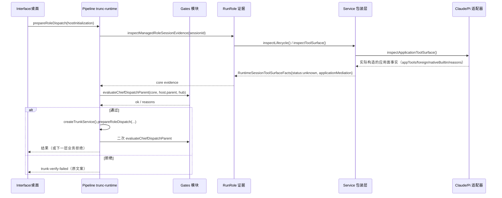
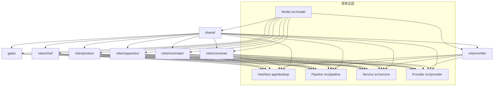

# 运行时派发门证据修复 + 产品内置角色代码模块化：方案（P1.6）

- 版本：**P1.6 草案，2026-11-07**；ANS 策划（Planning）独立上下文。**取代 P1.5（`c883ce31a9da6c06aad69d26f87626001720eee8021100d1c92bde56236e8ad5`，1227 行）、P1.4（`c9c36ba2…`，1204 行）、P1.3（`6985ff7e…`，1075 行）、P1.2（`e39561a3…`，1061 行）、P1.1（`c4a5eba4…`，1002 行）与 P1（`50a30ff8…`，944 行）**；历史版本保留、不再作为闸门 1 材料。复核记录 `docs/planning/2026-11-07_review_runtime-tool-surface-dispatch-gate.md` 当前 305 行 / 66050 bytes，`59b2c81c0bbb306dac0cf68911eb9ae0158e4551924554e05e83b165dae77762`（完整复核 P1、窄复核 P1.1、最终窄复核 P1.2、P1.3 最终核对 F21–F23、P1.5 窄复核 F24–F27）。P1.6 为纯文档修正（F24–F27），不改语义；见 §13.6。
- 状态：**待受影响部分窄复核、待闸门 1 客户确认；未实施、未测试、未验收、未 commit/push、未运行真实模型。** 客户在闸门 1 确认的版本才是实施与验收基线；实施另需闸门 2 角色指派与客户实施授权。
- 风险档位：**T3（建议，详见 §10）**。理由：改动共享运行时证据契约（Model/Service/Provider/Pipeline）与派发父门治理语义，并为现有六个产品内置角色各新增一个代码模块、八个**开发侧代码维护角色**（worker 角色）候选与共享/门控代码治理；即使阶段 1 代码面很小，也属治理/权限边界变更，不得按 T0/T1 处理。
- **口径澄清（重要）**：本方案所说的六个“内置角色”是**产品内置治理角色**（运行时概念：chief/product/rapporteur/nominator/convener/verifier，保持不变、不扩张）；八个新增角色是 **ANS 开发侧 worker 角色**（`角色卡/` 下由统筹派发、闸门 2 确认、人事写卡的项目维护角色），用于维护 ans-studio 源代码，不是产品内置角色扩张。文中统一称“XX 代码维护角色（开发侧 worker）”。
- 依据（本检出）：
  - 意图记录 `docs/communication/2026-11-07_intent_runtime-tool-surface-gate.md`（当前 68 行，`779a42493926cd969fa4e6bab014aeca96cb59c51fc22e26c96c1836f5c78997`；P1 引用的 `5fc39558…` 是已失效的早期快照，按 F1 更正）。
  - 授权 `docs/communication/2026-11-07_authorization_trunk-verify-gate-fix.md`（`ae401b394bc5cd4ad27e5df5bda54a499a29d8a2b83d7748054affb2e6ff0ac9`）。
  - Claude schema 窄修复（T1，独立在飞、**不并入本变更**）`docs/communication/2026-11-07_authorization_claude-schema-fix.md`（`f76fd1637caf77816940b5c6e800037b290368cbdbd5b19c319593f221e32209`）。
  - 变更包/真实运行证据 `docs/scheduling/2026-11-07_change-package_direct-role-capabilities-closeout.md`（`0c316d48a0ddcbb14850b0ec94b8facec9abee209feaabe8aef377689cb8de60`），§10.4/§11 记录 run-2/run-3。
- 关联标准与方案（管理文档在主检出 `C:\Users\51054\Desktop\work\ans-studio\docs\`，本检出无原件；以下 hash 按主检出字节复算）：
  - 幕僚枢纽 P2.1 `planning/2026-11-06_design_chief-hub-routing.md`（`16a346e0db76bbd4d69b17af5db292cb5a4c6336d8a15cc7106c5fc9809cfc0c`）。
  - I6 B1 `acceptance/2026-11-06_chief-hub-routing-criteria-v1.md`（`94a23460f8ae766f96ebbc9c2f34a8c16476d194d4a314fbd135f1a2797a4adc`）。
  - 直接能力 P3.1 `planning/2026-11-05_design_direct-role-capabilities.md`（`3a0650fc14298dc5a3dfae40d2723386fdd810747692c34ffe9afb2710c6a73c`）。
  - Git 角色权限 P2 `planning/2026-11-05_design_git-role-permissions-workflows.md`（`5ca20c5f333c9390fadbff855126f01a5219735fffc034bbf64dbed0757a45b8`）。
- 代码基线：实施检出 `.claude/worktrees/trunk-amendment`，HEAD `e71501c`，外加 Claude schema 窄修复（T1）的未提交差异（**只读引用，不在本方案写集**）。本文所有行号均为该快照只读核对结果；实施以符号名与文本锚点为准。
- 标记约定：**[事实]** 已只读核实的代码/文档行为；**[推断]** 基于代码但未经真实运行证实；**[设计候选]** 本方案提议、未实施。

---

## 0. 摘要（先读这段）

### 0.1 问题

真实 Claude 闭环 run-2/run-3 中，幕僚 `dispatch_task` 被应用拒绝：`trunk-verify-failed：Repository initialization parent is not the actual active accepted chief dispatch turn`。根因不是 Claude schema，而是派发父门 `validParent()` 要求核心会话的 `toolSurface.status === "observed"`；而真实运行时中只有 Codex 能产生该状态（`inspectNativeToolSurface` 仅 Codex 实现；demo 测试运行时除外）。Claude/Pi 的运行时证据如实自报 `unknown`，因此真实 Claude/Pi 的幕僚派发**结构性必被拒**。

### 0.2 已复算的三个关键事实

1. **[事实]** `validParent()`（`src/pipeline/orchestration/trunk-runtime.ts:751-770`）在 L756 要求 `core.toolSurface?.status === "observed"`；`currentChiefResumeSource()`（同文件 `:671-690`，L676）有同一要求。
2. **[事实]** 非 Codex 的拒绝理由精确是 `native-tool-registry-binding-unverified`（`src/service/runtime/session.ts:772-774`：适配器没有 `inspectNativeToolSurface`）；`native-production-tool-factory-unverified`（`:782-783`）只在“有 native 事实但 runtime/factory/status 不符”时出现。两者都使 `status` 恒为 `unknown`（`:801`）。任务背景中“非 Codex 恒加 native-production-tool-factory-unverified”需按此更正。
3. **[事实]** 真实 run-3 的幕僚会话注册并**发起调用**了 `run_shell`（`C:\Users\51054\Desktop\work\ans-dogfood-2026-11-07-r3\.ans\state\logs\chief.jsonl` 第 27 行，`tool.call run_shell`，2026-11-07T03:38:20.075Z；同日 03:38:22.810 同 turn 中止，日志未记录该调用完成结果）。应用注册面包含 `run_shell` 这一事实成立；若新证据路径照抄 Codex 的“appTools 不得含 run_shell/start_background_task”规则（`session.ts:785-786`），真实 Claude 幕僚仍会被拒——本方案因此把该规则的作用域讲清（§5.3；客户已决定 shell 全运行时，见 §13.2）。

### 0.3 下游门的披露（必须让客户知道）

**[事实+推断]** `inspectInitializationProtection()`（`trunk-runtime.ts:59-145`）对 Core 注册表中**每个 active 条目**要求 `lifecycle.processCoverage === "complete"`、`toolSurface.status === "observed"`、`nativeToolRegistry === "application-mediated"` 且 `native.factoryPlan` 存在（`:104-111`）。Claude/Pi 的 processCoverage 恒为 unknown（`session.ts:639`；Claude `src/provider/claude/session.ts:530`；Pi `src/common/pi-adapter/real-adapter.ts:1415`）。因此：**即使派发父门修好，真实闭环在运营执行仓库初始化（`git_candidate init`，`trunk-runtime.ts:212-241`）时仍会大概率被 `git-core-creation-proof-unavailable`/`git-native-surface-unproven` 拦下。** 该门属写/发布效果闭包，**不在本变更阶段 1 放宽范围**；需客户在闸门 1 明确是否另立变更（Q5）。

### 0.4 推荐

- **阶段 1（先让真实闭环可验证）**：采用路线 **A**（Claude/Pi/Codex 提供诚实的应用中介 tool-surface 事实 + 受限的 `application-mediated-unknown-native` 证据路径），同时采纳**有界的路线 D**：把派发父门判定抽成独立、纯函数、可测试的门控模块（单实现，`validParent` 与 `currentChiefResumeSource` 共用），Codex 严格路径原条件逐字保留。客户已决定受控 shell 对所有运行时可用、允许已配置外来 MCP：Claude/Pi 走应用中介路径；Codex 在严格路径因受控 shell 给 unknown 时走同一应用中介路径（严格路径本身不变）；**Codex chat 传输不支持外来 MCP，配置即 fail-closed（F19 事实结论）**。真实重跑以“幕僚派发被受理、任务创建/投递成功”为最小验证目标；后续门如实报告。
- **实施策略（客户已决定，P1.4/P1.5）**：采用 E 骨架「先定义公共契约，然后并行开发」：**E0 契约冻结 → E1 8 个开发侧角色上岗并行开发新模块（greenfield，旧代码不动）→ E2 影子/双轨对照 + 增量切换（禁止一次性替换；切换验证后删除旧实现）→ E3 测试贯穿/终验（含死代码/重复实现扫描 + 构建 + 全量测试）**。§9.1–§9.5 为主计划；原 P1→P2→P3→P4 保留为对比/回退基线（§9.4）。E0 契约包含六角色模块、共享模块、门控模块的 public API、错误语义、依赖方向、写集分配、行为/测试基线；契约冻结后变更走接口评审（不引入客户卡）。客户要求清理不再使用的代码：只清理本变更导致不再使用的代码，不确定项列「待确认」不盲删（Q18/D9/E-A10）。产品内置六角色本身不扩张、不新增。路线 **C**（统一 tool-surface 契约）作为长期架构方向，本变更以 A 的字段设计为其兼容切片，不整体迁移。
- **不推荐路线 B**（只放宽 `validParent`）：没有正向证据，等于把“未知”按运行时种类放行，无法证明应用中介面未被额外通道污染，且会迫使后续再改一次。**D 单独实施不修问题**（门仍只认 observed），必须与 A 同阶段。

### 0.5 本方案不做

不实施、不跑真实模型、不改任何产品/测试文件、不写角色卡、不任命角色、不改冻结标准、不建工作流引擎/DSL、不放宽任何客户主权/验收/写权语义。

---

## 1. 问题陈述与目标/非目标

### 1.1 触发事实

- run-2（CDP + 回填项目注册）与 run-3（真实 UI 导入 + UI 发送，目标项目不同）均复现：首席真实 Claude 回合执行了 `project_state`/`list_dir`/`contract_check`/`role_status` 等工具后，`dispatch_task` 两次被拒；无任务、无客户卡、未进入六角色闭环（变更包 §10.4/§11；证据 `run-3\ui-03-dispatch-denied.jpeg`、`run-3\ui-03-body.txt`、`chief.jsonl`）。
- 授权要求：修复后再次用真实 Claude 重跑真实闭环并如实报告（授权 `2026-11-07_authorization_trunk-verify-gate-fix.md`）。
- 客户已确认走变更普通流程（意图记录）；随后客户补充方向：门独立成模块、六个产品内置角色各自成为代码模块并由开发侧角色维护、共享代码由单一角色维护、最终明确为 **6 + 1 + 1 = 8 个新增开发侧 worker 角色**（产品内置六角色本身不扩张）。客户补充架构约束：**代码重构须满足每个维护角色代码不重复**（共享/私有划分 + 反重复可检查口径，§8）。

### 1.2 现状调查（已验证事实）

| # | 位置 | 已验证事实 | 与问题关系 |
| --- | --- | --- | --- |
| F1 | `src/pipeline/orchestration/trunk-runtime.ts:751-770` | `validParent()` 要求 `core.construction === "default-core"`、`core.roleId === "chief"`、`core.runtime === context.parent.runtime`、`core.toolSurface?.status === "observed"`、`toolSurface.sessionId` 匹配、`factoryProvenance !== "custom-override"`、`lifecycle.turnId` 匹配、`!stopRequested`、`activeDispatch`、`inputAccepted === true`、`settled === false`；creatorReports 另核 handback provenance。 | 直接触发门。 |
| F2 | 同文件 `:671-690` | `currentChiefResumeSource()` 使用同一组条件（L676 同样要求 `toolSurface?.status === "observed"`），供 `prepareControllerResume` 使用。 | 同族门；只修 `validParent` 会留下 controller resume 的 Claude/Pi 阻塞。 |
| F3 | 同文件 `:771-772` | 失败统一返回 `code: "trunk-verify-failed"`，消息固定为 “Repository initialization parent is not the actual active accepted chief dispatch turn”（非 init 派发也复用该文案）。 | 错误语义基线。 |
| F4 | `src/service/runtime/session.ts:752-813` | `inspectToolSurface()`：通用注册表/处理器漂移检查（`:759-766`）；非 demo 时读 `inner.inspectNativeToolSurface?.()`（`:769-770`）；`native` 缺失或身份不匹配 → `native-tool-registry-binding-unverified`（`:772-774`）；native 存在时的生命周期/执行覆盖/native factory/注册表一致性/未中介执行检查（`:776-791`）；`disposed`（`:794`）；`status = reasons.length ? "unknown" : "observed"`（`:801`）；`nativeToolRegistry` 仅当无 reasons 且有 native 时为 `application-mediated`（`:799`）。 | `observed` 的唯一产地；Claude/Pi 在此恒 unknown。 |
| F5 | 同文件 `:498-513` | `prepareNative()` 仅当 `factoryProvenance === "default-production" && options.runtime === "codex"` 时才准备 native factory（`:502`）；其它 runtime 返回 `undefined`。 | 非 Codex 没有 native plan 的结构性原因。 |
| F6 | `src/model/runtime.ts:174-216` | `RoleSession` 只有可选 `inspectNativeToolSurface?()`（`:179`）与 `inspectLifecycle?()`；无应用中介 tool-surface 事实接口。 | 需新增窄接口。 |
| F7 | 同文件 `:220-258` | `RuntimeSessionToolSurfaceFacts`：`status: "observed" | "unknown"`、`nativeToolRegistry: "application-mediated" | "unknown"`、可选 `native`；`RuntimeNativeToolSurfaceFacts` 的 `factory` 只允许 `"codex-chat" | "unknown"`。 | 类型层只表达 Codex native。 |
| F8 | 同文件 `:358-397` | `RuntimeSessionLifecycleFacts` / `RuntimeNativeLifecycleFacts`；transport kind 含 `unknown`，`processCoverage: "complete" | "unknown"`。 | 诚实 unknown 的类型基础。 |
| F9 | `src/common/codex-adapter/chat-transport.ts:258-272` | Codex `inspectNativeToolSurface()`：报告实际函数分发图、`factory: "codex-chat"`、`status` 由 reasons 决定。 | 全仓唯一实现（grep 确认仅此一处）。 |
| F10 | `src/provider/claude/session.ts:514-540` | Claude `inspectNative()`：无 active tool 时 `status: "unknown"`（`:525`）；`transport.kind: "unknown"`（`:529`）；`processCoverage: "unknown"`（`:530`）；reasons 如实说明 SDK 不暴露 PID/进程树/关闭确认（`:531-538`）。 | Claude 无法满足 native 条件。 |
| F11 | 同文件 `:541-570, 944` | Claude 有 `nativeLifecycle`（bind 身份 + inspect/stop），但**没有** `inspectNativeToolSurface`。 | 可提供 bind 身份，不能提供 native tool registry。 |
| F12 | `src/common/pi-adapter/real-adapter.ts:1385-1470` | Pi `makeRoleSession`：`nativeLifecycle` 存在；`inspectNative` 报 `transport.kind: "in-process"`（`:1413`）、`processCoverage: "unknown"`（`:1415`）、reasons 含进程树不可观测（`:1416-1421`）；无 `inspectNativeToolSurface`。 | 同 Claude。 |
| F13 | 同文件 `:1542-1550, 1646-1647, 1695-1697, 1773-1787, 1807-1811` | Pi 构造时 `noTools: "builtin"`、`customTools` = 受治理工具、`allowedSurface` = 注入名 + 白名单 MCP；`getActiveToolNames()` 超出放行面即构造失败。 | Pi 可诚实报告应用中介面。 |
| F14 | `src/service/runtime/session.ts:602-682` | 包装层 `collectLifecycle()`：合并 provider tool lifecycle 与 native facts；Claude/Pi 因 native coverage unknown → `coverageUnknown = true`（`:639`），最终 `processCoverage: "unknown"`；`turnId` 来自 `latestTurn`（`:675`）。 | 派发门所需的 turnId/activeDispatch 对 Claude/Pi 可用；processCoverage 不可用。 |
| F15 | 同文件 `:209-220` | Core 注册表把 `entry.session.inspectLifecycle()` 与 `inspectToolSurface()` 复制为证据。 | 门只读复制事实，不读适配器内部。 |
| F16 | `src/pipeline/orchestration/run-role.ts:737-743` | `inspectManagedRoleSessionEvidence()` 从本进程实际构造的 handle 取 `lifecycle` 与 `toolSurface`。 | Pipeline 取得证据的唯一入口。 |
| F17 | `app/desktop/session.ts:8798-8811` | 桌面从真实父会话 `origin`（turnId/inputAccepted/settled/kind/creatorReports）与 native-directory-selection registration 构造 `hostInitialization`，且 `current()` 二次校验。 | host 侧事实来源可信。 |
| F18 | 同文件 `:9006-9017, 9056-9077` | 团队计划与文档准备各自从真实父会话构造 host 上下文；缺 `inputAccepted`/turnId 即不构造。 | 同上。 |
| F19 | `src/service/trunk/abstract/trunk-service.ts:248-253` | `RepositoryInitializationContext.parent` 类型把 `inputAccepted: true; settled: false` 写成字面量；运行期仍由应用构造。 | Service 层同时重核这些字段（如 `apply-journal.ts:3508, 3566, 3648`）。 |
| F20 | `src/service/trunk/impl/apply-journal.ts:3501-3558` | hub 分支：要求 `fromRoleId === "chief"`、五个目标、flowId 格式、host 注册/父来源、项目身份一致；creatorReports 走 `creatorReportSource`。 | 本变更不得改变这些 Service 语义。 |
| F21 | 同文件 `:3639-3664` | 非 hub 的仓库初始化分支：要求 native selection、`initial.state === "absent"`、应用状态存在、无父仓库/reasons。 | 同上。 |
| F22 | `src/pipeline/orchestration/trunk-runtime.ts:59-145` | `inspectInitializationProtection()`：对注册表每个条目要求 active plan、无 reasons、lifecycle 完整（`:104-105`），并要求 `surface.status === "observed"`、`nativeToolRegistry === "application-mediated"`、`native.factoryPlan`（`:107-111`）。被 `git_candidate` init/commit、`git_publish` delivery、文档/计划/激活发布等路径调用（主调用点 `:204,218,260,322,348`，另有复检 `:206,236,262,326,351` 与 `:448,503` 两个消费者）。 | **下游写/发布门，Codex-only；本变更不放宽。** |
| F23 | `src/pipeline/orchestration/run-role.ts:1843-1844` | stable-write 前置只要求 `factoryProvenance === "default-production"` 与 active `request_stable_write`，不要求 toolSurface observed。 | 与本门不同；本变更不应改变。 |
| F24 | `C:\Users\51054\Desktop\work\ans-dogfood-2026-11-07-r3\.ans\state\logs\chief.jsonl:27` | 真实幕僚会话 `tool.call run_shell`（同一 turn `8a41a47f…`；仅记录发起，未记录完成；同 turn 2.7s 后中止，见第 29 行）。 | 证明应用注册面含 `run_shell`；新路径若禁止它将无法达成目标。 |
| F25 | `src/common/门禁引擎/governance-roles.ts:313-572` | 六个内置角色规格（cardText、Section 1 entries、preauthorizedDirs、forbiddenWritePaths、capabilities、矩阵摘要）集中在门禁引擎私有 common（数组自 `:313` 起，实际结束于 `:572`）。 | 角色模块化的现状起点。 |
| F26 | `src/pipeline/orchestration/run-role.ts:990-1013, 1687-1704, 2336-2349, 2859-2894` | 角色专属策略散落在 Pipeline：`isTrio`/registry 能力、chief 专属工具、`canRequestRequirementChange`/`canRequestStableWrite`/`canRequestVersionDecision`、`TRIO_CARD_KINDS`。 | 角色模块化的主要迁移对象。 |
| F27 | `app/desktop/session.ts`（`chief` 约 70 处、`convener` 约 39 处、`product`/`rapporteur` 各约 10 处）、`src/service/trunk/impl/apply-journal.ts`（`convener` 约 78 处、`chief` 约 62 处、`rapporteur` 约 27 处、`nominator` 约 23 处、`verifier` 约 25 处） | 角色条件在桌面与 Service 大面积分布（grep 计数为近似口径；`app/desktop/session.ts` 含非文本字节，普通 `grep -o` 可能漏计 1–4 处；精确清点交给阶段 2 基线盘点）。 | 模块化必须按“纯策略数据/函数 + 共享引擎”迁移，不能把整个文件搬走。 |
| F28 | `src/common/编排/workflow-preconditions.ts:1530-1607` | 已有共享派发授权/预检/报告目标函数（`evaluateDispatchAuthorization`、`evaluateDispatchPreflight`、`reportTargetForTaskCreator`）；`src/common/编排/handback.ts:456` 有 `isDispatchableRoleId`。 | 共享协议的上收基座。 |
| F29 | `角色卡/门禁引擎/boundary.md:7-14`、`角色卡/编排/boundary.md:10-20`、`角色卡/运行时核心/boundary.md:9-19` | 现有 owner：门禁引擎拥有 Model boundary/role/decision、resolveWrite、shell-rules、私有 common；编排拥有 `trunk-runtime.ts`/`run-role.ts` 等单文件；运行时核心拥有 `model/runtime.ts`、`service/runtime/session.ts`、provider/runtime 工具与 schema。 | 开发侧代码维护角色映射的现状事实。 |

### 1.3 复算更正与关键发现

1. **理由码更正**（见 F4）：Claude/Pi 的实际原因是 `native-tool-registry-binding-unverified`，不是 `native-production-tool-factory-unverified`。设计以代码为准。
2. **run_shell 事实**（F24）：真实幕僚应用面包含 `run_shell`。任何“照抄 Codex 严格面”的新路径都会继续拒绝真实 Claude；必须把“tool call 来源证据”与“效果闭包证据”分开（§5.3）。
3. **下游门**（F22）：派发修复不等于真实闭环完成。仓库初始化/交付仍要求 Codex native 完整证明；本变更明确不放宽，真实重跑必须如实报告下一个门。
4. **门文案耦合**（F3）：`staleParent()` 的固定消息包含 “Repository initialization”，但被所有派发复用；本变更默认不改文案（Q12）。
5. **角色代码分布**（F25-F28）：六角色策略跨 Model/Service/Pipeline/Interface 多层分布，且 `governance-roles.ts` 已集中一部分数据。模块化必须新增“共享策略接口 + 纯策略函数”，不是把引擎文件按角色复制。

### 1.4 目标与成功结果

- **G1（阶段 1）**：真实 Claude、Pi 与含受控 shell 的 Codex 幕僚派发父门可正确判定：在真实 active chief turn、`inputAccepted:true`、`settled:false`、`activeDispatch`、`default-core`、默认工厂的前提下，使用诚实的应用中介证据通过；未知 native 仍保持 unknown。Codex 配置外来 MCP 时 fail-closed（其 chat 传输不支持，见 F19）。
- **G2（阶段 1）**：Codex 严格路径原条件逐字保留；custom/disposed/stopped/wrong-turn/无 active dispatch 等继续拒绝。客户决定 1 下，Codex 含受控 shell 时通过新增应用中介路径参与派发（不改变 strict 定义，见 G7）；外来 MCP 仅 Claude/Pi。
- **G3（阶段 1）**：派发父门判定抽成独立纯模块（单实现），配套正负例矩阵；`validParent` 与 `currentChiefResumeSource` 共用。
- **G4（E0/E1）**：为现有六个产品内置角色各新增一个独立代码模块，角色专属数据/策略从 Pipeline/Service/Interface 的散落条件中收拢；共享协议（派发-报告-收口、工具 schema、i18n、账本等）上收共享模块；门控判定独立成门控模块；行为与门禁语义不变（差分回归证明）。
- **G5（E0/E1）**：形成 8 个**开发侧代码维护角色**候选（6 个角色代码模块维护 + 1 个共享代码维护 + 1 个门控代码维护）的能力/边界/写集候选，供统筹按五维判断、闸门 2 客户确认；角色卡由人事在闸门 2 后写。**客户已决定 E 骨架：E0 契约冻结后 8 角色上岗并行开发新模块**；产品内置六角色不扩张。
- **G6**：分阶段交付：P1 派发门修复 + 最小真实重跑（可与 E0 契约设计并行）；**主计划 E0 契约冻结 → E1 8 角色并行开发 → E2 增量切换 → E3 测试贯穿/终验**；原 P1→P2→P3→P4 保留为对比/回退基线（§9.4）。每阶段独立验收，不把后阶段设计混入前阶段候选。
- **G7（阶段 1，客户决定 1/2）**：受控 shell 对所有运行时可用；已配置外来 MCP 在 Claude/Pi 精确枚举后允许。Codex 在严格路径因受控 shell 给 unknown 时，经同一应用中介路径参与派发；**Codex chat 传输不支持外来 MCP，配置即 fail-closed**；写/发布门仍不接受应用中介证据。
- **成功后的用户可见结果**：真实 Claude/Pi 幕僚不再被“父门无法判定”拒绝；派发继续走原有 Service 身份/项目/报告校验；后续若被仓库初始化门拒绝，回执如实指向该门而不是“父门”。

### 1.5 非目标

- NG1 不删除/绕过/弱化任何门；unknown 不得冒充 observed。
- NG2 不放宽客户主权、验收判定、写权/边界、shell/Git ACL、D3、冻结、报告/收口语义。
- NG3 不把仓库初始化/交付的 Codex-native 写闭包放宽为应用中介（另立变更，Q5）。
- NG4 不建通用工作流引擎/DSL/规则解释器；角色模块是 TypeScript 数据与纯策略函数。
- NG5 不新增客户卡、不改客户入口、不把内部接口评审变成客户审批。
- NG6 不在本方案任命角色、不写角色卡、不改边界文件；不修改其他角色文档/角色卡。
- NG7 不把 T1 Claude schema 修复并入本变更候选。
- NG8 不改 I6 H01–H11、旧 A/J 冻结标准；新基线暂名“运行时派发门与角色模块化 B1”，不替代/不修改 H02/H03；如需新增判据只写本 B1。
- NG9 不追求“一次重构完成”；不做大爆炸式迁移，不做先复制后清理。

---

## 2. 路线选型（第一部分：派发门证据）

### 2.1 路线 A：诚实的应用中介 tool-surface 事实 + 受限证据路径（推荐）

**内容**：
1. 新增 Model 类型 `RuntimeApplicationToolSurfaceFacts`（`source: "application-mediated-tool-surface"`；`nativeInstanceId`/`roleId`/`runtime`/`factory: "claude-sdk-mcp" | "pi-custom-tools" | "codex-chat"`/`status`/`observedAt`/`appTools`/`foreignMcpServers`/`nativeBuiltinTools`/`reasons`）。
2. `RoleSession` 新增可选 `inspectApplicationToolSurface?()`；Claude/Pi/Codex 适配器实现，报告**实际构造**的工具注册事实（不是配置意图）。
3. 包装层 `inspectToolSurface()` 交叉核对后，在 `RuntimeSessionToolSurfaceFacts` 增加可选 `applicationMediation` 字段，`kind: "application-mediated-unknown-native"`；`status` 与 `nativeToolRegistry` **保持 unknown**。
4. 派发父门模块接受二选一：Codex 原 `status === "observed"` 严格路径，或受限的 `applicationMediation.status === "verified"` 路径（Claude/Pi/Codex 共用同一受限 predicate；Codex 要求 native 事实存在且绑定）；两条路径都保留其余全部条件。
5. Codex 的 native 检查、`inspectInitializationProtection`、stable-write 等写/发布消费者逐字不变。

**优点**：正向证据诚实（适配器自报实际注册面 + 包装层交叉核对）；unknown 不冒充 observed；Codex 不动；改动面可控；为路线 C 的长期契约提供兼容字段。
**缺点/成本**：Claude/Pi/Codex 各加一个窄方法；Model 共享类型新增（跨角色）；`run_shell`/foreign MCP 的政策已由客户决定（shell 全运行时、允许已配置外来 MCP），但需精确落实枚举/负例；证据仍不能证明 native 进程/传输，必须严格限制消费门（§5.3）。

### 2.2 路线 B：只放宽 `validParent`（不推荐）

**内容**：对 Claude/Pi 不要求 `toolSurface.status === "observed"`，改用“runtime ∈ {claude, pi} + 其余严格事实 + 新显式状态”。

**评估**：
- 若“新显式状态”没有适配器正向证据，就只是按 runtime 种类信任：无法区分默认工厂正常注册面与“适配器未注册任何工具/额外注册了 native 通道”的情况；`factoryProvenance` 只能排除显式 custom factory，不能证明适配器内部构造。
- 违反“证据来源归各 owner”原则：包装层会 attest 自己未观察的适配器内部。
- 若把 `status` 改成新值，会波及所有 `status` 消费者与 UI 展示；若新增布尔值，则仍需适配器证据，最后回到 A。
- 结论：仅作为“A 落地前的临时诊断”也不建议，因为会留下第二套判定语义。

### 2.3 路线 C：统一 tool-surface 契约（长期方向，不在本变更整体实施）

**内容**：把 tool-surface 证据统一为判别联合：
- `native-registry-observed`（Codex，完整 native 证明）；
- `application-mediated-unknown-native`（Claude/Pi，应用面已证、native 未知）；
- `unknown`（无证据）。
所有消费者（派发父门、controller resume、仓库初始化保护、stable-write、UI 展示）按 gate 声明接受哪些 kind。

**优点**：消除 `status`/`nativeToolRegistry`/`applicationMediation` 三处语义分散；新 runtime 接入只需实现契约；便于门控模块统一测试。
**缺点**：触及 `inspectInitializationProtection`、`run-role` stable-write、桌面展示与所有现有证据字段；Codex “逐字不变”难以声明；改动面与回归成本远超阶段 1。
**结论**：作为架构方向；本变更只新增 `applicationMediation` 判别字段，字段命名与语义按 C 的终态设计，不迁移其它消费者。

### 2.4 路线 D：门独立成模块（客户方向，推荐有界采纳）

**内容**：把派发/准入类门（dispatch 父门、turn 身份、tool-surface 证据、activeDispatch/inputAccepted/settled、controller resume 等治理校验）抽成独立模块：单一职责、明确输入/输出与错误码、完整测试（正例 + 负例 + 回归）。不建通用工作流引擎/DSL。

按协调者要求逐维评估：

| 维度 | 评估 |
| --- | --- |
| ① 与现状分散实现相比的收益/成本 | 现状：`validParent` 与 `currentChiefResumeSource` 在 `trunk-runtime.ts` 内重复同一核心条件（L676/L756），证据读取在 `run-role.ts`，证据生产在 `session.ts`/适配器，门文案在 Pipeline。抽模块收益：单实现、可单测矩阵、拒绝原因结构化、避免两处漂移；成本：新增共享模块与公共入口、需治理模块位置（§7.4）、需行为等价证明。 |
| ② 分层与依赖方向 | 门模块只做判定，依赖 Model 类型与共享接口，不依赖 Service/Provider/Pipeline 实现；放在共享支撑区（候选 `src/common/gates/`），由 Pipeline/Service 经 public entry 调用。不得放在某个引擎文件内部再被复制；不得成为 god-module（只收派发/准入家族，不收写路径/边界判定——后者仍归门禁引擎）。 |
| ③ 证据来源归各 owner | 门模块**不采集/不伪造**证据：输入是调用方传入的 `core`（来自 `inspectManagedRoleSessionEvidence`）、host parent、hub 标志；输出是 `{ok}` 或 `{ok:false, reasons}`。运行时进程/工具面事实仍由 Service/适配器生产。 |
| ④ 迁移步骤与兼容 | 先把现有两条判定逐字提取为纯函数（Codex 条件不变、错误文案不变），用差分测试证明旧/新输出等价；让 `validParent`/`currentChiefResumeSource` 改调同一函数；再引入 A 的新证据分支。阶段 1 内完成，不等待全量模块化。 |
| ⑤ 测试策略 | 纯函数正负例矩阵（§12）；`prepareRoleDispatch` 集成测试；与旧实现的差分对照（同一 fixture 集合输出一致，除新增 A 分支的预期差异）；真实运行只做最小验证。 |
| ⑥ 与 A/B 的关系 | D 不修语义，只收拢判定；单独 D 会保持“Claude/Pi 必被拒”。推荐 **A + 有界 D 同阶段**：A 提供新证据，D 让判定只有一处实现与一套测试。B 无需 D（但 B 本身不推荐）。 |
| ⑦ 风险档位与影响面 | 门模块本身是行为等价重构（中风险）；和 A 一起构成治理语义变更（T3）。影响：Pipeline 调用方、门测试、诊断 reason；不影响证据生产与其它写门。 |

**红线**：模块只判定，不采集；不成为工作流引擎；不放宽任何治理/客户主权/写权语义；unknown 不得冒充 observed；不得把写路径/边界判定并入门模块。

**关于 Codex“逐字不变”的精确含义**：A 不改变 Codex 的任何条件；D 把这组条件从 `trunk-runtime.ts` 的内联位置搬到门模块，属于**代码形状变化**，但条件集合、短路顺序、结果与错误码保持一致，并以差分测试证明等价。若客户/复核要求物理文件内逐字不变，可采用 **D-minimal 变体**：纯函数仍留在 `trunk-runtime.ts` 内，仅导出给测试与 `currentChiefResumeSource` 复用（仍满足单实现，但模块独立性弱于 D）；该变体列入 Q1 的备选说明。

### 2.5 选型比较与推荐

| 维度 | A | B | C | D（有界） |
| --- | --- | --- | --- | --- |
| 修复真实 Claude/Pi/Codex(含 shell) 派发 | 是 | 是（但无正向证据） | 是 | 否（单独） |
| Codex 严格路径原条件保留 | 是 | 是 | 否（整体迁移） | 是（提取等价；应用中介为新增并行路径，不放宽 strict 定义） |
| unknown 不冒充 observed | 是 | 形式上，实质弱 | 是 | 是 |
| 证据归 owner | 是 | 否 | 是 | 是（只判定） |
| 改动面 | 中 | 小 | 大 | 小-中 |
| 可测试性 | 好 | 差 | 好 | 很好 |
| 长期架构 | 兼容切片 | 债务 | 目标态 | 支撑 C |

**推荐**：P1 = **A + 有界 D**；C 作为长期方向；B 拒绝。D 的门模块同时是 8 个开发侧代码维护角色中“门控代码维护角色”的种子资产（§7）；按客户最新 E 决定，门控角色在 E0 契约冻结后上岗并行开发其模块（§9/Q16）。**客户决定带来的范围变化**：Codex 在严格路径因受控 shell 给 unknown 时，可经同一应用中介路径参与派发——这是派发门层面的行为新增，不是 `status: "observed"` 定义放宽；写/发布门仍不接受应用中介（§5.3、§13.2）。**Codex 外来 MCP**：chat 传输不支持（构造期 fail-closed），不在应用中介路径放行；外来 MCP 仅 Claude/Pi（F19）。

### 2.6 路线 E：8 角色并行 greenfield 开发 + 替换原代码（客户已采纳策略，P1.4）

**客户原话**：「我现在的想法是新规划 出 8个角色出来，然后并行的开发出来代码，然后替代掉原本的代码。在测试，你觉得呢。」

**路线 E 的定义（按客户描述）**：
1. **E0 规划/契约冻结**：先规划 8 个开发侧角色及其模块公共契约（六个角色模块 + 共享模块 + 门控模块），冻结 public entry、共享接口、行为基线与测试基线。
2. **E1 并行开发**：8 个角色在旧代码**旁**并行开发新模块（greenfield），旧代码保持可运行、不新增行为。
3. **E2 替换**：用新模块替换原代码。
4. **E3 测试**：替换后测试（客户原话“在测试”可理解为测试环节）。

**与现方案（P1 派发门修复 → P2 现有 owner 重构 → P3 8 角色上岗 → P4 终验）的对比**：

| 维度 | 现方案 | 路线 E（客户原话） | 评估 |
| --- | --- | --- | --- |
| 角色上岗时点 | 模块形成后（P3） | 契约冻结后、开发期即上岗（8 角色并行开发） | E 改变“先重构后角色上岗”的顺序：角色在模块未形成前上岗，但角色本身负责创建模块；需 Q16 确认。 |
| 谁写新代码 | 现有 owner 先重构，P3 后转移 | 8 个新角色直接写新模块 | E 可减轻现有 owner 负载，但要求契约、写集、接口评审先到位。 |
| 替换策略 | 增量迁移（门面共存、分批） | 并行重写后替换 | E 若“一次性替换”风险不可接受；必须改为按模块增量切换（E'）。 |
| 测试时机 | 阶段性验收 | 替换后测试 | E 原话测试偏后；必须改为测试贯穿（契约/单元/差分/集成/真实运行），否则无法证明行为不变。 |
| 并行依赖 | 现有 owner + 模块契约 | 8 角色并行，依赖契约冻结、共享接口、测试基线 | E 的并行度最高，前置依赖也最强；契约不冻结则 8 路并行会放大漂移。 |
| 双轨/影子成本 | 门面共存，成本中 | 新旧代码并存，双轨/差分/切换/回滚成本高 | E 需专门的双轨与差分基建；否则“替换”无法证明等价。 |
| 协调成本 | 现有 owner 协调 | 8 角色 + 共享/门控接口评审 + 统筹 | E 协调成本最高；需契约评审与单一共享 owner。 |
| 评审/验收 | 每阶段 B1/B2 | 契约冻结评审 + 模块等价 + 切换证据 + 终验 | E 可验收，但必须增加“契约冻结/等价/切换/回滚”证据。 |
| 主要风险 | 迁移漂移、阶段长 | 一次性替换、隐藏耦合、回滚困难、双轨漂移、8 路协调 | E 需安全变体，不接受一次性替换。 |

**推荐（客户已采纳 E 骨架，最终采用安全变体 E'）**：
- **E0（前置，必须先于并行开发）**：8 角色边界/写集 + 六角色模块/共享/门控模块的 public 契约冻结；行为基线、测试基线、旧代码冻结规则、双轨与切换方案一并冻结；独立评审/验收契约。
- **E1（并行开发）**：8 角色在旧代码旁开发新模块；旧代码保持可运行、只修阻断缺陷、不新增行为；新逻辑只进新模块；共享代码只由共享 owner 写；门控代码只由门控 owner 写；角色模块间零 import。**greenfield 范围：六角色模块 + 门控模块；共享模块角色在既有 `src/common/shared/` 上按 E0 契约维护/迁移，遵循 E2/D9。**
- **E2（增量切换，禁止一次性替换）**：按模块/门逐个切换；桥接/feature flag + 双跑对照 + 切换 gate + 回滚开关；每模块切换前必须证明旧/新行为等价（差分），切换后回归；旧代码在对应模块切换成功并可回滚前保持可用；**切换成功并验证后立即删除旧实现/门面/符号（客户硬性要求）**；清理只限本变更导致不再使用的代码，不确定项列「待确认」不盲删。
- **E3（测试贯穿）**：契约测试、模块单测、差分双跑、集成、真实运行按里程碑执行，不把测试留到替换后；最终全量回归 + 门禁负例 + 死代码/重复实现扫描（TS Compiler API + 构建 + 全量测试）；被删除文件/符号清单入变更包；Git 历史保留旧实现。
- **P1 派发门修复的顺序**：仍应先做（或作为 E1 的第一个门控模块切片）——真实闭环验证需要它；E 不能替代 P1。若客户希望 8 角色从门控模块开始，则先完成 E0 门控契约 + 让门控角色实现 P1 切片，再做真实重跑；否则按现方案 P1 先修、再 E0/E1/E2/E3。**若 E 与 P1 顺序冲突，以“先让真实闭环可验证”为优先**（Q16）。
- **与客户决定 3 的关系**：E 实质修改“先重构后角色上岗”——角色在契约冻结后即上岗开发，而不是等模块形成后接管；这是客户新策略的自然结果，但需闸门 1 明确确认（Q16），并保留“角色不得在契约冻结前上岗”的硬前置。
- **明确拒绝“一次性替代原代码”**：治理代码（apply-journal/run-role/desktop session）耦合深、证据链长，一次性替换无法逐项证明行为/门禁语义不变，回滚困难，且会与“先让真实闭环可验证”冲突；若客户坚持一次性替换，本方案如实说明风险不可接受，至少要求按模块增量切换 + 回滚 + 双跑等价证据（E'）。
- **DRY 约束不变**：双轨期间旧代码冻结、新逻辑只进新模块；共享代码单一 owner；不得把旧实现复制进新模块；切换后旧代码删除，不留双份（§8.6）。

---

## 3. 安全不变量（硬约束）

| 编号 | 不变量 | 强制点 | 验证 |
| --- | --- | --- | --- |
| INV-1 | unknown 不得冒充 observed；Claude/Pi 及 Codex 应用中介路径的 `status` 与 `nativeToolRegistry` 永远保持 unknown | `inspectToolSurface` 只在 native 完整证明时置 observed/application-mediated | 负例：伪造 observed、native 缺失、fact unknown；含 Codex 应用中介路径 |
| INV-2 | 新证据只用于派发父门与 controller resume；不得被仓库初始化/交付/stable-write/写权门接受 | `inspectInitializationProtection`、`run-role.ts:1843-1844` 等消费者不读 `applicationMediation` | 负例：A 路径下 git init/stable-write 仍拒绝 |
| INV-3 | 仍要求真实 active chief turn：`default-core`、`roleId:"chief"`、runtime/sessionId 一致、`lifecycle.turnId === parent.turnId`、`activeDispatch` | 门模块全条件保留 | 负例：wrong turn、无 activeDispatch |
| INV-4 | 仍要求 host `inputAccepted === true`、`settled === false` | 门模块 + Service 双侧 | 负例：false/true |
| INV-5 | custom factory、disposed、stopRequested、registry/handler 漂移继续拒绝；demo 不走新应用中介路径，demo 严格路径现状不变（若客户要求整体拒绝 demo，按 Q1 另议，见 N13） | 现有条件逐字保留 | 负例矩阵 |
| INV-6 | **Codex 严格路径原条件逐字保留、`status: "observed"` 定义不放宽**；严格路径不成立且 native 事实存在/绑定时可走受限应用中介路径（仅派发/controller resume）；写/发布门仍只接受 strict observed | §4.4 运行时四分支（claude/pi/codex/demo）+ 严格路径 `applicationMediation === undefined` | 差分测试 + Codex 回归 + 双路径负例 |
| INV-7 | 应用中介证据必须来自适配器实际构造事实，包装层交叉核对注册表/身份/工厂；缺失/不匹配即 unknown | 新类型 + guard + 包装层核对 | 负例：fact 缺失、appTools 不一致 |
| INV-8 | 适配器不得报告“无 native 通道”却实际注册 native builtin；`nativeBuiltinTools` 必须为空 | 适配器构造事实 + 包装层 | 负例：native builtin 非空 |
| INV-9 | 门模块不采集/不伪造证据；不依赖 Service/Provider/Pipeline 实现；不形成第二事实源 | 模块输入为已取得事实 | 依赖图/评审 |
| INV-10 | 不新增客户卡、不改变客户主权/验收/写权；不建工作流引擎/DSL | 设计范围 | 评审 + 验收 |
| INV-11 | 两次 `validParent`（Service 调用前后）都使用同一门模块，保证 TOCTOU 复检 | `prepareRoleDispatch` 前后两次 | 集成测试 |
| INV-12 | 六角色模块化行为不变：同一输入下旧/新策略输出完全一致；门禁语义不变 | 差分回归 | 差分测试 + 全量回归 |

---

## 4. 第一部分架构设计

### 4.1 分层与模块

```
Interface (app/desktop)
   │  hostInitialization / dispatch / UI
   ▼
Pipeline (src/pipeline/orchestration)
   │  prepareRoleDispatch / validParent / controller resume
   ▼
Service (src/service/runtime, src/service/trunk)
   │  inspectToolSurface 包装、host/任务/账本校验
   ▼
Provider (src/provider/claude|pi|codex, src/provider/runtime)
   │  adapter facts: native (Codex) / application-mediated (Claude/Pi)
   ▼
Model (src/model)
      RuntimeSessionToolSurfaceFacts / RuntimeApplicationToolSurfaceFacts

共享支撑（供上层读取，不反向依赖）：
  src/common/gates/     门控判定模块（阶段 1 新建，候选 owner=门控代码维护角色）
  src/common/shared/    共享协议/原语（候选 owner=共享代码维护角色）
  src/common/roles/     六角色代码模块（阶段 2 新建，候选 owner=各角色代码维护角色（开发侧 worker））
```

- 门模块 `src/common/gates/` 只依赖 Model 与 `src/common/shared/`；不得 import `src/common/roles/`、Service、Provider、Pipeline。
- 角色模块 `src/common/roles/<id>/` 只依赖 Model 与共享接口；不得 import 门模块、其它角色模块或任何引擎。
- 共享模块 `src/common/shared/` 只依赖 Model；不得 import 门模块或角色模块。
- 依赖 DAG：Model ← shared ← {gates, roles} ← engines。无环。
- **共享根授权缺口（F5/F8）**：`src/common/gates/`、`src/common/roles/` 当前不在任何现有角色 Section 1；现行 `shared-directories.md` 只定义 `common/<role-id>/`（私有）与 `common/shared/`（PM 唯一 writer）。按客户最新决定（E 骨架：契约冻结后角色上岗并行开发），P1/E0/E1 期间由现有 owner 或临时 owner 按 Q9 取得 `src/common/gates/`、`src/common/roles/` 的临时写集授权；E0 完成后由 8 个角色按新模块路径写卡/接管。不得只写“临时 owner”而无边界授权。

### 4.2 调用与数据流



### 4.3 接口与数据模型（设计候选）

**Model 新增**（`src/model/runtime.ts`，运行时核心 owner）：

```ts
/** 适配器实际构造的应用中介工具注册面；不是 native 进程/传输证明。 */
export interface RuntimeApplicationToolSurfaceFacts {
  source: "application-mediated-tool-surface";
  nativeInstanceId: string;      // 必须等于 nativeLifecycle.instanceId
  roleId: string;
  runtime: RuntimeKind;          // 应用中介路径接受 "claude" | "pi" | "codex"
  factory: "claude-sdk-mcp" | "pi-custom-tools" | "codex-chat";
  status: "observed" | "unknown";
  observedAt: string;
  appTools: readonly string[];           // 实际注册给模型的 ANS 工具名
  foreignMcpServers: readonly string[];  // 实际配置的外来 MCP server 名
  nativeBuiltinTools: readonly string[]; // 实际启用的 native builtin；本路径必须为空
  reasons: readonly string[];
}

export function isRuntimeApplicationToolSurfaceFacts(v: unknown): v is RuntimeApplicationToolSurfaceFacts;
```

`RoleSession` 新增：`inspectApplicationToolSurface?(): RuntimeApplicationToolSurfaceFacts;`

`RuntimeSessionToolSurfaceFacts` 新增可选字段：

```ts
applicationMediation?: {
  kind: "application-mediated-unknown-native";
  status: "verified" | "unknown";
  runtime: RuntimeKind;
  factory: "claude-sdk-mcp" | "pi-custom-tools" | "codex-chat";
  observedAt: string;
  appTools: readonly string[];
  foreignMcpServers: readonly string[];
  nativeBuiltinTools: readonly string[];
  reasons: readonly string[];
};
```

**门模块接口**（`src/common/gates/dispatch-parent.ts`，阶段 1。只使用 Model 类型，不 import Service/Pipeline）：

```ts
export interface DispatchParentHostFacts {
  parent: { roleId: "chief"; runtime: RuntimeKind; sessionId: string; turnId: string;
    inputAccepted: true; settled: false; kind?: string };
  creatorReports?: readonly { taskId: string; roleId: string; reportId: string; turnId: string }[];
}
export interface DispatchParentCoreFacts {
  disposed: boolean;
  construction: string;                       // 只接受 "default-core"
  roleId: string;
  runtime: RuntimeKind;
  lifecycle?: RuntimeSessionLifecycleFacts;   // Model 类型
  toolSurface?: RuntimeSessionToolSurfaceFacts; // Model 类型（含 applicationMediation）
  turnInput?: { turnId: string; provenance?: RuntimeInputProvenanceV1 };
}
export type DispatchParentDecision = { ok: true } | { ok: false; reasons: readonly string[] };
export function evaluateChiefDispatchParent(input: {
  host: DispatchParentHostFacts; core: DispatchParentCoreFacts | undefined; hub: boolean;
}): DispatchParentDecision;
```

输入是已取得事实；模块不读取注册表、不调用 Service。Pipeline 的 `inspectManagedRoleSessionEvidence` 结果由调用方映射为上述窄结构（字段级白名单，不传整个对象）。

### 4.4 判定规则（精确条件）

**运行时分支（F15 处置）**：
- `runtime ∈ {"claude","pi"}`：只走受限应用中介路径（native 证据结构上不可得）。
- `runtime === "codex"`：先走严格 native 路径；严格路径不成立时，若 native 事实存在且绑定、且 `status === "unknown"`（由受控 shell 导致；Codex chat 传输不支持外来 MCP，配置即 fail-closed）则走受限应用中介路径；若 `status === "observed"` 与 `applicationMediation.status === "verified"` 同时成立 → 拒绝（双路径歧义）。
- `runtime === "demo"`：只走严格路径（现状）；不构造应用中介证据。
- 其它 runtime：拒绝。

**严格 native 路径（Codex 原条件 + F15 补充）**：
```
core 存在 && !disposed && construction === "default-core" && roleId === "chief"
&& core.runtime === host.parent.runtime
&& core.toolSurface?.status === "observed"
&& core.toolSurface.sessionId === host.parent.sessionId
&& core.toolSurface.factoryProvenance !== "custom-override"
&& core.toolSurface.applicationMediation === undefined   // F15：严格路径不接受应用中介证据
&& core.lifecycle?.turnId === host.parent.turnId
&& !core.lifecycle?.stopRequested
&& activeDispatch(core.lifecycle)
&& host.parent.inputAccepted === true && host.parent.settled === false
&& creatorReports 校验（若提供）
&& parent.kind 校验（若提供）
```

**host 缺失时保持旧行为**：`validParent` 在 `hostInitialization` 不存在时直接返回 true（CLI/旧调用方兼容）；门模块只在 host 存在时调用，不改变无 host 路径。

**demo 口径（F2/F14 处置）**：现有 `inspectToolSurface()` 对 demo 跳过 native 检查（`session.ts:767`），注册表/处理器未漂移时 `status` 可为 `"observed"`，且 `validParent` 只要求 `factoryProvenance !== "custom-override"`（demo 的 provenance 为 `"demo"`），因此 **demo 在严格路径下可保持现状通过**。本变更**不整体拒绝 demo**；N13 只指“新应用中介路径拒绝 demo”（该路径只接受 claude/pi/codex）。若客户要求“派发门整体拒绝 demo”，需新增显式条件、补负例并作为行为变更说明——本方案不默认这样做（Q1 备注）。

**受限应用中介路径（Claude/Pi/Codex）**：
```
core.runtime ∈ {"claude","pi","codex"}
&& core.toolSurface?.status === "unknown"            // 不得是 observed（避免双路径歧义）
&& core.toolSurface.sessionId === host.parent.sessionId
&& core.toolSurface.factoryProvenance === "default-production"
&& core.toolSurface.nativeToolRegistry === "unknown" // F13：native registry 未被证明
&& core.toolSurface.applicationMediation?.kind === "application-mediated-unknown-native"
&& core.toolSurface.applicationMediation.status === "verified"
&& core.toolSurface.applicationMediation.runtime === core.runtime
&& core.toolSurface.applicationMediation.factory === (runtime === "claude" ? "claude-sdk-mcp" : runtime === "pi" ? "pi-custom-tools" : "codex-chat")
&& core.toolSurface.applicationMediation.reasons.length === 0
&& core.toolSurface.applicationMediation.nativeBuiltinTools.length === 0
&& core.toolSurface.applicationMediation.appTools 与包装层 appTools 一致
&& core.toolSurface.applicationMediation.foreignMcpServers 与包装层 configuredForeignMcpServers 一致
&& activeDispatch 的工具名 ∈ applicationMediation.appTools  // 与 Codex native L780-781 同类约束对齐
// Codex 追加：native 事实存在且绑定（不允许“无 native 证据”的 Codex 走应用中介路径）
&& (core.runtime !== "codex" || (core.toolSurface.native?.factory === "codex-chat"
   && core.toolSurface.native.nativeInstanceId === core.toolSurface.applicationMediation.nativeInstanceId))
// 其余条件（default-core/role/runtime/session/turn/activeDispatch/inputAccepted/settled/creatorReports/kind）全部与严格路径相同
```

**为何要求 active dispatch 工具名在 appTools 中**：Codex native 路径已通过 `lifecycle.activeTools.some(tool => !appTools.includes(tool.name))`（`session.ts:780-781`）拒绝“生命周期记录的工具不在注册表”的情况；受限路径必须等价，否则适配器可能报告空/不全的 appTools 而生命周期仍记录 dispatch 调用。该检查同时防止“隐藏 dispatch 工具注册”的第二通道。

**双路径互斥（F15）**：严格路径要求 `applicationMediation === undefined`；受限路径要求 `toolSurface.status === "unknown"` 且 `applicationMediation.status === "verified"`。包装层也只在严格 `status !== "observed"` 时构造 `applicationMediation`。因此“observed + verified”只能由伪造/异常证据产生，门模块应按 N20 拒绝；两条路径不会同时放行。

**包装层构造 `applicationMediation` 的条件**（`inspectToolSurface` 内，设计候选）：
- runtime ∈ {claude, pi, codex}，`factoryProvenance === "default-production"`，未 disposed；
- **仅在严格 `status !== "observed"` 时构造**（严格已 observed 时保持 `applicationMediation` 缺席，避免双路径）；
- 通用注册表/处理器检查通过（具体允许/阻断原因见下方 reason 白名单/阻断集）；
- 适配器 fact 存在、结构合法、`status === "observed"`、`reasons.length === 0`；
- 身份绑定：fact.nativeInstanceId === nativeInstanceId === nativeLifecycle.instanceId；fact.roleId === role.id；fact.runtime === options.runtime；
- 注册表一致：`sameNames(fact.appTools, appTools)`、`sameNames(fact.foreignMcpServers, configuredForeignMcpServers)`（外来 MCP 允许非空，但必须精确枚举）；
- `fact.nativeBuiltinTools.length === 0`；
- **Codex 追加**：`native` 事实存在、`native.factory === "codex-chat"`、`native.nativeInstanceId === nativeInstanceId`；若 native 缺失/身份/registry/factory/生命周期任一不符，不得构造；
- 否则 `applicationMediation` 缺席或 `status: "unknown"`（fail-closed）。

**reason 白名单/阻断集（F4/F15 处置）**：`applicationMediation.status: "verified"` 只在以下口径成立：
- **Claude/Pi 可共存 reason**：仅 `native-tool-registry-binding-unverified`（native 证据结构上不可得，正是本路径的前提）。
- **Codex 可共存 reason**：仅 `unmediated-execution-registered`，且必须同时满足应用事实的 `nativeBuiltinTools.length === 0`、`foreignMcpServers` 与配置精确相等、`appTools` 与包装层一致——对 Codex，该 reason 只可能来自 app 级 `run_shell`/`start_background_task`（chat 传输不支持外来 MCP；配置非空会使 `foreignMcpServers: []` 与配置不一致而拒绝）。若来自 native builtin/registry 不一致，则被事实字段或阻断集拒绝。
- **阻断 reason（任一出现即不成立）**：`core-registry-changed-after-factory`、`core-registry-read-failed`、`core-tool-handler-changed-after-factory`、`custom-provider-factory-unverified`、`disposed-registry-not-current`、`role-capability-callback-guard-unverified`（`session.ts:798`：角色能力回调未证明时，应用面可能含未绑定/无效果回调）、`native-tool-surface-read-failed`、`native-tool-registry-binding-unverified`（Codex）、`native-tool-registry-mismatch`、`native-tool-execution-coverage-unverified`、`native-production-tool-factory-unverified`、`owned-execution-program-not-proven-stopped`、以及**任何未列入对应 runtime 白名单的 reason（默认拒绝）**。
- **信任边界**：`nativeBuiltinTools` 完全由适配器自报；包装层只能核对 appTools/foreign/身份/bind 实例，不能独立枚举 native builtin。因此该证据只证明“适配器对其实际构造面的声明与包装层注册表一致”，不能替代 native 探测；这也是它只用于派发/controller resume、不用于写/发布闭包的根本原因。适配器测试必须覆盖“实际构造面 = 报告面”（含 WebSearch、背景任务、外来 MCP），见 §12.1。包装层构造条件中的通用检查回链本节白名单，不另行维护第二份规则。

**`currentChiefResumeSource` 的参数化**：其唯一生产调用是 chief→convener controller resume（`prepareControllerResume`），调用门模块时传 `hub: true`，以保持其 creatorReports 分支与旧实现一致；其余条件与原函数逐条对应。

**shell/外来 MCP 政策（客户闸门 1 前决定，2026-11-07）**：
- **受控 shell 对所有运行时可用**：Claude/Pi 应用中介路径允许；Codex 在严格路径因受控 shell 给 unknown 时，走同一应用中介路径（严格路径本身不变）。该路径证明“派发调用来自默认应用注册表、无额外 native 通道”，不是“效果面闭包”；`run_shell` 有 run-3 发起调用证据，`start_background_task` 仅有代码注册路径、无真实运行证据。**写/发布门（仓库初始化、交付、stable-write、run-stop）仍只接受 strict `status: "observed"`，不读应用中介证据；Codex 含 shell 时这些门在现状下仍拒绝（Q5 另议）。**
- **Claude/Pi 已配置外来 MCP 允许**：必须由适配器精确枚举且与包装层 `configuredForeignMcpServers` 一致；未枚举/隐藏/漂移拒绝。**Codex chat 传输不支持外来 MCP，配置即 fail-closed（N28）。** WebSearch 不属于外来 MCP，仍按 native builtin 处理（启用即 fail-closed，除非 Q2 具名只读例外被批准）。
- 该路径不改变 `inspectInitializationProtection`/stable-write/run-stop 等写/发布门（INV-2）。

### 4.5 错误语义

- 对外：保持 `code: "trunk-verify-failed"` 与现有文案（F3），避免 UI/契约变更。
- 对内：门模块返回 `reasons`（稳定字符串码，如 `not-default-core`、`tool-surface-unknown`、`application-mediation-unverified`、`turn-mismatch`、`no-active-dispatch`、`input-not-accepted`、`turn-settled`、`custom-factory`、`disposed`、`stopped`、`wrong-runtime`、`evidence-identity-mismatch`、`registry-mismatch`、`native-builtin-present`）。
- 诊断：可选 O1，在诊断日志记录 reason 列表（不改变回执）；默认建议实施，便于真实运行定位。

### 4.6 兼容与迁移

- **Codex**：`inspectNativeToolSurface` 与严格路径原条件逐字保留（`status observed` 仍含原有 shell/foreign 排除）；**新增** `inspectApplicationToolSurface`（同一 `chat-transport` 闭包；`appTools` = 实际 `toolMap` 键（含受控 shell 时）、`foreignMcpServers: []`、`nativeBuiltinTools: []`、`factory: "codex-chat"`；native 事实缺失/身份不符时不提供应用面事实），使 Codex 在严格路径因受控 shell 给 unknown 时，可经应用中介路径参与派发（客户决定 1）。**Codex chat 传输不支持外来 MCP**：`provider/codex/session.ts:546` 对非空 `installedServers` 构造期抛错；`prepareCodexRuntimeAdapter` 对非空 MCP 置 `native-plan-mcp-unproven`（`:430`）并封存 `installedMcpServers: []`（`:437`）；因此 Codex 配外来 MCP 一律 fail-closed，不属于应用中介路径的允许情形。`inspectInitializationProtection`、stable-write、run-stop 等消费者仍逐字不变（不读 `applicationMediation`）；新增类型字段为可选，旧调用忽略。
- **Claude**：在 `src/provider/claude/session.ts` 实现 `inspectApplicationToolSurface()`，从实际 `options.tools`/`names`/`installedMcpConfigs`/`webSearchEnabled`/`server` 注册表构造事实；不得读取配置意图冒充实际构造；外来 MCP 允许非空但必须精确枚举。
- **Pi**：在 `src/common/pi-adapter/real-adapter.ts` 的 `makeRoleSession`/bind 路径实现事实，来源于实际 `customTools`、`allowedSurface`、`noTools: "builtin"`、server-tools/MCP 白名单；无 observation/bind 时不提供事实（fail-closed）；外来 MCP 允许非空但必须精确枚举。
- **T1 共存**：本变更不触碰 `src/common/claude-adapter/schema.ts` 与其测试；候选与证据包分开；T1 验收完成后由统筹安排本变更实施顺序。
- **标准**：不改 I6 H01–H11/旧 A/J；新基线暂名“运行时派发门与角色模块化 B1”（独立验收撰写），与 I6 B1（幕僚枢纽路由增补 v1）区分，**不替代/不修改 H02/H03**，仅交叉引用；若验收角色认为需要新增判据，只写本 B1，不改冻结标准。
- **回滚**：删除/停用适配器事实方法即回到 unknown → 派发被拒（fail-closed），不需要数据迁移；无持久化证据格式变化。

### 4.7 下游门披露与阶段 1 真实重跑范围

- 阶段 1 真实重跑的**最小目标**：真实 Claude 幕僚 `dispatch_task` 被受理（父门通过），任务创建/投递成功；若随后在仓库初始化/交付门被拒，如实记录该门与证据，不宣称闭环完成。
- 若客户要求“完整六角色闭环”作为本变更出口，则必须先决定是否另立“仓库初始化保护的应用中介证据”变更（Q5）；本方案不把它塞进阶段 1，以免放宽写/发布语义。
- Pi 真实运行是否纳入阶段 1 正向必测由 Q11 决定（推荐：Claude 真实必测；Pi 以确定性集成 + 可选真实定向）。

---

## 5. 共享业务契约：tool-surface 事实

### 5.1 事实分类

| kind | 生产者 | 含义 | 可信度 | 能证明 | 不能证明 |
| --- | --- | --- | --- | --- | --- |
| `native-provider-tool-registry`（Codex） | Codex 适配器 `inspectNativeToolSurface` | 实际 native 函数分发图 + HTTP-only 执行路径 | 适配器自报 + 包装层交叉核对 | 默认工厂、闭合 native 工具面、无 MCP/builtin/fallback | 模型行为、任务语义 |
| `application-mediated-tool-surface`（Claude/Pi/Codex 应用面） | Claude/Pi/Codex 适配器 `inspectApplicationToolSurface` | 实际构造的应用注册面（appTools/foreign/nativeBuiltin） | 适配器自报 + 包装层注册表/身份核对 | 应用默认注册表、无额外 native builtin；Claude/Pi 外来 MCP 已枚举；Codex 无 MCP 通道 | native 进程/传输/退出、效果闭包 |
| unknown | 包装层 | 证据缺失/不匹配 | — | 无 | 任何准入 |

### 5.2 各运行时事实

| 运行时 | 来源 | 关键事实 | 失效条件 |
| --- | --- | --- | --- |
| Codex | `chat-transport.ts:258-272` 的 `inspectNativeToolSurface` + 新增 `inspectApplicationToolSurface` | native：`factory: codex-chat`、HTTP-only、无 MCP/builtin；应用面：实际 `toolMap` 的 appTools（含受控 shell 时）、`foreignMcpServers: []`、`nativeBuiltinTools: []` | disposed、身份不匹配、registry 变更、custom factory、native binding/registry/lifecycle 失败；配置外来 MCP 非空时应用面 `foreignMcpServers: []` 与配置不一致 → 应用中介路径拒绝（Codex 当前不注册外来 MCP，fail-closed） |
| Claude | 新增方法；构造点 `provider/claude/session.ts:630-734, 753-800` | `tools: []` 或 `[WebSearch]`、`allowedTools` 精确名、`strictMcpConfig`、`mcpServers: {ans, ...installed}`、PreToolUse/canUseTool deny；**WebSearch 必须计入 `nativeBuiltinTools`**（启用 `ANS_CLAUDE_WEB_SEARCH=1/on` 时；判断模式强制关闭） | 方法缺失、fact unknown、appTools/foreign 不匹配、nativeBuiltin 非空（含 WebSearch 启用）、registry/handler 漂移、disposed |
| Pi | 新增方法；构造点 `real-adapter.ts:1542-1550, 1646-1647, 1695-1697, 1773-1787, 1807-1811` | `noTools: "builtin"`、customTools=受治理工具、allowedSurface、构造期超面即失败 | 同上；另：observation 缺失、server-tools/MCP 运行时漂移 |
| demo | 无 | 不适用 | 本路径拒绝 |

### 5.3 `application-mediated-unknown-native` 的判定条件与边界

**判定条件**（全部满足才 `verified`）：
1. runtime ∈ {claude, pi, codex} 且 factory 与 runtime 匹配（claude-sdk-mcp / pi-custom-tools / codex-chat）；默认工厂（`default-production`）。
2. 适配器事实结构合法、`status: observed`、`reasons` 为空；包装层原因满足 §4.4 的对应 runtime 可共存白名单（Claude/Pi：native binding unverified；Codex：unmediated-execution-registered 且应用事实字段自证），且不含任何阻断 reason。
3. bind 身份一致（nativeInstanceId = nativeLifecycle.instanceId、roleId、runtime）；Codex 追加 native 事实存在、`factory === "codex-chat"`、nativeInstanceId 一致。
4. 应用注册表一致（appTools、foreignMcpServers 精确相等；无重复名）。**Claude/Pi 外来 MCP 允许非空但必须精确枚举；Codex chat 传输不支持外来 MCP，配置非空即不一致 → 拒绝（F19）。**
5. `nativeBuiltinTools` 为空（WebSearch 启用时 Claude 计入此项 → 拒绝）。
6. 包装层通用检查通过（registry 未变、handler 未变、未 disposed）。
7. host 侧全部严格事实成立（turn/inputAccepted/settled/activeDispatch/default-core/chief）。

**边界**：
- 只用于派发父门与 controller resume；**不得**被 `inspectInitializationProtection`、`git_publish` delivery、stable-write、run-stop、shell/Git ACL 接受。
- 不证明 native 进程已退出/传输已关闭；不得用于“停稳/清理/效果闭包”判定。
- 不证明模型行为或任务正确性。
- **受控 shell（客户已决定，2026-11-07）**：对所有运行时可用。Claude/Pi 应用中介路径允许；Codex 在严格路径因受控 shell 给 unknown 时走同一应用中介路径（严格路径本身不变）。`run_shell` 有 run-3 发起调用证据；`start_background_task` 仅有代码注册路径、无真实运行证据——两者都必须由适配器精确列入 `appTools`（否则 appTools 一致性检查失败），且不得计入 `nativeBuiltinTools`；若无真实证据，B1 只能按代码/桩件覆盖，不得声称真实运行已验证。
- **WebSearch（F3）**：`ANS_CLAUDE_WEB_SEARCH=1/on` 时 Claude SDK `tools` 含 `WebSearch`（`provider/claude/session.ts:711-728`），它是 native builtin、不是应用中介工具；适配器必须把它计入 `nativeBuiltinTools`。按“nativeBuiltinTools 必须为空”，**启用 WebSearch 时应用中介路径不成立（fail-closed，派发被拒）**；判断模式强制关闭 WebSearch。若客户希望启用 WebSearch 仍可派发，需在 Q2 中显式批准“具名只读 native 工具例外”，并补正负例；默认不放开。
- **严格度语义（客户决定后的口径）**：Codex 的 `status: "observed"` 仍是比派发门所需更强的“效果闭包”证明，且严格路径**原条件逐字保留 + 新增 `applicationMediation` 互斥 guard**；但客户要求 shell 对所有运行时可用，因此 Codex 含受控 shell 时通过**应用中介路径**参与派发，而不是放宽 `observed` 的定义。该路径不用于写/发布门（INV-2）。B1 必须同时覆盖“严格路径原条件保留”和“应用中介路径新增”。
- **外来 MCP（客户已决定，2026-11-07）**：Claude/Pi 允许已配置的外来 MCP；必须精确枚举、与包装层 `configuredForeignMcpServers` 一致；未枚举/隐藏/漂移拒绝。**Codex chat 传输不支持外来 MCP**（`provider/codex/session.ts:546` 构造期抛错；`:430` `native-plan-mcp-unproven`），配置即 fail-closed，属于闸门 1 客户可见限制。WebSearch 不属于外来 MCP。
- 证据失效：任一身份/注册表/工厂/生命周期漂移 → `applicationMediation.status: "unknown"` → 门拒绝。

### 5.4 证据消费者

| 消费者 | 是否接受应用中介 | 备注 |
| --- | --- | --- |
| `validParent` / dispatch gate | 是（受限） | 本变更 |
| `currentChiefResumeSource` / controller resume | 是（受限，建议同 predicate） | Q4 |
| `inspectInitializationProtection` | 否 | 写/发布闭包，保持 Codex-only |
| stable-write（`run-role.ts:1843-1844`） | 否（现状只看 factoryProvenance） | 不变 |
| UI/桌面 inventory | 只展示 | 新增可选字段只读展示 |
| 诊断/测试 | 只读 | O1 |

---

## 6. 第二部分：六个产品内置角色的代码模块化设计

### 6.1 现状分布（迁移对象）

| 层/文件 | 角色相关现状 | 迁移方向 |
| --- | --- | --- |
| `src/common/门禁引擎/governance-roles.ts:313-572` | 六角色 cardText、Section 1 entries、preauthorized/forbidden、capabilities、矩阵摘要 | 拆为六个角色模块的 `spec` 数据；`governance-roles.ts` 保留装配门面（过渡期）。 |
| `src/pipeline/orchestration/run-role.ts:990-1013, 1687-1704` | `isTrio`、registry 能力位、chief 专属工具（roleActivityLog/terminateRoleRun/redispatchTask/projectNote 等） | 能力/工具策略进入角色模块；引擎保留注入执行。 |
| 同文件 `:2336-2349` | `canRequestRequirementChange`（rapporteur/convener）、`canRequestVersionDecision`（chief）、`canRequestStableWrite`（convener） | 角色模块纯谓词；引擎调用。 |
| 同文件 `:2859-2894` | `TRIO_CARD_KINDS` 卡种白名单 | 角色模块数据；共享卡种协议保留在共享模块。 |
| 同文件 `:1224-1470, 1553-1562, 1596` | 卡种校验/默认/预约写卡/卡发起人提示 | 角色模块提供 `cards` 数据；引擎执行统一校验。 |
| `src/service/trunk/impl/apply-journal.ts` | hub dispatch（`:3505-3558`）、review（`:3518-3529`）、仓库初始化（`:3639-3664`）、appointment/team plan/run-change 等 | 角色模块提供派发/报告/动作策略；Service 保留账本/事务/证据核验。 |
| `app/desktop/session.ts:8798-8811, 9006-9017, 9056-9077` 及 dispatch/review/plan 路由 | host 上下文、派发路由、卡呈现、报告/收口 UI | Interface 只做呈现与宿主事实；角色策略从模块读取。 |
| `src/provider/runtime/schema.ts` / `tools.ts` | 通用工具 schema 与执行；少量角色条件（如 dispatch resume 的 `scope.roleId !== "chief"`） | 通用契约共享；角色专属条件移入角色模块策略。 |
| `src/common/编排/workflow-preconditions.ts:1530-1607`、`handback.ts:456` | 共享派发授权/预检/报告目标 | 保留为共享协议；角色模块只提供参数/白名单数据。 |

### 6.2 角色模块契约（设计候选，Model 层接口）

```ts
export interface BuiltInRoleModule {
  id: "chief" | "product" | "rapporteur" | "nominator" | "convener" | "verifier";
  displayName: string;
  function: GovernanceFunction;
  card: { text: string; entries: BoundaryEntry[]; preauthorizedDirs: readonly string[]; forbiddenWritePaths: readonly string[] };
  capabilities: GovernanceCapabilities;
  cards: readonly GovernanceCardKind[];
  tools(input: TrustedToolPolicyInput): RoleToolPolicy;         // 纯函数：可用能力/工具集合 + reasons
  dispatch(input: RoleDispatchPolicyInput): RoleDispatchPolicy; // 纯函数：允许目标/来源/报告期望
  preflight?: RolePreflightHooks;                                // 纯函数：动作前置事实校验
  context(input: RoleContextInput): readonly RoleContextSection[]; // 提示块/资源引用
}
```

约束：
- 只依赖 `src/model/` 与 `src/common/shared/` 的 public entry；不 import 引擎/门模块/其它角色模块；无 I/O、无账本、无会话、无时钟。
- 契约所需的共享类型（如 `GovernanceCapabilities`、`GovernanceCardKind`、`GovernanceRoleSpec` 的公开形状）在阶段 2 上收 Model/shared（唯一 primary owner 评审）；过渡期角色模块只经门禁引擎的公开只读入口引用，不得 import 其私有 common。
- 返回值是普通数据/判定，不携带权限；引擎仍执行全部安全边界。
- 每个模块有唯一 public entry `index.ts`；内部文件可拆，但外部只能经 index。

**E0 细化要求（P1.4）**：上表是契约骨架；E0 冻结时须给出每个角色 `tools/dispatch/preflight/context` 的具体函数签名、输入/输出类型、错误码、允许依赖、消费者清单与测试基线（§9.1/Q17）。冻结后变更走接口评审（共享/门控/角色 owner + 消费者，不引入客户卡），并更新冻结记录与受影响证据。

### 6.3 六角色模块内容（候选）

| 角色 | 模块内容（从现状收拢） | 不进入模块（留在引擎/共享） |
| --- | --- | --- |
| 幕僚 chief | card/entries/capabilities；chief 专属工具策略（roleActivityLog/terminateRoleRun/redispatchTask/projectNote/requestVersionDecision/governance matrix）；hub 派发目标与报告期望；chief 决策上下文；chief-workflow 资源引用；intent-confirm 卡数据 | 会话装配、工具执行、账本、任务创建、客户卡渲染 |
| 产品 product | card/entries/capabilities；version-upgrade 提交前置策略；产品上下文；卡种（无）；报告期望 | VCA Service 事务、schema 校验、trunk apply |
| 策划 rapporteur | card/entries/capabilities；detail-amendment 整单策略；run-change 三模式选择策略；decision 卡数据；报告期望 | VCA/run-change Service、停稳证据、账本 |
| 人事 nominator | card/entries/capabilities；D3/appointment 策略；三文档写卡前置；install_skill/install_mcp 能力位；appointment-write 卡数据 | resolveWrite、边界解析、stable-write 机制、账本 |
| 运营 convener | card/entries/capabilities；worker 派发目标/模块规则；team plan 策略；git 动作前置（init/commit/integrate/revert/publish 的角色侧条件）；decision 卡；项目 workflow 资源引用 | Git 执行/ACL/证据闭包、Service 事务、桌面路由 |
| 质检 verifier | card/entries/capabilities；review target/最终候选/CID/criteria 策略；acceptance 卡数据；报告期望 | 验收判定（独立验收）、Git 候选证据核验、账本 |

### 6.4 依赖方向与反循环

- Model ← shared ← roles/gates ← engines（Interface/Pipeline/Service/Provider）。
- 角色模块之间禁止互相 import；共同逻辑必须上收 shared（单 owner）或作为参数注入。
- `src/common/roles/` 与 `src/common/gates/` 是新共享根，现行 `shared-directories.md` 未覆盖；修订前不获授权（Q6/Q8），修订是治理变更（含变更记录/客户确认）。
- 角色模块不得 import `src/common/门禁引擎/`（私有 common）、`src/pipeline/`、`src/service/`、`src/provider/`、`app/`。
- 门模块不得 import 角色模块；若门需要角色策略（如派发目标白名单），由调用方从角色模块取得数据后作为普通参数传入。
- 依赖图必须无环（使用仓内 TypeScript Compiler API 脚本生成；若采用 dependency-cruiser/madge 须先加入 devDependency 与脚本，见 §8.4）。

### 6.5 数据流

1. **会话打开**：Pipeline 解析角色 → 角色模块 `tool/capabilities/context` → 编排把能力位映射为注入对象 → 适配器构造工具 → 包装层产证据。
2. **派发**：Interface 构造 host 事实 → Pipeline 门模块判定 → Service 用角色模块的派发策略（目标/报告期望）做业务前置 → 账本/任务创建。
3. **报告/收口**：Service 用共享报告协议 + 角色模块报告期望校验真实 creator/target → 账本 → 通知。
4. **动作前置**：VCA/修正案/任命/团队计划/run-change/review/git 动作由 Service 调对应角色模块的纯 preflight（事实入参），再做共享事务与证据校验。
5. **UI**：Interface 从角色模块读取卡文本/标签/允许卡种（经 Pipeline public handle），不复制策略。

### 6.6 错误语义

- 角色模块返回 typed `RolePolicyDecision`：`{allow: true}` 或 `{allow:false, code, messageKey, details?}`；`code` 为稳定内部码，文案由共享 i18n 渲染。
- 现有对外错误码/文案保持不变（如 `trunk-verify-failed`）；角色模块不直接写用户文案、不抛异常作为控制流。
- 任何“缺事实/未知”默认拒绝（fail-closed），不得默认允许。

### 6.7 迁移与共存（行为不变）

1. **基线冻结**：先冻结当前行为基线与测试清单（含六角色正负例、卡种、派发、报告、动作门）。
2. **数据先行**：把 `governance-roles.ts` 六规格拆为六模块 `spec`，`governance-roles.ts` 变门面（re-export + 装配）；所有现有消费者不改。
3. **能力/工具策略**：把 `run-role.ts` 的散落条件移入模块，引擎改为读取模块；逐步替换，双跑对照。
4. **派发/报告策略**：把 apply-journal/desktop 的角色条件移入模块；Service 调用模块策略 + 共享事务。
5. **动作 preflight**：按角色分批迁移（product→rapporteur→nominator→convener→verifier→chief），每批独立回归。
6. **移除门面**：稳定窗口后删除旧散落条件与重复表；保留共享组件目录文档。
- 共存期：旧 API/门面保留，新模块为唯一数据源；禁止两处各自维护（见 §8 反重复）。
- 每步均需：现有套件通过 + 差分测试（旧/新输出一致）+ 相关真实/集成证据不失效或明确重取。

### 6.8 防 god-module

- 每个角色模块只含该角色的数据与纯策略；共享协议、账本、事务、证据闭包、工具执行、UI 渲染全部留在共享/引擎。
- 角色模块不得成为“第二 Service”：不得访问文件系统/网络/时钟/随机数；不得持有可变状态。
- 单个角色模块的 public API 限制在 §6.2 契约内；新增能力需方案/评审，不得由角色模块自行扩张。
- 门模块与角色模块分离；写路径/边界判定仍归门禁引擎，不得并入。

### 6.9 行为不变与门禁语义不变的证明

- 差分测试：对同一 fixture（角色/任务/卡/动作事实），旧实现与新模块输出逐字段比较；允许的差异仅限本方案明确的新证据分支。
- 全量回归：现有相关测试不改断言、不加 skip；失效证据按既有规则重取。
- 门禁负例：§11 N 系列在模块化前后都必须拒绝。

---

## 7. 第三部分：8 个开发侧代码维护角色候选（worker 角色）

> 本节只提供能力/边界/写集候选与重叠分析；不任命、不写卡、不改边界。最终由统筹按五维判断、闸门 2 客户确认、人事写卡。**这 8 个是开发侧 worker 角色（维护 ans-studio 源代码），不是产品内置角色；产品内置六角色保持现状、不扩张。**

### 7.1 结构

| # | 候选角色（开发侧 worker） | 维护的代码模块 | 一句话能力 |
| --- | --- | --- | --- |
| 1 | 幕僚代码维护角色 | `src/common/roles/chief/` + 测试 | 维护 chief 角色代码模块（卡/能力/派发/报告/上下文） |
| 2 | 产品代码维护角色 | `src/common/roles/product/` + 测试 | 维护 product 角色代码模块（VCA/上下文） |
| 3 | 策划代码维护角色 | `src/common/roles/rapporteur/` + 测试 | 维护 rapporteur 角色代码模块（修正案/run-change/卡） |
| 4 | 人事代码维护角色 | `src/common/roles/nominator/` + 测试 | 维护 nominator 角色代码模块（D3/写卡前置/能力位） |
| 5 | 运营代码维护角色 | `src/common/roles/convener/` + 测试 | 维护 convener 角色代码模块（团队计划/worker/git 角色侧） |
| 6 | 质检代码维护角色 | `src/common/roles/verifier/` + 测试 | 维护 verifier 角色代码模块（review/CID/criteria 角色侧） |
| 7 | 共享代码维护角色 | `src/common/shared/` + 测试 + 共享组件目录 | 维护共享协议/原语与共享 API 评审 |
| 8 | 门控代码维护角色 | `src/common/gates/` + 测试 | 维护派发/准入门控判定模块与门 API 评审 |

### 7.2 每角色能力、边界、写集候选、依赖、接口、测试

**通用纪律**：代码维护角色只写自己的模块与测试；引擎文件（`run-role.ts`、`trunk-runtime.ts`、`session.ts`、适配器、桌面）仍由现有 owner 写；接口变更走共享/门控评审，不自行扩写集。

| 角色（开发侧 worker） | 能力 | 模块边界 | 精确写集候选 | 依赖/接口 | 测试与验收责任 |
| --- | --- | --- | --- | --- | --- |
| ① 幕僚代码维护角色 | chief 卡文本、capabilities、hub 派发目标、报告期望、chief 工具/上下文策略、intent-confirm 数据 | `src/common/roles/chief/` | 该目录 + `test/roles/chief/` + 自身 docs | 只依赖 Model/shared；向编排/Service 提供 public entry | 模块单测 + 派发/报告正负例；参与阶段 1 门控集成 |
| ② 产品代码维护角色 | product 卡/边界/capabilities、VCA 提交前置策略、上下文 | `src/common/roles/product/` | 同上 | 只依赖 Model/shared；VCA Service 为消费者 | VCA 前置正负例、角色不变性 |
| ③ 策划代码维护角色 | rapporteur 卡/边界/capabilities、修正案/run-change 策略、decision 卡 | `src/common/roles/rapporteur/` | 同上 | 只依赖 Model/shared；Service/桌面为消费者 | 修正案/run-change 正负例、卡种 |
| ④ 人事代码维护角色 | nominator 卡/边界/capabilities、D3/appointment、三文档前置、能力位 | `src/common/roles/nominator/` | 同上 | 只依赖 Model/shared；门禁引擎 resolveWrite 为下游 | D3/写卡正负例、边界不变 |
| ⑤ 运营代码维护角色 | convener 卡/边界/capabilities、worker/team plan、git 动作角色侧条件、decision 卡 | `src/common/roles/convener/` | 同上 | 只依赖 Model/shared；Service/Git 能力为消费者 | 团队计划/派发/Git 动作前置正负例 |
| ⑥ 质检代码维护角色 | verifier 卡/边界/capabilities、review/CID/criteria、acceptance 卡 | `src/common/roles/verifier/` | 同上 | 只依赖 Model/shared；Service/Git 候选证据为消费者 | review 正负例、独立验收边界 |
| ⑦ 共享代码维护角色 | 共享协议/原语、共享 API 评审、共享组件目录、消费者影响分析 | `src/common/shared/` | 该目录 + `test/common/shared/`（或既有共享测试目录）+ `角色卡/项目管理/docs/architecture/shared-components.md` | 只依赖 Model；被角色/门控/引擎消费 | 共享行为单测 + 消费者契约测试；接口变更评审记录 |
| ⑧ 门控代码维护角色 | 派发/准入门判定、门 API、门测试矩阵、拒绝原因码 | `src/common/gates/` | 该目录 + `test/gates/` + 自身 docs（**P1/E0 由现有/临时 owner 按 Q9 取得临时写集；E1 起门控角色按 E0 契约接管新模块**） | 只依赖 Model/shared；被 Pipeline/Service 调用；不依赖角色模块 | 门正负例矩阵 + 与旧实现差分；阶段 1 真实重跑配合 |

**接口治理**：
- 共享 API 变更：需求角色/owner 提出 → 共享代码维护角色（开发侧 worker）评审（语义/消费者/兼容/测试）→ 实施 → 受影响 owner 更新调用 → 统筹排期 → 独立验收判证据。不新造客户卡。
- 门 API 变更：门控代码维护角色（开发侧 worker）评审；涉及证据生产/消费的变更必须同时经运行时核心/编排/适配器 owner；不得单方面改门语义。
- 角色模块 public entry 变更：角色代码维护角色（开发侧 worker）提出，消费者 owner 确认，共享/门控代码维护角色只评审接口兼容。
- **P2 临时安排（历史）**：8 个维护角色在 P3 才上岗；P2 重构期间 `src/common/roles/`、`src/common/gates/` 由现有 owner 按 Q9 的临时写集授权实施，P3 再书面转移给对应角色；不得借临时安排复制实现或跳过接口评审。
- **E0/E1 临时安排（客户决定 E，P1.4 起为主）**：E0 契约冻结由统筹 + 共享/门控/六角色候选 + 现有 owner 评审；E1 角色上岗后只写自己的新模块 + 测试，旧代码 owner 保留旧文件；若 E0 期角色尚未写卡，由现有/临时 owner 按 Q9 取得写集授权，E1 角色上岗后按冻结契约接管。不得借临时安排复制实现或跳过接口评审。

### 7.3 模块总图（8 模块 × 五层）



说明：角色模块可被各层读取（公开资产）；门模块只被 Pipeline/Service 调用；共享模块被所有支撑/引擎读取；角色模块**不**依赖门模块；门模块**不**依赖角色模块；共享**不**依赖两者。依赖图必须无环。

### 7.4 门控模块 vs 共享模块 vs 现有门禁引擎

- **门控代码维护角色（开发侧 worker，新）**：运行时派发/准入判定（dispatch 父门、turn 身份、tool-surface 证据消费、activeDispatch/inputAccepted/settled、controller resume）。只判定，不采集证据。
- **共享代码维护角色（开发侧 worker，新）**：共享协议/原语（任务-报告-收口协议、派发授权矩阵、工具 schema/描述、i18n、账本/审计原语、运行时证据类型辅助）。不判定业务门。
- **门禁引擎（现有）**：写路径/边界解析与 `resolveWrite`、Model boundary/role/decision 类型、shell 规则。**不并入**门控模块；两者边界在“写/边界判定” vs “运行时准入判定”。
- **编排（现有）**：调用门控模块与角色模块，保留会话/派发编排。
- **运行时核心（现有）**：生产 tool-surface/lifecycle 证据，持有 Model runtime 类型；不写角色策略。
- **适配器（现有）**：生产各自的应用中介/native 事实；不判定门。

### 7.5 与现有 worker 的重叠与调整候选

| 现有 worker | 保留/拆分/合并/收窄候选 | 依据（五维要点） |
| --- | --- | --- |
| 运行时核心 | **保留**；增加“证据契约 owner”职责；不把角色策略搬入。不拆分 Model 类型/证据生产（拆分会产生第二 owner，不采用） | 责任独立、契约影响大、证据生产不可分 |
| 编排 | **保留**；角色策略外移后职责收窄为引擎/装配/调用；门判定移入门控模块。不拆分会话编排与派发编排（同一会话生命周期，拆开产生跨角色状态） | 范围归属清晰，避免 god-file |
| 桌面窗口 | **保留**；host 事实与路由保留；角色策略改读模块 | 证据独立（host 事实）、协调成本低 |
| 桌面UI | **保留**；只消费模块数据渲染 | 无判定职责 |
| 门禁引擎 | **保留并收窄**：写/边界判定、Model boundary/role/decision；`governance-roles.ts` 变门面/装配，角色数据迁出。不合并入门控（写门 vs 准入门）；不拆分 shell-rules（同一执行边界） | 避免与其写门混淆；契约影响需评审 |
| Claude/Codex/Pi 适配器 | **保留**；各自新增/维护应用中介事实方法；不拆不并 | 证据 owner 原则 |
| 测试 | **保留**；跨角色回归/联调；角色模块单测归对应角色代码维护角色（开发侧 worker）；门/共享矩阵归对应代码维护角色。不并入八个维护角色（独立性丧失） | 证据独立性 |
| 装配 | **保留**；新增模块 public entry/打包接线 | 构建/入口职责 |
| 项目管理（技术架构） | **保留**；共享代码维护候选 S1（见 7.6）；架构文档/项目规则；若 S2，则共享代码职责转移、项目规则/架构保留 | 五维：责任独立性与协调成本 |
| 独立验收 | **保留**；不承担维护职责 | 独立性 |
| 现有“产品”worker | **保留**；与新“产品代码维护角色（开发侧 worker）”候选区分命名与写集；默认不合并（ANS 产品视角 vs 产品内置角色代码），若统筹判断合并需闸门 2 角色变更 | 责任不同 |
| UIUX设计师/宣传/桌面应用（归档） | 不受影响 | — |

### 7.6 共享代码维护角色（开发侧 worker）：S1 vs S2

| 选项 | 内容 | 收益 | 成本/风险 |
| --- | --- | --- | --- |
| S1（现有框架默认） | 项目管理（技术架构）角色继续作为 `src/common/shared/` 唯一 writer + `角色卡/项目管理/docs/architecture/shared-components.md` 维护者 | 不新增角色；符合 `shared-directories.md` 的既定规则；共享组件事务已有流程 | PM 同时承担项目规则/架构/协调；共享代码量与接口评审可能成瓶颈；与六角色代码维护角色的接口协作需排队 |
| S2（客户 8 个开发侧 worker 角色结构） | 新建专职共享代码维护角色（开发侧 worker），接管 `src/common/shared/`、共享测试、共享组件目录与 API 评审 | 专注、单一 owner、接口治理清晰；与六角色/门控代码维护角色并行 | 需修订共享空间规则（原 PM 唯一 writer）；角色卡/边界/交接成本；PM 与共享角色的职责切分需明确 |

**建议**：按客户已表达的 8 角色方向，采用 **S2**；但把“共享空间规则修订 + PM 职责收窄 + 共享组件目录归属”列入闸门 1/2 确认（Q8）。若统筹五维判断认为 S2 协调成本过高，可退回 S1，并把 8 角色结构中的第 7 位改为 PM 兼任（客户确认）。

### 7.7 接口治理流程（无客户卡）

1. 需求方（角色/门控/引擎 owner）提交“共享 API 变更提案”：目的、消费者、兼容性、测试、迁移。
2. 共享代码维护角色（开发侧 worker）评审并书面批准/拒绝；涉及门语义的同时经门控代码维护角色评审；涉及 Model 类型的经运行时核心。
3. 共享代码维护角色实现并测试；受影响 owner 更新调用；统筹排期；独立验收按证据判断。
4. 共享组件目录更新；旧实现删除，不留双份。
5. 不新造客户卡；仅按既有授权/闸门要求由客户确认方案或实施，不把内部评审伪装成客户决定。

### 7.8 闸门 2 输入

- 8 个开发侧 worker 角色（代码维护角色）的候选能力/边界/写集（本节）；
- 与现有 worker 的保留/拆分/合并/收窄候选（7.5）；
- 共享空间规则修订（若 S2）；
- 阶段顺序与共存期（§9）；
- 由统筹按五维正式判断，客户闸门 2 确认；人事在闸门 2 后写卡（本方案不写卡）。

---

## 8. 第四部分：共享/私有与反重复（硬性验收口径）

### 8.1 原则

- **共享抽象唯一 primary owner**：每个共享模块只有一个 primary owner（对应代码维护角色，开发侧 worker）且只归其维护；其他角色只经 public entry 使用。
- **私有留角色模块**：角色专属卡文本、边界条目、能力位、派发/报告策略、动作前置、上下文文本留在该角色模块，不放进共享。
- **不得复制**：同一逻辑只允许一处实现；共享实现不得在角色模块/引擎中复制；角色模块不得私改共享实现。
- **无“为共享而共享”**：共享必须有 ≥2 个真实消费者、稳定语义、单一 owner；否则留在角色模块。

### 8.2 共享模块候选清单（供统筹写集）

| 共享模块 | 现有位置（或新建） | owner 候选 | public entry | 消费者 | 测试 |
| --- | --- | --- | --- | --- | --- |
| 派发-报告-收口协议 | `src/common/编排/handback.ts` | 共享代码维护 | 现有导出 | 六角色/桌面/Service | 现有 + 新增契约 |
| 派发授权/预检 | `src/common/编排/workflow-preconditions.ts:1530-1607` | 共享代码维护 | `evaluateDispatchAuthorization` 等 | chief/convener/桌面 | 现有 + 新增 |
| 工具 schema/描述 | `src/provider/runtime/schema.ts` | 运行时核心（现有）或共享（视边界） | 现有 | 三适配器/引擎 | 现有 |
| 受治理工具执行/构建 | `src/provider/runtime/tools.ts` | 运行时核心 | `buildGovernedTools` 等 | 引擎 | 现有 |
| i18n/文案 | `src/common/shared/i18n/` | 共享代码维护 | 现有 | 全层 | 现有 |
| 账本/审计原语 | `src/common/shared/jsonl-ledger.ts`、`src/provider/trunk/...` | 共享/Provider 现有 owner | 现有 | Service/Provider | 现有 |
| 路径/原子写/环境原语 | `src/common/shared/path-primitives.ts`、`atomic-write.ts` 等 | 共享代码维护 | 现有 | 全层 | 现有 |
| 运行时证据类型/guard | `src/model/runtime.ts` | 运行时核心（Model 主属主） | 现有 | 全层 | 现有 |
| 门控判定 | `src/common/gates/`（新建） | 门控代码维护 | `index.ts` | Pipeline/Service | 新建矩阵 |
| 角色模块契约 | `src/model/role.ts` 或 `src/common/shared/roles-contract.ts` | 共享/运行时核心 | 新 public | 六角色/引擎 | 新建 |

> 注：`src/provider/runtime/schema.ts` 与 `tools.ts` 当前属运行时核心专有（角色卡边界），是否迁入共享区由统筹判断；本方案只列候选，不重划现有边界。`src/common/编排/handback.ts`、`workflow-preconditions.ts` 当前位于编排的私有 common 目录；阶段 2 若确认其跨角色共享属性，须按 `shared-directories.md` 由共享代码维护角色评审并迁入 `src/common/shared/`（或声明为公开只读入口），迁移前后不得存在双份实现。

### 8.3 DRY vs 模块独立性的逐项权衡

| 能力 | 共享还是私有 | 理由 |
| --- | --- | --- |
| 任务/报告/收口协议 | 共享 | 六角色同一语义；复制会导致 creator/target 漂移 |
| 派发授权矩阵（谁能给谁） | 共享 | 一条规则，六角色数据是参数 |
| 工具 schema/描述 | 共享 | 三适配器同一契约；复制会漂移 |
| 卡种列表/发起人 | 私有数据 + 共享校验 | 每角色卡种不同，但校验/呈现协议共享 |
| 角色卡文本/边界条目 | 私有 | 角色身份与写权语义专属，不应共享 |
| 派发/报告期望（目标角色） | 私有策略 + 共享协议 | chief/convener 目标集不同 |
| 动作前置（VCA/D3/team plan/review） | 私有 preflight + 共享事务 | 业务条件角色专属；账本/事务共享 |
| 门控判定（派发父门等） | 共享门模块 | 单实现、单测试；不复制到 Pipeline |
| 运行时证据生产/类型 | 运行时核心/适配器 | 证据 owner；门只消费 |
| i18n/路径/原子写/诊断 | 共享 | 基础能力 |

### 8.4 反重复可检查口径（验收硬项）

1. **目录与 owner 声明**：`角色卡/项目管理/docs/architecture/shared-components.md`（或经评审的等价目录；仓库根 `docs/architecture/` 当前不存在）列出每个共享模块的 owner/public entry/消费者/测试；8 个开发侧代码维护角色各自的边界文件列明写集。
2. **依赖图扫描（F6 处置）**：使用仓内 **TypeScript Compiler API 脚本**（`typescript` 已在 devDependencies；建议 `scripts/check-module-graph.mjs` 或 `test/gates/module-graph.test.ts`）生成 `src/common/{shared,gates,roles}` 与引擎的 import 图并检测环；要求无环、角色模块间零 import、门模块不 import 角色模块、共享不 import 门/角色。若改用 dependency-cruiser/madge，必须在阶段 2 写集内加入 devDependency/脚本与 owner 评审；当前 `package.json` 未安装两者，不得在验收中假设可用。
3. **重复实现扫描**：对 `src/common/{roles,gates,shared}` 的导出函数做归一化（去注释/空白/重命名局部变量后）body hash 比对；对连续 ≥20 行（可配置阈值）相同代码块做窗口扫描；报告重复项清单（0 容忍用于“共享逻辑复制”；角色文本/数据允许同形文案但需说明）。
4. **共享测试单源**：每个共享行为有且只有一处测试；角色模块测试只测角色差异；禁止在角色测试中重写共享行为的实现等价测试。
5. **接口变更记录**：共享/门 API 变更必须有评审记录、消费者影响清单、兼容性说明与测试；无记录不得合并。
6. **阶段 1 合规**：阶段 1 新增的门判定只能出现在 `src/common/gates/`（若 Q9 选择 D-minimal，则以 `trunk-runtime.ts` 内导出的唯一纯函数为唯一实现，不得另有副本；阶段 2 迁入 `gates/`）。`trunk-runtime.ts` 只调用或承载该唯一实现，不得复制条件。适配器事实只在各自适配器实现；包装层只组合。
7. **验收失败条件**：发现共享逻辑被复制/私改、依赖图有环、角色模块 import 其它角色/引擎、共享 API 变更无评审记录，任一项即验收失败（不得以“后续清理”通过）。

### 8.5 共享 API 变更与证据失效

- 共享行为变更使受影响调用方的既有证据失效；按 `shared-directories.md` 规则重取或明确标注影响。
- 共享组件目录必须同步更新；消费者文档链接而不是复制定义。
- 角色模块 public entry 变更同理；由角色代码维护角色与消费者 owner 共同确认。

### 8.6 路线 E' 双轨期的反重复规则

- **旧代码冻结**：E0 后旧代码只修阻断缺陷、不新增行为/策略/角色逻辑；所有新逻辑只进新模块。
- **新模块不复制旧实现**：新模块只通过冻结契约/shared public entry 使用能力，不得把旧代码片段复制进新模块；旧代码中的共享逻辑必须上收 shared 或作为契约迁移。
- **共享/门控单一 owner**：双轨期间共享代码只由共享代码维护角色写、门控代码只由门控代码维护角色写；角色模块不得私改。
- **差分双跑**：每模块切换前用同一 fixture 旧/新双跑，输出逐字段一致（允许方案明确的新证据分支）；差分报告是切换 gate 的必要证据。
- **切换即删除（客户硬性要求，P1.5）**：每模块切换成功并验证（等价 + 回滚演练）后，**立即删除被替换的旧实现/门面/符号**；切换前旧实现保留用于回切；不得长期保留两份可执行实现。
- **清理边界（P1.5）**：只清理本变更导致不再使用的代码；与本变更无关的历史功能/依赖不删；不确定是否仍被使用的（动态加载、字符串引用、外部入口、跨仓引用）如实列为「待确认」并报告，不盲删；Git 历史保留旧实现，不以删除代替历史。
- **E3 终验清理检查（P1.5）**：用仓内依赖/使用扫描（TS Compiler API 脚本）+ 构建 + 全量测试证明“无未使用旧代码、无重复实现”；**扫描范围限定为被替换旧实现/本变更导致不再使用的代码；无关历史导出列「待确认」不删**；被删除文件/符号清单入变更包。
- **验收**：D8（双轨规则）+ D9（死代码清理）纳入 §11.4；违反任一规则即验收失败，不以“迁移期”豁免。

---

## 9. 阶段计划与依赖

**客户决定（2026-11-07）**：采用 E 骨架「先定义公共契约，然后并行开发」。主计划为 **E0 契约冻结 → E1 8 角色上岗并行开发 → E2 影子/双轨对照 + 增量切换 → E3 测试贯穿/终验**；原 P1→P2→P3→P4 保留为对比/回退基线（§9.4）。**P1 派发门修复**仍是让真实闭环可验证的最小前置：门修复属现有 owner 的小改动，可与 E0 契约设计并行，但真实重跑仍只承诺“派发受理”，后续门如实报告。

### 9.1 E0：定义并冻结公共契约（第一步）

**产物（冻结基线）**：
1. **8 个角色模块边界与 public API 清单**：六个角色模块（chief/product/rapporteur/nominator/convener/verifier）+ 共享模块 + 门控模块；每模块列 public entry、输入/输出、错误码、不变量、消费者、owner、版本。
2. **§6.2 角色模块契约细化**：`BuiltInRoleModule` 的字段/纯函数签名、允许的依赖（Model/shared public entry）、禁止项（I/O/账本/引擎/其它角色 import）；每角色 `tools/dispatch/preflight/context` 的具体签名与返回类型。
3. **共享模块契约**：任务-报告-收口协议、派发授权/预检、工具 schema/描述、i18n、账本/审计原语、路径/原子写/诊断；每项 public entry、owner、消费者、测试。
4. **门控模块契约**：派发父门 predicate 输入/输出、reason 码、可接受证据 kind、消费门（派发/controller resume）、禁止消费门（写/发布）；门控模块不采集/不伪造证据。
5. **错误语义**：对外 `trunk-verify-failed` 与现有文案不变；内部稳定 reason 码；角色策略返回 `RolePolicyDecision`（allow/deny + code + messageKey）；缺事实/未知默认拒绝。
6. **依赖方向**：Model ← shared ← {roles, gates} ← engines（Interface/Pipeline/Service/Provider）；角色模块间零 import；门控不 import 角色；共享不 import 门/角色；依赖图无环。
7. **写集分配与 owner**：8 角色各自模块 + 测试 + docs 写集；旧代码 owner 保留；E0 阶段契约文件/接口清单由谁写、临时 owner 路径（Q9）；写集不得重叠。
8. **行为/测试基线**：旧代码行为基线、差分 fixture、门禁负例矩阵、契约测试、切换/回滚方案；旧代码冻结规则（只修阻断缺陷、不新增行为）。

**冻结方式**：
- 契约以 TypeScript 类型/接口 + 契约文档 + 测试基线表达，不建 DSL/工作流引擎/规则解释器。
- 产出“接口清单 + 冻结记录”（路径、版本、sha256、评审人/角色、消费者清单、测试证据）；冻结后变更走接口评审（共享/门控/角色 owner + 受影响消费者；不新造客户卡），并更新冻结记录与受影响证据。
- **E0 出口 = 契约冻结评审通过 + B1（契约）可判**；未冻结不得开始 E1 并行开发。

### 9.2 E1：8 个角色上岗并并行开发（greenfield，旧代码不动）

- **greenfield 范围（F26）**：六个角色模块 + 门控模块为 greenfield（新目录/新文件）；**共享模块角色在既有 `src/common/shared/` 上按 E0 契约维护/迁移**（i18n/ledger/path 等是既有模块，不是 greenfield 重写），同样遵循 E2 增量切换与 D9 清理规则。
- **角色上岗时点**：契约冻结后即上岗（客户最新决定「先定义公共契约，然后并行开发」）；取代早前“先重构后角色上岗”的“模块形成后才上岗”。角色写卡/边界基于**新模块路径**（`src/common/roles/<id>/`、`src/common/gates/`、`src/common/shared/` 及相关测试）与 E0 写集；不接管旧代码文件（旧 owner 保留）。
- **并行规则**：旧代码冻结；新逻辑只进新模块；共享代码只由共享代码维护角色写、门控代码只由门控代码维护角色写；角色模块间零 import；每个角色只写自己的模块/测试；接口变更走 E0 评审流程。
- **依赖**：E0 冻结的 public 契约/共享接口/测试基线；并行开发不得私改契约；需要变更时先评审再改契约与消费者。

### 9.3 E2：影子/双轨对照 + 增量切换；E3：测试贯穿/终验

- **E2**：按模块/门逐个切换；桥接/feature flag + 旧/新双跑差分 + 切换 gate + 回滚开关；每模块切换前旧/新输出逐字段一致（允许方案明确差异），切换后回归；旧代码在对应模块切换成功且回滚演练通过前保持可用；**切换成功并验证后立即删除旧实现/门面/符号**（客户硬性要求）；**禁止一次性替换**；清理只限本变更导致不再使用的代码，不确定项列「待确认」不盲删。
- **E3**：契约测试、模块单测、差分双跑、集成、真实运行按里程碑执行，不把测试留到替换后；终验 = 全量回归 + 门禁负例 + **死代码/重复实现扫描（TS Compiler API + 构建 + 全量测试）** + 反重复扫描（D1–D9）+ 真实运行证据；被删除文件/符号清单入变更包，Git 历史保留旧实现。
- **P1 关系**：P1（A + 有界 D + 真实重跑）先于大规模切换；两种衔接（Q16）：(a) P1 先修（现有 owner）→ E0/E1/E2/E3；(b) E0 门控契约 + P1 作为 E1 第一个门控切片（门控角色实现）→ 真实重跑 → 其余模块并行。两者都必须保证真实重跑早于大规模切换。

### 9.4 对比/回退基线（原 P1→P2→P3→P4）

> 若客户不选择 E、或 E 在某模块失败回切，使用本基线；**E 与 P2→P3→P4（模块化部分）二选一；P1 派发门修复为两者共同前置 / E1 首个门控切片，不与 E 互斥。**

| 阶段 | 范围 | 候选 owner（闸门 2 确认） | 出口/验收 |
| --- | --- | --- | --- |
| P0 方案/闸门 1 | 本文件、独立复核、客户确认 | 策划/沟通/独立复核 | 闸门 1 确认；不改代码 |
| P1 派发门修复 + 真实重跑 | A（应用中介事实 + 受限证据，含 Codex 应用面）+ 有界 D（门模块最小实现）+ 最小真实 Claude 重跑；**不启动 8 角色上岗** | 编排/运行时核心作为临时 owner（按 Q9 取得 `src/common/gates/` 边界/写集授权）或 D-minimal；运行时核心（Model/包装层）；Claude/Pi/Codex 适配器 | 门正负例矩阵 + 差分 + Codex 严格路径回归 + 真实派发受理证据；如实报告下游门 |
| P2 代码重构（模块化） | 共享模块基线 + 六个角色代码模块 + 门控模块收敛（含 P1 临时实现迁移）；**行为不变、门禁语义不变；不启动角色上岗** | 共享/门控/六角色代码维护角色候选尚未上岗时由现有 owner 按临时写集实施；或按 Q9/Q15 的过桥安排 | 依赖图无环、反重复扫描、差分/全量回归；模块边界可核查 |
| P3 8 个开发侧代码维护角色上岗 | 对应模块形成后，闸门 2/人事写卡与边界；影子期后接管模块/测试/接口评审 | 统筹/人事/8 个开发侧代码维护角色 | 角色边界/写集核查；无越界；反重复持续；交接记录 |
| P4 终验 | 派发门 + 模块化 + 角色上岗 + 真实运行整体验收 | 独立验收 | B2 判 pass/fail/insufficient；不通过如实保留 |

基线依赖：P1 先于真实闭环验证；P2 依赖 P1 门模块种子；P3 依赖 P2 模块形成；P4 终验。E 的 E0 吸收 P2 的契约/基线工作，E1/E2 吸收 P2/P3，E3 吸收 P4。

### 9.5 顺序与依赖（E 主计划）

- E0 契约冻结 → E1 并行开发 → E2 增量切换 → E3 测试贯穿/终验；E0 不得跳过，E1 不得早于 E0，E2 不得早于对应模块的等价证据与回滚演练。
- 角色上岗不早于 **E0 契约冻结**（客户最新决定；取代“模块形成后才上岗”）。
- P1 派发门修复早于大规模切换；真实重跑只到派发受理，后续门如实报告。
- 每阶段独立候选/证据包，不跨阶段混证。
- **一次性替代原代码不接受**（E-A9）；若客户坚持，至少要求按模块增量切换 + 双跑等价 + 回滚。

---

## 10. 风险档位与影响面

**档位：T3**。依据风险档位规则：治理/权限边界变更、共享运行时契约、跨角色模块化与开发侧代码维护角色结构，均属 T3；即使阶段 1 代码量小，也不得降档。

| 风险 | 描述 | 缓解 |
| --- | --- | --- |
| R1 治理语义被误放宽 | 新证据路径被错误用于写/发布门，或 unknown 被当 observed | INV-1/2/7；消费者白名单；负例矩阵；门模块单实现 |
| R2 Codex 回归 | 提取门/类型时改变 Codex 条件 | 逐字条件、差分测试、Codex 专项回归 |
| R3 shell/外来 MCP 政策 | 客户已允许受控 shell 与已配置外来 MCP；风险转为“应用中介证据被误当效果闭包”或未枚举 MCP 混入 | 客户决定 1/2；把“调用来源证据”与“效果闭包”分开；外来 MCP 精确枚举；WebSearch 仍 fail-closed；B1 明确边界 |
| R4 下游仓库初始化门 | 派发修好后真实闭环仍停 | 阶段 1 只承诺派发受理；Q5 决定是否另立变更 |
| R5 模块化行为漂移 | 角色策略搬迁改变现有行为 | 差分测试、分批迁移、门面共存、全量回归 |
| R6 角色/写集协调 | 8 角色与现有 worker 重叠/命名冲突；角色不得早于契约冻结上岗 | §7.5 映射、闸门 2、五维判断、先影子后转正；客户最新 E：E0 契约冻结后角色上岗并行开发（Q16）；旧 P2→P3 为回退基线 |
| R7 共享/门控 god-module | 共享或门控膨胀为第二 Service | §6.8/§7.4 边界、依赖图、评审、反重复扫描 |
| R8 周期/预算 | 多阶段 + 真实运行成本 | 分阶段闸门/验收；真实运行最小化；Q11 预算 |
| R9 证据/标准漂移 | 新旧标准混用 | 不改冻结标准；本变更另立 B1；T1 不混包 |
| R10 先复制后清理 | 阶段 1 为快复制门条件 | §8.4-6 硬性验收；门模块从第一天单实现 |
| R11 Codex 应用中介路径扩大范围 | 客户要求 shell 全运行时可用，Codex 含受控 shell 时新增应用中介路径；若实现过宽可能让 Codex 派发门行为变化超出预期 | 严格路径原条件保留；仅派发/controller resume 消费；Codex 要求 native 事实存在且绑定；reason 白名单/阻断集；负例矩阵；Codex 外来 MCP 仍 fail-closed（F19）；闸门 1 说明（§13.2） |
| R12 阶段顺序调整 | 客户改为 E 骨架后，角色上岗提前到 E0 后；若客户又要求重构先于派发门修复，真实反馈进一步推迟 | 主计划 E0→E1→E2→E3；P1 作为并行/前置小改动；旧 P1→P2→P3 为回退基线；Q15/Q16 |
| R13 路线 E 双轨漂移/成本 | 新旧代码并存、差分/切换/回滚基建缺失会导致行为漂移或长期双份实现 | 仅接受 E'（契约冻结 + 增量切换 + 双跑等价 + 回滚 + 切换即删除）；§8.6 反重复；Q16 |
| R14 8 角色并行协调 | 契约未冻结/边界重叠会导致 8 路并行互相阻塞或越界 | E0 契约冻结先行；写集/依赖图/接口评审；共享/门控单一 owner；统筹协调 |
| R15 一次性替换 | 客户原话“替代掉原本的代码”若按一次性 big-bang 执行，隐藏耦合/门禁语义/回滚风险不可接受 | 明确拒绝一次性替换；至少按模块增量切换 + 双跑等价 + 回滚；Q16 说明 |
| R16 清理误删/漏删 | 为满足“不用的代码要清理掉”而盲删动态加载/字符串引用/外部入口，或遗留未使用旧代码 | 只清理本变更导致不再使用的代码；TS Compiler API 扫描 + 构建 + 全量测试；不确定项列「待确认」报告；Git 历史保留；D9/E-A10；Q18 |

---

## 11. 可检查验收标准（供独立验收写 B1；本方案只是输入）

> 独立验收可增删/改写为最终 B1；以下每项必须可复现、可定位证据。**本 B1 暂名“运行时派发门与角色模块化 B1”，与 I6 B1（幕僚枢纽路由增补 v1）区分，不替代/不修改 H02/H03，仅交叉引用（F11）。**

### 11.1 第一部分（派发门）

**正向**
- P1 真实 Claude 幕僚（默认工厂、真实 active turn、`inputAccepted:true`、`settled:false`、`activeDispatch`）调用 `dispatch_task`，父门通过，`prepareRoleDispatch` 返回 `ok`（或其后的 Service 业务拒绝与本门无关，需证据区分）。
- P2 真实/确定性 Pi 同等条件下父门通过（真实 Pi 是否必测见 Q11）。
- P3 同一输入的 Codex 会话仍按原严格路径通过；Codex 严格路径**原条件逐字保留**（新增 `applicationMediation` 互斥 guard，不改变原判定结果）。
- P4 Claude/Pi/Codex 应用中介证据中 `status === "unknown"`、`nativeToolRegistry === "unknown"`、`applicationMediation.kind === "application-mediated-unknown-native"` 且 `status === "verified"`；无冒充 observed。
- P5 `validParent` 与 `currentChiefResumeSource` 使用同一门模块（单实现），两次 `validParent` 复检生效。
- P6 **Codex 受控 shell**：严格路径给 unknown，但 native 事实存在且绑定、应用面事实一致时，应用中介路径通过派发门（客户决定 1）；严格路径本身仍 unknown，不得声称 `status observed`。Codex 配置外来 MCP 时 fail-closed（N28）。
- P7 **已配置外来 MCP（仅 Claude/Pi）**：精确枚举且 registry 一致时应用中介路径通过；未枚举/漂移拒绝。Codex 不支持（F19）。

**负向与边界（拒绝项；N16/N26 的通过例外见 P6/P7，勿把“允许情形”误读为拒绝）**
- N1 伪造 `status: "observed"` 但无 native 事实/证据不匹配。
- N2 `factoryProvenance === "custom-override"`。
- N3 disposed。
- N4 `stopRequested`。
- N5 `lifecycle.turnId !== parent.turnId`（wrong turn）。
- N6 `inputAccepted !== true`。
- N7 `settled === true`。
- N8 无 active `dispatch_task`。
- N9 非 chief / runtime 不匹配 / sessionId 不匹配 / 非 default-core。
- N10 适配器事实缺失、`status: "unknown"`、`reasons` 非空、身份不匹配。
- N11 appTools/foreignMcpServers 与包装层注册表不一致。
- N12 `nativeBuiltinTools` 非空。
- N13 **新应用中介路径拒绝 demo**（只接受 claude/pi/codex）；demo 在严格路径的现状不变（若客户要求派发门整体拒绝 demo，需新增显式条件、补负例并按行为变更说明，见 F2/F14 处置）。
- N14 Codex 无 native 证据（不得走应用中介路径；严格路径也不成立）。
- N15 应用中介证据下 `inspectInitializationProtection`/stable-write/run-stop 仍按原规则拒绝（不得借新证据放宽）。
- N16 Codex `appTools` 含 `run_shell`/`start_background_task` 时严格路径仍 unknown；若 native 事实存在且绑定、应用面事实一致，应用中介路径可通过（客户决定 1）；若 native 事实缺失/身份/registry 不符则仍拒绝。
- N17 两次 `validParent` 之间证据变化（TOCTOU：turn/stop/dispose/registry/evidence 任一变化）→ 第二次拒绝。
- N18 `parent.kind` 非 `message`（且无 creatorReports）。
- N19 `creatorReports` 数量/角色/taskId/reportId/turnId/status 任一不匹配。
- N20 `applicationMediation.status === "verified"` 但 `toolSurface.status === "observed"`（双路径歧义）→ 拒绝。
- N21 受限路径下 `nativeToolRegistry !== "unknown"` → 拒绝。
- N22 `ANS_CLAUDE_WEB_SEARCH` 启用（`WebSearch` 计入 nativeBuiltinTools）→ 应用中介路径拒绝。
- N23 阻断 reason 出现：`role-capability-callback-guard-unverified`、registry/handler 漂移、`custom-provider-factory-unverified`、disposed、未列入白名单的 reason。
- N24 适配器报告 `nativeBuiltinTools` 为空但实际构造含 native builtin（隐藏通道）：包装层无法独立检测，由适配器桩件测试与“实际构造面 = 报告面”断言覆盖（§12.1）；发现即验收失败。
- N25 active dispatch 工具名不在 `applicationMediation.appTools` 中（生命周期记录与注册表不一致）→ 拒绝。
- N26 Claude/Pi 外来 MCP 未枚举/隐藏/与配置漂移（`foreignMcpServers` 不一致）→ 拒绝；精确枚举非空不拒绝（客户决定 2）。
- N27 Codex 应用中介路径下 `native` 事实缺失/`factory !== "codex-chat"`/nativeInstanceId 不一致 → 拒绝。
- N28 Codex 配置外来 MCP（非空 `installedMcpServers`）→ fail-closed（chat 传输构造期不支持；应用面 `foreignMcpServers: []` 与配置不一致），不得走应用中介路径（F19）。

### 11.2 第二部分（六角色模块化）

- M1 六角色模块目录存在、各有唯一 public entry；`governance-roles.ts` 门面行为与旧版逐字段一致。
- M2 依赖图：角色模块之间零 import；角色模块不 import 引擎/门模块/其它角色私有 common；无环（扫描报告）。
- M3 行为不变：同一 fixture 下旧实现与新模块的卡文本/边界条目/capabilities/卡种/派发目标/报告期望/动作前置输出逐字段一致；允许差异仅为方案明确项。
- M4 现有相关测试全过；无删断言/加 skip/放宽；失效证据按规则重取并披露。
- M5 门禁语义不变：§11.1 N 系列与写/边界/Git/验收既有负例仍拒绝。
- M6 六角色模块 public API 限于 §6.2 契约；无 I/O/可变状态/第二事实源。
- M7 迁移/共存：门面保留期无两处各自维护；每批迁移有差分与回归证据。
- M8 文档：每模块有功能/接口说明；共享组件目录更新。

### 11.3 第三部分（8 个开发侧代码维护角色）

- R1 8 个开发侧 worker 角色候选的能力/边界/写集在本方案/团队计划中可核查；闸门 2 确认后角色卡由人事按边界写。
- R2 实际写盘扫描：每个角色只写其声明写集；引擎文件仍由原 owner 写；无越界。
- R3 共享代码仅共享代码维护角色（开发侧 worker）写；角色模块不复制/私改共享实现（扫描 + 评审记录）。
- R4 共享 API 变更均有共享代码维护角色的评审记录、消费者影响与测试。
- R5 门控代码仅门控代码维护角色（开发侧 worker）写；门 API 变更经门控评审；门模块不采集证据。
- R6 与现有 worker 的保留/拆分/合并/收窄按闸门 2 决定执行；无未确认的职责迁移。
- R7 **角色上岗不早于模块形成**（客户决定 3）：8 个开发侧代码维护角色的写卡/边界/接管均不早于 P2 对应模块形成；P1/P2 期间由现有 owner 按临时写集或 D-minimal 实施。

### 11.4 第四部分（反重复）

- D1 共享/门控/角色模块目录与 owner 声明齐备。
- D2 依赖图无环，角色模块间零 import，门不 import 角色，共享不 import 门/角色（用仓内 TypeScript Compiler API 脚本/测试生成报告，见 §8.4-2）。
- D3 重复实现扫描报告：共享逻辑 0 复制；角色模块间无共享逻辑复制；发现即失败。
- D4 每个共享行为有唯一测试源；角色测试只测差异。
- D5 阶段 1 门判定只在 `src/common/gates/`（或 Q9 的 D-minimal 唯一内联实现）；引擎无复制（源码级 guard 测试：`trunk-runtime.ts` 必须 import/承载 `evaluateChiefDispatchParent` 单实现，且不得包含重复的条件片段）。
- D6 共享 API 变更记录/兼容性/测试齐备。
- D7 任一反重复失败不得以“后续清理”通过。
- D8 路线 E' 双轨规则：旧代码冻结、新逻辑只进新模块、共享/门控单一 owner、双跑等价、切换即删除；违反即失败（§8.6）。
- D9 死代码清理（客户硬性要求，P1.5/P1.6）：每模块切换成功并验证后旧实现/门面/符号不存在；**扫描范围限定为“被替换旧实现/本变更导致不再使用的代码”**；该范围内零未使用导出、零重复实现；构建与全量测试通过；被删除文件/符号清单入变更包；与本变更无关的历史导出/功能/依赖列「待确认」不删；动态加载/字符串引用/外部入口等不确定项列「待确认」并报告，不盲删。

### 11.5 真实运行

- RR1 阶段 1 真实 Claude 最小重跑：真实回合、真实工具调用、`dispatch_task` 父门通过、任务创建/投递证据；如实记录后续门（若有）。预算/中止条件见 §12.3。
- RR2 真实 Pi 若 Q11 纳入：同等证据。
- RR3 真实运行预算/中止/失败原件保留；不美化、不伪造。

### 11.6 路线 E'（客户已采纳）验收

- E-A1 契约冻结：8 角色边界/写集 + 六角色模块/共享/门控 public 契约 + 行为/测试基线齐备并经评审；未冻结不得开始并行开发。
- E-A2 并行开发：写集不重叠；角色模块间零 import；共享/门控代码只由对应 owner 写；旧代码冻结（仅阻断缺陷）。
- E-A3 等价：每模块切换前旧/新差分逐字段一致（允许方案明确差异）；门禁负例不变。
- E-A4 增量切换：按模块/门切换，有桥接/开关/回滚；禁止一次性替换；每步切换记录与回滚演练证据；**切换成功并验证后删除旧实现/门面/符号**（客户硬性要求）。
- E-A5 测试贯穿：契约/单测/差分/集成/真实运行按里程碑执行，不把测试留到替换后。
- E-A6 8 角色：边界/写集可核查；无越界；共享/门控接口评审记录齐备。
- E-A7 P1 关系：真实重跑在本变更/首个门控切片后完成；大规模切换不得早于真实重跑。
- E-A8 终验：全量回归 + 门禁负例 + 反重复扫描（D1–D9）+ 真实运行证据。
- E-A9 若客户坚持一次性替换：验收不通过（本方案不接受；至少要求 E-A4 的增量切换与回滚）。
- E-A10 死代码清理（客户硬性要求）：切换后旧实现不存在；TS Compiler API 使用/导出扫描**限定为“被替换旧实现/本变更导致不再使用的代码”**，该范围内零未使用导出、零重复实现；构建与全量测试通过；被删除文件/符号清单入变更包；Git 历史保留旧实现；与本变更无关的历史功能/依赖/导出列「待确认」不删；不确定项（动态加载/字符串引用/外部入口）列「待确认」并报告，不盲删。

---

## 12. 测试策略

### 12.1 层次

1. **单元**：门模块纯函数矩阵（§11.1 P/N）；Model guard；包装层组合逻辑（fake adapter facts）；角色模块纯策略（差分）。
2. **适配器接线**：Claude/Pi/Codex 事实方法在桩件下断言“实际构造面 = 报告面”（不跑真实模型）：`appTools` 与构造 options/customTools/toolMap 一致；`nativeBuiltinTools` 精确（Claude 启用 `ANS_CLAUDE_WEB_SEARCH` 时必须含 `WebSearch`）；`foreignMcpServers` 与注入配置一致（Claude/Pi 允许非空但必须精确；Codex 必须为空/配置为空，非空即 fail-closed）；`start_background_task`/`run_shell`（若注入）出现在 `appTools` 而非 nativeBuiltin；Codex 应用面事实与 `toolMap`/native 身份一致；身份绑定与 reasons。参考现有导出测试接缝（Claude `loadSdk`、Pi `makeRoleSession`/`RoleSessionDeps`、Codex chat transport 构造）。
3. **集成**：`prepareRoleDispatch` 用 fake managed sessions（现有 `test/编排/git-capabilities.test.ts` 模式）覆盖 Claude/Pi/Codex；两次 validParent；creatorReports；controller resume；Service host 校验不变。
4. **差分/回归**：旧实现 vs 门模块/角色模块逐字段；现有相关套件全量。
5. **静态扫描**：依赖图、重复实现、边界写集。
6. **真实运行**：阶段 1 最小 Claude；Pi 可选；Codex 回归可用真实/既有证据。

### 12.2 负例清单（最小）

伪 observed、custom factory、disposed、stopped、wrong turn、inputAccepted false、settled true、无 activeDispatch、非 chief、runtime/session 不匹配、fact unknown/缺失、appTools 不一致、Claude/Pi foreign MCP 未枚举/漂移、Codex 配置外来 MCP（fail-closed）、nativeBuiltin 非空、demo（仅新路径）、Codex 无 native、新证据用于 git init/stable-write/run-stop、Codex appTools 含 run_shell/start_background_task（严格 unknown；应用中介按 P6/N16）、TOCTOU、parent.kind 非 message、creatorReports 不匹配、双路径歧义（verified+observed）、nativeToolRegistry 非 unknown、WebSearch 启用、阻断 reason（role-capability guard/registry 漂移/custom factory/disposed）、隐藏 native builtin、Codex 应用面 native 绑定缺失、角色模块跨角色 import、共享实现复制、依赖环。

### 12.3 真实运行预算控制

- 阶段 1 仅一次最小真实 Claude 派发验证：**单条客户消息、单 chief 回合、最多 1 次 `dispatch_task` 调用、无自动重试；墙钟上限 10 分钟；失败/超时/预算超限立即中止并保留证据；不跑六角色全链**。Pi 真实运行默认不实施（O3/Q11）。
- Codex 应用中介路径（受控 shell；外来 MCP 仍 fail-closed）以确定性集成/桩件验证，不跑真实模型；若 Q11 批准真实 Pi/Codex 定向，另计预算。
- 真实模型调用需单独预算授权；费用按单回合上限控制，超限即停止并报告；不与 T1 验证混跑；运行前先跑确定性门矩阵，避免把已知失败带到真实运行。
- 真实运行目标项目/隔离目录/临时 userData 按既有 dogfood 约束；不碰现有项目。

### 12.4 证据与回归范围

- 阶段 1：门矩阵 + 差分 + Codex 严格路径/应用中介路径回归 + Claude/Pi 适配器/包装层相关套件 + typecheck + 最小真实运行。
- E1/E2：按受影响套件分批全量回归；T3 按风险档位执行适用全量/分层回归；真实运行只做有界定向。
- 证据包按阶段独立；不把旧候选证据冒充当前候选。

### 12.5 路线 E' 的测试贯穿

- **E0 契约测试**：public API 形状/类型、错误码、依赖方向/无环、写集声明、消费者清单；契约冻结记录可复算；未冻结不得开发。
- **E1 模块测试**：每角色只测本模块 + 契约；共享/门控契约测试由对应 owner 单源；角色模块间零 import；旧代码冻结检查（无新逻辑）。
- **E2 切换测试**：每模块旧/新差分双跑（同一 fixture 逐字段一致，允许方案明确差异）、切换 gate、feature flag、回滚演练；禁止大爆炸；切换后删除旧实现并回归。
- **E3 终验**：全量回归 + 门禁负例（§11.1 N 系列）+ 反重复/死代码扫描 D1–D9 + 真实运行证据（P1 最小派发；大规模切换前完成）。
- **死代码清理（P1.5/P1.6，客户硬性要求）**：每模块切换后运行 TS Compiler API 使用/导出扫描 + 构建 + 全量测试；**扫描范围限定为“被替换旧实现/本变更导致不再使用的代码”**，证明该范围内旧实现不存在、零未使用导出、零重复实现；被删除文件/符号清单入变更包；与本变更无关的历史导出/功能/依赖列「待确认」不删；不确定项（动态加载/字符串引用/外部入口）列「待确认」并报告，不盲删；Git 历史保留旧实现。
- 不 mock 关键门/账本/证据；差分 fixture 来自真实基线；测试证据按模块/阶段独立保存。

---

## 13. 闸门 1 待确认问题（Q1..Q18）与选装（O1..O12）

### 待确认问题

- **Q1 路线**：确认阶段 1 采用 A + 有界 D（门模块），B 不采用，C 仅长期方向？若要求 Codex 物理文件内逐字不变，是否采用 D-minimal 变体（纯函数留在 `trunk-runtime.ts`，见 §2.4）？demo 是否需整体拒绝（默认不改变 demo 现状：严格路径可过，仅新应用中介路径拒绝 demo，见 F2 处置）？
- **Q2 应用面工具政策（客户已决定，2026-11-07）**：客户原话「允许使用shell这个申请就可以啊，都可以使用shell啊。」→ 受控 shell 对所有运行时可用。设计：Claude/Pi 应用中介路径允许；Codex 严格路径因受控 shell 给 unknown 时走同一应用中介路径（严格路径条件不变）。剩余确认：Codex 应用中介路径的行为新增（P6/N16）是否接受？`WebSearch` 仍按 native builtin fail-closed；是否批准“具名只读 native 例外”？`start_background_task` 无真实证据，B1 只能代码/桩件覆盖。
- **Q3 外来 MCP（客户已决定方向，2026-11-07；F19 澄清范围）**：客户原话「允许外来mcp」→ Claude/Pi 允许已配置外来 MCP；适配器精确枚举且与包装层一致即可；未枚举/隐藏/漂移拒绝；WebSearch 不属于 foreign MCP。**Codex chat 传输不支持外来 MCP（`provider/codex/session.ts:546` 构造期抛错；`:430` `native-plan-mcp-unproven`），配置即 fail-closed**——列为闸门 1 客户可见限制。剩余确认：精确枚举的验收负例（N26/N28）是否足够？
- **Q4 controller resume**：是否把 `currentChiefResumeSource` 一并纳入新证据路径与同一门模块（推荐是，否则 H06 同类真实流程仍阻）？
- **Q5 下游门**：仓库初始化/交付的 Codex-native 写闭包门是否保持不动、另立变更（推荐是；阶段 1 只承诺派发受理并如实报告下一门）？
- **Q6 角色模块位置/契约**：是否确认 `src/common/roles/<id>/`（共享公开资产、每角色唯一 owner、public entry）与 `src/common/gates/`、`src/common/shared/` 的三区布局？**现行 `shared-directories.md` 只授权 `common/<role-id>/`（角色私有）与 `common/shared/`（PM 唯一 writer）；`common/roles/`、`common/gates/` 是新共享根，修订前不获授权。** 修订 `shared-directories.md` 是治理参考变更（维护者、变更记录、客户同意），不只是团队计划项；是否启动修订？
- **Q7 六角色模块边界**：§6.3 的模块内容/不进入模块清单是否确认？角色模块 public API 限于 §6.2 契约？
- **Q8 共享代码维护角色**：采用 S2（新建专职共享代码维护角色（开发侧 worker），接管 `src/common/shared/` + 目录 + API 评审）还是 S1（项目管理/技术架构兼任）？若 S2，PM 职责收窄与共享目录归属如何切分？共享组件目录按 PM 现行边界为 `角色卡/项目管理/docs/architecture/shared-components.md`（仓库根 `docs/architecture/` 当前不存在）；若改用其它路径须说明理由并经评审。
- **Q9 E0/E1 写集与临时 owner（客户采纳 E 后）**：E0 契约冻结阶段由统筹 + 共享/门控/六角色候选 + 现有 owner 评审；`src/common/roles/`、`src/common/gates/`、`src/common/shared/` 及契约文件/测试的写集如何分配？8 个角色在 E0 后上岗，各自只写新模块 + 测试 + docs；旧代码 owner 保留旧文件。若 E0 期间角色尚未写卡，采用临时 owner（现有 owner 经闸门 2/人事边界授权）还是先完成角色卡再开始 E0？**不得只写“临时 owner”而无边界/写集授权。**
- **Q10 8 角色结构与现有 worker**：确认 8 个是开发侧 worker 角色（不扩张产品内置角色）；§7.5 的保留/拆分/合并/收窄候选是否作为闸门 2 团队判断输入？特别是：编排、桌面窗口、门禁引擎、运行时核心、现有“产品”worker 的职责边界？**角色上岗时点按客户最新决定：E0 契约冻结后即上岗并行开发（取代“模块形成后 P3 上岗”）；写卡/边界基于新模块路径。**
- **Q11 真实运行预算**：阶段 1 真实 Claude 最小派发验证是否批准？Pi 真实运行是否纳入必测（推荐：Claude 必测；Pi 确定性集成 + 可选真实定向）？
- **Q12 错误语义**：派发拒绝保持 `trunk-verify-failed` 与现有文案，内部 reason 进诊断（O1）是否确认？是否允许新增内部 reason 码而不改对外文案？
- **Q13 T1 共存**：确认本变更与 Claude schema 窄修复分开候选/验收、T1 验收完成后再实施本变更？
- **Q14 标准**：确认不改 I6 H01–H11/旧 A/J；新基线暂名“运行时派发门与角色模块化 B1”，与 I6 B1（幕僚枢纽路由增补 v1）区分，**不替代/不修改 H02/H03**（仅交叉引用：H02 的“普通 dispatch 核真实 Chief/当前输入”在新证据路径下重验）；是否同意？模块化阶段是否另立 B1？
- **Q15 阶段顺序（客户最新决定：E 骨架）**：客户原话「那就先定义公共契约，然后并行开发。」→ 主计划 **E0 契约冻结 → E1 8 角色上岗并行开发（旧代码不动）→ E2 影子/双轨 + 增量切换 → E3 测试贯穿/终验**；P1 派发门修复作为真实闭环可验证的最小前置，可与 E0 契约设计并行，真实重跑仍只到派发受理。原 P1→P2→P3→P4 保留为对比/回退基线（§9.4）。剩余确认：是否接受 E0 先于 E1、角色在 E0 后上岗（取代“模块形成后上岗”）？是否接受增量切换而非一次性替换？
- **Q16 实施策略路线**：确认采用 E 骨架（安全变体 E'：契约冻结 + 并行开发 + 影子/双跑 + 增量切换 + 测试贯穿），而不是“并行重写后一次性替代原代码”？若客户坚持一次性替换，是否接受“至少按模块增量切换 + 双跑等价 + 回滚”的最低安全要求（否则本方案验收不通过）？
- **Q17 契约冻结产物/审批**：确认 E0 产物与冻结方式——8 模块 public API 清单、共享/门控契约、错误语义、依赖方向、写集分配/owner、行为/测试基线、冻结记录（路径/版本/sha256/评审/消费者）；冻结后变更走接口评审（共享/门控/角色 owner + 消费者，不引入客户卡）。是否接受该冻结/变更流程？
- **Q18 死代码清理边界（客户硬性要求，2026-11-07）**：客户原话「最后把不用的代码要清理掉。」→ 每模块切换成功并验证后删除被替换的旧实现/门面/符号；E3 用 TS Compiler API 使用/导出扫描 + 构建 + 全量测试，**扫描范围限定为被替换旧实现/本变更导致不再使用的代码**，证明该范围内零未使用导出/零重复实现；被删除文件/符号清单入变更包；Git 历史保留旧实现。**只清理本变更导致不再使用的代码**；与本变更无关的历史功能/依赖/导出不删；动态加载/字符串引用/外部入口等不确定项列「待确认」并报告，不盲删。是否接受该边界与验收（D9/E-A10）？

### 选装项（默认不实施需注明）

- **O1 诊断 reason 记录**：门拒绝时把结构化 reasons 写入诊断日志（不改回执）。收益：真实运行定位快；成本：小。默认建议实施（需 Q12）。
- **O2 离线证据探针**：只读 CLI/脚本打印当前 Core 会话的 tool-surface 证据与门判定，便于真实运行前自检。收益：减少真实模型试错；成本：小-中；默认不实施（可选）。
- **O3 真实 Pi 定向**：阶段 1 额外跑一次真实 Pi 派发。收益：覆盖 Pi 证据；成本：预算；默认不实施（Q11）。
- **O4 共享组件目录/架构文档**：随 E0 建立 `角色卡/项目管理/docs/architecture/shared-components.md`（或经评审的等价目录）。收益：反重复可核查；成本：文档/维护；默认建议随 S2 实施。
- **O5 差分双跑工具**：旧/新策略自动双跑报告。收益：行为不变证明；成本：测试基建；默认建议 E1/E2 实施（可作为测试策略一部分）。
- **O6 角色模块代码生成器**：不实施（会滑向 DSL/模板化，违背非目标）。
- **O7 门面提前删除**：不实施（必须保留共存期，避免大爆炸）。
- **O8 代码维护角色影子期**：新角色先影子维护（评审 + 不写盘）一个迭代再转正；E 路线下可与 E1 并行、按模块转正。收益：降低交接风险；成本：周期；默认可选（由统筹排期）。
- **O9 契约冻结记录/接口清单模板**：E0 产物模板（public API、错误码、消费者、owner、版本、sha256、评审记录）。收益：冻结可核查；成本：小；默认建议实施（Q17）。
- **O10 双跑/开关/回滚基建**：E2 的 feature flag、桥接、差分报告、回滚演练脚本。收益：增量切换可证；成本：中；默认建议 E2 实施。
- **O11 分模块影子期**：每模块切换前影子运行一个观察窗（只读对照，不产生权限/效果）。收益：降低切换风险；成本：周期；默认可选（按模块排期）。
- **O12 死代码/使用扫描脚本**：TS Compiler API 使用/导出与重复实现扫描 + 报告（含不确定项清单）。收益：清理可核查；成本：小-中；默认建议 E3 实施（Q18/D9）。

### 13.1 复核处置（P1 → P1.1）

复核记录：`docs/planning/2026-11-07_review_runtime-tool-surface-dispatch-gate.md`（当前 305 行，`59b2c81c0bbb306dac0cf68911eb9ae0158e4551924554e05e83b165dae77762`；完整复核 P1、窄复核 P1.1、最终窄复核 P1.2）。完整复核结论“建议修订后提交”，0 must-fix，F1–F6 为提交前修订项，F7–F13 为建议项；窄复核 F14–F17 处置见 §13.2；最终窄复核 F18–F20 处置见 §13.3。

**版本记录**

| 版本 | 日期 | 变更摘要 | 状态 |
| --- | --- | --- | --- |
| P1 | 2026-11-07 | 初稿：A/B/C/D 选型、六角色模块化、8 个开发侧维护角色候选、共享/反重复、Q1–Q15/O1–O8 | 已被 P1.1 取代；保留历史 |
| P1.1 | 2026-11-07 | 处置复核 F1–F13：意图哈希、demo 口径、WebSearch/背景任务、fail-closed reason 集、阶段 1 写集授权、依赖图扫描工具、共享路径/规则、术语与行号、B1 命名、预算/负例、受限 predicate 补强 | 已被 P1.2 取代；窄复核见 §13.2 |
| P1.2 | 2026-11-07 | 处置窄复核 F14–F17 + 客户三项决定：shell 全运行时（含 Codex 应用中介路径）、允许已配置外来 MCP、先重构后角色上岗；阶段重排 P1→P2→P3→P4 | 已被 P1.3 取代；最终窄复核见 §13.3 |
| P1.3 | 2026-11-07 | 处置最终窄复核 F18–F20：INV-6 改为 Codex 严格原条件保留 + 受限应用中介路径；Codex 外来 MCP 事实结论（chat 传输不支持，fail-closed）；负向标题/措辞/引用/版本自洽 | 已被 P1.4 取代；最终窄复核见 §13.3 |
| P1.4 | 2026-11-07 | 客户采纳 E 骨架（先契约冻结、8 角色并行开发、影子/增量切换、测试贯穿）；新增 §2.6/§9.1–§9.5/E 验收/Q16–Q17/O9–O11；P1→P2→P3→P4 改为对比/回退基线 | 已被 P1.5 取代 |
| P1.5 | 2026-11-07 | 客户死代码清理硬性要求：E2 切换验证后即删旧实现、E3 TS Compiler API 扫描 + 构建 + 全量测试、清理边界/不确定项、D9/E-A10/Q18/O12；F21 `:430`、F22 Claude/Pi 外来 MCP 限定、F23 复核引用更新 | 已被 P1.6 取代 |
| P1.6 | 2026-11-07 | P1.5 窄复核 F24–F27 纯文档修正：F25 §9.4 二选一表述、F24 复核引用 305 行/66050 bytes/`59b2c81c…`、F26 E1 greenfield 范围（共享模块为既有模块维护/迁移）、F27 D9/E-A10 扫描范围限定 | 待受影响部分窄复核 / 闸门 1（最终实施基线候选） |

**逐项处置**

| 编号 | 处置 | 修订内容 |
| --- | --- | --- |
| F1 意图记录哈希 | **采纳** | 头部改为当前快照 `779a4249…`（68 行），注明 `5fc39558…` 是已失效早期快照；闸门 1 材料使用同一版本。 |
| F2 demo 口径 | **采纳（澄清，不改变 demo 现状）** | §4.4 新增 demo 口径；N13 改为“新应用中介路径拒绝 demo（只接受 claude/pi/codex；P1.2 起含 Codex）”，demo 严格路径现状保持；若客户要求整体拒绝 demo，作为行为变更另议（Q1 备注）。 |
| F3 WebSearch/background task | **采纳（默认保守）** | §5.2/§5.3 明确 WebSearch 计入 `nativeBuiltinTools`，启用即 fail-closed；`start_background_task` 无真实证据，只能代码/桩件覆盖；Q2 分开问“受控 shell”与“具名 native 例外”。 |
| F4 fail-closed reason 集/信任边界 | **采纳** | §4.4 增加可共存 reason 白名单（仅 `native-tool-registry-binding-unverified`）与阻断集（含 `role-capability-callback-guard-unverified` 等，未列即拒绝）；写明 `nativeBuiltinTools` 为适配器自报的信任边界；§12.1 增加适配器“实际构造面 = 报告面”测试。 |
| F5 阶段 1 gates 写集授权 | **采纳（P1.2 按客户决定 3 调整）** | §4.1/§7.2/§9/Q9 写明：现行无角色 Section 1 覆盖 `src/common/gates/`；P1/P2 由现有 owner 取得临时写集授权或 D-minimal；P3 门控角色上岗后接管（§13.2）。不得只写“临时 owner”。 |
| F6 依赖图扫描工具 | **采纳** | §8.4-2/D2/D5 改为仓内 TypeScript Compiler API 脚本/测试；若要 dependency-cruiser/madge，须在阶段 2 写集加 devDependency/脚本/owner 评审；增加源码级 guard 测试防复制。 |
| F7 shared-components 路径/规则 | **采纳** | 路径统一为 `角色卡/项目管理/docs/architecture/shared-components.md`（仓库根 `docs/architecture/` 不存在）；Q6/Q8 明确 `shared-directories.md` 修订是治理变更（维护者/变更记录/客户同意）。 |
| F8 新共享根未授权 | **采纳** | §4.1/§6.4/Q6/Q8 明确 `common/roles`、`common/gates` 是新共享根，现行规则未覆盖；修订前不获授权，阶段 1 需先完成边界/写集授权。 |
| F9 术语 | **采纳** | §0.4 改为“为现有六个产品内置角色各新增一个代码模块”；全文统一“开发侧 worker（代码维护角色）”。 |
| F10 行号/计数/措辞 | **采纳** | F25 改 `313-572`；F26 统一 `2859-2894`；F22 补 `448,503` 消费者；F27 标注近似口径与非文本字节；mermaid 改 `evaluateChiefDispatchParent`；run_shell 改为“发起调用（未记录完成）”。 |
| F11 B1 命名/与 I6 关系 | **采纳** | §4.6/NG8/§11 引入暂名“运行时派发门与角色模块化 B1”，声明不替代/不修改 I6 B1 与 H02/H03，仅交叉引用；Q14 同步。 |
| F12 预算/负例 | **采纳** | §12.3 写明单消息/单回合/1 次 dispatch/10 分钟/无重试/超限中止；§11.1/§12.2 补 TOCTOU、parent.kind、creatorReports、双路径歧义、nativeToolRegistry、WebSearch、阻断 reason、隐藏 native builtin 等负例。 |
| F13 受限 predicate 补强 | **采纳** | §4.4 受限路径新增 `nativeToolRegistry === "unknown"`，并要求 active dispatch 工具名出现在 `applicationMediation.appTools`（与 Codex native L780-781 对齐）；§5.3/§11.1 N20/N21 同步。 |

**语义/范围/验收口径变化说明**：F2（demo 只在新路径拒绝）、F3（WebSearch 默认 fail-closed、background task 证据缺口）、F4（reason 白名单/阻断集、适配器信任边界）、F13（受限 predicate 两条新增条件）直接影响 B1 验收口径与安全不变量审计；其余为事实锚点、写集可执行性、共享规则与文档口径修订。P1 的核心推荐（A + 有界 D、T3、阶段 1/2+ 分离、8 个开发侧 worker 角色、产品内置角色不扩张）未改变。

**仍未解决、需闸门 1 决定（P1.5 更新）**：Q2 残留（Codex 应用中介路径行为新增是否接受、WebSearch 具名例外）、Q3 残留（Claude/Pi 外来 MCP 精确枚举负例、Codex 外来 MCP fail-closed 限制是否接受）、Q5（下游仓库初始化门是否另立变更）、Q6/Q8（新共享根与共享规则修订、S1/S2、shared-components 路径）、Q9（E0/E1 写集与临时 owner）、Q11（真实运行预算/Pi 是否必测）、Q12（错误语义/诊断）、Q14（B1 命名与冻结标准关系）、Q15（E0→E1→E2→E3 与角色上岗时点）、Q16（实施策略 E 与拒绝一次性替换）、Q17（契约冻结产物/审批）、Q18（死代码清理边界/验收）。

### 13.2 窄复核与客户决定处置（P1.1 → P1.2）

**窄复核记录**：`docs/planning/2026-11-07_review_runtime-tool-surface-dispatch-gate.md`（当前 305 行 / 66050 bytes，`59b2c81c0bbb306dac0cf68911eb9ae0158e4551924554e05e83b165dae77762`；完整复核 P1、窄复核 P1.1、最终窄复核 P1.2）。窄复核结论“仍需修订（窄修）”：F1、F3–F9、F11、F12 已关闭；F2/F10/F13 有残留；新增 F14（must-fix）、F15（general）、F16（general）、F17（suggestion）。

**F14–F17 处置**

| 编号 | 处置 | 修订内容 |
| --- | --- | --- |
| F14 INV-5 与 demo 矛盾（must-fix） | **采纳** | §3 INV-5 改为“demo 不走新应用中介路径；demo 严格路径现状不变（整体拒绝另议 Q1，见 N13）”，删除“demo runtime 继续拒绝”。 |
| F15 双路径 predicate/验收不一致 | **采纳** | §4.4 增加运行时分支：claude/pi 只走受限路径；codex 先严格路径、严格不成立且 native 绑定才走受限路径；demo 只走严格路径；其它拒绝。严格路径新增 `applicationMediation === undefined`；若 observed 与 verified 同时成立 → 拒绝（N20）。 |
| F16 标题/版本自洽 | **采纳** | 文件标题改为“方案（P1.2）”（P1.3 起为 P1.3，P1.5 为 P1.5，P1.6 为 P1.6）；复核记录引用：P1.3 当时 194 行 `a9e7952d…`，P1.5 当时 244 行 `9e455086…`，P1.6 当前 305 行 `59b2c81c…`（P1.2 当时 141 行 `829a19ac…`）。 |
| F17 残留一致性 | **采纳** | §6.1 `313-572`；§9 依赖说明回链 Q9 边界/写集授权；§4.4 包装层构造列表回链 reason 白名单；§13.1/§14 hash 更新；§6.1 行号与 §1.2 一致。 |

**客户闸门 1 前决定（原话与设计处置）**

1. **shell 全运行时**：客户原话「允许使用shell这个申请就可以啊，都可以使用shell啊。」
   - 设计：受控 shell 对所有运行时可用。Claude/Pi 走应用中介路径；**Codex 新增应用中介路径**：严格路径因 `appTools` 含 `run_shell`/`start_background_task` 给 unknown 时，若 native 事实存在且绑定、应用面事实一致，可经应用中介路径通过派发门（P6/N16）。**严格路径原条件（含 shell/foreign 排除）逐字保留，新增 `applicationMediation` 互斥 guard**，`status: "observed"` 的定义不放宽；变化仅发生在派发/controller resume 消费的新增路径。
   - 范围/风险：这是 P1.1→P1.2 的实质范围新增（Codex 派发门行为变化），列入 §10 R11 与闸门 1 说明；不改变 `inspectInitializationProtection`/stable-write/run-stop 等写/发布门（INV-2）。**注意**：这些写/发布门仍要求 strict `status: "observed"`；Codex 含 shell 时它们在现状下仍会拒绝。若客户要求“shell 全运行时”同时覆盖仓库初始化/交付等写门，需另立变更（Q5），本方案不把应用中介证据用于写门。
   - 未决：Codex 应用中介路径的行为新增是否接受；`WebSearch` 仍按 native builtin fail-closed，是否批准具名只读例外；`start_background_task` 无真实证据。
2. **允许外来 MCP**：客户原话「允许外来mcp」。
   - 设计：**Claude/Pi** 允许已配置外来 MCP；适配器必须精确枚举且与包装层 `configuredForeignMcpServers` 一致；未枚举/隐藏/漂移拒绝（N26）。**Codex chat 传输不支持外来 MCP**（事实结论：`provider/codex/session.ts:546` 对非空 `installedServers` 构造期抛错；`prepareCodexRuntimeAdapter` 在 `:430` 置 `native-plan-mcp-unproven`、`:437` 封存 `installedMcpServers: []`；`chat-transport.ts:18/267` 无 MCP 连接），配置即 fail-closed（N28），列为闸门 1 客户可见限制。
   - 未决：Claude/Pi 精确枚举负例是否足够；Codex 外来 MCP 限制是否接受。
3. **先重构后角色上岗（历史；P1.4 被客户新决定取代）**：客户原话「先重构代码，然后角色才能上岗啊，你不重构，都在一块也分不开啊。」
   - **P1.4 客户最新决定**：「那就先定义公共契约，然后并行开发。」→ 采用 **E 骨架：E0 契约冻结 → E1 8 角色上岗并行开发（旧代码不动）→ E2 影子/双轨 + 增量切换 → E3 测试贯穿/终验**；角色在 E0 契约冻结后上岗并行开发其模块，取代“模块形成后 P3 上岗”。本段的 P1→P2→P3→P4 保留为对比/回退基线（§9.4），不再为主计划。
   - 历史设计（保留）：阶段顺序 P1 派发门修复 + 真实重跑 → P2 代码重构（共享/六角色模块/门控模块收敛）→ P3 8 角色上岗 → P4 终验；P1 是让真实闭环可验证的最小前置。
   - 替代顺序（重构先于派发门修复）：可行但真实反馈推迟到 P2 之后；P1.4 的 E 主计划已把 P1 作为可与 E0 并行的小前置，真实重跑仍早于大规模切换。

**语义/范围/验收口径变化说明**：F14 消除 demo 不变量矛盾；F15 明确运行时分支与双路径拒绝；客户决定 1 新增 Codex 应用中介路径（派发门行为新增，strict 定义不变；Codex 仅受控 shell，外来 MCP 仍 fail-closed）；客户决定 2 允许 Claude/Pi 精确枚举的外来 MCP；客户决定 3 的阶段顺序（P1→P2→P3→P4）在 P1.4 已被客户 E 骨架（E0→E1→E2→E3）取代。T3 档位不变；其余 P1/P1.1 核心推荐（A + 有界 D、六角色模块化、8 个开发侧 worker、产品内置角色不扩张、不建 DSL）不变。

### 13.3 最终窄复核处置（P1.2 → P1.3）

最终窄复核记录：同上，当前 305 行 / 66050 bytes，`59b2c81c0bbb306dac0cf68911eb9ae0158e4551924554e05e83b165dae77762`；对象 P1.2 `e39561a3…`（1061 行）。结论：“F14–F17 全部关闭；客户决定 3 无漂移；客户决定 1/2 并入后留下 F18/F19 两项必须窄修与 F20 建议”。

| 编号 | 处置 | 修订内容 |
| --- | --- | --- |
| F18（must-fix）INV-6 与新 Codex 路径矛盾 | **采纳** | §3 INV-6 改为：Codex 严格路径**原条件逐字保留、`status: observed` 定义不放宽**；严格路径不成立且 native 事实存在/绑定时可走受限应用中介路径（仅派发/controller resume）；写/发布门仍只接受 strict observed；强制点改为 §4.4 运行时四分支（claude/pi/codex/demo）。INV-1 同步补 Codex 应用中介路径保持 unknown。 |
| F19（must-fix）Codex 外来 MCP 双重口径 | **采纳（选择 (a)：Codex 不支持）** | 只读核实：Codex **chat 传输**（`inspectNativeToolSurface` 所在路径）不支持外来 MCP——`provider/codex/session.ts:546` 对非空 `installedServers` 构造期抛错；`prepareCodexRuntimeAdapter` 在 `:430` 置 `native-plan-mcp-unproven`、`:437` 封存 `installedMcpServers: []`；`chat-transport.ts:18/267` 明确无 MCP 连接。默认 app-server 路径虽支持 MCP，但没有 `inspectNativeToolSurface`，不属于本证据路径。故：**Codex 配置外来 MCP → fail-closed（N28）**；P6/G7/§0.4/§4.4/§4.6/§5.3/§11/§13.2 已限定为“Codex 受控 shell；外来 MCP 仅 Claude/Pi”，并列为闸门 1 客户可见限制。 |
| F20（suggestion）验收/措辞/引用 | **采纳** | §11.1 标题改为“负向与边界（拒绝项；N16/N26 的通过例外见 P6/P7）”；“严格路径逐字不变”统一为“原条件逐字保留 + 新字段互斥 guard”（§0.4/G2/§4.6/INV-6/§5.3/P3 等）；INV-1 补 Codex 应用中介路径 unknown；复核记录引用：P1.5 当时 244 行 `9e455086…`，P1.6 当前 305 行 `59b2c81c…`；最终窄复核记录保留追加节。 |

**Codex 外来 MCP 事实结论（供闸门 1 说明）**：本变更的 Codex 证据路径是 **chat 传输**（唯一提供 `inspectNativeToolSurface` 的路径），该路径在构造期禁用/拒绝非空外来 MCP；默认 app-server 路径虽支持 MCP，但不提供本变更所需的 native tool-surface 证据。因此“允许外来 MCP”的客户决定在 Codex 上无法安全落地，方案选择 **fail-closed**：Codex 配置外来 MCP 时拒绝派发（并可能在建会话时即失败），Claude/Pi 正常允许。若客户要求 Codex 也支持外来 MCP，需要另立“Codex app-server tool-surface 证据”变更（范围更大，Q3/Q5）。

### 13.4 客户实施策略（E 路线，已采纳，P1.4）

**客户原话**：「那就先定义公共契约，然后并行开发。」——正式采纳 E 路线骨架。P1.4 将主计划改为 **E0 契约冻结 → E1 8 角色上岗并行开发（greenfield，旧代码不动）→ E2 影子/双轨对照 + 增量切换 → E3 测试贯穿/终验**；原 P1→P2→P3→P4 保留为对比/回退基线（§9.4）。此前“先重构后角色上岗”的 P3 上岗时点被取代为“E0 契约冻结后角色上岗并行开发其模块”（Q9/Q10/Q15/Q16）。

**关键取舍与理由**：
- **契约冻结先行**：8 路并行必须有唯一 public API/共享/门控契约、错误语义、依赖方向、写集分配与行为/测试基线；否则并行会放大漂移（§9.1）。
- **角色上岗时点提前到 E0 后**：客户新策略要求 8 角色开发新模块，角色在契约冻结后即上岗；这是对“先重构后角色”的有意修改，需闸门 1 确认（Q16）。
- **旧代码不动 + 影子/双轨**：新模块 greenfield 旁路开发，旧代码保持可运行；E2 按模块/门增量切换，双跑差分 + 回滚；**拒绝一次性替换**（E-A9）。
- **测试贯穿**：客户原话“在测试”若理解为替换后测试，风险不可接受；本方案要求契约/单元/差分/集成/真实运行按里程碑执行（E3）。
- **P1 派发门修复**：仍为真实闭环可验证的最小前置；门修复是现有 owner 的小改动，可与 E0 契约设计并行；真实重跑仍只到派发受理（Q16）。
- **DRY**：双轨期间旧代码冻结、新逻辑只进新模块、共享/门控单一 owner、切换即删除旧实现（§8.6/D8）；不得复制旧实现或长期双份。

**契约冻结产物（E0 出口，Q17）**：8 模块 public API 清单、§6.2 角色契约细化、共享/门控契约、错误语义、依赖方向、写集分配/owner（含临时 owner 路径 Q9）、行为/测试基线、冻结记录（路径/版本/sha256/评审/消费者）；冻结后变更走接口评审（共享/门控/角色 owner + 消费者，不引入客户卡）。

**明确不接受**：一次性替代原代码（big-bang）；若客户坚持，至少要求按模块增量切换 + 双跑等价 + 回滚，否则本方案验收不通过（E-A9/Q16）。

### 13.5 客户死代码清理要求与 P1.3 最终核对项（P1.5）

**客户原话**：「最后把不用的代码要清理掉。」P1.5 将其落为硬性要求：
1. **逐模块切换即删除**：E2 每模块切换成功并验证（等价 + 回滚演练）后，立即删除被替换的旧实现/门面/符号；切换前旧实现保留用于回切；不得长期保留两份可执行实现（§8.6/§9.3/E-A4）。
2. **终验清理检查（E3）**：TS Compiler API 使用/导出与重复实现扫描 + 构建 + 全量测试，证明“无未使用旧代码、无重复实现”；被删除文件/符号清单入变更包；Git 历史保留旧实现（§9.3/§11.6 E-A8/E-A10/§12.5）。
3. **清理边界**：只清理本变更导致不再使用的代码；与本变更无关的历史功能/依赖不删；动态加载、字符串引用、外部入口等不确定项列「待确认」并报告，不盲删（§8.6/Q18）。
4. **验收**：B1 输入新增「死代码清理」可检查项——切换后旧实现不存在；扫描零未使用导出/零重复实现；构建与全量测试通过；D9/E-A10 为验收失败条件。

**P1.3 最终核对项（F21–F23）处置**：
- **F21（行号精度）**：`prepareCodexRuntimeAdapter` 的 `native-plan-mcp-unproven` 实际在 `provider/codex/session.ts:430`（`:432` 是 `native-plan-custom-transport-unproven`）；全文已由 `:432` 更正为 `:430`。
- **F22（句内口径）**：§4.4 shell/外来 MCP 政策 bullet 已改为“Claude/Pi 已配置外来 MCP 允许；Codex chat 传输不支持，配置即 fail-closed（N28）”。
- **F23（引用协调）**：复核记录引用在 P1.5 为 244 行 / `9e455086…`；P1.6 更新为当前 305 行 / 66050 bytes / `59b2c81c…`（含 P1.3 最终核对与 P1.5 窄复核 F24–F27）；后续复核引用同步。
- 影响：F21–F23 均为文档精度/引用，不改变设计、验收基线或安全不变量；P1.5 仅新增清理要求与上述更正。

### 13.6 P1.5 窄复核处置（F24–F27，P1.6）

P1.5 窄复核记录：`docs/planning/2026-11-07_review_runtime-tool-surface-dispatch-gate.md` 当前 305 行 / 66050 bytes，`59b2c81c0bbb306dac0cf68911eb9ae0158e4551924554e05e83b165dae77762`。结论“建议提交客户确认”，无 must-fix；剩 F25（general）+ F24/F26/F27（suggestion）。

| 编号 | 处置 | 修订内容 |
| --- | --- | --- |
| F25（general）§9.4 二选一表述 | **采纳** | §9.4 改为“**E 与 P2→P3→P4（模块化部分）二选一；P1 派发门修复为两者共同前置 / E1 首个门控切片，不与 E 互斥**”；与 §9.3/§9.5/Q15/Q16 一致。 |
| F24（suggestion）复核 byte/引用 | **采纳** | §13.2/§13.3 的 byte 数由 `47334` 更正为 `55941`（对应当时 244 行记录）；全文当前引用统一更新为最新 **305 行 / 66050 bytes / `59b2c81c…`**（含 P1.5 窄复核节）。 |
| F26（suggestion）E1 greenfield 范围 | **采纳** | §9.2 明确：**六角色模块 + 门控模块为 greenfield；共享模块角色在既有 `src/common/shared/` 上按 E0 契约维护/迁移**（不是 greenfield 重写），遵循 E2 增量切换与 D9 清理规则；§2.6 E1 同步。 |
| F27（suggestion）清理扫描范围 | **采纳** | D9/E-A10/§8.6/§12.5/Q18 明确：扫描范围限定为**“被替换旧实现/本变更导致不再使用的代码”**；该范围内零未使用导出、零重复实现；与本变更无关的历史导出/功能/依赖列「待确认」不删。 |

**影响**：F24–F27 均为文档精度/口径修正，不改变 E' 路线、清理要求、门禁/写权/客户主权语义或验收实质；P1.6 为最终实施基线候选。复核记录引用已按最新 305 行 / 66050 bytes / `59b2c81c…` 更新；若复核者再追加，以最新 hash 为准。

---

## 14. 参考（只读）

- 意图/授权：§0 头部四份；变更包 §10.4/§11；真实运行证据 `run-3\ui-03-body.txt`（`0914db95…`）、`chief.jsonl`（`63a9ed46…`，第 27 行 run_shell；第 29 行同 turn 中止）。
- 独立复核：`docs/planning/2026-11-07_review_runtime-tool-surface-dispatch-gate.md`（当前 305 行，`59b2c81c0bbb306dac0cf68911eb9ae0158e4551924554e05e83b165dae77762`；完整复核 P1、窄复核 P1.1、最终窄复核 P1.2；P1.3 处置见 §13.1–§13.3）。
- 标准/方案：chief-hub P2.1、I6 B1、direct-role P3.1、git-role P2（hash 见头部）。
- 代码锚点：§1.2 F1–F29；§4/§5/§6/§7 各表内 `文件:行号`。
- 现有角色边界：`角色卡/门禁引擎/boundary.md:7-14`、`角色卡/编排/boundary.md:10-20`、`角色卡/运行时核心/boundary.md:9-19`；角色卡首段用于职责映射。
- 共享目录规则：技能 `ans-governed-construction/references/shared-directories.md`（第 5-19、21-35 行）。

---

## 附录 A：事实与推断分离

| 类型 | 内容 |
| --- | --- |
| 已验证事实 | §1.2 F1–F29；run-3 日志 run_shell；`inspectInitializationProtection` 要求（代码）；Claude/Pi native 缺失；Codex 唯一 native 实现；Codex chat 传输不支持外来 MCP（`provider/codex/session.ts:546` 构造期抛错；`:430` `native-plan-mcp-unproven`）；角色策略分布计数；客户 Q2/Q3/阶段顺序决定（原话见 §13.2）。 |
| 推断（高置信） | 派发修复后真实闭环会在 `git_candidate init` 被 `inspectInitializationProtection` 阻断（取决于 chief 会话仍 active 与 git 动作路径；代码结构支持，未真实重跑）。 |
| 设计候选 | 所有新增类型/方法/门模块/角色代码模块/开发侧代码维护角色/写集/流程；含 Codex 应用中介路径（客户决定 1）与阶段重排；未实施。 |
| 待客户确认 | §13 Q1–Q18；选装 O1–O12。 |

## 附录 B：文件面候选（供统筹团队计划，不代替判断）

**阶段 1（派发门）**
- Model：`src/model/runtime.ts`（新类型/字段/guard；运行时核心 owner）。
- Service：`src/service/runtime/session.ts`（包装层组合；运行时核心 owner）。
- Provider：`src/provider/claude/session.ts`、`src/common/pi-adapter/real-adapter.ts`、`src/common/codex-adapter/chat-transport.ts`（应用中介事实；各自适配器 owner）。
- Pipeline/门控：`src/pipeline/orchestration/trunk-runtime.ts`（调用门模块；编排 owner）、`src/common/gates/`（新建；门控 owner 或临时 owner）、`src/pipeline/orchestration/run-role.ts`（仅证据读取不变；编排）。
- 测试：`test/gates/`（新建）、`test/runtime-core/`、`test/编排/`、`test/claude-adapter/`、`test/pi-adapter/`（按 owner）。
- 文档：本文件、独立验收 B1/B2、诊断/契约记录。

**阶段 2（代码重构，模块化）与阶段 3（8 角色上岗）**
- 新建：`src/common/roles/{chief,product,rapporteur,nominator,convener,verifier}/`、`src/common/gates/`、`test/roles/*`、`test/gates/`、共享组件目录。
- 改造：`src/common/门禁引擎/governance-roles.ts`（门面化）、`src/pipeline/orchestration/run-role.ts`（策略外移）、`src/service/trunk/impl/apply-journal.ts`（策略调用）、`app/desktop/session.ts`（路由/宿主事实）、`src/common/编排/*`（共享协议）、`src/provider/runtime/{schema,tools}.ts`（契约）。
- 角色/边界：8 个开发侧代码维护角色的角色卡与边界由人事在闸门 2 后、E0 契约冻结后、E1 上岗前写（基于新模块路径）；本方案不写。

---

**本方案到此。** 推荐下一步：受影响部分窄复核（重点：E0 契约冻结产物、角色 E0 后上岗、增量切换/回滚、死代码清理边界/扫描/验收、Q16–Q18、P1 与 E0 关系）→ 闸门 1 客户确认 → 团队计划/闸门 2 → 按 E0→E1→E2→E3（P1 并行/前置）实施。
