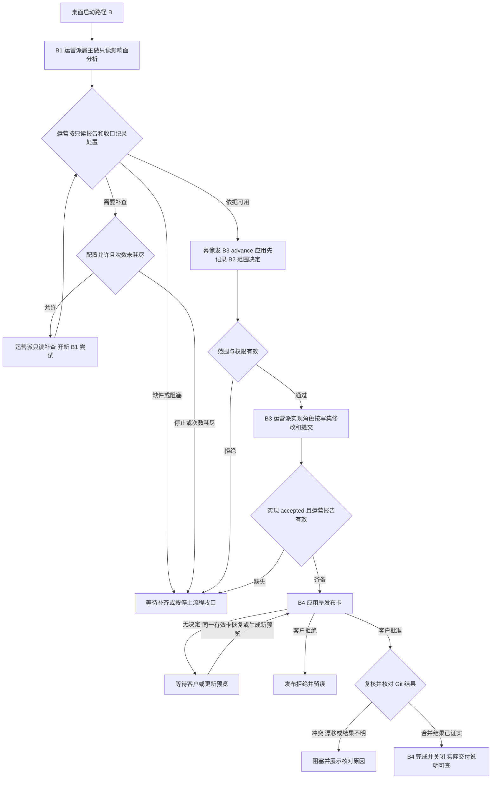

# 路径 B 持久化工作流原型方案

| 项目 | 依据与状态 |
| --- | --- |
| 方案 | v1.1 · 2026-11-17 · 已处置完整独立复核发现，待复核受影响章节 |
| 已确认意图 | [Gate 0 v1.2](../communication/2026-11-17_intent_path-b-durable-workflow.md)，含桌面零额外部署、增加工作流及外置配置改变走向 |
| 产品与源码基线 | ANS Studio v2.0.0 路径 B；`ans-studio` 的 `refs/remotes/origin/main` 本地快照 `ffe75ce623a659320e9caf1079ef7e9d81330b02` |

## 目标与范围

在一个启用原型的新路径 B 实例中，客户从现有桌面入口发起修改，并在 B4 通过应用卡决定是否本地合并 `main`。断网或退出后重新打开，客户能看到原实例的进度、待决审批，以及待派发、待回交或需要核对的任务。恢复时续投已落盘的工作，保留角色作出的专业判断，只在权限和结果有据可查时继续写入或合并。客户解压对应桌面发行包后即可启动，Dapr、数据库及控制面进程由应用管理。

原型覆盖一条真实业务流程，即路径 B 从启动到交付或有据可查地停止。用户可在项目目录编辑 YAML，选择对报告需要补查的情形执行有限补查或停止；新启动的实例使用已通过校验的配置。增加一条不同形状的测试专用外置工作流，验证同一套能力能复用。路径 A、存量在途实例迁移、运行中替换流程图、默认上线、集群、多设备同步、可视化编辑器及任意代码插件留待另立项。

## 核实的现状

| 基线证据（路径相对于冻结的 `ans-studio`） | 对原型的约束 |
| --- | --- |
| `src/common/门禁引擎/workflows/chief/chief-workflow-v2.md`、`src/common/编排/workflow-service.ts`、`app/desktop/session/fixed-workflow/route.ts` | 幕僚发运营阶段请求，运营派专业角色。B1 只读调查。B34 拒绝 B2 阶段请求，B1 完成后下一请求是 B3，受理时先校验 B1 依据、派生写集并记录 `change.scope-decided`。任务、阶段与队列分步写入，恢复须覆盖其中任一步落盘后的中断。 |
| `角色卡/测试/docs/change/2026-11-12_RR34_wuxia-roguelike-pathb-clean.md` | 真机从干净的既有 Git 仓库复现 B1 阶段请求被误用为专业角色任务，收到 `stage-request-invalid`，经过补齐尝试才完成。该次走通 B3、B4 和本地合并，应用未收到 B2 请求。记录也披露 B2 的影响面指针曾命中源码文件，原型须用经应用校验且绑定本次 B1 的报告引用。 |
| `app/desktop/session/delivery/queue.ts`、`test/桌面应用/b82-fixed-workflow-binding-handback.test.ts` | 现有队列记录在途项和投递凭据，fixed 回交核对真实子任务和接收角色；批准派发、入队、送达与任务收口是不同事实。 |
| `app/desktop/session/fixed-workflow/release-merge.ts`、`app/desktop/customer-input.ts`、`test/桌面应用/b31-fixed-release-auto-desktop.test.ts`、`test/桌面应用/pending-card-restart.test.ts` | B3 收口及运营有效报告触发 B4，由应用构造客户卡。旧键按 workflow + tip 派生 `releaseId` 和 `requestId`，自动呈卡遇见同 `requestId` 的历史会跳过。原型的未决卡按持久快照重挂，变更快照派生新身份。 |
| `README.md` 的 v2.0.0 工作流说明 | 原 `docs/flows/` 文件为历史资料，本原型使用新目录 `docs/workflows/` 存放客户可编辑的配置，项目原有流程说明继续用于原用途。 |
| `.github/workflows/release.yml`、`electron-builder.yml` | 发行形态为 Windows x64、macOS arm64、macOS x64 的 ZIP 包，三种架构均应从实际发行包验证。 |

## 产品流程与权限



- **B1** 从已存在的 Git 仓库建立任务分支及基线，沿用脏工作区和活动流程门禁。幕僚的阶段请求与运营的只读生产任务由应用按真实父任务分开生成或受理。B1 完成须具备属主的真实报告、应用计算的报告哈希及匹配的收口证据；仅有阶段请求或运营报告不足以推进。
- **B2** 幕僚依据 B1 报告向运营发真实 B3 `advance` 请求。其中 `requestedEvidence` 是范围候选，缺省回看对应 B1 生产任务已记录的 `modulePaths`，候选仍缺失则拒绝。应用校验本次 B1 收口、报告引用、当前基线、来源、范围及理由，并按现有名单模块属主和边界派生写集。B2 是同一 B3 请求的必经逻辑门，应用验证通过后持久记 `change.scope-decided`，随后才开放该次 B3。显式 B2 阶段请求，以及发往专业角色的错形阶段请求，继续沿用拒绝码，业务状态原地保留。
- **B3** 运营仍是实现任务派发者。应用经现有授权、父任务、写集与 Git 门把任务交给实现角色；角色只在任务分支提交，运营核对报告后独立作 accepted、返工或阻塞处置。同一原型实例的 B1 到 B4 机械推进由 Workflow 负责，应用收到现有角色操作只提交业务事实；拒绝把模型生成的阶段号、标识、哈希或完成文字当证据。
- **B4** B3 accepted 加有效运营报告才准备发布预览，沿用路径 B 的验收强度与披露，无 A12b 前置。幕僚汇总，应用只经客户发布卡执行本地 `main` 合并；对运行期未验证的内容在交付说明中明示。`delivered` 需要可核对的本地合并及关闭记录；交付说明的生成与送达状态独立显示，合并恢复不依赖模型补说一次。
- **终止与安全门** 保留现有角色、只读与写入边界、基线漂移、高风险卡及 Git 约束。停止须按现有门确认无活动写任务，失去结果证据时停在可核对状态。发布只经应用固定 Git 参数入口；无自动 `git init`、push、tag、force/reset/clean，无额外 shell 审批卡。测试仓库的发布批准经客户 UI 边界提交，判断代理最多转人工或拒绝，不能代批。

本轮有两项可观察的行为变更。原型的等待中发布卡在窗口关闭、应用退出或异常重启后继续待决，替代旧入口把部分中止/超时记为 `judge` 拒绝的行为。本轮不新增自动到期，客户明确拒绝和权限拒绝继续留痕。另一项是外置配置可在 B1 增加有限补查等合法分支，通过验证后从新实例生效。

## 共有业务契约 v1.1

### 标识、业务回执与补投

每条输入绑定已规范化的稳定项目 ID、workflow 实例、定义注册名与契约版本、目标步骤、事件或操作 ID。涉及任务时同时绑定父任务、任务、角色、阶段尝试及运行尝试；涉及审批时绑定请求及快照版本。凭据由宿主验证，模型和 Dapr 历史中只传必要引用，应用计算并核验证据摘要。任务、发布和回交的唯一键作用域至少覆盖项目及实例。业务记录与审核理由可从原桌面面板按步骤查询。

1. 应用收到审批决定、派发意图或回交报告时，验证身份、对象及当前尝试；在一次 ANS SQLite 事务内提交业务事实、幂等记录和待投递项（outbox）。证据内容须已可靠落盘并可通过不可变引用和哈希重取，才可回执「已保存」。失败时回可查询的错误，响应丢失走同键查询或重试。相同键和内容返回既存结果，相同键内容不同作冲突处理。
2. Outbox 应用进程以有界退避补投。Dapr `raiseEvent` 成功只记录「引擎已受理」。事件携带作用域和持久事实引用，作为唤醒提示。Workflow 按当步读取 ANS 事实，依据有效顺序消费，必要时等待依赖；同一事件重复到达只返回原结果，终态、旧尝试和错误实例的事件记录拒绝或忽略原因。早到的合法事实留待前置齐备，消费游标不得越过它而丢失。漏投、重复和响应丢失不依赖 Dapr FIFO 纠正。[Dapr Workflow API](https://docs.dapr.io/reference/api/workflow_api/) · [外部事件与重放](https://docs.dapr.io/developing-applications/building-blocks/workflow/workflow-features-concepts/)
3. Workflow 通过幂等活动把消费结果与有效推进产生的 ANS 动作意图同事务记账，写入关联事件 ID、目标步骤、尝试和结果。该持久消费回执才允许关闭对应 outbox 项。活动完成回包丢失时由 Workflow 从历史继续，活动重试返回原推进结果。启动、重连及周期扫描对照未消费 outbox、当前步骤及引擎状态并可安全补投；实例启动也用固定 ID 查询和重试，禁止通过新 ID 掩盖未知启动结果。缺失或不一致的历史进入阻塞，界面保留最后确认状态及错误。
4. 同一实例同一时刻只有一个有效执行尝试。送达、执行、报告及收口先核对作用域和尝试。模型发送、文件写入及 Git 命令的宿主作用端，在实际提交副作用前通过与换代共享的串行门，持久领取该操作的有效执行权。换代先停止新领取。仅做过初检的旧执行会被拒绝；已领取的操作须先证明未发出，或等待执行停止并核对实际效果，才能开放新尝试。认领、PID 消失或超时不足以证明未执行，状态未知时保持阻塞。同键已有可信结果优先返回，防止重复启动或写入。

**B2 与 B3 的事务边界**。ANS Service 在同一 SQLite 事务写入绑定当前 B1 尝试、报告摘要和基线的 `change.scope-decided`，连同原 B3 请求指纹、操作键和待进 Workflow 事件。由 Workflow 消费同一请求，向 Service 幂等登记 B3 派发意图，业务上才开放后续运营派发。派发时仍复核 B1、写集和当前授权。若 B2 提交后、B3 开放前退出，按原键补投，不向幕僚再要一次决定，不产生第二条范围记录。SQLite 在原型中是权限、范围及任务事实的权威账本，旧格式仅可投影，不能作为第二条写路径或恢复驱动。

### 发布审批

应用保存待决请求快照，至少绑定项目、实例、B4 尝试、目标 `main` 起点 OID、任务分支及批准 tip OID、基线、文件列表和 diff 摘要、B3 收口与运营报告证据摘要。原型以作用域内的逻辑发布键关联同一交付的多轮预览，以该键、快照摘要和持久请求代次区分具体 `releaseId`、`requestId`。同一有效快照恢复同一身份，main 或证据变化即使 tip 相同也能生成新身份。旧版请求、回调和合并意图随失效一并封存，执行入口复核最后有效快照与 Git 事实。实际合并成功按逻辑发布键至多一次。

客户本人经既有受信卡入口作 approve 或 reject，持久记录决定 ID、来源、时间和准确的 `requestId`、快照摘要及代次；瞬时窗口回调只负责把动作交给宿主。同请求同决定的重复点击或结果回包丢失返回同一事实，反向决定拒绝。待决快照仍有效时恢复同一张卡；窗口关闭、断网、进程退出和超时均不能产生客户决定。拒绝后标记发布拒绝，不创建合并意图。基线、工作区、分支、main、证据或预览漂移使旧批准失效，需要有效的新预览及新请求版本，由客户重新作答。

### 派发、回交与 Git 结果

| 交接 | 收到、送达、结束各如何证明 |
| --- | --- |
| 幕僚 → 运营；运营 → 专业/实现角色 | 阶段请求与生产任务各有自己的操作键和权限。任务和待交付项先落盘。接收端绑定真实任务、当前尝试、角色与运行时消息 ID，持久送达回执后才展示「已送达」。开始、报告和收口各自可查。忙或离线保留原队列项；确定未送达可以同键重投。送达不明或模型可能已执行时查运行凭据、报告和 Git，不能靠重派重跑来取得回执。 |
| 专业/实现角色 → 运营 → 幕僚 | 应用核对实际任务、报告来源及证据并落盘。向收件端通知可补投，同一报告只满足一次业务条件。收件端已看到报告仍需有权角色单独作收口决定并记录依据。重复报告返回原结果，旧尝试或已结束的报告不能改变终态；返工走新授权尝试。 |
| Git 写入和发布 | 先记录操作意图、仓库与预期 refs、写集或已批准快照。命令返回丢失时只读核验工作区、refs、OID、预期分支、Git 父节点/预期快进位置及实际 diff；只有在操作意图与现场证据唯一相符时才补记结果及关闭。已证实没有开始且快照仍有效时才可执行一次。有漂移、未知写入、未清冲突或结果归属不清时阻塞。由已知当前操作触发的正常合并冲突沿用受控 `merge --abort` 和切回任务分支，重启后归属不清则停给人工。禁止把「tip 是 main 祖先」单独当作发布成功证明。 |

## 五层结构与流程扩展

| 层 | 责任与调用 |
| --- | --- |
| Interface | 现有 Electron 桌面、客户卡、受治理角色工具入口接受命令，渲染 Pipeline 的查询投影。客户端不可直接访问 Dapr、SQLite 或 Git。 |
| Pipeline | Dapr Worker 中的版本化配置执行器、应用启动装配和业务入口流程。Workflow 读取实例已钉住的图与活动结果来决定等待和合法下一步，业务 I/O 经活动调用 Service。启动与 Worker 回调经声明的接口接入，不将底层客户端转交给界面或角色。 |
| Service | ANS 实例所有权、配置检查与快照准入、角色/任务/写集、卡与决定、证据校验、派发/回交语义、Git 结果判定和应用查询投影。复用现有业务守卫，通过 Provider 读写持久事实并执行许可的外部操作。 |
| Provider | SQLite 事务与 outbox 存储、Dapr 客户端及进程生命周期、现有角色会话传输与受控 Git 端口。基础设施入口通过 Provider 公开端口，错误按明确原因返回。 |
| Model | 各层共享的实例和版本、任务/阶段/尝试、决定与证据引用、回执和错误等类型与纯约束。Model 独立于操作层。 |

调用采用 `Interface → Pipeline → Service → Provider`，Model 供各层共用。仅无业务含义的基础设施启动／连接操作可沿已有 Pipeline 到 Provider 公开入口的例外。Dapr SQLite 保存 Workflow 历史，ANS SQLite 单独保存授权及业务事实；Scheduler 的内置 etcd 保存调度提醒数据。ANS 内的原子提交覆盖同库事实与 outbox，跨 Dapr、会话和 Git 的窗口靠可重试的记录和核对闭合。原型实例按 ANS 记录投影到现有面板，例如定义名称与版本、步骤 ID 与名称、状态、待办动作、阻塞原因及证据；界面不从引擎的 `RUNNING` 猜测审批或收口结果。

实例创建时持久指定单一阶段所有者及定义版本，原型路由只向显式启用的新 B 实例分配 Dapr。同一候选包内，既有引擎的入口、自动推进、恢复扫描、重派和合并均须跳过原型实例；Dapr 入口也拒绝旧引擎实例。原型用独立应用数据目录与专用测试仓库。同一候选包按规范化 Git 仓库身份持久独占，有原型活动实例时两个应用数据目录、别名路径或仓库 worktree 也不能重复受理。关闭原型开关只影响新实例，已有原型按原版本恢复或安全暂停。支持的回退入口是同一候选包关闭新实例开关，在独立测试仓库走既有引擎，或启动兼容的原型包续跑保留的数据。冻结旧发行包无法理解原型登记，测试时只允许它打开另一仓库，原型专用仓库及目录保留给兼容候选。

### 外置 YAML 与版本

客户可打开项目的 `docs/workflows/`，从原型示例编辑或增加 `.yaml`，按工作流 ID 从同一桌面入口选择启动。提交启动时，应用读取并严格解析选定文件，检查后显示定义 ID、版本、摘要或定位到字段的错误。保存文件即可改下次启动的走向，无须改应用源码、重新打包或重启应用。配置声明有名称的步骤和前置关系，引用内置活动、角色别名和现有审批策略，按经 ANS 校验的枚举事实选下一步。角色别名解析到已有角色及项目边界，模块属主仍由现有授权规则查得。

下面的最小路径 B 示例将报告需要补查的情况引回 B1。运营基于属主的本次只读报告作收口或补查处置，ANS 校验角色、报告引用及尝试后记录 `analysisDisposition`。只有 `usable`、证据和收口都有效，才开始等幕僚的 B3 advance 并经 B2 门校验。将 `needsFollowup` 改向 `blocked`、删除随之不可达的 `followup` 并提升 `version`，新实例将停止等待处置。`role: module-owner` 由内置只读活动解析为合法模块属主，发起派发的角色仍是运营。每个实例首次进入 `followup` 时，在换代门通过后持久消耗一次补查额度，开放新 B1 尝试。该事务中，原报告保留审计引用并退出当前依据。回到 `impact` 后运营按新尝试号派一次补查任务，旧报告迟到不恢复其有效性，重启或重复唤醒不额外消耗额度。超限展示阻塞原因。

```yaml
schema: 1
id: path-b
version: 2
start: impact
steps:
  impact:
    action: b1-impact-readonly
    role: module-owner
    on:
      usable: scope
      needsFollowup: followup
      blocked: blocked
  followup:
    action: b1-open-followup-attempt
    maxVisits: 1
    onLimit: blocked
    next: impact
  scope:
    action: accept-b3-advance-with-b2-scope
    next: implement
  implement:
    action: b3-implement-and-accept
    next: release
  release:
    action: b4-customer-merge-main
    on:
      merged: delivered
      rejected: stopped
  blocked: { terminal: blocked }
  stopped: { terminal: stopped }
  delivered: { terminal: delivered }
```

- **配置准入**。只读项目目录内的单文档 YAML 1.2，拒绝重复键和隐式外部引用。阻断未知字段、步骤、结果、角色、能力，阻断不完整或歧义的分支、不可达节点、无出口或没有计数上限的循环、非法的并行或权限组合。每个可达的写入或发布步骤都要通过内置前置图检查。B3 必须经过 B1 报告与 B2 授权，B4 必须经过真实 B3 收口和运营报告，`delivered` 只可由已证实合并的出口到达。即使新定义复用发布能力，也必须经过应用生成快照、客户本人批准和执行前复核；YAML 不能添加动作实现、运行表达式代码、拼接 shell、修改写集、改变角色或跳过审批。现有 Service 每次执行时再校验角色、尝试、证据和高风险权限。
- **固定实例版本**。校验后将规范化图与 ID、用户配置版本、schema 版本和内容摘要存成不可变 ANS 快照。同一项目内的 ID/version 唯一对应内容摘要，不同项目可使用同一 ID/version 的不同图。启动事务绑定项目、实例、快照和执行器注册名，向 Dapr 传入固定图及其身份。重放只读固定图。配置写坏、删除或替换时，既有实例可续，新启动无有效图则报错。已有实例可按运行事实或既有授权决定选择图内分支。测试专用的只读流程可通过核对只读报告进入 `completed`，`delivered` 留给经客户批准且已证实合并的路径 B。
- **执行器升级**。较大的执行语义、事件或活动契约更改使用新的 Dapr 注册名，保留旧执行器、事件解释和活动输入输出供在途版本重放。应用先核对活动实例需要的注册名、活动契约及快照，再开启 Worker 或事件补投；不匹配时在界面显示阻塞并保留原数据。若所选 SDK 无法按实例隔离不兼容任务，暂停该原型数据目录的 Worker，保持旧历史未消费，验证兼容注册恢复后再开放同一实例。新图复用现有持久化、授权、唤醒、回执和状态投影；新增实际能力仍走 ANS 边界与产品确认。[Dapr 版本化说明](https://docs.dapr.io/developing-applications/building-blocks/workflow/workflow-versioning/) · [JavaScript SDK 注册建议](https://v1-20.docs.dapr.io/developing-applications/sdks/js/js-workflow/js-workflow-versioning/)

## 本地运行与可行性调查

候选为 Dapr Runtime `1.19.1` 与 `@dapr/dapr` `3.19.0`。上游有三种架构的 `daprd` 和 Scheduler 资产及校验值，SQLite 声明支持 Actor/Workflow 状态，Scheduler 从 Dapr 1.19 起可选择承担 actor placement。原型先以 Scheduler 内嵌 placement 的两进程控制面配置验证（`daprd` 和 Scheduler，应用内还有 Worker），用实际连接日志及 durable timer 重启验证其生效。若该组合不可用但独立 Placement 仍可随包管理，可走同一原型验证，保留取舍、进程清单和证据。上游能力、发布资产和候选版本均为只读核对结果，运行兼容待验证。[Runtime 资产](https://github.com/dapr/dapr/releases/expanded_assets/v1.19.1) · [JS SDK 发行记录](https://github.com/dapr/js-sdk/releases/tag/v3.19.0) · [SQLite 组件](https://docs.dapr.io/reference/components-reference/supported-state-stores/setup-sqlite/) · [Scheduler 与 placement](https://docs.dapr.io/concepts/dapr-services/scheduler/)

分支准备阶段已用原始 Windows x64 二进制、内嵌 placement 的 Scheduler、SQLite 与 JS SDK 跑通一个最小 Workflow 的外部事件（工作区 `.dapr-prototype-cache/probe/runtime.ps1` 和 `runtime.cjs`）。应用集成、发行包启动、数据跨进程及 OS 重启恢复、两种 macOS 架构均待验证。

- 启动时由应用监督子进程，固定应用 ID、数据目录和控制面身份，并区分监听就绪、Worker 注册成功及能够恢复业务。`daprd`、Scheduler、嵌入 etcd 和如需的 Placement 绑定到本机回环，Dapr 管理端点不进入 renderer 或代理工具面。目录位于当前用户持久应用数据中，分开保存 Dapr SQLite、ANS SQLite 及 WAL、Scheduler `--etcd-data-dir`，常规退出和重启保留。应用启动互斥且只回收可证实为本应用实例的子进程。服务启动冲突时阻塞并说明原因，不接管陌生端口或清空存储。
- **只读调查**。从冻结版本的 `route.ts`、`delivery/queue.ts`、`release-merge.ts` 和 `workflow-service.ts` 标出两种引擎的读写入口、落盘边界、所有者检查、现有门、投影读者及可复用端口。从锁定版本文档、资产清单、源码和许可核对三平台二进制、Scheduler flags、SQLite Actor 配置、JS SDK 协议和官方支持范围。列出每平台的构建环境和可持续访问的重启环境，两项可用性分别核对，包括 OS/架构、是否支持真实桌面交互、可用持久磁盘与重启后取证入口。将旧包范围、兼容拒绝行为及待实测平台回填五层结构与本节。调查到能指明落盘边界和验收入口即结束；依赖资产缺失、接口不支持或许可不清则提交策划裁定。
- **原型证明**。尽早在候选发行包验证真实 Workflow 等待、Scheduler durable timer 跨进程重启、Worker 注册和兼容阻塞，再接入现有路径 B，验证故障与安全、外部文件改走向、实例隔离和升级。打包产物可由现有 runner 生成；真实 OS 重启使用可重启且保有同一数据卷和工作区的原生架构主机或虚拟机。重启前后证据写到该持久数据卷并归档，记录环境、注入和版本，失败记录与成功同样留存。若任一平台需要用户另装服务、Docker 或数据库，或必须公网监听、依赖远端控制面、丢失计时提醒、无法可靠识别实例所有权或无法证明不盲重放，暂停原型并带证据回策划。版本、拓扑、契约与范围的实质变更经沟通处理。

## 可核对的完成标准

在隔离测试仓库进行端到端对照。取 `test/测试/fixed-path-full-chain.test.ts` 的路径 B 真实 Git 测试仓库形状和 RR34 的实际 B1 → B3 → B4 行为为基线，记录原始基线 OID、授权写集和期望 diff。不触碰 RR34 原目录。在一条候选正常链中从桌面发起真实 ANS 角色任务和发布流程，保存真实提交及客户通道作答痕迹。其余故障点可用确定性角色输出提高复现性，但仍通过真实应用入口、真实 Dapr/SQLite/进程与隔离 Git 仓库，注明替身覆盖面。记录报告是否经真实模型和实际运行期验证。

共同判据为正向用例有且仅有一次逻辑决定、有效派发、报告收口和适用的 Git 结果；已确认业务输入零丢失，未经授权的阶段推进、执行启动、写入和合并均为零。当所需组件均显示健康、Worker 完成所需版本注册、当前前置事实齐备且若需远端服务已重新连通时开始计时，原型须在 60 秒内显示续投结果、下一等待项或明确阻塞原因，人工操作和模型执行时间另计。对故障期间已到期的 durable timer，从本地控制面与 Worker 恢复健康起计算同一期限，允许重复技术唤醒，要求相关业务动作只生效一次。未知副作用允许安全阻塞，已知未执行且前置齐全的工作必须可续跑。

| 覆盖对象 | 验证环境与次数 |
| --- | --- |
| V1–V8、V10、V11a、V11b 的路径 B、配置与恢复细项 | 至少一个原生架构候选发行包跑完整矩阵，优先 Windows x64 以对照 RR34。每个故障窗口连续独立复现两次。 |
| V9 和一次真正 OS 重启（V4） | Windows x64、macOS arm64、macOS x64 各一次完整包验证，各一次 OS 重启，复用同一数据卷、应用数据和 Git 仓库。用待决卡或原任务、outbox 及已到期 durable timer 抽验，单次 OS 重启要求独立于每窗口的双复现。 |

| 验证项 | 注入与通过判据 |
| --- | --- |
| V1 正常链及门禁 | 初始走向的主线有一次有效 B1 生产任务、匹配的影响面报告哈希和一次 B2 记录。B2 证据能追溯幕僚同一 B3 advance、当前 B1 尝试和候选来源，B3 只用该写集。B4 正常链只呈一个逻辑发布请求，合并记录与 main OID/父节点/实际 diff 相符，交付关闭可查。另验无仓库、脏基线、B1 错工具形状、B1 缺属主收口、B2 显式错误请求、B2 漂移、候选缺失或越界、B3 越权写、B4 缺报告均失败封闭。保留 A 与旧 B 路由、角色权限、写集、shell/发布门的受影响回归结果。 |
| V2 外部断网 | 保持 Electron、Worker、daprd、本机网络存活，阻断远端模型链路，在待决发布卡、待派发和待回交各观察一次；原 UI 可查询已保存数据，可提交有效本地决定，依赖远端的工作停在等待，恢复网络后补投原键且无重复业务效果。用 PID、环回健康及远端失败证明是外部断网。 |
| V3 进程失联 | 分别停止或切断 daprd、Worker、Scheduler，测试「业务已提交但未投」「Dapr 已受理但未消费」「消费已落盘但活动结果未回」窗口。另定位 B2 与 B3 请求已提交、B3 派发未开放，杀 Worker 后按原键恢复，只有一次范围决定和一次有效 B3，无再次授权请求。校验 SQLite 事务、outbox 和 Workflow 历史，重连后未消费项续投、已消费项收敛。分别记录进程状态与有效进度，检查 durable timer 在 Scheduler 恢复后可唤醒。 |
| V4 真正重启 | 对待决卡、决定已落盘未回执、派发在途、报告已落盘未收口、Git 已执行未记账分别强制退出应用和原型子进程，再启动同一发行包、数据目录和测试仓库。查新 PID、原实例和请求、相同版本、任务及历史。另在三平台各做一次 OS 重启，存在待决卡或任务、待触发计时器和持久 outbox，重开后既有事实可查，合法工作续跑。 |
| V5 审批负例 | 重复点击、回包丢失、窗口关闭、客户拒绝、judge 试批、旧卡动作、审批前后 Git 或证据漂移分别施加。相同有效未决卡恢复同一请求，重复决定查同一结果，拒绝与无有效授权的用例零合并。分别保持 tip 不变，仅更改 main 或证据触发新快照，核对旧代次失效、新卡可批准且至多合并一次。 |
| V6 交付、报告与 fencing | 注入收件端忙、派发已认领但送达未明、送达后模型状态未知、重复或乱序报告、旧尝试回执迟到、收口已完成但通知未结。另在模型发送和任务写入初检后暂停旧尝试，同时请求换代再放行，验证旧尝试未领取时送达或写入被拒绝，已领取且未证实停止时换代保持阻塞。未送达的同键可补；可能已执行的路径进入核对，零重复的未授权模型启动、写入或收口。对早到的有效报告核对依赖齐备前后可见性。 |
| V7 Git 中断与冲突 | 在 B3 任务提交、B4 合并各定位「Git 已改变但应用未记结果」窗口，同时检验操作未开始、ref 漂移和合并冲突。另在旧执行通过 Git 初检后暂停并争抢换代，核对只有仍获有效权的一方可进入实际 Git 门，已领取未结的旧操作阻止换代。证据唯一的旧结果只补记一次，漂移/不明不碰 refs；当前操作的可归属冲突受控 abort。保存前后 OID、`git status`、父关系、diff 和命令计数，证实无多提交或额外 push/tag。 |
| V8 单一所有者 | 同一候选包下同时触发既有与原型引擎的启动、推进和恢复入口，同实例只有原所有者；另用两个应用数据目录及不同路径指向同一 Git 仓库尝试启动，活动原型期间另一入口不能获权。关闭新实例开关后，测试仓中的原型仍按已有登记续跑，另一独立仓可走既有引擎。核对冻结旧包只打开另一仓，并用兼容候选重开原型数据。冲突场景零额外写入和合并。 |
| V9 三平台包 | Windows x64、macOS arm64、macOS x64 原生环境以标准账户和干净用户目录解压发行 ZIP，事先无 Dapr CLI、Docker 或外部数据库，全程阻断外网验证本地控制面。每个平台实测首次启动、SQLite 状态、Scheduler 提醒及应用重启恢复，验证端口冲突、普通退出无孤儿进程。收集包与二进制哈希、架构、实际版本、监听地址、数据目录、进程及冷启动/恢复耗时，并记录体积与平台启动限制。 |
| V10 外置走向 | 同一发行包、相同初始报告处置、现有角色与两次独立新实例，原配置遇补查走阻塞，新配置遇补查走一次只读补查。后者忽略已退役 B1 尝试的迟到报告，只在当前尝试有效报告和收口后开放 B2，超限停止。提供两个 YAML、摘要与步骤轨迹，应用包/源码与角色定义哈希相同。至少验证未知角色/活动、缺条件、不可达或无界环、B2 或客户审批绕过和 shell 字段，各类拒绝均为零新任务、写入或合并，且既有实例能继续。 |
| V11a 配置扩展与版本固定 | 增加一条不同步骤形状、带只读角色报告和等待分支的测试 YAML，与 B 同时运行，正常退出为有证据的 `completed`。用跨项目同 ID/version 不同图、重名局部键、跨实例输入及乱序唤醒验证隔离。保持相同执行器注册名，让配置 v1 在等待点冻结，改成 v2 后强制重启，旧实例按固定 v1 消费原事件并完成，新实例走 v2。保存原文件、固定快照、注册名、版本、摘要和事件。 |
| V11b 执行器兼容 | 用缺少旧执行器或旧活动契约的候选连接在途数据。开闸前拒绝不兼容的 Worker 消费与事件补投，旧实例显示明确阻塞，历史和待投递记录可核对且没有阶段推进。装回兼容注册后用原实例与原未决事件继续，给出实际 Worker 注册、消费以及 UI 证据。 |

完成证据随实际原型候选记录方案版本、候选 Git commit 及代码 diff、项目与基线、三平台发行包/二进制哈希、配置和环境，使用同一关联 ID 串起注入时间、UI 状态、ANS 事务与 outbox、Dapr 历史、接收回执、授权/失败原因以及 Git 前后状态，去除凭据。提交用例逐项结果、失败和跳过记录，有基线已知失败时逐项与同环境的冻结基线比较。任何缺平台、缺实测或安全判据未通过均标为未达成。以上标准供客户确认方案；独立验收在确认版与实施授权到位后、实施前形成正式 B1 完成标准，实施后按同一版本核对证据。

## 复核处置

v1.0 首稿依据 Gate 0 v1.2。v1.1 据 [独立完整复核记录](2026-11-17_review_path-b-dapr-workflow.md) 修订，受影响章节待复核。沟通记录方案版本和分支内授权范围。

| 发现 | 处置 | 理由及 v1.1 改动 |
| --- | --- | --- |
| F1 | 采纳 | 明确真实 B3 advance 携带范围候选、当次 B1 证据与事务受理动作，消除第二次决定和重复派发风险。涉及产品流程、共有契约、YAML 和 V1/V3。 |
| F2 | 采纳 | 用逻辑发布键关联交付，用快照摘要和代次区分具体请求，使同 tip 的新卡可以正常呈现。涉及发布审批与 V5。 |
| F3 | 采纳 | 原型限专用测试仓和独立用户数据，以同候选包的新实例选项和兼容包为恢复边界，覆盖跨应用数据目录同仓互斥。涉及五层结构与 V8。 |
| F4 | 采纳 | 区分配置版本和执行器注册，开 Worker 与补投前检查兼容身份，保护在途实例。涉及外置 YAML、早期可行性与 V11a/V11b。 |
| F5 | 采纳 | 以实际作用门的持久认领与换代串行检查，消除初检与副作用之间的竞争。涉及共有契约及 V6/V7。 |
| F6 | 采纳 | 明确运营处置、补查额度和旧报告退役，并补项目范围、只读终态与角色示例。涉及产品图、YAML 契约及 V10/V11a。 |
| F7 | 采纳 | 区分打包与有持久卷的真实重启环境，明确次数、健康信号、已到期计时提醒与取证位置。涉及调研和完成标准。 |
