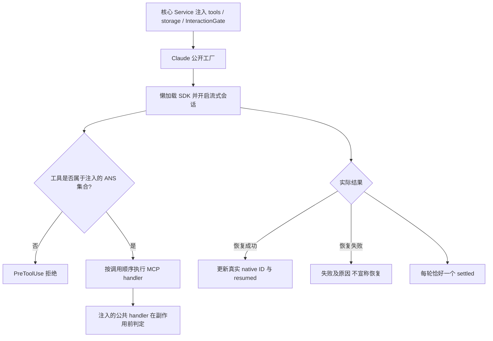

# Claude 会话只调用 ANS 提供的工具

客户选择 Claude 后，读取、写入、执行命令和请求确认都应沿用 ANS 的能力。例如模型调用写文件时，适配器只调用传入的 handler，由公共工具在真正写入前判断权限。本设计细化已获客户实施授权的 [ANS-RUNTIME-V2 revision 1](../../../项目管理/docs/design/2026-10-14_design_multi-runtime-integration.md)，没有额外选装。当前代码与测试待实施；实际功能完成后见 [Claude 会话](../feature/claude-session.md)。

## 官方接口与依赖证据

2026-10-14 从官方 npm registry 读取并下载 `@anthropic-ai/claude-agent-sdk@0.3.299` 的 tarball，只在 `/private/tmp/ans-claude-sdk-0.3.299/` 检查，不安装项目、不调用模型。`package.json` 要求 Node ≥18，peer dependencies 为 `zod ^4.0.0`、`@anthropic-ai/sdk >=0.93.0`、`@modelcontextprotocol/sdk ^1.29.0`；各平台可选 native package 同版本，包的 `claudeCodeVersion=2.1.299`。Zod 选精确 `4.6.7`。实际 `sdk.d.ts` 的 `Options` 是 `settingSources`（单数），`query` 支持 AsyncIterable 输入，`Query` 有 `interrupt/close`。

官方[自定义工具](https://code.claude.com/docs/en/agent-sdk/custom-tools)区分工具可见性与许可；`tools: []` 清空原生工具，`allowedTools` 只预批准工具。设置 `strictMcpConfig: true`、`settingSources: []`、`skills: []`、`plugins: []`；`extraArgs` 使用 `bare` 与 `disable-slash-commands`，不加载外部 MCP、hooks 或本地项目指令。自定义 systemPrompt 仅由固定角色卡、边界提示和注入工具指南组成。`PreToolUse` 额外拒绝非精确 ANS 工具名；`canUseTool` 对未预批准调用拒绝。MCP `readOnlyHint` 只用于准确描述，本角色统一排队执行所有工具，保证交互与写入顺序。

schema 转换使用真实 Zod API。支持当前公共 schema 的 object、array、string、number/integer、boolean、null、enum、required、optional、嵌套、union 与约束；无法准确转换的关键字明确失败，不能默默删掉限制。真实 MCP 注册和 tool/list、tools/call 在无模型环境验证，与假引擎生命周期分别取证。

SDK0.3.299 实际 BaseHookInput 有 native `prompt_id`，MCP RequestHandlerExtra 没有原生 tool_use_id/turn 字段。UserPromptSubmit 先记录 native ID 对应的原始轮次；PreToolUse 必须找到该映射并写入随机单次保留字段 `__ans_call_context`，handler据此取原始信号并剥离字段。缺失、重放、未知或旧轮 nonce 拒绝；模型伪造值由 hook 覆盖。终止/中止/关闭失效映射，旧 callback甚至旧 PreToolUse晚到新一轮也不能借用最新信号。原始 schema 若与保留字段冲突明确拒绝；字段本身不授予权限。依据[官方 hooks](https://code.claude.com/docs/en/hooks)的 MCP tool event、prompt_id 和执行前 updatedInput说明；将通用 updatedInput 契约用于SDK进程内MCP为文档推断，实际 native模型轮次未运行，不能把假 query当作 vendor hook执行证据。

SDK [流式输入](https://code.claude.com/docs/en/agent-sdk/streaming-vs-single-mode)允许一个 query 承载多个消息。活句柄保留上下文；只有完成当前轮并清理工具后才能接下一轮。停止先中止当前轮 signal，工具 handler 固定捕获该次调用 signal，再 interrupt SDK；关闭终止进程并释放输入/事件队列。InteractionGate 等待期间暂停 prompt deadline；中止/超时/失败分别回交，不能由 settle 推断提交报告成功。

官方 [MCP timeout](https://code.claude.com/docs/en/mcp)仍有硬性工具调用上限；SDK 进程内 MCP 不受 idle timer 影响，但 wall-clock timer 无禁用接口。必要设置为 `server.timeout=2147483647`（约 24.8 天，Node timer 上限）及 `CLAUDE_CODE_MCP_AUTO_BACKGROUND_MS=0`，避免默认约 28 小时/两分钟后台化改变等待语义。测试实际 MCP Client 同样采用生产 server timeout；不通过测试专用参数消除限制。ANS prompt deadline 会暂停，但原生客户等待无法承诺真正无限时；到达上游上限仍失败，不自动授意、报告或重放。项目管理已接受并安排披露该真实限制。

## 设置与持久化

产品只接受 API key；[官方 overview](https://code.claude.com/docs/en/agent-sdk/overview)要求第三方产品使用 API key。`ANTHROPIC_API_KEY` 必填，`apiKeyEnvVar` 可将显式选定的环境键映射到该字段；不读取订阅登录或 OAuth。`ANS_CLAUDE_MODEL` 可省略，使用 SDK 默认模型；`ANTHROPIC_BASE_URL` 可省略，使用 SDK 默认 endpoint。构造 subprocess env 时只复制必要基础变量并传入选定 API key 和 endpoint，不能继承其它 runtime 的秘密或 provider 切换标志。错误和 MCP 结果净化凭据；不回显原始异常。

原生配置根使用注入的 `storage.nativeDirectory`，由核心 `validateNativeDirectory/prepareNativeDirectory` 回调校验并准备，不能在本角色复制路径安全实现或遍历全局会话。无 storage 时仅在首次 prompt 创建临时隔离配置目录并设置 `persistSession:false`，dispose 清理临时目录，项目 `.ans` 不创建。ANS 回放和索引由核心 Service 的存储回调维护，适配器只读取 `readLatest` 取得精确 native ID。SDK 的 `resume` 不表示恢复已成功；只有实际成功 result 且对应 session ID 后才更新 `resumed`。恢复失败如实失败并附 contextWarning，同时清除失效 native ID；客户下一条明确输入会新建上下文并保留 `recovered` 警示，重新打开时核心保存的实际状态同样不会再尝试失效 ID。适配器不自动重放有副作用的 prompt。见官方[会话](https://code.claude.com/docs/en/agent-sdk/sessions)。

## 独立影响评估与 Mutation Contract

复用 Model `RuntimeProviderOptions/RuntimeAdapter/RoleSession/ToolDefinition`，变动仅在 vendor 接入。Service 仍是唯一组装者；Provider 只调用注入能力，不导入核心 Provider、他人私有 common 或上层模块。现有准确公开入口为 `src/provider/claude/session.ts::createClaudeRuntimeAdapter`；沿用本次批准的根 facade，三段式全仓迁移不在范围。现有共享秘密键注册由项目管理维护，依赖及 lock 由装配维护。

允许写 `src/provider/claude/session.ts`、`src/common/claude-adapter/**`、`test/claude-adapter/**` 和本角色白名单 docs/API/map/memo/changelog。基线为 PM 设计记录中的 `906abd3ee275cba82b2f9e54ceef1cd9473c2d5c` 加已存在工作区变更，其他角色变更只读。保护全部其它源码、配置、`.env`、凭据与 Git 元数据；不提交/推送、不调用网络模型、不登录。

影响核心：需要其 optional `prepareNativeDirectory` 回调，PM 已安排；适配器调用失败直接上抛，不能切换引擎。影响装配：上述精确 SDK 与 peer dependencies。影响编排/桌面：设置为空及恢复失败必须如实呈现，延迟成功后才展示恢复。没有新增写集缺口。

验证命令为 `node --test 'test/claude-adapter/**/*.test.ts'`、`npx tsc --noEmit`，静态检查 import 边与本角色变更路径。测试使用注入的假 query，执行生产 MCP 注册/handlers，覆盖原生能力清空、外部 config 隔离、schema 必需/可选/union、gate 拒绝零副作用、handler 异常净化、顺序、报告/派发回执、连续轮次、停止待确认和晚到调用、超时暂停、恢复实际成功/失败、storage 精确目录与无 `.ans`。真实账号、在线模型轮次、全 OS 沙箱不在证据内。

## A1V 原生回环验证

B0 已安装正式 SDK0.3.299/native2.1.299、Zod4.6.7、MCP1.32.1、Anthropic SDK0.93.0。项目管理再次释放本固定角色 A1V，明确授权严格loopback fakeAnthropic endpoint与假凭据驱动bundledCLI的必要验证；不读取真实.env/认证、不访问外部API、不调用真实模型。探针单独存本角色test，最多45秒，finally关闭query/HTTP/临时目录，关闭官方非必要流量。验证bare下显式hooks、真实prompt_id与提供的SDKinputUUID关系、updatedInput进入实际进程内MCP。

根据实测关系，UserPromptSubmit须按已知transportUUID对照原始Turn，而非把晚到旧hook归给当前submitting slot；缺失/未知/旧ID均拒绝。增加晚到旧UserPromptSubmit测试，保持nonce只是归属标记、ANS仍是唯一权限判定。环境在adapter构造时snapshot clone，使保存新凭据不能改变旧会话认证却漏掉redaction。最终重跑正式本角色suite、probe和整仓tsc，并保留17项假引擎证据与实际native证据的区别；当前A1V待实现/待测试。

A1V实施结果：bare实际抑制显式hooks，生产已移除并用settings.disableAllHooks:true隔离外部hooks；nativeprompt_id实测不同SDKuuid，采用受信wire首行标记查原始Turn，禁止latest/submitting fallback。正式20项、真实native回环与整仓tsc通过，详见[原生修复](../fix/2026-10-14_fix_claude-native-hook-identity.md)。前文裸模式/ID同源等待验证推断已被此实测结果取代。
