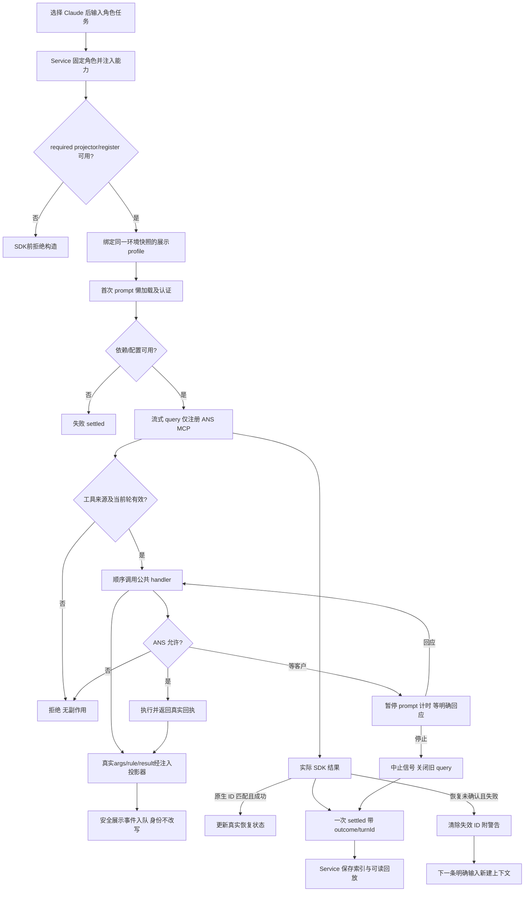

# 选择 Claude 后继续受治理的角色对话

选择 Claude 后，角色会话仍通过 ANS 判断写入与执行权限。源码已实现；CLI/桌面的选择入口由各自属主接线，正常依赖已经安装；最终项目组合测试仍由集成与测试属主继续。无需模型账号的本角色测试已验证生产 MCP handlers 与连续轮次。

核心 Service 选择 `createClaudeRuntimeAdapter` 并注入工具、客户等待闸和存储。固定角色的第一条 prompt 才加载 SDK、检查 API key 并启动流式会话；后续消息复用活 query。缺依赖、缺认证或配置错误直接失败。只有传入的 ANS MCP 工具可用；SDK 原生工具清空，工具调用在副作用前交给公共治理 handler。

客户等待期间可以停止：旧轮次的工具保留旧 signal，迟到回答不能恢复授权或提交报告，下一条输入可以继续。SDK MCP 有约 24.8 天硬超时上限，适配器禁用自动后台化并暂停 ANS prompt timer，但不承诺原生无限等待。完成一轮只表示该次 prompt 已终止；提交报告/派发是否成功看其真实回执。

开启 persistence 时，原生配置根位于注入的 `.ans/sessions/<role>/claude/native`。核心回放在同 runtime 隔离目录；回放能阅读旧对话，不证明原生上下文恢复。首次拿到旧 ID 时只待确认；实际成功 result 才显示 resumed。恢复未确认且本轮失败时清除 ID，下一条明确输入重新开始并保留 warning。没有 storage 时使用临时配置、不创建项目 `.ans`，关闭时清理。

API 最短使用方式是由核心 `createRuntimeAdapter({runtime:'claude', gate, projectRoot, skillRoot})` 选择本工厂；provider 直接调用只用于已注入完整能力的调用方和测试，详见[公开接口](../../api-spec.md)。配置 `ANTHROPIC_API_KEY` 为必需；模型 `ANS_CLAUDE_MODEL` 和 endpoint `ANTHROPIC_BASE_URL` 可选。只接受 API key，不尝试订阅登录。

当前正式包28项测试、接入Core required-v1的真实bundledCLI本地回环probe及整仓类型检查通过；真实账号、外部模型和最终项目组合尚未验证。工具start/result携带真实输入规则与可选execution，原MCP content不变；只有原Turn可证明的hook拒绝有blocked，未知hook只发诊断。C新元数据由Core先剥离，Claude收到的模型原文/图片不变。详见[本轮验证](../change/2026-10-15_change_tool-display-projection.md)。

| 日期 | 类型 | 状态 | 变化 | 详细记录 |
| --- | --- | --- | --- | --- |
| 2026-10-14 | 设计 | 已实施 | 确定 SDK 能力隔离、MCP schema 与生命周期 | [设计](../design/2026-10-14_design_claude-governed-session.md) |
| 2026-10-14 | 修改 | 项目复测待执行 | 新增 Claude 适配器并完成本角色临时离线验证 | [证据](../change/2026-10-14_change_claude-runtime.md) |

| 2026-10-14 | 修复 | 已验证 | 移除bare、按wire标记关联真实nativeprompt_id并冻结环境快照 | [原生证据](../fix/2026-10-14_fix_claude-native-hook-identity.md) |

| 2026-10-15 | 修改 | 本角色验证通过，完整流待集成 | A4工具展示与C2.tp1 SDK运输保护 | [实施证据](../change/2026-10-15_change_tool-display-projection.md) |
