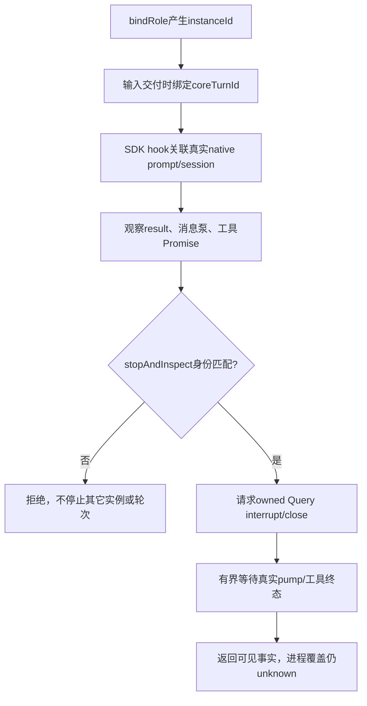

# Claude 原生停止事实

停止/重启调用方通过 `RoleSession.nativeLifecycle` 观察 Claude 实例。事实用于防止把 ANS turn 的结束误当 SDK 已退出；由运行时核心决定如何消费，适配器不扩大角色写权。

每次 bind 的 instanceId 独立。coreTurnId 只取本次 prompt 的 `currentTurnId()`；SDK UserPromptSubmit 提供 native prompt/session 关联。原生 result 或消息迭代器真实终结才使 promptState settled；主动 reject、abort、timeout、dispose 返回和本地 closed 标志都不能制造该事实。自然迭代器结束表示可见消息泵结束；异常结束的运输仍unknown。

ANS handler 从 callback进入到 Promise finally（含排队）留在 activeTools；原生工具按真实 start/result 配对。关闭不清空事实，退休引擎未终结的泵/工具不会被新引擎隐藏。stopAndInspect 校验 instance/coreTurn，取消与超时不伪造成功；等待期间换轮拒绝旧停止结果。

SDK Query 不暴露 owned PID、子孙清单、进程 close/exit/退出码或 HTTP 完成事件。`close():void` 文档描述清理行为但没有可等待终态。故 processes=[]、processCoverage=unknown、transport.kind=unknown，status 从不冒报 quiescent。测试里的真实 child.close 只验证 query seam 与可见消息泵，并不证明生产 SDK 提供 PID/整树事实；正常 Claude stop/restart 仍不能据此放行。Git受管面也仍unknown。

验证：公开 adapter + seam/真实 Node owned child、真实 MCP 运输，session.test 61/61、0skip，主typecheck通过；无真实模型/网络/账号请求。详见[变更与原始证据](../change/2026-11-05_change_direct-role-capabilities-native-stop.md)。
