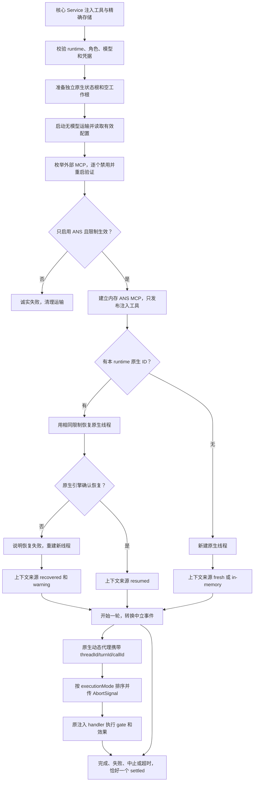

# 让 Codex 只能通过 ANS 工具改项目

用户选择 `--runtime codex` 后，Codex 可以读取项目、提出修改并调用获得授权的 ANS 工具。它自己携带的命令执行器和文件写入器不能增加角色权限。成功或失败、当前轮停止与历史恢复仍按运行时核心的公共契约返回。适配器已实现，自有 14 项无模型测试通过；稳定 CLI 安装后的协议验证及用户入口联调仍待完成。当前功能见[Codex 受治理会话](../feature/codex-governed-session.md)，实际结果见[实施与验证](../change/2026-10-14_change_codex-governed-session.md)。

本设计是项目管理已获客户授权的 [ANS-RUNTIME-V2 revision 1](../../../项目管理/docs/design/2026-10-14_design_multi-runtime-integration.md) 的同范围细化。项目管理已释放 X1；先让本设计与隔离证据可审阅，再进入实现。没有新增选装。

## 为什么需要 app-server

2026-10-14 从官方 npm registry 下载并检查 `@openai/codex-sdk@0.162.1`，归档 SHA-1 为 `ddd70c2c7d7a40cf7f34c715f355f74708d36a11`。包内 `dist/index.d.ts` 和 `dist/index.js` 证明：

- `CodexOptions` 有 `config/configOverrides/env/apiKey/baseUrl/codexPathOverride`，`env` 提供时替代父进程环境继承。
- `ThreadOptions` 有 `model/sandboxMode/workingDirectory/approvalPolicy/webSearchMode`；`TurnOptions.signal` 支持中止；`startThread/resumeThread/runStreamed` 可开始、继续和恢复线程。
- SDK 以 `codex exec --experimental-json` 子进程交换 JSONL。`apiKey` 放入子进程 `CODEX_API_KEY`，`baseUrl` 转为 `openai_base_url`；SDK 没有有效配置读取、实际工具目录检查、服务端请求应答接口，也不暴露 `--ignore-user-config`。
- 包依赖 `@openai/codex@0.162.1`。MCP 工具流式事件已经发生在派发/结果阶段，不能成为写前拦截点。

[官方 SDK 文档](https://developers.openai.com/codex/sdk) 支持结构化配置覆盖和线程恢复，但单靠 API 字段还不能证明工具隔离。

本机只读探针用 `codex-cli 0.162.0-alpha.17.2`（`/Applications/ChatGPT.app/Contents/Resources/codex-cli/CodexCLI.app/Contents/MacOS/codex`），生成真实 app-server TypeScript schema，并通过本地 `initialize/config/read` 检查临时假配置。没有启动模型、登录或调用远端 API。

第一轮发现 `mcp_servers={ans=...}` **会合并已有 MCP map**：临时 `foreign_user` 仍保留，原“根 map 能替换全部目录”的推测被否定。第二轮对已枚举 ID 加 `enabled=false`，得到：启用 MCP 只有 `ans`，`foreign_user` 已禁用，untrusted 项目的 `foreign_project` 不进入配置，假外部 MCP 没被启动；`features.shell_tool=false`、`features.hooks=false`、`sandbox_mode=read-only`、`approval_policy=never` 均实际可见。临时脚本为 `/tmp/ans-codex-x0-probe.mjs`，检查后删除假状态目录。该证据仅覆盖记录的 alpha 二进制，不冒充稳定版或 OS 沙箱全验证。

因此采用 app-server JSON-RPC 运输：在任何线程或 MCP 连接前先读取有效配置、枚举全部非 ANS MCP 并明确关闭，重启运输后再次读取和验证；不通过的配置直接失败。此缺口不能由 SDK 的事件观察修复。项目管理已授权在本适配器内部采用必要 app-server 运输。[官方 app-server 文档](https://developers.openai.com/codex/app-server) 给出配置读取、线程 start/resume、turn/interrupt 和服务端审核请求的实际协议。

## 请求怎样走

原生工作根与实际项目分开，工作根不含用户 `.codex`，并设为 untrusted；工具处理器仍使用核心注入的项目路径。子进程的 `CODEX_HOME` 指向该角色/runtime 的注入 `nativeDirectory` 内独立 Codex 状态根；没有存储选项时使用系统临时目录，并在 dispose 删除。不给子进程复制账户凭据或任意父进程环境，也不读取用户 `~/.codex`；持久化模式只保留该 runtime 的原生上下文，不写 auth 文件。

隔离单靠 `CODEX_HOME` 仍不足，因为系统配置仍可能合并。预检运输只读配置，不开线程、不读取 MCP 工具目录、不建立 MCP 连接。枚举所有 native MCP ID 后将其 `enabled=false` 作为命令行强制覆盖；再次读配置必须显示没有 native MCP 服务启用。实际探针还发现 quoted dotted override 不可靠，因此使用根 TOML map 显式叠加每个已发现 ID 的 `enabled=false`，没有假设根 map 会删除旧项目。`projects` 的 untrusted 也通过已验证根 map 设置。若二次配置出现新外部 ID或读取失败则拒绝继续，不能循环猜测成功。broker 本身在验证后才启动。

必须覆盖的 native 功能开关以官方 schema 和本机 `features list` 为依据：`shell_tool/hooks/apps/plugins/remote_plugin/browser_use/browser_use_external/browser_use_full_cdp_access/in_app_browser/computer_use/code_mode/code_mode_host/multi_agent/multi_agent_v2/request_permissions_tool/skill_mcp_dependency_install` 设为 false；`web_search=disabled`。不使用已经 removed 的 `apply_patch_freeform` 充当禁写证据。原生写入以 `read-only` 沙箱和 `never` 审核策略拒绝，服务端 native command/file/permissions 审核请求还会显式拒绝。新建、恢复和每轮都带相同沙箱/审核约束，并核对返回的实际沙箱。只有 ANS MCP handler 可执行项目效果。

[配置参考](https://developers.openai.com/codex/config-reference)与[实际官方 schema](https://developers.openai.com/codex/config-schema.json)声明这些能力开关和 MCP allowlist；[配置分层文档](https://developers.openai.com/codex/config-basic)明确 untrusted 项目跳过项目 config/hooks/rules，同时仍加载系统配置；[沙箱文档](https://developers.openai.com/codex/sandboxing)描述 read-only 和 approval 策略。真正 OS 下的完整原生沙箱覆盖仍需另有受控在线验证，不能由本次假 engine 测试替代。

## MCP 和公共契约

直接引用[运行时核心已冻结接口](../../../运行时核心/api-spec.md)与 `src/model/runtime.ts`，不复制治理工具、不导入核心 Provider 或任何其他角色 private common。入口拟为 `src/provider/codex/session.ts::createCodexRuntimeAdapter(options)`，匹配 `RuntimeProviderFactory`；本角色扩展选项仅供注入 fake engine，不成为 Model 的另一份定义。

X1 发现 native HTTP MCP 的现有类型没有可靠轮次身份，上一轮请求若在新轮次才到达，无法安全补上信号。项目管理据此接受同范围必要细化：模型侧只注册已核实的实验 `dynamicTools` ANS 代理，`item/tool/call` 服务端请求具有 `threadId/turnId/callId/namespace/tool/arguments`。开启 `initialize.capabilities.experimentalApi=true`；`DynamicToolFunctionSpec` 使用 `type:function/name/description/inputSchema`；响应为 `contentItems:[{type:inputText,text}]/success`。这些字段来自本机真实 schema 和官方 app-server 动态工具章节，稳定 CLI 安装后再实测。

代理先校验线程和原生轮次，再使用 MCP `Client` + `Server` + `InMemoryTransport.createLinkedPair()` 发出真实 `tools/call`，broker 调用注入 handler。`tools/list` 只发布原注入名称及完整 JSON Schema，保持 optional/required。未知名称、未知线程、已停止的旧轮次在进入 MCP 前拒绝；队列也保存原始 signal，不能改用当前轮信号。所有 native MCP 配置禁用，无 HTTP broker、监听端口或 bearer 认证分支。MCP `isError` 与 `ToolResult.ok` 同义。服务端 request 是执行前回调，流式 item notification 仍只用作展示。

引擎事件仅转换消息、展示已运行的工具和轮次收尾，不承担权限判定。prompt 超时在等待核心 `interactionGate` 时暂停，abort 同时中断原生轮次和本地 MCP handler 的 Signal；dispose 中止当前轮、关闭 broker 与运输，不把停止请求写成任务已完成。

存储只使用注入的 `storage`，先检查 `runtime=codex` 与绑定角色一致。读 `readLatest` 不建目录；原生 ID 必须来自同角色/runtime 记录。app-server `thread/resume` 真正成功后才设 resumed。ANS JSONL 回放只由核心存储维护，不把它当原生上下文，也不遍历 Pi 目录。恢复失败明确 warning 并新建，不切其他引擎。

## 设置、认证与装配依赖

支持 `ANS_CODEX_MODEL`、`ANS_CODEX_BASE_URL` 和首选 `CODEX_API_KEY`。模型和 key 必需；base URL 可省略，默认 `https://api.openai.com/v1`。调用方的 `modelId/baseUrl/apiKeyEnvVar` 优先；显式 key 来源缺失时不 fallback，未指定时 `CODEX_API_KEY` 优先，再显式映射 `OPENAI_API_KEY` 到子进程 key。后者是本适配器提供的兼容输入，不能声称 app-server 原生会读取它。拒绝带 username/password 的 URL，不回显原值。[环境变量官方文档](https://developers.openai.com/codex/environment-variables)明确 `CODEX_API_KEY` 用于非交互 exec/TypeScript SDK，以及 `CODEX_HOME` 的状态根语义。

app-server 不调用 login；为所选 API endpoint 配置本次唯一自定义 provider，使用经 schema 核实的 `base_url/env_key/wire_api=responses` 和 `requires_openai_auth=false`，从最小子进程环境读取 key。初始化设置 `explicitGatewayOauth=true`，不选择自动浏览器登录。模型和 key 缺少、URL 不合法或接口错误均失败；错误文本过滤共享凭据集合及实际自定义 key 和 URL 用户信息，设置可用状态只报告布尔。模型实际可用与网关兼容性须由真实提供方决定，本次不调用模型证实。

运行生产运输所需精确依赖拟由装配角色添加：`@openai/codex@0.162.1`、`@modelcontextprotocol/sdk@1.32.1`。不添加已被判定缺口的 TypeScript SDK 作为无效间接层。MCP SDK 当前归档 SHA-1 `853286b3240b6d8143f5f8e6d58af85c77d475ab`，实际类型已核对 `Server.setRequestHandler`、`StreamableHTTPServerTransport.handleRequest` 与 JSON 响应/无会话模式。生产依赖与 lockfile 属装配，当前没有改项目依赖。稳定 CLI 版本与本机 alpha 协议差异须在装配后重新核实，失败不能退回另一引擎。

## 独立影响评估与写集

本角色不会新增授权判断。核心的 `ToolDefinition/InteractionGate/RuntimeSessionStorage` 已可承载真实 MCP 回调、顺序模式和中止；本角色负责 transport、MCP 表示、native 生命周期和错误转换。核心 Service 仍负责创建工具与记录 ANS 回放，编排仍负责角色授权与审读；这条调用关系不会变成 Provider 向上导入。

需要其他属主配合的只有：装配安装两项精确依赖并验证 CLI 定位；项目管理提供掩码设置；核心按冻结契约注入工具、存储和当前轮 ID；编排/桌面调用中立入口。这些代码对本角色只读，公共契约变更会使本角色旧测试失效，届时重测。现有 Provider 未采用完整 abstract/public/impl 目录是既有结构，本次在已批准 root 公共入口和私有 common 内实现，不自行扩大目录权限或搬迁其他角色文件。

本次生产写集仅 `src/provider/codex/session.ts`、`src/common/codex-adapter/`、`test/codex-adapter/` 与本角色已有授权文档。禁止写 Model、核心实现、package/lock、真实 `.env`、用户原生状态与其他角色文件；不做模型调用、commit 或 push。

验证命令为 `node --test 'test/codex-adapter/**/*.test.ts'` 和 `npm run typecheck`；依赖未装时仅测试的真实 MCP loader 可显式指向隔离临时 harness，生产代码没有临时 fallback。上述 gate/schema/生命周期/隔离场景已在本角色 14 项测试覆盖。Codex 自有严格类型检查通过，全仓检查暂受 Claude 依赖未安装影响，原结果没有写成通过。MCP 客户端请求期限为 Node 可支持的 `2147483647ms`，不会用默认一分钟抢先结束客户等待；官方文档与当前 schema 没有给出动态请求的服务器期限，不能声称无限等待。若上游 `serverRequest/resolved` 在 handler 返回前清掉请求，立即中止该轮原始 signal 并收口，迟到确认不能成功。当前已实施并通过自有测试，稳定 CLI/最终联调未验证，未部署。
