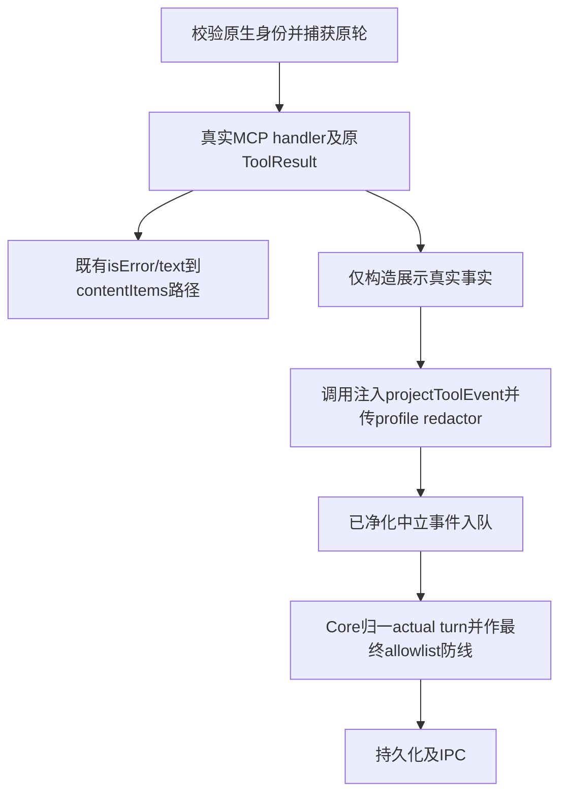

# 让工具详情来自真实调用，保持原模型输入

用户展开 Codex 的一次 read_file 或 run_shell，应看到那次受治理 handler 的真实目标、返回和失败原因。展示裁切不改变模型回执，也不把报告来源对象交给 Codex 原生运输。本记录是固定 Codex适配器角色对 [A/r3](../../../运行时核心/docs/design/2026-10-15_design_tool-display-contract-a.md)、[C/r2](../../../运行时核心/docs/design/2026-10-15_design_report-provenance-contract-c.md) 的独立消费设计，关联[当前功能](../feature/codex-governed-session.md)。遵循[PM总计划](../../../项目管理/docs/design/2026-10-15_design_complete-flow-interface-plan.md)与[独立验收计划](../../../测试/docs/design/2026-10-15_three-interface-verification-plan.md)。仅设计，未实施、未运行新行为测试、未部署；不取得生产/测试/配置/边界修改授权。

结论：对 A/r3、C/r2 作同版设计回签，建议 PM 继续评审并呈交客户确认。r1 两项阻塞已由 A/r3 明文解决：Codex 无独立 hook，仅真实 handler-start/handler-result，不由 ok=false 制造 blocked；opaque 身份不经 scrub，投影事件直接入队的薄出口不再经过旧 emit。精确 source union、displayInputRule、required-v1 与 profile 登记协议亦已足够形成本角色实施范围，没有剩余 Codex 接口阻塞。此为设计接受，源码尚未实现，不代表测试通过。C 的存储、receipt 恢复与队列设计由对应属主评审，本角色只确认运输隔离，不代其背书。

## 真实字段从哪里取得

已只读检查 `src/provider/codex/session.ts` 与 `test/codex-adapter/session.test.ts`、`fixtures.ts`、`fixtures/native-cli.mjs`；配置净化事实来自 `src/common/codex-adapter/config.ts`。本轮没有读取凭据值或操作桌面。

| 字段/阶段 | 当前真实位置与拟接入 |
| --- | --- |
| start | session.ts:310，身份校验通过后 MCP execute 在真正 handler 前发 tool_call；source.phase=start、origin=handler-start。原始 args 来自 params.arguments，解析给 handler 的是同一次 object 值；start不得把全部args复制到新detail。 |
| result | :311–323，await tool.handler 的 ToolResult 为唯一 message/ok/execution 来源；source.phase=result、origin=handler-result，source.result 取当前最终有效 ToolResult；Codex 此路径不填 native fallback，kind沿实际ok。保留原始调用上下文供投影，不能靠start相邻行找目标。 |
| 异常 | :312 当前 catch 把异常转成 `{ok:false,message:config.redact(error)}`。展示另保捕获的 Error.message；非Error不展开任意对象/stack/cause，缺真实message仅通用失败摘要。已有模型错误转换保持原行为，不因展示规则改写。 |
| blocked | 当前没有可区分的本地写前hook事件。gate拒绝由handler返回ok=false，只能报告真实result；原生权限request被decline，不是已执行ANS调用。未知、旧轮、重复call在MCP前拒绝，不能伪装成handler start/result。若公共工具层另发真实blocked，保留该事实且不吞同call后续result；不得由ok=false或错误文字推造blocked。 |
| call | :351 构造 `codex:<instanceUUID>:<ansId>:<nativeTurn>:<nativeCall>`，经过thread/turn/tool/namespace/重复call校验后传入handler。沿原值保存，不重建、截断、脱敏或用工具名代替。ansCallToken只作内部MCP关联，不展示。 |
| turn | :387 ansId使用Core注入currentTurnId，standalone缺值时才生成UUID；nativeId来自turn/start响应，仅用于原生验证。事件顶层与detail真实中立turn均用ansId，native turn/thread不能代替Core turn。 |
| command/path | 携带本次注入 ToolDefinition.displayInputRule 与原 args 到 source.input，由 Core 按 A/r3 的 core-path-v1/core-command-v1 同源规则选择（含 file_path/filePath、cmd 的实际优先级）。本适配器不复制别名解析，不按同名工具猜 rule，不把 shell argv拼接回命令。custom 同名无 rule 目标缺席。 |
| execution | 当前公开ToolResult无此字段。等待Core新增可选execution后直接传实际返回的metadata；不得从MCP文本、native commandExecution或message正则还原exit/stdout/stderr。未启动、未知或signal-only都保持缺席。 |
| duration | 当前未记录工具起止，首版可缺席；不从排队耗时或native turn时间猜执行耗时。 |

停止路径保持现状：原始TurnState/signal在排队前捕获，停止后回执替换为既有拒绝，completed后不追加迟到success。新display不得夹带已失效returned.execution冒充最终事实；没有足够真实返回字段就缺席。不得补发虚构失败或修改settled/outcome。

## 注入和净化的实施顺序

由 RuntimeProviderOptions 注入 `projectToolEvent`，只导 Model 公开类型，不 import Core 私有 common，不复制投影器、敏感格式识别或UTF-8预算。调用方注入纯函数，不让模型args决定redactor。每个允许展示的实际字符串先过当前bindRole捕获的config.redact，再由Core投影统一凭据/格式净化，最后按UTF-8字段与JSON总量预算裁切。当前profile已替换公共名单及实际自定义key值，URL删除用户名/密码/query，当前没有删除fragment；fragment、Bearer/赋值格式、内部标识、控制符由统一投影规则补齐。不能只依靠当前递归scrub声称符合A。

opaque身份（runtime、roleId、turnId、toolCallId及schema枚举）与展示文本必须分开：profile redactor只作用允许的文本字段，不重写身份；Core负责身份校验和超限typed诊断。当前emit对detail递归scrub会替换身份内的相同字符串，故新工具投影事件应走直接queue的专用薄出口，不能再走旧递归scrub造成ID变化或裁切后再净化；非工具旧emit保留。source含原args仅作为投影函数瞬时输入，不进入队列/JSONL/IPC。

required-v1 或已注入投影器时，start/result必须完全替代旧tool_call/accepted/denied出口，不另外emit旧summary或detail.args。result摘要不得旁路使用raw message；name、path、command等兼容别名如需要，只用投影后允许字段并计入预算。异常同样走投影。投影失败仅发有界无业务结论diagnostic，不fallback raw，不把展示错误变成真实工具拒绝。Core最终pump/旧历史allowlist是第二道防线，不作为适配器漏接理由。

生产 Core 固定传 toolDisplayMode=required-v1，同时注入 projector/register；本适配器在任何 SDK load、原生 query、MCP 或工具效果前检查两者为函数，缺失明确拒绝构造。bindRole 的 settings 解析后、存储/临时根/engine 初始化前，调用 registerToolDisplayProfile：仅登记 config.keyName 以及 Core toolDisplayCredentialEnvNames 所列键在同一次 options.env ?? process.env 快照中的值，不传整个 env。现 settings 已在 bindRole 开头同步捕获 model/base/key 与 profile redactor；实施增加同步登记，不新读 .env、登录态或凭据文件。登记值只交可信闭包，不入队/日志/IPC；重复同 profile 幂等，不同 profile 要求新会话。Core bind 后的 ready 断言由 Core 实施。profile 未 ready 的提前投影遵循 DISPLAY_PROFILE_NOT_READY 诊断。

standalone 省略 mode 或显式 legacy-standalone 保留原降级语义，可无 projector/register且没有 A 安全保证；显式 required-v1 即使 standalone 也同样早拒。这是兼容分支，不自行复制算法。生产缺注入由 Core 接线及 adapter 零 SDK/零效果测试共同证明不可发生。投影后 truncated/redacted 在 Core 再处理时只能保真，不重置。

模型分支保持：MCP仍返回原 `isError:!result.ok` 与现有 `config.redact(result.message)` 文本，dynamic callback仍映射原text到inputText；execution/display绝不序列化进content。展示原异常message可更严格，但不能借A改变当前模型异常回执。必须用前后逐字比较证明，并覆盖超长、多字节与假secret情景。

## C 新选项不会进入 Codex

当前prompt只读取promptOptions.images，构造turn/start的input、固定权限和model，没有spread整个options；图片仍按原引用读取并转换localImage。接受C由Core在inner.prompt前消费并剥离inputProvenance/inputPresentation/onDeliveryProgress；这些是ANS公共选项，不是假定SDK或app-server支持的参数。

Codex不生成reportId/attemptId，不落typed报告或receipt，不把这些值混入systemPrompt、text、tool args、native request或图片文件名。真实Core turn继续由currentTurnId提供；报告source turn或deliveryId不得替它。standalone直接调用新公共类型时仍只读取既有images，不实现虚构持久能力。Core的RoleSession.persistence由Core包裹会话提供，本Provider不宣称enabled/disabled或恢复来源。C本身不要求改本角色生产代码；需增加受控运输断言证明剥离契约与images/text不变。

## 精确未来写集与依赖

本轮实际仅新增本设计文件。下列均为待PM评审、客户确认实施后的候选，不是本轮授权：

- 生产：`src/provider/codex/session.ts`，仅 A source构造（含 tool.displayInputRule）、required 能力早拒/profile纯内存登记、注入投影薄出口和异常事实捕获。预计不改 `src/common/codex-adapter/config.ts` 或 `protocol.ts`，不修改依赖、native schema探针、配置或边界。
- 自有测试：`test/codex-adapter/session.test.ts`，必要时 `test/codex-adapter/fixtures.ts` 增加稳定call输入/运输捕获。无需修改fixture native CLI；如出现额外路径需求先回PM说明，不默认扩写。
- 文档：本设计及本角色 `api-spec.md`、`memo.md`、`changelog.md`、`docs/feature/codex-governed-session.md` 的实施状态与证据链接，实施后按真实结果更新。

A/r3 已定义 Model source/projector/profile/required/rule 精确签名、ToolResult.execution、错误/诊断及幂等规则，并解决 blocked/opaque 语义。实施前置为 Core 按同版落地并提供唯一投影、required 注入和登记断言；不将设计存在当作能力已存在。A/r3预算与内容政策、历史当前凭据保护限制须客户确认，不由适配器另选值。C由Core保证inner.prompt选项剥离；编排/窗口/独立测试核验typed持久链。B文档阅读不调用Codex、不新增Provider读文件能力，本角色无B源码写集。

## 必要验证与证据边界

本轮只有只读源码评审，没有运行未来API、单元测试、在线模型或桌面验证。历史16/16仅为旧候选既有证据，不能当A/C通过。

实施后先跑自有 `node --test 'test/codex-adapter/**/*.test.ts'` 与全仓 `npm run typecheck`；Core改变公共契约后必须重跑，不能沿用旧证据。受控真实内存MCP用独立预期检查start/result事实、read成功/ENOENT，shell退出0/非0/spawn/signal/中止/拒绝；execution来自注入真实handler且模型只收原text。超长身份走diagnostic且handler调用/模型结果/outcome不变。

覆盖同文不同call、同turn多call、跨turn、未知call、重复call、排队时停止/上游取消、settled后的迟到返回；不为拒绝补造start或blocked。假凭据穿summary/detail/error/command/path/两输出流及URL fragment、opaque ID巧合含假secret，确认文本保护且身份不被改写；实际自定义env快照只用虚构值。预算精确oracle归Core独立测试，不在adapter镜像算法；adapter验证注入被调用且无旧raw旁路、投影异常不泄漏。

C受控测试捕获turn/start精确对象，断言无三项新字段/报告对象、原text与images内容不变，并由Core测试证明剥离发生在inner.prompt边界；不能仅因Codex当前忽略字段就声称Core已剥离。还须回归现有配置隔离、原生禁用、权限拒绝、单一settled、清理和恢复行为。在线Codex与真实Electron留独立集成阶段；无账户/未授权模型调用时明确在线未测，受控通过不替代线上证据。

## r2 同版回签补充验证

2026-10-15 再次对照 session.ts:225–263、303–326、380–405 及 config.ts:14–40，确认源码仍是旧递归 scrub/旧 start-result emit，尚无 required/profile/rule 接线；prompt仍只取 images 构造原请求。因此本次解决的是设计阻塞，没有源码通过结论。C/r2 的三个新字段仍明确由 Core 剥离，运输断言与原模型 content 对照要求不变。

未来自有 session.test.ts 必加：required-v1 缺 projector、缺 register、非函数时 engineFactory/mcpLoader/handler 调用均为0，且无存储目录准备效果；登记先于首次 engineFactory/MCP，虚构 custom key 与 Core extra 名称取同次 profile env，未列环境键不外传，登记失败无原生启动。Core负责重复登记/ready与生产固定 required 的集成断言。测试不打印登记值。

source 捕获测试明确断言 origin、phase、actual ansId/callId、input.rule 和 result.execution，handler false 仅有 start/result；不传 native result、不凭 MCP isError 反造 execution。required source 投影事件不再过旧 emit，身份含虚构 secret 片段保持原值，同时允许文本已保护。custom 同名无 rule、cmd/file_path 别名只验证传递原事实及 Core 独立 oracle 结果，不在 adapter 写第二份选择器。投影/登记错误不改变原模型工具回执语义；构造错误不伪装为工具 denied。

本轮实际写集仍只有本 canonical 设计文件，revision2 取代 r1 的待修结论。未来源码/测试精确路径与前节一致，无新增文件、配置或边界需求；本次未运行上述测试，受控、在线及真实桌面均未新增验证。

## r2 窄同版回签：接受 A/r4 与 C/r2.text_policy_revision1

2026-10-15 已只读核对 A/r4 的 legacy neutral entries→Pipeline→Service 纯保护桥、1MiB/4096 条连续后缀预算与 hashed anchor，以及 C/r2 文本政策补充1。接受这两项增补，没有新的 Codex 接口阻点；前文 A/r3/C/r2 的回签在未变部分继续有效。本段取代前文对 C 新交接历史仍存原 text 的任何旧表述。

A/r4 历史桥仅消费 Window 已读出的 Pi legacy 中立事实，沿合法邻层公开入口保护后返回。它不调用 Codex、不为展开读文件，也不改变真实 opaque call/turn 身份；hashed anchor 是内容派生定位 token，不替代工具身份。连续后缀、条目省略及纯保护测试由 Core/编排/Window 与独立测试负责。Codex 的 Source union、handler-start/result、不造 blocked、身份不经 scrub、required-v1 能力早拒、profile 纯内存登记与投影薄出口均保持已签 A/r3 方案，无新增源码或测试写集。

C/r2.text_policy_revision1 仅在可信新 handback 路径内将模型原文与安全显示副本分开：Core 内部 modelPromptText 仍逐字交 inner.prompt，图片原引用及本适配器既有 content 映射不变；新 ANS user/typed summary/IPC/恢复材料使用安全副本及真实 redacted/truncated/summaryTruncated 标志，不要求 Codex 删除或重写既有 native 转录。inputProvenance/inputPresentation/onDeliveryProgress 仍由 Core 在 Provider 前剥离，名称未变，不加入 app-server 参数。保护失败的 TEXT_PROJECTION_FAILED 与 Provider 零调用由 Core 边界证明，不由 Codex 制造工具 denied。

未来仍只修改本设计前列的 session.ts、session.test.ts、必要 fixtures.ts 与角色自身实施记录；没有配置、依赖、native probe、协议、凭据文件、边界或桌面写集增量。原模型 text/content 逐字比较、opaqueID/phase 保真、required/profile 零效果早拒及选项剥离回归要求保持。安全显示副本与 flags 的精确预算/IPC验证属于新增 Core/消费者验收，不能以 Codex 受控运输测试替代。本次只追加本段设计，未实施、未运行生产/测试/桌面动作，也未读取任何凭据值。
