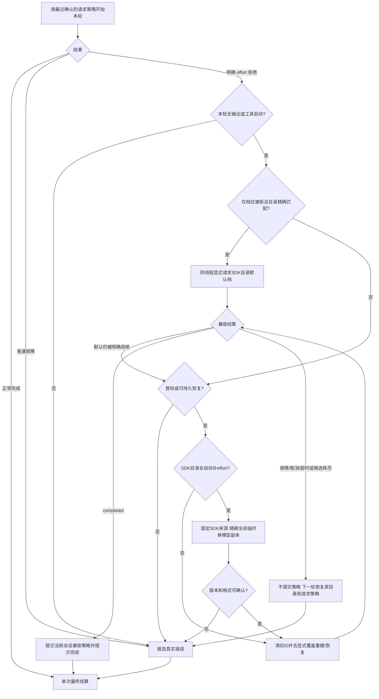

# 使用 Codex 执行受治理角色会话

用户在 CLI 或桌面选择 Codex 后，这个引擎通过 ANS 注入工具执行角色任务，沿用写前门禁、客户确认和报告流程。成功得到真实引擎输出和工具回执，缺配置或隔离验证失败直接报错，拒绝不会执行项目效果。适配器已实现并通过自有无模型测试；稳定依赖和 CLI 接线已由装配验证，桌面与最终整合验收由后继角色接续。

```mermaid
flowchart TD
  select[调用方选择 Codex 和固定角色] --> core[核心注入工具、当前轮 ID 和精确存储]
  core --> required{required注入能力齐全？}
  required -->|否| fail
  required -->|是| config[同env快照检查模型/key/API并内存登记profile]
  config --> inspect[空工作根、独立状态根，读取配置]
  inspect --> disable[禁用全部 native MCP 后重启验证]
  disable --> valid{限制全部生效？}
  valid -->|否| fail[返回真实错误，清理运输]
  valid -->|是| local[建立真实内存 MCP，只发布注入工具]
  local --> history{有同角色/runtime 原生 ID？}
  history -->|无| fresh[建立新线程]
  history -->|有| resume[用相同限制恢复线程]
  resume --> resumed{原生确认成功？}
  resumed -->|是| continue[标记 resumed]
  resumed -->|否| recover[标记 recovered/warning，重建线程]
  fresh --> turn[开始本轮，捕获原始 signal]
  continue --> turn
  recover --> turn
  turn --> proxy[ANS 动态代理带原生线程/轮次/调用 ID]
  proxy --> identity{身份匹配且原轮仍有效？}
  identity -->|否| denied[拒绝，不调用 handler]
  identity -->|是| handler[MCP 顺序队列调用原 handler]
  handler --> receipt[返回真实成功或拒绝]
  handler --> project[真实start/result及rule/args/execution交注入投影]
  project --> protected[保护后薄出口入队，失败只诊断]
  receipt --> end[模型原text/content回执，恰好一次 settled]
  protected --> end
  denied --> end
  turn --> stop[中止/超时/上游取消，使原信号失效]
  stop --> clean{原生停止完成？}
  clean -->|是| end
  clean -->|否| quarantine[如实报清理失败，隔离会话]
  quarantine --> end
```

模型与 key 必需，API 地址留空或空白时默认 `https://api.openai.com/v1`。显式非空地址覆盖环境地址，显式空白表示官方默认；绑定时 model/base/key 与错误脱敏捕获同一份环境结果。读取原生记录前先校验注入目录；只在真正初始化持久原生状态时创建目录。没有存储选项时使用临时目录，dispose 删除。ANS 可读回放由核心记录，不能证明模型恢复；一般模型失败也不推翻已经确认的恢复结果。

客户确认与 shell 审读等待会暂停本地 prompt 期限。中止当前轮会拒绝原队列和迟到确认，普通停止后可继续下一轮；清理失败必须重建会话。交报告、派发和审读以实际注入能力与回执为准，settled 本身不代表任务完成。

公开入口 `src/provider/codex/session.ts::createCodexRuntimeAdapter(options)`，正式中立接口由[运行时核心](../../../运行时核心/api-spec.md)单独维护。本角色[接口报告](../../api-spec.md)说明实际设置和运输。X1 原 14 项与 alpha 原证据见[实施结果](../change/2026-10-14_change_codex-governed-session.md)；X1S 当前 16 项及全仓类型检查通过，见[空地址修复](../fix/2026-10-14_fix_blank-base-url-default.md)。稳定 CLI 无模型探针已由装配通过，完整用户流程由后继角色验证。

| 日期 | 类型 | 状态 | 变化 | 文档 |
| --- | --- | --- | --- | --- |
| 2026-10-14 | 设计 | 已实施，自有测试通过 | SDK 缺少有效配置与轮次归属接口，使用必要 app-server 和真实内存 MCP | [运输设计](../design/2026-10-14_design_codex-governed-transport.md) |
| 2026-10-14 | 修改 | 待稳定运输/最终联调 | 配置隔离、原始轮次工具回调、停止/恢复与脱敏 | [实施结果](../change/2026-10-14_change_codex-governed-session.md) |
| 2026-10-14 | 修复 | 已验证 | 可选地址空白使用官方默认，显式优先级与环境快照一致 | [空地址修复](../fix/2026-10-14_fix_blank-base-url-default.md) |

2026-10-15 当前真实工具展示已经接入A4；required/profile在原生初始化前检查，真实opaque身份不再经过旧递归scrub。模型原text/content/images保持。自有22/22与固定CLI0.162.1本地假服务回环通过；最终全仓类型检查通过，在线/真实桌面未在本角色验证。见[本次实施](../change/2026-10-15_change_tool-display-projection.md)。

2026-10-15 安装包兼容：默认 JavaScript Codex CLI 在 Electron 宿主中，仅给严格隔离的子进程环境增加 `ELECTRON_RUN_AS_NODE=1`；普通 Node 和显式原生 `cliPath` 保持原样。25/25 自有回归、类型检查和实际 Electron+真实 CLI 无模型线程初始化/清理通过，最终发行安装包和 Windows 由装配/测试验收。见[修复与证据](../fix/2026-10-15_fix_packaged-electron-node-launch.md)。

2026-10-15 Windows CI发现POSIX脚本夹具不能直接spawn：仅该真实JSON-RPC测试的启动接缝改用Node加载脚本，保留实际子进程与全部协议/取消/清理断言，无生产改动。本地25/25和tsc通过；Windows CI待复跑。见[夹具修复](../fix/2026-10-15_fix_windows-native-wire-fixture.md)。

## 思考等级被拒时的兼容路径（2026-10-21 D1 + 已批准 E1）

用户选择的四档原样请求；off/未设不覆盖，并不保证推理关闭。配置说明在当前任务开始后作为 system 消息发送。以下流程只处理明确 effort 参数/档位拒绝，不把模型不存在、认证、限流或服务器故障当作改档理由。



最多两个不同候选，成功前只说“正在兼容”。对外线程ID跟随原生新线程；重建未确认则隔离，不复用状态不明引擎。工具执行前/原生工具 started 即禁止整轮回放。保存设置与其他会话均不变。

原 D1 回归发现 CLI 对目录内模型自动补默认 effort，保留了 gpt-5.5 的真实红日志。用户批准 E1 后，无 effort 候选会在确有必要时使用当前模型的临时 SDK 元数据副本；只改变默认 level、默认 summary 和两个 summary 能力标志，其他工具能力、上下文和模型说明保持。文件位于会话 workRoot、权限0600，恢复原目录或dispose时清理，普通路径不生成。元数据来源绑定已安装 CLI 0.162.1 二进制内嵌格式，有界读取，不接受项目目录或用户文本作为模型定义；这不是稳定公共 API。目录默认也被值拒绝时，同一无 effort 候选亦走 E1，不增加第三候选。

整个reasoning对象拒绝、非持久后续轮历史恢复及已有工具副作用边界仍未被此实现绕过。最终实际验证与历史红转绿记录见[修复及验证记录](../fix/2026-10-21_fix_reasoning-compatibility.md)。
