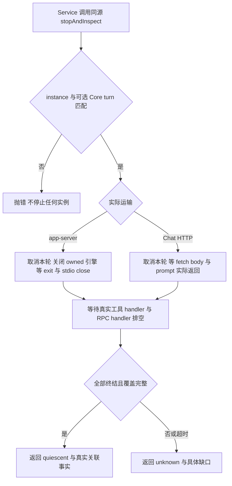
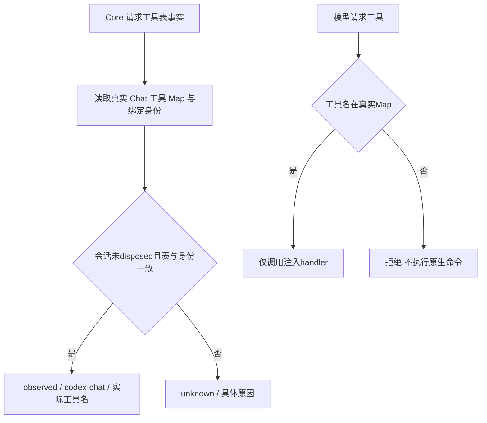
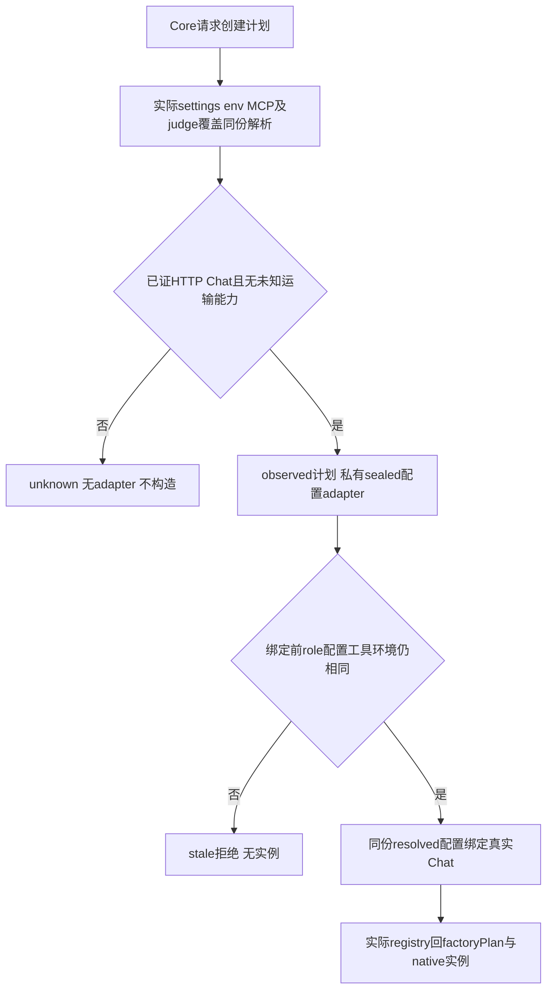

# Codex 停止事实

运行时 Service 通过绑定会话的 `nativeLifecycle` 判断旧原生实例是否真正停稳，再决定能否启动新 run。公共类型只采用 `src/model/runtime.ts` 的 `RuntimeNativeLifecycle`，接口签名见本角色 [api-spec](../../api-spec.md)。

`inspect()` 不触发停止。每次 bind 的 UUID 独立，prompt 开始时捕获注入的 Core turn，结束后保留真实 native turn/session 关联。专用 native stop 会隔离 app-server 会话，普通 `abort()` 的原有续轮语义保持；Service 不需要同时再调用 legacy abort。

app-server 的关闭事实来自 Node child exit 与 stdio close，POSIX 使用原专属进程组等待，Windows 只有 taskkill 成功且退出/stdio 排空才确认该 owned 树。外部 installed MCP 的进程覆盖没有可靠观察时仍 unknown；自定义 engine 若缺 `inspectLifecycle` 也 unknown，close Promise 返回不构成证明。活 handler 不因取消信号或 RPC 清表消失。Chat 没有 adapter 启动的原生子进程，覆盖依据该实现实际执行的 HTTP 和注入工具路径；fetch/body 与 handler 未返回时不报告停稳。Core 自身 shell/background 等事实仍由 Core 合并。

例如：读取 `hook.inspect().instanceId`，传给 `hook.stopAndInspect({ expectedInstanceId, expectedCoreTurnId, timeoutMs: 5000 })`。旧实例或旧轮次拒绝；返回 unknown 时后继不能宣告停稳。

本轮 Windows Node 24.22.1 离线新例 6/6；两文件回归 37 pass / 1 既有 symlink EPERM / 1 原 POSIX skip，类型检查 exit 0。未调用真实 Codex 模型/账户，未动态验证 POSIX；不代表三引擎整体停止已完成。历史与原始证据见 [T1.1 实施记录](../change/2026-11-05_change_direct-role-capabilities-native-stop.md)。

## Chat 工具注册表的同源观察

绑定的 Chat 会话另提供 `inspectNativeToolSurface()`，由真正执行请求的 `toolMap` 闭包同步返回 R8 `RuntimeNativeToolSurfaceFacts`。它列出实际注入的 appTools，`nativeInstanceId` 与上述 lifecycle 的实例 UUID 相同；实际 Chat 执行分支只有 HTTP 与这张工具表，没有原生命令或外来 MCP 的 fallback。

读取只产生普通事实快照；修改返回数组不影响内部注册表。工具 name/handler 发生漂移、内部实例身份错或 dispose 已开始时状态 unknown；Responses/native 分支没有这个观察口。Core 自行核对工厂来源和注入工具，事实只描述工具执行闭包，不能证明文件系统沙箱或全团队安全。

N2 新候选默认生产工厂＋真实本地 HTTP 测试证明：仅 `ans_probe` 进入注入 handler，未注册 `exec_command`/`ans_run_shell` 拒绝，原生 spawn 计数为零。N2 与原生命周期和配置负例合计 9/9；新候选两文件 41 项为 39 pass / 1 原 symlink EPERM / 1 原 POSIX skip，类型检查 exit 0。07–10 原始日志见上述实施记录；旧 01–06 证据保留作历史，不代替本次回归。

## 在创建实例之前准备计划

Core 可先调用 Provider 公共 `prepareCodexRuntimeAdapter(options,role)`，得到普通 plan facts、私有可选 adapter 和 isCurrent。准备只做真实配置解析及内存快照，不 bind/compose、不启动进程、不发 HTTP、不写项目根。

`configDigest` 只摘要公开的非 secret 工具面计划形状。完整环境、凭据与函数引用只留在私有比较中；secret 轮换会令 isCurrent false，不改变公开摘要。实际实例的 registry 事实带 `factoryPlan:{planId,configDigest}`，直接旧工厂绑定没有该字段。Core 独自管理一次性 token 和跨 actor lease；此 Provider 计划不代表全团队安全或文件系统约束。

N3 当前本地 HTTP 定向 12/12；最终两文件 44=42 pass/1 原 symlink EPERM/1 原 POSIX skip，主类型检查 exit 0，详见原实施记录的 11–15 日志。后继 Core/O/W/Q 整链验证仍需针对本候选执行。

N4 只细化原 native 目录 alias 的测试夹具：Windows 采用真实目录 junction，先证明越界 owned canary 可通过 alias 读取，再验证同一产品防护在引擎创建前拒绝；其他平台仍用 dir symlink。两文件当前 44=43 pass/0 fail/1 原 POSIX-only skip、自然 exit 0；原 Windows EPERM 证据保留。当前全仓类型检查另有 trunk owner 的缺 path 错误，见实施记录 16–17；此验证不代表已覆盖 POSIX 或所有 Windows 文件 symlink。

## Chief 专用有界决策会话

Core 已验证并克隆的 host-only `chiefDecisionContext` 选择专用 Chief 路径，Codex 只接受真实内置 Chief 身份和唯一 `decide_pending_request`。这不是 shell/governance judge 白名单的扩展：缺context、错身份、额外工具或非法写权一律在构造前拒绝。提示中的 Goal 只包含该固定待决请求，身份仍是 Chief，回执失败和未决必须如实保留。

流程为：Core传入真实context与窄handler → Codex核身份/闭合工具集 → 复用隔离的无MCP/搜索/持久化运输 → 模型只能调用固定决策工具 → 宿主验证请求依据/选项/次数并返回真实回执。原三工具 judge 会话保持原行为。

N5 真实默认 Core/Codex＋本地HTTP已验证到真实 handler，pending失败不冒批准；次数、轮次、错误身份与额外工具负例通过。当前四文件59项58pass/0fail/1原POSIXskip、typecheck0，详见实施记录18–21及manifest.n5。没有真实模型调用，不代表后继整链或独立验收完成。
