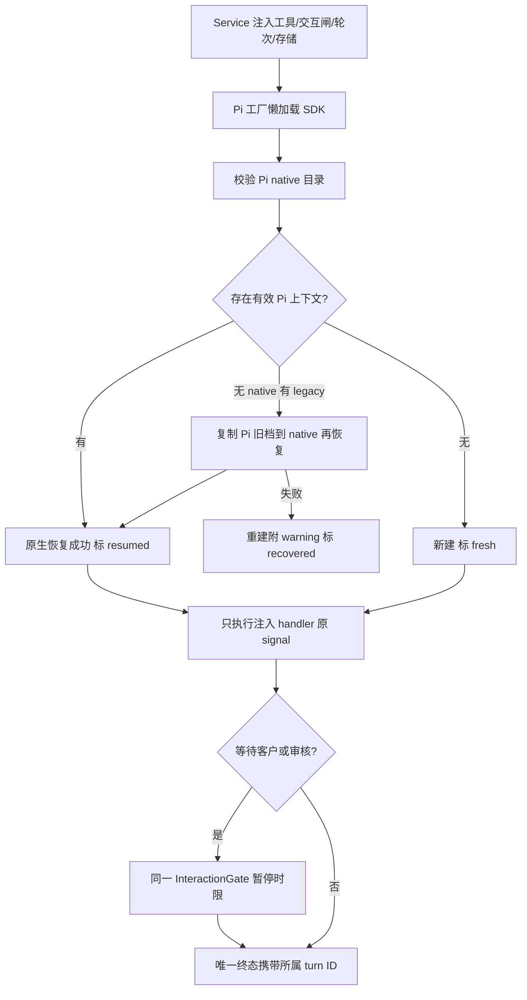

# Pi 使用核心注入工具并隔离原生会话

CLI 或桌面选择 Pi 后，核心 Service 已经准备好了受治理工具；目前 Pi 仍自行重新构造工具，导致共享实现、客户取消上下文及会话隔离没有真正进入生产链。本次只实现已批准的 P1 必要迁移，使用已有客户实施授权；没有额外选装。

拟让 `createPiRuntimeAdapter` 接受 Model 的 `RuntimeProviderOptions`。SDK 实现只将注入工具的 JSON Schema、说明与执行模式转换成 Pi custom tool，并把 SDK 原始 signal 和调用 ID 交给原 handler。生产不读取最新 signal 替换旧调用。共享交互闸及轮次 ID 使用注入对象，同批 sequential 继续交给真实 Pi SDK 执行。`noTools: builtin`、禁发现其他扩展、执行前严格工具名称白名单共同阻断 native 工具。工具 gate、shell spawn、客户 callback 和 schema 均由核心唯一实现维护。

旧 `PiRuntimeAdapterOptions` 和测试 demo 仍通过 `src/provider/pi/tools.ts` 窄兼容 facade 消费核心已声明 public tools/schema API；原 `session.ts` 类型显式转出 Model。旧 `describeTool`/`toPiTool` 辅助仅兼容 name+handler 测试输入，生产始终以完整注入定义为准。此有限迁移 edge 不授权其他 Provider 互调，不保留第二份生产治理/schema。

持久化从注入 storage 的 nativeDirectory 读取，只使用 Pi 自己原生格式。native 读前调用 validate，持久化前调用 prepare，不复制公共目录链安全实现。Pi legacyDirectory 中旧角色 JSONL 仅作为迁移输入；恢复前复制到 Pi native 目录，后续 SDK 写入在那里，旧文件保留。native 空时才查 legacy，绝不解析 Codex/Claude 目录。SDK 确认有效历史并构造成功才标 resumed；无历史为 fresh，无存储为 in-memory；旧文件无效或恢复失败后新建为 recovered，附清楚 warning。动态会话属性交给 Service 保存和桌面映射：核心 resumed 对应桌面“已恢复”，核心 recovered 对应“上下文已重建”。

## 独立影响评估

职责判断：工具执行、schema、中立契约、目录链已经属于核心，直接消费现有能力。Pi 保留 SDK 转换、资源封闭、模型配置与 native 恢复。调用方向判断：生产 SDK 实现只依赖 Model、自有 common 和 shared；旧 public Pi facade 明确转出核心 public tools/schema，供批准的兼容迁移，不成为生产重新构造点。

受影响者为核心 Service、编排默认 Pi 工厂、桌面窗口恢复呈现、装配 SDK wiring。核心 outer timeout 需保持旧 ANS_PI_PROMPT_TIMEOUT_MS/ANS_PI_CONSTRUCT_TIMEOUT_MS 解析语义，已交 PM/Core C1T；Pi 不改 Core。Model 的 callback metadata、工具输入和 storage 已覆盖所需行为，无需扩边界。

Mutation Contract：基线 HEAD `906abd3ee275cba82b2f9e54ceef1cd9473c2d5c`，保留其他属主并行改动。只写 `src/provider/pi/session.ts`、`src/provider/pi/tools.ts`、`src/common/pi-adapter/**`、`test/pi-adapter/**`、本角色 docs/API/功能资料。Core/Model/shared/Pipeline/app/index/package/角色定义全只读；不提交、不推送、不读写真实 .env/持久凭据、不调用模型或外网 API。静态门槛为 strict tsc（全仓结果分离）、自有跨层检查与 diff-check；动态门槛为 `node --test 'test/pi-adapter/*.test.ts'` 及注入定义/schema、storage/legacy、原 signal、gate pause、唯一终态/轮次和实际 SDK construction/wire 测试。只使用临时目录、占位凭据与本地 faux engine。

SDK 固定 `@earendil-works/pi-coding-agent@1.1.0`，依赖安装归装配。依据实际安装 `dist/core/sdk.js`、`session-manager.js/.d.ts`、`agent-session.js`、`resource-loader.js/.d.ts` 与 [官方 SDK 文档](https://github.com/earendil-works/pi/blob/main/packages/coding-agent/docs/sdk.md)；官方 main 不是固定版本证明，具体行为以安装包及离线测试为准。

当前：本设计已按既有授权实施，最终行为见 [Pi 当前功能](../feature/pi-runtime.md)，实际检查与候选指纹见 [P1 原记录](../change/2026-10-14_change_pi-injected-runtime.md)。设计与实现验证分别保留；没有真实模型调用或发布。
