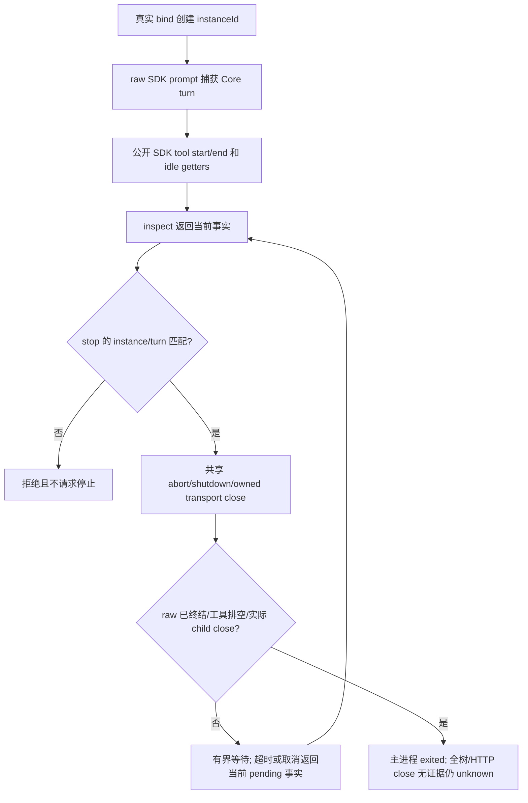

# Pi 原生停止事实

Service 从真实 Pi RoleSession.nativeLifecycle 读取本次 bind 的实例身份、实际 native session ID、raw SDK prompt 开始时捕获并保留的 Core turn，以及可见工具和 MCP 主进程终态。公开 legacy wrapper 透传同一 hook；假适配器与没有 nativeObservation 的旧测试 helper 不制造 hook。

SDK agent_settled、abort 成功、外层 prompt timeout、dispose void 或 transport.close 提前返回均不能替代 raw promise 与真实 child close。停止后旧 native instance 不再接新 prompt；迟到的 raw 终结与 MCP close 仍更新 inspect。每 bind 的 transport 列表包含真正创建的每次 transport，保留 PID；没有启动 PID 的 close 事件仍 unknown。

当前没有完整子进程树或模型 HTTP close 公共事实；processCoverage/treeStatus 仍 unknown，即便无 MCP/工具且 SDK idle 也不报告 quiescent。此限制包含 Git 受管 surface，Core 必须阻塞依赖完整停稳的重启。

实现、离线测试、首红与证据见[变更记录](../change/2026-11-05_change_direct-role-capabilities-native-stop.md)。未独立验收，未宣三引擎完成。
