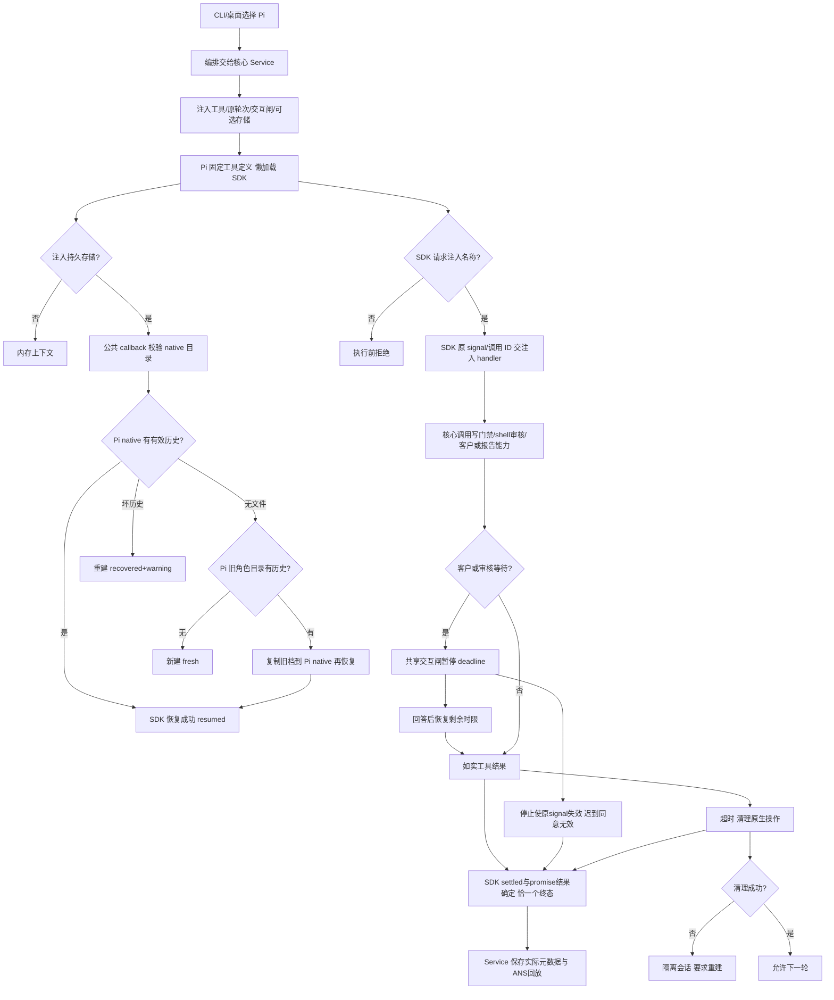
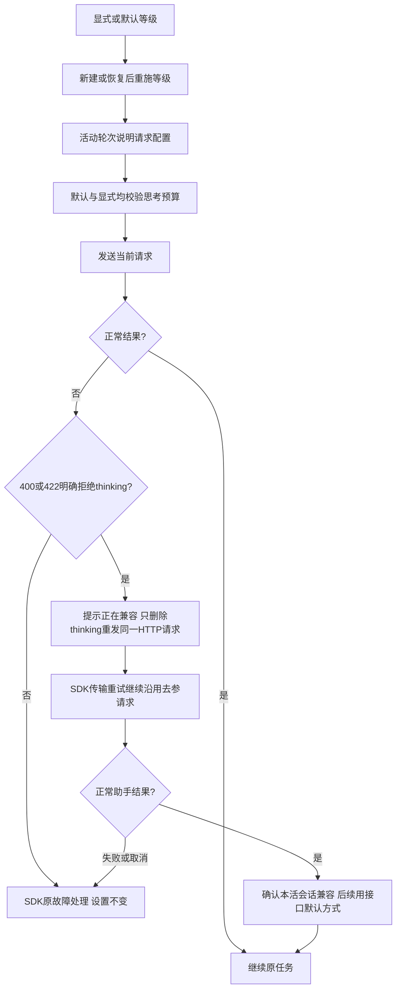

# 使用 Pi 执行受治理角色任务

在 CLI 或桌面选择 Pi 后，角色可以读取文件、按其边界写入、请求客户确认、交报告或派发任务。实际能力由编排及核心注入；缺席的能力没有工具，Pi 自带写文件与命令工具不能绕过治理。

例如 `ans role run Pi适配器 --runtime pi --task 示例任务` 由 CLI 交给编排，再由核心 Service 选择 Pi 并准备工具、交互闸、轮次与可选存储。模型配置仍通过 Pi 现有设置；缺少端点、模型或认证时明确失败。当前功能的完整接口见 [api-spec](../../api-spec.md)。

成功时工具使用核心同一处理器，按注入的 sequential 模式执行，报告和派发保留所属轮次。写被拒时没有 mkdir/write，shell 未获得审核 allow 不会 spawn；这由 [运行时核心](../../../运行时核心/docs/feature/runtime-core.md) 维护，Pi 不复制其判断。

会话持久化位于 `.ans/sessions/<role>/pi/native/`。读取先校验，真正建立持久会话前才 prepare；旧 Pi JSONL 复制迁入，旧档保持不变。只扫描注入的目录直接文件，绝不读取 Codex/Claude native。实际 Pi 模型上下文恢复成功标 resumed；坏档重建标 recovered 并给出原因。桌面从 ANS 回放展示历史不代表 native 上下文恢复，旧桌面词汇须显式转换。

停当前轮使用 SDK 原始信号取消模型、工具及客户等待。当前轮最多一个终态，失败、超时与中止不谎报 completed。原生中止清理失败会隔离该会话并要求重建。下一轮有新的轮次；旧客户信号不会变成新 signal。整个会话 dispose 退订并关闭资源及事件流。SDK/model/settings/resourceLoader 封闭装配，不使用全局 Pi 持久凭据或项目外设置；原始 prompt 图片块继续透传。

旧 Pi public gate factory、tools export、原 describeTool/toPiTool 和显式 sessionDir 只作兼容；新用户链使用 Service 注入工具和隔离存储。内部旧 fs-write helper 不在生产工具执行链。SDK仍钉1.1.0；当前测试使用临时目录和本地 faux engine，未调用真实模型。

演变历史：2026-10-14 [P1 设计与独立影响](../design/2026-10-14_design_pi-injected-runtime.md) → [迁移与验证](../change/2026-10-14_change_pi-injected-runtime.md)。先前图片/停止/诊断/工具变化仍见本角色既有 change/fix 与 changelog；本文件解释当前实际 Pi SDK路径，跨角色最终验收由各原属主完成。

工具事件只有 SDK execution_start 一个开始出口，带实际turnId/toolCallId和phase=start。它表示模型请求，并不表示已获授权；治理hook拒绝phase=blocked、SDK结束phase=result均保留真实事实。Core生产路径统一typed prompt-input输入，Pi不再另发旧输入回显；direct helper默认保留兼容typed回显。见2026-10-15 [重复事件修复与SDK验证](../fix/2026-10-15_fix_canonical-tool-events.md)。

批准A/r4后的Core生产接线固定required-v1：Pi在SDK加载前验证注入函数并登记本次实际凭据profile；全部工具事件经同一注入projector取得显示target/result/process，身份和模型原content保真。execution由私有同call事实传递，不混入SDK详情。旧独立入口可legacy兼容但没有A保护保证，投影失败仅固定diagnostic，不造工具失败。历史与C持久化仍由Core/编排/窗口负责。实现与实测见[PI-A-1](../change/2026-10-15_change_tool-display-projection.md)。

## 思考等级与接口兼容

选择的等级随会话构造进入 Pi。每次新建或恢复依次取显式档位、SDK 模型级设置、全局设置及固定 Pi 1.1.0 默认 medium，并通过公开 setThinkingLevel 应用。清空等级后恢复旧会话仍保留历史和身份，但不再继承旧 high。high/xhigh 的实际预算都可能为 16384，界面配置不能证明网关已经采纳。

兼容只改变当前请求方式，不改保存设置，不重复提交用户输入，原工具结果和图片留在同一请求中。每个 provider 调用只切换一次；一次兼容请求遇到暂时性网络错误时，SDK 的传输重试也不恢复已被拒字段。仅正常助手结果确认活会话兼容，失败/取消不粘连下一轮；改变设置、模型或端点并重建后重试原配置。401/403、408/429、5xx、未知模型等不触发兼容。

输出空间不足时，预算合法性守卫仅调整当前请求并发系统提示，不增加 maxTokens；它不宣称发现了全部 SDK 内部钳位。配置、兼容尝试、成功及修正提示使用活动轮内 system 消息，模型思考正文仍走原 reasoning 事实通道。

本轮已实现，所有者本地 SDK 验证与已知边界见[2026-10-21 修复记录](../fix/2026-10-21_fix_reasoning-compatibility-and-default.md)。兼容只覆盖进入成功响应流前的明确 HTTP 参数拒绝；不宣称所有第三方网关均接受该协议，未调用真实模型。跨角色集成与独立验收另行判定。
