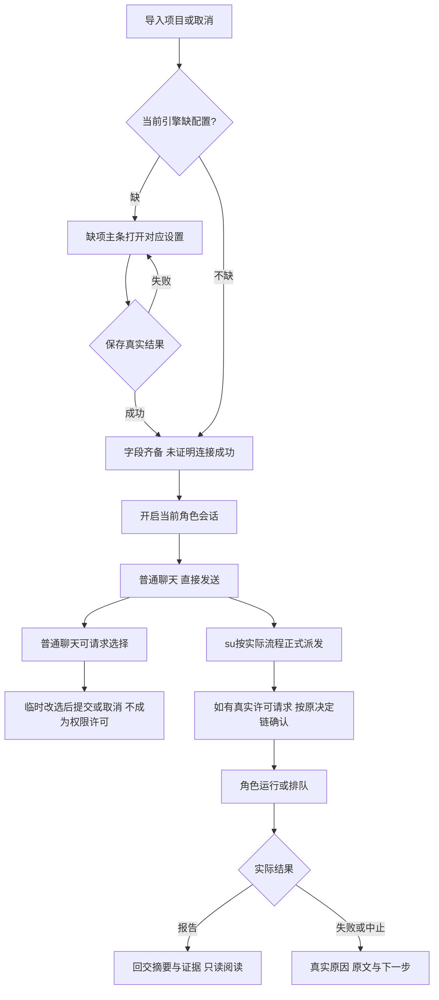

# 从导入项目到核对成果的完整桌面流程

用户不应在看到“执行失败”后仍不知道哪个文件出了什么错，也不应收到报告却打不开正文。本方案保留当前两栏聊天工作台，把**核对执行、阅读成果、处理失败**三条路径补完整，同时把普通聊天、正式派发、待选择/确认与实际完成区分清楚。整体颜色和布局保持中性、轻量，不新增管理首页、通知中心、模型账户中心或任务权限开关。

这是**v2设计提案**，不是已实施功能。客户本轮授权走查、原型和评审，正式应用/源码/测试/配置未改。[打开可点击原型](2026-10-15_design_desktop-complete-flow-prototype.html)；本机预览 `http://127.0.0.1:8766/2026-10-15_design_desktop-complete-flow-prototype.html`。顶部画布、演示起点和“模拟下一事件”是检查工具，不进入产品。所有项目、表单、执行、许可和报告均为内存模拟，不读取真实文件、不保存配置、不发IPC或模型任务。

输入：[产品七项问题](../../../产品/docs/design/2026-10-15_design_desktop-complete-walkthrough.md)、[PM两轮议程](../../../项目管理/docs/meetings/2026-10-15_meeting_desktop-complete-walkthrough.md)、[现行引擎与会话流程](../../../桌面UI/docs/feature/runtime-choice.md)、[前版设计](2026-10-13_design_ans-uiux-interaction-v1.md)。前版各项验收只说明当时范围，不替代本轮新问题的调查。

## 亲手走查的范围和限制

基线 `fca8f6b`，开始时工作树干净。生产者为本固定UIUX上下文，使用CUA操作仓库Electron，窗口“ANS 治理会话工作台”。产品明确释放后独占操作；完成已明确释放给root，恢复1360×860、duplicate-retest项目/Pi/su、抽屉关闭。真实项目为 `/private/tmp/ans-real-p-limit-20261015-duplicate-retest`。操作造成正常的会话读取/切换/恢复，不称为“零运行时副作用”。

| 场景 | 本人实际操作和观察 | 证据/限制 |
| --- | --- | --- |
| 普通聊天待选择 | 点UX-WALK-1“查看摘要”，↓回“查看完整记录”，Tab焦点到提交；没有提交/取消/停止 | [02 AX](2026-10-15-desktop-complete-flow-evidence/02-real-choice-tab.ax.txt)、[02图](2026-10-15-desktop-complete-flow-evidence/02-real-choice-tab.png)。root在本人释放后统一提交，不记为本人操作 |
| 待处理定位/角色资料 | 打开资料，仍写“无进行中或排队消息”；点现有定位pill关闭抽屉、聚焦原卡，Tab进入radio | [03 AX](2026-10-15-desktop-complete-flow-evidence/03-real-pending-drawer.ax.txt)、[04 AX](2026-10-15-desktop-complete-flow-evidence/04-real-locate-return.ax.txt) |
| 三引擎选择/缺配置 | Pi经菜单键盘选Claude，看到缺API密钥；Tab/Enter打开设置，不输入、不点显示、不保存，再Esc；返回Pi | [05图](2026-10-15-desktop-complete-flow-evidence/05-real-claude-empty.png)、[06 AX](2026-10-15-desktop-complete-flow-evidence/06-real-settings-open.ax.txt)、[07 AX](2026-10-15-desktop-complete-flow-evidence/07-real-settings-focus.ax.txt)。Codex本轮由产品亲测，本人未重复操作 |
| 正式派发/回交 | 切测试读取原派发与报告历史，读取su已有展开回交里的内部说明，不重新派发或生成报告 | 内容是已有真实历史；本人不把历史测试结论当重新运行的测试结果，也不把原本已展开的回交说成本人展开 |
| 失败和执行核对 | 实际开合read_file失败和12条执行记录，失败展开仍只generic，run_shell目标未记录，ISO时间进入窄列 | [08 AX](2026-10-15-desktop-complete-flow-evidence/08-real-failure-expanded.ax.txt)、[09 AX](2026-10-15-desktop-complete-flow-evidence/09-real-execution-expanded.ax.txt) |
| 文档阅读 | 测试资料→文档，点击dup-fresh-3.md，页面没有导航，AX仍为文字；目录也列入6项 | [10 AX](2026-10-15-desktop-complete-flow-evidence/10-real-document-path.ax.txt)、[10图](2026-10-15-desktop-complete-flow-evidence/10-real-document-path.png) |
| 窄窗/回焦 | 实际拖至960×620，切su、开资料再定位，原选择卡/提交/取消完整可见；恢复1360×860 | [11窄抽屉](2026-10-15-desktop-complete-flow-evidence/11-real-960-pending-drawer.png)、[12定位](2026-10-15-desktop-complete-flow-evidence/12-real-960-located.png)、[13交还状态](2026-10-15-desktop-complete-flow-evidence/13-real-release-state.png) |

未亲手覆盖：首次未导入、系统目录导入取消/失败、真实配置保存、真实发送/入队/撤回/停止、新的权限决定、无历史新项目、真实运行失败后的重试与真实报告读取（现无该能力）。这些在原型中模拟，不写成正式桌面通过。产品的目录切换/三引擎/普通聊天观察独立归属其记录。未使用屏读软件；AX可读不等于屏读已验收。

## 问题到方案：本轮必要范围

以下七项对应产品P1–P7；本人同意方向，按自身证据明确边界。P1/P2/P3是主路径，P4/P5/P6/P7是同一路径的必要表达和焦点，不拆成新系统。没有依据支持把这次改为整套视觉重做。

| 问题与证据 | 设计改变 | 原型入口与验收 |
| --- | --- | --- |
| P1 失败无法诊断。本人展开实际read_file，只有失败/目标未记录。该样例虽预期失败，展示仍无法诊断；不能据此断言新实时事件一定缺信息 | 首屏为工具/可靠目标/真实原因；详情展示真实输入、错误原文、退出码。旧数据没保存时明确“这条历史没有保存目标和错误详情”，保留原始记录，不从邻近助手总结补猜 | “运行失败”点展开详情；“旧历史字段未保存”看未知分支。新受控失败真实字段可读；旧历史缺口仍诚实，不能变成伪补全 |
| P2 执行记录难核对。本人看到12条活动都是run_shell/目标未记录，时间窄列多行 | 已有稳定项目/角色/引擎/turn/call身份时，把同一call开始/blocked/result呈为一次调用的阶段；摘要优先命令/路径+结果，时分短时间，完整时间与原文详情可得。blocked与result均保留；同文不同call独立。无身份不猜配对，保留原活动数 | “运行与排队”展开执行组及node -v详情。只在确有身份聚合时写“N次调用”；legacy仍写“N条活动”。开始不代表成功，未返回不写退出0 |
| P3 成果路径不能阅读。本人点击文档文字无变化，目录计入文件项 | 仅对窗口确认已列为可读文件的引用提供“阅读”入口；报告evidence仍是普通证据文字，不按正则抽路径升级成可读许可。回交与角色文档列表均沿这条规则；复用现有抽屉显示只读正文，标题/相对路径/来源清楚，关闭回原入口且保留聊天位置。目录标目录、文件才计数。失败保留原卡/路径，给不存在/越界/不可读的真实原因 | “收到回交成果”→阅读报告；资料→文档→阅读；“报告读取失败”→重试或关闭。此为拟新增读取能力，当前没有读正文IPC，原型绝不冒充已接入 |
| P4 回交把成果与内部模型指令混在一起。本人读取已有展开原文，任务关联未知还夹长段验收说明 | 有typed报告数据时默认来源/真实任务关联或未知/报告结论/摘要/产物/未完成。模型交接指令与完整原文放“原始交接内容”。“已完成”明确是报告声明，不等于全任务验收通过；无typed来源时保留原交接，不能按关键词删文本或从标题猜任务 | “收到回交成果”→阅读+原始交接内容。未知taskId必须写关联未知；缺证据仍未提供；不把所有普通助手答复变成报告 |
| P5 空态/恢复提示不清。本人Claude空历史仍写“以上为历史”，切回Pi再出现相同恢复说明 | 会话头现有次级区域显示**当前**模型上下文状态（尚未开启/正在恢复/已恢复/新会话/恢复失败）；有历史的新会话才说明“可读历史保留，模型未恢复”。真实不同的重开/恢复事件仍可在记录中溯源，不能按同文删除 | 首次/缺配/字段齐备/开启/切引擎原型分别有状态。正式验证空新会话不说“以上”；重复切换不把当前状态堆在对话尾部，也不抹真实生命周期事件 |
| P6 设置关闭回错入口。本人主条Tab/Enter开Claude设置，Esc回右上角图标 | 记录实际invoker。Esc/关闭回可见且仍有效的原按钮；保存后主条消失才回稳定设置图标，禁止给隐藏元素focus。打开不保存保留聊天草稿；保存配置不清消息草稿 | “导入后缺配置”打开/关闭设置；就绪聊天填草稿→右上设置→保存/关闭。分别验三入口与入口消失fallback、跨角色/引擎草稿保持 |
| P7 等待选择时资料仍只写无进行中/排队。本人独立复现；定位pill本身有效，应保留 | 资料顶部加当前角色“待处理1”及请求原题，注明普通聊天请求或实际任务关联，定位复用现有收抽屉/聚焦原卡。没有在跑和队列仍可各自为空，不能把待处理清成“全无”。侧栏waiting优先于空闲，不把普通聊天选择误叫正式任务 | “普通聊天·待选择”→资料→定位→radio方向键/Tab提交；另独立“正式任务权限确认”模拟。提交普通选择不自动派发，临时改选不是提交 |

## 保留的完整流程

正式派发继续由su工具与编排产生；composer不加“正式权限模式”。原型“模拟下一事件”推进预设，不代表生产应用增加派发按钮，也不代表每个任务必经客户许可。真实许可仍按原业务链判断；原型权限卡只示意数据和布局，不能以通用“同意”绕过现有shell/治理专属行为。

发送失败保留草稿/附件；忙时新消息入当前角色队列，入队不等于执行；仅未投递客户消息可撤回，派发/回交只读。停止仍与发送并存，受理后先等收尾，不假造已结束；队列与草稿保留。角色、项目、引擎身份隔离仍是原功能要求，普通阅读/展开/抽屉不抢滚动，显式定位才聚焦待处理卡。

## 布局、键盘、空态

两档画布为1360×860、960×620，原型按原尺寸显示；窄浏览预览容器横向滚动画布，不把桌面布局挤成手机版。正式应用最小窗口仍960×620。侧栏272px、标题栏36px、会话内容最大760px、外侧26px，正文14px/1.9。触发器104×28、列表160px、选项32px沿已确认[选择器规范](2026-10-14_design_engine-selector.md)。正文和资料不加装饰圆角；仅按钮/输入用6–8px，行间16–20px。背景白、侧栏#F4F4F2、抽屉#FCFCFA、文字#242624、次字#737773、线#E5E7E3、临时高亮#EEEFEB、选中#E8EBE4，焦点#42745E/2px。错误使用现#964035浅红语义，不靠颜色单独表达。

继续使用360px非模态右覆盖抽屉，top36、bottom100，避开composer；960宽可以覆盖普通历史，但待处理卡操作必须通过既有定位收抽屉后完整可达。报告正文复用同抽屉，不新开第二工作台；长路径换行，长代码只在自身容器横滚，不让整窗横滚。文档从资料进入时有“返回角色资料”，从回交进入时关闭回原阅读按钮。读取失败不丢报告卡。

Tab自然顺序；select-only combobox的↑↓/Home/End只临时浏览，Enter/Space才确认，Escape/外击/Tab取消且当前值保持。非模态抽屉不锁键盘；开时关闭按钮可聚焦，Esc关层按invoker回焦。系统导入对话用系统键盘语义，原型的模拟对话有Tab边界/Esc取消。选择卡原生fieldset/legend/radio，没有权威默认值时初始都未选、提交禁用，用户明确改选后才启用；↑↓只改选，Tab到提交；定位聚焦卡容器后下一Tab进入选项。待许可没有默认同意，关闭/Escape的决定语义必须沿各既有请求契约，不把隐藏视图当同意。

未导入只一个清楚的主行动；引擎禁选、输入/发送的不可用原因就近显示。缺配置保留原缺项主条和对应设置入口；没有角色的已导入项目仍可选引擎。不把配置完整标成服务连接成功；没有报告、没有证据、历史字段未保存、请求已失效分别说明，不用一条“空闲/失败”概括所有情况。输入法isComposing沿现保护，Enter发送、ShiftEnter换行。

## 能力缺口与实现交接（PM需取得属主评估）

| 范围 | 本设计需要的事实/能力 | 边界 |
| --- | --- | --- |
| P1/P2 桌面UI/桌面窗口及真实事件来源 | 真实call身份、原输入/目标、起止完整时间、blocked/result、真实输出/错误/退出码；实时与回放一致 | 当前历史有透传缺口，不承诺所有旧记录可补；必要时由PM协调核心/适配器原生来源评估。renderer不读原生会话文件，不按文本配对；保留净化和机密隐藏要求 |
| P3 桌面窗口+桌面UI | 拟新增受限项目文档只读请求/结果，返回权威类型/路径/正文或明确拒绝原因 | **当前无该IPC**。窗口/下层按已确认边界提供，renderer不能fs读文件。实际路径规范化/真实路径、目录/不存在/符号链接越界、文件类型与体积上限由窗口方案给出，机密配置不因被报告引用就允许预览；不接任意URL/HTML执行，不扩写权 |
| P4 事件来源+窗口+UI | typed报告信封、来源角色/引擎/真实taskId或null、summary/evidence/status、原始交接原文 | 当前可见交接多为文本；不能用正则切内部说明后冒结构化报告，也不能猜“全部收齐”。有typed时分层呈现，只有原文时按原文保留并标限制 |
| P5/P6/P7 桌面UI消费既有真实状态 | 当前上下文恢复状态/历史是否存在、请求和生命周期身份、invoker可见性、当前角色未决快照 | 不是UI新定超时/审批或删除同文历史；不会复制门禁/配置判定。确认失效仍由权威窗口通知 |

已读属主独立评估：[Window](../../../桌面窗口/docs/design/2026-10-15_design_complete-flow-window-assessment.md)、[UI](../../../桌面UI/docs/design/2026-10-15_design_complete-flow-ui-assessment.md)、[Core](../../../运行时核心/docs/design/2026-10-15_design_complete-flow-core-assessment.md)、[编排](../../../编排/docs/design/2026-10-15_design_complete-flow-orchestration-assessment.md)。Core指出现shell约1MiB为软阈值、无精确截断标志，输出并非天然脱敏；本设计不把原文无界下发设为政策，实施前须冻结有界展示投影、截断与敏感内容规则，预算数值目前未定。P4报告来源可能是合法submit_report或编排按任务实际终态产生的兜底，不能全部叫模型报告；按终态和来源如实表达。P4完整历史还需源报告记录与目标输入typed快照的中立持久合同；Core当前不持久化Pipeline handback，不能仅UI改卡就承诺全链。现有原文不做追溯伪结构化，不改写旧日志。

各源文件/接口方案和验证由对应属主在确认后准备，本设计没有实现授权。主涉及 `app/renderer/index.html/styles.css/renderer.js` 和必要展示模块；P3还涉及preload/main/窗口契约，P1/P2/P4可能涉及持久化与回放字段。五层边界继续按项目架构，不因为原型能本地展示就声称已有下层能力。不要一次把整仓历史、工具输出或机密原文无界塞进DOM。

## 必要与可选

本提案必要范围为P1–P7上述可验证改变、对应真实字段来源/安全只读能力及原功能保持。不新增用户未请求的O项；快捷搜索、另开文档中心、批量重试、历史自动修补、命令自动重跑、推测完成进度均不在提案。没有默认勾选的隐性附加项。P3若属主确认无法在既有边界安全实现，须PM说明具体缺口再修提案，不能把不可用按钮装作完成。

## 原型检查与评审状态

UIUX已在独立IAB打开本地HTML，实际点通导入取消/导入、缺配表单校验/模拟保存、开启会话、普通消息发送；普通选择radio方向键/Tab/提交、资料待处理定位；正式派发预设→许可模拟→运行、执行详情、消息排队/撤回、回交阅读。图像和后续检查范围见同目录证据；这些是**原型本地结果**，不代表真实模型、配置/权限或文件阅读已实现。

补查已实际执行：主条开设置Esc回主条；模拟保存后主条隐藏则回稳定设置图标；右上设置关闭及模拟保存均保留消息草稿；跨角色/引擎返回保留原草稿；原型选择默认两个radio均false/提交disabled，选后Tab可到提交；停止受理阶段仍待收尾并保留队列/草稿；文件读取失败可本地模拟重试/关闭并回原报告入口。所有模拟保存仅内存改变。资料→文档阅读→返回恢复原文档展开与焦点；这不证明真实文件读取安全已经实现。

最终双宽图（生产者UIUX，均为HTML原型）：[1360成果阅读](2026-10-15-desktop-complete-flow-evidence/24-prototype-report-reading.png)、[1360执行核对](2026-10-15-desktop-complete-flow-evidence/23-prototype-execution.png)、[失败详情](2026-10-15-desktop-complete-flow-evidence/25-prototype-failure.png)、[文档失败](2026-10-15-desktop-complete-flow-evidence/26-prototype-document-error.png)、[旧字段缺口](2026-10-15-desktop-complete-flow-evidence/29-prototype-legacy.png)、[960待处理抽屉](2026-10-15-desktop-complete-flow-evidence/27-prototype-960-pending-drawer.png)、[960原选择卡](2026-10-15-desktop-complete-flow-evidence/28-prototype-960-choice.png)。960实际量到app宽960/高620、卡底614.96、composer顶656.99（当时视口1000×820含演示条），关键动作在输入区上方。屏读、IME真实组合、真实文件路径安全及生产流没有由这些图证明。

第二轮产品实际指出三处原型回归，已限定修复：①“填写后续消息”和“填入示例”非空草稿只聚焦，空草稿才填建议；②模拟保存只把缺配未开启状态推进字段齐备，已有聊天/待选择/运行仍保原状态与记录；③停止受理保留执行组和单调用详情展开及阅读位置。PM指出普通choice侧栏称确认，现按kind显示待选择/待确认；root指出无默认来源不应代选，现初始两项均未选、提交禁用。已分别实操复核，证据：[草稿](2026-10-15-desktop-complete-flow-evidence/31-prototype-draft-keep.json)、[保存会话](2026-10-15-desktop-complete-flow-evidence/32-prototype-save-keeps-session.json)、[停止阅读](2026-10-15-desktop-complete-flow-evidence/33-prototype-stop-reading.json)。停止前后details打开数组同为false/true/false/true/false，top同为0，草稿原文保留；不把此局部值扩大为虚拟列表精确锚点全测。成果状态写“报告声明：已完成”，仍不等于验收。

两轮内形成当前v2，等待产品对受影响项复核和PM最终结论；不再追加新功能或会议轮次。生产未实施、生产测试未运行、未部署；产品/PM推荐与客户确认分别记录。
