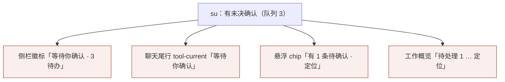

客户 2026-10-16 反馈「界面还是有点乱」，PM 当日追加客户原话「**聊天那块感觉太松散了**」并指定其为第一焦点；随后追加两条「**正在思考，没有动画**」「**运行中的图标太丑了**」（运行/思考状态反馈，见 (a2) 专节）。本轮为**审计 + 设计提案**：不实施、未测试、未部署；实施经 PM 评审与客户逐项勾选后由「桌面UI」（必要时与相关属主）执行。上一轮基线见[视觉收敛 v2](2026-10-15_design_visual-convergence.md)与其[落地评审](2026-10-15_design_visual-v2-implementation-review.md)；新增面（G-2 系统行/恢复卡）设计背景见 `2026-10-16_design_role-watchdog-and-closure`（属主文档，只读引用）。

## 取证方法与诚实声明

本角色在**临时目录**自建只读夹具（`/tmp/ans-uiux-v3/ext/audit-v3.mjs`，**未改仓库 test/ 任何文件**）驱动**真实 `app/renderer` + `app/preload.cjs`**（受控 IPC 替身：无模型请求、无网络、不读用户项目/凭据）；并只读运行仓库既有 `uiux-v2.mjs` 的 G2/视觉/完整流三模式及 `uiux-design-audit.mjs`。全部截图与逐值度量入 [evidence 清单](2026-10-16-visual-convergence-v3-evidence/manifest.json)（含渲染文件 SHA-256、Electron 44.7.0、HEAD `1c8a489`）。**这不是 CUA 亲操作**：未做真机点击与屏读；「after」示意为在真实渲染器上经 `webContents.insertCSS` 注入候选间距覆盖（仅夹具内，非正式应用改动）。文中一切数字均来自 [audit-v3-report.json](2026-10-16-visual-convergence-v3-evidence/audit-v3-report.json) 与对应截图；推断处已标注。

## 一、实况审计

### F1「松散」的结构量化（第一焦点）

同一规范化转录（2 用户 + 2 助手 + 1 工具组 + 1 拒绝行 + 1 系统行）在 1360×860 滚到底的实测：

| 量 | 实测值 | 说明 |
| --- | --- | --- |
| 相邻行间距 | **24.0px ×12/12**（无一例外） | `.chat-pane { gap: 24px }`（V2 落地值） |
| 正文行高 | 15px/27px（1.8） | 每段文本呼吸 = 1.27 字身 |
| 段间距 / 标题边距 | p 14px；h3 21/7px | |
| 单行用户气泡高 | 51px（padding 12/16 + 行高 27） | |
| 输入区总高 | **165.6px**（胶囊 106，其中空输入框 40px） | 1360 档 |
| 聊天视口 | **586.4px / 860** —— 边框组件（标题栏 36 + 会话头 72 + 输入区 166）=**274px = 窗口 32%** | |
| 转录总高 / 完整可见行 | 945px；**7 行**（视口 586px 内） | 平均每行内容块占 85.9px |
| 960×620 | 视口更矮（截图 `v3-chat-960.png`），同一转录可见块约 3 个 | 未做数值断言 |

证据：`v3-density-bottom-1360.png`（现状滚底）、`v3-chat-960.png`。推断：24px 一律间距 + 27px 行高 + 14px 段距 + 40px 高输入框叠加，是「松散」的主要来源；字号/颜色无异常（`assistantMsg 15px/27px`、色板与 v2 令牌一致）。

### F2 输入区与头部占用（可让出的垂直空间）

输入区 165.6px 的构成实测：外层 padding 20/14 + 胶囊 106（padding 12×2 + 空输入框 min-height 40 + 底行 32 + gap 8）+ 脚注 17.6 + 脚注上边距 8。空输入框 40px 高而仅一行占位文字（行高 22.4px）。证据：`v3-chat-bottom-1360.png`、`v3-sim-bottom-1360.png`（对照）。

### F3 工具行堆叠密度（展开态）

一次 `run_shell` 调用 = **2 条活动行**（调用发起 / 结果），实测行高 **53.1px**（两行文本：操作名 + 目标；padding 8px + 40px 内容），4 条活动 = 257.4px；组摘要行 26px。列网格 `42px 时间 / 目标 / 状态(40px)`，状态 10px 字。证据：`v3-records-open-1360.png`、`v3-density-records-1360.png`。时间列在活动无时间时仍保留（夹具所见为空列；真实回放行带时间，既有真机证据）。

### F4 同一状态在四处重复呈现

四者分别为：`role-status.js` 徽标、`renderer.js::renderCurrentWork` 的裸状态词行、`#op-chip`、工作概览待处理节。其中 B2 是**无上下文状态词**（仅「等待你确认」五个字，无主体、无计数），与 B3 同屏并存（`v3-system-live-1360.png` 实测两者同时可见）。证据：`v3-system-live-1360.png`、`v3-work-1360.png`、`v3-chat-bottom-1360.png`。

### F5 系统行（G-2 新面）文案与对齐

`[系统·看护] 投递排队积压：……`（`v3-system-live-1360.png`）：chip 已显示「系统消息 · 看护」，正文又重复 `[系统·看护] ` 前缀；同类前缀在同一消息的工作概览队列条目再出现一次（`v3-work-1360.png`）。注入盒实测 541.4×71.9px（按内容收缩居中，body 15px/27px）。分类、来源标注「系统」、实线+左竖条与角色投递虚线框的区分均符合设计（正向保留）。回放路径 `v3-system-replay-1360.png` 同解（同一分类器）。恢复确认卡实测（`g2-recovery-card-1360.png` / `-960.png`）：证据逐字 12.5px 保留、取消默认焦点、提示一行「点取消…不执行」；结构与 fail-closed 呈现正向保留。

### F6 悬浮 chip 与阅读列脱开

1360 档实测：chip 左缘 **x=240**，而阅读列（`.chat-pane`）左缘 **x=384**——chip 为 `#chat` 直属子元素 + `align-self:flex-start`，贴在窗口内容左缘，不随 800px 居中列走；宽屏下视觉上与对话流脱节（`v3-system-live-1360.png`、`v3-chat-bottom-1360.png` 可见）。chip 同时 sticky 悬浮遮挡其下内容（设计内已知取舍）。

### F7 次级噪声（逐条小项）

- 空态侧栏「尚未导入项目」出现两处（项目摘要 + 底部计数），且未导入时仍显示可点但空转的「工作概览/角色资料」（`v3-empty-1360.png`）。
- 报告内「查看执行记录」展开详情：两相位各渲染一块「实际命令/目标」字段，同一命令 `node -v` 出现两遍、成片白底值块无相位分组（`01-tool-detail.png`）。
- 工具组摘要计数口径为「N 条活动」（相位行计数），与用户直觉的「N 个调用」不同（`v3-records-open-1360.png`：2 个调用显示「4 条活动」）。
- 「工作概览」页签角标 4 = 排队 3 + 待确认 1 合并计数（两种类别混计）。

### F8 运行/思考状态无动画（客户「正在思考，没有动画」）

专项夹具实测（`indicators-report.json`，`ind-before-*.png`）：**「忙碌」的全部呈现都是静态的**——侧栏工作徽标是 10px 文本字形 `◐`（盒宽 9.2px，`animationName: none`）；聊天尾行「正在工作」为纯文本 12px（行高 26.6px，无动画）。全应用**唯一**的动画是开会话 loading 行的 `.spinner`（12px 边框转轮 `spin 0.8s linear infinite`，`ind-before-loading-1360.png`）——即「真正在跑的那段（生成中）恰恰没有任何动效」，客户观察属实。等待确认/恢复卡当前无忙碌动效（正向，不得回退）。

### F9 「运行中」图标审美（客户「运行中的图标太丑了」）

运行中图标 = `role-status.js` BADGES 的 `working: ◐`（U+25D0 半圆字形，10px）。放大对照（`ind-before-working-ico-1360.png`）：半圆填充字形在 10px 下笔画粗糙、亮暗两半的分界突兀，与全应用**内联 SVG 线性图标语言**（1.2–1.8 描边、currentColor、圆头线端，如标题栏、发送箭头、composer 附件、op-chip 盾徽）不一致；开会话转轮 `.spinner` 的边框画法在该尺寸下也偏淡（`ind-before-loading-1360.png` 近看几乎只剩浅环）。

### 正向对照（本轮未发现回退、明确不动）

960 档工作概览无横向溢出（`bodyScrollW=960`，`v3-work-960.png`）；「最近回交」空态一行；队列来源标签「客户消息 / 系统 / su 派发 / 回交投递」清楚；拒绝/失败为文字行（无彩色徽章海）；`is-replay` 淡显；会话引擎菜单、资料抽屉、报告卡（`visual-v2-1360.png`、`visual-v2-received-1360.png`、`visual-v2-drawer-1360.png`）与上一轮落地评估一致。

## 二、设计提案

### (a) 快速赢（低风险、styles.css 为主；数值均为实测或模拟实测）

「after」示意来源：在真实渲染器上注入候选 CSS 后的同转录同滚动位截图（`v3-sim-bottom-1360.png` / `v3-sim-records-1360.png` / `v3-sim-960.png`）；**示意非实现**，实现由桌面UI按同值落样式后重采。

| 编号 | 项 | 现状（实测） | 候选 | 依据/落点 |
| --- | --- | --- | --- | --- |
| W1 | 聊天行间距 | `.chat-pane` gap **24px** | **16px** | 全部相邻行 24.0px → 模拟后 16.0px；对话块间呼吸仍 ≥16 |
| W2 | 文本块内距 | p margin 14px；h1–h3 margin 21/7px | **p 10px；h3 16/6px** | 段间 14px 与 16px 行距同量级会吃掉层级 |
| W3 | 用户气泡 | 单行 51px（pad 12/16，行高 27px） | **42px（pad 9/14，行高 24px）** | 气泡是短确认语句，不需要 1.8 行高 |
| W4 | 输入区 | 总高 **165.6px**（pad 20/32/14；胶囊 106，空框 40，gap 8；脚注上距 8） | **≤137.6px**（pad 14/32/12；胶囊 88：pad 10/14、gap 6、空框 min-height **28**；脚注上距 6） | 模拟实测 137.6；空框 28 = 单行 22.4 + 5.6，autoGrow 无需改 JS（加载时按新 min-height 计算） |
| W5 | 工具展开行 | 活动行 53.1px（pad 8、首行上距 9）；组摘要行高 26px | **47.1px（pad 5、首行 6）；摘要 22px** | 4 条活动组 257.4→约 232px |
| W6 | 系统注入盒体量 | 盒高 71.9px（body 15px/27px） | **68.9px（body 行高 1.6）** | `v3-system-live-1360.png` vs 同文本更紧凑 |
| W6b | 系统行正文前缀（文本级） | chip「系统消息 · 看护」+ 正文重复「[系统·看护] 」 | 正文去掉该前缀（chip 已承载） | 需属主确认；分类判据在投递原文，不改判据 |
| W7 | 助手正文行高（**可选包**） | 15px/27px（1.8） | 1.7（25.5px） | 触碰已接受的 v2 排版基线；默认**不**纳入，客户勾选才做 |
| W8 | 空态/侧栏小文案 | 「尚未导入项目」×2 | 保留一处（底部计数行） | 文案级 |

运行/思考状态反馈三项（W9–W11，转轮图标与动效）见 **(a2) 专节**，同属快速赢级别。

**快速赢汇总效果（同一转录模拟实测）**：聊天视口 586.4→**614.4px**（+28px，输入区让位）；转录总高 945→**823px（−12.9%）**；滚到底完整可见行 **7→9（+28.6%）**；行距实测全部 16.0px。截图对照口径：`v3-density-bottom-1360.png` ↔ `v3-sim-bottom-1360.png`（同转录、同「滚到底」、同宽度），展开态 `v3-density-records-1360.png` ↔ `v3-sim-records-1360.png`，960 档 `v3-chat-960.png` ↔ `v3-sim-960.png`。

### (a2) 运行/思考状态反馈专节（客户追加反馈：正在思考没有动画 + 运行中图标太丑）

**现状（实测，`indicators-report.json`）**：忙碌呈现全静态——侧栏 `◐` 10px 字形（盒 9.2px、无动画）；尾行「正在工作」纯文本（高 26.6px、无动画）；唯一动画是开会话 loading 的边框转轮（`.spinner` 12px、`spin 0.8s`，但线条偏淡）。等待确认/恢复卡无忙碌动效（保持不动）。

**方案（统一为一枚 12px SVG 弧线转轮，静止时弧线本身仍可读为「运行中」）**：

| 编号 | 项 | 级别 | 现状 → 候选 | 示意证据 |
| --- | --- | --- | --- | --- |
| W9 | 侧栏「工作中」徽标 | 快速赢 | 文本字形 `◐` 10px（盒 9.2px，无动画）→ **SVG 弧线转轮**（盒 12px，`v3spin 0.9s linear infinite`；0/90/180/270 处帧见截图） | `ind-before-working-ico-1360.png` ↔ `ind-after-working-ico-1360.png`；整排 `ind-before-sidebar-1360.png` ↔ `ind-after-sidebar-1360.png` |
| W10 | 聊天尾行「正在工作」 | 快速赢 | 纯文本 → 文本前加同款 12px 转轮（**行高不变**，实测保持 26.6px）；文案不新造词 | `ind-before-tail-1360.png` ↔ `ind-after-tail-1360.png` |
| W11 | 开会话 loading 转轮统一 | 快速赢 | 边框转轮 `.spinner`（12px、spin 0.8s、线条淡）→ 同款 SVG 弧线（12px、0.9s），全应用**只有一种转轮** | `ind-before-loading-1360.png` ↔ `ind-after-loading-1360.png` |

**图标与动效规范（SVG，全应用唯一一枚转轮）**：`viewBox="0 0 12 12"`、`width/height=12px`、`circle cx=6 cy=6 r=4.6`、`fill:none`、`stroke:currentColor`、`stroke-width:1.5`、`stroke-linecap:round`、`stroke-dasharray="21.7 7.2"`（约 270° 弧）。动效：`transform: rotate(360deg)`、`0.9s linear infinite`、`transform-origin: 50% 50%`（transform 合成，不是布局动画）。颜色走现行状态规则：侧栏 working 沿用 `.st-working` 现值（`var(--text)`）、尾行与 loading 用 `var(--text-2)`（实测 rgb(93,104,98)），不新增颜色。`prefers-reduced-motion` 已由全局规则兜底，CDP 实测（`Emulation.setEmulatedMedia`）：`animation-duration: 1e-06s`、`iteration-count 1` → 静止弧；静帧下弧线＋文字标签仍可辨，不依赖动画传达状态。

**明确不做**：等待确认卡/恢复确认卡/`op-chip` 不加任何忙碌动效（避免把「等你确认」误示为「机器在忙」）；不给流式正文加打字光标/呼吸动画（正文持续出现本身就是进度，行内动画在虚拟窗口下有重建成本且干扰阅读）；不加全局跑马灯/骨架屏。

**实现触点与风险**：图标不是纯 CSS——`◐` 由 `role-status.js` 的 BADGES 映射 + `renderer.js::statusBadgeHtml`（现对 `badge.icon` 做 `esc` 转义输出）生成，左树每次重绘重建 DOM（本次模拟中实测：切角色重绘会抹掉 DOM 注入的 SVG，故**实现必须落在映射/渲染单点**，不能靠 DOM 注入）；开会话 loading 行的图标串在 `renderer.js:3323`；动画仅两条 CSS 规则（`.st-working` 图标动画、尾行/loading 复用）。代价：切图映射与转义策略的单点改动 + 相关测试锚点核对（由桌面UI同批处理）；风险：动效噪声与 CPU——仅 working 状态出现、与并发工作角色数同量级、纯 transform 合成层，可忽略；回滚 = 还原映射与两条动画规则，无数据影响。备选（若客户不接受 SVG 引入）：保留字形方案 `◐◓◑◒` 四帧步进动画（`steps(4)`），但字形粗糙审美问题仍在，**不推荐**。

### (b) 结构级项（需更多改动；逐条给取舍与代价）

| 编号 | 项 | 方案 | 收益（目标值） | 代价/风险 |
| --- | --- | --- | --- | --- |
| S1 | 工具调用相位合并 | 同一 `toolCallId` 的「调用发起 + 结果」两行并为一行（终态为准；未返回时显示「调用发起」；失败/未知照旧醒目、折叠摘要仍可见） | 一次调用占高 ~106→~47–53px（**减半**）；「4 条活动」→「2 个调用」直觉化 | 触及 `renderer.js` 行模型与行高缓存（虚拟窗口）、`tool-rows.js` 映射；须逐条保留实际身份与顺序（合并的是同一次调用的两相位，不折叠重复调用）；随附测试更新由桌面UI负责 |
| S2 | chip 对齐阅读列 | `#op-chip` 左缘对齐 `.chat-pane` 左缘（x 240→**384±4**，1360 档；窄档随列宽自适应） | 指示物回到对话列内 | 仅一个定位规则；**本轮未模拟**，实施后按数值复测；遮挡取舍不变 |
| S3 | 尾行状态词去重 | chip 可见时不显示 `tool-current`「等待你确认」（「正在工作」保留；无 chip 时状态词仍兜底） | 同屏不再四重状态（F4 的 B2 消除） | `renderCurrentWork` 与 `updateOpChip` 联动，两处刷新点同源；键盘/焦点不受影响 |
| S4 | 工具组摘要口径 | 随 S1：「N 条活动」→「N 个调用」(异常时补「· 异常 M」) | 计数与直觉一致 | 摘要为纯函数文本；`fillActivities` 一处 |

### (c) 明确不动的部分（维持既有交互契约）

标题栏 36px；会话头 72px 结构与 18px 标题；阅读列 800px 居中；正文 15px 字号与色板（W7 若客户不勾选则 1.8 行高不动）；所有圆角/焦点环（2px #42745E）/按钮 32px；恢复确认卡与 shell 卡的结构、fail-closed 默认焦点、逐字证据；抽屉 424px 模态与遮罩；`op-request` 卡样式与「确认/不同意」语义；队列来源标签语言；系统行=系统来源的实线+左竖条的区分方式；`is-replay` 淡显；拒绝/失败「以文字呈现」纪律；工具行身份与顺序呈现（S1 亦仅合并同一调用两相位）；**等待确认/恢复卡不加任何忙碌动效**（见 (a2)「明确不做」）。理由：这些是历轮客户裁定或已验收项的组成，收紧目标是间距密度与状态反馈，不是改契约。

### (d) 验收方式（沿用既有度量工具口径）

实施后由本夹具同源度量（audit-v3.mjs 的 DENSITY 段）在候选上重跑，逐条数值断言（1360×860，同一转录滚到底）：

1. `.chat-pane` gap = **16±1px**（现 24）；
2. 助手 p margin = **10±1px**、h3 margin 纵值 ≤16/≤6+1（现 14 / 21/7）；
3. 单行用户气泡 ≤**44px**（现 51）；
4. 输入区总高 ≤**140px**（现 165.6）、空输入框 ≤**30px**（现 40）；
5. 转录总高 ≤**850px**（现 945）；
6. 完整可见行 ≥**9**（现 7）；
7. 工具活动行 ≤**48px**（现 53.1）；
8. 960 与 1360 两档 `bodyScrollW == viewport 宽`（现为真，不得回退）。

运行/思考状态反馈追加断言（同夹具 `indicators-report.json` 口径）：

9. working 徽标为 12px±1 的 SVG（盒宽 12±1，现 9.2 字形）且 `animation-name` 为转轮、周期 0.9±0.2s（现 none）；
10. 尾行「正在工作」行高 26.6±2px **不因图标增加**、含转轮元素且动画生效；
11. 开会话 loading 行使用同一枚 SVG 转轮（全应用无第二实现）；
12. `prefers-reduced-motion: reduce` 模拟下（CDP）转轮 `animation-duration ≤0.01s` 且 iteration ≤1（静止弧仍可辨）。

截图对照：上文三组 before/after 同名文件对（现状文件即基线的 canonical 截图）；结构级项 S1–S4 各自追加口径：S1 展开组高度 ≤ 现状 60% 且失败/未知/截断在折叠摘要可见；S2 chip 与 pane 左缘差 ≤8px；S3 同状态截图 chip 可见时无「等待你确认」尾行、计数不回退。测试与实现归桌面UI（含受影响的 renderer 测试锚点更新），本角色复测签署。

### (e) 风险与回滚

- W1–W6、W8 全部为 `styles.css` 选择器级改动（含 `autoGrow` 自然按新 min-height 生效，无 JS 改动）；单提交即可整体回滚，无数据/契约影响。
- **与已验收 v2 基线的冲突（最主要风险）**：24px 行距、14px 段距、15/1.8 行高、40px 输入框均为 v2 落地时按既有验收值签署的样式；本提案把「间距密度」列为有意收紧——须客户确认这是一次**基线修订**，否则实施后旧截图对照断言将不再适用。
- W6b/S1/S3/S4 跨文件（renderer/tool-rows）：须桌面UI评估对虚拟窗口行高缓存、`rowModelDebug`、行距测试锚点的影响并同批更新；S1 若发现与「逐条保留身份与顺序」有解释冲突，随时可单独放弃（独立提交粒度）。
- W9–W11（转轮）跨 `role-status.js` + `renderer.js` 渲染单点 + CSS 两条：风险=状态徽标被重绘路径（左树重绘）必须走映射，DOM 注入无效（本次模拟已实地验证）；须核对断言工作徽标字符/文案的既有测试并同批更新；回滚=还原映射与两条动画规则。
- 本轮 sim 为样式覆盖示意：W4 的 textarea 高度在模拟中需触发一次输入事件才重算（先加载后注入所致），正式实现按新 CSS 加载即得，不构成偏差；S2/S3 未模拟，数值为推算，实施前保留复测；W9–W11 的 after 为 DOM/CSS 示意（夹具内），其中转轮的旋转中帧会取到 16–17px 的正方形外接盒属旋转包围盒，实绘圆弧仍在 12px 内（圆旋转不变形），不构成尺寸偏差。

## 三、需客户裁定的点

1. **默认包幅度**：W1–W6 是否按 16px 行距/10px 段距/28px 输入框执行（备选保守档：行距 18px、段距 12px、输入框 32px）。
2. **W7**：助手正文行高是否 1.8→1.7（默认不动）。
3. **W6b**：系统行正文去 `[系统·X]` 重复前缀（文本级）。
4. **S1**：工具调用相位合并是否实施（结构级，涉及工具行事实呈现方式）。
5. **S2/S3**：chip 对齐与尾行状态词去重是否纳入本轮（小项，见 F4/F6）。
6. **W8** 空态文案去重（随默认包即可）。
7. **W9–W11**：运行转轮按 SVG 弧线方案执行（推荐），或选字形步进备选（不推荐）；开会话 loading 转轮是否一并统一。
8. **动效边界**：确认「等待确认/恢复卡零动效」「不加打字光标」作为长期约束。

## 边界与状态声明

本轮仅审计与设计提案：**未实施、未测试、未部署**；未改 `app/`、`src/`、`test/` 任何文件；未 git 提交；未触碰 kanban-live-*、既有 /private/tmp 轮次目录与测试证据目录（仅只读引用）；accepted v2 规范与原型未动。审计截图与度量入本角色 evidence 目录。提案经 PM 评审与客户逐项勾选后，按项移交桌面UI实施；本文件不构成业务实施授权。
