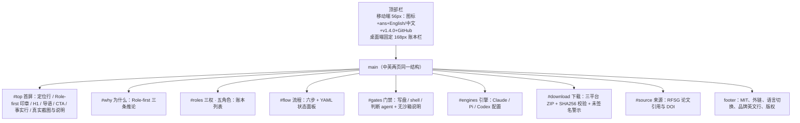

# 项目官网（GitHub Pages）

## 这是什么

官网是 ANS Studio 的公开入口：一页讲清产品定位（AI Agent 的自主组织运行时，Role-first 组织原则）、五个治理角色、从意图到验收的流程、边界与门禁、三种引擎、下载与学术来源。纯静态，无构建步骤，线上地址 `https://wangzhongren.github.io/ans-studio/`。

提供两个语言版本，共享同一套样式、脚本与素材，可互相切换：中文 `site/index.html`（`/`）与英文 `site/en/index.html`（`/en/`）。

当前状态：中文站已部署上线（2026-10-21，协调方提交 `f87eb134` 并 push 触发部署，run `39541758607` 成功，线上页面与本地字节一致；发布事实见[变更记录](../change/2026-10-21_change_project-site.md)）。英文版、双语切换、hreflang 与双语 sitemap 也已由协调方提交并部署（commit `b00bc74`，run `39545903589` 成功；线上 `/` 与 `/en/` 均与本地字节一致，见[英文版变更记录](../change/2026-10-21_change_english-site.md)）。角色文档仍在工作树未提交。

## 页面结构



桌面端左侧账本栏含锚点导航（角色/流程/边界/引擎/下载/来源），当前区块由 `IntersectionObserver` 标记 `aria-current`；移动端隐藏导航，改为自然滚动。两页 section id 相同，`app.js` 共用。

## 双语与语言切换

- 中文页 `lang="zh-CN"`，英文页 `lang="en"`；不做浏览器语言自动跳转。
- 英文页用 `../styles.css`、`../app.js`、`../assets/...` 引用共享资源，不复制副本。
- 切换位置：桌面账本栏底部、移动顶栏（同一 `.rail-foot`）、页脚链接列表末尾；当前语言为 mint + `aria-current="true"`，另一语言为链接（中文页 `English` → `en/`，英文页 `中文` → `../`）。
- 英文排版差异：`html[lang="en"]` 下 H1 `letter-spacing:-0.03em`、`line-height:1.06`、`max-width:15em`（随宽度自然两/三行），正文行高 1.65，角色列宽在桌面端单独调整；窄屏仍沿用统一移动布局。

## 文件与素材

| 文件 | 内容 |
| --- | --- |
| `site/index.html` | 中文单页：结构、SEO/OG/JSON-LD、双语切换、文案 |
| `site/en/index.html` | 英文单页：同一结构、英文文案与英文 SEO/JSON-LD，引用 `../` 共享资源 |
| `site/styles.css` | 颜色/字体 token、账本布局、语言切换、响应式、加载编排、reduced-motion |
| `site/app.js` | 仅导航高亮；异常捕获，不影响内容 |
| `site/assets/desktop-intent-confirm.png` | 真实桌面截图（1360×980，原图复制） |
| `site/assets/ans-seal.png` / `favicon.png` | 应用图标 256px / 64px（`sips` 导出） |
| `site/robots.txt` / `sitemap.xml` / `.nojekyll` | 抓取（双语 sitemap 含 xhtml alternate）与 Pages 约定 |

## 如何本地预览

```bash
python3 -m http.server 8765 --directory site
# 浏览器打开 http://127.0.0.1:8765/
```

页面不依赖构建；直接以 `file://` 打开大部分内容也可用，但以 HTTP 预览最接近线上。注意 macOS 上 Chrome headless 的最小窗口宽约 500px，验证 360/390 窄屏需用 CDP 设备模拟（首轮用 Node `ws` + `Emulation.setDeviceMetricsOverride`），不要用 `--window-size=390` 直接当移动端证据。

## 如何更新版本与下载链接

1. 确认新版本已由测试角色独立验收并公开（Release 非 draft），以该 Release 的实际资产名为准。
2. 在两个页面同步替换（首轮为 v1.4.0，2026-10-20 发布）：`site/index.html` 与 `site/en/index.html`。
   - 账本栏与移动顶栏的版本号 `v1.4.0`（`.rail-version`）；
   - 首屏主按钮「下载 v1.4.0」/ `Download v1.4.0`；
   - `#download` 的 H2 与导语中的发布日期；
   - 三个平台行的 ZIP 文件名与 `releases/download/vX.Y.Z/...` 链接；
   - 三个 `SHA256SUMS-*.txt`、`release-provenance.json`、`overlay.patch`、`SHA256SUMS-overlay.txt` 的链接版本号；
   - 若平台支持或截图变化，同步替换 `site/assets/` 素材与两页的 alt/说明。
3. 更新 `site/sitemap.xml` 两个 `<url>` 的 `lastmod`。
4. 若签名/公证状态变化，同步修改两页的下载警示；发布验收记录未证实已签名前，不删除「尚未签名或公证」提示。
5. 本地预览 `/` 与 `/en/`，重拍两种语言的截图，复查链接与溢出（见[中文变更记录](../change/2026-10-21_change_project-site.md)与[英文版变更记录](../change/2026-10-21_change_english-site.md)的检查方法）。
6. 由客户/协调方提交并 push；workflow 自动部署。

## 如何维护 hreflang 与双语 SEO

一次语言结构变更要同时改四处，缺一处都会产生不一致：

1. 两页 `<head>` 的三条 `rel="alternate" hreflang`（`zh-CN` → `/`、`en` → `/en/`、`x-default` → `/`）。
2. 各自的 `canonical`（`/` 与 `/en/`）与 `og:locale` / `og:locale:alternate`（中文 `zh_CN`+`en_US`；英文 `en_US`+`zh_CN`）。
3. JSON-LD 的 `inLanguage`（`zh-CN` / `en`）；英文页另有指向 `/en/` 的 `url`。
4. `site/sitemap.xml` 的两个 `<url>` 及各自三条 `xhtml:link rel="alternate"`。

新增或删除语言版本时，还要同步两页账本栏、移动顶栏与页脚的切换链接，并检查 360px 顶栏不溢出。`robots.txt` 不需要按语言修改。

## 部署流程

`.github/workflows/pages.yml`（本角色边界内唯一 workflow 文件）：

- 触发：push 到 `main` 且路径含 `site/**` 或 `.github/workflows/pages.yml`；也支持 `workflow_dispatch`。
- 权限：`contents: read`、`pages: write`、`id-token: write`；并发组 `pages`，`cancel-in-progress: false`。
- 任务：`ubuntu-latest` 上 checkout → configure-pages → upload-pages-artifact（`path: site`）→ deploy-pages；环境 `github-pages`，URL 取 `steps.deployment.outputs.page_url`。
- 前置条件（已满足）：仓库 Settings → Pages 的 Source 为「GitHub Actions」（`build_type=workflow`，由客户/协调方设置；本角色不改仓库设置）。
- 站点使用相对路径，部署在 `/ans-studio/` 子路径下可正常加载；`.nojekyll` 防止 Jekyll 处理。

## 已知限制

- 发布由客户/协调方执行：本角色不自行 push、运行工作流或改仓库设置；角色文档仍在工作树未提交。
- 双语站点已上线且与本地字节一致（zh `dfd7786b…`、en `bc6739fa…`）；后续改动仍由客户/协调方 push 触发部署。
- 运行包尚未签名或公证；站点已如实警示，不代替 GitHub Release 的 SHA256 校验。
- Google Fonts 走外链，被墙时回退系统字体（PingFang SC / 微软雅黑等），版面与可读性保持；无其他外部 JS。
- 页面不内嵌 SHA256 明细，校验以 Release 的 `SHA256SUMS-*` 文件为准。
- 未做真实手机与 Windows 浏览器实机测试；验证为 Chromium 桌面与 CDP 精确视口模拟（360/390/1440）。

## 历史

| 日期 | 类型 | 状态 | 变化 | 文档 |
| --- | --- | --- | --- | --- |
| 2026-10-21 | 设计 | designed | 建立信息架构、视觉 token、内容来源与验收口径；按客户定位追加修订首屏 | [设计记录](../design/2026-10-21_design_project-site.md) |
| 2026-10-21 | 变更 | implemented-unverified | 首轮建立站点、发布工作流与角色文档；本地验证通过 | [变更记录](../change/2026-10-21_change_project-site.md)、[证据](../change/2026-10-21_project-site-evidence/) |
| 2026-10-21 | 发布 | deployed | 协调方提交 `f87eb134` 并部署成功；线上页面与本地 SHA-256 一致（run `39541758607`） | [变更记录·发布记录](../change/2026-10-21_change_project-site.md) |
| 2026-10-21 | 变更 | implemented-unverified | 增加英文版 `/en/`、双语切换、hreflang 与双语 sitemap；本地验证通过 | [英文版变更记录](../change/2026-10-21_change_english-site.md)、[证据](../change/2026-10-21_english-site-evidence/) |
| 2026-10-21 | 发布 | deployed | 协调方提交 `b00bc74` 并部署英文版与双语导航；线上 `/` 与 `/en/` SHA-256 与本地一致（run `39545903589`） | [英文版变更记录·发布记录](../change/2026-10-21_change_english-site.md) |
