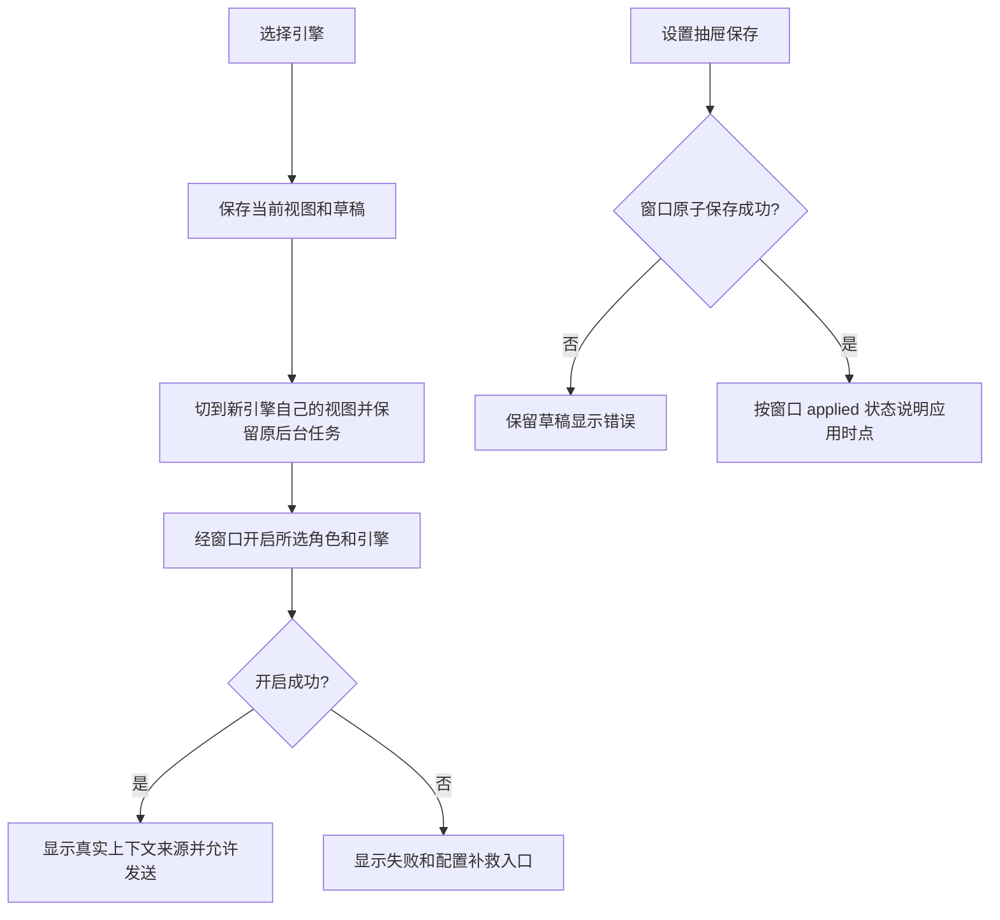

# 桌面选择引擎、查看配置与角色分组

用户选中一个角色后，可以在现有聊天头选择 Pi、Codex 或 Claude，并打开右上角设置抽屉查看这个引擎的实际配置。切换后看到的是该项目、角色和引擎自己的聊天记录，不会把 Pi 的上下文交给 Codex。角色列表按窗口层给出的组别摘要显示运行时接入组及组长/组员；没有组别的角色继续放在其他角色中。

本文件是[已经批准的 ANS-RUNTIME-V2 revision 1](../../../项目管理/docs/design/2026-10-14_design_multi-runtime-integration.md)的 U1 同范围细化，沿用客户“可以的，你新建角色吧，然后开发吧”的实施授权。没有新增选装。角色绑定为桌面UI；唯一写白名单是本角色 `boundary.yaml`，新增精确测试路径已由治理角色授权。

## 实现位置与交接

- `app/renderer/index.html` / `styles.css`：保留两栏、自绘标题栏、66px 聊天头、760px 会话列和覆盖抽屉。引擎选择只增加必要控件，设置复用原 Pi 面板的 DOM 钩子，保留旧探针入口。
- `renderer.js`：`selectRole` / `onSend` / `onRoleState` / `appendOneEvent` / `onSessionHistory` 等按窗口角色冻结契约传 runtime。运行时切换保存各自 pane、行模型、回放状态、输入草稿和队列视图；迟到的异引擎信封不进入当前视图。项目导入继续重置项目内存状态。
- 纯展示模块只处理组摘要、运行时名称、视图身份和字段文案；不读取角色 Markdown、不 import Node/SDK、不解释权限。
- 设置从窗口层的 masked view 读取。机密输入始终从空值开始，只展示已设置布尔。保存失败保留用户输入，成功清空机密草稿。是否立即应用或延后应用只根据窗口返回字段呈现；不由 UI 推断文件/环境或 SDK 默认值。
- 请求卡捕获原 runtime、项目与请求相关信息。窗口失效通知定格按钮；切引擎保留原引擎后台任务，旧同意不向新引擎回传。停止仍请求真实 abort，不把请求成功当轮次已结束。
- 上下文来源只消费窗口明确转换后的 display metadata；ANS 回放存在只表示可读历史，不证明模型上下文恢复。工具行继续使用实际 toolName/callId/turnId。

窗口角色是 IPC 契约唯一属主。设置、session open/send/history/live/abort/withdraw 和请求失效字段以[窗口 API](../../../桌面窗口/api-spec.md)实际冻结形状为准；未冻结前只进行独立分组与纯展示准备。

最后核对实际 adapter 事件发现工具展示还必须兼容两种已存在的中立形状：Codex 的 `detail.args.path/command`、`detail.ok`，以及注入核心的 `detail.call.{name,args,toolCallId}` / `detail.result.ok`。只读取这些明确字段，结果的 `ok:true` 可表示完成，`ok:false` 保留失败；没有结果字段（例如当前 Claude 事件）继续显示状态未记录。结果缺目标时，只从本视图内同 turnId/callId/toolName 的已知调用目标继承，不按摘要猜授权或执行成功。这是同范围实际消费缺口，PM已接受必要修正。

## 写集与验证

修改只涉及 `app/renderer/`、自有精确 `runtime-ui.test.ts` / `renderer.test.ts` / `tool-rows.test.ts` 和已授权 UI e2e 文件、自有 docs/API/导航。主进程/preload/desktop、其他测试、Model/Core/shared/Pipeline、package、角色定义及真实 env 都只读。基线 HEAD 是 `906abd3ee275cba82b2f9e54ceef1cd9473c2d5c`，其他属主的既有未提交改动继续保留。

计划执行 `node --test test/桌面应用/{markdown,renderer,tool-rows,runtime-ui}.test.ts`，`npm run typecheck`，以及真实 Electron `test/桌面应用/e2e/uiux-v2.mjs` 和 `ime-enter.mjs`（离线假 IPC）。新增行为验证组字段转义、缺字段、设置掩码与失败草稿、三引擎 open/send 归属、历史和状态隔离、迟到事件/请求、失效按钮和两档宽度截图。测试保留既有断言，不以放宽回归换取通过。主进程/桥/渲染全链路由独立测试角色另验；本侧离线 IPC 证据不宣称真实模型调用。

当前已按实际冻结窗口契约实施；本侧检查与截图见[原始实现报告](../change/2026-10-14_change_multi-runtime-ui.md)，完整当前流程见[功能说明](../feature/runtime-choice.md)。独立主进程全链路验收另行记录。
