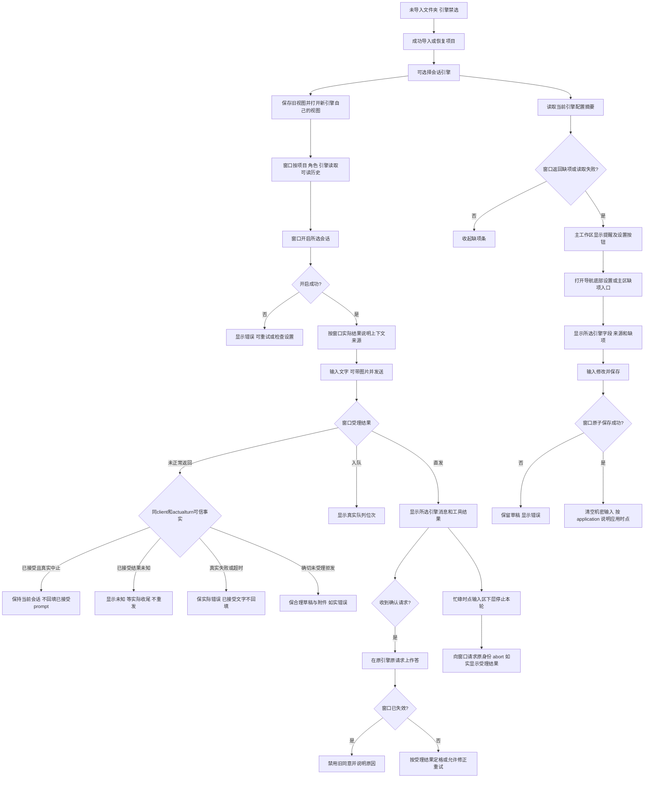
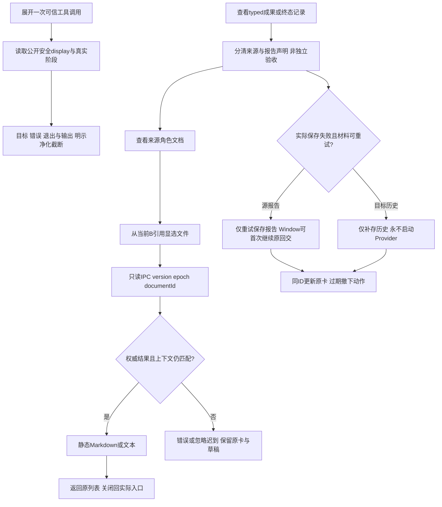
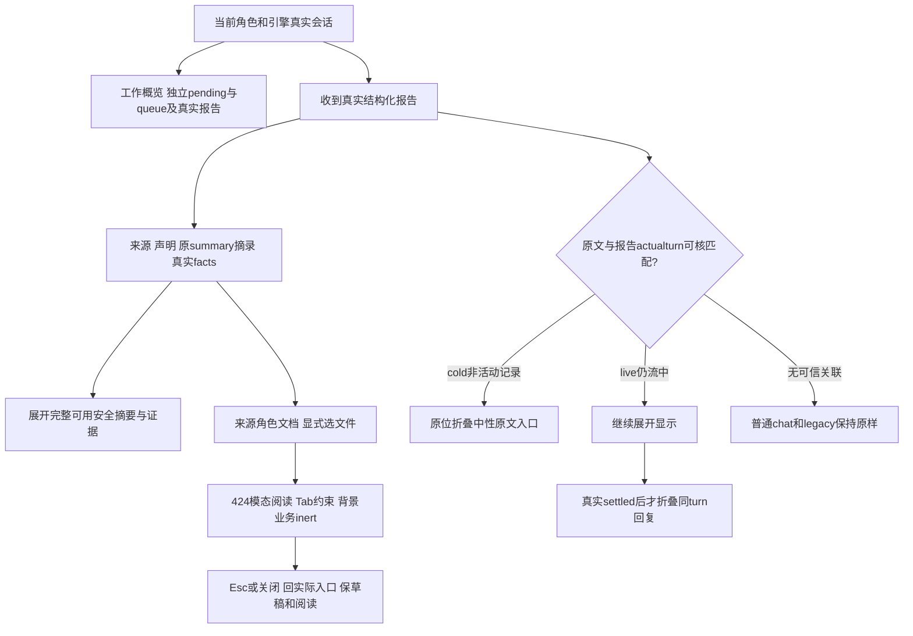

# 在桌面选择引擎并管理自己的会话与配置

未导入文件夹时引擎选择禁用；导入成功（包括没有角色的空文件夹）后，用户可以在会话头右侧选择 Pi、Codex 或 Claude。选择控件为浅色104×32px触发器与180px列表；方向键/Home/End只移动临时项，Enter/Space或点击才确认；当前项只收起，不重新开启会话。Escape、外点、失焦及Tab取消，Tab按自然焦点顺序离开。触发器是单焦点combobox，当前名称与已选项保持一致；列表翻转/限高，临时项滚入可见范围。每个引擎有自己的聊天记录、输入草稿、附件、待办与确认请求。切回原引擎可以继续查看原记录；切换只改变查看和下一次发送的目标，原引擎的后台任务继续运行。

导入或恢复项目后，以及每次切换引擎后，界面读取窗口的配置摘要。缺必填项时，聊天头下显示字段名称和“打开当前引擎设置”按钮；按钮直达已有设置抽屉，无需先点角色。配置读取失败如实提示，可打开设置重试；字段齐备时收起缺项条，这不代表凭据或远程服务已验证。迟到的旧引擎、旧项目或旧请求结果不覆盖当前状态。

左侧角色树保留主入口，其他角色按窗口提供的组别分组。运行时接入组的组长排在本组前面；组员及未知职责显示原文，没有组别的角色放在其他角色里。组别与组长标签只是说明，不改变任何文件权限。

## 用户操作与失败结果

引擎选择立即按当前角色请求历史和开启会话。历史失败显示读取错误，开启仍由窗口按实际配置决定。后台异引擎事件进入其游离视图；旧项目事件丢弃，不能写进当前聊天。

设置抽屉位于导航底部，缺项主条也可直接打开当前引擎设置。Pi 必填令牌、地址、模型，上下文窗口在高级中可留空；Codex 必填密钥和模型，地址可留空使用官方 Responses API；Claude 必填 API 密钥，模型与端点可留空使用 SDK 默认。字段名称、必填规则、有效来源、回退和帮助均由窗口 metadata 给出。机密输入为空，只显示已设置/未设置；“显示”只显示用户本次输入。保存失败保留输入；成功重读当前配置，仍缺项时继续提醒，重读失败时保留读取失败状态；成功获得新视图时清空机密输入，准确说明立即应用、下次会话应用或等当前轮次结束后应用。文件保存、必填完整性与应用时点分别说明。

停止仅请求当前项目、角色和引擎的真实 abort。请求成功不表示轮次已经结束，轮次仍由真实快照与收尾事件结束。失败或超时收尾保留错误状态。确认失效由窗口通知，界面不自行计时；旧同意不能作答新引擎。已失效 shell 弹窗只可关闭展示，关闭不再发送放行回包。

只有窗口报告原生恢复成功时才说明模型上下文已恢复。ANS 可读历史与模型上下文分别呈现；原生恢复失败后重建，保留真实原因，不按 JSONL 或索引存在推断成功。

例如：在运行时核心角色中先用 Pi 发消息，再选 Codex。Codex 视图不会带入 Pi 消息和待办；后台 Pi 仍工作。切回 Pi 能看到这段期间收到的 Pi 消息。若旧 Pi 确认已经中止，卡片保留原因，同意按钮不可继续作答。

## 实现与验证入口

渲染入口是 `renderer.js` 的 `selectRuntime` / `selectRole` / `onSend` 和事件路由；纯展示函数在 `runtime-ui.js`。数据只经 [桌面窗口实际 API](../../../桌面窗口/api-spec.md) 消费，不读取文件、SDK 或另写门禁逻辑。[本侧原始证据](../change/2026-10-14_change_multi-runtime-ui.md)记录自测候选、失败过程、命令与截图。该证据覆盖真实 Electron 的 renderer/preload 与离线 IPC；真实主进程全链路由独立测试角色验收，不宣称在线模型调用。

| 日期 | 类型 | 状态 | 变化 | 详细文档 |
| --- | --- | --- | --- | --- |
| 2026-10-14 | 设计 | 已实施 | 选择三引擎、独立会话视图、掩码设置和组摘要 | [同范围设计](../design/2026-10-14_design_multi-runtime-ui.md) |
| 2026-10-14 | 修改 | 本侧已验证 | 实际渲染实现、旧确认失效与双宽界面 | [实现证据](../change/2026-10-14_change_multi-runtime-ui.md) |

实时流和可读历史按权威turn/event/完整原文及逐次出现次数合并。full历史重建保留未被覆盖的实时内容、回交、收尾和原确认卡；没有身份的legacy不按文本猜测。用户气泡使用独立clientMessageId，仅由窗口原prompt闭包得到Core实际turn ack后绑定，同文direct/queued输入各自保留。前一静态守卫候选的自有60项和独立真实main23项通过，当时生产fingerprint一致（最新U1R2重验状态见下段）；原始红项、阶段9项与最后静态守卫迁移分别保存在[U1R记录](../fix/2026-10-14_fix_live-history-merge.md)。

当前U1R2候选：legacy full中的原确认卡只按窗口真实request/conclusion锚点重新插入，并保留原DOM/决定；明确null身份不继承当前历史token。自有60与离线Electron12通过，旧实际23因产品字节变化待T1重验，原证据不冒称当前。详见[卡片锚点修复](../fix/2026-10-14_fix_preserved-card-replay-anchor.md)。

导入前禁选与缺配置入口的最小修复已按客户确认 revision 1 实施；本侧配置专项实际 renderer 证据与独立真实主进程验收范围见[缺配置入口修复](../fix/2026-10-14_fix_runtime-missing-config-entry.md)。

引擎选择器统一浅色样式与完整键盘行为已按客户确认 v1 实施，本侧单元51项、实际renderer选择器25项及配置20/运行时16项回归通过；[实现与候选证据](../change/2026-10-14_change_engine-selector.md)说明独立真实桌面与辅助技术覆盖界限。

同一次可信工具阶段与typed输入现在按实际turn/call/phase或actualturn输入身份合并，特殊工具/请求卡只有一份生命周期表示；不同实际call/turn、blocked与result、失败/拒绝继续保留。实时/历史两向输入覆盖不靠正文猜重，未知旧记录保持事实，图文clientMessageId与阅读锚点原语义保留。必要生产源及历史字段由各属主修复，UI消费公共窗口结果；详见[重复展示修复r2](../fix/2026-10-15_fix_event-duplication.md)。

新项目导入在首次绘制角色树前清理旧项目状态，随后按新项目pending历史呈现真实恢复事实；同项目普通刷新继续保留当前状态。当前实现及新字节回归见[项目状态清理顺序](../fix/2026-10-15_fix_project-status-reset-order.md)。

## 完整核对与只读阅读（当前UI接线）

用户展开有actualturn/call身份的工具调用，可读安全命令/路径、三阶段、错误、退出事实与有界输出；原始时间保留，首屏只显示时分。未知旧记录保持未保存/来源限制，legacy文本分类与真实机器事实不混淆。安全详情在展开时构造，不通过界面重新读原生文件或解析助手总结补数值。

成果默认分清报告声明与系统兜底；保存、目标处理与验收是不同事实。“查看来源角色文档”打开该可信角色当前已列B引用，让用户显选文件，不能按证据文字自动找到报告。浏览不切聊天role/runtime；返回列表保位置，关闭回原入口；缺grant/平台/范围/编码/大小/文件变化或迟到响应均按实际结果说明，不从file链接读任意路径。

新C的“交接内容（安全显示副本）”不是完整模型输入，净化/正文截断/摘要截断分别标明；原模型文字仅可信后台链提供SDK。query不保存不prompt，来源disabled/unknown仍保原live回交，不伪称可重开。不可读报告文件只明示错误，不升级新成果。普通聊天、未知旧前缀不升级成可信报告/文件权限。

当前上下文位于会话头，只在实际open前读取可读旧历史事实，后续首prompt/当前回放不把新会话变成旧历史未恢复；loading不作证据；真实open返回新建/恢复事实仍保留，不增generation或按同文删真实重开。抽屉按实际invoker回焦，设置保存不清非空草稿或重开当前会话。待选择/待确认/混合待处理独立列出，pending不混入queue，定位沿原卡且不默认作答。上述UI消费者已完成受控实际renderer回归，真实GUI/在线及IO最终验证归独立测试；详见[同版实现与限度](../change/2026-10-15_change_complete-flow-ui.md)。

## V2统一阅读与辅助资料

导航按1360/960使用208/176px，品牌与紧凑项目块在上，导入/切换和设置稳定在下；真实角色和分组全部保留。会话头左侧为角色和真实上下文，右侧为引擎、工作概览、角色资料。输入区与主阅读列共用最大800px列，上层输入文字，下层为附件、当前角色/引擎、键盘提示、发送和实际停止动作。

工作概览是独立抽屉：pending按确认/选择列明，running/queue仍来自实际快照分开；最近回交只展示当前scope真实源报告或已实际收到的安全structured reports，同reportId只在概览列一次，不合并真实不同投递尝试。没有报告时明确空态，普通聊天不会凭界面造报告。

报告先列来源、实际origin和声明、未知任务关联，再显示原summary确定性180码点/最多4行预览；净化/截断/省略保持可见。源保存、目标batch receipt与独立验收分别说明，不把已保存或Provider已开始合成验收完成。来源文档为主行动；完整可用安全summary与证据、交接安全显示副本分别按需展开。目标的处理/保存回执放在batch层，不伪造到每份报告。

用户请求仅同报告turn关联后原位默认折叠；角色回复cold可靠同turn可折，live必须真实settled。标签“本轮角色回复原文（展开）”不声称Provider完成或预算之外的原文完整，原有保护标记留在折叠入口；显式展开和实际锚点保留。工具/错误/决定/终态不随之隐藏或重排。

抽屉424px为统一模态资料承载，背景角色/会话不可操作，真实系统窗口控件仍可用。Tab双向约束、Esc关闭回实际入口；来源资料显选、静态文件、返回列表及角色资料内外scroll/展开/草稿继续保持。没有新API/文件权限/模型调用。

本次当前功能实现与受控28专项、全部原保护见[V2实施记录](../change/2026-10-15_change_visual-v2-implementation.md)；设计数值与真实数据例外见[逐项对照](../change/2026-10-15_visual-v2-design-alignment.md)。受控图不替原生验收；received唯一受控图为中间帧已排除，root另采稳定native证据。

2026-10-15 delivery-note窄修：明确source=delivery-note的完整摘要为系统记录；旧匿名tool_call无工具元数据时保留未知系统全文，不补造工具身份或phase。真实已知legacy工具保留。builtin身份保title/aria，项目路径单行省略保完整title。证据见docs/fix/2026-10-15_fix_delivery-note-ui.md。

2026-10-15 SV13接收侧补齐：结构化回交输入已验证后，以当前scope实际receiver turn关联genuine assistant原文（不同于report source turn）。cold中性折已有记录，live仅真实settled后原位折为“本轮回交处理回复原文（展开）”；保flags/顺序/显式展开，不折工具/系统/终态/无关聊天。批次回执使用单一V2三事实dl，source报告两事实不变。证据见docs/fix/2026-10-15_fix_receiver-reply-original.md及2026-10-15_fix_delivery-batch-facts.md。
