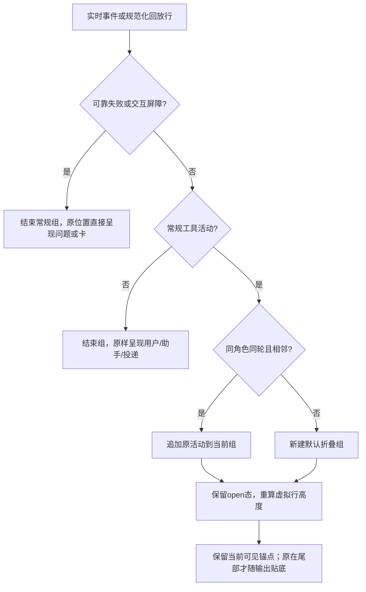

# 看资料时能继续输入，常规活动按需展开

这份方案把已获客户开发授权的 UI/UX v2 转成实际桌面写集：资料抽屉避开输入，常规工具活动折叠，角色工作位于资料之前。助手答复仍使用真实原文，工作、队列和确认来自既有事件与快照，不照搬原型演示状态。

固定角色是桌面应用，唯一写入白名单为本角色 [boundary.yaml](../../boundary.yaml)。仅做 UI1–UI3；O1–O4 不纳入。PM已阶段释放，六源码候选及本角色测试/资料已完成；本角色离线定向验证通过，独立产品/UIUX验收待PM。客户最新指令“让其他的角色开发吧，让UI和产品验收”已由 PM 派发确认，本方案不重复要求客户批准。

依据：[联合会议](../../../项目管理/docs/meetings/2026-10-13_meeting_product-uiux-redesign.md)、[v2交互说明](../../../UIUX设计师/docs/design/2026-10-13_design_ans-uiux-interaction-v1.md)、[v2原型](../../../UIUX设计师/docs/design/2026-10-13_design_ans-uiux-prototype-v1.html)、[产品第一轮](../../../产品/docs/design/2026-10-13_design_product-uiux-meeting-brief.md)、[第二轮](../../../产品/docs/design/2026-10-13_design_product-uiux-round2-review.md)、[当前UI评审](../../../产品/docs/design/2026-10-13_design_current-ui-reassessment.md)。所属现有功能：[桌面会话](../feature/2026-10-11_feature_desktop-three-pane.md)。

## 源码调查结果与证据限度

基线 main `92348995a25356078156b89f77991e1844314144`。工作树已有产品/PM/UIUX 文档变更，均保留。默认窗口与最小窗口已在 `app/main.ts` 固定为1360×860/960×620，不需修改。

| 位置 | 已核对的实际实现 | 对本次的影响 |
| --- | --- | --- |
| `styles.css` `.app`/`#right-drawer` | 两列272px+余宽，抽屉绝对定位、bottom:0；关闭仍translateX(102%)，外层未隔离该溢出 | 抽屉覆盖composer是定位规则直接造成；关闭面板的transform与不可收缩runtime-note是全窗横滚候选原因，仍须隔离窗口实际scrollWidth证明 |
| `index.html` Pi头 | 外层drawer-title/close，内层pi-panel-title/pi-close和路径同一flex行 | 删除内层重复身份/关闭，路径独立换行，保存仍归正文 |
| `renderer.js` 行表 | 150行起虚拟化；估计h、prefix、惰性build、keepEl、按index定位确认卡 | 聚合必须是一条真实虚拟行，不能只用CSS隐藏原行却留下spacer高度；展开会使高度缓存失效 |
| 实时SessionEvent | kind/summary/detail；真实执行开始有toolName/path/toolCallId/turnId；结果有ok/status和errorCode | 可准确区分调用发起、执行完成、执行失败；accepted本身不足以证明完成 |
| `session-history.ts` ReplayRow | kind/text/at和交互requestId/anchorKey/anchor；JSONL工具调用arguments、toolCallId、isError/details还在解析输入中 | 当前普通工具目标和结果被桌面解析层丢弃；可在本角色自有ReplayRow追加可选展示事实，不需改Pi契约 |
| 角色抽屉/快照 | role-state提供busy/queue/running/id/full，队列视图来自ui-labels；目前资料在前且有重复队列；更新innerHTML丢全文态 | 保持同一快照，单工作列表在前，按角色保存资料/全文/滚动状态 |
| 角色点击 | 旧U-1明确点角色贴底，未决优先 | v2要求角色阅读位置保留，拟更新为所有显式点角色继续“跳最新/未决”；普通刷新和展开保当前阅读，未决定位优先 |

本阶段没有操作用户真实ANS窗口、没有跑模型项目测试、没有执行浏览器截图验收。CSS机制判断不等于生产几何验收；PM后续安排隔离窗口/浏览器检查，必须同时量document/body/.app及操作按钮rect，不能只隐藏滚动条。

## UI1：把抽屉边界设在真实输入区上方

保留两列和360px覆盖抽屉。移除1180/940断点对左栏/抽屉宽度的缩小，落实v2的272/360，两档均不让聊天reflow。对`.app`隔离关闭抽屉的横向绘制；对正文、chat-pane、标题说明的flex最小宽度和换行规则处理真实内容，代码块/表格继续内部横滚。

composer有可增长textarea和图片行，不能死写bottom:100px。计划用实际composer高度更新`.app`的CSS自定义属性，抽屉bottom取该值；用ResizeObserver监听输入区/附件增高与窗口变化，初次渲染同步；不轮询、不额外计时器。composer保持正常布局与可操作层级。抽屉头66px，正文独立滚动且min-height:0；打开聚焦关闭钮，关闭/Esc回原入口，非模态不锁焦点。

Pi保留外层一个标题/关闭；内层改“保存位置”与原路径全文换行，删除pi-close监听及退役closePiPanel路径（如确有调用者则归并到既有closeRightDrawer）。保留字段、token掩码、共享env-file保存、齐备/失败反馈语义，不修改.env，不添加连接验证声明。

## UI2：实时和回放走同一种工具活动规则

扩展`tool-rows.js`为纯展示映射：输入SessionEvent或ReplayRow，输出操作名、有限目标、状态文字、是否异常、是否交互/报告屏障。只采用现有结构事实。`accepted`只有detail明确status=completed/ok=true的实际执行结果才显示“执行完成”；仅accepted而无结果写“状态未记录”，并告知原事件已接受；tool_call仅显示“调用发起/开始执行”。失败由denied或明确failed/ok=false/isError=true确定，默认直接可见。缺少目标/原因/退出码明确不补造。活动数计原活动条数，不计成功次数；不要求调用结果配对，也不删除真实独立活动。

本角色的JSONL解析保留工具名、调用id、调用/结果阶段、有限目标与明确结果状态为ReplayRow可选字段。用本次调用表把结果关联回调用path/command。已有details的status/ok优先；isError=true是可靠失败，isError=false可以说明工具返回，但旧记录没有明确结果标记则“状态未记录”。首行结果仅保留有限状态/错误摘要，文件正文与stdout/stderr不进入聊天；不能从内容猜业务成功。交互锚点算法不变，普通工具字段不取代requestId/anchorKey。

实时确有局限：run_shell事件没有command/exitCode，执行失败事件通常只有通用失败摘要/errorCode，不能声称具体非零码或文件不存在。已有失败仍直接显示操作+已有目标+失败；有可靠历史首行exit信息时保留。v2准许缺字段诚实降级，本范围不为补齐这些字段跨改src/。若PM认为必须在实时中显示具体命令/原因/退出码，须先交Pi适配器属主评估，不能前端臆造或自改冻结契约。

每个角色pane维护连续常规组，一组注册为一条虚拟行，data保存原顺序活动和open态。同轮且相邻才并入；任何用户/助手/系统投递/失败/拒绝/确认/回交卡/轮末/角色边界终止组，交互工具request_*和submit_report/dispatch特殊活动不藏入常规组。组id来自角色内稳定首活动身份/序位；刷新与回放重建按同组身份恢复主动展开。显示“查看执行记录 · N条活动”，含未知时追加“含状态未记录”。工作提示只用busy真快照，缺可靠动作时“正在工作”，结束即撤下，不用最后已结束工具冒充当前动作。

展开/收起/追加活动先保存可见内容锚点和相对offset，再更新组DOM、h/measured/prefix及spacer，恢复锚点；组内条目可以作为阅读子锚点，避免很长展开组只保住外壳顶部。离屏重建从data.open恢复；不把所有组keepEl而无限保留DOM。全量回放重建还要保存展开和活动阅读锚点，正常增量不强制scrollBottomForced。UiLabels.replayPlan须把新增展示事实纳入比较，避免文本一样但状态变化被skip。确认卡保持独立keepEl虚拟行及已有定位校准，不合入组；回放锚点表按实际聚合后的行index登记。

## UI3：一份工作列表，资料默认折叠

抽屉标题含当前角色名。首屏是同快照的当前工作（有则显示）和排队（有则显示），空时仅“无进行中或排队消息”。删除queueOverviewHtml和重复节；保留真实位次、来源、时间、摘要和id/full。下方四份完整资料默认折叠，原Markdown、安全转义、边界表和文档索引全部保留。

按roleId保存资料details开关、全文id集合、抽屉scrollTop及可见条目锚点。正常快照更新只重建工作区域并恢复全文和锚点；applyListing更新完整资料时先保存同角色阅读态；换角色先保存原角色再恢复目标角色。草稿沿用既有输入路径，不在刷新/切抽屉时清空。生产composer目前是全局textarea与attachments，v2原型则按角色保存草稿；PM已按v2纳入跨角色草稿与附件隔离，沿同写集完成并已验证在途图片/发送切角色。跨角色显式点角色继续U-1最新/未决；普通刷新/展开保阅读；未决卡显式定位机制优先，后台busy/未决不随选中状态清除。

仅非进行中的客户message显示撤回。请求中保留条目并禁用重复点击；状态按roleId+id保存，即使切角色也不会更新错卡。以真实withdrawQueued返回和role-state快照更新，失败保留全文/条目、可重试；成功后实际队列快照自然更新位次和角标。停止仍走既有haltCurrent/abort，绝不清队列或补助手结论。

## 精确写集与接口影响

拟源码：`app/renderer/index.html`、`styles.css`、`renderer.js`、`tool-rows.js`、`ui-labels.js`、`app/desktop/session-history.ts`。无新跨角色依赖、无新IPC通道、无src/配置写入；ReplayRow是桌面自有内部IPC payload，追加可选展示字段，旧consumer可忽略，缺字段诚实降级。SessionEvent、role-state、withdrawQueued和诊断通道保持不变。主进程入口/桥无需改：UI1/UI3可仅reload渲染器检查，新回放解析字段在最终真机验收需restart使主进程加载新session-history模块；离线fixture启动即使用新解析。

拟单测：`test/桌面应用/session-history.test.ts`、`tool-rows.test.ts`（新增纯映射行为测试）、`renderer.test.ts`、`hot-path.test.ts`、`markdown.test.ts`；新增`test/桌面应用/e2e/uiux-v2.mjs`隔离Electron fixture用于真实renderer/preload的离线几何、事件、滚动与队列操作。必要时只调整本角色旧e2e/main.mjs的已改变布局断言，不弱化IME/治理/失败守卫。

拟资料：本文及本角色api-spec.md、functional-description.md、feature-map.md、docs/feature/2026-10-11_feature_desktop-three-pane.md、docs/change/2026-10-13_change_uiux-v2.md、changelog.md、memo.md。角色卡/边界不改，产品/设计师/PM/测试角色资料不改。

## 分阶段验证与交付

先UI1布局，再UI2展示映射/解析和真实虚拟行，再UI3队列阅读态；三项完成后更新当前功能说明。全程禁止真实模型项目测试，不操作用户真实ANS UI。离线fixture不启用Pi工厂，使用隔离userData和临时项目、受控IPC/事件；截图与产品/UIUX验收由PM安排。

1. `node --test test/桌面应用/session-history.test.ts test/桌面应用/tool-rows.test.ts test/桌面应用/hot-path.test.ts test/桌面应用/markdown.test.ts`：结构事实、旧记录未知、isError失败、目标不泄露正文、组屏障/计数、回放幂等与事实变化。
2. `node --test test/桌面应用/*.test.ts`：本角色回归，包括发送/停止、图片、队列撤回、后台重建、确认卡与单一回交展示。`npm run typecheck`和`node --check app/renderer/renderer.js`等语法检查。
3. `node_modules/.bin/electron test/桌面应用/e2e/uiux-v2.mjs`：隔离1360×860与960×620，抽屉关/资料/Pi/重关；document/body/.app无横滚，composer和发送/停止/关闭rect在窗口内，开关聊天列宽不变，长路径/宽表/代码内滚；textarea/附件增长后底边仍避composer；执行常规/失败/拒绝/未决及未知回放默认视图；150以上实际虚拟行，组展开/增量/收起/上翻首可见内容offset、离屏恢复、未决定位；两个角色工作/待确认与阅读态、真实撤回成功/失败/在途切角色。
4. `node_modules/.bin/electron test/桌面应用/e2e/ime-enter.mjs`：既有真实renderer/preload离线IME验证，附件/草稿/气泡/发送IPC保持；停止后排队保留由uiux-v2 fixture验证。若运行窗口由PM统一安排，本角色交脚本并如实标记待运行，不能写通过。

读源码不能代替动态验证。当前可在app层完成核心UI范围，无必需跨角色字段阻塞；实时缺目标/细原因的诚实降级与角色点击阅读优先级请PM在阶段释放时核查。候选已实施，定向60/60、离线实际renderer36项及IME通过，全桌面205/204/1为既有目录名断言失败；独立产品/UIUX验收待PM，尚未部署。

## PM阶段释放决定（2026-10-13）

PM已核查实际消费者并释放实施，沿用客户v2 UI1–UI3授权：实时缺细字段诚实降级，不扩src；纳入每角色草稿及图片附件独立保存，异步结果仅影响原请求角色，换项目释放预览资源；跨角色恢复阅读，同角色再点跳最新，未决优先；动态composer以实际测量避让。新回放解析需正式应用重启，由PM在空闲且无草稿时统一操作。

PM后续精化：以产品验收约束为准，所有显式点角色（含跨角色）继续既有U-1跳最新/未决优先；不因原型保存阅读字段改导航语义。正常快照、增量、回放刷新、展开和抽屉开关保阅读位置。

实际实现与冻结指纹见[变更记录](../change/2026-10-13_change_uiux-v2.md)。
