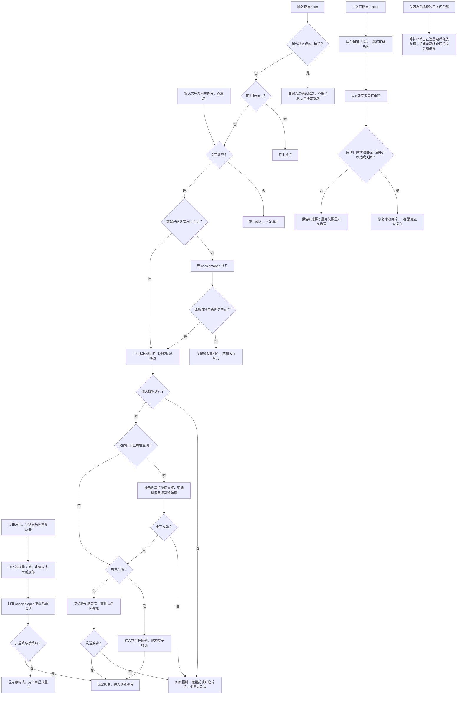
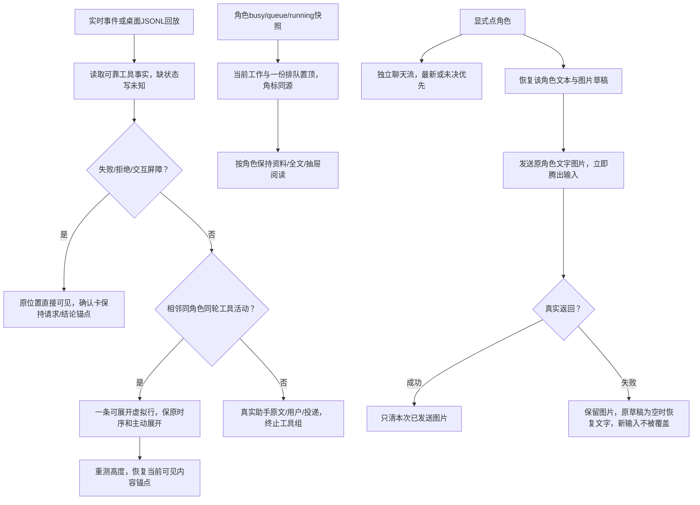

# 功能：桌面工作台（项目/角色 · 会话 · 角色资料）

> 稳定说明。源码见 `app/`；接口见 [api-spec.md](../../api-spec.md)。

## 目标

把受治理会话从命令行搬到人直接可用的界面，且**不新增第二份判定**：一切路径判定与角色/边界解析仍来自
门禁引擎，Pi 调用仍经 Pi 适配器。

## 三栏

| 栏 | 内容 |
| --- | --- |
| 左 | 「导入项目」系统文件夹选择器 → 门禁引擎 `listProject` 枚举角色 → 角色树（内联 SVG 图标、hover/选中态、**状态徽标**〔未开启/空闲/工作中/等待你确认/已停止/错误，悬停示最近事件+时间〕） |
| 中 | 点角色即聊天：多轮消息直发；普通`tool_call`/有可靠结果的`accepted`按相邻活动组折叠，未知状态诚实标注；失败/拒绝与交互直接可见，助手原文以聊天气泡刷出；消息经 **Markdown 受控渲染**（vendored markdown-it，`html:false`；链接 `rel` 外开）；**每角色一条独立聊天流**（切换保留历史，见下）；su 的**确认/选择**经聊天流里的**交互卡**（确认/单选/多选/带预览，作答后定格） |
| 右 | 360px覆盖抽屉避开实际composer高度，开关不reflow；角色名→当前工作/单份排队→默认折叠的完整角色卡、边界、变更、文档；Pi同位置单标题/关闭，正文滚动 |

## 会话流程（客户定稿：导入项目 = 授权；点角色即开，全程无确认框）

每角色保留一份聊天流和会话；切走不打断后台轮次。同角色点击会向后端确认，已有句柄就续接，历史和未决卡保留。边界改变时仍用既有门禁和编排建立新句柄，成功仅恢复用户仍指向的活动目标；非活动角色后台重建不抢位。

例如，与 su 聊完一轮，后台因治理边界变化重建后，输入“继续”可正常送达。重开或发送失败会显示原错误，用户显式点击角色可恢复；失败消息不会自动重发。发送前补开失败则保留尚未发送的文字和图片。换项目会关闭旧项目全部会话，包括正在重建中的句柄。

输入法选中文或英文候选时，Enter只确认候选，文字和附件仍在输入区；组合结束后再次普通Enter才发送。组合状态、键自身isComposing和229兼容标记在发送前检查，结束立即复位，没有延时吞键；Shift+Enter换行、发送按钮保持原行为。[精准事件证据](../fix/2026-10-13_fix_ime-enter-candidate.md)。

长会话上翻阅读时，新输出与轮末升级按实际视口保留可见内容；在底部才继续贴底，点角色仍按未决卡优先/滚底定位。卡的邻近行实体化后按实际rect校准，确保内容和作答按钮在视口，不依赖旧估算位置。来源角色的报告可查看结论与证据，并明确区分“未报告/失败/已中止”；主入口不提前镜像未经处理的报告。真实投递详情默认收起，连续已经到达的报告可在同一轮验收后由主入口向客户汇总，客户消息/派发不会被跨越合批。

界面故障会留下24小时诊断元信息，并显示“重新加载界面”按钮。用户点击后续接已知项目与角色，恢复仍等待的同id交互卡；不自动批准、重发任务或延长失效许可。关闭窗口后重新打开也能重新注册自身IPC。此恢复路径通过可控Electron渲染进程退出验证，不代表所有可能的整窗故障原因已根除。

入口核对：`app/renderer/renderer.js::selectRole/onSend` → 既有 preload IPC → `app/desktop/session.ts::open/send/refreshStaleBoundaries/stop` → 编排 `openRoleSession`。此次验证：管理器确定性回归 16/16，真实 Electron 11 项修复行为及 U-1/P-1 滚动均通过；完整桌面测试仍有一条既有目录名断言环境失败，详见修复记录。

## 边界来源与 acceptance（用户无感）

- 边界由门禁引擎解析（`role.boundary.boundarySource`）；**界面上不展示** writeSet、边界清单、acceptance 来源——
  用户对这些无感（边界是项目管理管的事，不是聊天的人管的事）。右栏资料分组仅作资料查阅，与授权无关。
- 主进程优先加载项目 `.ans` 的生效配置与 pin-backed acceptance；`.ans` 不可用时 fail-closed，界面如实提示。仅无 `.ans` 才使用已有运行期同意回退；本次重建修复沿用这条来源，不改变门禁判定或授权规则。

## 与 CLI 的一致性

- 同一门禁引擎、同一编排（`openRoleSession`）、同一 Pi 适配器；
- 授权动作同样是人类的显式操作——CLI 的 pin 对应这里的**导入项目**（系统文件夹选择器）；
- `scope` 传 `undefined`，授权上界 = 角色边界本身，判定唯一来自门禁引擎；
- **写入语义**（2026-10-11 客户裁定：界面不再暴露运行时选择器、**桌面一律 pi**）：真实适配器 `writeRoot=projectRoot`
  → **写入真实落到导入项目**，仍受门禁约束（越界写在写之前被拒）；横栏常驻一行如实说明（`#runtime-note`，单一来源）。
- 越界写入照样在**写入之前**被拦（含按根分组的允许路径），以内联消息呈现。

## 端到端自检

`test/桌面应用/e2e/main.mjs`：以真实 Electron 启动真实 preload+渲染进程，导入项目根、列出角色、
**点角色直接进入聊天（无确认框，4 处 NO_MODAL 检查点）**、连发两条消息、越界写入被拒且内联展开、同角色重复点击续接、
**切换保留历史 / Markdown 渲染与 XSS 转义 / 链接外开 / 角色状态徽标（B-1/B-2/B-3 检查点）**、右栏四组资料，
逐屏截图并写报告。

## 常规活动、工作阅读与输入草稿

当前异常默认可读原原因/exit及完整已知目标，缺目标写未知；队列真实grid的位次、来源时间、摘要、≥28px动作和普通全文稳定对齐。撤回无效/失败在原项动作下方显示真实回执，刷新/切角色保持。真实open未决优先“等待你确认”；被抽屉遮挡的卡暂不可作答，原定位button无遮挡且键盘可达，主动定位先收抽屉露出完整卡，回答/失效后依busy恢复。

工具返回不等于业务验收。可靠结果才写执行完成；实时缺具体目标/原因/退出码不编造。正常刷新/回放增量/展开和抽屉开关保阅读；所有显式点角色保既有最新/未决优先。异步图像/发送返回归原请求角色，项目切换释放预览资源，IME规则不变。

## 演变历史

- 2026-10-13：修复，桌面候选与本角色定向验证完成，独立产品/UI签收待PM——单份写入事实、实际grid/全文、默认目标、撤回就近反馈、真实未决/无遮挡键盘链。见[体验返工](../fix/2026-10-13_fix_uiux-reacceptance.md)。

- 2026-10-13：修改，桌面候选已完成、本角色离线定向通过，独立产品/UI验收待PM——对话优先、动态抽屉避输入、单工作列表与阅读/角色草稿保留。见[UI/UX v2](../change/2026-10-13_change_uiux-v2.md)。

- 2026-10-13：修复，已验证——输入法候选Enter不误发，保留文字与附件；结束后的下一普通Enter正常发送，Shift+Enter/按钮保持。见[IME修复](../fix/2026-10-13_fix_ime-enter-candidate.md)。

- 2026-10-13：修复，已验证——上翻时保留真实可见行；主入口单一报告详情与连续回交合批；宿主已授权常规检查政策实际接线；统一24小时日志、异常批收尾、显式恢复及mac重开。详见[视口/报告/诊断修复](../fix/2026-10-13_fix_viewport-reports-diagnostics.md)。

- 2026-10-13：修复，已验证——后台边界重建完成后恢复仍有效的活动目标；同角色点击真实确认后端；补开失败保留输入与附件，发送失败可显式恢复；关闭等待在途重建且终止旧扫描后续步骤。详见[后台重建后续发修复](../fix/2026-10-13_fix_background-rebuild-active-session.md)。

- 2026-10-11：建立——三栏、导入即授权、多轮聊天、回交呈现、Pi 配置面板、创世 finalize 入口、视觉方向定稿（浅色极简）。
- 2026-10-12：**聊天体验三项**——Markdown 最小子集渲染（B-1）、切换保留历史/并存会话（B-2）、角色状态徽标（B-3）；
  同日另更正 `session.ts` 会话路径的过时注释。详见 `../change/2026-10-12_change_markdown-and-multisession.md`、
  `../change/2026-10-12_change_session-comment-refresh.md`。
- 2026-10-12：**A-5 客户交互卡**——su 的确认/选择渲染为聊天流交互卡（见「三栏」）；**收口面全删**
  （「完成 bootstrap」入口/收口提议确认卡/相关 IPC 与 preload 方法），产物收尾改由编排在 su 会话 settle 后
  **自动**完成；B-3「等待你确认」接线。详见 `../change/2026-10-12_change_operator-cards-and-finalize-removal.md`。
- 2026-10-12：**C-1 回交报告卡片**——回交卡按 角色/任务/结论/摘要/证据 呈现（模型输出转义；空证据占位；
  blocked 带语义色可见区分）。详见 `../change/2026-10-12_change_handback-report-card.md`。
- 2026-10-12：**D-1 重启恢复（桌面面）**——项目导入/重载后回放项目内会话记录（分隔提示 + `is-replay`，
  助手文本走 Markdown）；徽标增「空闲（已恢复）」。详见 `../change/2026-10-12_change_session-restore.md`。
- 2026-10-12：**E-1 回交自动投递 su 验收**（全自动：去重/排队/自动开 su/失败如实+保留重试）+ **上下文来源
  文案**按 D-1 契约重定（「模型上下文已重启」退役；逐情形对照表见文档）。
  详见 `../change/2026-10-12_change_su-handback-acceptance.md`。
- 2026-10-12：**B-1 修订**——Markdown 渲染改用**第三方库**（vendored markdown-it 15.0.2，MIT；`html:false`）。
  详见 `../change/2026-10-12_change_markdown-vendored-library.md`。
- 2026-10-12：**真机修复**——交互卡严格投递所属 pane（含切回补挂/跨 pane 只读指针/过期定格）＋**工具行瘦身**
  （只显示状态与目标，不显示内容）。详见 `../change/2026-10-12_change_operator-card-delivery-and-tool-rows.md`。
- 2026-10-12：**G-1**——交互卡**不再按时间过期**（唯一失效＝应用重启/关闭；无计时器钉子）。
  详见 `../change/2026-10-12_change_no-timeout-cards.md`。
- 2026-10-12：**H-1**——su **派发任务**路由（复用 E-1 投递机：自动开/排队/失败保留/如实回执/队列期去重）＋
  系统投递输入**单独样式**（`.msg-injected` + 来源标签；手输防误伤）。
  详见 `../change/2026-10-12_change_dispatch-routing-and-injected-style.md`。
- 2026-10-12：**修复真机崩溃**——坏形状回交事件不再喂进 `renderHandbackPrompt`（三层形状防御 + 「零未捕获
  拒绝」钉子）。详见 `../fix/2026-10-12_fix_handback-render-crash.md`。
- 2026-10-12：**I-1 开放 shell（arm）**——(a) 确认框（命令原文 + 放行/拒绝）经 `shellOperatorChannel` 交编排
  装配 (c)/(b)/(a) `ShellGate`；**仅项目角色**（su 不 arm）；fail-closed 不变；**已知风险**：无沙箱 ⇒ 放行命令
  的写入绕过写门禁（客户知情授权）。详见 `../change/2026-10-12_change_shell-arm.md`。
