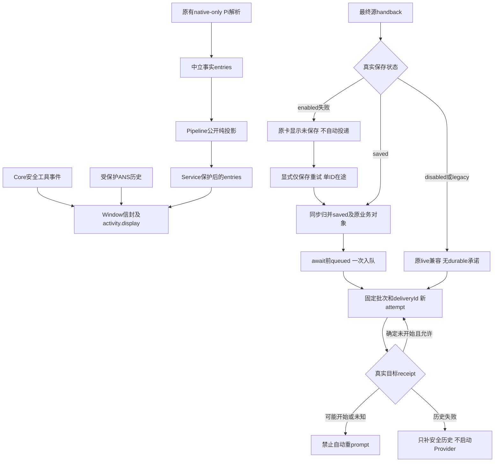

# 工具详情、报告和保存状态的桌面接线

本能力让桌面读取可信工具详情与报告状态，而不把模型原始交接内容或旧文件原文绕过保护发往界面。当前窗口代码与属主单测已实现；真实UI阅读、键盘/焦点与在线模型完整流程由UI/测试角色后续独立验收。

A的公开Model投影字段与预算由Core唯一维护。Window只经Pipeline读取受保护历史，activity.display与实际turn/call/phase保留；目标继承也取安全display.target。确认调用即使不再有raw title，仍用实际turn/call和phase给request/conclusion位置。旧native parser不迁移、不增加IO范围，模板识别不升级为结构化execution；中立entries经纯Pipeline→Service后才转回界面行，source/error/skipped也不得raw侧带。连续最近后缀、截断与省略数量随保护结果呈现。

旧锚点helper两端统一为legacy-anchor-v1:+SHA256(原kind+NUL+title)，不从脱敏后标题重算，不改变真实native call/turn，不把同标题当同一次工具操作。卡原请求、决定、取消与过期链不改。

C的raw handback和模型全文只留内部生成真实prompt；source IPC只含安全report/liveReport/reportPersistence，目标输入/交接详情仅安全副本与Core flags。队列full/running.full对回交也只给安全副本，尚未生成时显示占位，不泄raw text。普通聊天及既有native记录不泛改，不宣称全日志DLP。

源保存的初始事件、Promise和订阅都进入同一同步状态归并器：没有原业务对象的saved通知只缓存；权威saved不会被迟到failed事件降级；齐备后await前设置queued，仅Window入队一次。Pipeline不另行投递。disabled/unknown-live保原live回交，不造reportId，不把proxy方法存在当实际Core能力。

五个IPC仅接受version/scope/已登记reportId或attemptId，实际原handle和当前导入项目校验后转调Pipeline。保存重复点击共用一个Promise；查询零写入/零prompt；target历史补存不等再次投递。dispose或材料过期后禁旧重试，迟到旧handle回调不能更新新scope。最终receipt缺失保持pending/unknown，不从boundary或邻近settled造saved结论。

来源：[批准Window消费者设计](../design/2026-10-15_design_complete-flow-ac-consumers.md)、[本次实施证据](../change/2026-10-15_change_complete-flow-window-ac.md)。
