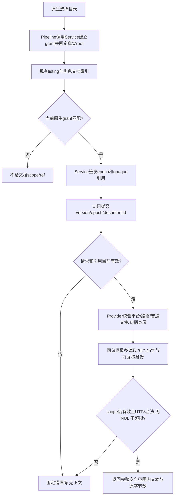

# 受限项目文档阅读

用户通过系统目录选择器导入项目后，可由UI从主进程已列出的角色卡、changelog、docs文件引用中选择UTF-8 Markdown/纯文本阅读。正文不写入项目、诊断或模型；读取不授写权。当前窗口接口与单测已实现，UI消费与真实Electron阅读验证由后续属主完成，尚不声称完整桌面入口可用。

`app:pick-project`只在真实选择成功后授当前窗口grant；取消不新增授权。同窗口renderer重载可保grant，关闭窗口清空，应用重启需原生重选。renderer直接listProject任意root、evidence字符串、旧recovery路径均不能给B授权。资料刷新保留同项目引用，移除文件引用撤销；只有成功导入才提交新的阅读scope；原生选择、开始枚举后失败或取消仍保留原项目refs。成功切项目、关闭或失效迟到请求无正文返回。

公开入口为Pipeline `createProjectDocumentReader`、IPC `project:document-read`、preload `readProjectDocument`。类型唯一来源 `src/model/project-document.ts`。RoleView.documents中的relativePath是项目相对路径；内部候选cardPath/changelogPath项目相对，而docs.path是角色卡目录相对，如docs/change/x.md。

只允许md/txt、UTF-8 fatal、原始字节上限262144（BOM计入，解码后移除BOM），拒绝NUL/二进制，不截断冒全文。目录、绝对路径、越界、所有子路径符号链接、未知ID、未列文件、平台/FS能力不足明确失败。Provider使用O_NOFOLLOW及同一只读句柄，前后核dev/ino/size/mtime/ctime和父目录身份，finally关闭；主进程再核scope。凭据位置、隐藏路径、未列源码不能通过任意路径补读。

保护范围是客户接受的可信本地项目/macOS/Linux本地FS能力检查；Windows与未知FS拒读。Node没有完整openat目录句柄隔离，恶意瞬时祖先替换、恢复时间、硬链接来源不构成本能力保证；允许文档内用户手写秘密也不被自动识别。本文不称通用DLP或恶意本地进程沙箱。真实Linux/Windows验证尚未完成，已实测macOS APFS。

维护线索：Service唯一拥有registry/资格/编码政策；Provider唯一做B文件IO；Pipeline只调用Service public。Interface不新增fs读取、不保第二份权限表。新C报告业务与A历史均另行派发，B不解析报告证据或升级报告身份。

历史：[批准设计B2](../design/2026-10-15_design_restricted-document-read.md)、[治理前置](../change/2026-10-15_change_restricted-document-boundary.md)、[本次实施](../change/2026-10-15_change_restricted-document-read.md)。

修复历史：[导入成功才提交scope](../fix/2026-10-15_fix_document-scope-import-commit.md)。
