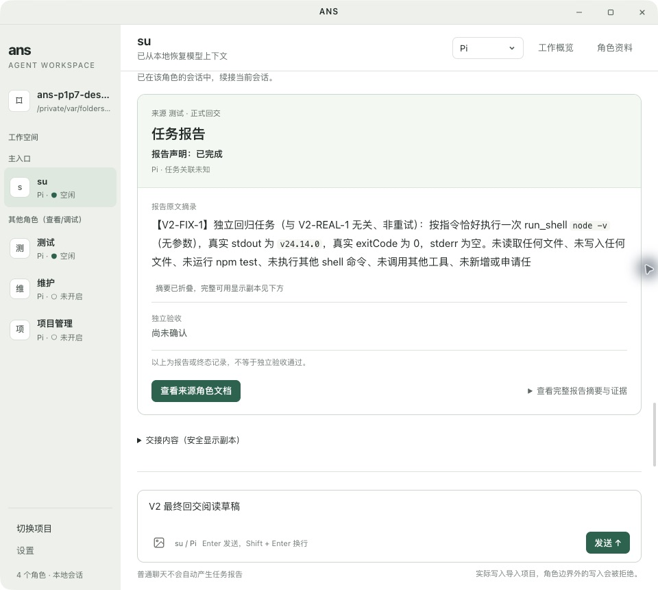

# V2 视觉统一实施的独立验证

用户已确认V2并明确要求相关角色实施、真实桌面完整测试、发现问题交原属主修复。root固定测试角色，仅改自身测试与证据，生产交桌面UI维护。实施依据为[已接受V2](../../../UIUX设计师/docs/design/2026-10-15_design_visual-convergence.md)与[PM实施预约](../../../项目管理/docs/change/2026-10-15_change_visual-convergence-implementation.md)，不覆盖视觉/r2冻结设计。

## 验证口径与步骤

- 基线已保存在[baseline.json](2026-10-15-visual-v2-implementation-evidence/baseline.json)：全部app/src/test实际当前字节、真实.env哈希、V2原型/规范、r2的13件冻结设计。旧P1–P7未提交成果不可reset或覆盖，先前1378通过不作为本轮结果。
- 候选稳定且属主退出自测后，真实Electron原生操作1360×860和960×860，检查导航208/176、主列≤800、32px控件及字阶/间距、报告摘要与事实先呈现、来源CTA和424px模态抽屉；明确静态测量与截图的版本/producer。
- 覆盖导入前禁选、原生导入、引擎键盘临时焦点/取消/确认、Claude缺配入口及设置实际invoker、非空草稿/角色引擎隔离。正式配置不改、不记录真实凭据。
- 普通聊天无报告；真实在线Pi请求选择，无默认/不自动提交，待决定与队列分源，撤回、定位、停止后旧决定失效，后续会话继续。
- 真实正式dispatch至测试角色，只在原有报告文档写权内记录；真实只读命令/测试、工具不同call、失败/截断展示、一次源报告/目标回交及终态事实，报告声明不当验收。读取来源角色清单显选文件、完整安全摘要/工具详情可达，来源入口返回正确；UTF-8/超限/静态文档及角色资料内外scroll/展开/focus保留。
- 复用自身既有受控renderer、回放、锚点/行距等必要回归（test/测试/uiux-v2-renderer-regression.mjs、uiux-anchor-drift-probe.mjs、uiux-rowgap-detached-probe.mjs及Node集成）；若视觉尺寸断言与已接受新值冲突，须逐项证明属于预期视觉变更才能更新，不放松业务断言。UI属主自有测试由它维护。
- 先窄后广，完成必要完整Node测试、typecheck、diff-check，最终复算受保护设计/后端/env。保实际红、报告owner、修后保同断言复测。最后PM复核当前证据。真实在线Pi与受控SDK/替身严格分开，不宣称所有引擎在线或全平台。

以下为分阶段验证历史；最终状态以文末“最终收口”及 final-verification.json 为准。

## 用户强调与严格对齐门槛

实施在途用户进一步强调“我需要完全按照产品和Ui/ux的去实现”。据此，最终验收以accepted规范与e95原型逐项比较结构/视觉/交互，不能只检查208/176/800 tokens或功能通过。UIUX独立静态指出首轮在途四项差异（尚不列最终失败）：工作/资料/设置仍旧titlebar簇，左项目大按钮/长路径旧结构，输入单行胶囊旧结构，报告缺独立浅绿分层头。root已逐项交桌面UI整改，UIUX在其新实施review记录严格对照表。真实数据/既有安全事实与原生窗口控件保留，原型演示条/假数据不搬生产；本轮不修改accepted设计。

验收截图须同时可见项目/角色导航、会话身份和操作区、报告分层与来源CTA、输入框及底部信息，不把单独卡片局部图当整页对齐。资料往返与模态焦点保持仍须实际点击，不以样式替代。

## 第一轮真实桌面结果（缺陷尚待关闭）

真实V2 Electron单一实例重启，原生选目录导入独立副本 `ans-p1p7-desktop-JqO4lM`。此前桌面控制仍指向同任务旧窗口，已核对自身进程并只结束这两组空闲测试实例后单一重启；不把旧窗口界面当新候选。默认沙箱Electron启动SIGABRT，正常批准运行权限下启动成功。这是运行/控制环境过程，不当作V2产品故障。

实际经过：导入前鼠标与Down/Return不能选引擎，原生picker取消后仍禁选；导入后角色/引擎正常。普通聊天真实回复完成且工作概览无报告；模态Tab/ShiftTab循环、Escape回实际工作按钮，主入口非空草稿保持，跨角色与Pi/Claude草稿隔离。Claude菜单Home+Esc不改选择，新的Tab顺序可达缺配置按钮，Return打开真实设置，ShiftTab首尾循环、Esc回该按钮且草稿保持。未输入/保存任何凭据。

真实request_choice初始两项均0/提交disabled；等待期间加入两条消息，工作概览待处理1与队列2分开，撤回第二项后仅保留项进入Core一次，撤回项0。定位关闭模态并聚焦原卡，Tab/Down只选第二项，独立Tab/Return才提交。停止另一真实选择轮次后所有旧radio disabled，未发送草稿保留，精确“本轮已中止”1处；无需重选角色又完成新聊天。普通聊天sourceReports仍0。

V2-REAL-1真实正式链：[执行事实](2026-10-15-visual-v2-implementation-evidence/native-real-execution-verified.json)确认dispatch1/worker输入1/sourceReport1/目标交接输入1/finalReceipt1；实际npm test一次exit0/31tests passed，两次node -v有不同call ID，sourceCore与SDK原生日志均10个真实工具调用。长显示副本16384字节/truncated，而SDK原始20480个x仍在；不把模型自述“未见截断”误当UI预算验证。报告10542字节真实落到本角色获准文档，业务四件hash未变。

来源CTA→可信列表显选v2-real-1.md→10542字节正文→返回清单焦点原报告按钮。Unicode/BOM/emoji122字节正常；262145字节超限明确拒读；非法UTF8明确拒读；脚本/图片/危险协议只按文本显示，未变窗口标题。Esc关闭实际回报告CTA，非空草稿仍在。各原生AX和截图见本目录新evidence。

### 已发现问题与owner修复在途

1. 新布局空态还指“右上角设置”、空资料两处还指图标，已由UI只修3条指路文字。首红/原生修后AX保留，当前index7beda47c、renderer5b80a727、styles56d2ff9e。其静态67/语法/diff通过；此前受控全组与指路窄修字节区分，不冒最终重跑。
2. 真实builtin Su多“内置”第三行、真实长路径换两行，由UIUX依据accepted两行节奏判为必要对齐，已交UI移辅助身份到title/aria、路径单行ellipsis，待修后真实图。
3. Test报告后多“查看执行记录1条活动→工具/目标未记录/调用发起”。[首红AX](2026-10-15-visual-v2-implementation-evidence/native-extra-tool-row-open-red-ax.txt)与真实Core/native10calls相对照，非实际多执行。UI/Window只读追证：Window emitDeliveryNote把投递进展系统提示发为tool_call且无tool元数据，UI又按kind认工具并在历史保留。PM按既有r2合同派Window producer与UI消费者窄修，不增加Model/API。Window已严格actual dispatch首红2tool应1→同assert绿，message/detail.source=delivery-note，全文保留、targetprompt1、专项31/31，overlay另存；UI消费者及真实重启回归仍在途。尚未标全部桌面通过。

桌面控制的实时AX索引刷新/截图后索引变化已通过重新观察修正；一次截图后旧按钮操作关闭了侧栏但未撤回，随后从新AX重新定位成功撤回，未误报产品缺陷；两条队列与模型实际计数以上以Core持久化事实核实。

## 最终收口：严格 V2 落地与真实桌面验证通过

状态：verified。以上在途/首红均为历史，不代表最终待办。依据 accepted V2 逐项实施，UIUX 最终 SV1–SV13 回签通过，见[最终落地评审](../../../UIUX设计师/docs/design/2026-10-15_design_visual-v2-implementation-review.md)。UIUX 检查 root 真实 PNG/AX 与源码，不冒称亲自操作 GUI；产品为静态评审。root 实际操作原生 Electron，而非仅浏览器原型或受控 DOM。

严格对齐包括：208/176 导航、两行角色与项目路径、底部导入/设置、会话头身份与操作、两层输入区、浅绿报告头与白色正文、来源主按钮和完整摘要、424 模态资料抽屉、统一文件阅读入口。真实 batch 的历史保存/输入保存/处理结果为 batch 级事实，以紧凑 dt/dd 结构呈现；不伪造每份报告事实，不隐藏真实未知、错误、截断提示。1360 与 960 下需要时正常滚动。

### 已关闭缺陷

- 3 条旧位置指路文字已指向真实入口；builtin 辅助身份放入无障碍/悬浮信息，角色维持两行，长路径 ellipsis 且保留完整 title。
- delivery-note producer 改为带明确来源的系统消息，UI 保留原文；旧无元数据活动中性显示，不伪造工具或阶段。真实新增 V2-FIX-1 重测，Core 与原生 SDK 工具数一致，无匿名额外工具行；实际派发和投递提示完整可读。
- batch 事实统一为紧凑三项结构；接收轮长回复仅按真实受信 provenance/receiver turn 关联折叠，原文可展开，普通聊天不折叠。冷启动中性标签，不假称实时等待。
- 冷报告快照仅在全部真实 at 有效时稳定排序；无有效时间保 wire order，事件/工具行不重排。真实旧 REAL-1→新 FIX-1 顺序正确。

### 最终版本、执行与测试

最终 renderer `5324b786…`、styles `df554f87…`、index `7beda47c…`、tool-rows `a4d86a1c…`、Window session `1e623ae7…`，完整 SHA 和证据在 [final-verification.json](2026-10-15-visual-v2-implementation-evidence/final-verification.json)。对比任务开始基线，仅 5 个生产文件和 9 个对应测试文件变化。其余既有未提交 P1–P7 成果保留；accepted V2 两件、r2 冻结 13 件、真实 .env 均哈希未变。

- 最终全仓 Node：1385 total / 1384 pass / 0 fail / 1 skip / exit 0；跳过为 macOS 下 Windows 专用路径用例。typecheck exit 0。日志[final-full.log](2026-10-15-visual-v2-implementation-evidence/final-full.log)。
- root 独立 renderer、anchor、rowgap 三个 Electron 脚本均 exit 0；rowgap miss 0/20。renderer 的 14 与 anchor 的 4 为观测记录数，不当测试总数。旧 fake IPC 缺 handler 仅补夹具，原断言未放松；首轮诊断保留。
- owner 最终 Node 72/72；visual/consumer/full/ghost 报告 false 均 0，记录数与真值/测量明确区分，不加总当测试数。所有自测 Electron 已退出。
- 真实在线 Pi 两个明确独立正式任务：REAL-1 跑 npm test 一次 exit 0 / 31 tests passed，授权文档 10542 字节落盘；FIX-1 为修后新的 producer 回归，只跑 node -v 与提交报告。累计 dispatch 2 / worker input 2 / source report 2 / completed saved receipt 2，deliveryId/attemptId 各独立。第二个任务不是旧任务重试。
- source Core 工具 12 = 原任务 10 + 新任务 2，与 native SDK 的 12 个真实工具一致；node -v 共 3 次是三个不同 call，npm test 仅 1 次。普通聊天 su 源报告 0；队列保留输入 1/撤回输入 0。
- p-limit 四个业务文件与只读文档样本哈希未变、治理 pin 全匹配。长展示副本 16384 字节/truncated，SDK 原始 20480 个 x 保留；完整摘要/安全副本可展开且明确“未记录完整模型输入”，不声称展示了 raw SDK 输入。

### 真实桌面覆盖与证据

实际完成导入前鼠标/键盘禁选、原生选择目录/取消、Pi/Claude 键盘选择和取消、缺配置按钮到设置及关闭回焦、普通聊天无回交、角色/引擎草稿隔离、Tab/ShiftTab 模态循环、Esc 回实际 invoker、请求选择/队列撤回/定位、停止使旧决定失效且后续可继续聊天。

实际正式派发、工具详情/失败/截断、31 tests 输出、报告来源清单显选/正文/返回、Unicode/BOM、超限/非法 UTF8 拒读、脚本危险协议静态展示均验证。960 深层角色资料往返保留内外滚动、展开状态与可见 Footer 焦点；最终跨来源阅读 10542 字节后会话仍为 su/Pi，非空草稿及来源按钮焦点保留。

最终字节上原生重测报告顺序、接收轮原文折叠、安全副本、npm/截断详情、跨角色来源阅读和双宽报告。较早导入/选择/队列/停止/960 深层资料记录保留其实际版本；后续改动为窄修折叠/排序，最终受影响项和完整自动回归通过，不假称每个原生步骤均重跑于最后一个字节。

实际在线仅 Pi；Claude 为原生缺配入口测试，其他适配器为受控测试，不扩大为所有引擎在线/全平台验收。真实数据可滚动与原型样本差异已由 UIUX 接受，未新增设计。当前真实桌面保持可检查，未提交 Git 或推送 GitHub。

最终截图：

PM 已检查最终证据与 UIUX 回签并封板 verified，见[PM 最终验收](../../../项目管理/docs/change/2026-10-15_change_visual-convergence-implementation.md)。源码未再变动，未提交/推送。
