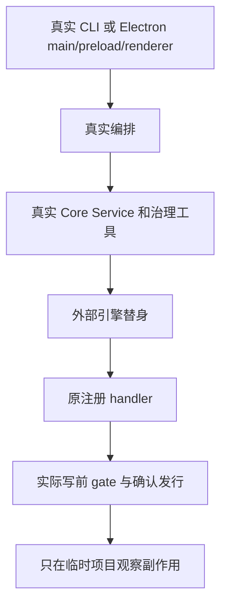

# 从真实入口独立验证三个运行时的治理与隔离

用户选择 Pi、Codex 或 Claude 后，命令行与桌面必须把请求交给选定运行时，并让实际 ANS 工具在写入前检查边界。停止后，旧确认不能给下一轮发行写权限。本次只验证[已批准的集成方案](../../../项目管理/docs/design/2026-10-14_design_multi-runtime-integration.md)，不新增产品能力或选装。

测试角色固定绑定，写集限 `test/测试/`、本角色 `docs/design/`、`docs/change/`、`docs/fix/`、导航和 memo。产品、peer tests、共享组件、配置与角色卡均只读。基线 HEAD 是 `906abd3ee275cba82b2f9e54ceef1cd9473c2d5c`；最终证据记录当前未提交组合候选与测试脚本的 SHA-256。测试使用临时项目、假 key 和临时 env，不读取真实仓库 `.env`，不接真实账户或外部模型服务。

## 拟执行的路径

1. 真 CLI `bin/ans.js` 的 `role run` 与 `govern`，三 runtime 经真实 Interface、Pipeline、Core Service、注册工具与 gate。测试 loader 仅注入外部运行引擎，真实工具处理器仍执行。覆盖合法/越界写、报告及 turnId，失败与未报告不冒充完成。
2. 真实桌面 `app/main.ts` 启动 Electron，真实 preload 与 renderer 同时执行。测试目录 loader 仅把环境路径改成临时假文件、目录对话框选项改成临时项目、外部 SDK 改成无网络引擎；不复制 IPC handlers，也不加生产测试开关。验证三元会话身份、运行时切换、历史、设置脱敏/应用时点、组摘要与确认卡。保留宽 1360/窄 960 的截图和实际检查报告。
3. 公共 Pipeline/Service 的独立无网络完整流程：等待期间暂停时限；停止/失败/超时每轮只有一个终态；旧 yes 在 abort 后不授权下一轮；派发、回交与队列保留源 runtime；原生恢复的实际状态和 ANS 回放分开；配置 revision/快照/空白 fallback 保持契约。
4. 复用仍有效的本角色回归，补真正缺少的跨角色用例，不复制所有实现单测。最终跑完整 `node --test "test/**/*.test.ts"`、`npm run typecheck`、`git diff --check`，复核新增入口/消费方向及生产不引用测试 loader。治理属主另做归属审计。

实际 Electron loader 可行性尚待检查。若平台阻止 loopback/Electron，先保存原失败，再使用已授权的最小受管本地测试执行；失败、不能运行和未测分别报告。若必须替换业务逻辑才能执行，将报告证据缺口，不把复制 harness 写成真实 main 通过。

## 判断结果

每条结论对应实际命令、输入、候选哈希与可复现观察。缺认证/未知运行时诚实失败，越界或取消无副作用，未收到报告不标 completed。恢复只按实际 public getter 结果判断：Core resumed 表示原生恢复成功；桌面 recovered 才表示对应磁盘恢复成功。在线模型调用、真实账户、全 OS 沙箱和 Mac 上的 Windows kill tree 不在本次证据中。

项目管理已同范围评审并释放实施，既有客户授权继续有效。测试 loader 为 Codex/Claude 的原公开工厂注入既有 engineFactory/loadSdk 接缝，原文件通过 bypass URL 逐字执行，真实 MCP 保留；Pi 只替换外部 SDK createAgentSession，其余 SDK 导出与生产适配器保留。临时 env 只覆写路径解析，dialog 只替换外部选择结果。当前开始实施，尚未取得本轮最终验证结果。

2026-10-14 同范围必要复测：真实入口发现单轮历史/实时重复后，原属主按已冻结的原turnId/eventKind、Core同步onTurnStarted与原clientMessageId闭包接线修复。T1保留原18项并增加真实composer两次同文（第一次直发、第二次排队）、不同clientID/actualturn、历史中两条权威user turn与两个原气泡的独立检查。旧许可、生命周期、模型SDK与写入边界要求不变；不增选装。

旧独立119/14 UI脚本同时消费当前preload：只给本角色fake IPC补已有history-get/live-views及当前runtime-config:get读取接口，按三元身份返回最近由fixture自己push的原历史、reset时清空；设置沿同一共享metadata返回原模拟值，不丢字段、不忽略读取、不改变原输入或断言。失败catch加rowModel/viewport/rootDOM/replayAnchor快照，区分不兼容fixture造成的人工error与真实旧保护回归。生产不导入这些辅助代码。

本方案已实施，最终按记录的无网络范围验证通过；[结果与原失败](../change/2026-10-14_change_multi-runtime-independent-verification.md)保存当前candidate/hash、复跑命令、实际23/119/14及全仓1225通过/1旧skip，并明确外部SDK替身及在线未测边界。
