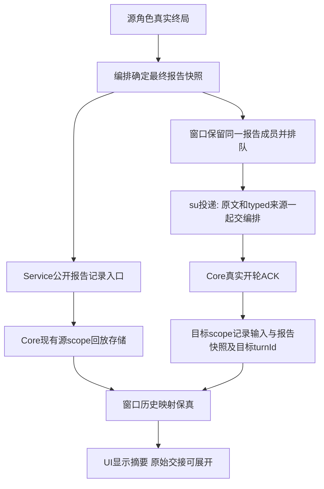

# 把真实报告展示为摘要，仍能核对原始交接

固定编排角色，只读评估[产品完整走查 P4](../../../产品/docs/design/2026-10-15_design_desktop-complete-walkthrough.md)和[UX完整流程 v1](../../../UIUX设计师/docs/design/2026-10-15_design_desktop-complete-flow.md)，并核对[窗口](../../../桌面窗口/docs/design/2026-10-15_design_complete-flow-window-assessment.md)、[UI](../../../桌面UI/docs/design/2026-10-15_design_complete-flow-ui-assessment.md)及[核心](../../../运行时核心/docs/design/2026-10-15_design_complete-flow-core-assessment.md)评估。本次只新增本评估文档；未改代码/测试、未操作桌面、未执行验证。本文是可行性和合同需求，尚未冻结字段，不构成实施授权。现有行为见[任务回交](../feature/task-handback.md)。

## 已存在的事实与断点

源角色在 withHandback 终局时产出真实 TaskHandback：roleId、可选 taskId/turnId/runtime、status、summary、evidence、at，旧替身还有 round。正常正式报告 completed/blocked 来自模型 submit_report；unreported/blocked/failed/aborted 也可能由编排按实际任务事件和终态生成。因此“成果摘要”不能把每份对象一律叫“模型已交报告”，更不能一律说“完成”。

窗口 handleHandback 将对象连同 handbackKey 及当前项目/runtime范围存入 DeliveryItem.handback，生成 renderHandbackPrompt 文本；连续 handback 可在 su 队首合批，原始成员仍保留在 batchItems。真正 sendDelivery 只发 text、images 和 ACK，未把报告对象交给 Runtime。

Core prompt-input 类型仅证明这是一轮实际输入，包含 text/imageCount；replay user 记录也主要是 text/turnId。Core在 Pipeline 下层，不能自动看到后来由 withHandback 补出的源角色 handback；源端报告事件目前不会因 Core 已持久化原始 SessionEvent 就自动进入回放。双方历史都存在 typed 业务断点。native JSONL 或助手自述不能替代已确认的 ANS typed 业务来源。

因此可先用已有 live 对象呈现诚实摘要，但要承诺重开后源端和接收端同样显示结构化报告，必须补中立持久合同。只缩短 renderHandbackPrompt 会改变给模型的验收要求，而且不能恢复已丢的报告对象，不推荐把这当 UI 修复。

## 建议最小合同及真实身份

建议由编排定义业务语义、运行时核心主属在 Model 发布可选中立合同，不能让 Model/Core/窗口导入编排私有 common 的 TaskHandback 类型。最终类型名、版本与服务入口要由 PM 协调冻结；下表是候选必须表达的信息，不是现成 API。

| 记录 | 最少内容与来源 | 不得推导的内容 |
| --- | --- | --- |
| 报告快照 | 编排已完成终态覆盖后的 status/summary/evidence/at；来源 roleId、已知 runtime、真实 turnId、明确 taskId；可选报告来源分类 submit_report/任务兜底 | 无 taskId 保持未知；不从正文、去重键或上一轮补任务号；缺 runtime/turnId 不伪造真实身份 |
| 输入来源 | 显式 customer-message / dispatch / handback；只有 handback 来源可附版本化报告快照数组 | prompt-input 标记本身不证明正式报告；用户文字包含[回交]不升级 |
| 投递关联 | 已定格报告成员的稳定键、源scope、目标scope；Core真实ACK生成的目标 turnId；文本仍为原实际输入 | 源 turnId与接收su的turnId不能混用；未知真实轮次不能用相邻事件配对；收到不等于成功执行或验收 |

报告快照必须是原终态对象的只读定格投影，不在显示时重新从助手文字抽取。来源分类应由编排实际生成分支提供：目前 TaskHandback 未携带该分类，不能由 UI 看到 completed 就倒推工具调用。即使 submit_report 合法，失败/超时/中止覆盖后的最终 status 仍优先。额外的“已验收”状态没有现有可靠结构事实，不纳入本次报告合同。

显式普通聊天 handback.required=false 只控制无报告时是否自动兜底，不代表该轮绝无报告。聊天主动 submit_report 的真实对象同样进入报告链；普通聊天无合法报告仍没有报告对象或报告来源记录，不能为成果卡补造。

## 持久化的最小两处接点

1. **源端记录。** withHandback 生成后由 Pipeline 经 Core拥有的 Service公开入口记录最终报告快照到现有源角色/runtime store；不另造窗口业务日志、不直接从编排 common 反向调用 Service，也不让 Interface 写 Provider。源端记录持久入口、可用存储句柄和失败结果需 Core评估，当前没有可直接复用的公开 append业务记录 API。若只实施接收端 typed 输入，不得宣称源角色历史已有成果卡。
2. **接收端输入。** 窗口从实际 handback DeliveryItem/batchItems附定格对象，编排验证/投影为已冻结的中立输入来源；Core在真实开轮后把该来源与实际输入/turnId一起持久化、产生 typed input event，Provider仍只收到原模型文本/图片，不把UI元数据原样传SDK。来源不能由 renderer任意提交报告JSON、正文前缀或模型工具参数冒充。
3. **历史读取。** Core负责版本化读取/未知版本与缺字段结果，窗口负责映射同一份已保存来源到 ReplayRow，UI只消费；旧原文仍可读。源端持久失败或接收输入未保存时须明确显示“历史未保存/投递失败”，不能把渲染出卡片当持久成功。是否持久失败阻止自动投递、以及已有 best-effort 状态如何呈现，要在实施合同中明确，不在本评估暗改任务执行语义。

不需要改变 renderHandbackBatchPrompt 的模型指令来实现摘要默认/原文折叠：模型继续收到当前完整验收要求，UI根据可信快照显示短摘要，实际输入 text 作为“原始交接内容”展开。原文与卡片来自同一次定格投递，重试不在显示时重渲染成另一版文案。

## 批量、重试与去重

- 报告身份沿用 handbackKey 的稳定语义：角色/明确任务/真实源turnId（旧替身降级round）/内容，不含 at；外层必须保留当前项目及源runtime scope。不把此内部键伪装成业务 taskId。
- 批次是按窗口实际队首连续报告组成的已知成员数组，客户消息或派发仍为屏障；数组长度只证明本次收到几份，不证明任务或所有角色收齐。不同源turnId即便同文也分别显示，不能按摘要合并。
- 重试保留原报告成员键和快照；同一报告可有不同接收投递尝试、不同真实目标turnId。报告去重与投递尝试关联分开，不因为“又见同一报告”丢掉真实失败/重试事实，也不因重试生成第二份源角色成果。
- 窗口现有投递失败放回队首、运行状态及去重策略保持；本次展示/持久合同不顺带新增跨进程exactly-once投递或队列恢复承诺。当前没有这种持久事务，不能用一个新ID声称已经实现。
- 旧替身无真实turnId时只保留既有round兼容，明确真实轮次未知；跨会话round可能重复，不借它宣称全局唯一或跨会话来源已确认。

## 显示边界与旧数据降级

completed 表示该报告的完成声明，或最终任务状态是完成，不等于独立验收通过。su的后续助手话也不是 typed验收结论；成果卡可写“角色报告：已完成，待主入口核对”，不能自行展示“已通过验收”。无报告、失败、中止及证据为空按实际字段表达，不能补“测试通过”。

evidence 是模型/编排提供的证据说明字符串，不是读取文件许可、文件存在证明或可用链接清单。P4只展示文本；P3阅读按钮须使用窗口另行确认的可读文件引用和受限读取接口，不能从evidence正则抽路径、打开file URL或扩张读权。报告字段的展示大小、版本验证和持久内容保护也需合同确认，不能因是typed就接受无界内容或执行Markdown/HTML。

旧文本记录、旧缺对象的prompt-input、缺必要来源或未知版本，只显示“原始交接内容（结构化报告未保存/关联未知）”；可以按已有输入样式折叠原文，但不能通过[回交]前缀构造 TaskHandback、猜summary/status/evidence或补造历史。合法助手消息说“报告已完成”仍是助手正文。禁止为美化历史回写旧JSONL。

## 角色影响与实施前置

编排拥有报告生成、来源语义、投递文案、单报告/批次投影及 Pipeline 调用；建议候选仍为 handback.ts/run-role.ts 与本角色单测。Core拥有 Model公开可选合同、Service记录入口、源/目标现有store持久化与回放兼容；须先由Core评估并给出精确文件/接口，当前评估不能代其接单。窗口拥有实际队列来源、成员定格、真实接收ACK关联、历史映射及IPC保真；UI拥有摘要/原文分层、未知降级及阅读状态。测试角色负责跨scope真实桌面验收。PM冻结合同与失败策略、评估各属主边界，再由客户确认实施；精确边界缺口仍交Governance，不借本记录扩权。

必要验证（均待实施后执行）：源/接收scope历史重开一致；单份/批次成员不丢；同文不同turn及runtime隔离；聊天似报告文本不升级；聊天主动报告；正式任务缺报告/失败/中止；实际源与目标turn不混；重试成员不变而尝试可区分；缺字段/未知版本/源或目标持久失败诚实降级；原始指令逐字保留；completed不显示验收通过；evidence不能变任意读文件入口。Core合同还须验证旧replay可读、无新增工具副作用、持久元数据不进SDK模型输入、大小/安全文本策略。

结论：P4设计可行，live源对象可以支持诚实摘要；端到端历史成果卡需要上述两个持久接点和跨角色中立合同，当前尚不存在。只有本评估新增，未实施、未测试、未部署；可供产品第二轮原型区分“真实报告摘要”和“旧原始交接”。
