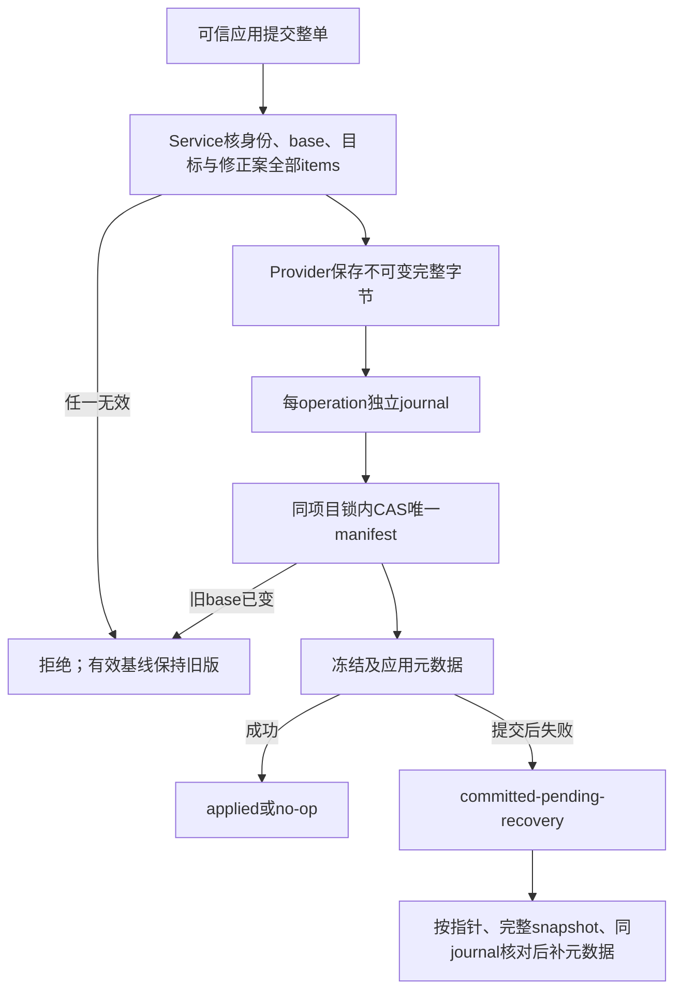
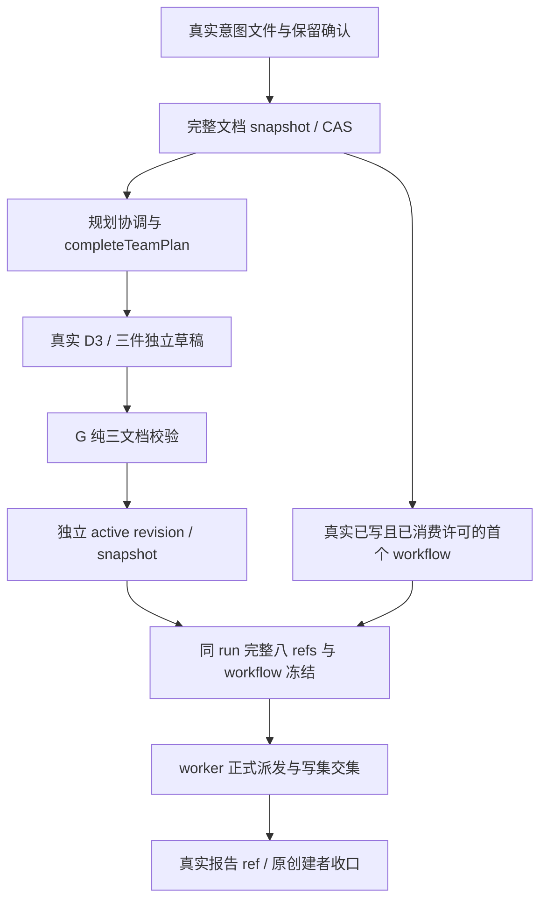

# 角色直接能力：完整快照与直接回执

目前已实现存储/Service公开能力，以及独立幕僚会话与来源审计窄桥；桌面提交到完整Pipeline接线仍由O1/W1继续。产品或策划调用直接提交时，应用验证真实身份、旧有效摘要、全部目标字节及引用关系，再一次切换有效manifest。规划版本可以没有workflow；这不代表角色已经可以执行。

未修改的引用继承旧snapshot字节；live草稿变化不会改已生效内容。修正案从同份不可变字节解析，漏项或错base不能部分应用。无变化不升版本，同operation重放不重复升版；直接文档提交不重pin旧run。

首次规划发布使用真实已确认意图记录及其完整字节，CAS从不存在的manifest建立t1；缺依据拒绝。执行校验缺workflow明确失败；旧run缺完整八类历史物证也拒绝，不用live材料补造。角色激活snapshot与文档snapshot有各自依据，文档提交保留既有角色物证指针。

独立幕僚入口只接受可信宿主context，工具仅decide_pending_request，禁止生产写入、持久化与自动repin。历史chief-delegated审计保留真实来源，重放不读取当前开关。

实际接口与阶段证据见[api-spec](../../api-spec.md)；演变记录见[本次变更](../change/2026-11-05_change_direct-role-capabilities.md)。本文件不作跨角色整链或独立验收结论。

### O1 当前已实现子链

本轮精确 154/154、主 TS 0；实际 API/限制见 api-spec 末节。stop/restart、规划 draft 收口依据、四 Fn 通知、桌面 worker/依赖消费与完整 Interface 验收仍未完成；不以单层正例代替整链结论。
