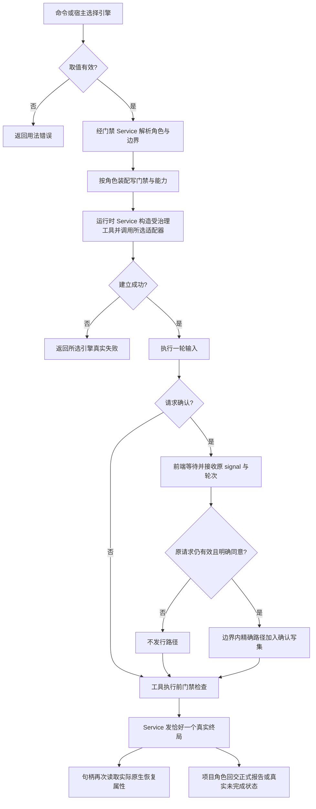

# 选择运行时并开启受治理会话

CLI 与桌面可以为一个角色选择 demo、Pi、Codex 或 Claude。同一角色切换引擎时使用不同的持久化上下文和 ANS 回放；中止后迟到的旧确认不能成为下一轮写文件的许可。编排接线已实现，实际 SDK/default Pi 与根入口整体验证仍由适配器、装配和桌面属主完成。

`ans role run <角色> --task <任务> --runtime <引擎>` 跑一轮并返回退出码；`ans govern --runtime <引擎>` 开治理会话。显式参数优先于装配注入，未知值在建会话前返回用法错误。role run 缺省 demo、govern 缺省 Pi。多轮入口为 `openRoleSession` 与 `openGovernanceSession`，宿主经 runtime 和 runtimeOptions 传选定配置。

编排按角色注入能力：治理角色可接派发，项目角色可交报告；未注入 shell 时工具不存在。项目 shell 三层审核的审读会话使用源引擎、仅接 verdict，并且不持久化。治理只读档规则保持。CLI 的 failed/aborted/timed_out 返回失败码；settled 不证明任务完成。

多轮默认启用持久化，`persistSession:false` 保持内存。实际存储由 Service 注入，目录为 `.ans/sessions/<role>/<runtime>/`，读取和建对象不预建目录。旧工厂注入和未显式 runtime 的 sessionDir 探针保持兼容；实际存储始终按所选引擎隔离。

句柄的 contextSource/nativeSessionId/contextWarning 是底层会话动态属性，prompt 后再次读取可得到真实结果。核心 resumed 表示原生恢复成功，recovered 表示恢复失败后重建；宿主不能直接套用旧界面中同名字段的不同含义。`readRoleSessionHistory` 只返回 ANS 回放，不证明模型上下文恢复。

内部代码接口见 [api-spec](../../api-spec.md)。代码位于 CLI run/govern、Pipeline run-role/govern-session/pm-reviewer/shell-arming 与私有 confirmed-writes。无网络测试通过真实 Service 与工具 handler 隔离外部模型；现阶段未调用在线模型，也未部署。

| 日期 | 类型 | 状态 | 变化 | 记录 |
| --- | --- | --- | --- | --- |
| 2026-10-14 | 设计/迁移 | 编排 238/238，实际引擎整合待验 | 四引擎选择、Model 类型、Service 接线、runtime 隔离、实际上下文和原轮次确认中止 | [独立评估](../design/2026-10-14_design_multi-runtime-orchestration.md)、[变更与证据](../change/2026-10-14_change_multi-runtime-orchestration.md) |
