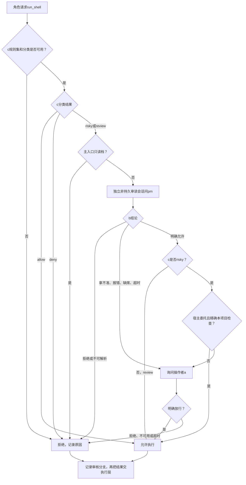

# 执行命令之前，区分常规检查与需要客户决策的操作

桌面项目角色调用`run_shell`时，先审核命令再执行。客户已委托宿主处理的本项目常规检查，经pm明确允许后不反复问客户；删除、安装等操作保持原确认链。主入口治理角色自己的shell只读，不向自己申请审核或客户放行。

## 当前流程

宿主开启角色会话时向`openRoleSession`注入shell规则和操作者通道；已获授权导入项目的项目角色可同时注入`routineShellPolicy`。编排装配ShellGate，Pi在唯一执行点取得明确allow后才能spawn。缺少能力时工具不注册；规则缺失或报错拒绝。

pm结论首选`report_shell_verdict`工具，文本JSON仅为现有降级。不可解析直接拒绝、不重试、不叫客户替系统错误作决定；拿不准或不可用继续原a链。整体审核超时拒绝，审计失败如实报告但不翻转已经作出的判定。操作者确认等待的模型计时暂停与abort由Pi适配器负责。

## 常规检查的精确范围

公开宿主政策为`RoutineShellPolicy {enabled:true, projectRoot, authorizationSource:'customer-delegated-routine-checks'}`，由Pipeline `shell-arming.ts`导出。它不是模型工具参数，也不从su派发或pm审读制造授权。桌面传`openRoleSession`顶层同名字段，编排仅转给项目角色三层链，su只读档不消费。

同项目cwd、b明确allow与精确argv缺一不可。新增免a分支用于`npm test`、`npm run typecheck`，不得带额外参数。`node --test`在现有c规则已是review，本来b允许即可执行；其常规匹配约定为无附加flag的项目默认发现，或项目`test/`下的`.test.ts/js/mts/mjs/cts/cjs`文件/对应glob。`..`、外部路径、包装、组合或附加flag不匹配委托，存在路径经共享realResolve检查外指符号链接。

非匹配命令继续原审核结果：c硬拒不可翻案，risky在b允许后仍需a，review按原b结果处理。policy不把安装、任意npm run、删除或发布变成常规检查；npm检查本身也是本项目脚本执行，仍需要b明确允许。

例如`npm test`已被宿主委托且b允许，审核返回`b-allow→customer-delegated-routine-checks`并直接交执行层；`npm install`即使b允许仍请求客户a。若本项目没有test脚本，真正执行失败会由Pi如实返回，不因审核允许宣称测试通过。

## 核对位置

- 装配和公开政策：`src/pipeline/orchestration/shell-arming.ts`与`run-role.ts`；政策匹配唯一实现：`src/common/编排/routine-shell-policy.ts`。
- 审核链：`src/common/编排/shell-gate.ts`；pm接线：`src/pipeline/orchestration/pm-reviewer.ts`。
- 原治理审计保持`docs/audit/shell-gate.jsonl`；统一24h诊断只记录审核分支/委托来源/调用ID，不记录命令或argv。
- 222/222编排测试含宿主接线、精确范围、原链保护与诊断隐私；测试只调用审核，不真执行shell，不发真实模型请求。

## 演变历史

| 日期 | 类型 | 状态 | 变化 | 详细说明 |
| --- | --- | --- | --- | --- |
| 2026-10-12 | 修改 | 已实施 | 项目角色三层链与独立pm审读 | [装配](../change/2026-10-12_change_shell-gate-arming.md)、[工具化审读](../change/2026-10-12_change_shell-review-verdict-tool.md) |
| 2026-10-12 | 修改 | 已实施 | 主入口只读档 | [只读策略](../change/2026-10-12_change_su-readonly-shell.md) |
| 2026-10-13 | 修复 | 编排已验证 | 客户委托的精确检查免重复a，统一诊断 | [本次修复](../fix/2026-10-13_fix_truthful-handback-and-authorized-shell.md) |
