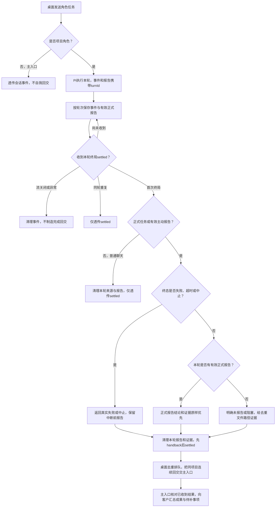

# 角色结束工作后，主入口收到能验收的结果

项目角色在桌面收到正式派发任务后，把实际结论和证据交回主入口。普通聊天无报告不自动回交；角色主动 submit_report 的合法报告仍交回主入口。用户能知道完成了什么、产物在哪、测试实际结果；未报告、失败或中止会如实显示。主入口自己的治理会话不向自己回交。

## 当前流程

入口是桌面通过`openRoleSession(...).send(text, opts?)`发送输入；编排专用 `opts.handback.required` 区分任务和普通聊天。Core 在真实开轮时同步确认 turnId，编排按该轮保存来源；专用选项不交给 Runtime，图片保持原引用。Runtime 执行模型与工具，模型用`submit_report`提交status/summary/evidence。回交是内部事件，不是网络接口。

未标记的 send 在 input.taskId 非空时保留既有任务默认，其余默认聊天；显式 required:false 覆盖旧 taskId，主动聊天报告也不继承旧任务编号。未知真实轮次无 ACK 不借另一轮来源，不制造缺报告回交；合法主动报告仍可回交但任务关联未知。旧无 metadata 串行替身仅消费一次 legacy 来源，不保证交错关联。

正式报告可以说completed或blocked；正常终局取本轮最后一份有效报告。非法报告不清掉已有合法报告；终局之后的迟到报告不能污染下一轮。正式任务无报告不从“会话结束”或工具次数推导完成。普通聊天无合法报告，不论写文件、拒绝或失败均只透传实际事件；跳过回交仍清理本轮并登记终局，迟到报告不污染新任务。无成功产物且有拒绝显示blocked；其余无报告显示unreported，并说明需补任务报告。

失败、超时分别显示failed，中止显示aborted。中断前的完成声明不会压过运行时终态，只保留为中断前报告。证据未给出时明确需补，不凭空补测试通过。

成功工具的toolName/path/ok用于未报告产物提取，“已写入/已编辑：路径”按同动作同路径去重。读取、失败、泛化完成但没有路径的事件不作产物证据。文件写入只是产物事实，仍需验收。

## 怎样理解主入口汇总

例如开发报告“实现四则运算；src/calc.ts；单测4/4”，测试角色报告“集成失败；test/integration.test.ts”。主入口输入保留两者完整报告，要求它给客户说明已实现的能力、实际测试结果、失败及下一步，而不是只回复completed。

`renderHandbackBatchPrompt`只整理已经收到的报告；桌面负责合并同项目队首连续handback，遇客户消息/派发即停止。未知taskId明确标记“任务关联未知”，没有可靠收齐条件不宣称整个任务或全部角色已完成。批次和单份首行均保留桌面约定的`[回交] `注入消息前缀。

去重键采用roleId/taskId/真实turnId/内容，不用时间戳；旧替身缺metadata时降级round，只按已知settle界限兼容并清空状态，不声称能识别交错轮次。回交只搬任务与证据，不获得新身份或写权。

## 核对位置

- 编排入口：`src/pipeline/orchestration/run-role.ts`；公共中立 metadata与事件：`src/model/runtime.ts`。
- 回交类型、状态、证据、去重和单份/批次文案：`src/common/编排/handback.ts`。
- 诊断消费共享`diagnostics.ts`，记录轮次、报告来源、真实状态和证据数；不存任务正文或文件内容，24h清理归项目管理。
- 此次编排247/247离线专项通过；桌面实际投递与真实应用验收由其属主、测试角色和主入口完成。详见本次修复记录。

## 演变历史

| 日期 | 类型 | 状态 | 变化 | 详细说明 |
| --- | --- | --- | --- | --- |
| 2026-10-12 | 修改 | 已实施 | 工具交报告优先，写类证据过滤 | [报告接入](../change/2026-10-12_change_submit-report-handback.md) |
| 2026-10-12 | 修改 | 已实施 | 同轮去重与稳定键 | [原稳定键](../change/2026-10-12_change_handback-round-stable-key.md) |
| 2026-10-13 | 修复 | 编排已验证 | 按turnId隔离、真实终态、可定位证据、已收到报告的汇总输入 | [本次修复](../fix/2026-10-13_fix_truthful-handback-and-authorized-shell.md) |

| 2026-10-14 | 修复 | 编排专项已验证，桌面待复测 | 本轮来源绑定真实ACK，普通聊天不自动缺报告回交 | [聊天来源修复](../fix/2026-10-14_fix_chat-handback-scope.md) |
