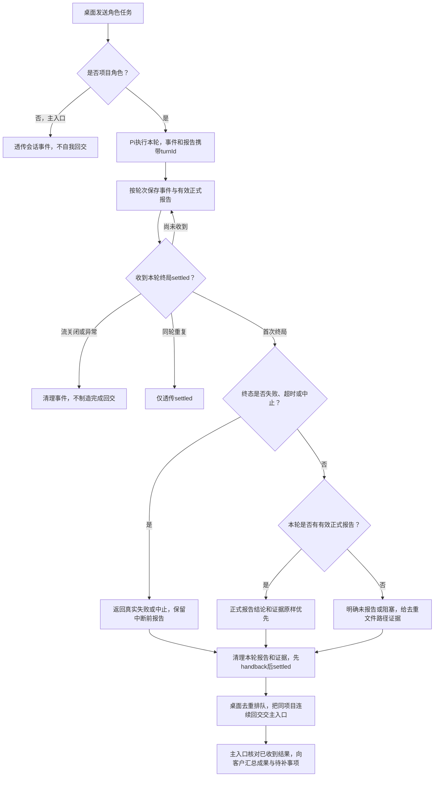

# 角色结束工作后，主入口收到能验收的结果

项目角色在桌面收到客户消息或派发任务后，把实际结论和证据交回主入口。用户能知道完成了什么、产物在哪、测试实际结果；未报告、失败或中止会如实显示。主入口自己的治理会话不向自己回交。

## 当前流程

入口是桌面通过`openRoleSession(...).send(text, opts?)`发送一轮任务。Pi执行模型与工具，模型用`submit_report`提交status/summary/evidence，运行时提供turnId。回交是内部事件，不是网络接口。

正式报告可以说completed或blocked；正常终局取本轮最后一份有效报告。非法报告不清掉已有合法报告；终局之后的迟到报告不能污染下一轮。无报告不从“会话结束”或工具次数推导完成。无成功产物且有拒绝显示blocked；其余无报告显示unreported，并说明需补任务报告。

失败、超时分别显示failed，中止显示aborted。中断前的完成声明不会压过运行时终态，只保留为中断前报告。证据未给出时明确需补，不凭空补测试通过。

成功工具的toolName/path/ok用于未报告产物提取，“已写入/已编辑：路径”按同动作同路径去重。读取、失败、泛化完成但没有路径的事件不作产物证据。文件写入只是产物事实，仍需验收。

## 怎样理解主入口汇总

例如开发报告“实现四则运算；src/calc.ts；单测4/4”，测试角色报告“集成失败；test/integration.test.ts”。主入口输入保留两者完整报告，要求它给客户说明已实现的能力、实际测试结果、失败及下一步，而不是只回复completed。

`renderHandbackBatchPrompt`只整理已经收到的报告；桌面负责合并同项目队首连续handback，遇客户消息/派发即停止。未知taskId明确标记“任务关联未知”，没有可靠收齐条件不宣称整个任务或全部角色已完成。批次和单份首行均保留桌面约定的`[回交] `注入消息前缀。

去重键采用roleId/taskId/真实turnId/内容，不用时间戳；旧替身缺metadata时降级round，只按已知settle界限兼容并清空状态，不声称能识别交错轮次。回交只搬任务与证据，不获得新身份或写权。

## 核对位置

- 编排入口：`src/pipeline/orchestration/run-role.ts`；公共Pi metadata与事件：`src/provider/pi/session.ts`。
- 回交类型、状态、证据、去重和单份/批次文案：`src/common/编排/handback.ts`。
- 诊断消费共享`diagnostics.ts`，记录轮次、报告来源、真实状态和证据数；不存任务正文或文件内容，24h清理归项目管理。
- 编排222/222离线测试与全仓typecheck通过；桌面实际投递与应用部署由其属主和主入口验收。

## 演变历史

| 日期 | 类型 | 状态 | 变化 | 详细说明 |
| --- | --- | --- | --- | --- |
| 2026-10-12 | 修改 | 已实施 | 工具交报告优先，写类证据过滤 | [报告接入](../change/2026-10-12_change_submit-report-handback.md) |
| 2026-10-12 | 修改 | 已实施 | 同轮去重与稳定键 | [原稳定键](../change/2026-10-12_change_handback-round-stable-key.md) |
| 2026-10-13 | 修复 | 编排已验证 | 按turnId隔离、真实终态、可定位证据、已收到报告的汇总输入 | [本次修复](../fix/2026-10-13_fix_truthful-handback-and-authorized-shell.md) |
