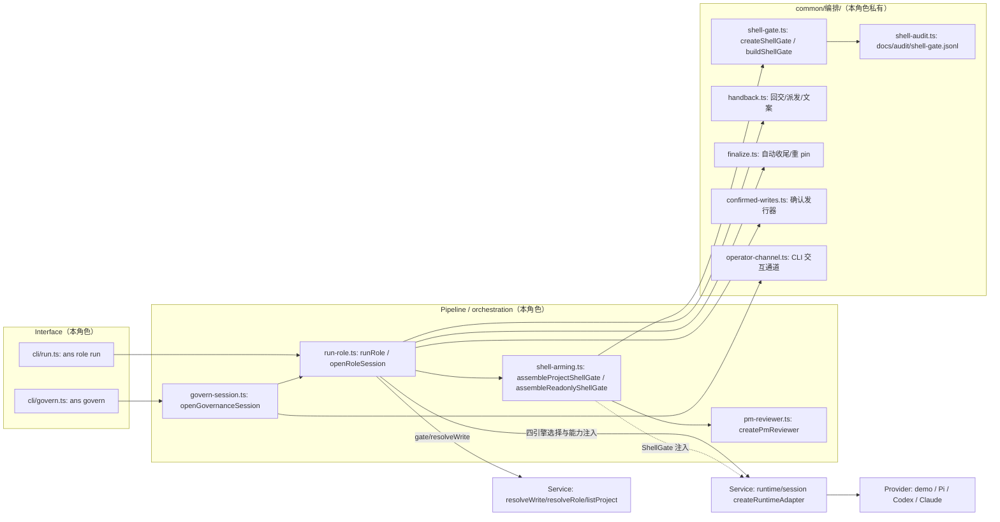

# Functional Description: 编排

本角色负责 ANS CLI 的命令接口与会话编排：把 `ans role run` / `ans govern` 变成一次受治理的角色会话，并管理其生命周期（角色/边界解析 → 写门禁 → shell 闸 → 回交/收尾 → 事件流）。
系统功能清单与状态见 [feature-map.md](feature-map.md)；各功能当前流程（含流程图）归 `docs/feature/<feature-id>.md`（待补），本文件只放**模块视图与代码位置**。

## Architecture Diagram

## Key Code Locations

| What | Where |
| --- | --- |
| 会话句柄式入口（多轮；桌面/CLI 共用） | `src/pipeline/orchestration/run-role.ts` — `openRoleSession()`（确认制、回交、收尾、shell arm 全在此收口） |
| 一次性路径 | `src/pipeline/orchestration/run-role.ts` — `runRole()`（`ans role run`；启动提示含 P1-4 定位指路行） |
| CLI 定位指路文案单一来源（P1-4） | `src/common/编排/cli-positioning.ts` — `CLI_POSITIONING`（`ans role run` 帮助与一次性会话启动行共用同一句；桌面 = 主工作台、CLI = 一次性执行器） |
| 治理会话引擎（CLI 与桌面收敛为同一份） | `src/pipeline/orchestration/govern-session.ts` — `openGovernanceSession()` |
| shell 闸**判定映射**（三层链 + su 只读档） | `src/common/编排/shell-gate.ts` — `createShellGate()` / `buildShellGate()`；只读档选项 `readonlyOnly`、离异分支常量 `BRANCH_READONLY_DENY` |
| shell 闸**装配**（三层链） | `src/pipeline/orchestration/shell-arming.ts` — `assembleProjectShellGate()` |
| shell 闸**装配**（su 只读档） | `src/pipeline/orchestration/shell-arming.ts` — `assembleReadonlyShellGate()`（审计边界解析共用私有 `resolveGovernanceBoundary`） |
| su arm 位（只读档/三层链两档分流） | `src/pipeline/orchestration/run-role.ts` — `openRoleSession` 输入 `shellReadonly`（优先）/ `shellOperatorChannel` + `shellArming` |
| (b) 审读会话 | `src/pipeline/orchestration/pm-reviewer.ts` — `createPmReviewer()`（经 `openRoleSession(内置治理角色)`；结论走 `report_shell_verdict` 工具） |
| shell 审计留痕 | `src/common/编排/shell-audit.ts` — 落 `docs/audit/shell-gate.jsonl`（`execution` 恒「未执行」；写前经门禁 + 声明 `shell-gate` 条件） |
| 回交 / 派发文案单一来源 | `src/common/编排/handback.ts` — `withHandback` / `renderHandbackPrompt` / `renderDispatchPrompt` / `handbackKey` 等 |
| 自动收尾 / 重 pin | `src/common/编排/finalize.ts` — `repinIfBootstrapped()` / `finalizeBootstrap()` |
| 确认制发行器（写集按客户确认发行） | `src/common/编排/confirmed-writes.ts` — `createConfirmedWriteIssuer()` |
| CLI 交互通道（客户确认 / 操作者确认） | `src/common/编排/operator-channel.ts` — `createCliCustomerInput()` / `createCliOperatorChannel()` |
| 角色/边界解析（Service 出口，本角色只消费） | `src/service/role/resolve-role.ts`、`src/service/boundary/resolve-boundary.ts`、`src/service/gate/resolve-write.ts` |
| 契约类型家（ShellGate / OperatorPrompt / 能力形状等单一来源） | `src/model/runtime.ts` |
| 本角色测试 | `test/编排/`（含 `shell-readonly.test.ts`——su 只读档 8 例） |

## Detailed Explanation

### 模块如何拼起来

- **一次会话的装配顺序**（`openRoleSession`）：角色/边界解析（`setupRole`，会话式入口允许内置治理角色）→ 写门禁（确认制则动态 writeSet，见 `confirmed-writes.ts`）→ 能力面组装（`customerInput` / `reportHandback` / `sessionDir` / `dispatchTask` / `shellGate` / `shellVerdict`，均「注入才注册」）→ `deps.createAdapter(gate, capabilities)` → 绑定角色 → 事件流包装（回交 + 每轮 settle 后自动收尾/重 pin）。
- **shell 闸两档**：**项目角色**走三层链 (c)→(b)→(a)（`assembleProjectShellGate`，需前端给 (a) 通道）；**su** 走**只读档**（`assembleReadonlyShellGate`，只接 (c) 白名单，risky/review/deny 一律拒，不接 (b)/(a)）。两档共用同一个 `shellGate` 能力位与同一审计边界解析；`run_shell` 仅在能力位被注入时注册（未 arm / 装配失败 ⇒ 不注册，fail-closed 结构性保证）。
- **判定源与执行点分离**：`shell-gate.ts` 不含任何规则集——`classifyShell` 与规则集由调用方注入（实件属门禁引擎，生产经 `src/service/gate/` 公开再导出，**该出口尚不存在**——既有跨角色待办，缺注入 ⇒ 闸一律拒）；执行（spawn）只在 Pi 适配器 `run_shell` 一处，审核与 spawn 同址。
- **审计口径**：一切 shell 判定都落 `docs/audit/shell-gate.jsonl`（命令逐字原文、argv、cwd、conclusion、branch、by、conditions、`execution` 恒「未执行」）；落盘本身经门禁（治理边界 + 声明 `shell-gate` 条件），审计失败不翻转判定、如实 stderr。

### Ownership

| File | Layer | Permission |
| --- | --- | --- |
| `src/interface/cli/run.ts`、`src/interface/cli/govern.ts` | Interface | Exclusive |
| `src/pipeline/orchestration/*.ts` | Pipeline | Exclusive |
| `src/common/编排/*.ts` | common（本角色私有） | Exclusive |
| `test/编排/**` | Test（本角色） | Exclusive |
| `src/model/runtime.ts`（ShellGate/Operator/能力形状） | Model | Shared（**契约家，只读消费**） |
| `src/service/gate/resolve-write.ts`、`src/service/role/resolve-role.ts`（公开出口） | Service | Shared（**只读消费**） |

### Cross-Module Notes

- **门禁引擎**：`classifyShell`/`defaultShellRules`（实件）在门禁引擎私有 common——生产不导入，经注入；`resolveWrite`/`resolveBoundary`/`listProject` 经 Service 公开出口。
- **Pi 适配器**：`ShellGate`/`ShellReviewResult`/`OperatorPrompt`/`CustomerInputFn`/`DispatchTaskFn` 等形状的单一来源在 `src/model/runtime.ts`；`run_shell`/交互工具的注册条件 = 编排是否注入对应能力（「注入才注册」）；spawn 前剥离凭据、cwd 钉项目根均为其既有职责。
- **桌面应用**：经 `openRoleSession` 注入 `customerInput`（确认制）、`shellOperatorChannel` 或 `shellReadonly`（su 只读档）、`dispatchTask` 路由等；桌面持有派发队列与去重（编排不造第二套）。
- **跨角色待办（如实登记）**：(c) 合法注入源（门禁引擎经 `src/service/gate/` 再导出 `classifyShell`/`defaultShellRules`）尚不存在——在此之前一切 arm 路径的闸一律拒绝（fail-closed），接口已按契约留好注入缝。

## 2026-10-14 运行时迁移

运行时选择、Service 工厂、能力注入、原轮次 signal 的确认发行、动态 native context 与 ANS 回放内部接口见 [api-spec](api-spec.md)，完整当前流程见 [运行时选择](docs/feature/runtime-selection.md)。旧 createPiAdapterFactory 保留兼容，调用 Service。编排不导入适配器 SDK 或同伴私有 common。实际 Pi/新SDK 默认工厂、根入口与桌面验证由各原属主负责；自有证据见 [O1 变更](docs/change/2026-10-14_change_multi-runtime-orchestration.md)。
